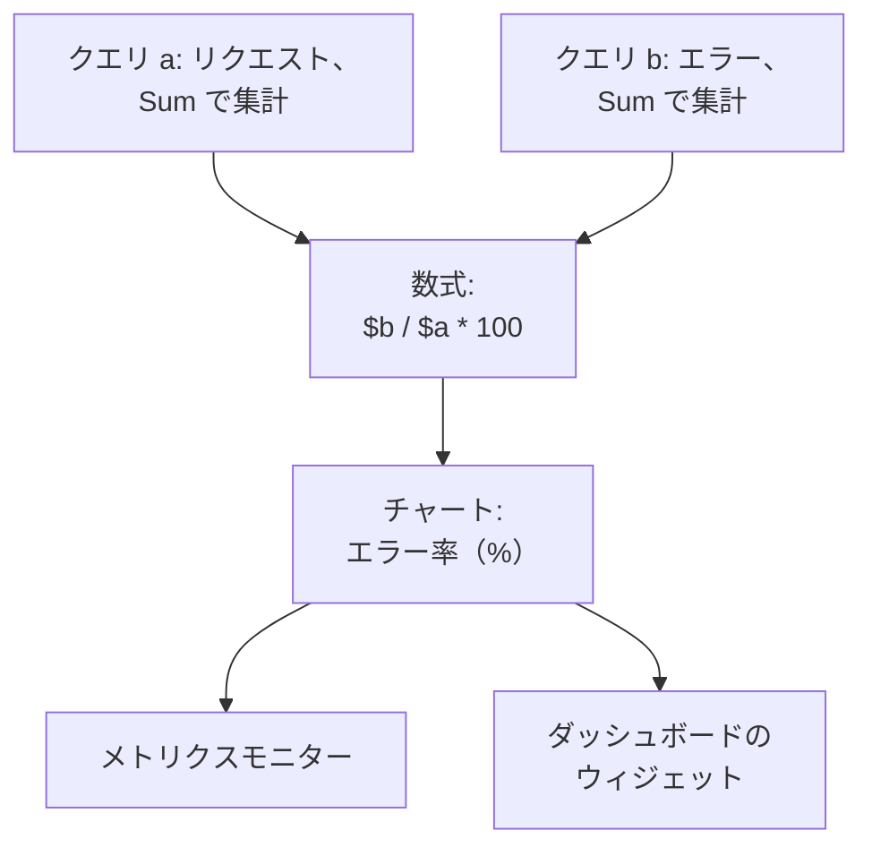

# メトリクスエクスプローラー

メトリクスは、サービスとインフラストラクチャが時間の経過とともに報告する数値です。リクエスト数、レイテンシ、CPU、キューの深さなどです。メトリクスエクスプローラーは、プロジェクトが受け取るすべてのメトリクスを一覧表示し、どれでもチャートにし、数式で組み合わせ、チャートをモニターやダッシュボードのウィジェットに変えます。

:::cards
- [メトリクスを探す](#メトリクスを探す): メトリクス名の一覧を検索します。
- [メトリクスをチャートにする](#メトリクスをチャートにする): クエリを集計し、絞り込み、グループ化します。
- [数式でクエリを組み合わせる](#数式でクエリを組み合わせる): エラー率などの比率。
- [チャートを活用する](#チャートを活用する): モニター、ダッシュボードのウィジェット、リンク。
- [AI でメトリクスを改善し、不足しているものを追加する](#ai-でメトリクスを改善し不足しているものを追加する): メトリクスを修正し、サービスに不足しているものを追加するプルリクエスト。
:::

## エクスプローラーの仕組み

エクスプローラーには 2 つの階層があります。**閲覧者** タブには、プロジェクトが受け取るメトリクスが一覧表示されます。1 つをクリックすると、そのメトリクスのクエリを持つメトリクスエクスプローラーが開きます。クエリは、メトリクス、その集計方法、絞り込みとグループ化の方法からなります。各クエリは `a`、`b` などの変数で、数式から使えます。

エクスプローラーには 5 つのタブがあります。

| タブ | 用途 |
| --- | --- |
| **閲覧者** | メトリクスの一覧。それぞれに小さなチャートと最新の値が付きます。直近一時間で開きます。 |
| **インサイト** | どのサービスがメトリクスを報告しているか、その数。 |
| **AI** | OneUptime が見つけた、記録する値が多すぎるメトリクスやバケットが合っていないメトリクス、不足しているメトリクスと、それに対して OneUptime AI が行ったこと。[AI でメトリクスを改善し、不足しているものを追加する](#ai-でメトリクスを改善し不足しているものを追加する) を参照してください。 |
| **セットアップガイド** | 取り込みキーのいずれかを使って、OpenTelemetry でメトリクスを送る方法。 |
| **設定** | **パイプラインルール** と **記録ルール**: 届いたメトリクスに何が起きるか。 |

## 始める前に

- **届いているメトリクス。** [OpenTelemetry](/docs/telemetry/open-telemetry) で送るか、[ホスト用 OpenTelemetry Collector](/docs/telemetry/host-otel-collector) や [Kubernetes エージェント](/docs/telemetry/kubernetes-agent) などのエージェントから送ります。
- **テレメトリを読み取れるロール。** Project Owner、Project Admin、Project Member、Viewer、Telemetry Admin、Telemetry Member、Telemetry Viewer のいずれか、または Read Telemetry Service Metrics 権限を持つカスタムロール。ロールがどのメトリクスを読み取るかは、[テレメトリー](/docs/permissions/index#テレメトリー) を参照してください。

## メトリクスを探す

**製品 → オブザーバビリティ → メトリクス** に移動します。**閲覧者** には、プロジェクトが受け取ったすべてのメトリクスが名前順に、時間範囲の小さなチャートと最新の値とともに表示されます。

- 単語だけ、または `name:` で名前を検索します。たとえば `name:http.server` で `http.server.request.duration` が見つかります。[検索構文](/docs/telemetry/search-syntax#メトリクス) を参照してください。
- サイドバーの **サービス** で絞り込むと、1 つのサービスが報告するメトリクスだけが表示されます。
- メトリクスをクリックすると、メトリクスエクスプローラーでチャートになります。

## メトリクスをチャートにする

:::steps
### メトリクスを開く

**閲覧者** でメトリクスをクリックします。一覧の時間範囲とフィルターを引き継いだ 1 つのクエリ `a` でエクスプローラーが開きます。

### 集計方法を選ぶ

**集計の基準** で、チャートの各ポイントの値をどう組み合わせるかを選びます。デフォルトの Avg のほか、Sum、Min、Max、Count、またはパーセンタイルの P50、P75、P90、P95、P99 です。リクエストの所要時間のようなヒストグラムのメトリクスのパーセンタイルは、そのバケットから計算されます。

### 絞り込んでグループ化する

**フィルターとグループ化** を開きます。**属性で絞り込み** は、特定の `http.route` のように属性が一致するデータポイントだけを残します。**グループ化** は、選んだ属性の値ごとに 1 本の線を描きます。たとえばホストごとに 1 本です。

### チャートを調整する

**表示設定** を開き、**チャートの種類**（線、面、棒）を選び、チャートに描く **警告のしきい値** と **重大のしきい値** を設定するか、**1 秒あたりのレートに変換** をオンにします。
:::

> [!TIP]
> `system.disk.io` のように増える一方のカウンターは、レートで見ると読みやすくなります。**1 秒あたりのレートに変換** をオンにすると、累計ではなく変化の速さを表示します。エクスプローラーは、そのようなカウンターを見つけるとこの設定を勧めます。

各クエリはそれぞれ独自のチャートを描きます。前のクエリと同じチャートに描くには、そのクエリの **表示設定** で **前のクエリと重ねて表示** をオンにします。

## 数式でクエリを組み合わせる

:::steps
### クエリを追加する

必要なメトリクスごとに **メトリクスを追加** をクリックします。新しいクエリは `b`、`c` などになります。

### 数式を追加する

**数式を追加** をクリックし、クエリの変数、演算子 `+`、`-`、`*`、`/`、`%`、`^`、かっこを使って **数式** を書きます。パーセントで表すエラー率なら `$b / $a * 100` と書きます。
:::

変数は `$` を付けても付けなくても書け、大文字と小文字も区別されません。定義していないクエリを参照する数式は、チャートを描く代わりにそのことを知らせます。

## チャートの周辺を調べる

チャートの上のボタンは、表示している時間範囲を対象に動作します。

| ボタン | 動作 |
| --- | --- |
| **ログ** | この時間範囲とフィルターで [ログエクスプローラー](/docs/telemetry/logs-explorer) を開きます。 |
| **トレース** | この時間範囲とフィルターで [トレースエクスプローラー](/docs/telemetry/traces-explorer) を開きます。 |
| **調査** | この時間範囲のログ、トレース、例外を表示するサイドパネルを開きます。 |
| **イベント** | この時間範囲のインシデントとアラートをチャート上に示します。 |
| **比較** | 各チャートに前の期間を破線で描き、何が変わったかを確認できるようにします。 |

チャートをドラッグするとその時点にズームインし、ダブルクリックすると元に戻ります。[時間範囲にズームインする](/docs/telemetry/charts-and-time-ranges) を参照してください。

## チャートを活用する

- **アクション → このビューからモニターを作成** は、これらのクエリと数式を入力済みの新しいメトリクスモニターを開きます。[メトリクス モニター](/docs/monitor/metrics-monitor) を参照してください。
- **アクション → ダッシュボードに追加** は、選んだダッシュボードにチャートを追加します。そのダッシュボードを編集する権限が必要です。
- **リンクをコピー** は、クエリ、数式、時間範囲を含め、このビューそのものへのリンクをコピーします。
- **保存済みビュー** は、ビューに名前を付けて、プロジェクトの全員のために残します。**閲覧者** には、その検索とフィルター用の独自の保存済みビューがあります。保存済みビューは [ログエクスプローラー](/docs/telemetry/logs-explorer#ビューを保存する) と同じように動作します。

## メトリクスのインサイト

**インサイト** タブは、ある時間範囲のメトリクスを数えます。**アクティブなメトリクス**、**送信元サービス**、サービスあたりの平均です。メトリクスをカテゴリーに分け、それらを報告するサービスを一覧表示します。

## AI でメトリクスを改善し、不足しているものを追加する

OneUptime は 1 時間ごとに、サービスが直近 1 時間に送ったメトリクスから、記録する値が多すぎるもの、ヒストグラムのバケットが合っていないもの、メトリクスを送っていない利用の多いサービスを探し、見つかったものを根拠とともに AI インサイトとして記録します。続いて OneUptime AI がそれぞれを調べ、修正するプルリクエストを開きます。マージは一切されません。各プルリクエストはチームがレビューします。

OneUptime は、その 1 時間にサービスが送ったデータポイントが最も多い 10 個のメトリクス (それぞれ 1,000 件以上) を詳しく読み取り、3 種類の検出結果を記録します。

| 検出結果 | OneUptime が記録する条件 | プルリクエスト |
| --- | --- | --- |
| **高カーディナリティ** | これらのメトリクスのいずれかにコードが付ける属性が、その時間内に 1,000 種類以上の値を取りました (ユーザー ID や完全な URL など)。値ごとに別々の系列になります。または、サービスのメトリクス名のうち 50 個以上が、異なる ID を含むだけの同じ名前です。 | メトリクスへのその値の記録をやめるか、名前から ID を取り除きます。 |
| **不適切なヒストグラムのバケット** | これらのメトリクスのいずれかがヒストグラムで、1,000 件以上の値を記録し、その 90% 以上が最小のバケットか最大のバケットより上に入っているか、バケットがまったくありません。そのためパーセンタイルを区別できません。 | 値に合ったバケットをヒストグラムに設定するか、単位を修正します。 |
| **メトリクスの不足** | サービスがその時間内に 1,000 件以上のスパンを送ったのに、メトリクスを一度も送っていません。 | 最も利用の多い操作のリクエスト数、エラー、所要時間をメトリクスとして追加します。 |

検出結果に属性の値が保存されることはありません。保存されるのは属性の名前、取った値の数、値の形だけです。

### オンにする

**メトリクス → AI → 設定** に **メトリクスを改善し、不足しているものを追加する** スイッチがあり、新しいプロジェクトではオンになっています。**AI を有効化** がオフの場合、メトリクスの問題は引き続き見つかりますが、OneUptime AI は何もしません。プルリクエストを開くには、[コード](/docs/ai/ai-agent) で接続したリポジトリが必要です。足りないものはページが最初に示します。各リポジトリのコードは、そのリポジトリがコードで選んだ Runner 上で変更されます。

OneUptime AI が自動で開くプルリクエストは 1 日 (UTC) 最大 5 件で、検出結果ごとに 1 件です。リポジトリの開いている AI プルリクエストの上限を超えることはありません。

### AI ルール

ルールがない場合、OneUptime AI はメトリクスで見つけた問題をすべてすぐに調査し、修正できるものにはプルリクエストを開きます。**その他の設定** の **AI ルール** で、これを 3 つのステップで絞り込みます。

| ステップ | 決めること |
| --- | --- |
| **一致** | 対象のサービス: 選んだもの、特定のラベルを持つもの、または名前がパターンに一致するもの。 |
| **調査** | **すぐに**、または **待機後もまだ見つかる場合のみ**。待機中に解消した問題は調査されません。 |
| **修正** | **修正しない**、**修正前に確認する**、または **確認せずに修正する**。先に確認する場合、プルリクエストは人に任されます。検出結果に **AI で修正** が表示されます。 |

**その他の項目** では、ルールごとに OneUptime AI が使えるコードリポジトリ、MCP サーバー、LLM プロバイダーを選びます。何も選ばない場合はすべてを使え、プロジェクトの既定の LLM プロバイダーを使います。

### 実行内容を確認する

- **メトリクス → AI → インサイト** には OneUptime が見つけたものが一覧され、各検出結果に根拠と **メトリクスで開く** があります。これは、見つかった時間帯のそのサービスのメトリクスを開きます。メトリクスのないサービスでは、代わりに **トレースで開く** が表示されます。メトリクスで測るはずのスパンです。
- **メトリクス → AI → ログ** にはすべての調査とプルリクエストが新しい順に、それぞれの状態とともに一覧されます。
- コードでは、タスクに OneUptime が開始したことが検出結果へのリンクとともに示され、プルリクエストにはそれを開いた理由が書かれます。

## 届いたメトリクスに何が起きるか

**メトリクス → 設定 → パイプラインルール** は、届いたメトリクスを保存前に変更します。ルールは一覧の順に実行され、順番はドラッグで変えられます。1 つのサービス用のルールは、すべてのサービス用のルールより先に実行されます。

| ルールの種類 | 動作 |
| --- | --- |
| フィルター（許可リスト） | 一致するデータポイントだけを残し、残りを破棄します。 |
| 破棄 | 一致するデータポイントを破棄します。 |
| メトリクスの名前を変更 | メトリクスの名前を変えます。 |
| 属性の名前を変更 | 一致するデータポイントの属性のキーの名前を変えます。 |
| 属性を追加 | 一致するデータポイントに属性を追加します。 |
| 属性を削除 | 値の種類が多すぎて役に立たない属性などを削除します。 |
| 属性を秘匿化 | 属性の値をプレースホルダーに置き換えます。 |
| サンプル | 一致するデータポイントの一定の割合を残します。 |

**メトリクス → 設定 → 記録ルール** は、ほかのメトリクスから新しいメトリクスを毎分計算します。記録ルールの仕組みは [ログの記録ルール](/docs/telemetry/log-recording-rules) を参照してください。

## トラブルシューティング

:::details カウンターのチャートが上がり続ける
累積カウンターです。クエリの **表示設定** で **1 秒あたりのレートに変換** をオンにしてください。
:::

:::details 一覧にメトリクスが見つからないと表示される
まず検索とフィルターチップをクリアしてください。それでも一覧が空なら、メトリクスがまだ OneUptime に届いていません。設定を **セットアップガイド** と比べてください。
:::

:::details あるサービスのメトリクスがない
**閲覧者** をその **サービス** で絞り込み、時間範囲を広げてください。それでもない場合は、ロールのスコープにそのサービスが含まれていない可能性があります。[テレメトリー](/docs/permissions/index#テレメトリー) を参照してください。
:::

## 次のステップ

:::cards
- [メトリクス モニター](/docs/monitor/metrics-monitor): メトリクスがしきい値を超えたらアラートを受け取ります。
- [ダッシュボードを作成する](/docs/dashboards/authoring): チャートを並べて表示します。
- [検索構文](/docs/telemetry/search-syntax): 検索ボックスが理解するすべてのフィルター。
:::
