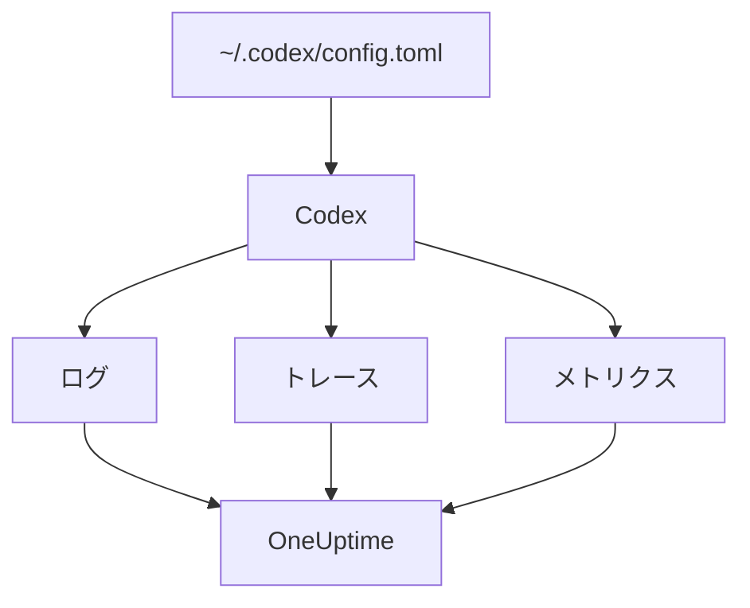

# OpenAI Codex

Codex CLI には、ログ、トレース、メトリクスごとに 1 つずつ、3 つの OpenTelemetry エクスポーターが組み込まれています。`~/.codex/config.toml` でこれらを OneUptime に向けると、Codex の各ターンがトークンとコスト付きで届きます。間にラッパーやプロキシは不要です。

:::cards
- [Codex を設定する](#codex-を設定する): `[otel]` ブロック 1 つと、シグナルごとの完全な URL。
- [使用量を人に帰属させる](#codex-の使用量を人に帰属させる): Codex はスパンやメトリクスで誰も特定しないため、自分で設定します。
- [トークンとコスト](#トークンとコスト): OneUptime がどのシグナルを読み、何が表示されるか。
- [トラブルシューティング](#トラブルシューティング): 何も届かないときに確認すること。
:::

## 仕組み

各エクスポーターは、1 つのシグナルをそれぞれの URL に送ります。トレースとログは設定するまでオフですが、メトリクスはそうではありません。



> [!WARNING]
> 設定を変えない限り、Codex はメトリクスを OpenAI に送ります。リリースビルドでは `metrics_exporter` の既定値が `statsig` で、メトリクスは `https://ab.chatgpt.com/otlp/v1/metrics` に送られます。下のように `metrics_exporter` を OTLP エクスポーターにするか、`none` にすると止まります。`[analytics]` で `enabled = false` にしても Statsig の既定値は止まりますが、自分で設定した OTLP のメトリクスエクスポーターは動き続けます。

## 始める前に

1. **プロジェクト設定 → テレメトリと APM → 取り込みキー** で、テレメトリの取り込みキーを作成します。
2. OTLP エンドポイントは `https://oneuptime.com/otlp` です。OneUptime をセルフホストしている場合は `https://YOUR-ONEUPTIME-HOST/otlp` です。
3. どのエクスポートも、キーを `x-oneuptime-token` ヘッダーで送ります。

## Codex を設定する

:::steps
### otel ブロックを追加する

これを `~/.codex/config.toml` に記述します。3 つのシグナルがすべて有効になり、あわせて Statsig の既定値も置き換わります。

```toml title="~/.codex/config.toml"
[otel]
environment = "prod"
log_user_prompt = false

[otel.exporter.otlp-http]
endpoint = "https://oneuptime.com/otlp/v1/logs"
protocol = "binary"
headers = { "x-oneuptime-token" = "YOUR_INGESTION_TOKEN" }

[otel.trace_exporter.otlp-http]
endpoint = "https://oneuptime.com/otlp/v1/traces"
protocol = "binary"
headers = { "x-oneuptime-token" = "YOUR_INGESTION_TOKEN" }

[otel.metrics_exporter.otlp-http]
endpoint = "https://oneuptime.com/otlp/v1/metrics"
protocol = "binary"
headers = { "x-oneuptime-token" = "YOUR_INGESTION_TOKEN" }

[otel.span_attributes]
"user.id" = "dev@example.com"
"user.email" = "dev@example.com"
"team" = "platform"
```

### 各エクスポーターに完全な URL を指定する

Codex は各 `endpoint` を書かれたとおりに使います。ほとんどの SDK と違い、`/v1/logs`、`/v1/traces`、`/v1/metrics` を付け加えません。3 つのエクスポーターをすべて `https://oneuptime.com/otlp` だけにすると、エラーもなくどこにも何も送られません。

### ターンを実行する

対話型の `codex` セッションを開始し、簡単な質問をしてターンを終わらせます。次に OneUptime で **ログ** を開くと、`codex.conversation_starts`、`codex.api_request`、`codex.turn_cost` などの Codex のイベントが表示されます。
:::

> [!IMPORTANT]
> Codex は `[otel]` の下の知らないキーを、警告なしに無視します。キーはスネークケース (`trace_exporter`、`metrics_exporter`、`span_attributes`) ですが、エクスポーター名と TLS のフィールドはケバブケース (`otlp-http`、`ca-certificate`) です。`trace-exporter` と書くと、エラーも出ずにトレースがオフになります。

## 設定キー

| キー | 既定値 | 役割 |
| --- | --- | --- |
| `environment` | `"dev"` | リソース属性 `env` を設定する |
| `log_user_prompt` | `false` | `codex.user_prompt` でプロンプトのテキストを送る。オフのときは `[REDACTED]` になる |
| `log_agent_responses` | `false` | エージェントの最終的な回答をログのエクスポーターに送る |
| `exporter` | `none` | ログのエクスポーター |
| `trace_exporter` | `none` | トレースのエクスポーター |
| `metrics_exporter` | `statsig` | メトリクスのエクスポーター。必ず設定する |
| `span_attributes` | — | エクスポートするすべてのスパンに追加する属性 |
| `tracestate` | — | W3C の `tracestate` のメンバー |
| `tool_result` | `{ max_bytes = 2048 }` | ログレコードがツールの結果をどれだけ保持するか (UTF-8 のバイト数) |

エクスポーターは `none`、`statsig`、`otlp-http`、`otlp-grpc` のいずれかです。`otlp-http` は `endpoint`、`headers`、`protocol` (`"binary"` または `"json"`。OneUptime はどちらも受け付ける)、`tls` (`ca-certificate`、`client-certificate`、`client-private-key`) を受け付け、`otlp-grpc` は `protocol` を除いて同じものを受け付けます。

## Codex の使用量を人に帰属させる

Codex が開発者を特定するのは 1 か所だけです。

- **ログレコード** は `user.account_id` と `user.email` を持ちます。
- **スパン** は持ちません。Codex は意図的に両方をトレースから外しています。
- **メトリクス** も持ちません。`auth_mode`、`session_source`、`originator`、`service_name`、`model`、`app.version` を持ちますが、人は含みません。

OneUptime が人を読み取るのはスパンとメトリクスのデータポイントからで、ログレコードからは読み取りません。そのため、`[otel.span_attributes]` で各スパンに ID を自分で付けてください。

```toml title="~/.codex/config.toml"
[otel.span_attributes]
"user.id" = "dev@example.com"
"user.email" = "dev@example.com"
"team" = "platform"
"cost_center" = "eng-123"
```

`user.id` は OneUptime が優先するキーで、`user.email` はメールアドレスの列を埋めます。Codex にはリソース属性がないため、チームのキー (`team.id`、`team`、`cost_center`、`department`) もここで設定します。このブロックは各開発者の構成ファイルに置かれるため、dotfiles や MDM プロファイルを使って開発者ごとに配布してください。1 つの ID を持つ共有ファイルを使うと、全員の支出が 1 人に計上されてしまいます。

## トークンとコスト

| シグナル | Codex が送るもの | OneUptime の扱い |
| --- | --- | --- |
| トレース | `gen_ai.usage.input_tokens`、`gen_ai.usage.output_tokens`、キャッシュのトークン。モデルはなし | 人ごとにトークンを数える。料金は算出できない |
| メトリクス | `token_type` 別の `codex.turn.token_usage` と、百万分の一 USD 単位の `codex.turn.cost_microusd` | コストを USD に換算する。スパンが何も報告しない場合にだけメトリクスを読む |
| ログ | `usage.estimated_usd` と人を含む `codex.turn_cost` | **ログ** エクスプローラーに保存する。支出には結び付けない |

上の設定では、 **使用量** タブは次のようになります。

- トークンはスパンから人ごとに取得され、`codex.turn.token_usage` は上乗せされません。両者が合算されることはありません ([理由](/docs/telemetry/ai-llm-observability#スパンが優先されメトリクスが補う))。
- Codex のスパンはモデルを示さないため、OneUptime は料金を算出できず、コストは 0 になります。そのため、コストの合計には `codex.turn.cost_microusd` から取った Codex のコストが、USD に換算されて使われます。
- **従業員** 、 **チーム** 、 **モデル** の表にはスパンの行が表示されます。人ごとのトークンはありますが、人ごとのコストはありません。
- トレースがない場合は、代わりにメトリクスがこれらの表を埋めます。コストだけで、Codex のメトリクスは誰も特定しないため、すべて **帰属なし** になります。

人の情報付きで最も正確なターンごとのコストは、ログレコード `codex.turn_cost` です。OneUptime はまだログレコードを支出に結び付けていませんが、ログのエクスポーターはオンのままにしておいてください。対応したときに履歴が残っています。

## CI と MCP サーバーでの Codex

`codex`、`codex exec`、`codex mcp-server` はどれも、同じ `[otel]` ブロックから 3 つのエクスポーターすべてでテレメトリを組み立てます。`codex exec` の実行は `originator` に `codex_exec` を持ち、`codex mcp-server` は `codex_mcp_server` としてエクスポートするため、これらの値で CI と MCP の実行を対話型セッションと区別できます。

## プライバシー

`log_user_prompt` と `log_agent_responses` の既定値は `false` です。オフのままにしてください。`codex.user_prompt` イベントはプロンプトが `[REDACTED]` に置き換えられた状態で届くため、プロンプトのテキストなしでターン、トークン、コストを把握できます。人 (`user.email`、`user.account_id`) は、これらのスイッチにかかわらずログレコードに含まれます。

調査のために内容を有効にする場合は、 **トレース → 設定** にあるトレースの **スクラブルール** と **破棄フィルター** で、保存前にマスクまたは破棄できます。

## Codex の代わりに OpenAI API を使う

OpenAI のプラットフォーム API は、自分では OpenTelemetry を送りません。スパンはすべて、自分のクライアントをインストルメントすることで生まれます。OneUptime では 3 つのインストルメンテーションが使えます。

- **OpenTelemetry**: Python 向けの `opentelemetry-instrumentation-genai-openai`。`opentelemetry-instrumentation-openai-v2` の後継です。メッセージを記録するかどうかは `OTEL_INSTRUMENTATION_GENAI_CAPTURE_MESSAGE_CONTENT` で決まります。
- **OpenLLMetry** (Traceloop): `opentelemetry-instrumentation-openai`。
- **OpenInference** (Arize): `openinference-instrumentation-openai`。

どれも、[AI / LLM オブザーバビリティ](/docs/telemetry/ai-llm-observability)の説明どおりに OneUptime に向けられます。どれも従業員が誰かを知らないため、`user.id` は自分で設定してください。

**OpenAI Agents SDK** は、OTLP ではなく OpenAI 独自のエンドポイントにトレースを送ります。SDK のスパンを OTLP エクスポーターに渡す `opentelemetry-instrumentation-openai-agents-v2` または `openinference-instrumentation-openai-agents` で橋渡ししてください。

## トラブルシューティング

:::details 何も届かない
まず 3 つの `endpoint` の値を確認してください。それぞれ `/v1/logs`、`/v1/traces`、`/v1/metrics` で終わっている必要があります。次に `x-oneuptime-token` ヘッダーを確認します。OneUptime は間違ったキーを拒否します。
:::

:::details ログは届くが、トレースが届かない
`[otel]` の下のキーのつづり間違いを探してください。Codex は黙って無視します。よくあるのは `trace_exporter` の代わりに `trace-exporter` と書いてしまうことです。
:::

:::details Codex のコストは合計に表示されるが、全員が $0 になる
これは想定どおりです。Codex のスパンはトークンを持ちますがモデルを持たないため料金を算出できず、コストのメトリクスは誰も特定しません。[トークンとコスト](#トークンとコスト)を参照してください。
:::

:::details 全員の支出が 1 人の下に表示される
すべてのマシンに、`[otel.span_attributes]` の同じ ID が設定されています。開発者ごとに別の ID を設定してください。
:::

## 次のステップ

:::cards
- [AI コーディングアシスタント](/docs/telemetry/ai-coding-assistants): すべてのコーディングアシスタントで支出がどう帰属するか。
- [AI / LLM オブザーバビリティ](/docs/telemetry/ai-llm-observability): 自社の AI 呼び出しの会話、アラート、コスト、予算。
- [AI ゲートウェイ](/docs/telemetry/ai-gateways): すべてのモデル呼び出しをトレースし、料金を算出する 1 つのゲートウェイ。
:::
