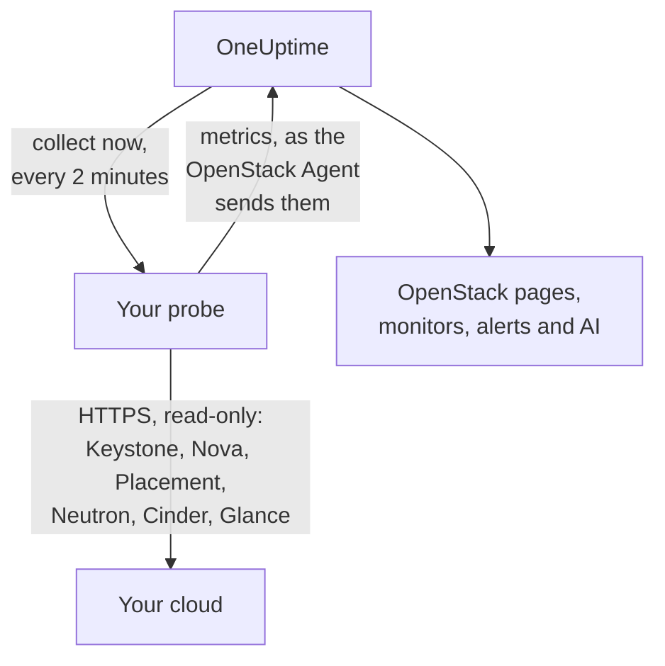

# エージェントなしの OpenStack

何もインストールせずに OpenStack クラウドを監視します。OneUptime に Keystone のアドレスとアプリケーションクレデンシャルを入力し、クラウドに到達できるプローブを選ぶと、[OpenStack エージェント](/docs/telemetry/openstack)と同じデータをプローブが収集します。インストールもアップグレードも常時稼働の管理も不要で、専用のマシンを用意する必要もありません。

> [!IMPORTANT]
> プローブがクラウドと通信するのは HTTPS のみです。クレデンシャルやそのトークンを平文の HTTP で送ることはありません。DevStack と Kolla-Ansible は既定で API を平文の HTTP で公開します。そのようなクラウドでは、API の TLS を有効にするか、クラウドの隣で動作する [OpenStack エージェント](/docs/telemetry/openstack)を使ってください。接続テストは、平文の HTTP アドレスを見つけるとその旨を表示します。

:::cards
- [始める前に](#始める前に): API に到達できるプローブとクレデンシャル。
- [クラウドを接続する](#クラウドを接続する): アドレス、クレデンシャル、テスト、名前。
- [トラブルシューティング](#トラブルシューティング): 各メッセージの意味と対処。
:::

## 仕組み



プローブは 2 分ごとに、選択した各リージョンの各サービスを読み取り、見つけた内容を OneUptime に送ります。データは OpenStack エージェントが送るものとまったく同じ形で届くため、すべての OpenStack ページ、[OpenStack モニター](/docs/monitor/openstack-monitor)、アラートテンプレートが同じように読み取れます。

各サービスは、ほかのサービスと同時に、それぞれ独立して読み取られます。Neutron が失敗したりハングしたりしても失われるのは Neutron の系列だけで、Nova のデータはいつもどおり届きます。ただし Nova には独自の事情が 1 つあります。Nova は一覧にあるすべてのインスタンスについて Neutron に問い合わせます。そのため Neutron がダウンしている間、プローブは最後に読み取ったインスタンスを保持し、変更があったものだけを問い合わせます。インスタンスが変更された場合やプローブが起動したばかりの場合は、Nova もその一覧に答えられません。このとき Nova は失敗として表示されますが、ほかの系列は引き続き届き、各インスタンスは Neutron が復旧するまで最後の状態のままページに残ります。

Heat、Magnum、Manila、Trove、Gnocchi、Designate、Swift、Barbican は、Keystone のカタログに載っている場合に読み取られます。これらを実行していないクラウドではコストはかからず、接続テストでも何も表示されず、[痕跡も表示されません](/docs/telemetry/openstack#heat-と-magnum)。

カタログに Octavia があるクラウドでは、プローブはロードバランサー、プール、リスナー、アンフォラをそれぞれ 1 回の一覧取得で読み取り、続いてすべてのプールのメンバーと、`ACTIVE` であるすべてのロードバランサーとリスナーのトラフィックカウンターを、それぞれ 1 リクエストずつ読み取ります。ロードバランサー 3、プール 1、リスナー 1 のクラウドでは 1 回の収集に 9 リクエストかかります。検証環境で記録した実際の DevStack でもちょうどこの数でした。1 回の収集で読み取るのは、プールのメンバーが最大 25、カウンターが最大 50 で、読み取りから最も時間がたったものが優先され、残りは前回読み取ったときの内容のままになります。Octavia のカウンターは累積値なので、プローブは各カウンターの最新の値を保持し、2 つの値の差を 1 秒あたりに換算してグラフにします。そのためグラフは 2 回目の収集から始まり、カウンターが減少した場合(リスナーの再構築など)、その区間は何も描画されません。OVN プロバイダーはすべてのカウンターを 0 と報告します。これは平坦な線になりますが、障害ではありません。

アンフォラの読み取りは、すべて Octavia の admin ルールが必要です。admin 未満のクレデンシャルでは、自分のプロジェクトのロードバランサー、プール、リスナー、メンバーとそのカウンターは見えますが、アンフォラは見えません。ロードバランサーのページにはその旨が表示され、警告は出ません。ロードバランサーのないプロジェクトの monitoring ロールでは、何も見えません。`load-balancer_global_observer` は、このリリースではすべての読み取りが拒否されます。

Octavia API の停止は、プローブにとっては `up 0` です。エージェントのエクスポーターにはこれを伝えられません。

## プローブとエージェントのどちらを使うか

| | プローブ(このページ) | OpenStack エージェント |
|---|---|---|
| 実行するもの | すでに動かしているプローブ、または新規のプローブ | 専用のマシン上のエージェント |
| クレデンシャルの保管場所 | OneUptime 内で暗号化され、プローブにのみ送られる | エージェントの `clouds.yaml` ファイル内 |
| 到達できる必要があるもの | HTTPS 経由の Keystone と各サービスの API | Keystone と各サービスの API |
| 平文 HTTP の API | 収集されない: トークンは暗号化せずに送らない | 収集される |
| 最大のクラウド | シミュレートしたクラウド(実機ではない)で [200,000 インスタンス](/docs/telemetry/openstack-very-large-clouds)までテスト済み。48 MiB のアップロード最大十回で送信 | まだテストしていない: [スクレイプがタイムアウトする](/docs/telemetry/openstack-very-large-clouds#エージェントの場合)ため、それよりずっと手前で限界に達する |
| サービスログと AI エージェント | 含まれない | 含まれる |
| クラウドの土台: RabbitMQ、MariaDB、Memcached、HAProxy、OVN、libvirt | 含まれない: プローブはクラウドの API を読む | 含まれる。ターゲット名も表示 |
| libvirt または Ceilometer による各インスタンスの実際の CPU、メモリ、ディスク | 含まれない | 含まれる。エクスポーター名も表示 |
| Keystone へのログイン | トークンの有効期間に一回、通常は一時間 | スクレイプごとに一回 |
| 一つのプロジェクトの単なる `reader` | そのプロジェクトのインスタンス、ボリューム、ネットワーク | そのプロジェクトのボリュームとネットワーク。インスタンスは見えない |

どちらも同じ系列を送るため、ページとモニターはどちらでも動作します。プローブはさらに、ネイティブクライアントにしか読めない情報も送ります。インスタンスのアドレス、タスク状態、障害メッセージ、起動元のイメージ、オペレーターが Nova サービスを強制的にダウンさせたかどうか、DHCP エージェントが担当するネットワーク、ボリュームを保持するプール、インスタンス・ボリューム・イメージの最終変更時刻、各ボリュームスナップショットとバックアップの状態です。Cinder がボリュームを保持するプールを教えるのは、admin として扱うクレデンシャルに対してのみです。[Heat または Magnum](/docs/telemetry/openstack#heat-と-magnum) を実行しているクラウドでは、スタックやクラスターが失敗した理由、スタックが所有するインスタンスとボリューム、各クラスターのプロジェクト、テンプレート、Kubernetes バージョン、Heat の各エンジンと Magnum の各コンダクターが稼働しているかどうかも送ります。

サービスログ、AI エージェント、クラウドの土台と各インスタンスの実際の使用量、API が平文の HTTP でしか応答しないクラウド(DevStack と Kolla-Ansible は既定でそうです)、あるいは[データベースから読み取る](/docs/telemetry/openstack-very-large-clouds#データベース経由)必要があるほど大規模なクラウドには、エージェントを選んでください。それ以外はプローブを選んでください。インストールするものがなく、Nova と Cinder が返す情報をより多く読み取れます。どちらにどれだけのコストがかかるかは、規模ごとに [超大規模 OpenStack クラウド](/docs/telemetry/openstack-very-large-clouds)で説明しています。

クラウドごとに、**設定**ページでいつでも一方からもう一方へ切り替えられます。

## 始める前に

- **HTTPS で Keystone とすべてのサービスの API に到達できるプローブ。** 通常は、クラウドのネットワーク内にある[カスタムプローブ](/docs/probe/custom-probe)です。各サービスが応答する場所は Keystone のカタログに載っており、プローブはそれらのアドレスに接続します。そのため、どれもプローブから到達可能で、どれも HTTPS である必要があります。OneUptime Cloud では共有プローブに OpenStack のクレデンシャルは渡されないため、独自のプローブを追加してください。セルフホストのインスタンスでは、インスタンス自身のプローブでも収集できます。
- **クレデンシャル。** アプリケーションクレデンシャルが最適です。読み取りのみに制限でき、有効期限も設定できるためです。ユーザー名とパスワードでも動作しますが、そのアカウントができることはすべてできてしまいます。

OpenStack にはグローバルな読み取り専用ロールがないため、プローブにどこまで見えるかはクレデンシャル次第です。

| レベル | 必要なもの | プローブが読み取る内容 |
|---|---|---|
| フルビュー | 専用プロジェクトで `admin` を持つアカウントのアプリケーションクレデンシャル。アクセスルールで読み取りに制限 | Keystone のユーザーとグループを除くすべて。ルールで意図的に除外している |
| インフラのみ | 何も保持せずクォータがゼロの専用プロジェクトでの `oneuptime_monitoring` と `reader` ロール、および OpenStack エージェントに同梱のポリシーファイル | ハイパーバイザー、Nova のサービス、Neutron のエージェント、アドレスプール、Placement、プロジェクト一覧、すべてのプロジェクトのインスタンス。ボリューム、ネットワーク、ルーターはロールが割り当てられている場合のみ。`cinder-volume` と `cinder-scheduler` の状態およびストレージプールは読み取れない: Cinder 自身のコードが admin を要求する |
| プロジェクトビュー | 一つのプロジェクトの単なる `reader` | そのプロジェクトのインスタンス、ボリューム、ネットワーク。インフラは見えない |

接続テストは、クレデンシャルがどのレベルに相当するかを表示し、自分のプロジェクトに何かが存在する場合は警告します。Cinder の `enforce_new_defaults` が無効(これが既定)の場合、プロジェクト内のどのロールでも、`reader` を含め、そのプロジェクトのボリュームを作成できます。

> [!IMPORTANT]
> アクセスルールで制限されたアプリケーションクレデンシャルは、`keystonemiddleware` の `service_type` が設定されていないサービスでは `401` で拒否されます。接続テストは、読み取りごとにそのことを表示します。各サービスの設定で指定し、再起動してください。ルールとポリシーファイル、各サービスの設定は[クレデンシャルを作成する](/docs/telemetry/openstack#認証情報を作成する)に、実際のクラウドが返した内容は[各レベルが読み取る内容](/docs/telemetry/openstack#各レベルが読み取る内容)にあります。

## クラウドを接続する

:::steps
### クラウド一覧を開く
OneUptime で **OpenStack → すべてのクラウド** を開き、**クラウドを接続**をクリックします。

### アドレスとクレデンシャルを入力する
`clouds.yaml` または `openrc` ファイルの `auth_url`(例: `https://keystone.example.com:5000/v3`)と、アプリケーションクレデンシャルの ID およびシークレットを入力します。クラウドに到達できるプローブを選びます。

### 接続をテストする
**接続をテスト**をクリックします。プローブはログインし、各リージョンで収集が行う読み取りを順に試し、ログアウトします。結果には、カタログに載っているリージョン、クレデンシャルで読み取れるもの、拒否されるもの、それがないと表示されないページ、そして許可を開くための行が表示されます。読み取りが 1 つ失敗してもテストは止まりません。

### クラウドの証明書を信頼する
独自の認証局を持つクラウドは、プローブが信頼しない証明書を提示します。その場合、テストには証明書とそれを提示したホストが表示されます。そのフィンガープリントを API 自身のものと照合してから、**この証明書を信頼**をクリックします。サービスごとにホストがあるクラウドでは、サービスごとに証明書がある場合があり、最大 32 個まで信頼できます。

### リージョンを選んで接続する
読み取るリージョンを選び、クラウドに名前を付けて、**クラウドを接続**をクリックします。クラウドのページが開きます。
:::

クラウドの**概要**には**データ収集**カードが表示されます。最初の収集(1 分以内に始まります)までは**確認中**と表示され、その後**収集中**に変わってページにデータが入ります。一部のサービスは読み取れたものの別のサービスは読み取れなかった場合は、どれかが表示されます。プローブが 15 分間クラウドを担当しない場合(オフラインまたはバージョンが古い場合)は、直近の収集結果にかかわらず**収集されていません**と表示され、その旨が示されます。

クラウドの**設定**ページにある**データ収集**カードには、接続時に使った内容が保存されています。


## API または Terraform からクラウドを接続する

クラウドの接続設定は、API の `/api/openstack-cloud` にある [OpenStack Cloud リソース](/reference/open-stack-cloud)の通常のフィールドなので、ダッシュボードをまったく使わずにクラウドを接続できます。Terraform では `oneuptime_openstack_cloud` を使います。

```hcl
resource "oneuptime_openstack_cloud" "prod_eu" {
  name                      = "prod-eu"
  collection_method         = "Probe"
  auth_url                  = "https://keystone.example.com:5000/v3"
  credential_kind           = "applicationCredential"
  application_credential_id = var.openstack_application_credential_id
  credential_secret         = var.openstack_application_credential_secret
  collection_probe_id       = oneuptime_probe.eu_west.id
  collection_regions        = jsonencode(["RegionOne"])

  # A cloud with its own certificate authority: the fingerprints it presents.
  trusted_certificate_fingerprints = jsonencode(["AB:CD:EF:..."])
}
```

ユーザー名とパスワードを使う場合は、`credential_kind` を `password` に設定し、`keystone_username`、`project_name` を指定します。`Default` 以外であれば `user_domain_name` と `project_domain_name` も指定します。`endpoint_interface`、`collection_interval_in_minutes`、`collection_options` は、フォームでは**その他の項目**の下にまとめられているものです。必須なのは `name` だけです。エージェントが送るクラウドには、これらのどれもないためです。

`credential_secret` は書き込み専用です。どの読み取りでも返されず、Terraform もプランや出力に含めません。[保存されたクレデンシャルのルール](#保存されたクレデンシャル)はここでも同様に適用されます。アドレス、プローブ、信頼する証明書を変更するには、同じリクエストでシークレットも必要です。`collection_status`、`collection_error`、`presented_certificate` のようにプローブが報告する値は、読み取りはできますが設定はできません。

## クラウドへの負荷

監視がクラウドを停止させる原因になってはならないため、収集は設計上、負荷が小さくなっています。

- **ログインは 1 回で、保持する。** トークンは有効期限の 5 分前まで使い続けます。ログインは、不調な Keystone が最も負担に耐えられない処理です。
- **一覧はページ単位。** すべての一覧は、`limit` と `marker` を使って 1,000 行ずつ読み取ります。
- **インスタンスは変更分のみ。** 30 分ごとの全件読み取りの間は、プローブは `changes-since` を使って、前回の読み取り以降に変更されたものだけを Nova に問い合わせます。
- **ハイパーバイザーのインベントリは 1 回だけ。** Placement はインベントリが変わるたびにプロバイダーの世代を進めます。これは 1 回の一覧呼び出しですべてについて分かるため、そのときだけ再読み取りします。
- **決まった上限の負荷。** 1 つのものにつき 1 回の呼び出しが必要な処理は、1 回の収集で 2,000 を超えると順番に分けて行い、制限(クォータ)の読み取りは 250 プロジェクトを超えると分けます。今回読み取らなかったものは前回の読み取り結果のまま送られるため、系列に欠損が生じず、クラウドが大きくなっても負荷は増え続けません。
- **読み取るフィールドのみ。** Neutron の一覧はフィールドを指定して取得し、セキュリティグループは ID のみを要求します。
- **重ならない。** 間隔より長くかかった収集はスキップされ、次の収集と並行して実行されることはありません。
- **時間の予算。** 1 回の収集には間隔の 9/10、最長 10 分が割り当てられます。その時点までに読み取れたものを送信し、時間切れになったサービスはその旨を表示します。
- **バックオフ。** `429` や `Retry-After` で待つよう求められると、プローブは待機します。`429`、`503`、または無応答だったサービスは、1 分、2 分、4 分と最長 30 分まで間隔を延ばして放置され、その間もそのサービスの系列はダウンしていると示し続けます。
- **速度の抑制。** そのサービスの通常の応答より 3 倍遅く、かつ 1 秒以上かかった応答(通常がどうであれ 5 秒以上でも同様)があると、そのサービスの次のリクエストが同じ時間だけ遅れます。**データ収集**カードに、そうなった旨が表示されます。
- **拒否されたクレデンシャルは最も長く待つ。** 同じものを繰り返し使うとアカウントがロックされるため、5 分、10 分と最長 1 時間まで待ちます。修正したクレデンシャルはすぐに試されます。

- **大規模クラウドでは少なめに。** インスタンスが 5,000 を超えると、クラウドは件数とその構成要素のみを保持し、インスタンスごと・ボリュームごとの系列は保持されません。クラウドの**設定**ページの**インスタンスごとの実際の使用量**で別の選択をした場合を除きます。変更されたもの、保持するよう選んだもの、アラートが監視しているものは、毎回の収集で送られ続けます。それ以外は順番に分けて送られ、**データ収集**カードに 1 巡にかかる時間が表示されます。

既定の設定では、1 回の収集で 1 リージョンあたり、Nova に 7 回、Neutron に 7 回、Cinder に 5 回、Placement に 1 回とハイパーバイザーごとにさらに 2 回、Placement に[各フレーバーがいくつ収まるか](/docs/telemetry/openstack#容量)を尋ねる最大 4 回の追加呼び出しがあり、約 5 分ごとに Keystone に 5 回、Glance に 1 回呼び出します。ハイパーバイザーのインベントリは 1 回読み取り、Placement が変更を示した場合にのみ再読み取りします。1,000 行を超える一覧は、1,000 行ごとに 1 回の呼び出しがかかります。変更されたインスタンスごとに、その経緯を読み取るため Nova にさらに 1 回呼び出しますが、1 回の収集で読み取るのは最大 25 件で、静かなクラウドでは 1 回もありません。ML2/OVS では、Neutron はルーターごとにさらに 1 回、どの L3 エージェントが保持しているかを尋ね、10 分ごとに DHCP エージェントごと(最大 20)に 1 回、どのネットワークを担当しているかを尋ねます。DHCP エージェントがそれより多いクラウドは順番に分けて処理し、要約サイズを超えるクラウドではこれを省略し、Neutron が遅い場合は問い合わせません。OVN のクラウドには問い合わせる対象がありません。各規模で 1 分あたり何リクエストになるかは、[超大規模 OpenStack クラウド](/docs/telemetry/openstack-very-large-clouds#コントロールプレーンへの負荷)にあります。

Manila を実行しているクラウドは、約 5 分ごとにそれへの呼び出しを 2 回、Trove なら 1 回、Gnocchi なら 1 回、Barbican なら 3 回消費します。Designate は 2 回、`ACTIVE` でないゾーンごとにさらに 1 回で、1 回の収集で最大 50 回です。Swift は、クレデンシャル自身のプロジェクトに 1 回、`ResellerAdmin` があれば他のプロジェクトごとにさらに 1 回で、1 回の収集で最大 200 回です。Heat または Magnum を実行しているクラウドは、約 5 分ごとに Heat に 2 回、Magnum に 3 回の呼び出しを消費します。どちらの一覧も、すべてを示すわけではありません。Magnum の一覧にはクラスターの所有者や失敗の理由が含まれず、Heat の一覧にはスタックが所有するものが含まれません。そのためプローブは、ステータスが変わったクラスターやスタックを個別に読み取り、1 回の収集でそれぞれ最大 25 件です。それより多いクラウドでは、以降の収集で順に埋めていき、変化のないものが 2 度読み取られることはありません。

次の 3 つは、クラウドへの負荷が増えるため、有効にしない限りオフです。有効にするには、クラウドの**設定**ページの**データ収集**カードにある**既定以外で読み取る内容**、または接続時の**その他の項目**で指定します。

| オプション | 得られるもの | コスト |
|---|---|---|
| ポート | ポートごとの系列、およびアドレスのないポートの数やダウンしているロードバランサー | 指定したネットワークまたはプロジェクトごとに、ページ分割した一覧を一つ。何も指定しなければすべてのポートの一覧。大規模なクラウドでは、範囲を絞らないポートの一覧が Neutron を飽和させることがある |
| プロジェクトの制限 | プロジェクトごとのクォータと制限 | プロジェクトごとに四回の呼び出しで、一回の収集で最大 250 プロジェクト |
| Swift のストレージサーバー | 各サーバーが応答するか、レプリケーション、リングがすべて同一か。各サーバーの `/recon` ポートを `host:port` で指定する。Swift を実行しているクラウドのみで利用でき、最初の収集で Swift を読み取った後に**設定**ページに表示される | 収集ごとにサーバーあたり 5 回の呼び出し。クレデンシャルはそれらには送られない |

## 証明書

プローブは証明書の検証を決してスキップしません。すべての接続で完全な TLS ハンドシェイクを行い、そのうえで次のようになります。

- 信頼する証明書がない場合、API の証明書は、プローブのマシンが信頼する認証局が発行したもので、応答するアドレス宛のものでなければなりません。
- 信頼する証明書がある場合、API はその証明書のうちのいずれかを、SHA-256 フィンガープリントで識別して提示しなければなりません。それ以外は、公的に信頼されたものでも受け付けません。

フィンガープリントを確認するには、プローブのマシンで次を実行します。

```bash
openssl s_client -connect keystone.example.com:5000 </dev/null | openssl x509 -noout -fingerprint -sha256
```

証明書が更新されると、収集は**API の証明書が変更された**で停止し、新しい証明書が表示されます。クラウドの**概要**または**設定**ページで信頼するまで、何も送信されません。

## 保存されたクレデンシャル

シークレットは暗号化された書き込み専用で、誰も読み戻すことはできず、API も返しません。シークレットは、そのクラウドを収集するプローブにのみ送られ、プローブはそれをメモリ内にのみ保持します。

保存されたクレデンシャルが送られるのは、入力されたアドレス、プローブ、証明書に対してのみです。アドレス、プローブ、信頼する証明書を変更するときは再度シークレットを求められるため、クラウドを編集できる人が別の場所へ送ることはできません。プローブが保存済みのアドレスで見つけた証明書を信頼する場合や、信頼する証明書を減らす場合は、そのまま保持されます。

カタログにも、入力したアドレスと同じルールが適用されます。トークンはカタログが指す場所へ送られるためです。プローブは、ループバック、リンクローカル、クラウドメタデータのアドレスには、カタログがそれを指していても、ホスト名がそれに解決されても接続しません。また、確認済みのアドレスに接続し、その直後に DNS が返したアドレスには接続しません。リダイレクトにも従いません。

## エージェントとプローブの切り替え

クラウドの**設定**ページを開きます。その**データ収集**カードには、エージェントが送っているクラウドには**プローブで収集**、プローブが収集しているクラウドには **OpenStack エージェントを使用**が表示されます。エージェントに切り替えると、保存されたクレデンシャルは破棄されます。

> [!WARNING]
> プローブの最初の収集が成功したら、OpenStack エージェントを停止してください。両方が動作している間は、すべてのメトリクスが二重に届きます。

[5,000 インスタンス](/docs/telemetry/openstack-very-large-clouds#サマリーモード)を超えると、プローブの最初の収集はクラウド全体を把握したうえでその一部を送ります。そのため新しいクラウドの一覧は最初の 1 巡の間に埋まっていき、**データ収集**カードにすべてがそろう時期が表示されます。

## ベアメタル

カタログに Ironic があるクラウドでは、プローブはそのノードを読み取り、各フィールドを名前で指定して要求するため、ノードの `driver_info` は収集で読み取られることがありません。エージェントのエクスポーターにはない、ノードのドライバー、コンダクター、障害とその失敗理由が追加されます。Ironic は約 1 分以内に `last_error` を空にすることがあるため、ページは収集で最後に見たものを保持し、その時刻を表示します。

プローブは最初にカタログを読み取るため、エージェントのエクスポーターにはできない、Ironic の API がダウンしていることを伝えられます。Ironic のないクラウドには何も問い合わせません。

Ironic は、プロジェクトが所有するノードのみをそのプロジェクトに表示し、コンダクターの一覧は拒否します。Ironic の既定のポリシーでは、これらを読み取れるのはシステムスコープのクレデンシャルだけです。しかしプローブのクレデンシャルは、Nova の一覧も同じものを使って読み取るため、システムスコープにはできません。したがって、クラウドのポリシーでそのロールに `baremetal:node:list_all` と `baremetal:conductor:get` が与えられていない限り、プローブには自分のプロジェクトが所有するノードだけが見え、コンダクターは見えず、ページにもその旨が表示されます。詳細は[ベアメタル](/docs/telemetry/openstack#ベアメタル)をご覧ください。

## リファレンス

| 設定 | 既定値 | 備考 |
|---|---|---|
| 収集間隔 | 2 分 | 1 〜 60 分。大規模なクラウドは収集頻度を下げると負荷が軽くなる。Keystone と Glance は、ほかの収集頻度にかかわらず約五分ごとに読み取られる。 |
| エンドポイントインターフェース | public | カタログの URL のうちどれを使うか: public、internal、admin。 |
| 同時収集数 | プローブあたり 4 | 間隔より遅い収集はスキップされ、重なることはない。 |
| 最大アップロードサイズ | 48 MiB | 一回の収集は必要な数に分けて送られ、最大十回。[5,000 インスタンス](/docs/telemetry/openstack-very-large-clouds#サマリーモード)を超えると、変更のないものは順番に分けて送られる。 |
| 各サービスへのリクエスト | 一度に一つ | Placement のプロバイダーごとの呼び出しは四つずつ同時に行う。 |
| 一つの応答を待つ時間 | 60 秒 | `429` またはサーバーエラーの場合は、合計三回試行する。 |
| 接続テスト | 開始まで 90 秒 | どのプローブも時間内に取得しなかったテスト、または 3 分を超えて実行されたテストは、失敗として応答される。プロジェクトあたり、待機と実行を合わせて同時に五件まで。 |

## トラブルシューティング

:::details API の証明書が信頼されていません
クラウドが独自の認証局の証明書を提示しています。表示されたフィンガープリントを API の証明書と照合してから、**この証明書を信頼**をクリックします。
:::

:::details API の証明書が変更されました
証明書が更新されたか、通信の途中に第三者がいます。新しい証明書を信頼するまで、何も送信されません。フィンガープリントを確認してから信頼してください。
:::

:::details 認証 URL が正しくありません
Keystone の HTTPS アドレスを入力してください(例: `https://keystone.example.com:5000/v3`)。平文の HTTP のアドレスは、何かを送信する前に拒否されます。API が平文の HTTP でしか応答しないクラウドでは、TLS を有効にするか、[OpenStack エージェント](/docs/telemetry/openstack)を使ってください。
:::

:::details カタログに平文の HTTP エンドポイントがあります
クレデンシャルのトークンは暗号化せずに送られることはありません。その API の TLS を有効にするか、別のエンドポイントインターフェースを選ぶか、このクラウドでは [OpenStack エージェント](/docs/telemetry/openstack)を使ってください。読み取る各 API が HTTPS になるまで、接続テストは失敗します。収集では、そのエンドポイントのサービスだけが対象外になり、ほかは通常どおり読み取られます。
:::

:::details Keystone がクレデンシャルを拒否しました
ID、シークレット、パスワードが間違っているか、期限が切れた、または削除された、あるいはアカウントがプロジェクトでのロールを失っています。新しく作成し、クラウドの**設定**ページの**接続を編集**から入力してください。
:::

:::details アカウントにそのプロジェクトのロールがありません
ユーザー名とパスワードでログインできましたが、そのプロジェクトにはログインできていません。プロジェクト名と両方のドメインを確認してください。アプリケーションクレデンシャルなら、作成時にスコープが決まるため、この問題は起きません。
:::

:::details クレデンシャルでは監視に必要な情報を読み取れません
テストには、拒否された各読み取り、それがないと表示されないもの、許可を開くための行が一覧表示されます。アクセスルールのあるクレデンシャルでの `401` は、ルールがそのパスを列挙していないか、そのサービスの `keystonemiddleware` に `service_type` が設定されておらず再起動もされていないことを意味します。
:::

:::details プローブがクラウドから応答を得られません
プローブのネットワークからその API に到達できません。ファイアウォールで許可するか、クラウドのネットワーク内のプローブを選んでください。各サービスのアドレスは別々です。応答しなかったものがメッセージに示されます。
:::

:::details そのポートで何も応答しません
アドレスとポートを確認してください。Keystone は通常 5000 番、または `/identity` のようなパスの背後で 443 番で応答します。
:::

:::details セキュア接続に失敗しました
アドレスが HTTPS に対応していないポートを指している可能性があります。確認してください。クラウドの API が平文の HTTP でしか応答しない場合は、TLS を有効にするか、OpenStack エージェントを使ってください。
:::

:::details OneUptime はこのアドレスに接続しません
アドレス、またはカタログに載っているものが、ループバック、リンクローカル、クラウドメタデータのアドレスであるか、そこへ解決されます。ネットワーク内で API が応答するアドレスを使ってください。
:::

:::details このアドレスは Keystone ではありません
`clouds.yaml` または `openrc` ファイルの Identity エンドポイント、つまり `auth_url` を入力してください。
:::

:::details リージョンがカタログにありません
カタログに載っているリージョンから選んでください。接続テストにそれらが一覧表示されます。
:::

:::details Keystone が失敗しています
Keystone がサーバーエラーを返しました。プローブは復旧するまでログインの間隔を延ばし、ログインできない間はほかに何も読み取れません。Keystone のサービスと、その背後のデータベースを確認してください。
:::

:::details サービスが停止しているか、混み合って応答できません
`429` またはサーバーエラーを返し続けたため、プローブは復旧するまで収集の間隔を延ばします。稼働していることを確認し、次に負荷を確認してください。混み合っている場合は、収集頻度を下げると改善します。
:::

:::details 収集に時間がかかりすぎました
クラウドの応答がこの間隔には遅すぎました。収集頻度を下げるか、負荷を確認してください。
:::

:::details プローブがこれを取得しませんでした
プローブがオフラインか、OpenStack の収集に対応する前の古いバージョンの OneUptime を実行しています。**プローブ**ページで接続されていることを確認し、更新してください。クラウドのカードは、直近の収集の結果にかかわらず、収集が 15 分遅れるとこのことも表示し、プローブが復帰すると自動的に元に戻ります。
:::

:::details このクラウドはプローブで収集するには大きすぎます
メトリクスが 1 回の収集で送信できる量を超えており、このクラウドはすべてのインスタンスの系列を保持する設定になっています。クラウドの**設定**ページの**インスタンスごとの実際の使用量**で件数のみ保持するようにするか、[OpenStack エージェント](/docs/telemetry/openstack)を使ってください。何が失われるかは[サマリーモード](/docs/telemetry/openstack-very-large-clouds#サマリーモード)で説明しています。
:::

## 次のステップ

:::cards
- [OpenStack モニター](/docs/monitor/openstack-monitor): サービス、ハイパーバイザー、インスタンス、ネットワーク、ボリュームをアラート対象にします。
- [カスタムプローブ](/docs/probe/custom-probe): クラウドのネットワーク内でプローブを実行します。
- [OpenStack エージェント](/docs/telemetry/openstack): 代わりにエージェントでクラウドを収集します。
:::
