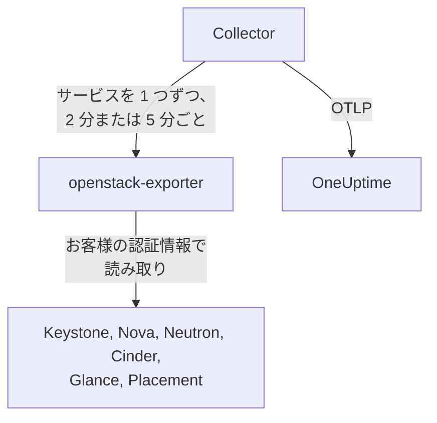

# OpenStack エージェント

OneUptime の OpenStack エージェントは、OpenStack クラウドを監視します。対象は、すべてのリージョンにわたるサービスとエージェント、ハイパーバイザー、インスタンス、ネットワーク、ルーター、ボリューム、ストレージプール、イメージ、プロジェクトです。エージェントはお客様が選んだ認証情報でクラウドの API を読み取り、見つかった内容を OneUptime に送信します。OneUptime では、クラウドがリージョン、ハイパーバイザー、プロジェクトとともに表示されます。[OpenStack モニター](/docs/monitor/openstack-monitor)は届いたデータをもとにアラートを出し、[プローブ](/docs/telemetry/openstack-agentless)を使えば、何もインストールせずにクラウドからデータを収集できます。

:::cards
- [プローブとエージェントのどちらを使うか](/docs/telemetry/openstack-agentless#プローブとエージェントのどちらを使うか): どちらでも使えるクラウドで、どちらを選ぶか。
- [参照範囲を選ぶ](#エージェントの参照範囲を選ぶ): OpenStack にはグローバルな読み取り専用ロールがないため、3 つのレベルがあります。
- [エージェントをインストールする](#エージェントをインストールする): 認証情報を作成し、インストールスクリプト、Docker Compose、または Docker なしでインストールします。
- [クラウドへの負荷](#クラウドへの負荷): 各設定が何を読み取るか、そして変更の方法。
- [容量](#容量): 各フレーバーがあと何台入るか、そして各リソースが満杯になるまでの日数。
- [支出](#支出): 誰が何を使っているか、お客様の単価または CloudKitty の評価額でいくらになるか、そして何を回収できるか。
- [ステータスページとプロジェクトへの通知](#ステータスページとプロジェクトへの通知): リージョンごとのページを 1 ステップで作成し、障害の影響を受けるプロジェクトにだけ通知します。
- [サービスログ](#サービスログ): 解析されたログと、サービスをまたいで追跡されるリクエスト。
- [ライフサイクルイベント](#ライフサイクルイベント): インスタンスの操作を、通知またはプローブからフィードとグラフに表示します。
- [誰が何をしたか](#誰が何をしたか): 監査証跡をセキュリティイベントに取り込みます。
- [リクエストをトレースする](#コントロールプレーンでリクエストをトレースする): 署名付きの 1 つのリクエストを、コントロールプレーン全体で追跡します。
- [外部からクラウドを確認する](#外部からクラウドを確認する): クラウドの外にあるプローブから、実際にインスタンスを起動できるかどうかを確認します。
- [インターネットなし](#インターネットなし): エージェントの 4 つのイメージと、それらを独自のレジストリにコピーする方法。
- [デプロイツール別](/docs/telemetry/openstack-deployment-tools): Kolla-Ansible、OpenStack-Ansible、OpenStack-Helm、Atmosphere、Sunbeam、Red Hat、Mirantis。
- [トラブルシューティング](#トラブルシューティング): 診断スクリプトと、よくある問題。
:::

## 仕組み

エージェントは、バージョンを固定した 2 つのアップストリームのプログラムとその設定を、1 台のマシンで動かす構成です。[openstack-exporter](https://github.com/openstack-exporter/openstack-exporter) がクラウドの API を読み取って `openstack_*` 系列に変換し、OpenTelemetry Collector がそこへ OpenStack サービスを 1 つずつ問い合わせます。Collector はすべての系列に取得元のクラウドとリージョンを付与して、OneUptime に送信します。コントローラーやコンピュートノードでは何も実行されません。ただし、それらのログを読み取る任意の[ログプロファイル](#サービスログ)を追加した場合は別です。



クラウドは最初のデータとともに自動的に登録されます。名前には、エージェントがすべてのメトリクスに `openstack.cloud.name` として付与するものが使われます。1 つのエージェントが監視するのは 1 つのクラウド、つまり 1 つの Keystone です。リージョンは 1 つでも複数でも構いません。

## 始める前に

- Docker Engine 20.10 以降と Docker Compose v2 プラグイン。Docker なしで動かす場合は、systemd 235 以降、glibc 2.34 以降（RHEL 9、Ubuntu 22.04、Debian 12）を備えた Linux マシン（x86_64 または arm64）と root 権限。
- そのマシンから Keystone と各サービスのパブリックエンドポイントへの経路。
- `openstack` コマンドラインと、下記の認証情報を作成できるユーザー。
- 取り込みキー。**プロジェクト設定 → テレメトリと APM → 取り込みキー** で作成し、その値をコピーしてください。
- そのマシンから OneUptime の URL への外向き HTTPS 通信。

### エージェントを動かす場所

エージェントは、監視対象のクラウドの外で動かしてください。別のハードウェア上の小さな VM、管理ホスト、別のクラウドなどです。障害が起きたクラウドの中にいるエージェントは、クラウドとともに沈黙します。そして沈黙は、報告が止まっただけの健全なクラウドと見分けがつきません。

## エージェントの参照範囲を選ぶ

OpenStack にはグローバルな読み取り専用ロールがなく、これが監視で最も厄介な点です。

- `reader` は、Keystone と Ironic を除くすべてで、プロジェクトにスコープされます。
- ハイパーバイザー、サービス、エージェント、プール、Placement は、既定で admin が必要です。
- ポリシーを上書きしても、Neutron や Cinder の全プロジェクト一覧は開けません。これらは自身のコード内で、admin コンテキストによってスコープを決めているためです。
- Cinder のサービスとストレージプールは、admin 以外には `403` を返します。これは、ポリシーの確認がすでに通った後で、Cinder 自身のコードが返すものです。どのポリシー上書きでも開けません。
- Neutron と Cinder は、通常の reader に `200` を返し、その reader 自身のプロジェクトの行だけを返します。うまくいったように見えますが、実際にはうまくいっていません。
- Cinder で `enforce_new_defaults` がオフ（これが Cinder 自身の既定値です）の場合、プロジェクト上のどのロールでも、そのプロジェクトのボリュームを作成できます。`reader` や `oneuptime_monitoring` も含まれます。Epoxy、Flamingo、Gazpacho では、通常の reader も実在のプロジェクト上のロールも、ボリュームを作成できました（`202`）。Hibiscus ではどちらも拒否されました（`403`）。DevStack が `enforce_new_defaults` をオンにするのは Hibiscus だけだからです。実在のプロジェクト上の読み取り専用ロールは、読み取り専用ではありません。

そのため、レベルは 3 つあり、それぞれに代償があります。可能であれば、最初のレベルから始めてください。

| レベル | 必要なもの | 参照できるもの | 参照できないもの |
| --- | --- | --- | --- |
| **1. 完全な参照** | 専用のプロジェクト上で `admin` を持つアカウントのアプリケーション認証情報。アクセスルールで読み取りに限定し、各サービスに `service_type` を設定する | エージェントが行うすべての読み取りに加え、このレベルだけが参照できる `cinder-volume` と `cinder-scheduler` の状態、ストレージプール | Keystone のユーザーとグループ（意図的なものです）。書き込みはできません。すべての書き込みが `401` で拒否されました |
| **2. インフラのみ** | 何も保持せず、クォータがゼロの専用プロジェクト上の `oneuptime_monitoring` ロールと `reader` ロール、およびエージェントが提供するポリシー上書き | Keystone のすべてのプロジェクト、ドメイン、サービス、エンドポイント。Nova のすべて（全プロジェクトのサーバーを含む）。Placement のすべて。Neutron のエージェントと IP 可用性 | Neutron のネットワーク、サブネット、ルーター、Floating IP、ポートと、Cinder のボリュームとスナップショットは、そのプロジェクトのものだけです。空のプロジェクトでは、共有と外部のものだけになります。`cinder-volume` と `cinder-scheduler` の状態、ストレージプールは参照できません。書き込みはできません。すべての書き込みが `403`、またはクォータによる `409` と `413` で拒否されました |
| **3. プロジェクトの参照** | 実在のプロジェクト上の通常の `reader`。他の誰かが運用するクラウドの一部を、自チームで監視する場合 | Cinder と Neutron から見える、そのプロジェクトのボリューム、ネットワーク、ルーター | インフラ全般。ハイパーバイザー、サービス、エージェント、プール、容量は参照できません。エージェント経由では、インスタンスも参照できません。エクスポーターの全プロジェクト読み取りが拒否されるためです。さらに、多くのクラウドでは `reader` でもそこへ書き込めます |

**Block Storage Service Down**、**Storage Pool Warning**、**Storage Pool Critical** の各テンプレートにはレベル 1 が必要です。**Compute Service Down**、**Network Agent Down**、および Placement とハイパーバイザーのテンプレートにはレベル 1 または 2 が必要で、レベル 3 ではインスタンスを一切読み取れません。

### 各レベルが読み取る内容

これは、Epoxy、Flamingo、Gazpacho（OVN と OVS）、Hibiscus の 5 つの実クラウドが返した結果です。各セルは、それらの記録をもとに書かれています。

| 読み取り | レベル 1: 完全な参照 | レベル 2: インフラのみ | レベル 3: プロジェクトの参照 |
| --- | --- | --- | --- |
| Keystone: プロジェクト | すべて | すべて | 拒否 |
| Keystone: ドメイン | すべて | すべて | 拒否 |
| Keystone: リージョン | すべて | 誰でも見えるもの | 誰でも見えるもの |
| Keystone: サービス | すべて | すべて | 拒否 |
| Keystone: エンドポイント | すべて | すべて | 拒否 |
| Nova: サーバー（全プロジェクト） | すべて | すべて | 拒否 |
| Nova: サービス | すべて | すべて | 拒否 |
| Nova: ハイパーバイザー | すべて | すべて | 拒否 |
| Nova: アグリゲート | すべて | すべて | 拒否 |
| Nova: アベイラビリティゾーン（詳細） | すべて | すべて | 拒否 |
| Nova: フレーバー | すべて | 誰でも見えるもの | 誰でも見えるもの |
| Nova: プロジェクトごとの使用量 | すべて | すべて | 拒否 |
| Placement: リソースプロバイダー | すべて | すべて | 拒否 |
| Neutron: エージェント | すべて | すべて | なし |
| Neutron: ネットワーク | すべて | 自プロジェクトのみ | 自プロジェクトのみ |
| Neutron: サブネット | すべて | 自プロジェクトのみ | 自プロジェクトのみ |
| Neutron: ルーター | すべて | 自プロジェクトのみ | 自プロジェクトのみ |
| Neutron: Floating IP | すべて | 自プロジェクトのみ | 自プロジェクトのみ |
| Neutron: IP 可用性 | すべて | すべて | なし |
| Neutron: セキュリティグループ | すべて | 409、想定どおり | 自プロジェクトのみ |
| Neutron: ポート | すべて | 自プロジェクトのみ | 自プロジェクトのみ |
| Neutron: クォータ | すべて | 拒否 | 拒否 |
| Cinder: ボリューム（全プロジェクト） | すべて | 自プロジェクトのみ | 自プロジェクトのみ |
| Cinder: サービス | すべて | 拒否 | 拒否 |
| Cinder: プール | すべて | 拒否 | 拒否 |
| Cinder: スナップショット（全プロジェクト） | すべて | 自プロジェクトのみ | 自プロジェクトのみ |
| Cinder: バックアップ（全プロジェクト） | すべて | 記録なし | 記録なし |
| Cinder: ボリュームタイプ | すべて | 誰でも見えるもの | 誰でも見えるもの |
| Glance: イメージ | すべて | 誰でも見えるもの | 誰でも見えるもの |

- **すべて**: admin が見たものと同じ行です。
- **自プロジェクトのみ**: そのプロジェクトの行と、共有または外部のものすべてです。何も保持していないプロジェクトでは、共有と外部のものだけになります。
- **拒否**: `401` または `403` です。
- **誰でも見えるもの**: パブリックなフレーバー、ボリュームタイプ、イメージしかないクラウドでは、どの認証情報にもすべての行が見えました。別のプロジェクトのプライベートなものを見るには、レベル 1 が必要です。
- **なし**: ネットワークが存在するプロジェクトでも、行のない `200` が返ります。うまくいったように見えますが、実際にはうまくいっていません。
- **記録なし**: admin にも行が見えなかったため、`200` で行がなく、判断材料がなかったことを示します。
- **409、想定どおり**: Neutron は、セキュリティグループを一覧するときにそのプロジェクトの既定のセキュリティグループを作成しようとしますが、クォータがゼロのため作成できず、`409 Quota exceeded` を返します。これは無害で、対処は不要です。

Octavia、Ironic、Heat、Magnum、Manila、Designate、Barbican、Swift、Trove、Gnocchi は、記録したクラウドがこれらを動かしていなかったため、ここには載っていません。[診断スクリプト](#トラブルシューティング)は、クラウドがこれらを動かしていればそれらにも問い合わせます。すべてのパスをお客様の実際の認証情報で読み取り、その認証情報で何が見えるかを報告します。

それぞれの認証情報でエージェントのエクスポーターが取得したものを、サービスごとの系列数で示します。件数はクラウドの保持するものによって変わるため、お客様のクラウドとではなく、表の中の値どうしで比較してください。

| エクスポーターのサービス | Admin | レベル 1: 完全な参照 | レベル 2: インフラのみ | レベル 3: プロジェクトの参照 |
| --- | --- | --- | --- | --- |
| identity | 14 | 13 | 13 | 4 |
| compute | 33 | 33 | 33 | 15 |
| placement | 25 | 25 | 25 | 1 |
| network | 36 から 40 | 36 から 40 | 24 から 26 | 14 |
| volume | 33 | 33 から 41 | 23 | 29 から 37 |
| image | 4 | 4 | 4 | 4 |

## エージェントをインストールする

どの OneUptime も、自身のリリース用のエージェントのインストールスクリプトとファイルを配信しています。以下のコマンドは `https://oneuptime.com` からそれらをダウンロードするので、セルフホストの OneUptime では、これをお使いの URL に置き換えてください。インストールスクリプトはまず `install.sh` として保存されるので、実行前に内容を確認できます。

:::steps
### 認証情報を作成する

選んだレベルに合わせてください。いずれもアプリケーション認証情報を作成し、`id` と `secret` が表示されます。secret が表示されるのは一度だけです。有効期限を設定し、`--unrestricted` は決して使わないでください。これを使うと、さらに認証情報を作成できてしまいます。

:::tabs
@tab Level 1: Full view
admin として、エージェント用のプロジェクトとアカウントを作成します。

```bash
openstack project create --domain default oneuptime-monitoring
openstack user create --domain default --password-prompt oneuptime-monitoring
openstack role add --project oneuptime-monitoring --user oneuptime-monitoring admin
```

次に、そのアカウントでそのプロジェクトにログインして、認証情報を作成します。ルールは、エージェントが使う `GET` パスそのもので、お使いのクラウドに合わせて調整されます。

```bash
curl -fsSLO https://oneuptime.com/install/openstack-agent/access/application-credential-access-rules.json
curl -fsSLO https://oneuptime.com/install/openstack-agent/access/access-rules-for-cloud.py
openstack catalog list -f json | python3 access-rules-for-cloud.py \
  application-credential-access-rules.json > access-rules-for-this-cloud.json
openstack application credential create oneuptime-agent \
  --role admin \
  --access-rules "$(cat access-rules-for-this-cloud.json)" \
  --expiration 2027-11-01T00:00:00
```

アクセスルールは、サービスから見えるパスと照合されます。`https://cloud.example/compute/v2.1` のようにパスのプレフィックスの後ろにあるサービスには `/compute/v2.1/servers` と見えるため、同梱されている `/v2.1/servers` のルールは `401` で拒否されます。`access-rules-for-cloud.py` は、カタログから読み取った各サービスのプレフィックスを付けて、各ルールをもう一度追加します。

エクスポーターの読み取りのうち 2 つは、手作業では見落としやすいルールを必要とします。1 つ目は、エクスポーターが何よりも先に Octavia のルートを読み取ることです。Apache の背後では、サービスにはこれが 2 つのスラッシュを持つ `/load-balancer//` と見えます。拒否されると、エクスポーターは空の `200` を返し、クラウドが Octavia を動かしていないように見えます。2 つ目は、Swift のアカウントを末尾のスラッシュ付きで一覧することで、`/v1/*` ではこれに一致しません。拒否されると、`openstack_object_store_up` が `0` になります。調整済みのルールには、この両方が含まれています。認証情報のルールは後から変更できないため、古いコピーから作成した場合は、新しく作成し直してください。

アクセスルールを使うには、各サービスで keystonemiddleware 用に `service_type` を設定し、そのサービスを再起動する必要もあります。設定しないと、サービスはその認証情報を `401` で拒否します。

```ini title="nova.conf"
[keystone_authtoken]
service_type = compute
```

| 設定ファイル | `service_type` |
| --- | --- |
| `nova.conf` | `compute` |
| `neutron.conf` | `network` |
| `cinder.conf` | `block-storage`。Cinder をそのように設定している場合に備えて、ルールには `volume` と `volumev3` も含まれます |
| `glance-api.conf` | `image` |
| `placement.conf` | `placement` |
| `octavia.conf` | `load-balancer` |
| `ironic.conf` | `baremetal` |
| `heat.conf` | `orchestration` |
| `magnum.conf` | `container-infra` |
| `manila.conf` | `sharev2`。Manila をそのように設定している場合に備えて、ルールには `shared-file-system` も含まれます |
| `designate.conf` | `dns` |
| `barbican.conf` | `key-manager` |
| `trove.conf` | `database` |
| `gnocchi.conf` | `metric` |
| `cloudkitty.conf` | `rating` |
| `proxy-server.conf`（`[filter:authtoken]` の下） | `object-store`。あわせて `include_service_catalog = True` も設定します。keystonemiddleware はルールをトークンのカタログと照合するため、DevStack が設定する `False` では、Swift はその認証情報に `500` を返します |

行が必要なのは、お使いのクラウドが動かしているサービスだけです。

クラウドが動かしていないかもしれないサービスについては、実際のクラウドで各レベルが得た結果が、上の表と次の 4 点で異なります。

- **Ironic** は、プロジェクトの認証情報（admin のものも同様）に対し、そのプロジェクトが所有するノードだけを返し、コンダクターは拒否します。すべてのノードとコンダクターを読み取れるのはシステムスコープだけで、エージェントの認証情報はプロジェクト上にあります。この認証情報でノードを読み取るには、`openstack baremetal node set --owner` でそのプロジェクトをノードの所有者にしてください。
- **Swift** は、認証情報自身のプロジェクトのコンテナーを一覧し、他のものは一覧しません。認証情報に `ResellerAdmin` がない限り、別のプロジェクトのアカウントには `403` が返ります。
- **Barbican** は、認証情報自身のプロジェクトについてのみ応答し、通常の reader は拒否します。OneUptime はシークレットを一切読み取りません。
- **Gnocchi** は、プロジェクト上のどのロールでもメトリクスを作成できます。そのため、これを動かしているクラウドでは、レベル 2 とレベル 3 でもそこへ書き込めます。

Keystone には何も必要ありません。ルールを調整し、`service_type` を設定して API を再起動すれば、記録したどのリリースでも、すべての読み取りが `200`、すべての書き込みが `401` でした。エクスポーターは、意図的に除外している Keystone のユーザーとグループを除き、admin と同じ内容を取得します。これは、クラウドが動かしていないかもしれないサービスについても同様です。DevStack での記録では、レベル 1 は、エクスポーターが読み取る各サービスについて admin の認証情報と同じ系列を取得し、すべての書き込みが `401` でした。

この変更を行わない場合は、`--access-rules` を付けずに同じ認証情報を作成してください。通常の admin のアプリケーション認証情報です。動作はしますが、書き込みもできるため、診断スクリプトはそのようにラベル付けします。
@tab Level 2: Infrastructure only
admin として、ロールと、何も保持せずクォータがゼロのプロジェクト、およびアカウントを作成します。

```bash
openstack role create oneuptime_monitoring
openstack project create --domain default --description "OneUptime monitoring: holds nothing" oneuptime-monitoring
openstack quota set --instances 0 --cores 0 --ram 0 --key-pairs 0 oneuptime-monitoring
openstack quota set --volumes 0 --gigabytes 0 --snapshots 0 --backups 0 --backup-gigabytes 0 oneuptime-monitoring
openstack quota set --networks 0 --subnets 0 --ports 0 --routers 0 --floating-ips 0 --secgroups 0 --secgroup-rules 0 oneuptime-monitoring
openstack user create --domain default --password-prompt oneuptime-monitoring
openstack role add --project oneuptime-monitoring --user oneuptime-monitoring oneuptime_monitoring
openstack role add --project oneuptime-monitoring --user oneuptime-monitoring reader
```

プロジェクトが何も保持せずクォータがゼロなのは、意図的です。Cinder で `enforce_new_defaults` がオフの場合、プロジェクト上のどのロールでも、そのプロジェクトのボリュームを作成できます。触れるものがなく、何かを作るクォータもなければ、書き込める対象はありません。記録したどのリリースでも、すべての書き込みが `403`、またはクォータによる `409` と `413` で拒否されました。

ポリシー上書きをダウンロードし、各ファイルを、すべてのコントローラー上で、そのサービスの設定（`nova.conf`、`neutron.conf` など）の `[oslo_policy] policy_file` で指定されたファイルにマージしてください。デプロイメントで別に指定されていない限り、それは `/etc/nova/policy.yaml` のようなパスです（DevStack では `policy.json`）。各ルールはそのサービスの既定を維持したままロールを追加します。oslo.policy は変更されたファイルを自動的に検知するため、再起動は不要です。

```bash
curl -fsSLO https://oneuptime.com/install/openstack-agent/access/policy/nova.yaml
curl -fsSLO https://oneuptime.com/install/openstack-agent/access/policy/neutron.yaml
curl -fsSLO https://oneuptime.com/install/openstack-agent/access/policy/keystone.yaml
curl -fsSLO https://oneuptime.com/install/openstack-agent/access/policy/placement.yaml
```

Cinder 用のファイルはありません。Cinder の `os-services` と `scheduler-stats/get_pools` は、記録した 5 つのクラウドすべてで、このロールに `403 User does not have admin privileges` を返します。これは、ポリシーの確認がすでに通った後で、Cinder 自身のコードが admin コンテキストを要求するためであり、どのポリシー上書きでも開けません。

**上書きを外すときは、ファイルを空（`{}`）にしてください。ファイルを削除してはいけません。** Flamingo（2025.2）と Epoxy（2025.1）では、一度読み込んだポリシーファイルがなくなると、oslo.policy がすべてのチェックで例外を発生させ、そのサービスはすべてのリクエストに失敗します。そのサービスが Keystone の場合は、トークンの検証が止まり、クラウド全体が `503` を返します。すでに起きてしまった場合は、そのサービスを再起動してください。

次に、そのアカウントでそのプロジェクトにログインして、認証情報を作成します。

```bash
openstack application credential create oneuptime-agent --expiration 2027-11-01T00:00:00
```

実在のプロジェクトにこのロールを付けてそのボリュームやルーターを参照すると、Cinder で `enforce_new_defaults` がオフのクラウドでは、そのアカウントがそこへ書き込めてしまいます。認証情報のプロジェクトに何かが存在する場合、診断スクリプトが警告します。
@tab Level 3: Project view
アカウントにそのプロジェクトの通常の `reader` ロールを付与し、そのアカウントでそのプロジェクトにログインして、認証情報を作成します。

```bash
openstack role add --project my-team --user my-monitoring-account reader
openstack application credential create oneuptime-agent --expiration 2027-11-01T00:00:00
```

エージェントには、Cinder と Neutron から見えるそのプロジェクトの行が表示され、インフラは表示されません。このレベルを選ぶ前に、次の 3 点を知っておいてください。

- **エージェント経由では、インスタンスがまったく表示されません。** エクスポーターは Nova に全プロジェクトのサーバーを問い合わせますが、Nova は通常の reader を拒否するため、その読み取りは全体として失敗します。1 つのプロジェクトのインスタンスを一覧できるのは、このエージェントを使わずに収集する OneUptime のプローブだけです。
- **書き込めるかもしれません。** Cinder で `enforce_new_defaults` がオフのクラウドでは、通常の `reader` でもそのプロジェクトにボリュームを作成できます。Epoxy、Flamingo、Gazpacho では作成でき（`202`）、Hibiscus では拒否されました（`403`）。DevStack が `enforce_new_defaults` をオンにするのは Hibiscus だけだからです。Cinder 自身の既定はオフです。
- **Placement は応答していないように見えます。** Placement へのすべての呼び出しが拒否され、エクスポーターは、Placement が停止したときと同じ形で `openstack_placement_up 0` と報告します。これは、記録した 5 つのクラウドすべてで同じです。各ページは、この認証情報に対して他に閉じられているものから判断できるため、その旨を表示します。[Placement API Down](/docs/monitor/openstack-monitor#構築済みアラートテンプレート) テンプレートは判断できないため、このレベルではそのテンプレートを使わないでください。
:::

### エージェントをインストールして起動する

:::tabs
@tab install.sh
インストールスクリプトをダウンロードし、エージェントを動かすマシンで実行します。

```bash
curl -fsSL https://oneuptime.com/install/openstack-agent -o install.sh
bash install.sh
```

スクリプトは、OneUptime の URL、取り込みキー、クラウドの固定的な名前、Keystone の認証 URL、リージョン名、アプリケーション認証情報（これを使わない場合はユーザー名とパスワード）、そしてクラウドが独自の認証局を持つ場合はプライベート CA ファイルを尋ねます。機密情報がエコーされたり、コマンドラインに現れたりすることはありません。スクリプトは、何かを書き込んだり起動したりする前に、Keystone で認証情報を確認します。インストール先は `/opt/oneuptime-openstack-agent` で、`/opt` に権限がない場合はホームフォルダーの `oneuptime-openstack-agent` です（必要なのは `docker` グループだけです）。`.env` と `clouds.yaml` はモード `0600` で書き込まれ、エージェントは Docker Compose で起動されます。すべての回答は環境変数でも指定でき、スクリプトを再実行すると、再度尋ねる代わりにそれらが再利用されます。これが[エージェントのアップグレード](#エージェントをアップグレードする)の方法です。
@tab Docker Compose
OneUptime から `docker-compose.yml` と `otel-collector-config.yaml` を、新しいフォルダーにダウンロードします。

```bash
mkdir oneuptime-openstack-agent && cd oneuptime-openstack-agent
curl -fsSLO https://oneuptime.com/install/openstack-agent/docker-compose.yml
curl -fsSLO https://oneuptime.com/install/openstack-agent/otel-collector-config.yaml
```

それらと同じフォルダーに `clouds.yaml` を作成します。エントリはリージョンごとに 1 つとし、**リージョン名を付けて**ください。エクスポーターの系列にはどのリージョンのものかが含まれないため、Collector がエントリの名前を `openstack.region.name` として付与するからです。

```yaml title="clouds.yaml"
clouds:
  RegionOne:
    region_name: RegionOne
    identity_api_version: 3
    auth_type: v3applicationcredential
    auth:
      auth_url: https://keystone.example.com:5000/v3
      application_credential_id: your-credential-id
      application_credential_secret: your-credential-secret
```

次に `.env` ファイルです。

```bash title=".env"
ONEUPTIME_URL=YOUR_ONEUPTIME_URL
ONEUPTIME_TELEMETRY_INGESTION_KEY=YOUR_TELEMETRY_INGESTION_TOKEN
OPENSTACK_CLOUD_NAME=my-cloud
OPENSTACK_EXPORTER_CLOUDS=[RegionOne,RegionTwo]
COMPOSE_PROFILES=openstack-exporter,openstack-ai-agent
```

`OPENSTACK_EXPORTER_CLOUDS` には、すべてのリージョンを角括弧の中に列挙します。`COMPOSE_PROFILES` は、同梱のエクスポーターと [AI エージェント](#ai-エージェント)を起動します。どちらのファイルにも機密情報が含まれます。エクスポーターは uid 65532 で動作し、`clouds.yaml` を読み取れる唯一のアカウントでなければなりません。エージェントを起動します。

```bash
chmod 600 .env
sudo chown 65532:65532 clouds.yaml
sudo chmod 600 clouds.yaml
docker compose up -d
```
@tab Without Docker
systemd 235 以降と glibc 2.34 以降を備えた Linux（x86_64 または arm64）では、インストールスクリプトが同じ 2 つのプログラムのアップストリームのリリースを systemd サービスとして実行します。RHEL 8 とその派生は glibc が古く、エクスポーターのリリースが動作しません。その場合、スクリプトはそう伝えて何も変更しないので、そこでは Docker を使ってください。

```bash
curl -fsSL https://oneuptime.com/install/openstack-agent -o install.sh
sudo bash install.sh --without-docker
```

質問も、Keystone での確認も、ファイルも同じです。各リリースのアーカイブは `install.sh` に固定された sha256 と照合され、一致しないダウンロードは、何かが変更される前にインストールを中止します。Collector は、OpenStack の認証情報を一切見ない使い捨ての非特権ユーザーで動作し、エクスポーターは `oneuptime-openstack` システムユーザーで動作します。このユーザーは `clouds.yaml` を読み取れる唯一のアカウントで、`127.0.0.1:9180` だけで待ち受けます。

エージェントはクラウドごとに 1 つ動かしてください。Docker のインストールから移行する場合は、先に `docker compose down` を実行してください。そうしないと、すべてのメトリクスが 2 重に届きます。
:::

すでに openstack-exporter を `--multi-cloud` で動かしていますか。エージェントをそちらに向ければ、同梱のものは起動しません。`OPENSTACK_EXPORTER_ADDRESS=10.0.0.5:9180 bash install.sh` とするか、`.env` から `COMPOSE_PROFILES` を外して、そこに `OPENSTACK_EXPORTER_ADDRESS` を設定します。そのエクスポーターの `clouds.yaml` には各リージョン名のエントリが必要で、同梱のものが無効にしているものを同じように無効にしてください。詳しくは[クラウドへの負荷](#クラウドへの負荷)を参照してください。エージェントのコンテナーから到達できるアドレスを使ってください。`localhost` はコンテナー自身を指します。

Kolla-Ansible のエクスポーターは `--multi-cloud` なしで動作するため `/probe` がなく、取得できる情報が少ないリリースに固定されています。その読み取り方と、各ページで何が欠けるかは、[すでに動かしているエクスポーターを使う](/docs/telemetry/openstack-deployment-tools#すでに動かしているエクスポーターを使う)に記載しています。各ツールのその他の手順は、[デプロイツール別の OpenStack](/docs/telemetry/openstack-deployment-tools)にあります。

### エージェントが動作していることを確認する

```bash
cd /opt/oneuptime-openstack-agent    # or the folder the script said it installed to
docker compose ps
docker logs oneuptime-openstack-agent
```

`docker compose ps` には、Collector（`oneuptime-openstack-agent`）、同梱のエクスポーター（`oneuptime-openstack-exporter`）、[AI エージェント](#ai-エージェント)（`oneuptime-openstack-ai-agent`）が表示されます。Collector のログには、起動後に次の行が表示されるはずです。

```text
Everything is ready. Begin running and processing data.
```

Docker なしの場合は、`systemctl status oneuptime-openstack-agent oneuptime-openstack-exporter` と `journalctl -u oneuptime-openstack-agent` で確認します。

### OneUptime でクラウドを見つける

**製品 → インフラストラクチャ → OpenStack** を開きます。クラウドは、最初の収集の後、数分以内に `OPENSTACK_CLOUD_NAME` の名前で表示されます。Compute、Network、Volume、Placement は 2 分ごと、identity と image は 5 分ごとに読み取られます。
:::

クラウドの**概要**には、データが OneUptime に届いているか、最初に対応が必要なもの、そして各サービスの状況が表示されます。


**ハイパーバイザー**には、各コンピュートホストについて Nova と Placement が約束している内容が表示されます。


**インスタンス**には、すべてのインスタンスが、Nova 自身の表現によるステータス、プロジェクト、フレーバー、ハイパーバイザーとともに一覧表示されます。


## 環境変数

インストールスクリプトはこれらを `/opt/oneuptime-openstack-agent/.env` に書き込みます。Docker Compose でインストールした場合は、`docker-compose.yml` と同じフォルダーの `.env` から読み込まれます。変更したら、そのフォルダーで `docker compose up -d` を実行してください。Docker を使わない場合は `sudo systemctl restart oneuptime-openstack-agent` を実行してください。認証情報を保持するのは `clouds.yaml` だけです。

| 変数 | 必須 | 説明 |
| --- | --- | --- |
| `ONEUPTIME_URL` | はい | OneUptime の URL。`https://oneuptime.com` やセルフホストのインスタンスなど。 |
| `ONEUPTIME_TELEMETRY_INGESTION_KEY` | はい | **プロジェクト設定 → テレメトリと APM → 取り込みキー** の取り込みキー。 |
| `OPENSTACK_CLOUD_NAME` | はい | OneUptime でのクラウドの名前。すべてのメトリクスに `openstack.cloud.name` リソース属性として付与されます。固定してください。変更すると新しいクラウドとして登録されます。既定値は `openstack`。 |
| `OPENSTACK_AUTH_URL` | 同梱のエクスポーター | インストールスクリプトの質問への回答で、Keystone の認証 URL。`/v3` がなければ追加されます。 |
| `OPENSTACK_EXPORTER_CLOUDS` | はい | 角括弧の中のリージョン（`[RegionOne,RegionTwo]` など）。それぞれ `clouds.yaml` のエントリ名です。既定値は `[RegionOne]`。 |
| `OPENSTACK_EXPORTER_ADDRESS` | いいえ | 独自のエクスポーターの `host:port`（スキームなし）。同梱のものを使う場合は指定しません。 |
| `OPENSTACK_CA_FILE` | いいえ | 独自の認証局を持つクラウドの認証局を含む PEM ファイル。インストールスクリプトは、そのコピーを `clouds.yaml` の隣に `ca.pem` として保持します。 |
| `OPENSTACK_EXPORTER_USER` | いいえ | エクスポーターのコンテナーが実行される `uid:gid`。`clouds.yaml` を所有している必要があります。既定値は `65532:65532`。 |
| `COMPOSE_PROFILES` | 同梱のエクスポーター | `openstack-exporter` は同梱のエクスポーターを、`openstack-ai-agent` は [AI エージェント](#ai-エージェント)を起動します。 |
| `OPENSTACK_LIBVIRT_EXPORTER_TARGETS` | いいえ | `prometheus-libvirt-exporter` 経由で[実際の使用量](#実際の使用量)を読み取るコンピュートノード。角括弧の中に指定します（`[compute-01:9177,compute-02:9177]` など）。既定値はなし。 |
| `OPENSTACK_CEILOMETER_EXPORTER_TARGETS` | いいえ | 同じものを Ceilometer 自身のエクスポーター経由で読み取る場合（`[compute-01:9101]` など）。既定値はなし。 |
| `OPENSTACK_SINGLE_CLOUD_EXPORTER_TARGETS` | いいえ | Kolla-Ansible のものなど、`--multi-cloud` なしで動作中のエクスポーター: `[10.0.0.254:9198]`。[すでに動かしているエクスポーターを使う](/docs/telemetry/openstack-deployment-tools#すでに動かしているエクスポーターを使う)を参照してください。 |
| `OPENSTACK_RABBITMQ_TARGETS` | いいえ | [クラウドの土台となるもの](#クラウドの土台となるもの)のための、各ノードの RabbitMQ の Prometheus プラグイン: `[10.0.0.11:15692,10.0.0.12:15692]`。既定値はなし。 |
| `OPENSTACK_MARIADB_TARGETS` | いいえ | 各 MariaDB ノードの隣にある mysqld_exporter。通常は `9104`。既定値はなし。 |
| `OPENSTACK_MEMCACHED_TARGETS` | いいえ | 各 Memcached の隣にある memcached_exporter。通常は `9150`。既定値はなし。 |
| `OPENSTACK_HAPROXY_TARGETS` | いいえ | HAProxy 自身の Prometheus エクスポーター。既定値はなし。 |
| `OPENSTACK_NETWORK_EXPORTER_TARGETS` | いいえ | OVN と Open vSwitch のための、各ノードの openstack-network-exporter。通常は `1981`。既定値はなし。 |
| `OPENSTACK_LIBVIRT_HEALTH_TARGETS` | いいえ | libvirt が応答するかどうかだけを見るための、各コンピュートノードの prometheus-libvirt-exporter。通常は `9177`。インスタンスごとの情報は読み取りません。既定値はなし。 |
| `OPENSTACK_CONTROL_PLANE_REGION` | いいえ | 上記のターゲットのうち、自身のリージョンを示していないもののリージョン。ターゲット側で `RegionTwo@10.1.0.11:15692` のように指定することもできます。既定値は最初のリージョン。 |
| `OPENSTACK_AGENT_SERVICES` | いいえ | このエージェントが読み取るサービス。`compute\|placement` のように指定し、[複数のエージェントでクラウドを分担する](/docs/telemetry/openstack-very-large-clouds#収集元間でクラウドを分担する)場合に使います。既定値はすべて。 |
| `OPENSTACK_AGENT_MEMORY_LIMIT_MIB` | いいえ | Collector がメモリに保持できる量。非常に大きなクラウドのスクレイプには、既定の `512` を超える量が必要です。 |
| `OPENSTACK_DATABASE_EXPORTER_TARGETS` | いいえ | [データベース経路](/docs/telemetry/openstack-very-large-clouds#データベース経由)のための `openstack_database_exporter`: `[openstack-database-exporter:9180]`。既定値はなし。この経路のその他の設定は、そちらに一覧があります。 |

インストールスクリプトは、質問を省略するために、認証情報を環境変数からも読み取ります。`OPENSTACK_APPLICATION_CREDENTIAL_ID` と `OPENSTACK_APPLICATION_CREDENTIAL_SECRET`、または `OPENSTACK_USERNAME`、`OPENSTACK_PASSWORD`、`OPENSTACK_PROJECT_NAME`、`OPENSTACK_USER_DOMAIN_NAME`、`OPENSTACK_PROJECT_DOMAIN_NAME` です。これらは、openrc ファイルが設定する `OS_*` ではなく独自の名前になっています。そのため、管理者が読み込んだ openrc が、誰にも尋ねられないままエージェントの認証情報になることはありません。ユーザー名とパスワードよりもアプリケーション認証情報をお勧めします。読み取りだけに制限でき、有効期限も設定できるためです。

## クラウドの土台となるもの

OpenStack の障害の多くは、その下層から始まります。RabbitMQ の消失、クォーラムを失った Galera、リーダーのいない OVN データベースなどです。エージェントは、これらがすでに持っているエクスポーターを 1 分ごとに読み取れますが、名前を指定するまでは無効です。ここでは何にも書き込まず、それぞれの系列のうち保持されるのはごく一部だけです。

エージェントの `.env` に、クラスターのすべてのメンバーを含めてそれぞれを指定し、`docker compose up -d` を実行します。

```bash
OPENSTACK_RABBITMQ_TARGETS=[10.0.0.11:15692,10.0.0.12:15692,10.0.0.13:15692]
OPENSTACK_MARIADB_TARGETS=[10.0.0.11:9104,10.0.0.12:9104,10.0.0.13:9104]
OPENSTACK_MEMCACHED_TARGETS=[10.0.0.11:9150,10.0.0.12:9150]
OPENSTACK_HAPROXY_TARGETS=[10.0.0.11:9101,10.0.0.12:9101]
OPENSTACK_NETWORK_EXPORTER_TARGETS=[10.0.0.21:1981,10.0.0.22:1981,RegionTwo@10.1.0.21:1981]
OPENSTACK_LIBVIRT_HEALTH_TARGETS=[10.0.0.21:9177,10.0.0.22:9177]
OPENSTACK_CONTROL_PLANE_REGION=RegionOne
```

ターゲットは、その一覧の最後のものように、自身のリージョンを指定できます。指定しないものは `OPENSTACK_CONTROL_PLANE_REGION` のリージョンに属します。Prometheus がそれらをすべて把握している Kolla-Ansible では、`control-plane-targets.py` がこれらの行を出力します。他のツールでの各エクスポーターの場所は、[デプロイツール別の OpenStack](/docs/telemetry/openstack-deployment-tools)に記載しています。

それぞれが何を読み取るか、そしてエージェントがそれに何を求めるかは次のとおりです。

| 設定 | 読み取る内容 | 有効にする方法 |
| --- | --- | --- |
| `OPENSTACK_RABBITMQ_TARGETS` | RabbitMQ 自身のプラグイン。`/metrics` と、`/metrics/detailed` の各キュー | 各ノードで `rabbitmq-plugins enable rabbitmq_prometheus` |
| `OPENSTACK_MARIADB_TARGETS` | 各ノードの隣にある mysqld_exporter。既定のままで Galera を報告します | エクスポーター以外は不要 |
| `OPENSTACK_MEMCACHED_TARGETS` | 各 Memcached の隣にある memcached_exporter | エクスポーター以外は不要 |
| `OPENSTACK_HAPROXY_TARGETS` | HAProxy 自身のエクスポーター | 専用の `frontend` に `http-request use-service prometheus-exporter` |
| `OPENSTACK_NETWORK_EXPORTER_TARGETS` | Open vSwitch または OVN のデータベースを持つ各マシンの openstack-network-exporter | 既定のコレクター。マシンは自分が動かしているものを報告します |
| `OPENSTACK_LIBVIRT_HEALTH_TARGETS` | 各コンピュートノードの prometheus-libvirt-exporter。libvirt が応答するかどうかだけ | エクスポーター以外は不要 |

すると、クラウドの**コントロールプレーン**カードに、それぞれについて 1 行が表示され、依存先ごとのページには、マシンごとに 1 行が表示されます。このカードの**監視対象外**は、まだ指定していないことを示し、正常と表示されることは決してありません。そこで起きた問題は、クラウドの**対応が必要**に表示されます。クラウドの**推奨事項**ページには[アラートテンプレート](/docs/monitor/openstack-monitor#クラウドを支えるもの)が提示され、`troubleshoot.sh` は各ターゲットが応答し、指定したとおりのものであることを確認します。

クラウドのヘルスに必要な範囲を超えて RabbitMQ やデータベースを詳しく見たい場合は、[キュー](/docs/telemetry/queues)と[データベース](/docs/telemetry/databases)の各製品が、それぞれ独自のエージェントを通じてそれらを読み取ります。これはここよりも多くのデータで、独自の条件に従います。コントロールプレーンのページからそちらへリンクしています。それらのインストールは別作業です。それらの製品が読み取るのは、それらのエージェントの系列であって、ここのものではないからです。

これらを記録したバージョンである openstack-network-exporter 0.3.0 について、知っておくべき点が 2 つあります。

- **Open vSwitch のデータベースへの接続は一度だけです。** Open vSwitch が再起動すると、エクスポーターも再起動するまで、`ovs_build_info`、ブリッジ、インターフェース、そして ovn-controller のすべての系列が消えたままになります。Open vSwitch 自身の系列はすぐに戻ります。**Exporter Lost Open vSwitch's Database** が、これが起きたことを知らせます。
- **1 台のマシンで読み取るのは、1 つの OVN データベースのクラスターステータスだけです。** 両方のソケットを持つマシン（Kolla-Ansible のマシンなど）では、それは Southbound です。そのため Northbound のリーダーが表示されるのは、Southbound を読み取れないマシンだけです。

## エージェントが収集するもの

Collector は、OpenStack サービスごとに 1 つのスクレイプジョブを作り、エクスポーターの `/probe?cloud=<region>&include_services=<service>` を通じて収集します。そのため、Nova が失敗しても、欠けるのは Nova の系列だけです。

| スクレイプジョブ | 間隔 | タイムアウト | 系列 |
| --- | --- | --- | --- |
| `oneuptime-openstack-compute` | 2 分 | 110 秒 | `openstack_nova_agent_state`, `openstack_nova_running_vms`, `openstack_nova_vcpus_used`, `openstack_nova_memory_used_bytes`, `openstack_nova_local_storage_used_bytes`, `openstack_nova_total_vms`, `openstack_nova_server_status`, `openstack_nova_flavors`, `openstack_nova_availability_zones` |
| `oneuptime-openstack-network` | 2 分 | 110 秒 | `openstack_neutron_agent_state`, `openstack_neutron_networks`, `openstack_neutron_subnets`, `openstack_neutron_routers`, `openstack_neutron_router`, `openstack_neutron_l3_agent_of_router`, `openstack_neutron_floating_ips`, `openstack_neutron_security_groups`, `openstack_neutron_network_ip_availabilities_total`, `openstack_neutron_network_ip_availabilities_used` |
| `oneuptime-openstack-volume` | 2 分 | 110 秒 | `openstack_cinder_agent_state`, `openstack_cinder_volumes`, `openstack_cinder_volume_gb`, `openstack_cinder_snapshots`, `openstack_cinder_pool_capacity_free_gb`, `openstack_cinder_pool_capacity_total_gb` |
| `oneuptime-openstack-placement` | 2 分 | 110 秒 | `openstack_placement_resource_total`, `openstack_placement_resource_usage`, `openstack_placement_resource_allocation_ratio`, `openstack_placement_resource_reserved` |
| `oneuptime-openstack-identity` | 5 分 | 120 秒 | `openstack_identity_projects`, `openstack_identity_project_info`, `openstack_identity_domains`, `openstack_identity_regions` |
| `oneuptime-openstack-image` | 5 分 | 120 秒 | `openstack_glance_images`, `openstack_glance_image_bytes`, `openstack_glance_image_created_at` |
| `oneuptime-openstack-load-balancer` | 5 分 | 120 秒 | `openstack_loadbalancer_total_loadbalancers`, `openstack_loadbalancer_loadbalancer_status`, `openstack_loadbalancer_total_amphorae`, `openstack_loadbalancer_amphora_status`, `openstack_loadbalancer_total_pools`, `openstack_loadbalancer_pool_status` |
| `oneuptime-openstack-baremetal` | 5 分 | 120 秒 | `openstack_ironic_node`, `openstack_ironic_node_updated_at`, `openstack_ironic_node_provision_updated_at` |
| `oneuptime-openstack-orchestration` | 5 分 | 120 秒 | `openstack_heat_stack_status`, `openstack_heat_stack_status_counter` |
| `oneuptime-openstack-container-infra` | 5 分 | 120 秒 | `openstack_container_infra_total_clusters`, `openstack_container_infra_cluster_masters`, `openstack_container_infra_cluster_nodes`, `openstack_container_infra_cluster_status` |
| `oneuptime-openstack-sharev2` | 5 分 | 120 秒 | `openstack_sharev2_shares_counter`, `openstack_sharev2_share_gb`, `openstack_sharev2_share_status`, `openstack_sharev2_share_status_counter` |
| `oneuptime-openstack-dns` | 5 分 | 120 秒 | `openstack_designate_zones`, `openstack_designate_zone_status`, `openstack_designate_recordsets`, `openstack_designate_recordsets_status` |
| `oneuptime-openstack-object-store` | 5 分 | 120 秒 | `openstack_object_store_objects`, `openstack_object_store_bytes` |
| `oneuptime-openstack-database` | 5 分 | 120 秒 | `openstack_trove_total_instances`, `openstack_trove_instance_status`, `openstack_trove_instance_volume_size_gb`, `openstack_trove_instance_volume_used_gb` |
| `oneuptime-openstack-gnocchi` | 5 分 | 120 秒 | `openstack_gnocchi_status_metricd_processors`, `openstack_gnocchi_status_metric_having_measures_to_process`, `openstack_gnocchi_status_measures_to_process` |

最後の 9 つは、クラウドが動かしていないかもしれないサービスです。カタログにないサービスについて問い合わせると、エクスポーターは Keystone にログインし、ログを 1 行（`No suitable endpoint could be found in the service catalog`）出力して、何も返さずに応答します。そのクラウドには、そのサービスの痕跡が一切表示されません。コストは、サービスとリージョンごとに 5 分ごとに 1 回のログインで、これがすべて 5 分間隔になっている理由です。動かしているサービスだけを問い合わせるには、`OPENSTACK_AGENT_SERVICES` を `identity|compute|placement|network|volume|image` のように設定します。

各サービスは `openstack_nova_up` のような `openstack_<service>_up` も報告します。すべての系列とその意味は、[OpenStack モニター](/docs/monitor/openstack-monitor#収集されるメトリクス)に一覧があります。すべての系列には次の属性が付きます。

| 属性 | 内容 |
| --- | --- |
| `openstack.cloud.name` | クラウドの名前。リソース属性 |
| `oneuptime.agent.version` | エージェントのファイルのバージョン。リソース属性です。固定している Collector のバージョンに、その Collector 上でファイルが変わるたびに末尾の数字を上げたもの |
| `openstack.region.name` | リージョン。`clouds.yaml` のエントリ名から取得し、各データポイントに付与 |
| `openstack_service` | ジョブの OpenStack サービス（`compute`、`network` など）。各データポイントに付与 |

モニターのフィルターは等価で一致を判定します。設定をカスタマイズする場合は、`transform/openstack-identity` プロセッサーと、`resource` プロセッサー内の `service.name` と `service.instance.id` の 2 つの削除を残してください。削除がないと、データはクラウドに届かず、架空の Service が登録されます。

## クラウドへの負荷

監視がクラウドを停止させる原因になってはならないため、既定値は控えめです。スクレイプのたびに Keystone に再ログインし、実際の API 呼び出しを行います。それが規模ごとに毎分何リクエスト、1 日何ギガバイトになるかは、[非常に大規模な OpenStack クラウド](/docs/telemetry/openstack-very-large-clouds)に記載しています。

| 設定 | 既定値 | オンにする、または変更すると得られるもの | コスト |
| --- | --- | --- | --- |
| プロジェクトクォータ | オフ | 各クォータをプロジェクトがどれだけ使ったか（プロジェクトのページと**対応が必要**に表示）、および Project Quota Nearly Reached アラート | プロジェクトごと、リージョンごとに 毎時一回、四回の API 呼び出し（Nova は一回、Cinder は二回、Neutron は一回）。専用のエクスポーターから実行されます |
| 低速メトリクス | オフ | Nova 自身のクォータ一覧と、サーバーごとの使用量 | スクレイプごとにプロジェクトあたり一回の呼び出し。プロジェクト数に比例して増えます |
| ポートごとの系列 | オフ | `openstack_neutron_port`, `openstack_neutron_ports`, `openstack_neutron_ports_no_ips`, `openstack_neutron_ports_lb_not_active` | すべてのポートのスコープなし一覧。大規模なクラウドでは、[Neutron を飽和させ、連鎖的な障害を引き起こす可能性があります](https://github.com/openstack-exporter/openstack-exporter/issues/540)。ポート数が少ないと分かっている場合を除き、オフのままにしてください |
| クラウドが動かしていないかもしれないサービス | オン | ロードバランサー、ベアメタル、スタック、クラスター、共有、DNS、オブジェクトストレージ、データベース、Gnocchi（クラウドにある場合） | 持っていないクラウドでは、一つにつき 5 分ごとに一回のログインが発生します。Designate はスクレイプごとにゾーンあたり一回の呼び出しとなるため、ゾーン数に比例して増えます |
| スクレイプ間隔 | 2 分と 5 分 | より新しいデータ、またはより少ない負荷 | 頻度が二倍なら API 呼び出しも二倍です。遅いスクレイプが前のスクレイプに重ならないよう、各 `scrape_timeout` は `scrape_interval` より短くしてください |

**プロジェクトクォータ:** `OPENSTACK_COLLECT_QUOTAS=true` を付けて `install.sh` をもう一度実行します。Docker Compose でインストールした場合は、`.env` の `COMPOSE_PROFILES` に `openstack-quotas` を追加し、`OPENSTACK_QUOTA_CLOUDS` に `OPENSTACK_EXPORTER_CLOUDS` と同じ値を設定します。どちらの方法でも、それ以外を一切読み取らない 2 つ目のエクスポーター `openstack-quota-exporter` が起動し、Collector は 1 時間に 1 回、`openstack_nova_limits_*`、`openstack_neutron_quota_*`、`openstack_cinder_limits_*`、`openstack_cinder_volume_type_quota_gigabytes` をそこに問い合わせます。これらはゆっくりとしか変化せず、エクスポーターはどのジョブから問い合わせても同じものを読み取るため、読み取りの頻度を下げるには専用のエクスポーターが必要です。お客様自身のエクスポーターにはそのような仕組みがないため、エージェントはスクレイプのたびに、そのエクスポーターが返すものを読み取ります。

**低速メトリクス:** 必要なものの `--disable-metric` 行を、`docker-compose.yml` のエクスポーターの `command` から削除します。Docker なしの場合は、`oneuptime-openstack-exporter.service` の `ExecStart` から削除します。コストは、スクレイプごとにプロジェクトあたり 1 回の呼び出しです。

| 削除するもの | 収集されるもの |
| --- | --- |
| `--disable-metric=nova-quota_cores` | `openstack_nova_quota_*` |
| `--disable-metric=nova-server_local_gb` | `openstack_nova_server_local_gb`（サーバーごとの使用量）。これはプロジェクトごとの呼び出しではなく、すべてのサーバーをたどる一つの使用量レポートですが、大規模なクラウドでは同様に低速です |

このエクスポーターからプロジェクトクォータを除外する 3 つの行（`--disable-metric=nova-limits_vcpus_max`、`--disable-metric=neutron-quota_network`、`--disable-metric=cinder-limits_volume_max_gb`）は残してください。削除すると、それらも 2 分ごとに読み取られるようになります。

各フラグは、その行の残りを読み取る系列を指定しているため、1 行ですべてをオフにできます。代わりにエクスポーター自身の `--disable-slow-metrics` を使わないでください。これは、イメージページが 1 回の呼び出しで読み取るイメージ一覧である `openstack_glance_image_*` も無効にします。Neutron のクォータ一覧は、レベル 1 以外のすべてのレベルで admin 専用なので、`openstack_neutron_quota_*` にはそのレベルが必要です。

**ポートごとの系列:** 同じ場所にある 4 つの `--disable-metric=neutron-port*` 行を削除します。

**間隔:** `otel-collector-config.yaml` のジョブの下にある `scrape_interval` と `scrape_timeout` を変更します。

その後、`docker compose up -d --force-recreate` を実行します。Docker なしの場合は、`sudo systemctl daemon-reload` を実行して両方のサービスを再起動します。アップグレードはこれらのファイルを置き換え、お客様のコピーを `<file>.bak.<timestamp>` として保持するので、その後でもう一度編集を行ってください。

さらに 3 つの行が残されています。なくても困らないためです。`--disable-metric=neutron-subnets_total` は、アドレスプールがすでに示している内容を表す多数の系列（`openstack_neutron_subnets_total`、`openstack_neutron_subnets_used`、`openstack_neutron_subnets_free`）を除外します。`--disable-metric=nova-security_groups` は、Nova にはもうないルートの読み取りを除外します。これは、エクスポーターのログを埋めるだけだからです。`--disable-metric=gnocchi-total_metrics` は、1 つのカウント（`openstack_gnocchi_total_metrics`）のために Gnocchi のすべてのメトリクスをページごとに読み取る処理を除外します。Gnocchi には何百万ものメトリクスが含まれることがあります。

パブリックではなく内部エンドポイントを読み取るには、同じ場所に `--endpoint-type=internal` を追加します。

アップストリームで未解決の 3 つの課題がこれらすべてを方向づけており、このプロジェクトは[メンテナーも募集しています](https://github.com/openstack-exporter/openstack-exporter/issues/443)。

- [Issue 660](https://github.com/openstack-exporter/openstack-exporter/issues/660): 1 つのサービスが失敗すると、スクレイプ全体が空になります。そのため、サービスごとに 1 つのスクレイプジョブがあります。これらを統合しないでください。
- [Issue 540](https://github.com/openstack-exporter/openstack-exporter/issues/540): スコープなしのポート一覧は Neutron を飽和させることがあります。そのため、ポートごとの系列はオフで、診断スクリプトはポートの小さな 1 ページだけを要求します。
- [Issue 244](https://github.com/openstack-exporter/openstack-exporter/issues/244): 大規模なクラウドではスクレイプがタイムアウトします。そのため、間隔は秒ではなく分で、それぞれの下にタイムアウトがあります。大規模なクラウドで 1 つのサービスの `openstack_*_up` が欠けるようになったら、他の何よりも先に、そのジョブの間隔とタイムアウトを引き上げてください。

## ベアメタル

クラウドが Ironic を動かしている場合、**ベアメタル**セクションが追加され、Ironic がその認証情報に見せるすべてのノードが表示されます。内容は、Ironic のステートマシンにおける現在の状態、電源、誰かがメンテナンスにしたかどうかとその理由、リソースクラス、そして Ironic がそのノードの動きを最後に確認した時刻です。Ironic のないクラウドには、このセクションも、これに関するアラートも、どのページにも関連する行もありません。

ノードはハイパーバイザーではありません。Nova と Placement はどちらもそれを UUID でハイパーバイザーとして一覧表示しますが、仮想マシンを動かせる場所としては数えられません。リソースクラスごとに、インスタンスを受け入れられるノードの数は、ベアメタルページ（Ironic がこの認証情報に見せるノード）と[容量](#容量)ページ（Placement が保持するすべてのノード）に表示されます。

誰かの対応が必要な状態を、[アラートテンプレート](/docs/monitor/openstack-monitor#構築済みアラートテンプレート)と同じ基準で示します。

| 読み取り | 意味 |
| --- | --- |
| `clean failed` or `deploy failed` などの失敗状態、または `error` | 誰かが対処するまで失敗のままです。Ironic はこれらをいずれも再試行せず、ノードを常にメンテナンスにするとも限りません |
| `wait call-back` など、同じ一時的な状態が 2 時間続く | Ironic は既定で 30 分後に待機を諦めるため、他の何かが状態を保持しています。ディスクの長時間の消去には、実際にこれだけかかることがあります。ページは Ironic 自身の時刻を読み取り、消去のハートビートがそれを更新し続けます。一方、アラートが読み取るのは状態の文字だけです |
| 7 日間メンテナンス中 | それまでは、誰かが無効にしたサービスのように計画されたものとして扱われるため、それ以前に対応が必要とは表示されません |
| `active` で電源がオフ | そのノード上で動いていたものは停止しています。そのノード上のインスタンスをオーナーが停止した場合、ノードのページはそれが計画的なものであると表示します。アラートは一つの系列を読むだけなので、区別できません |

### 見えないもの

以下はいずれも実際の DevStack で記録されたもので、重要な場面では各ページにその旨が表示されます。

- **Ironic は、プロジェクトに対して、そのプロジェクトが所有するノードだけを表示します。** Placement は誰にでも応答するため、Ironic が一覧しなかったノードを Placement が保持している場合、ページはその一覧がクラウド全体のものではないと表示します。Ironic の既定のポリシーでは、すべてのノードを読み取れるのはシステムスコープの認証情報、または `baremetal:node:list_all` を持つロールの認証情報だけです。
- **エクスポーターは、ノードが失敗した理由を伝えません。** メンテナンスの理由はありますが `last_error` はなく、Ironic は、ノードが失敗したままでも、約 1 分以内に `last_error` を空にすることがあります。失敗したクリーンではそうなり、失敗したデプロイでは残りました。そのため、すぐに `openstack baremetal node show <node> -c last_error` で、またはコンダクターのログで確認してください。[プローブ](/docs/telemetry/openstack-agentless)は `last_error` を読み取り、最後に見たものを保持します。
- **エクスポーターにはコンダクターがありません。** コンダクターを読み取れるのはプローブだけで、ポリシーで別に許可されていない限り（`baremetal:conductor:get`）、Ironic はプロジェクトの認証情報にその一覧を拒否します。
- **停止した Ironic は、Ironic がない状態と同じに見えます。** 停止している Ironic に問い合わせると、エクスポーターは、最初から存在しなかったクラウドと同じく、空の 200 を返します。そのためページは、Ironic から応答がないことと、ノードは最後に読み取ったとおりであることだけを表示します。停止とは決して表示しません。クラウドの他の部分がそれなしで最後に報告してから 2 週間後に、それらの行は消え、Ironic が戻れば再び表示されます。

## 容量

「これは入るのか」は、OpenStack の運用者が最もよく尋ねられる質問ですが、Nova の空き数では答えられません。アロケーション比率、予約、断片化のすべてが影響するため、クラウドに何千もの vCPU が空いていても、大きなインスタンスを 1 つ置く余地がないことがあります。クラウドの**容量**ページには、各フレーバーがあと何台入るか、そして何が不足しているかが、早いものから順に表示されます。ページが読み取るのは、2 分ごとに計算される 1 つのサマリーなので、読み込む量はホストの数が増えても増えません。フレーバー表の **CSV をエクスポート**で、ページ上のすべてをダウンロードできます。

ここにあるものはすべて割り当て、つまり約束された量であって、実際にビジー状態の量ではありません。アイドル状態のインスタンスも、その全量を保持します。

**容量とは何か。** リソースプロバイダーとリソースクラスごとに、容量は `(total - reserved) x allocation_ratio` で、割り当て済みは Placement が約束した量です。これをゾーン、アグリゲート、リージョン、クラウドごとに合計します。`nova-compute` が停止しているホストは最後の数値を報告し続け、無効にされたホストは何も受け入れないため、どちらも余地としては数えられません。それらが保持しているものは今もそこにあるため、予測には含まれます。

**ベアメタル。** ノードは 1 つのインスタンスを丸ごと受け入れるため、Ironic のあるクラウドには、リソースクラスごとの専用の表があります。ノード数、インスタンスを受け入れられるノード数、使用中のノード数、そして Nova の Ironic ドライバーが現在使えないために保留されているノード数です。これらは Placement 自身の数値なので、Ironic がプロジェクトに所有するものしか見せない場合でもクラウド全体のものであり、上記の vCPU とメモリには含まれません。プローブは、フレーバーが要求するクラスを読み取って、これらに対して数えます。エージェントのエクスポーターはそれを伝えないため、エージェントではベアメタルのフレーバーは、ホスト上の vCPU、メモリ、ディスクとして数えられます。

**あと何台入るか。** インスタンスは要求するすべてを 1 つのホスト上に必要とするため、各フレーバーはホストごとに数えられます。その数の隣には、空きがすべて 1 つのホストにあったとした場合の数が表示され、これによって、満杯のクラウドと断片化したクラウドを見分けられます。空の状態でもどのホストにも収まらないフレーバーには **すべてのホストには大きすぎる** と表示され、これについてアラートが出ることはありません。数はイメージから起動したインスタンスのものです。ボリュームから起動したインスタンスはルートディスクを要求しません。

ページには、各数値の取得元が表示されます。

| | プローブ経由 | エージェント経由 |
| --- | --- | --- |
| **集計元** | `GET /allocation_candidates`。これは Nova のスケジューラーが問い合わせるもので、[StackHPC の os-capacity](https://github.com/stackhpc/os-capacity) と同じ方法です。フレーバーの順番が回ってくるまで、インベントリで補われます | エクスポーターがすでに送信している Placement の系列: `openstack_placement_resource_{total,reserved,allocation_ratio,usage}` |
| **トレイトとネストしたプロバイダーの認識** | あり。フレーバーの extra specs も問い合わせるため、`trait:` と `resources:` も数えられます | なし。エクスポーターのフレーバー系列には extra specs がないため、トレイトを必要とするフレーバーはすべてのホストとして数えられ、ページにその旨が表示されます |
| **ホストの `max_unit`** | Placement 自身の値 | ホストの合計とみなされます。これは Nova が設定する値です |

プローブは控えめに問い合わせます。これは Placement に負荷をかける唯一の読み取りだからです。フレーバーの形ごとに 1 つずつ問い合わせるため、同じものを要求するフレーバーは 1 つの質問になり、フレーバーがいくつあっても、1 回の収集で最大 4 つまでを順番に問い合わせます。そのため、40 個のフレーバーを 2 分ごとに収集するクラウドでは、1 分あたり 2 回の呼び出しとなり、一巡に 20 分かかります。各回答は 1,000 ホストまでに制限されます。これは Nova 自身の `max_placement_results` で、1 回の起動に相当する作業量です。そこまで長い回答から得た数は下限値であり、ページには **以上** と表示されます。最初の収集では何も問い合わせず、その収集で Placement が遅かった場合も何も問い合わせず、認証情報が拒否された後の 1 時間も何も問い合わせません。インベントリからの数値はどのみち存在するためです。アプリケーション認証情報または `oneuptime_monitoring` ロールには、`/allocation_candidates` が許可されている必要があります。これは `access/application-credential-access-rules.json` と `access/policy/placement.yaml` に含まれています。

**ホストが実際に使う量との比較。** [実際の使用量](#実際の使用量)が OneUptime に届いている場合、ページは設定したアロケーション比率を、ホストが 1 日のピークで実際に使う量と並べて表示します。あわせて、**Hypervisor CPU Saturated** と **Hypervisor Memory Pressure** が基準とする 90% のラインにホストが達する比率も表示します。これは 1 つのワークロードの 1 日分から引いた直線なので、比率をどこまで動かせるかを示すものであって、動かすべきだと言っているわけではありません。ゾーンのホストの半数を超えるものが報告するまでは、何も表示されません。

**満杯になる時期。** 各ゾーンのリソースクラス、各外部ネットワークの IPv4 アドレス、各ストレージプールには予測があります。過去 1 週間に割り当てられた量を通る直線を、現在ある量と比較したものです。新しいクラウドは、1 日分が溜まるまで **履歴が不足しています** と表示します。

**ゾーンがホストを 1 台失えるか。** ゾーン内で割り当て済みのもの（失われたホストのものを含む）を、最大のホストを除いた残りのホストが約束できる量と比較します。これは、VMware の Host failure がクラスターに対して行う確認と同じです。各インスタンスがどこに置かれるかではなく量を比較するため、合格したゾーンに避難のための余地があることは示しても、すべてのインスタンスがホストを見つけられることを約束するものではありません。何が断片化しているかは、フレーバー表に表示されます。ホストが 1 台のゾーンには何も表示されず、誰かが無効にしたホストがあるゾーンも同様です。それは計画された作業だからです。

**どのインスタンスでも説明できない割り当て。** Placement が、あるホスト上でそのインスタンスのフレーバーの合計より多くを 30 分を超えて保持している場合、ページはそのホストを名指しします。たいていは、削除や移動が途中で失敗して残った[孤立したアロケーション](https://docs.openstack.org/nova/latest/admin/troubleshooting/orphaned-allocations.html)で、気づかないうちに容量を消費します。比較するのは vCPU とメモリです。ボリュームから起動したインスタンスは、フレーバーのディスクを保持しないためです。移動中のものがあるホストや、クラウドの一覧にもうないフレーバーのインスタンスについては、何も表示されません。それらが何かを確認し、それぞれが本当にどのインスタンスにも移行にも属さないことを確かめてから削除するには、次のようにします。

```bash
nova-manage placement audit --verbose
nova-manage placement audit --verbose --delete
```

**アラート。** **Flavor Can No Longer Be Placed**、**Capacity Forecast Under 14 Days**、**Reserved Headroom Gone** は、OneUptime が同じサマリーから書き込む系列を読み取ります。これらは[モニターのテンプレート](/docs/monitor/openstack-monitor#構築済みアラートテンプレート)と、クラウドの**推奨事項**ページにあります。

**コスト。** エージェントでは何もかかりません。プローブでは、上記の呼び出しが加わります。OneUptime は、2 分ごとに、各ゾーンのリソースクラス、外部ネットワーク、ストレージプールにつき約 2 系列、そして問い合わせ可能な各フレーバーにつき 1 系列を書き込み、他のメトリクスと同様に課金されます。

## 支出

プライベートクラウドにも費用はかかり、運用者は、誰が何を使っているか、そして何を回収できるかを尋ねられます。クラウドの**支出**ページはその両方に答え、設定なしで動作します。ここに表示されるのは、計画に使うための使用量と見積もりです。OneUptime は誰にも請求書を発行せず、ここにあるものはテナントが支払うべき金額ではありません。

一番上に**今月と先月の比較**があり、その次に増加しているところ、続いて各プロジェクトが大きい順に並び、**CSV をエクスポート**があります。ドメインと、どのフレーバーとボリュームタイプで何が使われたかは、その下にあります。プロジェクト自身のページには、今月の内訳と、それ以前の月があります。

### 使用量の計算方法

15 分ごとに、ワーカーがクラウドのインベントリから各プロジェクトが保持するものを読み取り、前回の読み取りからの経過時間分を加算します。加算するのは、フレーバー別の vCPU 時間とメモリ時間、タイプ別のボリューム GB 時間、Floating IP 時間、イメージとスナップショットのストレージです。インスタンスごとの系列は読み取りも書き込みもされないため、メトリクスストアにもテレメトリの請求にもコストはかからず、[サマリーモード](/docs/telemetry/openstack-very-large-clouds#サマリーモード)のクラウドでも同じように動作します。

これが数値に与える影響は次のとおりです。

- **リサイズは、時間を一方のフレーバーからもう一方へ移し**、削除はその時間を止めます。変更は、それを示す最初の読み取りから数えられるため、それぞれ最大 15 分のずれが生じることがあります。それより短い間しか存在しなかったインスタンスは、一度も検出されないことがあります。
- **パーツは、インベントリがそれを手放すまで数えられます。** これは、それがなくなってから最大 15 分です。順番に読み取られる大規模なクラウドでは、変更が反映されるまで、自分の順番が来るのと同じだけの時間がかかります。
- **インスタンスは、配置されてから削除されるまでフレーバーを保持します。** シャットオフされたものも、別の行として数えられます。Nova が、そのホスト上でその vCPU とメモリを確保したままにしているためです。ホストに到達しなかったものは数えられず、ホストから退避された shelved のものも数えられません。
- **エラー状態、または作成中のボリュームやスナップショットは数えられません。** 全体として、その背後に容量がないためです。
- **OneUptime が読み取っていなかった時間は、推測されません。** 1 時間を超える空白は最後の 1 時間として数えられ、ページには、数えられなかった時間数が表示されます。
- **エージェントのエクスポーターが報告するのはスナップショットの数であって、どれかではありません。** そのため、スナップショットのストレージが数えられるのは、[エージェントなしで接続した](/docs/telemetry/openstack-agentless)クラウドだけです。

### 単価

単価はお客様のもので、任意です。なければ、ページには使用量が表示されます。**単価**で、通貨と、vCPU、メモリ 1 GB、ボリューム 1 GB、Floating IP、イメージ 1 GB、スナップショット 1 GB の 1 時間あたりの単価を設定します。**詳細**には、フレーバーごとのインスタンス時間あたりの単価（そのフレーバーの価格のすべてになります）、ボリュームタイプ別の単価、そしてシャットオフされたインスタンスを除外するスイッチがあります。1 か月は約 730 時間です。

単価がゼロの場合は、無料のクラウドではなく、単価なしを意味します。単価のないものはその旨が表示され、単価のないものを使ったプロジェクトはページ上で数えられるため、単価のあるものだけの合計がすべてであるかのように見せかけることはありません。今日の単価は、表示されるすべての期間（先月も含めて）に適用されるため、単価を変更しても、プロジェクトの使用量が動いたようには見えません。変更した単価は 15 分以内に反映されます。

### CloudKitty

クラウドが [CloudKitty](https://github.com/openstack/cloudkitty) を動かしている場合、それが評価した金額が、プロジェクトごとに計算の代わりに使われ、ページにはどちらを使ったかが表示されます。プローブは今月と先月について 1 時間に 1 回問い合わせ、`GET /v2/summary`、またはそれに対応していない古い CloudKitty では `GET /v1/report/summary` に問い合わせます。これは 1 時間あたり 1,000 プロジェクトにつき最大 2 リクエストで、読み取りのたびにバージョンを確認するリクエストが加わります。

- **読み取れるのは[プローブ](/docs/telemetry/openstack-agentless)だけです。** エージェントのエクスポーターには CloudKitty の系列がないため、エージェントで接続したクラウドは計算し、その旨を表示します。
- **見えるのは、認証情報が見ることを許されたものです。** CloudKitty 自身のポリシーでは、admin の認証情報には（アクセスルールの有無にかかわらず）すべてのプロジェクトが見え、それ以外には自身のプロジェクトだけが見えます。評価されなかったプロジェクトは、引き続きお客様の単価から計算されます。
- **リージョンごとの CloudKitty は合算されます。** それぞれが個別のタイミングで読み取られ、プロジェクトの金額は、それらが合わせて評価したものになります。カタログが複数のリージョンに対して 1 つの CloudKitty を挙げている場合は、1 回だけ問い合わせます。
- **その金額は、ここでテレメトリになる唯一の部分です。** `openstack_cloudkitty_rated` として、プロジェクトと月ごとに 1 データポイントが 1 時間に 1 回届きます。10,000 プロジェクトでは 1 時間に 20,000 で、その規模のクラウドの他のデータと比べればほとんど無視できる量です。
- **通貨は示されません。** 単価表の通貨を設定していればその通貨で、そうでなければ数値のみで表示されます。
- **応答が止まった場合、** 各プロジェクトの評価額はそのまま残り、ページには最後に読み取った時刻が表示されます。**Rating API Down** がこれをアラートで知らせます。
- **実際の CloudKitty から応答を得ています。** `stable/2026.1` で、背後に InfluxDB を置き、Ceilometer が Gnocchi に書き込んだものを評価した環境です。読み取りを確認したのはこの構成だけです。ルールが有効でなければ各プロジェクトは `0` と評価され、まだ何も評価されていなければ行なしで応答します。どちらの場合も、それらのプロジェクトは引き続きお客様の単価から計算されます。

### 予算

予算は、プロジェクトまたはクラウド全体が 1 か月に使ってよい金額を、お客様の単価の通貨で定めます。[接続したクラウドの予算](/docs/telemetry/cloud-costs)と同様に、見積もりがその各割合（指定がなければ 80% と 100%）を超えた月の最初の時点でアラートを発行し、また、今保持しているものをこのまま保持すると月末までに超過する場合にも発行します。新しい月はゼロから始まり、先月のアラートは解決されます。予算はアラートを出すだけで、何も止めません。単価も CloudKitty もなければ比較するものがないため、予算は静かなままで、その行には、まだ確認されていないと表示されます。

### 回収できるもの

クラウドの**推奨事項**ページには、使われないまま残っているもの、それぞれが解放するもの、そしてそれを一覧するコマンドが、1 時間に 1 回表示されます。OneUptime は何も削除せず、これらはすべて、所有者への問いかけです。

| 対象 | 挙げられる条件 | 解放されるもの | 一覧するコマンド |
|---|---|---|---|
| 空にできるハイパーバイザー | vCPU とメモリの 20% 以下が割り当て済みで、その上のすべてがゾーンとアグリゲート内の他のホストに収まり、その後もゾーンがホストを一台失えること | ホスト全体 | `openstack hypervisor list --long` |
| 長期間シャットオフされているインスタンス | 30 日間シャットオフ | vCPU、メモリ、ローカルディスク | `openstack server list --all-projects --status SHUTOFF --long` |
| どこにもアタッチされていないボリューム | 30 日間 available でどこにもアタッチされておらず、Cinder 自身の `image-<id>` ボリューム（コマンドは一覧に含めます）ではないもの | ストレージ | `openstack volume list --all-projects --status available --long` |
| 古いボリュームスナップショット | 90 日前に作成。プローブのみ | ストレージ | `openstack volume snapshot list --all-projects --long` |
| そこから何も起動されていないイメージ | プライベートまたは共有で、作成から 30 日、保護されておらず、そこから作られたインスタンスやボリュームがないもの。プローブのみ | ストレージ | `openstack image list --long` |
| 何も使っていない Floating IP | 7 日間関連付けなし | アドレス | `openstack floating ip list --status DOWN --long` |

使用中のものが挙げられることはありません。ある状態がどれだけ続いているかは、プローブが報告する場合はクラウド自身の時計から得られます。エージェント経由では、OneUptime がその状態を見てきた期間なので、クラウドを接続した当日は、まだ何も古くなっていません。確信できないルールは、推測せずにその旨を表示します。エージェントはインスタンスがどのイメージから起動したかを知らないため、使用中のイメージが未使用に見えてしまいます。また、スナップショットは一覧できないため、これら 2 つのルールはプローブを待ちます。ホストは、どれだけビジーかではなく、割り当て済みの量で挙げられ、ホストが失われたか無効にされているゾーンでは挙げられず、挙げられたものがすべて実行できるよう、最も空いているホストから順に選ばれます。トレイトや、インスタンスがホストに求めるその他のものは見えません。

### 各規模でのコスト

読み取りのコストは、インスタンスの変更頻度にかかわらず同じで、ここに挙げたものが増えるほど増加します。これらは Postgres 上でテストされ、ステートメント数は正確に数えられ、最大規模の所要時間は予算内に収められています。

| ハイパーバイザー | インスタンス | プロジェクト | 一回の読み取りのステートメント数 | 保持される行数 | ページが読み取るもの |
|---|---|---|---|---|---|
| 10 | 100 | 10 | 13 | 750 | クラウドの一行、プロジェクトの一ページ |
| 500 | 20,000 | 1,000 | 14 | 75,000 | クラウドの一行、プロジェクトの一ページ |
| 5,000 | 200,000 | 10,000 | 37 | 750,000 | クラウドの一行、プロジェクトの一ページ |

クラウドに先月ができると、読み取りはそれも読み取り、2,000 プロジェクトにつき 1 ステートメントを使います。1 時間ごとのルールは、最大 5,000 行の 5 つのリストを読み取り、何が使用中かを調べるために、すべてのインスタンスの行を一度ずつたどります。

最大規模では、各プロジェクトが保持するものの読み取りは 5 秒未満、読み取り全体は 30 秒未満で、ページが読み取る行は 2 MB 未満に収まります。保持される行は、13 か月それぞれについてプロジェクトごとに 1 行、直近 62 日それぞれについてプロジェクトごとに 1 行です。これらはインスタンス数に依存せず、どれもテレメトリとしては数えられません。

## 実際の使用量

Nova と Placement が伝えるのは、ハイパーバイザー上で約束された量であって、ビジー状態の量ではありません。アイドル状態のインスタンスも、その vCPU のすべてを保持します。そのため、OneUptime ではこれらの数値を使用量とは呼びません。実際に何がビジーかを見るには、クラウドがすでに動かしている以下のいずれかにエージェントを向けてください。OpenTelemetry Collector には、独自の libvirt レシーバーがありません。

| ソース | 動作する場所 | 有効にする方法 |
| --- | --- | --- |
| [`prometheus-libvirt-exporter`](https://github.com/inovex/prometheus-libvirt-exporter) | 各コンピュートノードのポート 9177。Kolla-Ansible は、Prometheus と KVM が有効なときにこれを動かします。 | `OPENSTACK_LIBVIRT_EXPORTER_TARGETS=[compute-01:9177,compute-02:9177]` を設定する |
| Ceilometer 自身のエクスポーター（2025.1 以降） | 各コンピュートノードのポート 9101。ポーリングエージェントの隣で動作します。 | `ceilometer.conf` の `[polling]` で、`enable_prometheus_exporter = true`、エージェントから到達できるアドレスを `prometheus_listen_addresses` に、一つのノード上の最大インスタンス数より大きい値を `batch_size` に設定する。その後 `OPENSTACK_CEILOMETER_EXPORTER_TARGETS=[compute-01:9101]` を設定する |

どちらを変更した場合も、`docker compose up -d` を実行してください。各エクスポーターは 1 つのコンピュートノードを代表するため、読み取りたいノードをすべて指定してください。

Ceilometer が伝えるのは `polling.yaml` が要求する内容だけで、同梱のファイルには、これらの一部が含まれていません。全体像を得るには、次のメーターを追加してください。

| メーター | ないとどうなるか |
| --- | --- |
| `vcpus` | インスタンスの CPU は、代わりにフレーバーの値に対して測定されます。Epoxy にはこのようなメーターがありません。 |
| `memory.resident` | インスタンスがハイパーバイザー上で保持している量が分からないため、**Hypervisor Memory Pressure** が使えません |
| `disk.device.read.latency`, `disk.device.write.latency` | ディスクレイテンシーが得られないため、**Instance Disk Latency High** が使えません |

OneUptime は、届いた時点で両者を 1 組の系列に変換し、元の系列の隣に保持します。インスタンスごとに UUID で `openstack.instance.*`、ハイパーバイザーのインスタンスの合計に対して `openstack.hypervisor.instances.*` です。これらは [OpenStack モニター](/docs/monitor/openstack-monitor#収集されるメトリクス)に一覧があります。そのため、クラウドがどちらのソースを持っていても、ページとアラートは同じ意味を持ちます。

| 読み取る内容 | libvirt | Ceilometer |
| --- | --- | --- |
| 使用中の CPU | 二回の読み取りの間に経過した CPU 時間を、その間の時間で割ったもの | 同じ。ナノ秒単位の累積値から算出 |
| 待たされている CPU（ゲストが steal と呼ぶもの） | `libvirt_domain_vcpu_delay_seconds_total` | `ceilometer_cpu_delay`（リリースに含まれるようになった場合）。Epoxy から Hibiscus まで、リリース済みの Ceilometer にはまだなく、読み取り値は表示されません |
| 使用中のメモリ | ゲストのバルーンドライバーが報告する値: available から usable を引いたもの | `ceilometer_memory_usage`。同じ計算です。バルーンドライバーがなければどちらにもこの値はなく、推測せずに省かれます |
| ハイパーバイザー上のメモリ | `libvirt_domain_memory_stats_rss_bytes` | `ceilometer_memory_resident`。QEMU 自身が含まれるため、フレーバーのサイズより多くなります |
| ディスクとネットワーク | ディスクとインターフェースごとの速度、およびリクエストにかかった時間をリクエスト数で割ったレイテンシー | 同じ |

Ceilometer の読み取り値は、どれだけ頻繁に読み取っても、ポーリングサイクル（既定で 5 分）に 1 回しか変化しません。速度は、読み取り値が変化した時点の間で計算されるため、0、0、そして真の値の 5 倍という読み取りにはならず、変化しなかった読み取りはデータを追加しません。最初に見た値はポーリングされた時刻を伝えないため、最初の速度には 2 回のポーリングが必要です。ポーリングでインスタンスの何かが動いた後は、そのままだったものは 0 と読み取られ、何も動かないインスタンスの読み取りは 11 分後に 0 になります。カウンターが逆戻りするのは、インスタンスの再起動や移動の後に再スタートしたもので、ゼロから数え直されます。`libvirt_domain_info_memory_usage_bytes` は使用量としては読み取られません。これはバルーンのサイズであり、アイドル状態のインスタンスではフレーバーのメモリになります。

シャットオフされたインスタンスには、どちらのソースからも読み取り値がありません。libvirt は CPU 時間 0 を報告し、Ceilometer は何も伝えません。どちらも、インスタンスが何もしていないという意味ではありません。コンフィグドライブは CD-ROM で、libvirt のエクスポーターはこれを除外しますが、Ceilometer は除外しません。そのため Ceilometer では、コンフィグドライブを持つインスタンスにはディスクが 1 つ多く表示され（通常は `hda`）、何も読み取られません。

インスタンスのページには、CPU、メモリ、ディスク、ネットワークがフレーバーのサイズとともに表示され、そのグラフは**使用量**の下にあります。ハイパーバイザーのページには、そのインスタンスが使用している量が、アロケーション比率を適用する前の保有量に対して表示され、最もビジーなものが、それぞれに与えられた量とともに挙げられ、そのグラフは**メトリクス**の下にあります。基準線を超えると、どのインスタンスが原因で、どれが待たされているかが表示されます。ソースがない場合、各ページはその旨と、何を追加すべきかを表示します。OneUptime の[ホストエージェント](/docs/telemetry/hosts)がハイパーバイザー上で動作している場合、そのページはそのマシン自身の CPU、メモリ、ディスク、ネットワークをそこから読み取ります。これにはホスト自身のプロセスが含まれるため、インスタンスは基準線を超えていないのに、ホストが超えていることがあります。

エージェントのトラブルシューティングスクリプトは、指定した各エクスポーターを読み取り、それが把握しているインスタンスの数、Ceilometer がポーリングしていないメーター、そしてそれぞれがもたらすコストを表示します。

これらを読み取る[アラートテンプレート](/docs/monitor/openstack-monitor#構築済みアラートテンプレート)は 4 つあります。**Hypervisor CPU Saturated**、**Hypervisor Memory Pressure**、**Instance CPU Saturated**、**Instance Disk Latency High** です。ソースがなければ、これらは静かなままです。

### コスト

インスタンスごとの系列はすぐに増えるため、保持するかどうかは、クラウドの**設定**の**インスタンスごとの実際の使用量**で選択します。

| 選択肢 | 保持されるもの |
| --- | --- |
| 自動（既定） | クラウドのインスタンスが 500 以下の間はすべてのインスタンス、それを超えると何も保持しない |
| すべてのインスタンス | どの規模でも、すべてのインスタンス |
| 選択したプロジェクトとアグリゲートのみ | それらのプロジェクトのインスタンスと、それらのアグリゲートのハイパーバイザー上のインスタンス |
| なし | どのインスタンスの系列も保持しない |

保持されないインスタンスは元の系列も失うため、この選択によってコスト全体が止まります。それでもハイパーバイザーの合計には含まれます。この合計は、選択にかかわらずハイパーバイザーごとに 5 系列です。エージェントのスクレイプジョブは、OneUptime が各エクスポーターから読み取るものだけを保持します。インスタンスが 5,000 を超えると、同じ選択が、誰が[ステータスの系列](/docs/telemetry/openstack-very-large-clouds#サマリーモード)を保持するかも決めます。

vCPU 2 つ、ディスク 1 つ、ネットワークインターフェース 1 つのインスタンス 1 台のコストは次のとおりです。

| ソース | インスタンスあたりの系列数 | 毎時の行数 | 毎月の行数（100 インスタンス） | 毎月の行数（1,000 インスタンス） |
| --- | --- | --- | --- | --- |
| `prometheus-libvirt-exporter`、毎分読み取り | 30 | 1,800 | 131,400,000 | 1,314,000,000 |
| Ceilometer のエクスポーター、毎分読み取り、5 分ごとにポーリング | 24 | 864 | 63,072,000 | 630,720,000 |

ディスクが 1 つ増えるごとにどちらも 12 系列、インターフェースが 1 つ増えるごとに 4 系列増えます。vCPU が 1 つ増えるごとに、libvirt では 1 系列増えます。エージェントの Collector は、送信前にこれらをメモリに保持するため、大規模なクラウドでは、既定の 512 MiB より多く必要になることがあります。**OpenStack → ドキュメント**にあるガイドの計算ツールで、お客様の規模のクラウドでのこれらの費用を見積もれます。

## プロジェクトとドメイン

クラウドには多くのテナントが存在するため、OneUptime はすべてのものが誰のものかを記録しています。

- **プロジェクト**には、すべてのプロジェクトが、そのドメイン、動かしているもの、対応が必要なもの、そしてその構成要素で発生しているインシデントとアラートとともに一覧表示されます。プロジェクト自身のページにも同じ内容がすべて表示され、その配下でダウンしているホストが示されます。
- **ドメイン**には、各ドメインが保持するプロジェクトの数が表示されます。
- **プロジェクトが所有するものの一覧**はすべて、1 つのプロジェクトに絞り込むことができ、複数のドメインがあるクラウドでは 1 つのドメインにも絞り込めます。どちらも ID で指定するため、プロジェクトやドメインの名前を変更しても何も壊れません。

### プロジェクトのアラートをそのチームに送る

プロジェクトのページで、**通知先**または**これに関して発生するもののラベル**にルールを追加します。**ドメイン**にも、ドメイン全体に対する同じ 2 つがあります。それ以降、そのプロジェクトまたはドメインに届くすべてのアラートとインシデントに、それらの所有者またはラベルが付きます。

ここでのルールは、プロジェクトまたはドメインの ID が付いた **OpenStack クラウドの所有者ルール**または **OpenStack クラウドのラベルルール**なので、クラウドの**所有者ルール**または**ラベルルール**の設定にも表示され、そこで**1 つのプロジェクトまたはドメイン**の下に手作業で書くこともできます。どちらかの ID を持つルールは、クラウド自体には何も追加しません。クラウドに対する条件は引き続き適用され、**ドメイン**から作成したルールはそのクラウドを名指しします。どのクラウドにも `default` というドメインがあるためです。そのクラウドの名前を変更した場合は、ルールの名前の条件を更新してください。

クラウドの一部で発生したアラートやインシデントは、その部分に何かを持つすべてのプロジェクトに、いくつあっても届きます。何に届くかを判断できるのはモニターだけなので、このようなルールは、誰かが手作業で宣言したインシデントには届きません。ラベルはアラートが発生した時点で、所有者はその直後に付与されます。

以前に、説明文中の ``OpenStack project `<id>` `` or ``OpenStack domain `<id>` `` に一致する、アラートルールとインシデントルールのペアとして書かれたルールは、引き続き動作し、ここにも一覧表示されます。説明文に名前が挙がるのは、届くプロジェクトのうち最大 50 までなので、そのようなペアはそこで止まります。この制限を解除するには、ペアを削除して、ルールを追加し直してください。

### クォータ

クォータをオンにすると、プロジェクトのページに、それぞれの使用量が表示されます。インスタンス、コア、RAM、ボリュームのギガバイト、ネットワーク、ポート、Floating IP です。いずれかが 90% に達した、または超えたプロジェクトは、**対応が必要**に表示されます。上限が -1 の場合は無制限を意味し、どの値にも達しません。これらは 1 時間に 1 回読み取られます。3 時間より古い読み取り値は表示されますが、判定には使われなくなります。クォータがオフにされた可能性があるためです。

これらは、そのコストのためにデフォルトではオフです。[クラウドへの負荷](#クラウドへの負荷)を参照してください。プロジェクトが保持できるボリューム数に関する OpenStack のクォータは、エクスポーターが読み取るのがギガバイトだけなので、表示されません。

### Nova メタデータからのラベル

Nova のメタデータのキーをラベルとして表示するには、エクスポーターのコマンドに `--nova.metadata-extra-labels=team` を追加します。さらにキーを追加する場合は、カンマの後に続けます。プロジェクトのページには、そのインスタンスが持つ値が表示されます。

## トポロジーと影響範囲

クラウドの**トポロジー**ページは、クラウドをリージョンごとに描画します。アベイラビリティゾーン、ハイパーバイザーとその上のインスタンス、ストレージプールとボリューム、ネットワーク、ルーター、Floating IP、そして API とサービスです。各部分は**対応が必要**と同じルールで色分けされるため、`nova-compute` が停止したハイパーバイザーは赤で表示され、その下にそのインスタンスが並びます。

5,000 を超える構成要素がある場合、マップはすべてを描画する代わりに、何が失敗したか、そしてそれが何を巻き込むかを読み取り、失敗したホストで開き、省略したものを表示します。**対応が必要**を選ぶと、残りのすべてに絞り込まれます。[インフラストラクチャ](/docs/telemetry/topology)は、クラウドをお客様のホストやクラスターと並べて描画します。

ホストで `nova-compute` が停止すると、そのホストは赤になってその下にインスタンスが並び、ページには発生中のインシデントとアラートの数が表示されます。


構成要素の影響範囲とは、それが巻き込むものを、数とプロジェクトごとに示したものです。

| これが失敗すると | 影響が及ぶもの |
| --- | --- |
| ハイパーバイザー、またはその `nova-compute` | そのインスタンス |
| ストレージプール | そのボリューム、およびそれらがアタッチされているインスタンス |
| L3 エージェント | 他のどのエージェントも引き継げないルーターと、その Floating IP |
| リージョンの API | そのリージョンでその API が提供するすべて（すべてのプロジェクト） |

構成要素のページにそれが表示されます。その構成要素のアラートやインシデントは、説明文にそれを「2 プロジェクトの 3 インスタンス」のように、名前とともに示します。

エクスポーターは、インスタンスがどのネットワークにあるか、ボリュームがどのプールにあるかを伝えないため、エージェントが収集するクラウドでは、どちらも描画されません。マップにはその旨が表示され、ストレージプールの影響範囲は、「なし」と答える代わりに判断できないと表示します。[プローブ](/docs/telemetry/openstack-agentless)は両方を伝えます。すると、Cinder がその認証情報を admin として扱う場合は、マップがボリュームをそのプールに結び付け、プールの影響範囲はそのボリュームと、それらがアタッチされているインスタンスを数えます。また、インスタンスを、アドレスを持つ各ネットワークにも結び付けます。Nova はそれらのネットワークを名前でしか示さず、Neutron は同じ名前を 2 つ許可するため、マップはまずそのインスタンスのプロジェクト内で、次にそれと共有されているもの、最後にその名前の任意のものを探し、2 つが同程度に可能性が高い場合は結び付けを描画しません。まだ不明なものは、マップの通知に残ります。

## ステータスページとプロジェクトへの通知

多くのクラウドは、他の人々のために運用されています。ホストが故障したとき、そこに影響されるプロジェクトにだけ正確に伝え、各リージョンの状況を公開したいと考えます。ここにあるものはすべて OneUptime がすでに持っているものから作られ、作成されたものはそれぞれ、いつもの場所で引き続き編集できます。クラウドの**ステータスページ**ページを開いて始めます。

### 1 ステップでステータスページを作る

**ステータスページを作成**は、まず作成するものをモニターごとに表示し、了承するまで何も作成しません。各リージョンがグループで、そのリージョンが動かす各サービスが行になります。Compute、Networking、Block Storage、Images、Identity、Load Balancing で、それぞれが、それが動作しているかどうかを示すモニターに裏付けられています。クラウドが動かしていないサービスには行がありません。

すでに行を監視しているモニターはそのまま使われるため、1 つの障害では引き続き 1 つのインシデントが開きます。複数のリージョンがあるクラウドでは、クラウド全体用に作成したモニターを 1 つのリージョンの行にすることはできません。他の場所の障害でその行が赤になってしまうからです。その行には専用のモニターが作られ、これは行の表示だけを決めます。お客様のモニターは、引き続きインシデントを開きます。

ページは、公開すると言うまでは非公開です。これは通常のステータスページで、そのグループ、行、閲覧できるユーザーは、すべてそれ自身のページにあります。

**目標を作成**は、行ごとに 1 つの目標を、[サービスレベル目標](/docs/slo/introduction)に作成します。過去 30 日間の 99.9% で、そのモニターのアップタイムに基づき、[外部からの確認](#外部からクラウドを確認する)がオンの場合は、そのチェックのモニターも含まれます。もう一度実行しても、すでに作成したものには触れません。

### インシデントが名指しするもの

クラウドの一部で発生したインシデントには、その[影響範囲](#トポロジーと影響範囲)が付き、[プロジェクトの所有者ルール](#プロジェクトのアラートをそのチームに送る)を通じて、影響を受けるプロジェクトを所有するチームが追加されます。故障したハイパーバイザーは「7 プロジェクトの 42 インスタンス」と表示し、それらの名前を挙げます。

そのすべては、インシデントの説明文の **このクラウド内** という行の下にあり、お客様のチーム専用です。ステータスページとそのサブスクライバーは、説明文をその行の手前まで読み取るため、ある顧客の名前が別の顧客のページに届くことはありません。

### プロジェクトに通知する

**プロジェクト通知**は、そのプロジェクトに影響する構成要素でインシデントや計画メンテナンスがあったときに知らせを受け取る、1 つのメールアドレスまたは Webhook です。クラウドの**ステータスページ**ページ、またはプロジェクト自身のページで追加します。

通知は最初はオフです。オンにするのは必ずそのプレビューからで、プレビューには、通知先、対象のプロジェクト、そして障害時に伝える内容が表示されます。アドレスを変更するとまたオフに戻ります。確認した相手とは別になってしまうからです。

伝えられるのは、そのプロジェクトのことだけです。そのプロジェクトがその構成要素に持っているものを、OneUptime の言葉で伝えます。通知にホスト名が書かれることはありません。OpenStack 自身がホスト名をプロジェクトに見せないためで、他のプロジェクトについて何かが書かれることもありません。クラウドから来る言葉はすべてテキストとして扱われるため、変わった名前のプロジェクトがあっても、メールクライアントや Webhook を読むものには何も起きず、メールが外部から何かを読み込むこともありません。

| 行 | 通知先 |
| --- | --- |
| ホスト一台の上に三つのプロジェクトがあり、一つがオン | そのプロジェクトのみ。そこで保持しているものとともに |
| 通知がオフのプロジェクト | 誰にも通知されず、インシデントのフィードにその旨が表示される |
| 500 プロジェクトに及ぶ構成要素 | オンになっているすべてのプロジェクト。インシデントの説明文に名前が挙がる 50 を超えても通知される |
| プロジェクトのないインスタンス | 誰にも通知されない。合計には数えられ、プレビューにその旨が表示される |
| 削除されたプロジェクトで、インスタンスが残っている場合 | 通知の設定にかかわらず、誰にも通知されない |
| すでに通知済みの構成要素での二件目のインシデント | 両方が終わるまで誰にも通知されない。その後、終わったことが一回だけ通知される |
| 送信の直前の一分間にオフにされた通知 | 誰にも通知されず、**送信された内容**にその理由が表示される |
| 誰かが無効にしたホストで、メンテナンスイベントがない場合 | 誰にも通知されない。お客様のチームにページが飛び、プロジェクトがそこで動かしているものはそのまま動き続ける |

各通知が送信されるのは最大 1 回です。ワーカーが送信の途中で停止した場合、その通知は再送されず、**送信された内容**には、送られたかもしれないし、送られていないかもしれないと表示されます。Webhook は、変わらない `id` を持つ JSON の POST で、受け取られなかったことを示す応答（`429` または `5xx`）のときだけ再試行されます。

### プロジェクト専用の非公開ページ

プロジェクトのページにある**非公開ページを作成**は、そのプロジェクトを使う人々のための非公開のステータスページを作成します。そのプロジェクトが使う各サービスが、所在する各リージョンごとの行になります。行が赤になるのは、障害がそのプロジェクトに及んだときだけで、お知らせは、通知と同じ言葉で何が起きたかを伝えます。

**プライベートユーザー**に追加するまで、誰もそれを読めません。1 つのプロジェクトのページのセッションが、他のプロジェクトのページを読むこともありません。ページには自身のモニターだけが一覧され、それらにインシデントが付くことはないため、ページ上でも API を通じても、他のプロジェクトに関することは何も読み取れません。

### ホストまたはゾーンの計画作業

ハイパーバイザーまたはアベイラビリティゾーンのページにある**メンテナンスをスケジュール**は、まさにそれだけを対象とするメンテナンスイベントを作成します。最初に、誰に通知するかが表示されます。作成されると、そのフィードに影響を受けるプロジェクトが挙がり、それらのプロジェクトについて知らせを受けたいと希望した人に通知されます。実施中は、そのホストまたはそのゾーンのホストが伝える内容は、ステータスページの行も含めて静かになり、他のすべての構成要素は引き続きページを送ります。

ホストやゾーンを指定せずにクラウドにリンクされたイベントは、クラウド全体が対象です。

そのホストでのイベント中は `openstack compute service set --disable` が想定されており、ハイパーバイザーのページにもそう表示されます。イベントの外では、誰も理由を伝えていないため、**Compute Service Disabled** テンプレートがページを送ります。手作業で無効にされたホストを知りたい場合は、そのモニターを追加してください。これはお客様にページを送りますが、プロジェクトには通知しません。プロジェクトがそこですでに動かしているものはそのまま動き続けるからです。libvirt が停止したために自分自身を無効にした `nova-compute` は、1 件の障害で 1 件のインシデントです。**libvirt Service Down** がそれを伝え、それが発生している間、こちらは静かなままです。

## OneUptime の他の機能との連携

インシデントが OpenStack の中だけで完結することはまれです。ポッドが遅いのは、そのノードのインスタンスが満杯のハイパーバイザー上にあり、そのボリュームが劣化した Ceph プール上にあるからかもしれません。それぞれが独自に OneUptime に報告し、ここにあるのがそれらの結び付けです。

推測でリンクが作られることはありません。2 つの構成要素に一致する名前は、どちらの側から読んでもどちらにもリンクされません。`compute-01` というホストが、`compute-01.east.example` と `compute-01.west.example` という 2 つのハイパーバイザーの隣にある場合、どちらにも属さず、2 つのホストが該当し得るハイパーバイザーにはホストがありません。復元されたコピーなど、同じ UUID が 2 つのクラウドにある場合は、どちらかがアーカイブされていない限り、どちらにもリンクされません。

| 対象 | リンク先 | 方法 |
| --- | --- | --- |
| コンピュートノードで OneUptime のエージェントを動かしている[ホスト](/docs/telemetry/hosts) | そのハイパーバイザー | 名前によって。ホストとハイパーバイザーがちょうど一つずつ一致する場合。短い名前は完全な名前に一致し、異なるドメインの二つの完全な名前は二台のマシンとみなされます |
| ゲスト内のホスト | そのインスタンス | その `host.id` がインスタンスの UUID で、Collector の `nova` リソース検出器が報告します。`system` より優先されるよう、これを先頭に置いてください: `detectors: [nova, system, env]`。`host.name` は `nova: { resource_attributes: { host.name: { enabled: false } } }` で `system` に任せてください。そうしないと、ホストの名前がインスタンスの名前に変わります |
| Kubernetes ノード | そのインスタンス | その `spec.providerID`（`openstack:///<uuid>` or `openstack://<region>/<uuid>`）。`openstack-cloud-controller-manager` が設定します |
| サービス | それが動作しているインスタンスまたはハイパーバイザー | そのテレメトリが名指しするホスト、またはそのポッドがあるKubernetes ノード |
| Cinder のストレージプール | その Ceph クラスター | 以下を参照 |

各ページは次のページにリンクします。ホスト、Kubernetes ノード、サービスはどこで動作しているかを示し、インスタンスはそれが他に何であるかを示し、[インフラストラクチャ](/docs/telemetry/topology)はリンクされたホストのサービスをそのインスタンスの下に描画します。ホストのリンクは一度作られると、そのまま変更されません。作成できるようになるまで 5 分ごとに確認され、上書きされることは決してありません。複数のクラウドが該当し得る場合は、ホストの設定ページの **OpenStack クラウド**で 1 つを選んでください。

**土台となるもの**の下にある RabbitMQ と MariaDB のページは、[キュー](/docs/telemetry/queues)と[データベース](/docs/telemetry/databases)につながります。それらは、独自のエージェントが読み取るようになれば、さらに詳しく見られます。

ハイパーバイザーが故障すると、その影響範囲はクラウドの外へも続き、アラートの説明文と OneUptime AI は同じ答えを読み取ります。そのインスタンス、マシン自体、そのインスタンスであるホストと Kubernetes ノード、それらが属するクラスター、そしてそれらのホストとノード上のサービスです。遅いサービスから始まる調査は、そのハイパーバイザーまでたどることができます。

### ストレージプールと Ceph

プールについて各ソースが伝える内容によって、リンクの方法が決まります。

| ソース | 伝える内容 | 起こること |
| --- | --- | --- |
| 完全な参照レベルの[プローブ](/docs/telemetry/openstack-agentless) | Cinder の RBD ドライバーが、`location_info` に Ceph クラスターの fsid とプールを示す | ここにある一つの [Ceph クラスター](/docs/telemetry/ceph)がその fsid を報告する場合、自動的にリンクされます。Ceph クラスターがそれを報告するのは、エージェントの設定に `ceph.cluster.fsid` が設定されている場合だけです |
| エージェントのエクスポーター | プールの名前、そのバックエンドの名前、そしてベンダー。LVM でも RBD でも `Open Source` と表示される | Ceph 上にあることを示すものはありません。ちょうど一つのクラスターに同じ名前の Ceph プールがあれば、その Cinder プールを提案し、プールのページで誰かが一度確認します。ただし、同じ名前の別の Cinder プールがある場合は除きます。一致するものがなければ、クラスターを選ぶか、Ceph 上にないと回答できます |

リンクされると、プールのページにそのクラスターの状態が表示され、`HEALTH_WARN` or `HEALTH_ERR` はクラウドの**対応が必要**に表示されます。誰も確認していない提案は、何も発生させません。誰かが回答した内容は、プールのページで変更できます。プールを見られるのは、完全な参照の認証情報だけです。[エージェントの参照範囲を選ぶ](#エージェントの参照範囲を選ぶ)を参照してください。

## Heat と Magnum

クラウドが Heat または Magnum を動かしている場合、それらは自動的に表示されます。オンにする必要はありません。どちらも動かしていないクラウドには、メニューの項目も、**サービス**のカードも、選択できるアラートも含め、一切の痕跡がありません。それを決めるのはクラウド自身の応答であって、設定ではありません。エージェントは収集のたびにそれぞれについて問い合わせ、Keystone のカタログに名前のないサービスは何も返さずに応答します。

Heat があるクラウドでは**オーケストレーション**の下に**スタック**が、Magnum があるクラウドには **Kubernetes クラスター**が表示されます。それぞれ、すべてのスタックまたはクラスターを、そのサービス自身の言葉によるステータスとともに一覧表示し、それぞれにページがあります。失敗した状態のスタックまたはクラスターは、名前で**対応が必要**に表示されます。2 時間を超えて進行中のものも同様です。これは、どちらのサービスも自らタイムアウトさせる時間の 2 倍です。Magnum は Heat のスタックでクラスターを構築するため、失敗したクラスターと、その失敗したスタックは、クラスターの名前で 1 行として表示され、それぞれのページがもう一方にリンクします。

### 収集方法ごとに見えるもの

エクスポーターがこれらのサービスについて伝える内容は、API を読み取った場合より少なく、どちらのサービスも、admin 以外にはクラウド全体を表示しません。そのため各ページに、お客様のクラウドのコレクターに見えないものが表示されます。

| 対象 | エージェント、完全な参照 | プローブ、完全な参照 | それ以下 |
| --- | --- | --- | --- |
| すべてのプロジェクトのスタックとそのステータス | はい | はい | せいぜい自身のプロジェクトのもので、プロジェクトは付かず、エラーでそれが示されることもない |
| スタックの所有者 | はい | はい | いいえ |
| スタックが失敗した理由 | いいえ。`openstack stack failures list` を実行してください | はい | いいえ |
| すべてのプロジェクトの Kubernetes クラスターとそのステータス | はい | はい | 他のプロジェクトのものは一切なく、エラーでそれが示されることもない |
| クラスターの所有者 | その Heat スタックから | Magnum から | いいえ |
| クラスターが失敗した理由、そのテンプレートと Kubernetes のバージョン | いいえ。`openstack coe cluster show` を実行してください | はい | いいえ |
| **サービス**の Heat のエンジンと Magnum のコンダクター | いいえ | はい | いいえ |
| スタックが所有するインスタンスとボリューム | いいえ | はい | せいぜい自身のプロジェクトのもの |

2 つの障害は異なる見え方をしますが、どちらも実際のクラウドの挙動です。

- **停止した `heat-engine`** は、どちらのコレクターでも **Orchestration API Down** として表示されます。Heat の API は一覧のためにエンジンへ問い合わせるため、エンジンが 1 つも残っていなければ、RPC タイムアウトまで 1 分待った後、それらに答えられません。エンジンが進行中のままにしたスタックは、エンジンが戻った後も進行中のままになることがあり、2 時間が経過すると **Stack Stuck In Progress** と表示されます。
- **停止した `magnum-conductor`** は、エージェントが収集するクラウドではどこにも表示されません。Magnum の API はコンダクターがなくても応答を続け、エクスポーターはコンダクターを読み取らないためです。そのクラスターは、ただ動かなくなります。完全な参照の認証情報を持つプローブはそれらを読み取れます。これを知る唯一の方法はそれです。あるいは `openstack coe service list` を実行してください。

スタックが所有するインスタンスとボリュームは、そのスタックに対するもう 1 回の読み取りで分かりますが、エージェントのエクスポーターはこれを行いません。プローブが収集するクラウドでは、スタックのページにそれらが一覧され、インスタンスやボリュームのページとアラートにスタック名が表示されます。完全な参照の認証情報には、すべてのプロジェクトのスタックについて応答が返ります。それ以下の認証情報では、他のプロジェクトのスタックは拒否され、スタックのページには、まだ何も読み取られていない場合にその旨が表示されます。エージェントが収集するクラウドでは、`openstack stack resource list` を実行してください。

### Kubernetes エージェントがあるクラスター

Magnum が構築したクラスターに [Kubernetes エージェント](/docs/telemetry/kubernetes-agent)をインストールすると、設定なしで両者が双方向にリンクされます。Magnum クラスターのページには Kubernetes クラスターが表示され、Kubernetes クラスターのページには Magnum クラスターと、それが属するクラウドが表示されます。各ノードのページは、すでにどのインスタンスとハイパーバイザーであるかを示しています。

リンクとなるのは、ノードの `spec.providerID` がインスタンスを指し、それらのインスタンスの名前が、Magnum の Heat ドライバーがそのクラスターのスタックのサーバーに付ける名前（`<stack>-master-0`、`<stack>-node-0`）であるという点です。そのため、次の 3 つが必要で、どれが欠けてもリンクはなく、エラーも出ません。

- クラスター上の OpenStack クラウドプロバイダー。これが `spec.providerID` を設定します。Magnum はこれを既定でオンにします。
- Heat を読み取れる認証情報。スタックの名前がそこから得られるためです。
- Heat ドライバーで構築されたクラスター。Heat スタックを構築しないドライバーには、結び付ける対象がありません。

リンクが推測で作られることはありません。2 つの名前で 2 回インストールされたエージェントや、2 つの Magnum クラスターのサーバーを保持する 1 つのクラスターは、どちらにもリンクされません。手作業でクラスターに参加させたマシンや、独自のスタックを持つノードグループについては、どちらとも示されません。

Magnum クラスターのサーバーは、自身のページとそれに関するアラートにクラスター名を表示し、ハイパーバイザーの**巻き込まれるもの**には、その上にサーバーを持つ各 Magnum クラスターが表示されます。

サービスが Keystone のカタログから消えた場合、エクスポーターがそれについて何も返さなくなってから約 15 分後に、その行は消えます。ただし、クラウドの他の部分が応答を続けている場合に限ります。収集の失敗や、誰もログインできない Keystone では、何も消えません。モニターがそれについて開いていたインシデントは、誰かが解決するまで開いたままです。沈黙でインシデントが閉じることはありません。

## Manila

クラウドが Manila を動かしている場合、**ストレージ**の下に**共有**が自動的に表示されます。動かしていないクラウドには、その痕跡はありません。各共有には、Manila 自身の言葉によるステータス、確保している容量、プロトコル、所有者が表示され、専用のページがあります。エラー状態の共有は、名前で**対応が必要**に表示されます。1 時間を超えて処理中のままの共有も同様です。Manila には、遅いバックエンドに対する独自のタイムアウトがないため、ハングしたものは、それまでは遅いだけのものと同じに見えます。移行中またはバックアップ中の共有は、データのコピーにかかる時間だけ続くため、対象外です。

| 対象 | エージェント、完全な参照 | プローブ、完全な参照 | それ以下 |
| --- | --- | --- | --- |
| すべてのプロジェクトの共有とそのステータス | はい | はい | せいぜい自身のプロジェクトのもの。監視ロールでは何も表示されず、エラーでそれが示されることもない |
| どのバックエンドが共有を保持しているか、およびそのアクセスルールが有効か | いいえ。`openstack share show` を実行してください | はい | いいえ |
| 共有が失敗した理由 | いいえ。`openstack share message list` を実行してください | いいえ。同じコマンドを実行してください | いいえ |
| 共有がどれだけ使用されているか | いいえ。バックエンドだけが知っています | いいえ | いいえ |
| **サービス**の `manila-share`、`manila-scheduler`、`manila-data` | いいえ。`openstack share service list` を実行してください | はい | いいえ |

Manila の API は、他のサービスがなくても応答を続けるため、エージェントが収集するクラウドでは、停止した `manila-share` はどこにも表示されません。その共有は変化しなくなるだけで、最終的にそれを知らせるのは **Share Stuck** です。完全な参照の認証情報を持つプローブはそれらを読み取り、**Manila Service Down** がそれを知らせます。Manila は、正常にシャットダウンしたサービスには `stopped` と表示し、死んだサービスで、そのハートビートが古くなった場合にだけ `down` と表示します。

Manila のないクラウドでは、そのためのコストは一切かかりません。エクスポーターは何も返さず、行は作られません。Manila が Keystone のカタログから外れた場合、その行は、[Heat と Magnum のもの](#heat-と-magnum)と同様に、それが始まってから約 15 分後に消えます。

## Octavia

クラウドが Octavia を動かしている場合、**ネットワーク**の下に**ロードバランサー**が自動的に表示されます。動かしていないクラウドには、その痕跡はありません。各ロードバランサーには、Octavia 自身の言葉による、プロビジョニングステータスと運用ステータス、プロバイダー（`amphora` or `ovn`）、仮想 IP、所有者が表示されます。プールとアンフォラにはそれぞれ専用のページがあり、アンフォラは、それが動作しているインスタンスにリンクします。

`ERROR` のロードバランサー、1 時間 `PENDING_UPDATE` or `PENDING_CREATE` のままのもの、すべてのメンバーがヘルスチェックに失敗しているプール、`ERROR` のアンフォラ、マスターが 2 つあるアクティブ・スタンバイのペア、証明書の残りが 14 日未満のアンフォラは、いずれも名前で**対応が必要**に表示されます。アンフォラの証明書は、作成された日からちょうど 30 日間有効で（記録済み）、Octavia のハウスキーピングは、既定で残り 14 日になったものを更新するため、30 日のラインにすると、すべてのアンフォラで、その生涯を通じて発火してしまいます。

| 対象 | エージェント、完全な参照 | それ以下 |
| --- | --- | --- |
| すべてのプロジェクトのロードバランサーとプール、両方のステータス | はい | せいぜい自身のプロジェクトのもの。監視ロールでは何も表示されない |
| アンフォラ、そのロール、インスタンス、証明書 | はい | いいえ。Octavia は admin にしか一覧を許可しません |
| リスナーとメンバー | いいえ。エクスポーターにはそれらの系列がありません。[プローブ](/docs/telemetry/openstack-agentless)なら読み取れます | プローブ: 自身のプロジェクトのもの |
| トラフィック: 接続数、バイト数、リクエストエラー | いいえ。エクスポーターには `stats_*` 系列がなく、それを伝えるのは Octavia の API だけです。プローブがそれを読み取り、二回の読み取りの間の速度をグラフにします | プローブ: 自身のプロジェクトのもの |
| **サービス**の Octavia 自身のワーカー | いいえ。エージェントが読み取るものの中に、それらを一覧するものはありません | いいえ |

メンバーがすべてヘルスチェックに失敗しているプールは、運用ステータスが `ERROR` になる一方、プロビジョニングではそのプールとロードバランサーは `ACTIVE` のままです（記録済み）。そのため、プロビジョニングだけを読み取るページでは、何も問題がないように見えます。プロビジョニングが `ERROR` のロードバランサーは、運用ステータスが `OFFLINE` になります。OVN プロバイダーは、すべてのトラフィックカウンターを 0 と報告しますが、これは障害ではありません。

停止した Octavia API は、エクスポーターに `openstack_loadbalancer_up 0` ではなく空の応答を返します。これは Octavia のないクラウドと同じです。そのため、エージェントが収集するクラウドでは、Load Balancers API Down テンプレートは静かなままで、ページには Octavia から最後に応答があった時刻が表示されます。Octavia が Keystone のカタログから外れた場合、その行は Heat の場合よりはるかに長い時間が経ってから消えます。空の応答からは、サービスが外れたのか、止まったのかを区別できないためです。

## Designate

Designate を動かしているクラウドでは、**ネットワーク**の下に **DNS ゾーン**が自動的に表示されます。動かしていないクラウドには、その痕跡はありません。各ゾーンには、Designate 自身の言葉によるステータス、保持しているレコードセットの数、所有者が表示され、専用のページがあります。ページには、`ACTIVE` ではないレコードセットが一覧されます。行があるのはそれらだけです。ゾーンはいくつでもレコードセットを保持できますが、問題はそのうちどれがおかしくなったかだからです。再び `ACTIVE` と読み取られると、インベントリの次の巡回で一覧から消えます。

`ERROR` のゾーンは、名前で**対応が必要**に表示されます。30 分間 `PENDING` のままのゾーンも同様です。Designate のワーカーは、それよりはるかに前に自ら諦めるので、`PENDING` のままのものには、取り組んでいるものが何もありません。ゾーン自身の `SOA` と `NS` も、そのゾーンとともに `ERROR` と読み取られるため、それはゾーンによって 1 度だけ伝えられます。

| 対象 | エージェント、完全な参照 | プローブ、完全な参照 | それ以下 |
| --- | --- | --- | --- |
| すべてのプロジェクトのゾーンとそのステータス | はい | はい | なし。以下を参照 |
| `ACTIVE` ではないレコードセット | はい | はい。一回の収集で最大 50 ゾーン | いいえ |
| 各ゾーンが保持するレコードセットの数 | はい | `ACTIVE` ではないゾーンのみ | いいえ |
| ゾーンが失敗した理由 | いいえ。`designate-worker` のログを確認してください | いいえ | いいえ |
| Designate のサービス | いいえ。`openstack dns service list` を実行してください | はい | いいえ |

ここにある他のすべてのサービスとは異なる見え方をするものが 2 つあり、どちらも記録されたものです。

- **停止した Designate API は、何も伝えません。** エクスポーターは最初にそのバージョンを読み取り、応答が得られず、空の `200` を返します。これは Designate のないクラウドとまったく同じです。そのため、エクスポーターから得られるものでは両者を区別できず、OneUptime も区別できるとは主張しません。Designate があったクラウドは、20 分後に静かになったものとして**サービス**と**対応が必要**に表示されます。その状態が 2 週間続くと行が消え、Designate が戻れば再び現れます。エージェントが収集するクラウドでは、これを知らせるアラートはありません。プローブは Keystone のカタログを自分で読み取るため、**DNS API Down** はそれを知らせられます。
- **`openstack_designate_up` が 0 になるのは、拒否を意味します。** エクスポーターはすべてのプロジェクトのゾーンを要求しますが、それを許可されるのは admin だけです。そのため、一度もそれを読み取ったことがない認証情報には、Designate がダウンしているのではなく、そのことが伝えられ、Designate のアラートは提示されません。

停止した `designate-worker` は、ハートビートで判断されるため、しばらくの間、Designate の API が応答を続け、自身の一覧も `UP` と表示されたままになります。変更は受け付けられても実行されず、それを知らせるのが **DNS Zone Stuck Pending** です。

## Trove

Trove を動かしているクラウドでは、**データベース**が自動的に表示されます。動かしていないクラウドには、その痕跡はありません。各データベースには、Trove 自身の言葉によるステータス、動作しているもの、ボリューム、所有者が表示され、専用のページがあります。エラー状態のものは、名前で**対応が必要**に表示されます。1 時間を超えて処理中のままのもの、またはボリュームの 85% を超えているものも同様です。

| 対象 | エージェント、完全な参照 | プローブ、完全な参照 | それ以下 |
| --- | --- | --- | --- |
| すべてのプロジェクトのデータベースとそのステータス | はい | はい | まったくなし。以下を参照 |
| 稼働中のデータベースのボリュームがどれだけ満たされているか | はい | はい | いいえ |
| データベースが失敗した理由と、そのとき何をしていたか | いいえ。`openstack database instance show` を実行してください | はい | いいえ |
| `trove-taskmanager` と `trove-conductor` | いいえ。Trove にはそれらの一覧がありません | いいえ | いいえ |

エクスポーターは Trove の mgmt API を読み取りますが、これを許可されるのは admin だけです。Trove はそれ以下を拒否し、エクスポーターは拒否を、Trove が停止した場合と同じように読み取ります。`openstack_trove_up` は 0 になり、それ以外は何も伝えられません。そのため、一度も Trove を読み取ったことがない認証情報には、Trove がダウンしているのではなく、そのことが伝えられ、Trove のアラートは提示されません。プローブは同じ一覧を読み取り、両者を区別できます。Trove が応答したため API は稼働中と表示され、接続テストでは拒否されたと表示されます。一度 Trove を読み取った後は、0 はダウンとして読み取られます。その後にアクセス権を失った認証情報も、同じように読み取られます。

停止した `trove-taskmanager` はどこにも表示されません。Trove の一覧はそれがなくても応答し、ワーカーの一覧もないためです。それが処理していたものは動かなくなるだけで、それを知らせるのが **Database Instance Stuck** です。Trove は、その 1 時間よりはるかに前にゲストを自ら諦めます。

データベースが `ACTIVE` に達した記録はありません。テストのたびに Nova がゲストを拒否したため、ボリュームがどれだけ満たされているかの読み取りは、作り物の数値でしか確認されていません。実行中でないインスタンスは使用量 0 と読み取られ、これは空ではなく、何もないものとして扱われます。

## Gnocchi

Gnocchi を動かしているクラウドでは、その API が**サービス**に自動的に表示されます。動かしていないクラウドには、その痕跡はありません。Gnocchi には、個別に開く構成要素がないため、それが伝える内容は、その API 自身のページにあります。待機中のメジャーとメトリクスの数、そしてプロセッサーの数です。

プロセッサーがない場合は**対応が必要**に表示され、10,000 を超えるメジャーのバックログも同様です。Gnocchi の API は、`gnocchi-metricd` が停止していても応答とメジャーの受け付けを続けます（記録済み）。そのため、プロセッサーだけがそれを示す場所です。その間、何も失われませんが、より新しいものは読み取れません。

| 対象 | エージェント、完全な参照 | プローブ、完全な参照 | それ以下 |
| --- | --- | --- | --- |
| その API が応答するか | はい | はい | なし。以下を参照 |
| 待機中のメジャーとメトリクスの数と、プロセッサーの数 | はい | はい | いいえ |

エクスポーターは Gnocchi のステータスを読み取りますが、これを許可されるのは admin だけです。Gnocchi はそれ以下を拒否し、エクスポーターは拒否を、Gnocchi が停止した場合と同じように読み取ります。`openstack_gnocchi_up` は 0 になります。そのため、一度も Gnocchi を読み取ったことがない認証情報には、Gnocchi がダウンしているのではなく、そのことが伝えられ、そのアラートは提示されません。プローブは両者を区別できます。Gnocchi が応答したため API は稼働中と表示され、接続テストでは拒否されたと表示されます。

**Gnocchi Backlog Growing** は、直近 2 時間を通る直線を読み取ります。忙しいクラウドのバックログが 0 になることはないため、大きくても減少しているものは問題なく、減少していないものを、このアラートが知らせます。検証用クラウドのバックログは 10 メジャーまでしか達しなかったため、その直線は作り物の数値でしか確認されていません。

## Swift

Swift を動かしているクラウドでは、**ストレージ**の下に**オブジェクトストレージ**が自動的に表示されます。動かしていないクラウドには、その痕跡はありません。認証情報自身のプロジェクトのコンテナーと、それぞれが保持する量、オブジェクト数が一覧され、それぞれに専用のページがあります。

| 対象 | エージェント、完全な参照 | プローブ、完全な参照 | プローブ、`ResellerAdmin` あり | それ以下 |
| --- | --- | --- | --- | --- |
| この認証情報自身のプロジェクトのコンテナーと、それぞれが保持する量 | はい。プロジェクトは付かない | はい | はい | なし。以下を参照 |
| そのプロキシが応答するか | はい | はい | はい | いいえ |
| 他のプロジェクトのコンテナー | いいえ | いいえ | はい。一回の収集で最大 200 プロジェクト | いいえ |
| 停止したオブジェクト、コンテナー、アカウントサーバー | いいえ | いいえ | いいえ | いいえ |

Swift は、すべてのプロジェクトのアカウントを、他のすべてのプロジェクトの認証情報から隔離しています（記録済み）。そのため、`ResellerAdmin` がなければ、この一覧がクラウド全体のものになることはありません。エクスポーターは、どちらの場合も自身のアカウントだけを要求します。そのロールを持つ認証情報を使うプローブは、各プロジェクトのアカウントを 1 つずつ、アカウントごとに 1 回の読み取りで順に読み取り、各コンテナーの所有者を示します。

Swift が拒否する認証情報は、停止したプロキシと同じく、`openstack_object_store_up` が 0 と読み取られます。そのため、一度も Swift を読み取ったことがない認証情報には、Swift がダウンしているのではなく、そのことが伝えられ、そのアラートは提示されません。プローブは両者を区別できます。Swift が応答したため API は稼働中と表示され、接続テストでは拒否されたと表示されます。アクセスルールを持つアプリケーション認証情報には、`proxy-server.conf` の `include_service_catalog = True` も必要です。

停止したオブジェクトサーバーは、エクスポーターが伝える内容を何も変えません（記録済み）。Swift の一覧はアカウントサーバーとコンテナーサーバーから得られ、プロキシは応答を続けるためです。それを伝えるのは、各ストレージサーバーが自身の `/recon` を通じて伝える内容だけで、それは Keystone のカタログにはありません。

そのため、プローブは、お客様が名前を指定した場所でそれを読み取ります。**データ収集**カードの**既定以外で読み取る内容**に、各ストレージサーバーの `/recon` ポートを `host:port` として列挙してください。収集のたびに、サーバーごとに 5 回の呼び出しが行われ、認証情報がそれらに送られることはありません。すると、**Swift Storage Server Not Answering**、**Swift Rings Differ**、**Swift Replication Stale** と、それらを集計した内容が Swift 自身のページに表示されます。記録では読み取れるサーバーが 1 つしかなかったため、リングが異なる場合は、作り物の数値でしか確認されていません。レプリケーションが古くなる場合も同様で、検証用クラウド上では数分ごとに完了します。

**Object Container Growth Forecast** は、各コンテナーの直近 1 週間を通る直線を読み取り、1 週間先を見ます。Swift は、クラウドにどれだけ余裕があるかをここでは伝えないため、1 TiB というラインは、何かが壊れるラインではなく、知らせを受けるラインです。お客様のクラウドに合わせて変更してください。検証用クラウドには 1 週間分の増加がないため、作り物の数値でしか確認されていません。

## Barbican

エクスポーターには Barbican のリーダーがありません。`key-manager` を要求すると `400` になります（記録済み）。そのため、エージェントが収集するクラウドでは、動かしているかどうかにかかわらず、その痕跡は表示されず、何かを伝えるのは[プローブ](/docs/telemetry/openstack-agentless)だけです。

プローブは、Keystone のカタログが Barbican を示している場所でそれを読み取り、**サービス**に表示します。その API が応答するか、そしてこの認証情報自身のプロジェクトが保持するシークレット、オーダー、コンテナーの数です。Barbican は admin に対しても一度に 1 つのプロジェクトについてしか応答しないため、これらがクラウド全体の数になることはありません。OneUptime はシークレットを一切読み取りません。一覧からは存在することしか分からず、合計を得るために必要な 1 行だけを要求します。

Barbican は通常の reader を拒否し、それはあるがままに読み取られます。API は応答したので稼働中と表示され、件数は何も伝えません。

## サービスログ

上記のエージェントは、クラウドの API を外部から読み取ります。インスタンスの構築が失敗した理由は別の場所、つまり複数のマシンにある `nova-api`、`nova-conductor`、`nova-scheduler`、`nova-compute`、Neutron、Cinder にあります。任意のログプロファイルは、それらの行を解析して OneUptime に送信し、スタックトレースは 1 件のレコードにまとめられます。エージェントとは異なり、これはクラウド自身のコントローラーとコンピュートノード上で動作し、読み取りだけを行います。

:::cards
- [ログプロファイルをインストールする](#ログプロファイルをインストールする): マシンごとに 1 つのコマンド、またはチャートの値。
- [リクエストを追跡する](#リクエストを追跡する): インスタンスのページから、2 クリックでそのスケジューラーの行へ。
- [ログアラート](#ログアラート): 運用者ならその言葉で分かる障害。
- [保持する内容とコスト](#保持する内容とコスト): 最初から設定されているフィルターと、それが節約する量。
- [シークレット](#ログ内のシークレット): 決して保存されないものと、その方法。
:::

### ログプロファイルをインストールする

クラウドのサービスがどこにログを書くかは、何でデプロイしたかによって決まります。

| デプロイ方法 | サービスのログの場所 | 実行するもの |
| --- | --- | --- |
| Kolla-Ansible | `/var/log/kolla` のファイル。Docker ボリューム `kolla_logs` 内 | 各ノードで `install-logs.sh files`。それらのファイルだけを読み取れるコンテナー |
| OpenStack-Ansible | ジャーナル。コンテナーのものはホストに渡される | 各ホストで `install-logs.sh journald`。`systemd-journal` グループの systemd サービス |
| DevStack | ジャーナル。`devstack@*` ユニット | `install-logs.sh journald` |
| OpenStack-Helm、Atmosphere、Red Hat のディストリビューション | ポッド | [Kubernetes エージェント](/docs/telemetry/kubernetes-agent)。以下のチャートの値とともに |

```bash
curl -fsSLO https://oneuptime.com/install/openstack-agent/install-logs.sh
sudo bash install-logs.sh
```

引数がない場合、スクリプトはマシンを調べ、判断できなければ尋ねます。OneUptime の URL、取り込みキー、クラウドの名前（OneUptime でそのクラウドが持つ名前と同じでなければなりません）、そしてこのマシンが担当するリージョンを尋ねます。すべての回答は環境変数でも指定できるため、多数のマシンに対する実行では何も尋ねられません。`ONEUPTIME_URL`、`ONEUPTIME_TELEMETRY_INGESTION_KEY`、`OPENSTACK_CLOUD_NAME`、`OPENSTACK_REGION_NAME`、`OPENSTACK_NODE_NAME`、`OPENSTACK_LOGS_PROFILE` です。もう一度実行するとアップグレードになり、すべての回答が保持されます。

| 変数 | 用途 |
| --- | --- |
| `OPENSTACK_REGION_NAME` | このマシンが担当するリージョン。クラウドのログページはこれで絞り込みます。既定値は `RegionOne`。これより前にセットアップしたマシンはリージョンを持たないため、スクリプトを再実行するまで、そのログは**すべてのリージョン**の下にしか表示されません |
| `OPENSTACK_NODE_NAME` | このマシンの名前。ハイパーバイザーとサービスのページは、これでログを読み取ります。既定値はマシン自身の名前 |
| `OPENSTACK_LOGS_DIRECTORY` | Kolla-Ansible のログが、通常の Docker ボリューム以外にある場合の場所 |
| `OPENSTACK_LOGS_TIMEZONE` | oslo.log が時刻を書き込むタイムゾーン。既定値は `UTC` |
| `OPENSTACK_LOGS_UNITS` | 読み取るジャーナルのユニット。角括弧の中に指定します。既定値はすべての OpenStack サービスのもの |

ファイルプロファイルは OpenStack のサービスを名前で読み取るため、同じフォルダーにある RabbitMQ、MariaDB、HAProxy、libvirt には手を付けません。後で再起動された Collector は、到達していた行から続行します。

クラスターでは、Kubernetes エージェントの値に、クラウドと、そのサービスが動作する名前空間を指定します。すると、それらの名前空間のポッドは、スタックトレースが結合され、そのログはクラスターに加えてクラウドの下にも置かれます。これにはエージェントの DaemonSet ログモードが必要です。制限付きプリセットが使うログテイラーは、これを読み取りません。

```yaml title="values.yaml"
logs:
  openStack:
    cloudName: my-cloud
    namespaces:
      - openstack
```

### リクエストを追跡する

OneUptime が読み取るすべての行には、サービスの設定にかかわらず、レベル、サービス、マシン、リクエスト、ユーザー、プロジェクト、インスタンスが属性として付きます。oslo.log の既定の形式、DevStack のジャーナル形式、`use_json`、`use_journal` は、すべて同じものとして読み取られます。そのため、次のようになります。

- インスタンスの**ログ**タブには、その UUID を名指しする内容が表示されます。それらの行が属するリクエストから始まり、失敗したものが先頭に来ます。ハイパーバイザーのものはそのマシンからの内容を、サービスのものはそれ自身の内容を表示します。
- リクエスト ID を持つすべての行には**リクエストを追跡**が表示され、クリックすると、クラウドのログページでそのリクエストが開きます。その ID またはグローバル ID を持つすべての行が、すべてのサービスをまたいで、時間順に表示されます。

サービスが結合されるのは、それを呼び出す側がグローバルリクエスト ID を送るときです。Nova は Neutron、Cinder、Glance に送りますが、お客様が書いたものは送らないかもしれません。そのため、ページには結合されたサービスが表示され、同じ時間帯に他のリクエストの行を書いたサービスも挙げられます。OneUptime には、それらが関与したかどうかは判断できません。

### ログアラート

クラウドの**推奨事項**ページには、他の[アラートテンプレート](/docs/monitor/openstack-monitor#サービスのログが伝えること)とともに、次のものが提示されます。

| アラート | 発火する条件 |
| --- | --- |
| **No Valid Host** | `No valid host was found` |
| **RabbitMQ Connection Lost** | `AMQP server on <host> is unreachable`、または `MessagingTimeout` |
| **Database Connection Lost** | `DBConnectionError`、または MySQL の `Lost connection` と `Can't connect` |
| **Too Many Errors from a Service** | 一台のマシン上の一つのサービスが、多数の `ERROR` 行を書き込んでいる |
| **Token Validation Failing** | サービスが `Authorization failed for token` と出力するか、Keystone が `not a recognized Fernet token` と出力する。他のコントローラーと Fernet キーが異なるコントローラーはこのように見える |

### 保持する内容とコスト

クラウドは、誰も読まない大量のログを書き込みます。プロジェクトの OpenStack ログが初めて届いたとき、次のものが[ドロップフィルター](/docs/telemetry/drop-filters-and-scrub-rules)として設定され、そこで件数の確認、変更、オフにすることができます。オフにしたものはオフのままで、他の 2 つが残っている間に削除したものも同様です。3 つすべてを削除すると、次のログで 3 つとも戻ってくるので、不要なものはオフにしてください。

| フィルター | 破棄するもの | 節約できるもの | 失うもの |
| --- | --- | --- | --- |
| **OpenStack: DEBUG lines** | すべての `DEBUG` 行。クラウドのシークレットが漏れる場所です | `debug = True` では、クラウドが書き込む大半。テスト用クラウドでは、三つのリリースで行の 85 から 87%、バイト数の 70 から 76%。`debug = False` では何もなし | `debug` をオンにして読もうとしている詳細。サービスをデバッグしている間は、これをオフにしてください |
| **OpenStack: health checks** | ロードバランサーが各 API に `/` or `/healthcheck` を要求するもの: コントローラーごと、API ごとに数秒おきの行 | 2 秒に一回のチェックでは、コントローラーごと、API ごとに一日 43,200 行。テスト用クラウドでのこれらの行は 220 から 490 バイトだったので、一日 10 から 21 MB。これは行のサイズからの計算です。テスト用クラウドにはロードバランサーがありません | 人が読むものは何もありません。人からの同じ行も同じように見えます |
| **OpenStack: routine notifications** | `metrics.update`、およびすべての `*.exists` と `*.usage`。[ライフサイクルイベント](#ライフサイクルイベント)を参照 | 測定していません。記録が短すぎて、それほど多くは含まれていません。インスタンス数に比例して増えます | 何かが変化したことを示すものは何もありません。すべての通知を保持するには、これをオフにしてください |

これらのフィルターは、OneUptime がクラウドのログから読み取ったものにだけ一致するため、プロジェクト内の他のものには影響しません。

### ログ内のシークレット

OpenStack のデバッグログからは、トークンやパスワードが漏れたことがあり、ログに含まれる Fernet トークンはそのままログイン手段になります。クラウドの行が保存される前に、プロジェクトにどのようなルールが設定されていても、OneUptime は次のものを取り除きます。形で識別される Fernet、JWS、PKI トークン。シークレットとして名前が付いたもの（`password`、`token`、`X-Auth-Token`、`adminPass` など）の値。`transport_url` のような URL 内のパスワード。秘密鍵です。長すぎて全体を保持できない行は先に切り詰められ、切り詰めがその内側にかかったシークレットも一緒に取り除かれます。これをオフにする方法はありません。4 つの[スクラブルール](/docs/telemetry/drop-filters-and-scrub-rules)が、クラウドが指定されていないポッドのログなど、プロジェクトの他のログに対して同じ形を対象にします。こちらはお客様が変更できます。

oslo.log 自身もかなりの部分をマスクしますが、すべてではありません。テスト用クラウドの Cinder は `connection_info` を CHAP パスワードも含めて平文で書き込んでいました。OneUptime はそれも取り除きますが、そのサービス自身のログを読める人は、そこでは引き続き読めます。

## ライフサイクルイベント

「この直前に何が変わったか」はあらゆるインシデントで最初に出る問いで、OpenStack はその答えを通知を通じて伝えます。インスタンスの移行、ハイパーバイザーの無効化、ボリュームのデタッチなどです。それらは誰も読まないメッセージバスに送られ、本番の RabbitMQ にコンシューマーを接続することは、運用者が当然ながら拒否するリスクです。そのため、OneUptime はコンシューマーを必要としません。oslo.messaging の `log` ドライバーが、各通知をパスワードをマスクした JSON として、そのサービス自身のログに書き込み、[ログプロファイル](#ログプロファイルをインストールする)がそれを運びます。

それぞれの通知は、次のものになります。

- 構成要素の**フィード**とクラウドのフィードの 1 行。
- 構成要素のグラフ上のマーカー。そして、その構成要素のインシデントを OneUptime AI が調査するときの容疑候補。
- 次の収集で気づかれた時刻ではなく、構成要素の状態が実際に変わった時刻。
- 失敗したものについては、**Instance Action Failed** と **Scheduling Failed** アラート。それぞれに、通知が示す理由が付きます。

### 通知をオンにする

各サービスに同じ設定を行います。Nova は既定が `unversioned` なので、もう 1 つ必要です。

```ini title="nova.conf"
[oslo_messaging_notifications]
driver = log

[notifications]
notification_format = versioned
```

`neutron.conf`、`cinder.conf`、`glance-api.conf` にも `driver = log` を設定してください。各サービスの再起動が必要で、その方法はデプロイに使ったものによって異なります。

| デプロイ方法 | 設定する場所 | 再起動の方法 |
| --- | --- | --- |
| Kolla-Ansible | すべてのサービスには `/etc/kolla/config/global.conf`、Nova 固有のものには `/etc/kolla/config/nova.conf` | `kolla-ansible reconfigure -i <inventory> -t nova,neutron,cinder,glance` |
| OpenStack-Ansible | `user_variables.yml` の `nova_nova_conf_overrides`、`neutron_neutron_conf_overrides`、`cinder_cinder_conf_overrides`、`glance_glance_api_conf_overrides` | `openstack-ansible openstack.osa.nova`、他のサービスも同様。古いリリースでは、プレイブックの名前は `os-nova-install.yml` |
| OpenStack-Helm | チャートの値の `conf.nova.oslo_messaging_notifications.driver` と `conf.nova.notifications.notification_format`、他の各サービスのチャートも同様 | `helm upgrade`。設定が変更されたポッドが再起動されます |
| Red Hat のディストリビューション | `OpenStackControlPlane` リソース内の各サービスの `customServiceConfig`。これは Red Hat のドキュメントによるもので、実際には実行していません | リソースが変更されたときの、そのオペレーター |
| DevStack | `/etc` にある各サービスのファイル。`iniset` で設定できます | `sudo systemctl restart "devstack@n-*" "devstack@q-*" "devstack@c-*" "devstack@g-*"` |

これらを Ceilometer にも送るクラウドでは、2 つを指定できます。`driver` は複数回設定できます。その Ceilometer が Nova の古い形式を読み取る場合は、`notification_format = both` を使ってください。OneUptime は各組のうちバージョン付きのものを読み取るため、何も重複して表示されません。

`notify_on_state_change` はそのままにしてください。これが追加するのは `instance.update` の行だけで、それは[途中の手順](#保持されるもの)にあたり、構成要素の状態がいつ変わったかは、Nova の他のイベントがすでに伝えています。

### 通知がない場合

設定を変更できないクラウドでも、失敗した操作を確認できます。[プローブ](/docs/telemetry/openstack-agentless)は、前回確認した後に変化したインスタンスについて `os-instance-actions` を読み取り、Nova が送ったはずの通知として、Nova が示す理由とともにそれぞれを伝えます。コストは、変化したインスタンスごとに 1 回の呼び出しで、1 回の収集でせいぜい数回、静かなクラウドではゼロです。クラウド自身の通知が届くようになると静かになるため、同じことが 2 度伝えられることはありません。

Nova はこれらをインスタンスごとにしか保持せず、何も変わらなかったものについては記録がありません。ボリュームのアタッチに失敗しても、インスタンスは元のままになることがあり、その場合プローブには見えません。通知なら見えます。

Nova は、操作に何も残さずにビルドを失敗扱いにすることもあります。テスト用クラウドでは、コンピュートホストで失敗したビルドは、操作が正常に見えたまま、理由はインスタンスの fault に残りました。そのため、`ERROR` のインスタンスの最新の操作は失敗として数えられ、その fault が理由になります。

### 保持されるもの

イベントには 3 つのレベルがあり、[ドロップフィルター](#保持する内容とコスト)はそれらをこのように読み取ります。

| レベル | 内容 | 送られる先 |
| --- | --- | --- |
| 定型 | `metrics.update`、`*.exists`、`*.usage`。何も起きていないことを伝えるもの | 破棄されます。保持するには設定を一つ変えるだけです。保持した場合はログになり、他には送られません |
| 経過 | 途中の手順: `*.start`、インスタンスの起動中に更新されたポート、`instance.update` | ログ。リクエストを追跡するため |
| 変更 | 何かが起きた | ログ、フィード、グラフのマーカー、OneUptime AI |

## 誰が何をしたか

セキュリティチームは、クラウドで誰が何を変更したかを把握する必要があります。ロールの付与、ログインの失敗、管理者の操作などです。OpenStack はそのすべてを書き出すことができ、上記のすべてと同じ経路をたどります。バスを使わず、ログに書き込まれます。OneUptime はそれを[セキュリティイベント](/docs/telemetry/security-events)のソースとして読み取ります。

どれをオンにする場合も、**セキュリティイベント → 接続** の**ログからセキュリティイベントを見つける**がオンになると、OneUptime がそれを読み取ります。これらの設定を各ツールのどこに置くかは、[各ツールのガイド](/docs/telemetry/openstack-deployment-tools)に記載しています。

### Keystone の監査証跡をオンにする

```ini title="keystone.conf"
[DEFAULT]
notification_format = cadf
notification_opt_out = identity.authenticate.pending

[oslo_messaging_notifications]
driver = log
```

`notification_opt_out` は自分で指定してください。Keystone のドキュメントには、既定ではすべてのログインが除外されるとあります。Epoxy、Flamingo、Hibiscus では、Keystone 自身の既定は失敗したログインを送り、成功したものは除外します。24 回の誤ったログインでは、ユーザーが存在するかどうかにかかわらず 24 件の通知が送られ、正しいログインでは何も送られませんでした。`pending` だけを指定すると、失敗したかどうかにかかわらず、ログインごとに 1 行が送られます。**OpenStack admin credential used from a new address** は、成功したものを読み取ります。失敗したログインだけを送るには、`identity.authenticate.success` を追加してください。その検知は、監査フィルターが見たものを読み取るようになります。

### 監査フィルターをオンにする

Keystone の通知が扱うのは ID 管理です。Nova、Neutron、Cinder、Glance を通じて誰が何をしたかについては、keystonemiddleware の監査フィルターが各呼び出しを記録します。これは、サービスの paste ファイルに、pyCADF のマップファイル（サービスが動作する Python 環境の `etc/pycadf` にあります）とともに設定します。

```ini title="api-paste.ini"
[filter:audit]
paste.filter_factory = keystonemiddleware.audit:filter_factory
audit_map_file = /path/to/venv/etc/pycadf/nova_api_audit_map.conf
```

```ini title="nova.conf"
[audit_middleware_notifications]
driver = log
```

各パイプラインで、`audit` は `authtoken` と、それに続くコンテキストフィルターの直後に置きます。最後ではありません。Neutron の `extensions` フィルターはルーターとセキュリティグループに応答するため、その後ろのフィルターにはそれらが見えないからです。

フィルターは呼び出しごとに 2 行を書き込み、ほとんどの呼び出しは読み取りです。読み取りは、拒否された場合を除き何も伝えないため、OneUptime は何かを変更したものと、拒否されたものを保持します。拒否されたものは、誰かがクラウドを探っているときの様子です。フィルターのセクションに `ignore_req_list = GET, HEAD` を設定すると、読み取りはログからも除外され、拒否された読み取りも一緒に除外されます。

### セキュリティイベントに届くもの

| 対象 | 誰が、何を、何に対して |
| --- | --- |
| ログイン（失敗も含む） | 誰が、どのアドレスから、Keystone に対して |
| ロールの付与または剥奪 | 誰が、どのロールを、誰に、どのプロジェクトまたはドメインで |
| Keystone のレコードの変更 | 誰が、どの変更を、どのプロジェクト、ユーザー、アプリケーション認証情報に対して |
| 監査フィルターを通じた呼び出し | 誰が、どの操作を、どの構成要素に対して、拒否されたかどうか |
| 全世界に開放されたセキュリティグループ | 誰が、どのグループを、どのプロジェクトで、開放した機密性の高いポート |
| 公開されたイメージ | 誰が、どのイメージを、元の所有者は誰か |

Keystone は、システムに対して付与されたロールについては何も送らないため、ここではそれは検出されません。ユーザーがグループに参加したときは、グループが変更されたことしか伝えず、誰が参加したかは伝えません。存在しないユーザーのログインでは、入力された名前が記録されるため、そこにパスワードを誤入力してしまう可能性があります。それを避けるには、それらの行の `user_name` に対する[スクラブルール](/docs/telemetry/drop-filters-and-scrub-rules)を追加してください。

プロジェクトと構成要素は、OneUptime が把握している場合はクラウドのインベントリから名前が付けられるため、ケースには ID ではなく `project payments` や `instance web-1` と表示されます。構成要素のプロジェクトは、それに触れたトークンがどのプロジェクトのものであっても、その行が示すプロジェクトです。Keystone のユーザーは、エージェントが求めるアクセスでは意図的に除外されているため、インベントリにありません。ユーザーは、クラウドのいずれかのイベントがその名前を伝えた時点で名前が付き、それまでは ID で表示されます。ロールは、どのイベントもその名前を伝えないため、ID で表示されます。

クラウドのページには、セキュリティイベントがそのクラウドについて見つけたものが表示され、ケースにはクラウドの名前が付き、各構成要素のページには**変更した人**があります。これは、その状態が最後に変わった時点の前後で、誰が何をしたかを示します。監査証跡を読み取り、それがない場合は通知自身のアクターを読み取ります。どちらも何も伝えない場合は表示されません。

次の 6 つの[検知](/docs/telemetry/security-events)がルールライブラリから提供されます。

| 検知 | 内容 |
| --- | --- |
| **OpenStack failed logins burst** | 一つのアドレスから五分間に十回以上のサインイン失敗 |
| **OpenStack role granted on a protected project** | `admin` or `service` に付与されたロール。ルールの一覧に自分のプロジェクトを追加してください。プロジェクトの名前を読み取るため、クラウドのインベントリが必要です |
| **OpenStack admin credential used from a new address** | `admin` アカウントが、三十日間使われていないアドレスから使用された。サインイン、変更、または監査フィルターを通じた呼び出し。クライアントのアドレスを渡さないロードバランサーの背後では、すべてのアドレスがロードバランサーのものになります |
| **OpenStack application credential created** | 一つ作成された。Keystone の通知は、制限なしのものでも同じに見えるため、これはすべてで発火し、その旨を表示します。どれだったかは `openstack application credential show` で分かります |
| **OpenStack security group opened to the world** | `0.0.0.0/0`、`::/0`、またはアドレスなしで、機密性の高いポートまたはすべてのポートに対する受信 |
| **OpenStack public image published** | 三十日間で初めて公開が確認されたイメージ。すでに把握しているイメージの編集は静かなままです。Glance が伝えるのはイメージが何であるかであって、何であったかではないためです。そのため、この三十日間に非公開から公開に戻したものが二度伝えられることはありません |

### 決して保存されないもの

CADF イベントには、保持すべきでないものが含まれることがあります。発信者の認証情報にはトークンの一部が、無効なパスワードの添付にはそのハッシュの一部が含まれ、API リクエストにはあらゆるものが含まれ得ます。OneUptime は名前付きのフィールドの一覧を保持し、イベントのそれ以外は何も保持しません。そのため、新しいリリースが追加するものは、誰かが読んで追加するまで保存されません。リクエストパスにはクエリ文字列を保持しません。リクエストとレスポンスの本文は保存されません。監査フィルターがそれらを書き込まず、書き込まれたとしても保持されません。監査レコードには[セキュリティイベント](/docs/telemetry/security-events)自身の保持期間が適用され、行は読み取られる前にプロジェクトのログスクラブルールを通ります。

## コントロールプレーンでリクエストをトレースする

「インスタンスの起動に 4 分もかかるのはなぜか」という問いは、Nova、Neutron、Keystone、Glance をまたぎ、ログは断片しか示しません。トレースは、時間がどこで費やされたかを示します。OpenStack でそれを行う方法が [OSProfiler](https://docs.openstack.org/osprofiler/latest/) で、OneUptime は、それが送るものを[トレース](/docs/telemetry/traces-explorer)に、クラウドの構成要素とそのログに結び付けて表示します。

何をオンにするのかを理解しておいてください。

- **お客様が求めるまでオフで、リクエストごとに動作します。** スパンが存在するのは、サービスが持つ [HMAC キーで署名された](https://docs.openstack.org/osprofiler/latest/user/integration.html)リクエストだけです。署名されたものがなければ何も送られないため、常時送られるフィードにはなりません。
- **その [OTLP ドライバー](https://github.com/openstack/osprofiler/blob/master/osprofiler/drivers/otlp.py)は、OpenStack によって実験的とされています。** まず、それを受け入れられるクラウドで試してください。
- **プレーンな HTTP しか送信できません。** そのため、各マシン上の Collector がスパンを受け取り、TLS で OneUptime に転送します。
- **各サービスに `opentelemetry-sdk` と `opentelemetry-exporter-otlp` が必要です。** どのデプロイツールのイメージにも含まれていません。

> [!WARNING]
> OpenTelemetry の SDK は、バージョン 1.44 未満にとどめてください。このバージョンは、サービスがサブプロセスを起動するとハングします（[そのバグ](https://github.com/open-telemetry/opentelemetry-python/issues/5789)）。テスト用の 2026.2 クラウドでは、そのピンが 1.44.0 を指しており、Neutron の API が応答しなくなり、cinder-volume が動作しなくなりました。ここにあるコマンドは 1.44 未満を要求し、同じクラウドでそれが有効でした。1.43.0 では、ドライバーをオンにしてすべてのサービスが戻り、Neutron もトレースに含まれます。2026.2 の constraints ファイルは 1.44.0 を指定しているため、それらを拒否します。このインストールでは、そのファイルを使わないでください。

:::cards
- [トレースが示すもの](#トレースが示すもの): 標準のクラウドで、トレースされるものとされないもの。
- [トレースをオンにする](#トレースをオンにする): Collector、ライブラリ、設定。
- [リクエストをトレースする](#リクエストをトレースする): お使いのクラウド用のコマンドと、そのトレースの場所。
- [トレースのコスト](#トレースのコスト): 数えたものと、誰も測定していないもの。
:::

### トレースが示すもの

ここにあるものはすべて、OpenStack 2025.2 と 2026.2 の DevStack で、署名付きの起動に対してドライバーが実際に送ったものを読み取った結果であり、ドキュメントからではありません。1 つのリクエストは、どのサービスをまたいでも 1 つのトレースで、その Trace ID はクライアントが表示するものです。各サービスは、通常の名前で表示され、そのページに結び付けられます。トレースは、そのリクエストが名指ししたものにも結び付けられます。起動の場合は、作成されたインスタンス、そのイメージ、そのネットワークです。

| サービス | 標準のクラウドでは | できること |
| --- | --- | --- |
| `nova-api`、`nova-compute`、`neutron-server`、`keystone`、`glance-api`、`cinder-api`、`cinder-scheduler` | トレースに含まれる | |
| Placement | 何も送りません。`[profiler_otlp]` のない独自の設定を持つため、ドライバーは起動と同時に停止し、そのログに `no such option profiler_otlp` と出力されます | そのコードの[一行](#placement一行)。`trace_requests` がオンなら、`nova-compute` は Placement なしでも Placement への自身の呼び出しを表示します |
| `nova-conductor`、`nova-scheduler` | 2025.2 では、複数のワーカーで動作している間は何も送りません。ドライバーを作成した後で eventlet 上で fork し、fork されたワーカーが作ったものは何も届きませんでした。2026.2 ではスレッド上で動作し、トレースに含まれます | 2025.2 では、[それぞれワーカー一つ](#nova-のコンダクターとスケジューラーそれぞれワーカー一つ) |
| `cinder-volume` | 何も送りません。各バックエンドを常に fork したワーカーで動かすためで、2026.2 でも同様です | 設定するものはありません |
| Neutron の RPC サーバー | 何も送りません。OSProfiler を開始したとは一度も伝えず、伝えるのは Neutron の API です | 設定するものはありません |

そのため、標準の 2025.2 クラウドでは、それらのいずれかが呼び出したスパンは、決して届かない親を持った状態で届きます。`nova-compute` の `build_and_run_instance` は `nova-conductor` から呼び出されるため、起動のために `nova-compute` が行ったことはすべて、親が欠けたスパンの下に置かれます。トレースはそれ以外は完全で、ウォーターフォールの上に**このトレースにない**と表示され、それらのサービスの行は、[そのリクエストのログ](#トレースからそのログへ)には引き続き含まれます。

2026.2 では、トレースに、そのリクエストのものではないものが含まれ、そのリクエストのものが欠けることもあります。そこでの Nova のワーカーは、署名付きリクエストのコンテキストをスレッドに保持するため、ボリュームのアタッチにおける `nova-compute` の部分は、アタッチの下ではなく、その 1 分以上前の起動の下に届きました。失敗した起動のコンダクターのスパンも同じでした。トレースは、サービスだけでなく時刻も読み取ってください。

### トレースをオンにする

クラウドの**トレース**ページを開きます。そこには、クラウドをデプロイしたツールごとに、そのパスと変数を含むこれらの手順があります。どのツールのガイドも、そのツールの実際のデプロイでは試していません。実行されたのは DevStack での同じ設定で、各ガイドにその旨が記載されています。

:::steps
#### 各マシンで Collector を動かす

トレースしたいサービスがある、すべてのコントローラーとコンピュートノードで実行します。このマシン内だけで待ち受け、呼び出しに渡されたものを取り除き、スパンの出所のクラウドとマシンを付与し、残りを TLS で転送します。

```bash
curl -fsSLO https://oneuptime.com/install/openstack-agent/install-traces.sh
sudo -E bash install-traces.sh
```

#### 各サービスにライブラリを入れる

各サービスが動作する環境に入れてください。ない場合、サービスはそのログにその旨を出力し、トレースされないまま動作を続けます。2026.2 では、このインストールだけは、1.44.0 を指定している constraints ファイルを使わないでください。

```bash
pip install 'opentelemetry-sdk<1.44' 'opentelemetry-exporter-otlp<1.44'
```

#### OSProfiler をオンにする

`openssl rand -hex 32` でキーを 1 つ作成し、すべてのサービスに同じキーを渡します。これを持つ人は誰でも、任意のリクエストをトレース対象にできるため、パスワードと同じように扱ってください。`hmac_keys` を未設定にすると、OSProfiler はリテラル値の `SECRET_KEY` を使います。これを `nova.conf`、`neutron.conf`、`cinder.conf`、`glance-api.conf`、`keystone.conf` に追加して、再起動します。

```ini
[profiler]
enabled = True
hmac_keys = <your key>
connection_string = otlp://127.0.0.1:4318
trace_sqlalchemy = False
```

#### 各サービスが開始したことを確認する

各サービス自身のログには、起動時にこの行があり、`Could not initialize driver` がないはずです。

```text
osprofiler is enabled with connection string: otlp://127.0.0.1:4318
```
:::

### Placement、一行

これがなくても、署名付きリクエストは Placement に届いて動作しますが、Placement 自身の部分はトレースに含まれません。これがあれば、起動は、`allocation_candidates` とインスタンスのアロケーションを含めて Placement をまたぎます。これは 2025.2 と 2026.2 で実行しました。これは、お客様のマシン上の OpenStack のコードへの変更なので、アップグレードをまたいで維持するのはお客様の役目です。Placement の環境の Python で実行し、同じ `[profiler]` セクションを `placement.conf` に追加して、再起動してください。

```bash
sed -i '/profiler\.set_defaults(config)/a\        config.register_opts(profiler._OTLP_OPTS, group="profiler_otlp")' "$(python3 -c 'import placement.wsgi as module; print(module.__file__)')"
```

### Nova のコンダクターとスケジューラー、それぞれワーカー一つ

2026.2 ではこれらはスレッド上で動作し、スパンはそのまま送られるため、これは 2025.2 向けです。それぞれワーカーを 1 つにすると、ドライバーを作成したプロセスの中で動作します。これは 2025.2 で実行しました。Placement の 1 行もあわせると、起動のトレースには親が欠けたスパンがなく、`nova-api` からその両方を経て `nova-compute` まで連なり、スケジューリングの失敗は、失敗したスパン `No valid host was found` として表示されました。ワーカー 1 つは、それらのプロセスが持つ処理能力のすべてでもあるため、これはテスト用クラウドや、何かを調べる静かな 1 時間のためのものであり、忙しいクラウドで運用するためのものではありません。

```ini title="nova.conf"
[conductor]
workers = 1

[scheduler]
workers = 1
```

OpenStack-Helm の Nova チャートは、すでに両方を 1 にしており、ポッド数で拡張します。

### リクエストをトレースする


クラウドの**トレース**ページにある**リクエストをトレース**には、このクラウド用のコマンドがあります。キーはエコーなしで要求されるため、シェルの履歴やマシンのプロセス一覧に残りません。

```bash
read -rs OS_PROFILE && export OS_PROFILE
openstack server list
openstack server create --wait --flavor <flavor> --image <image> --network <network> oneuptime-trace-test
openstack server delete --wait oneuptime-trace-test
unset OS_PROFILE
```

`openstack --os-profile <key> server create ...` でも同じことができますが、キーが履歴に残ります。各コマンドは、何かがトレースされたかどうかにかかわらず `Trace ID: ...` を出力するので、それをページに貼り付けて、そのトレースを開きます。スパンはバッチで送信されるため、数秒待ってください。2025.2 では、API のスパンがそのワーカーの次のリクエストまで待たされることがあります。署名付きの `server list` の 15 秒後でも、テスト用クラウドでは `nova-api` のものは届いておらず、次のリクエストとともに届きました。

署名付きの `server list` は、`nova-api`、`keystone`、`neutron-server`、`glance-api` をまたぎます。署名付きの起動では、作成されたインスタンスに結び付けられた `nova-compute` が加わります。これらがあれば、正常に動作しています。

| 見えるもの | 意味 |
| --- | --- |
| `Trace ID` の行がない | クライアントに OSProfiler がなく、ないままではキーが無視されます。`openstack` を実行する場所で `pip install osprofiler` を実行してください |
| `Trace ID` があるのにトレースがない | 間違ったキーはエラーにならず、リクエストがトレースされないだけです。キー、サービスが再起動されたか、そのログ、そして Collector が `curl -i -X POST http://127.0.0.1:4318/v1/traces` に応答するかを確認してください |
| 親が欠けているスパン | 何も送らないサービスから呼び出されました。[トレースが示すもの](#トレースが示すもの)を参照してください |
| 再起動後にサービスがハングする、または応答しない | 動作している場所で `pip list \| grep opentelemetry-sdk` を実行します。バージョン 1.44 は、コマンドを実行した途端にハングさせます。それ未満をインストールするか、そのサービスから `[profiler]` を外してください。`py-spy dump --pid <worker>` を実行すると、`TracerProvider._handle_fork` で止まっているのが分かります。すでにハングしていた場合は、それ未満をインストールした後で、もう一度再起動してください。テスト用クラウドでは、Nova の API がハングした Neutron のワーカーを待っていたため、最初の再起動では応答せず、次の再起動で応答しました。ハングしたものが再起動後も残ることがあるため、残っているものは kill してください |

トレースは、クラウドの**トレース**ページにあり、インスタンス、ボリューム、ネットワークのものはそれぞれの**トレース**タブに、サービスと API のものはそれぞれのページにあります。リクエストが作成したインスタンスは、それを名指ししたリクエストから見つかります。起動自身の `POST` はそれを名指しできませんが、その後に続くものは名指しします。

### コントロールプレーン

クラウドの**トレース**ページは、最新のトレースからコントロールプレーンを描画します。どのサービスがどのサービスを、どのくらいの頻度で呼び出し、どれだけ時間がかかったかです。これはそれらのリクエストが通ったものだけで、トレースされたリクエストが一度も届かなかったサービスは含まれず、何も送らないサービスからの呼び出しも描画されません。

### トレースからそのログへ

どのスパンもリクエスト ID を持たず、どのログ行もトレースの ID を持ちません。OSProfiler と oslo.log は互いを知らないためです。[ログプロファイル](#サービスログ)がオンなら、トレースの上のカードが、両者に共通するものからそのリクエストを見つけ、それぞれの確実さを表示します。

| 表示される内容 | 意味 |
| --- | --- |
| その行が、このトレースが触れたインスタンスを名指ししている | ID と同等です。実際の起動では、Nova 自身のインスタンスアクションが示すリクエスト ID が得られます |
| ある API が、同じ呼び出しを同じ時刻にログに記録した | 確実です。ただし、他の誰かが同じ時刻に同じ呼び出しをした場合を除きます |
| 同じサービスが同じ時刻にあっただけ | 静かなクラウドではそれがそのリクエストですが、忙しいクラウドではそうとは限りません |

それぞれは、スパンを送らないサービスも含めて、すべてのサービスをまたいで[そのリクエスト](#リクエストを追跡する)を開きます。

### トレースのコスト

リクエストに署名するまでは、何もかかりません。OSProfiler がオンで何も署名されていない場合、リクエストにかかるコストは、ヘッダーの確認が 1 回失敗する分だけです。署名付きリクエストのコストについて、OpenStack は[数値を示しておらず](https://docs.openstack.org/osprofiler/latest/user/integration.html)、誰も測定していないため、私たちも示していません。署名付きリクエストは、通過するすべてのサービスでより多くの処理を行い、それぞれからすべてのスパンを HTTP で送信し、お客様のキーをメッセージバス上のコンテキストの中で運びます。署名するのは、調べようとしているものであって、トラフィックではありません。

数えたのは、1 台のマシンの DevStack で署名付きの起動が送信するものです。

| 設定 | 2025.2: スパン数と Collector が転送する量 | 2026.2: スパン数と Collector が転送する量 |
| --- | --- | --- |
| 上記の既定値 | 約 100、50 KB | 約 180、80 KB |
| `trace_requests = True` | 約 150、90 KB | 約 320、170 KB |
| `trace_sqlalchemy = True` | 約 900、1 MB | 約 1,000、1 MB |

2026.2 では `nova-conductor` も送信し、後続の処理がトレースに含まれるため、その 180 のうち、起動の 15 秒後に届いていたのは約 130 でした。

Collector を停止しても、署名付きの起動は動作し、そのスパンは失われました。そのため、トレースがリクエストの妨げになることはありませんでした。

### スパンが保持するもの

OSProfiler のドライバーは、トレースされた呼び出しに渡されたものを、Python が出力するのと同じ形式でスパンにコピーします。インスタンスの管理者パスワードとユーザーデータ、ボリュームの接続情報などです。Collector は、`args`、`kwargs`、`result`、`db.params` をマシンから出る前に取り除き、OneUptime は、別の経路で届いたスパンについて、到着時にそれらを取り除きます。これをオフにする方法はありません。`trace_sqlalchemy` のステートメントはプレースホルダーのまま保持され、値は保持されません。

お客様のキーは、どちらにも含まれません。ただし、署名付きリクエストが続く間、サービス自身の構成要素の間では、メッセージバス上の各メッセージのコンテキストの中を運ばれます。

### スケジュールによるトレース

トレースが存在するのは、リクエストが署名されたときだけなので、ここにあるものがクラウドを自動的にトレースすることはありません。[ライフサイクルチェック](#ライフサイクルチェック)は、キーが渡されると自身の書き込みに署名し、各ステップがそれぞれ別のトレースになるため、検出された遅い起動にはトレースがあります。キーは、OneUptime がキーを保持する唯一の場所です。暗号化され、書き込み専用で、このチェックだけのためのものです。

## 外部からクラウドを確認する

すべてのサービスが正常と報告していても、誰もインスタンスを起動できないことがあります。そのため、最も確かなテストは、ユーザーがすることを、ユーザーのいる場所から行うことです。プローブはこれをクラウドの外から行います。障害が起きたクラウドの中でのチェックは、何も伝えないからです。これらは[独自のプローブ](/docs/probe/custom-probe)で実行してください。ユーザーと同じように、クラウドのパブリックエンドポイントに到達できる場所に置きます。OneUptime Cloud では、共有プローブが OpenStack の認証情報を受け取ることはありません。

どちらもクラウドの**チェック**ページにあります。[OpenStack モニターのテンプレート](/docs/monitor/openstack-monitor#外部からのチェック)が、検出した内容をインシデントに変えます。

### API チェック

既定では 1 分ごとで、読み取り専用です。Keystone がトークンを発行し、カタログの各サービスが、認証付きの 1 行の読み取りに応答し、各エンドポイントの証明書の有効期限が読み取られます。問い合わせるのはカタログにあるものすべてなので、保守する一覧はありません。

プローブがすでに収集しているクラウドでは、1 クリックで済みます。**API チェックをオンにする**は、同じプローブ、アドレス、認証情報を使います。エージェントが収集するクラウドにはプローブにそれらがないため、入力を求められます。ログインできる認証情報であれば何でも構いません。拒否したサービスも応答したことには変わりないからです。

コストは、リージョンごと、サービスごとに 1 分ごとの 1 回のログインと 1 回の小さな読み取りで、再試行はありません。Keystone が拒否した認証情報は、毎分ではなく後で再度試行されます。繰り返すとアカウントがロックされてしまうからです。

### ライフサイクルチェック

既定では 30 分ごとで、オプトインした場合のみ動作します。このチェック専用のプロジェクトで、専用の認証情報を使い、サーバーを作成し、`ACTIVE` になるのを待ち、必要に応じて Floating IP をアタッチして ping し、必要に応じてボリュームを作成してアタッチし、その後すべてを削除します。各ステップの所要時間は系列になり、失敗した実行は、そのステップと、Nova または Cinder が示した fault を示します。

:::warning
このチェックは、お客様のクラウドに書き込みます。以下はすべて、それを 1 つのプロジェクトに限定するためのもので、実行のたびに確認されます。
:::

プロジェクトを作成します。同時に 3 回の実行ができる余裕を持たせてください。異常終了した実行が残したものは、janitor が削除するまでクォータに数えられるためです。

```bash
openstack project create --domain default --description "OneUptime lifecycle check" oneuptime-checks
openstack quota set --instances 3 --cores 3 --ram 2048 --volumes 3 --gigabytes 3 \
  --floating-ips 3 --secgroups 6 --secgroup-rules 20 --ports 8 oneuptime-checks
openstack user create --domain default --password-prompt oneuptime-check
openstack role add --project oneuptime-checks --user oneuptime-check member
```

そのユーザーでそのプロジェクトにログインして、起動に使うネットワークをプロジェクトに用意します。ルーターは Floating IP の部分のためだけに必要です。

```bash
openstack network create oneuptime-check-net
openstack subnet create --network oneuptime-check-net --subnet-range 192.168.250.0/24 oneuptime-check-subnet
openstack router create oneuptime-check-router
openstack router set --external-gateway public oneuptime-check-router
openstack router add subnet oneuptime-check-router oneuptime-check-subnet
```

次に、引き続きそのユーザーで、その認証情報を作成します。

```bash
openstack application credential create --role member oneuptime-check
```

**チェック**ページで**ライフサイクルチェックをオンにする**を選び、プロジェクトの名前を入力し、認証情報の ID とシークレットを貼り付けます。フレーバー、イメージ、ネットワークは空のままにしておくと、実行のたびに選ばれます。小さなテスト用イメージがあればそれ、それに収まる最小のフレーバー、そしてプロジェクトに 1 つだけあるネットワークです。どれを指すのか判断できない場合は、推測せずにその旨を表示します。

#### 作成されるもの

すべてのものには、チェックのプロジェクトの中で、正確にこの形式の名前が付き、これ以外のものは作成されません。

```text
oneuptime-check-<key>-<when>-<random>-<part>
```

`<key>` は、このチェックのハッシュの 16 進数 12 文字で、1 つのプロジェクトを共有する 2 つのチェックが互いのものに触れることはありません。`<when>` は実行が開始された時刻（UTC）です。`<part>` はそれが何であるかを示します。

| パート | 内容 | いつ |
| --- | --- | --- |
| `server` | 収まる最小のフレーバーのサーバー一台 | 毎回 |
| `sg` | どこからでも ICMP を許可するセキュリティグループ一つ | Floating IP の部分を含む場合 |
| `fip` | Floating IP 一つ。Floating IP には名前がないため、これはその説明 | Floating IP の部分を含む場合 |
| `volume` | ボリューム一つ。指定がなければ 1 GiB | ボリュームの部分を含む場合 |

Nova はサーバーのポートも作成し、サーバーとともに削除します。

#### 触れる可能性があるもの

実行が作成したばかりのものと、janitor が見つけたものを削除します。janitor が何かを削除するのは、次のすべてが成り立つ場合だけで、似ているだけのものには触れません。

- その名前が、上記の形式で、このチェックのキーとそれが何であるかに正確に一致する。`oneuptime-check-web`、`...-server-old` というコピー、サーバーの名前を持つボリュームは、いずれも対象外です。
- 他のプロジェクトを指していない。
- 2 回分の間隔より古い。名前が示す時刻とサービスが示す時刻の両方で判断します。実行中のものは、1 回分より新しいものです。
- ボリュームの場合は、このチェックが作成していないものにアタッチされていない。

各実行は janitor から始まるため、クラッシュが残したものは、2 回分の間隔と 1 回の実行のうちに消えます。それまでは、このチェックの名前が付いたものが、実行にかかり得る時間より新しい場合、実行はそれ自身をスキップします。実行がまだ続いているかもしれないからで、実行中に次の実行が始まることはありません。

#### 拒否するもの

各実行の前、そして各書き込みの前にも、与えられたプロジェクトより広い範囲に届き得る認証情報では続行を拒否します。拒否された実行は何も書き込まず、ページにその理由が表示されます。

- トークンがプロジェクトにスコープされていない、または別のプロジェクトにスコープされている。最初の実行の後、プロジェクトの ID が固定されるため、同じ名前の新しいプロジェクトも拒否されます。
- ロールのいずれかの名前に `admin` or `service` が含まれる、または Keystone がこれを admin プロジェクトとしている。
- `--unrestricted` で作成されたアプリケーション認証情報。さらに認証情報を作成できてしまいます。
- admin にしか読めないものを読める。すべてのプロジェクト、すべてのハイパーバイザー、すべてのネットワークエージェントなどです。ロールにはどんな名前も付けられるため、名前に加えてこれも確認されます。

ここでは、パスワードよりもアプリケーション認証情報のほうが適しています。他のプロジェクトにスコープすることができないからです。

#### 遅い起動をトレースする

[OSProfiler](#コントロールプレーンでリクエストをトレースする) のキーを**チェック**ページに保存すると、各ステップの書き込みが署名され、各ステップがそれぞれ別のトレースになるため、遅い起動には、起動だけを含むトレースがあります。待機は署名されません。署名付きリクエストは、通過するすべてのサービスで、より多くの処理を行うからです。キーは認証情報と同様に、暗号化され書き込み専用です。このプローブと各署名に渡され、どこからも読み戻されません。

#### オフにする

チェックをオフにすると、それ以降の実行は開始されません。それに関する名前のものがなくなるまで、プローブは janitor だけを動かし続けます。そのため、認証情報はそれまで保持されます。その後、OneUptime は認証情報とキーを破棄し、プロジェクトを削除できます。OneUptime でクラウドを削除すると、それらは即座に破棄されますが、何も後片付けされません。そのため、先にチェックをオフにして、ページが後片付け中と表示しなくなるまで待ってください。先に認証情報がなくなった場合は、残っているものを名前で探してください。

```bash
openstack server list --name '^oneuptime-check-'
openstack volume list --name 'oneuptime-check-'
```

### OpenStack 自身のトレース

2026.2 の oslo.middleware 8.2.0 と oslo.messaging 18.3.1 は、何も署名されていなくてもトレースできるため、いつか常時送られるフィードになる可能性があります。私たちはこれらを試しましたが、OneUptime はまだ読み取りません。出荷時の状態では、サービスをまたぐリクエストを追跡しないからです。

- oslo.messaging だけでは何も送信せず、呼び出しのたびに `has no attribute 'trace_exporter'` をログに出力します。
- 各 API のパイプラインに oslo.middleware のフィルターを追加すると、API の呼び出しは、それぞれ別のトレースになります。1 回の起動で 83 のトレースができ、2 つのサービスをまたぐものは 1 つもありませんでした。外向きの HTTP 呼び出しでトレースを引き継ぐものがないためです。Keystone と Placement には、追加先のパイプラインがありません。
- それらのスパンにはリクエスト ID がなく、RPC のスパンにはあります。

これらをオンにしても、そのスパンは Collector を通じて、それ自身の名前で、このクラウドの**トレース**ページに届きます。

## AI エージェント

エージェントの `docker-compose.yml` は、**OpenStack AI エージェント**（`oneuptime-openstack-ai-agent`、イメージ `oneuptime/resource-ai-agent:release`）も動かします。OneUptime AI がこのクラウドのインシデントやアラートを調査する間、これを通じて読み取り専用の `openstack` コマンドを実行します。`openstack compute service list --host compute-01`、`openstack server list --all-projects --limit 50 --host compute-01`、`openstack server event list ID`、`openstack network agent list`、`openstack volume service list` などで、実行したものを引用して示します。エージェントには `openstack` バイナリもシェルもありません。各コマンドは、それに答えるサービスへの 1 回の `GET` になり、エージェント自身の認証情報で実行されます。エージェントは、Collector が報告するのと同じ `OPENSTACK_CLOUD_NAME` で登録されるため、このクラウドを担当します。

- **AI による調査は、既定でオンです。** エージェントが接続すると、OneUptime AI はこれを使ってこのクラウドのインシデントやアラートを調査し、クラウドの**概要**にはエージェントのステータスが表示されます。止めるには、エージェントが動作する場所で `ONEUPTIME_AI_INVESTIGATION=false` を設定します。**AI → AI エージェント** には、エージェントのステータス、**接続をテスト**、**エージェントをリセット**、インストール手順があり、**AI → インサイト** には実行した内容、**AI → ログ** には実行したコマンドがあります。
- **指示がない限り、読み取りのみです。** 修正は、2 回オプトインするまでオフで、専用の認証情報を使います。[修正](#修正)を参照してください。Keystone のユーザー、認証情報、ロールの割り当て、コンソール、ゲストが出力したもの、Barbican のシークレットは、読み取りも変更も禁止されています。
- **認証情報が絶対的な制限です。** エクスポーターが読み取る `clouds.yaml` の認証情報を使うため、[エージェントの参照範囲を選ぶ](#エージェントの参照範囲を選ぶ)で選んだレベルが許す範囲が見えます。アクセスルールを使ってその認証情報を作成した場合は、現在の[ルール](https://oneuptime.com/install/openstack-agent/access/application-credential-access-rules.json)から作り直してください。エージェントのために、いくつかの `GET` パス（インスタンスの操作、ネットワーク、サブネット、ルーター、Floating IP、ポート、イメージの 1 つ）が追加されましたが、古いものも、それ以外のすべてに対して引き続き動作します。専用の認証情報を使うには、`ONEUPTIME_AI_OPENSTACK_APPLICATION_CREDENTIAL_ID`、`ONEUPTIME_AI_OPENSTACK_APPLICATION_CREDENTIAL_SECRET`、`OPENSTACK_AUTH_URL` を設定し、独自のエクスポーターを使う場合のようにエージェントの隣に `clouds.yaml` がないときは、`OPENSTACK_AI_CLOUDS_FILE=/dev/null` も設定します。
- **シークレットは含まれません。** インスタンスの `user_data`、その管理者パスワード、イメージの `direct_url`、ボリュームの `provider_auth`、そしてすべての AI エージェントがマスクする一般的なシークレットは、モデルやログに届く前に出力から取り除かれます。
- `install.sh` は、同梱のエクスポーターとともにこれを起動します（`openstack-ai-agent` Compose プロファイル）。独自のエクスポーターを使う場合は、その隣に `clouds.yaml` がないため、専用の認証情報が必要で、`.env` の `COMPOSE_PROFILES` にそのプロファイルを追加すると起動します。`install.sh --without-docker` はこれを実行しません。OneUptime AI にこのクラウドを読み取らせたい場合は、Docker でインストールしてください。
- `clouds.yaml` の所有者として、ケーパビリティなし、読み取り専用のルートファイルシステムで動作します。OneUptime AI を使わない場合は、`docker-compose.yml` から `oneuptime-openstack-ai-agent` サービスを削除してください。`install.sh` を再実行すると元に戻り、編集したファイルは `docker-compose.yml.bak.<timestamp>` として保持されるので、[アップグレード](#エージェントをアップグレードする)の後はもう一度削除してください。

実行できるコマンドとトラブルシューティングの方法は、[インフラストラクチャ AI エージェント](/docs/ai/infrastructure-ai-agents#openstack-クラウド)を参照してください。OneUptime AI の調査は、オンにしている場合、このクラウドの対応が必要なもの、影響範囲、サービスログ、ライフサイクルイベントも読み取ります。

### 修正

OneUptime AI がクラウドに対して行える変更は 10 種類だけです。何かを削除することは決してなく、Keystone、クォータ、セキュリティグループに触れることもありません。

| 区分 | 変更 |
| --- | --- |
| 安全 | `openstack server start SERVER-ID`、`openstack server reboot --soft SERVER-ID`、`openstack compute service set --enable HOST nova-compute`、`openstack network agent set --enable AGENT-ID` |
| やや危険 | `openstack server reboot --hard SERVER-ID`、`openstack server migrate SERVER-ID [--host HOST]`、`openstack server migrate live SERVER-ID [--host HOST]`、`openstack compute service set --disable --disable-reason "REASON" HOST nova-compute`、`openstack network agent set --disable AGENT-ID` |
| 常に人に確認する | `openstack server evacuate SERVER-ID... [--host HOST]`。許可リストの内容にかかわらず、どのモードでも。確認なしに避難が触れてよいインスタンス数はゼロです。Nova はホストがダウンした後でしか避難を受け付けないため、実行できる避難はすべて、死んだハイパーバイザーのものです |
| 誰が承認しても拒否 | 削除を伴うもの（`server delete`、`volume delete`、`project delete` など）、Keystone、クォータ、セキュリティグループに関するすべて、`--state` と `--down`、そしてこの表にないすべてのコマンド |

各変更の書き方は 1 通りで、その順序です。フラグの順序を変えたもの、省略形、実際のクライアントが受け付ける別のフラグは拒否されます。そのため、人が承認するもの、許可リストの項目が指すもの、実行されるものは、同じ文言になります。コールドの `server migrate` は、人が確認するまでインスタンスを `VERIFY_RESIZE` のままにしますが、OneUptime AI がそれを確認することはありません。

**修正は、2 回オプトインするまでオフです。** エージェント側では、`ONEUPTIME_AI_ALLOW_WRITES=true` と、変更用の認証情報が必要です。クラウド側では、**AI に許可する操作**をオフ以外にするか、エージェントに `ONEUPTIME_AI_FIXES` を設定します。最初の接続では、他の種類のリソースとは異なり、これらはオフのままです。

**人が変更を承認する前に、** エージェントはそれが触れるものを読み取り、カードには、いくつのインスタンスとプロジェクトか、そしてどれかが表示されます。避難のカードには、ホストがどの状態か、そして計画に名前がない、そのホストが保持している他のものも表示されます。エージェントがすべてを読み取れない避難は提案されません。すべての修正は、触れた各構成要素のフィードとクラウドのフィードに、承認した人とともに変更イベントとして記録されます。

**変更を適用できる場所。** どちらの設定も、`project:ID`、`host:NAME`、`instance:ID` をカンマ区切りで受け付け、それぞれに `*` を含めることができます。プロジェクトとインスタンスは ID で指定します。名前は再利用され得るためです。それ以外の方法で指定した項目があると、修正されるまでエージェントは読み取り専用のままになります。

- `ONEUPTIME_AI_PROTECTED_TARGETS` は、決して触れないものです。他のすべての設定に優先し、同じものを指す書き込み対象や、人の承認よりも優先されます。このクラウド上でエージェントが動作している場合は、そのインスタンスをここに入れてください。
- `ONEUPTIME_AI_WRITE_TARGETS` は、変更を適用できる場所を制限します。どちらかにホストが指定されている場合、`--host` を指定しない移動は拒否されます。スケジューラーはそれをどこにでも配置できるからです。

エージェントは、変更の直前に、そのインスタンスがどのプロジェクトとホストにあるかを読み取りの認証情報で読み取ります。読み取れないものは変更しません。

#### 変更用の認証情報

変更には専用の認証情報を使い、エージェントが読み取りに使うものは決して使いません。エージェントは、両方に同じものを使っての実行を拒否します。

Nova は、他のプロジェクトのインスタンスを、ポリシーの確認が通った後に自身のコード内で、admin コンテキストにしか渡さないため、これより狭いロールでは、他人のプロジェクトのインスタンスを再起動できません。そのため、この認証情報のロールは `admin` で、それを制限するのは、そのロールの周囲のすべてです。

1. **専用のアカウントで、クォータのない空のプロジェクト。** そこには触れるものがなく、何かを作るクォータもありません。

   ```bash
   openstack role create oneuptime_remediation
   openstack project create --domain default --description "OneUptime fixes: holds nothing" oneuptime-remediation
   openstack quota set --instances 0 --cores 0 --ram 0 --key-pairs 0 oneuptime-remediation
   openstack quota set --volumes 0 --gigabytes 0 --snapshots 0 --backups 0 --backup-gigabytes 0 oneuptime-remediation
   openstack quota set --networks 0 --subnets 0 --ports 0 --routers 0 --floating-ips 0 --secgroups 0 --secgroup-rules 0 oneuptime-remediation
   openstack user create --domain default --password-prompt oneuptime-remediation
   openstack role add --project oneuptime-remediation --user oneuptime-remediation admin
   openstack role add --project oneuptime-remediation --user oneuptime-remediation oneuptime_remediation
   ```

2. **アクセスルール: 4 つのパスだけで、他にはありません。** そのアカウントでそのプロジェクトにログインし、お使いのクラウドに合わせて調整します。

   ```bash
   curl -fsSLO https://oneuptime.com/install/openstack-agent/access/write-application-credential-access-rules.json
   curl -fsSLO https://oneuptime.com/install/openstack-agent/access/access-rules-for-cloud.py
   openstack catalog list -f json | python3 access-rules-for-cloud.py \
     write-application-credential-access-rules.json > write-access-rules-for-this-cloud.json
   openstack application credential create oneuptime-agent-fixes \
     --role admin --role oneuptime_remediation \
     --access-rules "$(cat write-access-rules-for-this-cloud.json)" \
     --expiration 2027-11-01T00:00:00
   ```

   アクセスルールを使うには、Nova（`compute`）と Neutron（`network`）で keystonemiddleware 用に `service_type` を設定し、それぞれを再起動する必要があります。

3. **アクセスルールでは見えないもののための、ポリシーファイル。** `POST /servers/{id}/action` は、起動と強制削除が同じ 1 つのパスです。`https://oneuptime.com/install/openstack-agent/access/policy/write-nova.yaml` は、そのパスでエージェントが決して行わないすべての操作を `oneuptime_remediation` ロールから取り除き、他の全員の既定はそのままにします。盗まれた認証情報では、起動、再起動、移動、避難ができるだけで、それ以外は何もできません。

その後、その ID とシークレットをエージェントの `.env` に記入し、`docker compose up -d` を実行します。

```bash
ONEUPTIME_AI_ALLOW_WRITES=true
ONEUPTIME_AI_OPENSTACK_WRITE_APPLICATION_CREDENTIAL_ID=...
ONEUPTIME_AI_OPENSTACK_WRITE_APPLICATION_CREDENTIAL_SECRET=...
```

クラウドのデプロイ方法ごとに、その 2 つの設定を置く場所は次のとおりです。実際に実行したのは最初の行だけで、実際の DevStack で、この認証情報が実際の `nova-compute` を再び有効にし、Nova が死んだホストのインスタンスの避難を受け付けました。それ以外に試したことはすべて拒否されました。読み取りと他のサービスには 401、サーバーに対する他の操作には 403 でした。残りは各ツール自身のドキュメントの内容を示すもので、実際のデプロイでは試していません。

| デプロイ | `service_type` | ポリシーファイル |
| --- | --- | --- |
| 手作業、パッケージ、DevStack | `/etc/nova/nova.conf` と `/etc/neutron/neutron.conf` の `[keystone_authtoken] service_type`。その後それぞれの API を再起動 | `/etc/nova/policy.yaml` にマージ |
| Kolla-Ansible | `/etc/kolla/config/nova.conf` と `/etc/kolla/config/neutron.conf` の同じセクション。その後 `kolla-ansible reconfigure -t nova,neutron` | `/etc/kolla/config/nova/policy.yaml`。同じ `reconfigure` を実行 |
| OpenStack-Ansible | `user_variables.yml` の `nova_nova_conf_overrides` と `neutron_neutron_conf_overrides`。その後各サービスのプレイブックを実行 | `user_variables.yml` の `nova_policy_overrides` |
| OpenStack-Helm | 各チャートの値の `conf.nova.keystone_authtoken.service_type` と `conf.neutron.keystone_authtoken.service_type`。その後 `helm upgrade` | Nova の値の `conf.policy` |
| Atmosphere | 同じ値を `openstack_helm_nova_values` と `openstack_helm_neutron_values` 経由で | `openstack_helm_nova_values` 経由の `conf.policy` |
| Canonical Sunbeam | チャームが提供していないため、アクセスルールも使えません。以下の通常の認証情報になります | チャームが提供していません |
| Red Hat OpenStack on OpenShift | `OpenStackControlPlane` 内の Nova と Neutron の API テンプレートの `customServiceConfig` | Nova の API テンプレートの `defaultConfigOverwrite`（`policy.yaml` として） |
| Mirantis MOSK | `OpenStackDeployment` 内の Nova と Neutron の `services` の値 | `OpenStackDeployment` の `features.policies` |

これらの変更を一切行わないクラウドでも、そのアカウントのアプリケーション認証情報を `--access-rules` なしで使えます。動作はしますが、admin ができるすべてのことができ、それとの間にあるのはエージェント自身のポリシーだけです。エージェントの `.env` を誰が読めるかを決めるときは、そのことを念頭に置いてください。

### よくある障害のランブック

クラウドの **AI エージェント**ページには、これらそれぞれのランブックが用意されており、追加してチーム独自のものにできます。何を確認するか（確認に使う読み取りとともに）、どの修正に至り得るか、そしてその修正がどの区分かが書かれています。それぞれは、人が 1 つずつ確認していく手作業の手順です。クラウドへの変更は修正とそのポリシーを通るため、ランブックの中のものが自動で実行されることはありません。

| 障害 | 至り得る修正 |
| --- | --- |
| コンピュートサービスのダウン | 安全: 有効にする。やや危険: 無効にする。常に人に確認する: それが保持していたものを避難させる |
| インスタンスの停止状態 | 安全: 起動する、またはソフトリブートする。やや危険: ハードリブートする、または移動する |
| ボリュームの停止状態 | 手作業: ここにはボリュームを変更するものはなく、状態のリセットは、ログを読んだ人が行うものです |
| エージェントのないルーター | 安全: エージェントを有効にする。やや危険: 無効にする |
| RabbitMQ のパーティション | マシン上で手作業: RabbitMQ は OpenStack の下層にあり、OneUptime AI のどのコマンドも届きません |
| Galera のクォーラム喪失 | マシン上で手作業。`wsrep_last_committed` が最大のノードから |

### ワークフローからの修正

ワークフローは OpenStack のアラートから開始して修正を提案できます。**Propose an OpenStack fix** ステップは、アラートまたはインシデントと、コマンドを受け取ります。OneUptime AI が提案する修正と同じポリシー、同じ書き込み範囲、変更が触れるものの同じ読み取りを通り、AI モデルは不要で、人がアラート上で承認します。ワークフロー自身が変更を行ったり、提案したものを承認したりすることはできません。クラウドの修正モードがどうであってもです。**Propose taking a failing OpenStack compute service out of scheduling** テンプレートが出発点になります。

## systemd サービスとして動かす

マシンの起動時にエージェントを起動し、失敗したときに再起動するには、その systemd ユニットをインストールします。エージェントが、インストールスクリプトの配置先である `/opt/oneuptime-openstack-agent` にあることを前提としています。Docker なしのインストールは、すでに systemd サービスです。

```bash
sudo curl -fsSL https://oneuptime.com/install/openstack-agent/systemd/oneuptime-openstack-agent.service -o /etc/systemd/system/oneuptime-openstack-agent.service
sudo systemctl daemon-reload
sudo systemctl enable --now oneuptime-openstack-agent
```

## エージェントをアップグレードする

エージェントは、そのファイルのバージョンを**エージェントバージョン**として報告します。これは、固定している Collector のバージョンに、その Collector 上でファイルが変わるたびに末尾の数字を 1 つ上げたものです。それがこの OneUptime のリリースが固定するバージョンより古いと、その横に警告マークが表示されます。それを選択すると、これらのコマンドが表示されます。

Collector のイメージは `docker-compose.yml` で固定され、その設定は隣のファイルにあるため、pull するだけではエージェントは先に進みません。`install.sh` をもう一度実行してください。Docker なしでインストールした場合は `sudo` を付けます。既存の `.env` のすべての値と `clouds.yaml` の認証情報が再利用され（何も改めて尋ねられません）、認証情報が Keystone で確認され、エージェントのファイルが更新され（編集したファイルは `<file>.bak.<timestamp>` として保持されます）、イメージが pull され、Collector が新しい設定を読み取るようにエージェントが再作成されます。

```bash
curl -fsSL https://oneuptime.com/install/openstack-agent -o install.sh
bash install.sh
```

Docker Compose でインストールした場合は、エージェントのフォルダーで両方のファイルをもう一度ダウンロードし（それらに加えた変更もやり直します）、イメージを pull してエージェントを再作成します。

```bash
curl -fsSLO https://oneuptime.com/install/openstack-agent/docker-compose.yml
curl -fsSLO https://oneuptime.com/install/openstack-agent/otel-collector-config.yaml
docker compose pull
docker compose up -d --force-recreate
```

`clouds.yaml` の内容を変更するには、そのファイルを別の場所に移してスクリプトをもう一度実行します。尋ねられるのは認証情報だけです。または、変更される内容を export します。たとえば、リージョンを追加するには `OPENSTACK_EXPORTER_CLOUDS=RegionOne,RegionTwo` です。古いファイルは `clouds.yaml.bak.<timestamp>` として、元と同じ非公開の状態で保持されます。古い認証情報が含まれているため、エージェントが新しいもので報告するようになったら削除してください。認証情報を置き換える場合は、最初のものを削除する前に 2 つ目を作成し、エージェントが認証情報なしの状態にならないようにしてください。

## エージェントをアンインストールする

```bash
cd /opt/oneuptime-openstack-agent
docker compose down
cd /
sudo rm -r /opt/oneuptime-openstack-agent
```

ホームフォルダーにインストールした場合は、これらのコマンドで `~/oneuptime-openstack-agent` を使い、`sudo` は付けません。[systemd サービスとして動かしている](#systemd-サービスとして動かす)場合は、先にユニットを取り除きます。

```bash
sudo systemctl disable --now oneuptime-openstack-agent
sudo rm -f /etc/systemd/system/oneuptime-openstack-agent.service
sudo systemctl daemon-reload
```

Docker なしの場合:

```bash
sudo systemctl disable --now oneuptime-openstack-agent oneuptime-openstack-exporter
sudo rm -f /etc/systemd/system/oneuptime-openstack-agent.service /etc/systemd/system/oneuptime-openstack-exporter.service
sudo systemctl daemon-reload
sudo rm -r /opt/oneuptime-openstack-agent
sudo userdel oneuptime-openstack
```

その後、認証情報を削除します: `openstack application credential delete oneuptime-agent`。ポリシー上書きを使った場合は、各サービスのファイルからそれらを取り除くか、ファイルを空（`{}`）にしてください。ファイルを削除してはいけません。

## インターネットなし

エアギャップの内側にあるエージェントが外部から必要とするものは 2 つです。インストールスクリプトとそのファイル（お客様自身の OneUptime が配信します）と、`docker-compose.yml` が実行するイメージ（お客様側のレジストリにコピーします）です。エージェントが送信するのはお客様の OneUptime の URL だけで、読み取るのはお客様のクラウドだけです。

イメージは `docker-compose.yml` で固定されているため、ミラーするものは、エージェントが実行するものとまったく同じです。

| イメージ | 入手先 | 用途 |
| --- | --- | --- |
| `otel/opentelemetry-collector-contrib:0.161.0` | Docker Hub | Collector。常に必要で、[ログ](#サービスログ)と[トレース](#コントロールプレーンでリクエストをトレースする)のプロファイルも同じものを動かします |
| `ghcr.io/openstack-exporter/openstack-exporter:2.0.0-alpha@sha256:2a864f41db28a1656a5034e8a17831fb37986e8856fd3f5361586a05f928950a` | GitHub Container Registry | 同梱のエクスポーターと、プロジェクトクォータを読み取るもの。[独自のエクスポーターを動かす](#エージェントをインストールして起動する)場合は不要です |
| `oneuptime/resource-ai-agent:release` | Docker Hub | [AI エージェント](#ai-エージェント)。`docker-compose.yml` からそのサービスを外す場合は不要です。`release` タグは OneUptime のリリースごとに動くため、アップグレードのときにもう一度コピーしてください |
| `ghcr.io/vexxhost/openstack-database-exporter:v1.2.0@sha256:cae2c794f14f84f697d802a60b866ce69a99ebcffade7dd5e6e0e46f44457508` | GitHub Container Registry | [データベース経路](/docs/telemetry/openstack-very-large-clouds#データベース経由)のみ |

ダイジェストを指定している 2 つはダイジェストでコピーされるため、ダイジェストを保持するミラーには同じバイト列が入ります。インターネットとレジストリの両方に到達できるマシンでは、`crane copy` がそれを保持します（`skopeo copy --all --preserve-digests` でも同様です）。または、`docker save` でファイルに保存し、それを持ち込んで、エージェントのマシンで `docker load` します。

```bash
crane copy otel/opentelemetry-collector-contrib:0.161.0 registry.example.com/otel/opentelemetry-collector-contrib:0.161.0
crane copy ghcr.io/openstack-exporter/openstack-exporter:2.0.0-alpha@sha256:2a864f41db28a1656a5034e8a17831fb37986e8856fd3f5361586a05f928950a registry.example.com/openstack-exporter/openstack-exporter:2.0.0-alpha
crane copy oneuptime/resource-ai-agent:release registry.example.com/oneuptime/resource-ai-agent:release
```

その後、エージェントのマシンで、お客様自身の OneUptime から、通常どおり[インストールスクリプト](#エージェントをインストールして起動する)を実行します。スクリプトはイメージの pull を試み、できなければその旨を伝えて、マシンにあるもので起動します。レジストリを使う場合は、`docker-compose.yml` の各 `image:` を自分のコピーに変更し、`docker compose up -d` を実行します。`install.sh` は実行のたびに `docker-compose.yml` を置き換え、編集したものを `docker-compose.yml.bak.<timestamp>` として保持するので、[アップグレード](#エージェントをアップグレードする)の後はもう一度編集してください。

ギャップの内側では `--without-docker` を使わないでください。Collector とエクスポーターのリリースアーカイブを GitHub からダウンロードし、代わりにミラーからダウンロードするオプションがありません。

OneUptime 自身のイメージは別の方法でギャップを越えます。[エアギャップインストール](/docs/installation/air-gapped)はプラットフォームのものを扱っており、エージェントのものは扱っていません。エージェントのイメージは、そのバンドルに含まれていません。

## トラブルシューティング

:::details まず診断スクリプトを実行する
エージェントには、スクリプト [`troubleshoot.sh`](https://oneuptime.com/install/openstack-agent/troubleshoot.sh) が同梱されており、エージェントが使うネットワーク経路上のチェーン全体を確認します。コンテナーまたはサービス、`clouds.yaml`、エクスポーター、DNS、TLS、Keystone、カタログの各サービス、クラウド名、そして OneUptime が取り込みキーを受け付けるかどうかです。OneUptime は不正なキーを `401` で拒否し（無効なキーまたはブラウザーキーは `422`）、Collector は拒否された各バッチを `Exporting failed` というログ 1 行で破棄するため、見落としやすいものです。

```bash
curl -fsSL https://oneuptime.com/install/openstack-agent/troubleshoot.sh -o troubleshoot.sh
sudo bash troubleshoot.sh    # add -d <dir> if you installed outside /opt/oneuptime-openstack-agent
```

エージェントが必要とするすべてのパスを、実際の認証情報で、小さな 1 ページずつ読み取り、それぞれを**すべて読み取れる**、**自プロジェクトのみの可能性あり**、**拒否**、**未デプロイ**のいずれかで報告します。それがないとどのページとアラートが使えなくなるか、そして何をすべきかも示します。その後、回答を合わせるとどのレベルになるかを伝え、認証情報自身のプロジェクトに何かがある場合は警告し、最も可能性の高い原因を挙げた結論で終わります。
:::

:::details OneUptime にクラウドが表示されない
1. Collector のログを読みます: `docker logs oneuptime-openstack-agent`、Docker なしの場合は `journalctl -u oneuptime-openstack-agent`。エクスポート時の `401` は取り込みキーが不正なこと、connection refused は `ONEUPTIME_URL` が間違っていることを意味します。
2. エクスポーターが応答するか確認します。同梱のエクスポーターはホストにポートを公開しないため、そのネットワークの内側から問い合わせます: `docker run --rm --network container:oneuptime-openstack-exporter curlimages/curl -s "http://localhost:9180/probe?cloud=RegionOne&include_services=identity" | head` で `openstack_identity_*` の行が出力されるはずです。
3. スクレイプ間隔 1 回分待ちます。compute は 2 分、identity は 5 分です。
:::

:::details エクスポーターが再起動を繰り返す、または設定を読み取れないと表示される
エクスポーターは `clouds.yaml` の所有者でなければなりません。そのイメージは uid 65532 で動作します。root で実行した場合、`install.sh` はそのファイルをそのユーザーに渡します。他のユーザーで実行した場合は、代わりにエクスポーターをそのユーザーで動かし、`OPENSTACK_EXPORTER_USER` にその旨を設定します。`install.sh` を再実行して修正するか、その変数が未設定なら `sudo chown 65532:65532 clouds.yaml` を実行してください。
:::

:::details Keystone からの x509 または TLS エラー
エクスポーターのイメージが信頼するのは、お使いのマシンのものではなく、パブリックな認証局です。クラウド自身の認証局を渡してください: `OPENSTACK_CA_FILE=/path/to/ca.pem bash install.sh`。
:::

:::details アクセスルールの認証情報で、すべての読み取りが 401 になる
パスのプレフィックスの後ろにあるサービスは、同梱のルールを拒否します。`access-rules-for-cloud.py` でお使いのクラウドに合わせて調整してください。各サービスには、keystonemiddleware 用の `service_type` の設定と再起動も必要です。どちらも、レベル 1 の[認証情報を作成する](#エージェントをインストールする)にあります。
:::

:::details ハイパーバイザーまたはサービスが空
レベル 3 の認証情報はそれらを読み取れず、ポリシー上書きのないロールも同様です。レベル 1、または `[oslo_policy] policy_file` が指すファイルにポリシーファイルをマージしたレベル 2 を使ってください。サービスが読み取らないファイルでは何も変わりません。診断スクリプトが、どの読み取りが拒否されたかを示します。
:::

:::details Cinder のサービスまたはストレージプールが空
`cinder-volume` と `cinder-scheduler` の状態、およびストレージプールが見えるのは、レベル 1 だけです。Cinder 自身のコードは、それ以外には、ポリシーの確認がすでに通った後で `403 User does not have admin privileges` を返すため、どの上書きでも開けません。
:::

:::details セキュリティグループが 409 Quota exceeded を返す
レベル 2 では想定どおりで、無害です。Neutron は、セキュリティグループを一覧するときにプロジェクトの既定のセキュリティグループを作成しようとしますが、クォータがゼロのプロジェクトはそれを保持できません。対処する必要はありません。
:::

:::details ボリュームとルーターが 1 つのプロジェクトしか表示されない
Neutron と Cinder は、admin 以外には、自身のプロジェクトだけを含む `200` を返します。うまくいったように見えます。すべてのプロジェクトを見るには、レベル 1 が必要です。実在のプロジェクト上のロールは、そのプロジェクトを表示し、多くのクラウドでは、そのアカウントがそこへ書き込めるようにします。
:::

:::details レベル 3 でインスタンスがない
エクスポーターは Nova に全プロジェクトのサーバーを問い合わせますが、Nova は通常の reader を拒否するため、その読み取りは全体として失敗します。レベル 1 または 2 を使うか、1 つのプロジェクトのインスタンスを一覧できる[プローブ](/docs/telemetry/openstack-agentless)を使ってください。
:::

:::details 1 つのサービスのデータが欠けている
これは設計どおりの動作で、他のサービスは報告を続けます。診断スクリプトが、そのサービスが応答するかどうかを示します。その後、エクスポーターのログを読みます: `docker logs oneuptime-openstack-exporter`、Docker なしの場合は `journalctl -u oneuptime-openstack-exporter`。ルールの古いコピーから作成したアクセスルールの認証情報は、スクリプト自身の読み取りは通るにもかかわらず、Swift と、パスの後ろにある Octavia でこれを起こします。新しく作成し直してください。
:::

:::details ポリシーファイルを取り除いた後、すべての OpenStack サービスが失敗する
Flamingo と Epoxy では、一度読み込んだポリシーファイルがなくなると、oslo.policy がすべてのチェックで例外を発生させ、そのサービスが Keystone の場合は、クラウド全体が `503` を返します。サービスを再起動してください。上書きを外すには、ファイルを空（`{}`）にし、削除してはいけません。
:::

:::details クラウドのサービスログが届かない
Collector のログを読みます。ファイルプロファイルでは `docker logs oneuptime-openstack-logs`、ジャーナルのものでは `journalctl -u oneuptime-openstack-logs` です。`401` は取り込みキーが不正なことを意味します。クラウドなしで行が届く場合は、`OPENSTACK_CLOUD_NAME` が OneUptime でのクラウドの名前と一致していません。正しい名前で `install-logs.sh` をもう一度実行してください。
:::

:::details レベル、リクエスト、サービスのない行が届く
OneUptime は oslo.log 自身の形式を読み取ります。`logging_context_format_string` or `logging_default_format_string` を変更したクラウドは別の形式で書き込み、それらの行はそのまま保持され、そこから何も読み取られません。形式を元に戻すか、形式にかかわらず同じように読み取れる `use_json` をオンにしてください。
:::

:::details フィードが空のまま
各サービスには `driver = log` と再起動が必要で、Nova にはさらに `notification_format = versioned` も必要です。[通知をオンにする](#通知をオンにする)を参照してください。サービスを確認するには、そのログで `oslo.messaging.notification` を grep します。何もなければ `default_log_levels` を確認してください。`oslo.messaging` が `INFO` より上のレベルになっていると、そのほとんどが出力されなくなります。設定を変更できないクラウドでは、[プローブ](#通知がない場合)を使えます。
:::

## 次のステップ

:::cards
- [OpenStack モニター](/docs/monitor/openstack-monitor): サービス、ハイパーバイザー、インスタンス、ネットワーク、ストレージプールをアラートで監視します。
- [エージェントなしの OpenStack](/docs/telemetry/openstack-agentless): 何もインストールせずに、プローブからクラウドを収集します。
- [ホスト OpenTelemetry Collector](/docs/telemetry/host-otel-collector): 各コントローラーとハイパーバイザーの OS レベルのビュー。
:::
