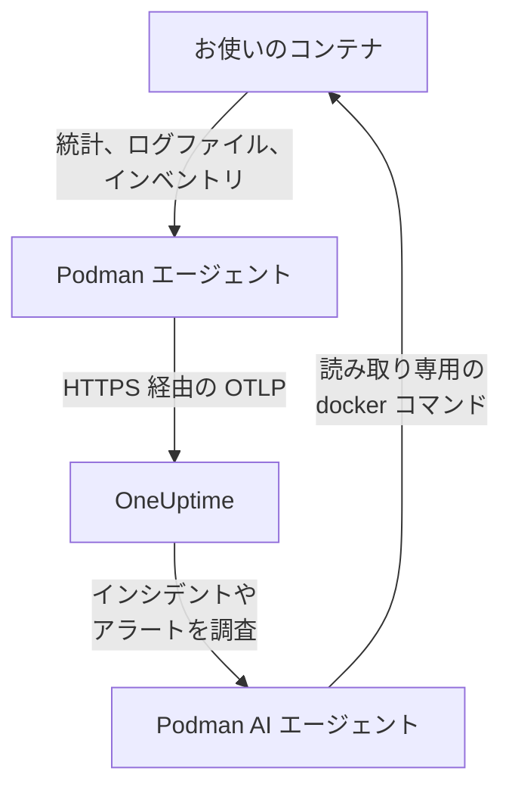

# Podman エージェント

OneUptime の Podman エージェントは、Podman ホスト上で実行する 1 つのコンテナです。ホスト上のすべてのコンテナの統計とログファイルを読み取って OneUptime に送信し、OneUptime ではホストがそのコンテナ、メトリクス、ログとともに表示されます。2 つ目のコンテナである Podman AI エージェントにより、OneUptime AI がホストを調査できます。[Podman モニター](/docs/monitor/podman-monitor) は、エージェントが送信した内容をもとにアラートを出します。

:::cards
- [エージェントをインストールする](#エージェントをインストールする): `podman run` または Podman Compose で 2 つのコンテナ。
- [エージェントが収集するもの](#エージェントが収集するもの): すべてのコンテナのメトリクス、ログ、インベントリ。
- [コンテナのログには k8s-file が必要](#コンテナのログには-k8s-file-ログドライバーが必要): 切り替えない限り、Podman は journald にログを出力します。
- [トラブルシューティング](#トラブルシューティング): 再起動の繰り返し、メトリクスやログが届かない場合。
:::

## 仕組み

エージェントは、OneUptime の設定を組み込んだ OpenTelemetry Collector です。Podman の Docker 互換 API ソケットを通じて、30 秒ごとに各コンテナの統計を読み取り、5 分ごとにすべてのコンテナ、イメージ、ネットワーク、ボリュームを一覧します。コンテナのログファイルを追跡し、渡した取り込みキーを使って、すべてを OTLP で OneUptime の URL に送信します。



ホストは最初のデータとともに、`PODMAN_HOST_NAME` で指定した名前で自身を登録します。AI エージェントは任意です。省いても Collector は同じように動作します。

## 始める前に

- Podman 4.0 以降と、ホストの root 権限。
- `/run/podman/podman.sock` にある Podman の API ソケット。`sudo systemctl enable --now podman.socket` で有効にします。
- 取り込みキー。**プロジェクト設定 → テレメトリと APM → 取り込みキー** で作成し、その値をコピーします。
- ホストから OneUptime の URL への送信方向の HTTPS。
- コンテナのログを収集するには、コンテナが `k8s-file` ログドライバーを使っていること。rootful の Podman は既定で `journald` にログを出力し、エージェントはそれを読み取れません。[コンテナのログには k8s-file ログドライバーが必要](#コンテナのログには-k8s-file-ログドライバーが必要) を参照してください。

## エージェントをインストールする

:::steps
### エージェントを起動する

`YOUR_ONEUPTIME_URL` を OneUptime の URL に、`YOUR_TELEMETRY_INGESTION_TOKEN` を取り込みキーに、`my-podman-host` をこのホストの名前 (`prod-podman-01` など) に置き換えます。ホストはこの名前で OneUptime に表示されるため、変えないでください。新しい名前にすると新しいホストとして登録されます。

:::tabs
@tab Podman CLI
```bash
podman run -d \
  --name oneuptime-podman-agent \
  --user 0:0 \
  --restart unless-stopped \
  -v /run/podman/podman.sock:/run/podman/podman.sock:ro \
  -v /var/lib/containers/storage:/var/lib/containers/storage:ro \
  -e ONEUPTIME_URL="YOUR_ONEUPTIME_URL" \
  -e ONEUPTIME_SERVICE_TOKEN="YOUR_TELEMETRY_INGESTION_TOKEN" \
  -e PODMAN_HOST_NAME="my-podman-host" \
  oneuptime/podman-agent:release
```

続いて、同じ値で [AI エージェント](#ai-エージェント) をその横で起動します。**AI 調査はデフォルトで有効です**。OneUptime AI がこのホストのインシデントやアラートを調査している間、AI エージェントを通じて、Podman の Docker 互換 API に対して読み取り専用の `docker` コマンドを実行し、修正を許可しない限り何も変更しません。AI 調査なしでインストールするには、このコマンドを省いてください。

```bash
podman run -d \
  --name oneuptime-podman-ai-agent \
  --user 0:0 \
  --restart unless-stopped \
  --read-only --tmpfs /tmp \
  -v /run/podman/podman.sock:/run/podman/podman.sock:ro \
  -e ONEUPTIME_URL="YOUR_ONEUPTIME_URL" \
  -e ONEUPTIME_SERVICE_TOKEN="YOUR_TELEMETRY_INGESTION_TOKEN" \
  -e ONEUPTIME_AI_AGENT_RESOURCE_TYPE=podman \
  -e PODMAN_HOST_NAME="my-podman-host" \
  oneuptime/resource-ai-agent:release
```
@tab Podman Compose
これをホスト上のフォルダーに `docker-compose.yml` として保存します。2 つ目のサービスが [AI エージェント](#ai-エージェント) です。AI 調査なしで Collector を実行するには、これを省いてください。

```yaml title="docker-compose.yml"
services:
  oneuptime-podman-agent:
    image: oneuptime/podman-agent:release
    container_name: oneuptime-podman-agent
    user: "0:0"
    restart: unless-stopped
    volumes:
      - /run/podman/podman.sock:/run/podman/podman.sock:ro
      - /var/lib/containers/storage:/var/lib/containers/storage:ro
    environment:
      - ONEUPTIME_URL=YOUR_ONEUPTIME_URL
      - ONEUPTIME_SERVICE_TOKEN=YOUR_TELEMETRY_INGESTION_TOKEN
      - PODMAN_HOST_NAME=my-podman-host
    logging:
      driver: json-file
      options:
        max-size: "10m"
        max-file: "3"
  oneuptime-podman-ai-agent:
    image: oneuptime/resource-ai-agent:release
    container_name: oneuptime-podman-ai-agent
    user: "0:0"
    restart: unless-stopped
    read_only: true
    tmpfs:
      - /tmp
    volumes:
      - /run/podman/podman.sock:/run/podman/podman.sock:ro
    environment:
      - ONEUPTIME_URL=YOUR_ONEUPTIME_URL
      - ONEUPTIME_SERVICE_TOKEN=YOUR_TELEMETRY_INGESTION_TOKEN
      - ONEUPTIME_AI_AGENT_RESOURCE_TYPE=podman
      - PODMAN_HOST_NAME=my-podman-host
```

そのフォルダーで起動します:

```bash
podman compose up -d
```
:::

### エージェントが実行中であることを確認する

```bash
podman ps --filter name=oneuptime-podman-agent
podman logs -f oneuptime-podman-agent
```

Collector が起動すると、ログに次の行が表示されるはずです:

```text
Everything is ready. Begin running and processing data.
```

### OneUptime でホストを見つける

**製品 → インフラストラクチャ → Podman → すべてのホスト** を開きます。1 分ほどでホストが `PODMAN_HOST_NAME` の名前で、そのコンテナ、メトリクス、ログとともに表示されます。AI エージェントは、ホストの **AI エージェント** ページと、その **概要** の下部に接続済みとして表示されます。
:::

## 環境変数

| 変数 | 必須 | 説明 |
| --- | --- | --- |
| `ONEUPTIME_URL` | はい | OneUptime の URL。`https://oneuptime.com` やセルフホストのインスタンスなど。インスタンスが HTTP のみの場合は、`http://` とそのポートを使います。 |
| `ONEUPTIME_SERVICE_TOKEN` | はい | **プロジェクト設定 → テレメトリと APM → 取り込みキー** で作成した取り込みキー。 |
| `PODMAN_HOST_NAME` | いいえ | OneUptime でのホストの名前。既定は `podman-host` なので、ホストごとに固有の名前を付けてください。 |
| `DOCKER_API_VERSION` | いいえ | エージェントが Podman ソケットに対して使う Docker API のバージョン。既定は `1.44` です。ソケットが報告する上限がそれより古い場合は下げるか、空の値にしてネゴシエートさせます ([トラブルシューティング](#トラブルシューティング) を参照)。 |

値を変更するには、エージェントを削除してコマンドを再実行する (Podman CLI) か、`docker-compose.yml` を編集して `podman compose up -d` を実行します (Podman Compose)。

## エージェントが収集するもの

| データ | 内容 |
| --- | --- |
| コンテナのメトリクス | コンテナごとに 30 秒ごと: CPU (使用量、割合、スロットリング)、メモリ (使用量、上限、割合)、ネットワークとブロック I/O、稼働時間、再起動回数、プロセス数。 |
| コンテナのログ | すべてのコンテナの stdout と stderr。`k8s-file` ログドライバーが書き込む `ctr.log` ファイルから読み取ります。 |
| インベントリ | あらゆる状態のすべてのコンテナと、すべてのイメージ、ネットワーク、ボリューム。5 分ごと。 |

各コンテナのメトリクスとログは、そのコンテナの名前を付けたサービスの下に記録されます。各ログ行の重大度は、`[ERROR]`、`level=warn`、`{"level":"info"}` のように行に書かれたレベルから決まります。レベルのない行はストリームの重大度になり、stderr は `ERROR`、stdout は `INFO` です。空白や閉じ括弧で始まる行は前の行に連結されるため、スタックトレースは 1 つのレコードとして届きます。エージェント自身のログは除外されます。

[Podman モニター](/docs/monitor/podman-monitor#収集されるメトリクス) に、すべてのメトリクスとその意味が一覧されています。

## コンテナのログには k8s-file ログドライバーが必要

エージェントは、Podman の `k8s-file` ログドライバーが書き込むファイル `/var/lib/containers/storage/overlay-containers/*/userdata/ctr.log` を追跡します (Podman では `json-file` も同じドライバーです)。rootful の Podman の既定のドライバーは `journald` で、読み取るファイルが残りません。`syslog` のようなリモートのドライバーも同様です。そのようなコンテナのメトリクスは届きますが、ログは届きません。

コンテナのログドライバーと、Podman の既定を確認します:

```bash
podman inspect <container> --format '{{.HostConfig.LogConfig.Type}}'
podman info --format '{{.Host.LogDriver}}'
```

`k8s-file` でコンテナを実行するか、Compose のサービスをそれに切り替えます:

```bash
podman run --log-driver k8s-file --log-opt max-size=100m ... <image>
```

```yaml
services:
  my-app:
    image: my-app:latest
    logging:
      driver: "k8s-file"
      options:
        max-size: "100m"
```

または、`containers.conf` (rootful では `/etc/containers/containers.conf`、rootless では `~/.config/containers/containers.conf`) で、以降に作成するすべてのコンテナの既定にします:

```toml title="containers.conf"
[containers]
log_driver = "k8s-file"
log_size_max = 104857600
```

その後、コンテナを作り直します。コンテナは作成時のログドライバーを使い続けるため、再起動だけでは不十分です。

## エージェントのアップグレード

エージェントが OneUptime より古い場合、ホストの **概要** にある **エージェントバージョン** の横に警告マークが表示されます。マークを選択すると、これらのコマンドが表示されます。

:::tabs
@tab Podman CLI
```bash
podman pull oneuptime/podman-agent:release
podman pull oneuptime/resource-ai-agent:release
podman rm -f oneuptime-podman-agent oneuptime-podman-ai-agent
```

その後、[エージェントを起動する](#エージェントを起動する) の 2 つの `podman run` コマンドを再度実行します。
@tab Podman Compose
```bash
podman compose pull
podman compose up -d
```
:::

`release` タグは常に最新のリリースを指します。バージョンを固定するには、`oneuptime/podman-agent:10.0.31` のように `oneuptime/podman-agent:<version>` を使います。同じイメージは GitHub Container Registry にも `ghcr.io/oneuptime/podman-agent:release` として公開されています。

## エージェントのアンインストール

:::tabs
@tab Podman CLI
```bash
podman rm -f oneuptime-podman-agent
podman rm -f oneuptime-podman-ai-agent
```
@tab Podman Compose
```bash
podman compose down
```
:::

ホストは、送信したデータとともに OneUptime に残ります。不要になったら、そのメニューの **ホストを削除** で削除してください。

## AI エージェント

上のコマンドと Compose ファイル、Podman エージェントの `install.sh`、そして [PodmanAgent ディレクトリ](https://github.com/OneUptime/oneuptime/tree/master/agents/PodmanAgent) にある `docker-compose.yml` は、どれも **Podman AI エージェント** を実行します。これは 2 つ目のコンテナ `oneuptime-podman-ai-agent` (イメージは `oneuptime/resource-ai-agent:release`) で、OneUptime AI がこのホストのインシデントやアラートを調査する際に求める読み取り専用のコマンドを、Podman の Docker 互換 API に対して `docker` CLI で実行し (`docker ps -a`、`docker logs --tail 200 web`、`docker container inspect web`)、許可した場合に限り、指定したコンテナの再起動などの修正を適用します。Collector と同じ `ONEUPTIME_URL`、`ONEUPTIME_SERVICE_TOKEN`、`PODMAN_HOST_NAME` を読み取るため、まさにこのホストを担当し、OneUptime ではホストの **AI エージェント** ページに表示されます。

- **AI 調査はデフォルトで有効です**。エージェントが接続すると、OneUptime AI はこれを使ってこのホストのインシデントやアラートを調査し、ホストの **概要** にエージェントの状態が表示されます。止めるには、エージェントを実行している場所で `ONEUPTIME_AI_INVESTIGATION=false` を設定する (AI エージェントのページの **AI に許可する操作** の下にある **変更** で方法が表示されます) か、エージェントを省きます。
- `ONEUPTIME_AI_ALLOW_WRITES=true` で起動しない限り、読み取り専用です。`ONEUPTIME_AI_WRITE_TARGETS` (たとえば `web-*,api-*`) で、修正が変更してよいコンテナを制限します。修正の実行方法を指定するには、`ONEUPTIME_AI_FIXES` も付けて起動します。`ask-for-approval` (人が 1 件ずつ承認)、`automatic`、`bypass-approval` のいずれかで、AI エージェントのページには読み取り専用で表示されます ([エージェントが設定する、AI に許可する操作](/docs/ai/infrastructure-ai-agents#what-ai-may-do-set-by-the-agent))。
- Collector と同じソケットが必要で、ソケットは root が所有しているため、それをマウントして root として実行されます。そして rootful の Podman では、`:ro` かどうかにかかわらず、ソケットを使える者はこのホストの root と同じです。歯止めになるのはエージェントのコマンドポリシーです。`exec`、`run`、`rm`、`prune` は決して実行せず、自分自身、Collector、`ONEUPTIME_AI_PROTECTED_TARGETS` (コンテナ名の glob) に含まれるものは決して変更しません。
- `install.sh --no-ai-agent` で省くことができ、`podman rm -f oneuptime-podman-ai-agent` で削除できます。アップグレードは Collector と同じです。`podman pull oneuptime/resource-ai-agent:release` を実行し、削除してから、再び起動します。

実行できるコマンド、修正の仕組み、トラブルシューティングについては、[Infrastructure AI Agents](/docs/ai/infrastructure-ai-agents#docker-and-podman-hosts) を参照してください。

## トラブルシューティング

:::details エージェントが "client version is too new" で再起動を繰り返す
エージェントのログに次のように表示されます:

```text
Error: cannot start pipelines: failed to start "docker_stats" receiver:
Error response from daemon: client version 1.44 is too new.
Maximum supported API version is 1.41
```

クライアントのバージョンの上限を強制する Docker API サーバーは、それより新しいクライアントを拒否するため、レシーバーが起動せず、Collector もそれとともに終了します。Podman ソケットが報告する API バージョンを確認します:

```bash
curl -s -o /dev/null -D - --unix-socket /run/podman/podman.sock http://localhost/_ping | grep -i '^api-version'
```

その後、`podman run` に `-e DOCKER_API_VERSION=1.41` (または確認した値) を追加するか、Compose で `DOCKER_API_VERSION` を設定します。新しいサーバーも古い API バージョンに応答するため、この設定はアップグレード後も有効です。

番号を調べたくない場合は、`DOCKER_API_VERSION` を空文字列に設定します。するとエージェントはバージョンを固定せず、ソケットとネゴシエートします (`HEAD /_ping` を 1 回送り、ソケットが報告する上限を使います):

```bash
podman run -d ... -e DOCKER_API_VERSION= ...
```
:::

:::details Podman ソケットへのアクセスが拒否される、またはソケットがない
`/run/podman/podman.sock` を読み取るには、エージェントを root として実行する必要があります。`podman run` コマンドに `--user 0:0` が、Compose に `user: "0:0"` が含まれていること、そしてソケットが有効になっていることを確認してください: `sudo systemctl enable --now podman.socket`。rootless の Podman では、ソケットは代わりに `/run/user/<uid>/podman/podman.sock` にあります (`systemctl --user enable --now podman.socket`)。`/run/podman/podman.sock` の代わりにそのパスをマウントしてください。
:::

:::details ホストが切断済みと表示される
1. エージェントが実行中であることを確認します: `podman ps --filter name=oneuptime-podman-agent`
2. そのログでエラーを探します: `podman logs oneuptime-podman-agent 2>&1 | grep -i error`
3. `ONEUPTIME_URL` と `ONEUPTIME_SERVICE_TOKEN` を確認します。キーは無効化されていない有効な取り込みキーである必要があります。
4. ホストからネットワーク経由で OneUptime の URL に到達できることを確認します。
:::

:::details メトリクスが表示されない
1. Podman ソケットがエージェントにマウントされていることを確認します。イメージにシェルがないため、同じマウントを共有する使い捨てのコンテナから確認します: `podman run --rm --volumes-from oneuptime-podman-agent alpine:3.19 ls -la /run/podman/podman.sock`
2. そのログでエクスポートのエラーを探します: `podman logs oneuptime-podman-agent 2>&1 | tail -100`
3. 取り込みキーが有効で、期限切れでないことを確認します。
:::

:::details メトリクスは届くがコンテナのログが届かない
コンテナが、Podman の既定のログドライバーである `journald` を使っている可能性が高いです。エージェントが監視しているファイルと、コンテナが使っているドライバーを確認します:

```bash
podman logs oneuptime-podman-agent 2>&1 | grep -E "Started watching file|no files match"
podman inspect <container> --format '{{.HostConfig.LogConfig.Type}}'
```

エージェントが `no files match the configured criteria` と報告する場合は、[コンテナのログには k8s-file ログドライバーが必要](#コンテナのログには-k8s-file-ログドライバーが必要) のとおりに、コンテナを `k8s-file` に切り替えて作り直してください。
:::

:::details ログが別のホストに入る、またはホスト名が podman-host になっている
ホストの名前は `PODMAN_HOST_NAME` から取られます。これを指定せずに起動したエージェントは `podman-host` と報告するため、そのように設定したホストはすべて同じホストに見えます。あとで名前を変えると、OneUptime は 2 つ目のホストを登録し、新しいデータはそちらに入ります。各ホストで `PODMAN_HOST_NAME` に固有の名前を設定し、エージェントを作り直してください。エージェントが報告している名前を確認するには:

```bash
podman inspect oneuptime-podman-agent --format '{{range .Config.Env}}{{println .}}{{end}}' | grep PODMAN_HOST_NAME
```
:::

## 次のステップ

:::cards
- [Podman モニター](/docs/monitor/podman-monitor): コンテナの CPU、メモリ、再起動に対してアラートを出します。
- [データベース](/docs/telemetry/databases): ホスト上のデータベースのコンテナが検出され、専用のページが作られます。
- [Kubernetes エージェント](/docs/telemetry/kubernetes-agent): 代わりに Kubernetes クラスターを監視します。
- [ホスト OpenTelemetry Collector](/docs/telemetry/host-otel-collector): マシン自体の CPU、ディスク、プロセス、ログを監視します。
:::
