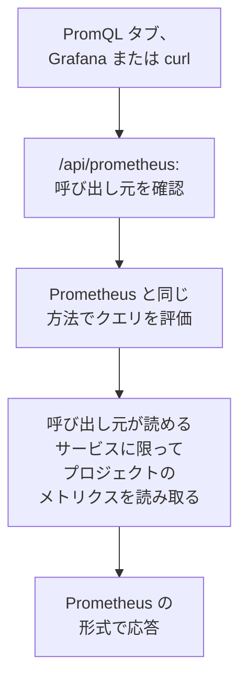

# PromQL でメトリクスをクエリする

PromQL は Prometheus のクエリ言語で、メトリクスをチャートにする人の多くがすでに知っている言語です。OneUptime は PromQL でプロジェクトのメトリクスを読み取ります。使える場所は、メトリクスの **PromQL** タブと、Grafana をはじめ Prometheus データソースに対応したツールなら何でも接続できる、Prometheus 互換の API です。

:::cards
- [クエリを書く](#クエリを書く): メトリクスのページで PromQL を実行し、結果をグラフかテーブルで見ます。
- [メトリクスの命名規則](#メトリクスの命名規則): OpenTelemetry の名前と属性が PromQL でどう読まれるか。
- [Grafana を接続する](#grafana-を接続する): OneUptime を Prometheus データソースとして追加します。
- [制限](#制限): クエリが読み取れる量と、かけられる時間。
:::

## 仕組み

PromQL タブと Grafana は同じ API に問い合わせます。OneUptime は、呼び出し元がプロジェクトのメトリクスを読み取れることを確認し、呼び出し元が読み取れるサービスだけを読み取り、Prometheus と同じ方法でクエリを評価します。



## 始める前に

- **届いているメトリクス。** [OpenTelemetry](/docs/telemetry/open-telemetry) で送るか、[ホスト用 OpenTelemetry Collector](/docs/telemetry/host-otel-collector) などのエージェントから送ります。
- **メトリクスを読み取れるロール。** Project Owner、Project Admin、Project Member、Viewer、Telemetry Admin、Telemetry Member、Telemetry Viewer のいずれか、または Read Metrics 権限を持つカスタムロール。一部のサービスに限定されたロールは、それらのサービスのメトリクスだけを読み取ります。
- **Grafana やスクリプトから使う場合は、プロジェクトの API キー。** 上記のロールのいずれか、または Read Metrics 権限を持つキーが必要です。[API キーを作成する](/docs/api-reference/api-reference#api-キーを作成する) を参照してください。OneUptime Cloud では、API キーには **Growth** プランが必要です。

## クエリを書く

:::steps
### PromQL を開く

**メトリクス** を開き、**PromQL** タブをクリックします。

### クエリを入力する

エディターに入力するか、**例** から 1 つ選ぶか、プロジェクトのメトリクスを PromQL での名前で一覧表示する **メトリクス名を追加** から始めます。

### 実行する

**クエリを実行** をクリックするか、Ctrl+Enter (Mac では ⌘+Enter) を押します。**グラフ** は時間範囲全体にわたってクエリを描画し、**テーブル** は時間範囲の終わりの時点での各系列の値を表示します。
:::

手始めに使えるクエリをいくつか紹介します。

```text title="PromQL"
# Requests per second, by service
sum by (job) (rate(http_requests_total[5m]))

# The 95th percentile of a latency histogram
histogram_quantile(0.95, sum by (le) (rate(http_server_request_duration_bucket[5m])))

# The five hosts using the most memory
topk(5, system_memory_usage)
```

実行できないクエリについては、何が問題でどこにあるのかをエディターが示します。たとえば `rate(http_requests_total)` では、この関数には `[5m]` のような範囲が必要だと表示されます。

## メトリクスの命名規則

OneUptime はメトリクスを OpenTelemetry の方式で保存します。PromQL は、Prometheus 自身の OpenTelemetry サポートが付けるのと同じ名前でメトリクスを読み取るため、Prometheus 向けに書いたクエリがここでもそのまま動きます。

| OneUptime での表記 | PromQL での表記 |
| --- | --- |
| ゲージ `system.cpu.utilization` | `system_cpu_utilization` |
| カウンター `http.requests` | `http_requests` または `http_requests_total` |
| ヒストグラム `http.server.request.duration` | `http_server_request_duration_bucket` (`le` 付き)、`_count`、`_sum` |
| サマリー `rpc.latency` | `rpc_latency` (`quantile` 付き)、`_count`、`_sum` |
| 属性 `http.route` | ラベル `http_route` |
| リソース属性 `service.name` | ラベル `resource_service_name` と `job` |
| リソース属性 `service.instance.id` | ラベル `resource_service_instance_id` と `instance` |

- **メトリクス名とラベル名のドットとダッシュは、アンダースコアになります。** 保存されているとおりの名前でメトリクスやラベルを指定するには、Prometheus 3 と同じく引用符で囲みます。たとえば `{"http.server.request.duration", "http.route"="/checkout"}` です。
- **デルタカウンターは、クエリの時間範囲の開始時点から合算されます。** そのため `rate()` と `increase()` は、デルタカウンターもほかのカウンターと同じように読み取れます。
- **指数ヒストグラム** には `_count` と `_sum` がありますが、バケットはありません。

## Grafana を接続する

:::steps
### API キーを作成する

OneUptime で **プロジェクト設定 → 詳細 → API キー** を開き、**API キーを作成** をクリックします。キーには、テレメトリを読み取れるロールか、Read Metrics 権限を与えます。

### Prometheus データソースを追加する

Grafana で **Connections → Data sources → Add data source** を開き、**Prometheus** を選びます。

### サーバーの URL を入力する

**Prometheus server URL** に、OneUptime のアドレスの後ろに `/api/prometheus` を付けたものを設定します。OneUptime Cloud では `https://oneuptime.com/api/prometheus` です。**PromQL** タブには、自分のサーバーのアドレスがコピーボタン付きで表示されます。

### API キーを送る

**HTTP headers** でヘッダー `Authorization` を追加し、値には `Bearer`、スペース 1 つ、API キーを続けて入力します。Basic 認証も使えます。ユーザー名は何でもよく、パスワードに API キーを指定します。

### 保存してテストする

**Save & test** をクリックします。Grafana がクエリを実行し、データソースが動作していることを知らせます。
:::

ほかの Prometheus クライアントも同じように使えます。curl の場合は次のとおりです。

```bash title="Query OneUptime's Prometheus API"
curl -H "Authorization: Bearer $ONEUPTIME_API_KEY" \
  "https://oneuptime.com/api/prometheus/api/v1/query?query=up"
```

## API

API は `/api/prometheus` の下で、Prometheus HTTP API のルートに `GET` または `POST` で応答します。

| ルート | 応答する内容 |
| --- | --- |
| `/api/v1/query` | ある 1 時点でのクエリ (`time`、既定は現在)。 |
| `/api/v1/query_range` | `start` から `end` まで、`step` ごとのクエリ。 |
| `/api/v1/series` | `match[]` が選択する系列。 |
| `/api/v1/labels` | `match[]` が選択する系列、またはすべてのメトリクスのラベル名。 |
| `/api/v1/label/<name>/values` | 1 つのラベルの値。`__name__` ではメトリクス名を一覧表示します。 |
| `/api/v1/metadata` | 各メトリクスの種類、ヘルプ、単位。 |

時刻は Unix 秒または RFC 3339、期間は秒数または `15s` のような期間で指定し、応答は Prometheus の形式です。`/api/v1/status/buildinfo` は Prometheus 3 サーバーとして応答します。ルールとアラートは空です。OneUptime は [モニター](/docs/monitor/metrics-monitor) でアラートを出すためです。

## 対応している PromQL の機能

- **セレクター**: すべてのマッチャー (`=`、`!=`、`=~`、`!~`)、範囲、`offset`、`@` (`start()` と `end()` を含む)、サブクエリ。
- **演算子**: 算術演算、比較 (`bool` を含む)、`and`、`or`、`unless`、および `on`、`ignoring`、`group_left`、`group_right` によるベクトルマッチング。
- **集約**: `sum`、`avg`、`min`、`max`、`count`、`group`、`stddev`、`stdvar`、`topk`、`bottomk`、`quantile`、`count_values`。`by` または `without` と組み合わせて使えます。
- **関数**: `rate`、`irate`、`increase`、`delta`、`idelta`、`deriv`、`predict_linear`、`histogram_quantile`、すべての `*_over_time` 関数、`changes`、`resets`、`absent`、`label_replace`、`label_join`、`sort`、`clamp`、`round`、数学関数、日付関数など。

`histogram_count()` など、Prometheus のネイティブヒストグラム用の関数は使えません。OneUptime はヒストグラムをバケット付きで保存しており、それを `histogram_quantile()` と、`_count` および `_sum` の系列が読み取ります。

## 制限

すべてのクエリには上限があるため、パネルの多いダッシュボードでも OneUptime に過負荷をかけることはありません。

| 制限 | 値 |
| --- | --- |
| 範囲クエリの 1 つの系列に含まれる点 | 11,000 |
| 1 つのクエリが読み取って保持できるサンプル | 5,000,000 |
| 1 つのセレクターが読み取れるメトリクスのデータポイント | 1,000,000 |
| 読み取りにかけられる時間 | 30 秒 |
| 評価にかけられる時間 | 30 秒 |
| セレクターが系列の最新のサンプルを探してさかのぼる時間 | 5 分 |
| クエリで省略したときのサブクエリのステップ | 1 分 |

## トラブルシューティング

:::details Grafana でデータソースが動作しないと表示される
URL が `/api/prometheus` で終わっていること、`Authorization` ヘッダーに `Bearer`、スペース、API キーが入っていることを確認してください。メトリクスを読み取れるロールを持たないキーは拒否されます。**プロジェクト設定 → 詳細 → API キー** でキーにロールを与えてください。
:::

:::details エクスプローラーにあるメトリクスで何も見つからない
PromQL での名前は、保存されている名前のドットの部分がアンダースコアになります。また、ヒストグラムは `_bucket`、`_count`、`_sum` を通して読み取ります。PromQL タブの **メトリクス名を追加** には、すべての名前が PromQL での表記で一覧表示されます。
:::

:::details "The query reads more than 1,000,000 metric points"
クエリが、1 回の読み取りで保持できる量を超えるデータを求めています。ラベルのマッチャーを追加するか、時間範囲を短くするか、より大きなステップを使ってください。
:::

## 次のステップ

:::cards
- [メトリクスエクスプローラー](/docs/telemetry/metrics-explorer): クエリを書かずにメトリクスをチャートにします。
- [メトリクス モニター](/docs/monitor/metrics-monitor): メトリクスがしきい値を超えたらアラートを出します。
- [外部データソース](/docs/dashboards/data-sources): 外部の Prometheus をダッシュボードでチャートにします。
:::
