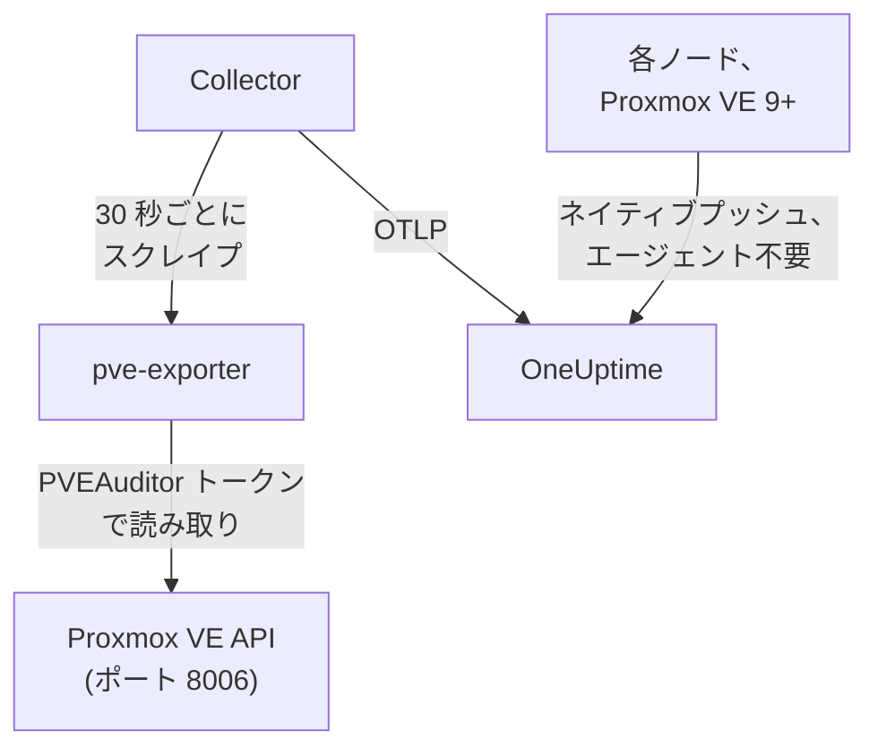

# Proxmox エージェント

OneUptime の Proxmox エージェントは、Proxmox VE クラスターのノード、QEMU の VM、LXC コンテナ、ストレージ、HA の状態、バックアップの対象範囲、レプリケーションを監視します。読み取り専用のトークンを使って Proxmox VE API 経由でクラスターを読み取り、見つけたものを OneUptime に送信します。OneUptime では、クラスターがそのノード、ゲスト、ストレージとともに表示されます。Proxmox VE 9 以降では、何もインストールせずにノード自身がメトリクスをプッシュすることもできます。[Proxmox モニター](/docs/monitor/proxmox-monitor) は、届いた内容をもとにアラートを出します。

:::cards
- [接続方法を選ぶ](#接続方法を選ぶ): エージェント、または Proxmox VE 9 自身のプッシュ。
- [エージェントをインストールする](#エージェントをインストールする): API トークンを作成し、インストールスクリプトまたは Docker Compose を使います。
- [ネイティブプッシュ](#インストール不要の代替策-proxmox-ve-9-以降のネイティブ-opentelemetry-プッシュ): Proxmox VE 9 が自身でメトリクスを送信します。
- [トラブルシューティング](#トラブルシューティング): 診断スクリプトと、よくある問題。
:::

## 仕組み

エージェントは、1 台のマシンで Docker Compose を使って実行する一連のコンテナです。[prometheus-pve-exporter](https://github.com/prometheus-pve/prometheus-pve-exporter) がポート 8006 で Proxmox VE API を読み取り、OpenTelemetry Collector が 30 秒ごとにエクスポーターをスクレイプしてすべてのメトリクスにクラスター名を付与し、Proxmox AI エージェントにより OneUptime AI が調査中にクラスターを読み取れます。Proxmox VE 9 のネイティブプッシュでは、代わりに各ノードのメトリクスが直接 OneUptime に送信されます。



クラスターは最初のデータとともに、エージェントがすべてのメトリクスに `proxmox.cluster.name` として付与する名前で自身を登録します。

## 接続方法を選ぶ

| | エージェント | ネイティブプッシュ |
| --- | --- | --- |
| Proxmox VE | サポートされている任意のバージョン | 9.0 以降 |
| インストールするもの | 単一のマシン上の Docker Compose | なし: Proxmox の Web UI でのメトリクスサーバーの追加 |
| ノード、ゲスト、ストレージ | はい | はい |
| HA の状態、起動時の自動開始、バックアップの対象範囲、レプリケーション | はい | いいえ |
| Proxmox AI エージェント | はい | いいえ |

**HA Resource in Error State**、**Guest Down**、**Guest Not Backed Up**、**Replication Failing** の各テンプレートにはエージェントが必要です。1 つのクラスターにはどちらか一方を使ってください。両方を実行すると、すべてのリソースが二重に報告されます。

## 始める前に

- Docker Engine 20.10 以降と Docker Compose v2 プラグイン。ポート 8006 で Proxmox VE API に到達できるマシン上に必要です。
- API トークンを作成するための、任意の Proxmox VE ノードの root シェル、または Proxmox の Web UI。
- 取り込みキー。**プロジェクト設定 → テレメトリと APM → 取り込みキー** で作成し、その値をコピーします。
- そのマシンから OneUptime の URL への送信方向の HTTPS。

### エージェントを実行する場所

エージェントはネットワーク経由で Proxmox VE API にクエリするため、クラスターのノード上に置く必要はなく、置くべきでもありません。ノードの障害を生き延びるマシン (別のハードウェア上の小さな監視用 VM、管理ホスト) で実行するか、`PVE_HOST` を 1 つのノードのアドレスではなく仮想 IP やラウンドロビン DNS の名前に向けてください。エージェントの API の接続先がちょうど停止したノードだと、監視もそれとともに止まります。唯一の例外は任意の journald のログパイプラインで、これは Proxmox VE ノード上で実行する必要があります ([Proxmox のサービスログを送信する](#任意-proxmox-のサービスログを送信する) を参照)。

## エージェントをインストールする

:::steps
### 読み取り専用の API トークンを作成する

エージェントは、**PVEAuditor** ロールを持つ API トークンでクラスターを読み取ります。このロールは読み取りしかできません。

:::tabs
@tab Shell
任意の Proxmox VE ノードで root として実行します:

```bash
pveum user add monitoring@pam
pveum acl modify / --roles PVEAuditor --users monitoring@pam
pveum user token add monitoring@pam oneuptime --privsep 1
pveum acl modify / --roles PVEAuditor --tokens 'monitoring@pam!oneuptime'
```

最初のコマンドは、`monitoring@pam` がすでに存在する場合にだけ失敗しますが、害はありません。API トークンは独自のシークレットを持つため、ユーザーにパスワードやシステムアカウントは不要です。`pveum user token add` はトークンのシークレットを 1 回だけ表示します。トークン ID は `monitoring@pam!oneuptime` です。
@tab Proxmox web UI
1. *Datacenter → Permissions → API Tokens* に移動し、**Add** をクリックします。
2. ユーザーを選び (または作成し)、トークンに `oneuptime` のような ID を付け、**Privilege Separation** はチェックしたままにします。
3. トークン ID (`user@realm!tokenname`) とシークレットをコピーします。シークレットは 1 回しか表示されません。
4. *Datacenter → Permissions* で、パス `/` に **PVEAuditor** ロールを 2 回追加します。トークンに対する **API Token Permission** として 1 回、そのユーザーに対する **User Permission** として 1 回です。
:::

権限が分離されたトークンは、そのユーザーも持っている権限しか得られないため、ロールはトークンだけでなくユーザーにも付与します。エクスポーターはすべてのノード、ゲスト、ストレージのオブジェクトを読み取るため、ロールはルートパス `/` に置く必要があります。より狭いパスではクラスターの残りの部分が見えなくなり、`401`/`403 Permission check failed (/, Sys.Audit)` で失敗します。

### エージェントをインストールして起動する

:::tabs
@tab install.sh
インストールスクリプトをダウンロードし、エージェントを置くマシンで実行します:

```bash
curl -sSL https://raw.githubusercontent.com/OneUptime/oneuptime/master/agents/ProxmoxAgent/install.sh -o install.sh
bash install.sh
```

スクリプトは、OneUptime の URL、取り込みキー、クラスターの名前、Proxmox VE API のホスト、同梱のエクスポーターを実行するかどうか、トークン ID とシークレットを尋ねます。さらに、[AI エージェント](#ai-エージェント) に修正の適用を許可するかどうかと、許可する場合はその専用のトークンと、決して変更してはならないゲストも尋ねます。`/opt/oneuptime-proxmox-agent` にインストールし、`0600` の `.env` ファイルを書き込み、Docker Compose でエージェントを起動します。スクリプトを再実行すると、再び尋ねる代わりにその `.env` の内容をすべて再利用します。これが [エージェントのアップグレード](#エージェントのアップグレード) の方法です。
@tab Docker Compose
[ProxmoxAgent ディレクトリ](https://github.com/OneUptime/oneuptime/tree/master/agents/ProxmoxAgent) から、`docker-compose.yml` と `otel-collector-config.yaml` を新しいフォルダーにダウンロードします:

```bash
mkdir oneuptime-proxmox-agent && cd oneuptime-proxmox-agent
curl -fsSLO https://raw.githubusercontent.com/OneUptime/oneuptime/master/agents/ProxmoxAgent/docker-compose.yml
curl -fsSLO https://raw.githubusercontent.com/OneUptime/oneuptime/master/agents/ProxmoxAgent/otel-collector-config.yaml
```

その横に `.env` ファイルを作成します。トークンのシークレットを含むため、`chmod 600 .env` で非公開にしてください:

```bash title=".env"
ONEUPTIME_URL=YOUR_ONEUPTIME_URL
ONEUPTIME_TELEMETRY_INGESTION_KEY=YOUR_TELEMETRY_INGESTION_TOKEN
PROXMOX_CLUSTER_NAME=my-proxmox-cluster
PVE_HOST=192.168.1.10
PVE_API_TOKEN_ID=monitoring@pam!oneuptime
PVE_API_TOKEN_SECRET=your-token-secret
COMPOSE_PROFILES=pve-exporter
```

`COMPOSE_PROFILES=pve-exporter` により、同梱のエクスポーターも起動します。エージェントを起動します:

```bash
docker compose up -d
```
:::

すでに prometheus-pve-exporter を実行している場合は、スクリプトが同梱のものを実行するか尋ねたときに **n** と答えるか、`.env` から `COMPOSE_PROFILES` を削除し、エージェントの接続先を既存のエクスポーターにします (`host:port` の形式で、スキームなし、エージェントのコンテナから到達できるアドレス。`localhost` はコンテナ自身を指します)。[AI エージェント](#ai-エージェント) を使う場合は、そのトークンで API を呼び出すため、`PVE_API_TOKEN_ID` と `PVE_API_TOKEN_SECRET` は残してください:

```bash
PVE_EXPORTER_URL=your-exporter-host:9221
```

### エージェントが実行中であることを確認する

```bash
docker compose ps
docker logs -f oneuptime-proxmox-agent
```

`docker compose ps` には、Collector (`oneuptime-proxmox-agent`)、同梱のエクスポーター (`oneuptime-pve-exporter`。独自のものを使う場合を除く)、AI エージェント (`oneuptime-proxmox-ai-agent`) が表示されます。Collector が起動すると、そのログに次の行が表示されるはずです:

```text
Everything is ready. Begin running and processing data.
```

### OneUptime でクラスターを見つける

**製品 → インフラストラクチャ → Proxmox → すべてのクラスター** を開きます。最初のスクレイプから 1 分ほどで、クラスターが `PROXMOX_CLUSTER_NAME` の名前で、そのノード、ゲスト、ストレージとともに表示されます。
:::

## 環境変数

インストールスクリプトはこれらを `/opt/oneuptime-proxmox-agent/.env` に書き込みます。Docker Compose でのインストールでは、`docker-compose.yml` の横にある `.env` から読み取ります。値を変更したら、そのフォルダーで `docker compose up -d` を実行してください。

| 変数 | 必須 | 説明 |
| --- | --- | --- |
| `ONEUPTIME_URL` | はい | OneUptime の URL。`https://oneuptime.com` やセルフホストのインスタンスなど。インスタンスが HTTP のみの場合は、`http://` とそのポートを使います。 |
| `ONEUPTIME_TELEMETRY_INGESTION_KEY` | はい | **プロジェクト設定 → テレメトリと APM → 取り込みキー** で作成した取り込みキー。 |
| `PROXMOX_CLUSTER_NAME` | はい | OneUptime でのクラスターの名前で、すべてのメトリクスに `proxmox.cluster.name` リソース属性として付与されます。変えないでください。あとで変更すると別のクラスターとして登録されます。既定は `proxmox-cluster` です。 |
| `PVE_HOST` | はい | エクスポーターと AI エージェントがクエリする Proxmox VE API のホスト (クラスターの任意のノード)。`192.168.1.10` など。 |
| `PVE_EXPORTER_URL` | いいえ | prometheus-pve-exporter のアドレス (`host:port` の形式、スキームなし)。既定は同梱のエクスポーター `pve-exporter:9221` です。 |
| `PVE_API_TOKEN_ID` | 同梱のエクスポーターまたは AI エージェント | Proxmox API トークンの完全な ID。`monitoring@pam!oneuptime` など。AI エージェントは、専用のトークン (`ONEUPTIME_AI_PVE_API_TOKEN_ID` / `ONEUPTIME_AI_PVE_API_TOKEN_SECRET`) がない限り、これで API を読み取ります。 |
| `PVE_API_TOKEN_SECRET` | 同梱のエクスポーターまたは AI エージェント | Proxmox API トークンのシークレット。 |
| `PVE_VERIFY_SSL` | いいえ | Proxmox API の TLS 証明書を検証します (エクスポーターと AI エージェント)。Proxmox は自己署名証明書を同梱しているため、既定は `false` です。 |
| `COMPOSE_PROFILES` | いいえ | 同梱のエクスポーターのコンテナを起動するには `pve-exporter` に設定します。 |

## エージェントが収集するもの

Collector は、クラスターとノードの両方のコレクターを有効にして、30 秒ごとにエクスポーターをスクレイプします。これにより、エクスポーターで既定で有効な `backup-info` (クラスターレベル) と `replication` (ノードレベル) のコレクターもカバーされます。すべての系列には、リソースを示す `id` ラベルが付いています: `node/<name>`、`qemu/<vmid>`、`lxc/<vmid>`、`storage/<node>/<storage>`。

| カテゴリ | メトリクス |
| --- | --- |
| 可用性 | `pve_up`、`pve_uptime_seconds` |
| ノード | `pve_node_info`、`pve_cpu_usage_ratio`、`pve_cpu_usage_limit`、`pve_memory_usage_bytes`、`pve_memory_size_bytes` |
| ゲスト (VM または LXC) | `pve_guest_info` と、`qemu/*` と `lxc/*` の ID での CPU、メモリ、ネットワークの系列 (`pve_network_receive_bytes`、`pve_network_transmit_bytes`) |
| ストレージ | `pve_disk_usage_bytes`、`pve_disk_size_bytes`、`pve_storage_info` |
| HA | `pve_ha_state` |
| バックアップの対象範囲 | `pve_not_backed_up_total` (どのバックアップジョブの対象にもなっていないゲスト。クラスターレベルの単一の系列で、`id` ラベルなし) と `pve_not_backed_up_info` (対象外のゲストごとの系列で、その `id` 付き)。対象範囲内とは、少なくともいずれかのジョブがゲストを選択していることを意味します。バックアップが最近実行されたか、成功したかは、エクスポーターでは公開されません。 |
| レプリケーション | ストレージのレプリケーションジョブごとの `pve_replication_failed_syncs`、`pve_replication_duration_seconds`、`pve_replication_last_sync_timestamp_seconds`、`pve_replication_last_try_timestamp_seconds`、`pve_replication_next_sync_timestamp_seconds`、`pve_replication_info`。その `id` ラベルはリソースではなくジョブ ID (`100-0` など) です。 |

モニターの条件と属性フィルターは、プレフィックスではなく完全一致で照合するため、Collector の `transform/pve-identity` プロセッサーは `id` を 3 つの属性にも分割します。組み込みの Proxmox アラートテンプレートはこれらで絞り込むため、設定をカスタマイズする場合もこのプロセッサーは残してください:

| 属性 | 値 | `qemu/100` の場合 |
| --- | --- | --- |
| `pve.scope` | `node`、`guest`、`storage`、`cluster` (`qemu` と `lxc` はどちらも `guest`) | `guest` |
| `pve.type` | `node`、`qemu`、`lxc`、`storage` | `qemu` |
| `pve.id` | `id` の最初の `/` より後ろのすべて (`pve1`、`100`、`pve1/local`) | `100` |

元の `id` ラベルはそのまま残ります。

## 任意 — Proxmox のサービスログを送信する

既定では、エージェントはメトリクスだけを送信するため、クラスターの **ログ** ページは空のままです。Proxmox VE のサービスは、8 つのユニットで systemd ジャーナルにログを出力します: `pveproxy`、`pvedaemon`、`pve-firewall`、`pve-ha-crm`、`pve-ha-lrm`、`pvescheduler`、`pvestatd`、`qmeventd`。同梱の `otel-collector-config.yaml` には、まさにこれらのユニットを対象とする `journald` レシーバーがコメントアウトされた状態で含まれており、同じくコメントアウトされた `logs` パイプラインにつながっています。このパイプラインが `proxmox.cluster.name` を付与するため、ログはクラスターに入ります。

:::steps
### ノード上でエージェントを実行する

ジャーナルはホストごとにあるため、リモートのエージェントからは読み取れません。これは [エージェントを実行する場所](#エージェントを実行する場所) に反する唯一の構成です。メトリクスのエージェントをクラスターの外に保つには、代わりにノード上でログ専用の 2 つ目の Collector を実行します (設定をコピーしてから、`prometheus` レシーバーと `metrics` パイプラインを削除します)。

### レシーバーを有効にする

コンテナがホストのジャーナルを読み取れるように、`otel-collector-config.yaml` の `journald` レシーバーと `logs` パイプライン、そして `docker-compose.yml` のジャーナルのボリュームのコメントを外します:

```yaml
- /var/log/journal:/var/log/journal:ro
- /etc/machine-id:/etc/machine-id:ro
```

### Collector のイメージを差し替える

標準の `otel/opentelemetry-collector-contrib` イメージは `FROM scratch` でビルドされています。journald レシーバーが実行する `journalctl` が含まれておらず、ジャーナルを読み取れないユーザーとして実行されます。次のラッパーをビルドし、`docker-compose.yml` の `image:` をそれに向けてください:

```dockerfile title="Dockerfile"
FROM otel/opentelemetry-collector-contrib:0.161.0 AS otelcol
FROM debian:stable-slim
RUN apt-get update \
    && apt-get install -y --no-install-recommends systemd \
    && rm -rf /var/lib/apt/lists/*
COPY --from=otelcol /otelcol-contrib /otelcol-contrib
ENTRYPOINT ["/otelcol-contrib"]
CMD ["--config", "/etc/otelcol-contrib/config.yaml"]
```

`systemd` パッケージは `journalctl` のためだけに入れており、このイメージはジャーナルを読み取れる root として実行されます。または、ログには Docker を使わず、`journalctl` がすでにあるノード自体で `otelcol-contrib` のリリースの `.deb` を実行します。
:::

各ノードが送信するのは自身のジャーナルだけです。すべてのノードのサービスログを得るには、各ノードでログ専用の Collector を実行してください。

### カスタムイメージを使わない代替策: /var/log/syslog に対する filelog

標準のイメージを使い続けるには、代わりに syslog を追跡します。ノードに rsyslog をインストールし (`apt install rsyslog`。Debian 12 と Proxmox VE 8 以降には同梱されなくなりました)、`/var/log` ディレクトリをコンテナにマウントし (`- /var/log:/var/log:ro`。ログのローテーションで古いファイルを掴んだままにならないよう、ファイルではなくディレクトリをマウントします)、journald のレシーバーの代わりに `filelog` レシーバーを使います:

```yaml
receivers:
  filelog:
    include:
      - /var/log/syslog
    start_at: end
```

ユニットごとのフィルターは失われ (syslog には 8 つのサービスだけでなくすべてが含まれます)、標準のイメージのユーザーがファイルを読み取れる必要があります。同じくコメントアウトされた `logs` パイプラインにつないでください (`receivers: [filelog]`)。

## インストール不要の代替策: Proxmox VE 9 以降のネイティブ OpenTelemetry プッシュ

Proxmox VE 9.0 以降には、ノード、ゲスト、ストレージのメトリクスを任意の OTLP/HTTP エンドポイントにプッシュする OpenTelemetry メトリクスサーバーが搭載されており、エージェントやエクスポーターをインストールする必要はありません。Proxmox の Web UI で *Datacenter → Metric Server → Add → OpenTelemetry* に移動し、次のように入力します:

| フィールド | 値 |
| --- | --- |
| Server | OneUptime のホスト。`oneuptime.com`、またはセルフホストのホスト |
| Port | `443` |
| Protocol | `https` |
| Path | `/otlp/v1/metrics` |
| Headers | `{"x-oneuptime-token": "YOUR_TELEMETRY_INGESTION_TOKEN"}` |

追加は 1 回だけで、クラスターのすべてのノードがそれぞれ自身のメトリクスをプッシュします。OneUptime はプッシュを認識し、エージェントが送信するのと同じ `pve_*` 系列に変換するため、次のようになります:

- クラスターは Proxmox のクラスター名で (単独のノードはそのノード名で) 自身を登録します。*Resource Attributes* で `proxmox.cluster.name` を設定した場合は、代わりにそれが使われ続けます。
- ノード、ゲスト、ストレージの各ページ、概要のグラフ、メトリクスカタログ、CPU・メモリ・ストレージのアラートテンプレートは、エージェントを使う場合と同じように機能します。
- 元の `proxmox_node_*`、`proxmox_vm_*`、`proxmox_storage_*` 系列は、Proxmox VE が報告するそのほかの情報 (ロードアベレージ、スワップ、プレッシャーストール、NIC ごとのトラフィック) のために [メトリクスエクスプローラー](/docs/monitor/metrics-monitor) に残ります。

### ノードの報告が止まったとき

各ノードは自身のステータスだけをプッシュするため、停止したノードは自分でそれを伝えられません。まだ動いているノードが代わりに報告します:

- 最後の報告から約 2 分後、ノードはノードのページで **オフライン** と表示されます。ノード自身のページの **最終確認** には、そのノード自身の最後の報告の時刻が残ります。
- 約 5 分後に、そのノードについて **Node Offline** が発火します。**Cluster Quorum at Risk** もそのノードをオフラインとして数えます。このテンプレートには 5 分間のウィンドウ全体の報告が必要なため、ノードが沈黙してから約 7〜9 分後に発火します。
- 次の報告で再び **オンライン** になり、アラートは回復します。

ここでのオフラインは、ノードが報告を止めたことを意味し、必ずしも停止しているとは限りません。ノードが稼働していても、`pvestatd` がハングまたは強制終了している、クラスターファイルシステム (`pmxcfs`) が停止している、または OneUptime へのネットワークが切断されている場合も、同じように報告されます。

カバーできないもの:

- 単独のホスト、またはクラスター全体が一度に沈黙した場合: 報告するノードが残っていないため、ノードごとのアラートは発火しません。代わりに、エージェントが停止したときと同じように、クラスターが **切断済み** になります。
- 7 日を超えて沈黙しているノードは報告されなくなります。そのアラートは解決され、ノードのページから消えます。セルフホストの OneUptime では、この 7 日を `PVE_SILENT_NODE_RETENTION_HOURS` で変更できます。
- クラスターから外したノードは、停止したノードと同じように見えます。そのページの **ノードを削除** を使うと、ノードは消え、アラートも解決されます。そうしないと、最大 7 日間オフラインのままになります。
- ノードのゲストとストレージ: オフラインとして残るのはノード自体だけです。その VM、コンテナ、ストレージは最後の報告から約 15 分後にそれぞれのページから消え、HA が別のノードで再起動したゲストは、そのノードの下に再び表示されます。

OneUptime の取り込みが停止したあとは、新たに沈黙したノードは、ほかのノードのいずれかが再び 2 分間プッシュしてから初めて報告されるため、停止そのものですべてのノードについて呼び出しが発生することはありません。すでにオフラインだったノードは、短い停止の間もオフラインのままで、アラートも維持されます。5 分を超える停止のあとは、ほかのノードが 2 分間プッシュした時点で再び報告されます。

[メトリクスエクスプローラー](/docs/monitor/metrics-monitor) では、これらの報告は `oneuptime.proxmox.inferred` = `not-reporting` のラベルが付いた `pve_up` = 0 のポイントなので、ノードが自分自身について報告したものといつでも区別できます。

### ネイティブプッシュでできないこと

ネイティブプッシュは各ノードが自分自身について知っていることだけを送信するため、エージェントが収集するものの一部には、ネイティブの同等のものがありません:

| エージェントが必要なもの | 理由 |
| --- | --- |
| HA の状態 | プッシュされません: **HA Resource in Error State** テンプレートにはエージェントが必要です。 |
| 起動時の自動開始のフラグ | プッシュされません: 起動時に自動開始する設定のゲストについてだけ呼び出す **Guest Down** には、エージェントが必要です。 |
| バックアップの対象範囲とレプリケーション | プッシュされません: **Guest Not Backed Up** と **Replication Failing** にはエージェントが必要です。 |

これらが必要な場合は、代わりにエージェントを実行し、メトリクスサーバーを削除してください。両方を実行すると、すべてのリソースが二重に報告されます。

## systemd サービスとして実行する

マシンの起動時にエージェントを起動し、失敗したときに再起動するには、その systemd ユニットをインストールします。インストールスクリプトが配置する `/opt/oneuptime-proxmox-agent` にエージェントがあることを前提としています:

```bash
sudo cp systemd/oneuptime-proxmox-agent.service /etc/systemd/system/
sudo systemctl daemon-reload
sudo systemctl enable --now oneuptime-proxmox-agent
```

## エージェントのアップグレード

エージェントは、そのファイルが固定している Collector のバージョンを **エージェントバージョン** として報告します。それがこの OneUptime のリリースが固定しているバージョンより古い場合、クラスターの **概要** でその横に警告マークが表示されます。マークを選択すると、これらのコマンドが表示されます。ファイルがバージョンを報告するようになる前にインストールしたエージェントは、この方法でアップグレードするまでバージョンが表示されません。

Collector のイメージは `docker-compose.yml` で固定され、その設定はその横にあるファイルなので、プルするだけではエージェントは新しくなりません。`install.sh` を再実行してください。既存の `.env` のすべての値を再利用し (何も尋ねられません)、`docker-compose.yml` と `otel-collector-config.yaml` を更新し (編集したファイルは `<file>.bak.<timestamp>` として残ります)、イメージをプルしてエージェントを作り直すため、Collector は新しい設定を読み込みます。

```bash
curl -sSL https://raw.githubusercontent.com/OneUptime/oneuptime/master/agents/ProxmoxAgent/install.sh -o install.sh
bash install.sh
```

Docker Compose でインストールした場合は、エージェントのフォルダーで両方のファイルを再度ダウンロードし (それらに加えた変更があれば、もう一度行います)、イメージをプルしてエージェントを作り直します:

```bash
curl -fsSLO https://raw.githubusercontent.com/OneUptime/oneuptime/master/agents/ProxmoxAgent/docker-compose.yml
curl -fsSLO https://raw.githubusercontent.com/OneUptime/oneuptime/master/agents/ProxmoxAgent/otel-collector-config.yaml
docker compose pull
docker compose up -d --force-recreate
```

## エージェントのアンインストール

```bash
cd /opt/oneuptime-proxmox-agent
docker compose down
```

その後、不要であれば *Datacenter → Permissions → API Tokens* で API トークンを削除してください。

## AI エージェント

エージェントの `docker-compose.yml` は、**Proxmox AI エージェント** `oneuptime-proxmox-ai-agent` (イメージは `oneuptime/resource-ai-agent:release`) も実行します。OneUptime AI がこのクラスターのインシデントやアラートを調査している間、これを通じて読み取り専用の `pvesh` コマンド (`pvesh get /cluster/status`、`pvesh get /nodes/pve1/qemu/101/status/current`、`pvesh get /nodes/pve1/tasks --errors 1 --limit 20`) を実行し、許可した場合に限り、ゲストの起動や再起動などの修正を適用します。中に `pvesh` のバイナリはありません。各コマンドは、同じ `.env` のトークンを使った、`PVE_HOST` の Proxmox VE API へのちょうど 1 回の呼び出しになります。Collector と同じく `PROXMOX_CLUSTER_NAME` という名前のクラスターとして登録され、OneUptime ではクラスターの **AI エージェント** ページに表示されます。

- **AI 調査はデフォルトで有効です**。エージェントが接続すると、OneUptime AI はこれを使ってこのクラスターのインシデントやアラートを調査し、クラスターの **概要** にエージェントの状態が表示されます。止めるには、エージェントを実行している場所で `ONEUPTIME_AI_INVESTIGATION=false` を設定する (AI エージェントのページの **AI に許可する操作** の下にある **変更** で方法が表示されます) か、エージェントを省きます。
- 越えられない限界は API トークンです。調査には Collector の PVEAuditor トークン (`PVE_API_TOKEN_ID` / `PVE_API_TOKEN_SECRET`) を使い、これは読み取りしかできません。独自のエクスポーターを実行していて `.env` にトークンがない場合は、追加してください。修正には、ゲストの電源を操作できる AI エージェント専用のトークン (`VM.PowerMgmt`。たとえば `/vms` または 1 つのプールに対する `PVEVMUser` ロール) が必要で、`ONEUPTIME_AI_PVE_API_TOKEN_ID` / `ONEUPTIME_AI_PVE_API_TOKEN_SECRET` として設定します。
- `ONEUPTIME_AI_ALLOW_WRITES=true` を設定しない限り、読み取り専用です。`ONEUPTIME_AI_WRITE_TARGETS` (`100,101` のような VMID と、ノードのサービスには `<node>/<service>`) で、修正が変更してよい対象を制限します。エージェントがこのクラスターのゲスト内で動いている場合は、そのゲストの VMID を `ONEUPTIME_AI_PROTECTED_TARGETS` に入れてください。同じ `.env` の `ONEUPTIME_AI_FIXES` で修正の実行方法を指定します。`ask-for-approval` (人が 1 件ずつ承認)、`automatic`、`bypass-approval` のいずれかで、AI エージェントのページには読み取り専用で表示されます ([エージェントが設定する、AI に許可する操作](/docs/ai/infrastructure-ai-agents#what-ai-may-do-set-by-the-agent))。
- エクスポーターと同じく、`PVE_VERIFY_SSL=true` を設定するか、`PVE_CA_FILE` をクラスターの CA (`/etc/pve/pve-root-ca.pem`。コンテナにマウントします) に向けない限り、API の自己署名証明書を検証しません。
- UID 1000 で、ケーパビリティなし、読み取り専用のルートファイルシステムで実行され、`/access` を読み取ることも、コンソールを開くことも、設定を変更することもありません。OneUptime AI を使わない場合は、`docker-compose.yml` から `oneuptime-proxmox-ai-agent` サービスを削除してください。

実行できるコマンド、修正の仕組み、トラブルシューティングについては、[Infrastructure AI Agents](/docs/ai/infrastructure-ai-agents#proxmox-clusters) を参照してください。修正用トークンを作成するための正確な `pveum` コマンドは、エージェントの README にあります。

## トラブルシューティング

:::details まず診断スクリプトを実行する
エージェントには、経路全体を確認するスクリプト [`troubleshoot.sh`](https://github.com/OneUptime/oneuptime/blob/master/agents/ProxmoxAgent/troubleshoot.sh) が付属しています。コンテナランタイム、エクスポーターのスクレイプ、すべてのメトリクスに付与されたクラスター名、トークンの形式、Collector 自身のメトリクス、そして OneUptime が取り込みキーを受け付けるかどうかを確認します。最も重要なのは最後の確認です。OneUptime は不正なキーを `401` で拒否し (無効化されたキーやブラウザーキーでは `422`)、Collector はどちらも恒久的なエラーとして扱います。バッチを破棄して `Exporting failed` のエラーを 1 つログに出すだけなので、コンテナが正常なままだと見落としやすくなります。スクリプトはエージェントのネットワーク内から `GET <url>/otlp/v1/validate` を問い合わせて、`200` (有効) または `401` (無効) を直接受け取り、古いサーバーでは `POST /fluentd/v1/logs` にフォールバックします。

```bash
curl -sSL https://raw.githubusercontent.com/OneUptime/oneuptime/master/agents/ProxmoxAgent/troubleshoot.sh -o troubleshoot.sh
bash troubleshoot.sh    # add -d <dir> if you installed outside /opt/oneuptime-proxmox-agent
```

最後に、最も可能性の高い原因を示す判定を出力します。
:::

:::details OneUptime にクラスターが表示されない
1. Collector のログを確認します: `docker logs oneuptime-proxmox-agent`。エクスポート時の `401` は取り込みキーが不正であることを、接続拒否は `ONEUPTIME_URL` が誤っていることを意味します。
2. エクスポーターが応答することを確認します。同梱のエクスポーターはホストでポートを公開していないため、そのネットワーク内から問い合わせます。`docker run --rm --network container:oneuptime-pve-exporter curlimages/curl -s "http://localhost:9221/pve?target=YOUR_PVE_HOST" | head` で `pve_*` の行が表示されるはずです。独自のエクスポーターでは、その `host:9221` に直接問い合わせてください。
3. `PROXMOX_CLUSTER_NAME` が設定されていることを確認します。クラスターは `proxmox.cluster.name` リソース属性で識別されます。
:::

:::details エクスポーターが 401 または 595 エラーを返す
API トークンが誤っているか、権限が不足しています。トークン ID の形式 (`user@realm!tokenname`)、シークレット、そしてトークンとそのユーザーの両方について、パス `/` に **PVEAuditor** ロールがあることを確認してください。API の応答はエクスポーター自身のログに表示されます: `docker logs oneuptime-pve-exporter`。
:::

:::details ノードのメトリクスだけでゲストのメトリクスがない
ゲストの系列 (`qemu/*` と `lxc/*` の ID) は、エクスポーターのクラスターコレクターから取得されます。同梱の設定では、スクレイプのパラメーター `cluster=1` でこれを有効にしています。`otel-collector-config.yaml` をカスタマイズした場合は、`cluster: ["1"]` のパラメーターを戻してください。
:::

:::details メトリクスが別のクラスターに入る
OneUptime は Proxmox クラスターを `proxmox.cluster.name` で登録し、エージェントはこれを `PROXMOX_CLUSTER_NAME` から取得します。最初のデータのあとにこれを変更すると、最初のクラスターの名前が変わるのではなく、2 つ目のクラスターが作成されます。
:::

:::details ネイティブプッシュでノードがオフラインと表示される
ノードが報告を止めています。停止したノード、ハングした `pvestatd`、停止した `pmxcfs`、OneUptime へのネットワークの切断は、どれも同じように見えます。次の報告で元に戻ります。ノードをクラスターから外した場合は、そのページの **ノードを削除** を使ってください。そうしないと、最大 7 日間オフラインのままになります。[ノードの報告が止まったとき](#ノードの報告が止まったとき) を参照してください。
:::

:::details ネイティブプッシュで Guest Down、HA、バックアップのアラートが発生しない
ネイティブプッシュは、HA の状態、起動時の自動開始、バックアップの対象範囲、レプリケーションを送信しません。これらが必要な場合は [エージェントをインストール](#エージェントをインストールする) し、メトリクスサーバーを削除してください。両方を実行すると、すべてのリソースが二重に報告されます。
:::

## 次のステップ

:::cards
- [Proxmox モニター](/docs/monitor/proxmox-monitor): ノード、ゲスト、ストレージ、HA、バックアップ、レプリケーションに対してアラートを出します。
- [Ceph エージェント](/docs/telemetry/ceph): Proxmox クラスターの下にある Ceph ストレージを監視します。
- [Infrastructure AI Agents](/docs/ai/infrastructure-ai-agents): Proxmox AI エージェントが実行できるコマンドと、修正の仕組み。
- [ホスト OpenTelemetry Collector](/docs/telemetry/host-otel-collector): 各ノードの OS レベルのビュー。
:::
