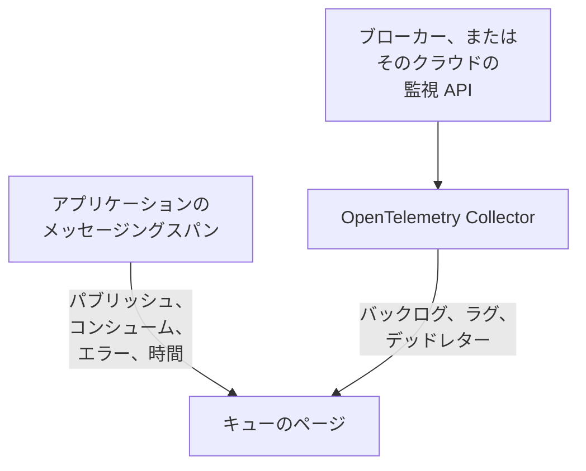

# キュー

**キュー** は、アプリケーションが使うすべてのメッセージキュー、トピック、サブスクリプションに専用のページを用意します。そこには、どのサービスがパブリッシュし、どのサービスがコンシュームしているか、どれだけのメッセージが流れ、どれだけが失敗し、処理にどれだけ時間がかかるか、そのトレースとメトリクスが表示され、ブローカー自身のメトリクスが OneUptime に届くと、バックログ、コンシューマーラグ、デッドレター、スロットリングも表示されます。キューには、ほかのすべてのリソースと同じく、ラベル、所有者、ラベルルールと所有者ルール、アーカイブがあります。**製品 → リソース → キュー** で開きます。

:::cards
- [アプリケーションの計装](#アプリケーションの計装): OpenTelemetry の計装がすでに送信しているメッセージングスパン。
- [ブローカーの正常性メトリクス](#ブローカーの正常性メトリクス): ブローカーからのバックログ、ラグ、デッドレターを、システムごとに。
- [アラート](#アラート): 用意されたテンプレートと、遅れて届くメトリクスやカウンター。
- [トラブルシューティング](#トラブルシューティング): 作成されなかったキューや、空のままのブローカーの正常性。
:::

## 仕組み

Apache Kafka、RabbitMQ、Apache ActiveMQ とその他の JMS ブローカー、Amazon SQS と SNS、Google Cloud Pub/Sub、Azure Service Bus、Event Hubs、Event Grid、Apache Pulsar、Apache RocketMQ、NATS、BullMQ ([サポートされるメッセージングシステム](#サポートされるメッセージングシステム) を参照) のどのブローカーでも、またスパンが `messaging.system` で示すその他のどのブローカーでも、同じように動作します。ほとんどのキューは、2 つのソースから自動的に表示されます:

| ソース | 必要なもの | キューのページに加わるもの |
| --- | --- | --- |
| **アプリケーショントレース** | 計装済みのアプリケーション (OpenTelemetry)。[アプリケーションの計装](#アプリケーションの計装) を参照 | パブリッシュおよびコンシュームされたメッセージ、エラーと処理時間、両側のサービス、トレースそのもの |
| **ブローカーメトリクス** (OpenTelemetry Collector) | ブローカー用の Collector レシーバーまたはスクレイプ。[ブローカーの正常性メトリクス](#ブローカーの正常性メトリクス) を参照 | **ブローカーの正常性**: バックログ、コンシューマーラグ、デッドレター、最も古いメッセージの経過時間、スロットリング、ブローカー自身のメッセージレート |



トレースは、キューが存在することと、アプリケーションがそれをどう使っているかを OneUptime に伝えますが、どれだけ溜まっているかまでは伝えません。それはブローカー自身、またはそのクラウドプロバイダーの監視 API から届きます。ジョブを Redis に保持し、問い合わせるブローカーを持たない [BullMQ](#bullmq) の場合は、アプリケーションが報告するゲージから届きます。

キューは手動でも追加できます。**キュー → キューを作成** で、メッセージングシステムと宛先名を指定し、Azure Service Bus と Event Hubs の場合は名前空間も指定します。フォームは最初のステップ **メッセージングシステム** でこれらを尋ね、次に任意の名前と説明を尋ねます。ラベルは **その他の項目** (**キュー情報**) にあります。名前空間を空のままにするのは、アプリケーションがエミュレーターまたはカスタムドメイン名経由で接続するキューの場合だけにしてください。そのスパンは名前空間を示さず、Azure Monitor のメトリクスがそのようなキューに届くことはありません ([制限事項](#制限事項) を参照)。

## はじめに

:::steps
### アプリケーションのトレースを送信する

パブリッシュとコンシュームを行うアプリケーションを計装し、そのトレースを OneUptime に送信します ([アプリケーションの計装](#アプリケーションの計装) を参照)。OneUptime 固有のものは何も必要ありません。計装がすでに作成しているメッセージングスパンが、キューを示します。

### ブローカーのメトリクスを送信する

[ブローカーの正常性メトリクス](#ブローカーの正常性メトリクス) でメッセージングシステムを探し、取り込みキーを使ってその Collector 構成を実行します。各キューの **ドキュメント** タブには、そのキュー用の構成がコピーできる状態で用意されています。

### キューを開く

**製品 → リソース → キュー** を開きます。検出は 10 分ごとに実行されます。15 分以内にそのキューのスパンが 3 件以上届くか、ブローカーメトリクスがそのキューを示すと、キューが表示されます。
:::

## サポートされるメッセージングシステム

OneUptime は以下のメッセージングシステムを名前で認識します。計装が `messaging.system` に入れる値を、大文字と小文字を区別せずに 2 列目の値 (OpenTelemetry の既知の値がある場合はその値) に正規化するため、`AmazonSQS`、`aws.sqs`、`aws_sqs` は 1 つのシステムです。`nats` と `bullmq` は OpenTelemetry の既知の値ではありません。`nats` は Java エージェントの NATS 計装が報告する値で、`bullmq` は BullMQ に設定する値です ([BullMQ](#bullmq) を参照)。

OneUptime が認識しないシステムも機能します。正しい形式の値 (`ibmmq`、`solace`、`mqtt`。英小文字、数字、`.`、`_`、`-` で 64 文字まで) は届いたとおりに保持されるため、そのブローカーのキューは検出され、その名前で表示されます。ブローカー自身のメトリクスだけが、この表のシステムを必要とします。`spring_integration` は無視されます。Spring Integration のチャネルは 1 つのプロセス内のメソッド呼び出しであり、ブローカーではないためです。

**ブローカーメトリクス** 列は、システムのヘルスメトリクスの入手元を示します: collector-contrib のレシーバー、Prometheus エンドポイント (`:port/path`、Collector の `prometheus` レシーバーでスクレイプ)、クラウドプロバイダーの監視 API、または Collector の外で OTLP によって送信するプログラムです。各システムは下のセットアップにリンクしており、各キューの **ドキュメント** タブがそれをそのキュー用の構成にします。

| システム | `messaging.system` | ほかに受け付ける値 | ブローカーメトリクス |
| --- | --- | --- | --- |
| [Amazon SNS](#amazon-sns) | `aws.sns` | `aws_sns`, `amazonsns`, `sns` | `aws_cloudwatch` または `awsfirehose` レシーバー (クラウド監視) |
| [Amazon SQS](#amazon-sqs) | `aws_sqs` | `aws.sqs`, `amazonsqs`, `sqs` | `aws_cloudwatch` または `awsfirehose` レシーバー (クラウド監視) |
| [Apache ActiveMQ](#apache-activemq) | `activemq` | `artemis`, `activemq_artemis` | OpenTelemetry JMX Scraper (OTLP で送信) |
| [Apache Kafka](#apache-kafka) | `kafka` | — | `kafka_metrics` レシーバー |
| [Apache Pulsar](#apache-pulsar) | `pulsar` | `apache_pulsar` | Prometheus (Pulsar ブローカー), `:8080/metrics/` |
| [Apache RocketMQ](#apache-rocketmq) | `rocketmq` | — | Prometheus (RocketMQ ブローカー), `:5557/metrics` |
| [Azure Event Grid](#azure-event-grid) | `eventgrid` | `azure_eventgrid`, `azure.eventgrid`, `microsoft.eventgrid` | `azure_monitor` レシーバー (クラウド監視) |
| [Azure Event Hubs](#azure-event-hubs) | `eventhubs` | `azure_eventhubs`, `azure.eventhubs`, `microsoft.eventhub` | `azure_monitor` レシーバー (クラウド監視) |
| [Azure Service Bus](#azure-service-bus) | `servicebus` | `azure_servicebus`, `azure.servicebus`, `microsoft.servicebus` | `azure_monitor` レシーバー (クラウド監視) |
| [BullMQ](#bullmq) | `bullmq` | — | 組み込みなし |
| [Google Cloud Pub/Sub](#google-cloud-pubsub) | `gcp_pubsub` | `gcp.pubsub`, `pubsub`, `google_pubsub` | `googlecloudmonitoring` レシーバー (クラウド監視) |
| [JMS](#jms) | `jms` | — | 組み込みなし |
| [NATS](#nats) | `nats` | `jetstream` | Prometheus (prometheus-nats-exporter), `:7777/metrics` |
| [RabbitMQ](#rabbitmq) | `rabbitmq` | — | `rabbitmq` レシーバー |

キューは、1 つのシステムの 1 つの宛先です。**Azure Service Bus** と **Azure Event Hubs** では名前空間もその一部です。2 つの名前空間がそれぞれ `orders` という名前のキューを持てるためです。**JMS** と **Apache ActiveMQ** はキューを共有します。Java アプリケーションは JMS API 経由で ActiveMQ に接続し、その API のスパンはブローカーにかかわらず `jms` と示しますが、ブローカー自身のメトリクスは `activemq` としか示せないため、両方が 1 つのキューに入ります ([2 つの観測が 1 つのキューになる条件](#2-つの観測が-1-つのキューになる条件) を参照)。

## キューの検出方法

各キューは、トレース、ブローカーメトリクス、人のどれによって作成されたかを記録します。あとから同じキューを示すものはすべて、別のキューを作らずにそのキューに加わります ([2 つの観測が 1 つのキューになる条件](#2-つの観測が-1-つのキューになる条件) を参照)。

### アプリケーショントレースから

OneUptime は 10 分ごとに、アプリケーションが直近 15 分間に送信したスパンのうち、`messaging.system`、`messaging.destination.name`、`messaging.destination`、`message_bus.destination`、`az.namespace`、`azure.resource_provider.namespace`、`aws.sqs.queue.url`、`aws.queue_url`、`aws.sns.topic.arn` のいずれかを持つものを集計します。SERVER スパン以外のすべてのスパンが対象です。PRODUCER、CONSUMER、CLIENT、INTERNAL のスパンと、トレースパイプラインの **スパン種別リマッパー** が別の種別 (Unspecified など) にした、または種別をなくしたスパンです。SERVER スパンがキューを示すことはありません。

ブローカー自身のスパンも SERVER スパンです。[Kubernetes エージェント](/docs/telemetry/kubernetes-agent#ebpf-のトレースの見え方) の eBPF トレーサーは、Kafka、MQTT、NATS のブローカー側の各やり取り (受信するメッセージ、配信するメッセージ) を記録し、その大半を PRODUCER または CONSUMER として送信します。OneUptime はそれらを SERVER として保存するため、ブローカーが、自身が運ぶトピックのプロデューサーやコンシューマーとして一覧に載ることはありません。サブスクライバーにメッセージを渡す MQTT ブローカーはクライアントと同じ PUBLISH を書き込み、トレーサーは両方を同じように報告するため、MQTT と NATS のパブリッシュについて、OneUptime は接続の相手側のポートで判断します。ポート 32768 以上 (オペレーティングシステムが接続元クライアントのポートを選ぶ範囲です。Linux のデフォルト範囲はそこから始まり、Windows と macOS は 49152–65535 を使います) であればサブスクライバーのポートであり、そのスパンはブローカーのものです。そのため、ランダムに公開された Docker ポートのように、自身が 32768 以上のポートで待ち受ける MQTT または NATS ブローカーにパブリッシュするアプリケーションは、そのトピックのプロデューサーとして一覧に載らず、そのようなアプリケーションだけが使うトピックは、トレーサーのスパンからはまったく検出されないことがあります。32768 未満のポート (狭められたポート範囲、または NAT が書き換えたポート) からブローカーに接続するサブスクライバーでは、自身に配信されるトピックのプロデューサーとして、引き続きブローカーが一覧に載ります。

OpenTelemetry のメッセージング属性はすべて、まだ開発中とされているため、1 つのプロジェクト内のアプリケーションが同じ内容を最大 5 世代の名前で報告します。OneUptime はそれらをすべて新しいものから順に読み取り、スパン名は解析しません。スパン名の形式はセマンティック規約 1.27 で変わり、ベンダーが自由に選ぶためです:

- **システム**: [サポートされるメッセージングシステム](#サポートされるメッセージングシステム) と同じように正規化した `messaging.system`。これがない場合は、Azure SDK の `az.namespace` または `azure.resource_provider.namespace` (`Microsoft.ServiceBus`、`Microsoft.EventHub`)、古い Azure SDK の `component` キー、SQS または SNS を呼び出す AWS SDK のスパン (`rpc.system` = `aws-api`。Java エージェントの SNS スパンは `messaging.system` を持ちません)、または SQS キュー URL や SNS トピック ARN のキー。
- **宛先**: `messaging.destination.template`、`messaging.destination.name`、`messaging.source.template`、`messaging.source.name`、`messaging.destination`、`message_bus.destination` のうち、スパンが持つ最初のもの。どれも持たないスパンは、そのシステム固有のキーを使います: SQS キュー URL (`aws.sqs.queue.url`、`aws.queue_url`、または `messaging.url`、`server.address`、`net.peer.name` 内のキュー URL)、SNS トピック ARN (`aws.sns.topic.arn`)、RabbitMQ ではルーティングキー (`messaging.rabbitmq.destination.routing_key` または `messaging.rabbitmq.routing_key`) で、これはメッセージがデフォルトエクスチェンジを通るときのキュー名です。
- **方向**: まず `messaging.operation.type`、次にスパンの種別 (PRODUCER はパブリッシュ、CONSUMER はコンシューム)、次に古い `messaging.operation`、次に `messaging.operation.name`、SQS と SNS では `rpc.method` 内の AWS SDK オペレーション (`SendMessage`、`ReceiveMessage`、…)。一部の計装が古いキーを誤って設定していたため、種別は古いキーより優先されます。Python 用の confluent-kafka は、プロデューサースパンに `receive` を書き込んでいました。

トレースからキューが **作成** されるのは、実行が調べる 15 分間の時間枠内で、そのスパンが 3 件以上 (`MESSAGE_QUEUE_MIN_SPANS`) になったときです。これにより、使い捨てのスクリプトがキューを作ることはありません。また、作成されるのはプロジェクトが [自動作成の上限](#自動作成の上限) を下回っている間だけです。キューを作成しないスパンも、既存のキューには数えられます。

各メッセージングスパンは取り込み時にキューのタグも付けられるため、キューの **トレース** タブには、キューが作成される前に送信されたスパンも含め、そのキューを示すすべてのスパンが表示されます。

### ブローカーメトリクスから

[ブローカーの正常性メトリクス](#ブローカーの正常性メトリクス) の一覧にあるブローカーメトリクスは、ブローカー独自の属性 (Kafka の `topic`、RabbitMQ の `rabbitmq.queue.name`、Azure Monitor の `EntityName` ディメンション、CloudWatch の `QueueName`) でキューを示し、OneUptime は取り込み時にそのキューと照合します。ブローカーメトリクスは `messaging.system` を持ちません。それぞれ名前 (`kafka.consumer_group.lag_sum`) で認識され、2 つのシステムが同じ名前を使う場合 (Azure Monitor は Service Bus と Event Hubs のメトリクスに同じ名前を付けます) は、データポイントが持つリソースタイプで認識されます。

次の検出の実行で、まだ存在しないキューが作成されます。[自動作成の上限](#自動作成の上限) の範囲内であれば、ブローカーメトリクス 1 つで十分です。そのため、計装されたアプリケーションがまったく触れないキューも、ブローカーが報告すれば表示されます。

クラウドの監視 API (CloudWatch、Azure Monitor、Cloud Monitoring) は、各値を測定対象の時刻から数分後に公開し、その値はその時刻で保存されます。そのため各実行は、スパンやほかのメトリクスを読む直近 15 分間ではなく、直近 1 時間のメトリクスを読みます。遅れて届いたデータポイントも、そのキューの観測になり、またはキューを作成します。

### メッセージングクライアントのメトリクスから

計装されたクライアントもメトリクスを報告できます: OpenTelemetry のメッセージングクライアントメトリクス `messaging.client.sent.messages`、`messaging.client.consumed.messages`、`messaging.client.operation.duration`、`messaging.process.duration`、その古い名前 `messaging.publish.duration`、`messaging.receive.duration`、`messaging.publish.messages`、`messaging.receive.messages`、`messaging.process.messages`、`messaging.client.published.messages`、そして Azure SDK for Java の `messaging.servicebus.messages.sent`、`messaging.servicebus.receiver.lag`、`messaging.servicebus.settlement.request.duration`、`messaging.servicebus.settlement.sequence_number` です。各データポイントはスパンと同じ方法でシステムと宛先を示し (Azure SDK の Service Bus メトリクスはシステムを示さないため、その名前が代わりになります)、取り込み時にそのキューと照合されるため、キューの **メトリクス** タブに表示されます。各データポイントに `messaging.system` と `messaging.destination.name` を持つ独自のメトリクスも同様です (リソースに付けた値は読み取られません)。たとえばキューの深さのゲージです ([BullMQ](#bullmq) を参照)。

メッセージングクライアントのメトリクスがキューを作成することはありません。キューを作成するのは、トレース、ブローカーメトリクス、または人です。既存のキューを示すクライアントメトリクスは、スパンと同じようにそのキューの **最終確認** を最新に保ちます。独自のメトリクスはどちらも行わず、キューの **メトリクス** タブに表示されるだけです。

### 2 つの観測が 1 つのキューになる条件

キューの識別子は、その **システム** と **宛先** で、大文字と小文字を区別せずに比較されます。`Orders` と `orders` は 1 つのキューで、最初に観測された名前で表示されます。Azure Service Bus と Event Hubs では、識別子に **名前空間** も含まれます:

- スパンでは、SDK が接続したホストの最初の DNS ラベル。`server.address`、`net.peer.name`、`peer.address`、`network.peer.address` の順に調べ、そのホストが名前空間のホスト (`<namespace>.servicebus.windows.net`、またはソブリンクラウドの `.servicebus.usgovcloudapi.net`、`.servicebus.chinacloudapi.cn`、`.servicebus.cloudapi.de`) である場合に使います。Event Hubs は Service Bus のドメインを共有します。
- Azure Monitor のメトリクスでは、報告対象の名前空間の `name`。

識別子にはほかに何も含まれないため、次のものがキューを分けることはありません: ブローカーのアドレス (Kafka クライアントはほとんど報告せず、Azure の名前空間は多くのアドレスで応答します)、コンシューマーグループまたはサブスクリプション (トピックのコンシューマーは別々のキューではありません)、パーティション、デッドレターのサブキュー。このうちキューが保持するのは、表示用のブローカーのアドレスだけです。

**JMS と ActiveMQ は 1 つのファミリーです**。どの JMS スパンも、背後にどのブローカーがあっても `jms` と示し、ブローカー自身のメトリクス ([OpenTelemetry JMX Scraper](#apache-activemq)) は `activemq` としか示せないため、OneUptime は ActiveMQ のキューを JMS ファミリーで識別します。`orders` のスパンとブローカーメトリクスは 1 つのキューに入ります。キューはブローカーのメトリクスが届くまでは JMS として、それ以降は Apache ActiveMQ として表示され、その逆になることはありません。手動で Apache ActiveMQ として作成したキューも、その同じキューです。

### 宛先名の読み取り方

計装は 1 つのキューをさまざまな方法で示し、OneUptime は報告された内容をキュー自身の名前に集約します:

| システム | 報告される形 | キュー |
| --- | --- | --- |
| Amazon SQS | `https://sqs.us-east-1.amazonaws.com/123456789012/orders`、キュー URL (Go 用の `otelaws` はこれを `server.address` に入れます) | `orders` |
| Amazon SNS | `arn:aws:sns:us-east-1:123456789012:order-events`、トピック ARN | `order-events` |
| Google Cloud Pub/Sub | `projects/shop/topics/orders`、リソース名 | `orders` |
| Azure Service Bus | `orders/Subscriptions/billing`、トピックのサブスクリプション `billing` のエンティティパス | `orders` |
| Azure Service Bus | `orders/$DeadLetterQueue`、キューのデッドレターサブキューのエンティティパス | `orders` |
| Azure Event Hubs | `telemetry/ConsumerGroups/$Default/Partitions/3`、コンシューマーグループ `$Default` の受信側のエンティティパス | `telemetry` |
| Apache Pulsar | `orders-partition-3`、短い名前のトピックのパーティション | `persistent://public/default/orders` |
| Apache Pulsar | `acme/shop/orders`、ドメインのないトピック | `persistent://acme/shop/orders` |
| JMS | `queue://orders`、宛先タイプのプレフィックス付き | `orders` |
| RabbitMQ | `shop:new-order:orders`、コンシューマー側のエクスチェンジ、ルーティングキー、キュー (セマンティック規約 1.30 以降) | `orders` |
| RabbitMQ | `amq.default`、デフォルトエクスチェンジ、ルーティングキー `orders` 付き | `orders` |
| RabbitMQ | `,orders`、デフォルトエクスチェンジ経由の aio-pika の `{exchange},{routing key}` | `orders` |
| RabbitMQ | `shop,new-order`、aio-pika の `{exchange},{routing key}` | `shop` |

Pulsar のパーティションはそのトピックにまとめられ、ドメインのない名前は Pulsar 自身と同じ方法で補完されます (短い名前は `public/default` 名前空間に入ります)。そのため、Java エージェントの名前がブローカーの完全修飾メトリクスラベルと一致します。RabbitMQ のスパンは通常、パブリッシュ側でもコンシューム側でも、メッセージが通過したエクスチェンジを示します。デフォルトエクスチェンジ (`amq.default`、`<default>`、または空の名前) は、そのルーティングキー、つまりキュー名を表します。セマンティック規約 1.30 は、エクスチェンジ、ルーティングキー、キューを `:` で結合し (Java エージェントのオプトインの名前)、OneUptime はコンシューマーの結合名からキューを、パブリッシャーの結合名からエクスチェンジを取り出します。aio-pika はパブリッシュ側でエクスチェンジとルーティングキーをカンマで結合し、OneUptime はそれも同じように分割します。

### 無視されるもの

OneUptime は、迷ったらキューを作らない側に倒します。そうしないと、リクエストごとやコンシューマーごとに作られる名前が、メッセージのたびに誰も所有しないキューを作ってしまうからです。次のものがキューになることはありません:

- **SERVER スパン**、および `messaging.system` が `spring_integration` のスパン。
- **一時的または匿名とマークされた宛先**: `messaging.destination.temporary`、`messaging.destination.anonymous`、`messaging.source.temporary`、`messaging.source.anonymous` が `true` に設定されたもの。古い `messaging.temp_destination` は信頼しません。Python の pika と aio-pika の計装は、すべてのパブリッシュでこれを設定するためです。
- **計装が名前の代わりに報告するプレースホルダー**: `(temporary)`、`(anonymous)`、`<generated>`、`unknown` (複数のトピックにまたがる Kafka のバッチ)、`aws:sqs` (Java エージェントの Lambda SQS イベント)、Azure Monitor の `-NamespaceOnlyMetric-`、OneUptime 自身のデータスクラビングが丸ごと置き換えた値 (`[REDACTED]`)。
- **生成された宛先と返信用の宛先**: RabbitMQ の `amq.gen-JzTY20BRgKO-HjmUJj0wLg` 形式のサーバー命名キュー、Spring の `spring.gen-…` キュー、グループを持たないコンシューマーの Spring Cloud Stream の `<destination>.anonymous.<id>` キュー、ダイレクトリプライ (`amq.rabbitmq.reply-to…`)。JMS の一時的な宛先 (`temp-queue://…`、`temp-topic://…`) と TIBCO の `$TMP$…`。ActiveMQ のアドバイザリートピック (`ActiveMQ.Advisory.…`)。NATS のインボックス (`_INBOX.…`) と JetStream の確認応答サブジェクト (`$JS.ACK.…`)。Pulsar のシステムトピック (`__change_events`、`__transaction_…`、および `/__` セグメント以下のすべて)。そして UUID だけでできた宛先。
- **SNS のテキストメッセージとモバイルプッシュ**: 電話番号 (`+15555550123`、または botocore の `phone_number:**`) やプラットフォームエンドポイントの ARN (`arn:aws:sns:us-east-1:123456789012:endpoint/GCM/shop-app/1234`) は、トピックではなくデバイスです。
- **1 つのキューになり得ない名前**: バッチからの宛先のリスト (`["orders","payments"]`)、制御文字を含む名前、255 文字を超える名前。

**UUID はテンプレート化されます**。宛先内の各 UUID は `{uuid}` に置き換えられるため、`reply-7f1c2a9e-4b1d-4c3e-9f1a-2b3c4d5e6f70` のようなリクエストごとの名前は、それぞれ別のキューではなく、1 つのキュー `reply-{uuid}` になります。

### 自動作成の上限

トレースとブローカーメトリクスが自動でキューを作成するのは、プロジェクトのアクティブでアーカイブされていない検出済みキューが 500 未満の間だけです (`MESSAGE_QUEUE_AUTO_CREATE_BUDGET`。[セルフホストでの調整](#セルフホストでの調整) を参照)。手動で作成したキューは数えられず、ブロックされることもありません。アーカイブされたキューは数えられないため、[自動アーカイブ](#ライフサイクルとアーカイブ) によって上限に空きができます。既存のキューは引き続き照合され、更新されます。

### ライフサイクルとアーカイブ

- **最終確認** は、検出がトレース、メッセージングクライアントのメトリクス、ブローカーメトリクスのいずれかでキューを最後に確認した時刻です。
- **アーカイブして非表示にする**。検出されたキューを削除しても、再び確認されるまでしか消えません。次に確認されると、新しいキューとして戻ってきます。完全に非表示にするには **アーカイブ** します。アーカイブされたキューは識別子を保持するため、そのキューを示すものは、新しいキューを作らずにアーカイブされたキューに結び付いたままになります。
- **自動アーカイブ**。7 日間 (`MESSAGE_QUEUE_AUTO_ARCHIVE_DAYS`) 確認されていない検出済みのキューは、人が名前を変更したり、説明を付けたり、ラベルを付けたり、所有者を割り当てたりしていない限り、自動的にアーカイブされます。ラベルルールや所有者ルールが自動で付けたラベルと所有者は数えません。
- **復元**。自動的にアーカイブされたキューは、再び確認されると自動的に復元されます。手動で作成したキューと、人がアーカイブしたキューは、検出によってアーカイブも復元もされません。人が復元したキューは、何も確認しなくても 30 日間 (またはアーカイブの期間がそれより長い場合はその期間) 復元されたままです。次に確認されたときから、再び 7 日のルールが適用されます。

## アプリケーションの計装

キューは、OpenTelemetry の計装がすでに生成しているメッセージングスパンから作られます。OneUptime 固有のものは何も必要ありません。[OpenTelemetry](/docs/telemetry/open-telemetry) の説明に従ってトレースを OneUptime に送信し、使っている言語の一覧を確認してください。

:::tabs
@tab Java
OpenTelemetry Java エージェントは、Kafka、RabbitMQ、JMS (ActiveMQ、Artemis、IBM MQ、その他すべての JMS ブローカー)、Amazon SQS と SNS、Pulsar、RocketMQ、NATS のクライアントを、コードを変更せずにトレースします。OneUptime は、エージェントがデフォルトで出力する属性名と、`OTEL_SEMCONV_STABILITY_OPT_IN=messaging` (エージェント 2.31.0 以降) で出力する新しい属性名の両方を読み取ります。JMS のスパンは、背後にどのブローカーがあっても `jms` と示します ([JMS](#jms) を参照)。

- **Azure Service Bus と Event Hubs**: Azure SDK for Java は自身をトレースし、Java エージェントがそのトレースを OpenTelemetry に接続します。
- **Google Cloud Pub/Sub**: クライアントは、その `Publisher` と `Subscriber` のビルダーが OpenTelemetry インスタンスとトレースのスイッチ (`setOpenTelemetry(GlobalOpenTelemetry.get())` と `setEnableOpenTelemetryTracing(true)`) を受け取ると、自身をトレースします。どちらか一方の呼び出しだけでは何もトレースされません。
@tab .NET
- **Azure Service Bus と Event Hubs** (`Azure.Messaging.ServiceBus`、`Azure.Messaging.EventHubs`): Azure SDK では、その OpenTelemetry スパンは試験的な機能です。環境変数 `AZURE_EXPERIMENTAL_ENABLE_ACTIVITY_SOURCE=true` (または下の `Azure.Experimental.EnableActivitySource` スイッチ) で有効にし、`Azure.*` ソースをサブスクライブします。
- **RabbitMQ.Client** 7 は自身をトレースします: `RabbitMQ.Client.*` をサブスクライブします。
- **MassTransit** は自身をトレースします: `MassTransit` をサブスクライブします (そのスパンに含まれないものについては [制限事項](#制限事項) を参照)。
- **Confluent.Kafka**: `OpenTelemetry.Instrumentation.ConfluentKafka` パッケージ。
- **Amazon SQS と SNS**: `OpenTelemetry.Instrumentation.AWS` パッケージに `.AddAWSInstrumentation(opt => opt.SemanticConventionVersion = SemanticConventionVersion.Latest)` を指定します。デフォルトの属性セット (`V1_28_0`) では、SQS キューは URL (`aws.queue_url`。OneUptime はこれを読み取ります) でしか示されず、SNS トピックはまったく示されません。

```csharp
// Before any Azure client is created; or set AZURE_EXPERIMENTAL_ENABLE_ACTIVITY_SOURCE=true.
AppContext.SetSwitch("Azure.Experimental.EnableActivitySource", true);

builder.Services.AddOpenTelemetry()
    .WithTracing(tracing => tracing
        .AddSource("Azure.*")
        .AddSource("RabbitMQ.Client.*")
        .AddSource("MassTransit")
        .AddOtlpExporter());
```
@tab Node.js
- `@opentelemetry/auto-instrumentations-node` は `amqplib` (RabbitMQ)、`kafkajs`、AWS SDK (SQS と SNS) をトレースします。
- **Azure Service Bus と Event Hubs**: `@azure/opentelemetry-instrumentation-azure-sdk` の `createAzureSdkInstrumentation()` を登録します。
- **Google Cloud Pub/Sub**: `new PubSub({ enableOpenTelemetryTracing: true })`。
- **BullMQ**: [BullMQ](#bullmq) を参照してください。BullMQ 自身のテレメトリには、2 つの属性を追加する必要があります。
@tab Python
- Kafka: `opentelemetry-instrumentation-kafka-python`、`opentelemetry-instrumentation-confluent-kafka`、または `opentelemetry-instrumentation-aiokafka`。RabbitMQ: `opentelemetry-instrumentation-pika` または `opentelemetry-instrumentation-aio-pika`。SQS と SNS: `opentelemetry-instrumentation-botocore`、または SQS 用の `opentelemetry-instrumentation-boto3sqs`。`opentelemetry-bootstrap -a install` は、インストール済みのライブラリに必要なものを選びます。
- **Azure Service Bus と Event Hubs**: `azure-core-tracing-opentelemetry` をインストールし、`settings.tracing_implementation = "opentelemetry"` (`azure.core.settings` から) を設定します。
- **Google Cloud Pub/Sub**: `PublisherOptions(enable_open_telemetry_tracing=True)` と `SubscriberOptions(enable_open_telemetry_tracing=True)`。
- Celery のスパンは `messaging.system` を持たず、ブローカーも示さないため、キューを作成しません。
@tab Go
- **Amazon SQS と SNS**: `otelaws` (`go.opentelemetry.io/contrib/instrumentation/github.com/aws/aws-sdk-go-v2/otelaws`) を `otelaws.AppendMiddlewares(&cfg.APIOptions)` で追加します。その SQS スパンはキュー URL を `server.address` に持ち、OneUptime はそれをキューとして読み取ります。
- **Google Cloud Pub/Sub**: `pubsub.ClientConfig{EnableOpenTelemetryTracing: true}`。
- **Kafka** (`segmentio/kafka-go`): OpenTelemetry Go の自動計装 (`go.opentelemetry.io/auto`、eBPF、Linux 上) は、コードを変更せずにそのプロデューサーとコンシューマーをトレースします。
- OpenTelemetry の Go contrib ライブラリには、Kafka、RabbitMQ、NATS の計装がありません。ほかのクライアントでは、クライアントライブラリ自身の OpenTelemetry サポートを使うか、送信処理とハンドラーを囲むスパンに `messaging.system`、`messaging.destination.name`、スパンの種別を設定します。
:::

## ブローカーの正常性メトリクス

ブローカーは、どのアプリケーションにも見えないことを知っています。待機しているメッセージの数、各コンシューマーグループの遅れ、デッドレターキューに送られたものです。以下の各セクションには、1 つのシステム用の Collector 構成があります。OneUptime に送信する OTLP エクスポーターで終わる、完全な OpenTelemetry Collector の構成です。テレメトリの取り込みキー (**プロジェクト設定 → テレメトリと APM → 取り込みキー**) を `x-oneuptime-token` に入れ、セルフホストの場合は `https://oneuptime.com` を自分のホストに置き換え、`otel/opentelemetry-collector-contrib` 0.161.0 以降で実行します (ここにあるすべての構成は 0.161.0 で検証済みです)。最近の Collector は、`otlphttp` は非推奨で `otlp_http` を使うようにとログに出力しますが、どちらの名前も同じエクスポーターです。複数のシステムを収集するには、それらのレシーバーを 1 つの Collector にまとめます。

各キューの **ブローカーの正常性** セクションは、そのシステムについて一覧にあるメトリクスをグラフにします (ゲージはその値、期間ごとの件数は間隔ごとの合計、カウンターは毎秒のレート)。キューの系列は、メトリクスごとに必要な方法で組み合わせます (RabbitMQ キューの準備完了メッセージと未確認メッセージは合計され、最も遅れているコンシューマーグループがラグになります)。Collector が送信するものは、すべて **メトリクス** エクスプローラーにもあります。一覧にあるメトリクスがまだキューに届いていない間は、このセクションにそのシステムのメトリクスの入手元が、ここでの該当セクションへのリンクとともに表示されます。

### Amazon SNS

トピックの CloudWatch メトリクスを Collector の `aws_cloudwatch` レシーバーで読み取るか、CloudWatch Metric Stream と Amazon Data Firehose を経由して、その `awsfirehose` レシーバーにストリーミングします。

`aws_cloudwatch` レシーバーは CloudWatch の `GetMetricData` API をポーリングし、レシーバーごとに 1 つの名前空間を扱うため、SNS には [Amazon SQS](#amazon-sqs) 用のインスタンスとは別に専用のインスタンスを用意します。レシーバーは AWS SDK のデフォルトの認証情報 (環境、共有プロファイル、またはインスタンスロール) を使い、これには `cloudwatch:ListMetrics` と `cloudwatch:GetMetricData` が必要です:

```yaml
receivers:
  aws_cloudwatch/sns:
    region: us-east-1
    metrics:
      collection_interval: 5m
      period: 1m
      delay: 10m
      discovery:
        filters:
          namespace: AWS/SNS
        limit: 500

processors:
  batch: {}

exporters:
  otlphttp:
    endpoint: https://oneuptime.com/otlp
    headers:
      x-oneuptime-token: YOUR_TELEMETRY_INGESTION_TOKEN

service:
  pipelines:
    metrics:
      receivers: [aws_cloudwatch/sns]
      processors: [batch]
      exporters: [otlphttp]
```

[Amazon SQS](#amazon-sqs) と同じく、`stats` は設定しないでください。Metric Stream は SNS と SQS をまとめて運びます: [Amazon SQS](#amazon-sqs) のセットアップで、ストリームの名前空間に `AWS/SNS` を追加します。

トピックはどちらの側からも同じ名前で示されます: スパンはその ARN または名前を報告し、OneUptime は ARN の最後の `:` より後の名前を保持します。

| メトリクス | 表示名 | 種類 |
| --- | --- | --- |
| `amazonaws.com/aws/sns/numberofmessagespublished` (JSON ストリーム: `numberofmessagespublished`) | Messages published | 期間ごとの件数 |
| `amazonaws.com/aws/sns/numberofnotificationsdelivered` (JSON ストリーム: `numberofnotificationsdelivered`) | Notifications delivered | 期間ごとの件数 |
| `amazonaws.com/aws/sns/numberofnotificationsfailed` (JSON ストリーム: `numberofnotificationsfailed`) | Notifications failed | 期間ごとの件数 |
| `amazonaws.com/aws/sns/numberofnotificationsredriventodlq` (JSON ストリーム: `numberofnotificationsredriventodlq`) | Redriven to dead-letter queue | 期間ごとの件数 |

### Amazon SQS

キューの CloudWatch メトリクスを Collector の `aws_cloudwatch` レシーバーで読み取るか、CloudWatch Metric Stream と Amazon Data Firehose を経由して、その `awsfirehose` レシーバーにストリーミングします。

**CloudWatch のポーリング** には、AWS 側で認証情報以外に何も必要ありません。レシーバーは AWS SDK のデフォルトの認証情報 (環境、共有プロファイル、またはインスタンスロール) を使い、これには `cloudwatch:ListMetrics` と `cloudwatch:GetMetricData` が必要です:

```yaml
receivers:
  aws_cloudwatch/sqs:
    region: us-east-1
    metrics:
      collection_interval: 5m
      period: 1m
      delay: 10m
      discovery:
        filters:
          namespace: AWS/SQS
        # Metrics per scrape: about nine per queue. Must be set.
        limit: 500

processors:
  batch: {}

exporters:
  otlphttp:
    endpoint: https://oneuptime.com/otlp
    headers:
      x-oneuptime-token: YOUR_TELEMETRY_INGESTION_TOKEN

service:
  pipelines:
    metrics:
      receivers: [aws_cloudwatch/sqs]
      processors: [batch]
      exporters: [otlphttp]
```

- **`stats` は設定しないでください**。設定しなければ、各メトリクスは期間ごとに 1 つのサマリーとして届き、OneUptime はそれを読み取ります。設定すると、各統計が独自の系列になり、グラフでそれらが混ざります。
- `discovery.limit` は必須で、1 回のスクレイプで読み取るメトリクスの数の上限です。キューごとに約 9 個です。各メトリクスはスクレイプごとに `GetMetricData` のサブクエリを 4 つ使い、AWS はそれに課金します。
- `delay` は CloudWatch が期間を公開するのを待つため (数分かかります)、この構成ではキューのブローカーメトリクスが 11〜17 分遅れて届きます。それらに対するモニターには、より長い時間枠が必要です ([アラート](#アラート) の **遅れて届くメトリクス** を参照)。
- 1 つのレシーバーは 1 つのリージョンと 1 つの名前空間を読み取ります: リージョンごとにインスタンスを追加します。

**ストリーミング** は、CloudWatch が公開するたびにメトリクスをプッシュします。`AWS/SQS` (および `AWS/SNS`) 名前空間を対象に、出力形式 **OpenTelemetry 1.0** の CloudWatch Metric Stream を作成し、宛先が HTTP エンドポイント (アクセスキーを持つ Collector) である Amazon Data Firehose ストリームに配信します。Firehose はポート 443 の `https://` にしか配信しないため、Collector には証明書と公開ポート 443 が必要です (たとえばロードバランサーの背後):

```yaml
extensions:
  awscloudwatchmetricstreams_encoding:
    format: opentelemetry1.0

receivers:
  awsfirehose:
    # Firehose delivers to HTTPS on port 443 only: expose this port as 443,
    # for example behind a load balancer.
    endpoint: 0.0.0.0:4433
    encoding: awscloudwatchmetricstreams_encoding
    access_key: ${env:FIREHOSE_ACCESS_KEY}
    tls:
      cert_file: /etc/otelcol/tls/server.crt
      key_file: /etc/otelcol/tls/server.key

processors:
  batch: {}

exporters:
  otlphttp:
    endpoint: https://oneuptime.com/otlp
    headers:
      x-oneuptime-token: YOUR_TELEMETRY_INGESTION_TOKEN

service:
  extensions: [awscloudwatchmetricstreams_encoding]
  pipelines:
    metrics:
      receivers: [awsfirehose]
      processors: [batch]
      exporters: [otlphttp]
```

出力形式 **JSON** のストリーム (`format: json`) も使えます: 各メトリクスを元の名前のまま送信し、OneUptime はストリームが付ける `service.name` (`SQS`、`SNS`) で SQS のメトリクスと SNS のメトリクスを区別します。

デッドレターキューは独自のメトリクスを持つ通常の SQS キューなので、OneUptime では独立したキューになります。キューは名前だけで識別され、アカウントやリージョンでは区別されません ([制限事項](#制限事項) を参照)。

| メトリクス | 表示名 | 種類 |
| --- | --- | --- |
| `amazonaws.com/aws/sqs/approximatenumberofmessagesvisible` (JSON ストリーム: `approximatenumberofmessagesvisible`) | Messages visible | ゲージ |
| `amazonaws.com/aws/sqs/approximateageofoldestmessage` (JSON ストリーム: `approximateageofoldestmessage`) | Oldest message age | ゲージ |
| `amazonaws.com/aws/sqs/approximatenumberofmessagesnotvisible` (JSON ストリーム: `approximatenumberofmessagesnotvisible`) | Messages in flight | ゲージ |
| `amazonaws.com/aws/sqs/numberofmessagessent` (JSON ストリーム: `numberofmessagessent`) | Messages sent | 期間ごとの件数 |
| `amazonaws.com/aws/sqs/numberofmessagesreceived` (JSON ストリーム: `numberofmessagesreceived`) | Messages received | 期間ごとの件数 |
| `amazonaws.com/aws/sqs/numberofmessagesdeleted` (JSON ストリーム: `numberofmessagesdeleted`) | Messages deleted | 期間ごとの件数 |

### Apache ActiveMQ

Collector には JMX レシーバーがないため、ActiveMQ Classic ブローカーの横で `OTEL_JMX_TARGET_SYSTEM=activemq` を指定して OpenTelemetry JMX Scraper を実行します。スクレイパーはブローカーの宛先メトリクスを OTLP でプッシュします。

1. ブローカーが JMX 接続を受け付けるようにします。`apache/activemq-classic` イメージまたは `bin/activemq` スクリプトでは、起動前に `ACTIVEMQ_SUNJMX_START` を設定します。この例では認証を無効にしています: ポートはプライベートネットワーク内に置くか、パスワードファイルを使って `jmxremote.authenticate` を有効にし、スクレイパーに `OTEL_JMX_USERNAME` と `OTEL_JMX_PASSWORD` を渡します。

```bash
ACTIVEMQ_SUNJMX_START="-Dcom.sun.management.jmxremote.port=1099 -Dcom.sun.management.jmxremote.rmi.port=1099 -Dcom.sun.management.jmxremote.authenticate=false -Dcom.sun.management.jmxremote.ssl=false -Djava.rmi.server.hostname=activemq"
```

2. そのポートに到達できる場所で、Java ランタイムを使ってスクレイパーを実行します。スクレイパーは OneUptime に直接送信します。代わりに自分の Collector を経由させるには、`OTEL_EXPORTER_OTLP_ENDPOINT` を Collector の OTLP レシーバーに向けます。

```bash
curl -fsSLo opentelemetry-jmx-scraper.jar https://github.com/open-telemetry/opentelemetry-java-contrib/releases/latest/download/opentelemetry-jmx-scraper.jar

export OTEL_JMX_SERVICE_URL=service:jmx:rmi:///jndi/rmi://activemq:1099/jmxrmi
export OTEL_JMX_TARGET_SYSTEM=activemq
export OTEL_JMX_TARGET_SOURCE=instrumentation
export OTEL_METRIC_EXPORT_INTERVAL=30000
export OTEL_SERVICE_NAME=activemq-prod
export OTEL_EXPORTER_OTLP_PROTOCOL=http/protobuf
export OTEL_EXPORTER_OTLP_ENDPOINT=https://oneuptime.com/otlp
export OTEL_EXPORTER_OTLP_HEADERS=x-oneuptime-token=YOUR_TELEMETRY_INGESTION_TOKEN
java -jar opentelemetry-jmx-scraper.jar
```

`OTEL_JMX_TARGET_SOURCE=instrumentation` は、スクレイパーが 1.53.0-alpha 以降使っているメトリクス名 (`activemq.message.queue.size`。宛先は `messaging.destination.name`) を維持します。OneUptime は、古いスクレイパーの名前と `OTEL_JMX_TARGET_SOURCE=legacy` の名前 (`activemq.message.current`。宛先は `destination`) も読み取ります。

ブローカーのメトリクスは、その JMS クライアントのスパンが作成したキューに加わり、それ以降キューは Apache ActiveMQ として表示されます ([2 つの観測が 1 つのキューになる条件](#2-つの観測が-1-つのキューになる条件) を参照)。スクレイパーはすべての宛先を報告します: OneUptime はアドバイザリートピックを無視しますが、デッドレターキュー (`ActiveMQ.DLQ`、または個別のデッドレター戦略での `DLQ.<destination>`) は独立したキューです。ActiveMQ Artemis は異なる MBean を持ち、これらのルールでは読み取りません: Artemis のキューは引き続き JMS スパンから作られますが、ブローカーの正常性はありません。

| メトリクス | 表示名 | 種類 |
| --- | --- | --- |
| `activemq.message.queue.size` | Queue size | ゲージ |
| `activemq.message.current` | Queue size (legacy names) | ゲージ |
| `activemq.message.enqueued` | Enqueued | カウンター (毎秒で表示) |
| `activemq.message.dequeued` | Dequeued | カウンター (毎秒で表示) |
| `activemq.message.expired` | Expired | カウンター (毎秒で表示) |
| `activemq.consumer.count` | Consumers | ゲージ |
| `activemq.message.enqueue.average_duration` | Average time in queue | ゲージ |
| `activemq.message.wait_time.avg` | Average time in queue (legacy names) | ゲージ |

### Apache Kafka

Collector の `kafka_metrics` レシーバーは、ブローカーからコンシューマーグループのラグとパーティションのオフセットを読み取ります。`topics` と `consumers` のスクレイパーを有効にします。

```yaml
receivers:
  kafka_metrics:
    brokers: ["kafka-1:9092", "kafka-2:9092"]
    # topics: each partition's log-end offset; consumers: each group's
    # committed offsets and lag. brokers: the broker count.
    scrapers: [brokers, topics, consumers]
    collection_interval: 30s
    # auth:
    #   sasl:
    #     mechanism: SCRAM-SHA-512
    #     username: ${env:KAFKA_USERNAME}
    #     password: ${env:KAFKA_PASSWORD}
    # tls:
    #   ca_file: /etc/kafka/ca.pem

processors:
  batch: {}

exporters:
  otlphttp:
    endpoint: https://oneuptime.com/otlp
    headers:
      x-oneuptime-token: YOUR_TELEMETRY_INGESTION_TOKEN

service:
  pipelines:
    metrics:
      receivers: [kafka_metrics]
      processors: [batch]
      exporters: [otlphttp]
```

SASL または TLS を使うクラスターでは、`auth` と `tls` のコメントを外します。レシーバーは各トピックを `topic` で示し、メトリクスはそれによってトピックのキューを見つけます。コンシューマーグループのラグとコミット済みオフセットは、そのグループがオフセットをコミットしたトピックについてのみ報告され、名前が `_` で始まるトピック、つまり Kafka の内部トピックはスキップされます (`topic_match` のデフォルトは `^[^_].*$`)。

| メトリクス | 表示名 | 種類 |
| --- | --- | --- |
| `kafka.consumer_group.lag_sum` | Consumer lag | ゲージ |
| `kafka.consumer_group.lag` | Partition lag | ゲージ |
| `kafka.consumer_group.offset_sum` | Consumed | カウンター (毎秒で表示) |
| `kafka.partition.current_offset` | Produced | カウンター (毎秒で表示) |

### Apache Pulsar

各ブローカーは、トピックとサブスクリプションのメトリクスを Web サービスのポートで提供します。ブローカーは現在所有しているトピックしか報告しないため、すべてのブローカーをスクレイプします。

```yaml
receivers:
  prometheus:
    config:
      scrape_configs:
        - job_name: pulsar-broker
          scrape_interval: 30s
          metrics_path: /metrics/
          # Every broker: each one reports only the topics it owns.
          static_configs:
            - targets: ["pulsar-broker-0:8080", "pulsar-broker-1:8080"]
          # Keeps the families the queue page charts; remove it to keep all.
          metric_relabel_configs:
            - source_labels: [__name__]
              regex: "pulsar_(msg_backlog|subscription_back_log|storage_backlog_age_seconds|in_messages_total|out_messages_total)"
              action: keep

processors:
  batch: {}

exporters:
  otlphttp:
    endpoint: https://oneuptime.com/otlp
    headers:
      x-oneuptime-token: YOUR_TELEMETRY_INGESTION_TOKEN

service:
  pipelines:
    metrics:
      receivers: [prometheus]
      processors: [batch]
      exporters: [otlphttp]
```

- トピックとサブスクリプションの系列には、`broker.conf` の `exposeTopicLevelMetricsInPrometheus=true` が必要です。これはデフォルトです。
- Pulsar は各系列にトピックの完全な名前 (`persistent://public/default/orders`) のラベルを付け、パーティションの系列にはパーティションの名前 (`persistent://public/default/orders-partition-3`) のラベルを付けます: パーティションはそのトピックに合算されます。
- バックログはエントリー単位で数えられ、Pulsar はメッセージのバッチを 1 つのエントリーとして数えます。
- `exposeConsumerLevelMetricsInPrometheus=true` のとき、Pulsar は `pulsar_out_messages_total` をコンシューマーごとに繰り返します。これらのコンシューマーごとの系列はグラフから除外されるため、メッセージが 2 回数えられることはありません。
- ブローカーが判断できない間、`pulsar_storage_backlog_age_seconds` は `-1` を示します。
- Pulsar 3.3 以降のネイティブな OpenTelemetry メトリクス (試験的な機能で、デフォルトでは無効) は別の名前を使うため、グラフには表示されません。

| メトリクス | 表示名 | 種類 |
| --- | --- | --- |
| `pulsar_msg_backlog` | Backlog | ゲージ |
| `pulsar_subscription_back_log` | Subscription backlog | ゲージ |
| `pulsar_storage_backlog_age_seconds` | Backlog age | ゲージ |
| `pulsar_in_messages_total` | Messages in | カウンター (毎秒で表示) |
| `pulsar_out_messages_total` | Messages out | カウンター (毎秒で表示) |

### Apache RocketMQ

ブローカーの `broker.conf` で `metricsExporterType=PROM` を設定し、ブローカーがラグとスループットのメトリクスを提供するようにします。

```text
metricsExporterType=PROM
metricsPromExporterPort=5557
metricsPromExporterHost=0.0.0.0
```

次に、すべてのブローカーをスクレイプします:

```yaml
receivers:
  prometheus:
    config:
      scrape_configs:
        - job_name: rocketmq-broker
          scrape_interval: 30s
          metrics_path: /metrics
          static_configs:
            - targets: ["rocketmq-broker-a:5557", "rocketmq-broker-b:5557"]

processors:
  batch: {}

exporters:
  otlphttp:
    endpoint: https://oneuptime.com/otlp
    headers:
      x-oneuptime-token: YOUR_TELEMETRY_INGESTION_TOKEN

service:
  pipelines:
    metrics:
      receivers: [prometheus]
      processors: [batch]
      exporters: [otlphttp]
```

これは RocketMQ 5 の組み込みエクスポーターです。RocketMQ 4 にはこれがなく、代わりに使われる別の `rocketmq-exporter` は別のメトリクス名を報告するため、グラフには表示されません。コンシューマーグループのデッドレタートピック (`%DLQ%<group>`) は独立したキューです。

| メトリクス | 表示名 | 種類 |
| --- | --- | --- |
| `rocketmq_consumer_lag_messages` | Consumer lag | ゲージ |
| `rocketmq_consumer_ready_messages` | Ready messages | ゲージ |
| `rocketmq_send_to_dlq_messages_total` | Sent to dead-letter queue | カウンター (毎秒で表示) |
| `rocketmq_messages_in_total` | Messages in | カウンター (毎秒で表示) |

### Azure Event Grid

Azure Monitor にはトピックの配信とデッドレターのメトリクスがあり、Collector の `azure_monitor` レシーバーがそれを読み取ります。まだキューのページにはグラフ表示されないため、メトリクスで確認してください。

レシーバーは `azure_auth` 拡張機能を通じてサインインします。サービスプリンシパルに、サブスクリプションの **Monitoring Reader** ロールを付与します:

```yaml
extensions:
  azure_auth:
    service_principal:
      tenant_id: ${env:AZURE_TENANT_ID}
      client_id: ${env:AZURE_CLIENT_ID}
      client_secret: ${env:AZURE_CLIENT_SECRET}

receivers:
  azure_monitor/eventgrid:
    subscription_ids: ["${env:AZURE_SUBSCRIPTION_ID}"]
    auth:
      authenticator: azure_auth
    collection_interval: 60s
    services:
      - Microsoft.EventGrid/topics
      - Microsoft.EventGrid/systemTopics
      - Microsoft.EventGrid/domains
    maximum_number_of_records_per_resource: 1000

processors:
  batch: {}

exporters:
  otlphttp:
    endpoint: https://oneuptime.com/otlp
    headers:
      x-oneuptime-token: YOUR_TELEMETRY_INGESTION_TOKEN

service:
  extensions: [azure_auth]
  pipelines:
    metrics:
      receivers: [azure_monitor/eventgrid]
      processors: [batch]
      exporters: [otlphttp]
```

OneUptime は Event Grid のメトリクスをキューのページにグラフ表示しません: Azure Monitor はそれらを Event Grid リソースとイベントサブスクリプションごとに報告し、キューを示す形にはなっていないためです。メトリクスは **メトリクス** エクスプローラーに届きます: `azure_publishsuccesscount_total`、`azure_deliverysuccesscount_total`、`azure_deadletteredcount_total` などです。Event Grid の名前空間については、`services` に `Microsoft.EventGrid/namespaces` を追加します。

### Azure Event Hubs

Collector の `azure_monitor` レシーバーで Azure Monitor から名前空間のメトリクスを読み取ります。レシーバーは EntityName ディメンションでそれらをイベントハブごとに分割します。

レシーバーは `azure_auth` 拡張機能を通じてサインインします。サービスプリンシパルに、サブスクリプションの **Monitoring Reader** ロールを付与します:

```yaml
extensions:
  azure_auth:
    service_principal:
      tenant_id: ${env:AZURE_TENANT_ID}
      client_id: ${env:AZURE_CLIENT_ID}
      client_secret: ${env:AZURE_CLIENT_SECRET}

receivers:
  azure_monitor/eventhubs:
    subscription_ids: ["${env:AZURE_SUBSCRIPTION_ID}"]
    auth:
      authenticator: azure_auth
    collection_interval: 60s
    services: [Microsoft.EventHub/namespaces]
    maximum_number_of_records_per_resource: 1000
    metrics:
      "Microsoft.EventHub/namespaces":
        IncomingMessages: [Total]
        OutgoingMessages: [Total]
        ServerErrors: [Total]
        UserErrors: [Total]
        QuotaExceededErrors: [Total]
        ThrottledRequests: [Total]

processors:
  batch: {}

exporters:
  otlphttp:
    endpoint: https://oneuptime.com/otlp
    headers:
      x-oneuptime-token: YOUR_TELEMETRY_INGESTION_TOKEN

service:
  extensions: [azure_auth]
  pipelines:
    metrics:
      receivers: [azure_monitor/eventhubs]
      processors: [batch]
      exporters: [otlphttp]
```

メトリクスは名前空間 (`name`) とイベントハブ (`EntityName`) でイベントハブを見つけます。これは、スパンが `<namespace>.servicebus.windows.net` として報告する名前空間です。`maximum_number_of_records_per_resource` は、Azure がメトリクスと名前空間ごとに返す系列の数で、引き上げない限り 10 です: イベントハブの数より大きくしておかないと、残りは報告されません。`use_batch_api` はデフォルトどおり無効のままにします: バッチ API は Collector 0.155.0 以降、Event Hubs の名前空間で失敗しています。

Azure Monitor には Event Hubs のコンシューマーラグのメトリクスがありません: その `ConsumerLag` は Premium レベルと Dedicated レベルのアプリケーションメトリクスログにしか存在せず、このレシーバーはそれを読み取りません。

| メトリクス | 表示名 | 種類 |
| --- | --- | --- |
| `azure_incomingmessages_total` | Incoming messages | 期間ごとの件数 |
| `azure_outgoingmessages_total` | Outgoing messages | 期間ごとの件数 |
| `azure_servererrors_total` | Server errors | 期間ごとの件数 |
| `azure_usererrors_total` | User errors | 期間ごとの件数 |
| `azure_quotaexceedederrors_total` | Quota exceeded errors | 期間ごとの件数 |
| `azure_throttledrequests_total` | Throttled requests | 期間ごとの件数 |

### Azure Service Bus

Collector の `azure_monitor` レシーバーで Azure Monitor から名前空間のメトリクスを読み取ります。レシーバーは EntityName ディメンションでそれらをキューとトピックごとに分割します。

レシーバーは `azure_auth` 拡張機能を通じてサインインします。サービスプリンシパルに、サブスクリプションの **Monitoring Reader** ロールを付与します:

```yaml
extensions:
  azure_auth:
    service_principal:
      tenant_id: ${env:AZURE_TENANT_ID}
      client_id: ${env:AZURE_CLIENT_ID}
      client_secret: ${env:AZURE_CLIENT_SECRET}

receivers:
  azure_monitor/servicebus:
    subscription_ids: ["${env:AZURE_SUBSCRIPTION_ID}"]
    auth:
      authenticator: azure_auth
    collection_interval: 60s
    services: [Microsoft.ServiceBus/namespaces]
    # Series Azure returns per metric and namespace (default 10): keep it
    # above your number of queues and topics.
    maximum_number_of_records_per_resource: 1000
    metrics:
      "Microsoft.ServiceBus/namespaces":
        ActiveMessages: [Average]
        DeadletteredMessages: [Average]
        IncomingMessages: [Total]
        OutgoingMessages: [Total]
        CompleteMessage: [Total]
        AbandonMessage: [Total]
        ServerErrors: [Total]
        UserErrors: [Total]
        ThrottledRequests: [Total]

processors:
  batch: {}

exporters:
  otlphttp:
    endpoint: https://oneuptime.com/otlp
    headers:
      x-oneuptime-token: YOUR_TELEMETRY_INGESTION_TOKEN

service:
  extensions: [azure_auth]
  pipelines:
    metrics:
      receivers: [azure_monitor/servicebus]
      processors: [batch]
      exporters: [otlphttp]
```

- メトリクスは名前空間 (`name`) とエンティティ (`EntityName`) でキューまたはトピックを見つけます。SDK のスパンは、同じ名前空間を `<namespace>.servicebus.windows.net` として示します。`orders/Subscriptions/billing` または `orders/$DeadLetterQueue` のスパンは、メトリクスと同じく `orders` に属します。
- `maximum_number_of_records_per_resource` は、Azure がメトリクスと名前空間ごとに返す系列の数で、引き上げない限り 10 です: キューとトピックの数より大きくしておかないと (エラーのメトリクスは、各エンティティをさらに結果ごとに分割します)、残りは報告されません。
- Azure Monitor はトピックのサブスクリプションごとには分割しません: トピックの件数には、そのすべてのサブスクリプションが含まれます。
- `metrics` の一覧は、キューのページがグラフ表示するものを、それぞれグラフで使う 1 つの集計で正確に収集します。メトリクス (`ScheduledMessages`、`Size`、…) を追加すると、それも収集されます。
- レシーバーは 1 日に 1 回名前空間を一覧するため、新しい名前空間が表示されるまで最大 24 時間かかることがあります。

| メトリクス | 表示名 | 種類 |
| --- | --- | --- |
| `azure_activemessages_average` | Active messages | ゲージ |
| `azure_deadletteredmessages_average` | Dead-lettered messages | ゲージ |
| `azure_incomingmessages_total` | Incoming messages | 期間ごとの件数 |
| `azure_outgoingmessages_total` | Outgoing messages | 期間ごとの件数 |
| `azure_completemessage_total` | Completed messages | 期間ごとの件数 |
| `azure_abandonmessage_total` | Abandoned messages | 期間ごとの件数 |
| `azure_servererrors_total` | Server errors | 期間ごとの件数 |
| `azure_usererrors_total` | User errors | 期間ごとの件数 |
| `azure_throttledrequests_total` | Throttled requests | 期間ごとの件数 |

### BullMQ

BullMQ はジョブを Redis に保持し、スクレイプするブローカーを持ちません。OneUptime 自身のワーカーが `queue.size` で行っているように、`messaging.system` と `messaging.destination.name` を持つメトリクスとして、アプリケーションからキューの深さを報告します。

[Kubernetes エージェントの eBPF トレーサー](/docs/telemetry/kubernetes-agent#ebpf-のトレースの見え方) を使うと、OneUptime は BullMQ が送る Redis コマンドから BullMQ のキュー (BullMQ 5 以降) も読み取ります。アプリケーションの変更は不要です。ジョブの追加ではサービスがそのキューのプロデューサーとして、ジョブの完了ではコンシューマーとして表示されます。エージェントはデフォルトでリクエストの外で行われたデータベース呼び出しを破棄し (`ebpf.dropUnlinkedDatabaseCalls`)、ジョブを処理するワーカーはリクエストの外で動作するため、この方法で見つかったキューには、初期状態ではほとんどプロデューサーしか表示されません。コンシューマーも表示するには、`ebpf.dropUnlinkedDatabaseCalls=false` を設定してください。

BullMQ 自身のテレメトリ (`bullmq-otel` パッケージが実装する `telemetry` オプション) は、キューを `bullmq.queue.name` で示し、`messaging.system` を設定しないため、それだけではキューを作成しません。アプリケーションの送信先の Collector で `transform` プロセッサーを使い、ジョブを追加・処理するスパンと BullMQ 自身のメトリクスに、OneUptime が読み取る 2 つのキーを追加します:

```yaml
receivers:
  otlp:
    protocols:
      grpc:
        endpoint: 0.0.0.0:4317
      http:
        endpoint: 0.0.0.0:4318

processors:
  # BullMQ names the queue in bullmq.queue.name and sets no
  # messaging.system: copy it into the keys OneUptime reads, on the spans
  # that publish (add) and process jobs, and on BullMQ's own metrics.
  transform/bullmq:
    error_mode: ignore
    trace_statements:
      - set(span.attributes["messaging.system"], "bullmq") where span.attributes["bullmq.queue.name"] != nil and span.attributes["messaging.system"] == nil and (span.kind == SPAN_KIND_PRODUCER or span.kind == SPAN_KIND_CONSUMER)
      - set(span.attributes["messaging.destination.name"], span.attributes["bullmq.queue.name"]) where span.attributes["messaging.system"] == "bullmq" and span.attributes["messaging.destination.name"] == nil
    metric_statements:
      - set(datapoint.attributes["messaging.system"], "bullmq") where datapoint.attributes["bullmq.queue.name"] != nil and datapoint.attributes["messaging.system"] == nil
      - set(datapoint.attributes["messaging.destination.name"], datapoint.attributes["bullmq.queue.name"]) where datapoint.attributes["messaging.system"] == "bullmq" and datapoint.attributes["messaging.destination.name"] == nil
  batch: {}

exporters:
  otlphttp:
    endpoint: https://oneuptime.com/otlp
    headers:
      x-oneuptime-token: YOUR_TELEMETRY_INGESTION_TOKEN

service:
  pipelines:
    traces:
      receivers: [otlp]
      processors: [transform/bullmq, batch]
      exporters: [otlphttp]
    metrics:
      receivers: [otlp]
      processors: [transform/bullmq, batch]
      exporters: [otlphttp]
```

タグが付くのは、ジョブを追加する PRODUCER スパンと、ジョブを処理する CONSUMER スパンだけです: BullMQ の内部スパン (次のジョブの取得、ロックの延長) もキューを示しますが、メッセージではありません。キューの深さについては、アプリケーションでジョブ数を観測します。2 つのキーを自身で持つゲージには、変換は必要ありません:

```ts
import { metrics } from "@opentelemetry/api";
import { Queue } from "bullmq";

const queue = new Queue("orders", { connection: { host: "redis" } });

metrics
  .getMeter("bullmq-queues")
  .createObservableGauge("queue.size", { unit: "{job}" })
  .addCallback(async (result) => {
    const counts = await queue.getJobCounts("waiting", "active", "delayed", "failed");
    for (const [state, count] of Object.entries(counts)) {
      result.observe(count, {
        "messaging.system": "bullmq",
        "messaging.destination.name": queue.name,
        state,
      });
    }
  });
```

これはキューの **メトリクス** タブに表示されます。OneUptime には、**ブローカーの正常性** にグラフ表示する BullMQ 独自のメトリクスはありません。

### Google Cloud Pub/Sub

Collector の `googlecloudmonitoring` レシーバーで Cloud Monitoring からトピックとサブスクリプションのメトリクスを読み取り、各メトリクスタイプを `metrics_list` に列挙します。

レシーバーはアプリケーションのデフォルト認証情報 (`GOOGLE_APPLICATION_CREDENTIALS`、または Collector を実行しているサービスアカウント) でサインインし、それにはプロジェクトの **Monitoring Viewer** ロールが必要です:

```yaml
receivers:
  googlecloudmonitoring:
    project_id: my-gcp-project
    collection_interval: 2m
    # Only the metric types listed here are read.
    metrics_list:
      - metric_name: pubsub.googleapis.com/subscription/num_undelivered_messages
      - metric_name: pubsub.googleapis.com/subscription/oldest_unacked_message_age
      - metric_name: pubsub.googleapis.com/subscription/dead_letter_message_count
      - metric_name: pubsub.googleapis.com/subscription/ack_message_count
      - metric_name: pubsub.googleapis.com/topic/send_request_count

processors:
  batch: {}

exporters:
  otlphttp:
    endpoint: https://oneuptime.com/otlp
    headers:
      x-oneuptime-token: YOUR_TELEMETRY_INGESTION_TOKEN

service:
  pipelines:
    metrics:
      receivers: [googlecloudmonitoring]
      processors: [batch]
      exporters: [otlphttp]
```

- `metrics_list` にないメトリクスタイプは読み取られず、一覧は Collector の起動時に読み込まれます: 変更後は Collector を再起動します。
- `collection_interval` は 1 分以上です。Cloud Monitoring は Pub/Sub のメトリクスを 2〜4 分遅れで公開します。
- サブスクリプションのメトリクスはサブスクリプションのキュー (`subscription_id`) に、トピックのメトリクスはトピックのキュー (`topic_id`) に結び付きます。これはクライアントライブラリのスパンがそれらを示す方法でもあります ([制限事項](#制限事項) を参照)。

| メトリクス | 表示名 | 種類 |
| --- | --- | --- |
| `pubsub.googleapis.com/subscription/num_undelivered_messages` | Undelivered messages | ゲージ |
| `pubsub.googleapis.com/subscription/oldest_unacked_message_age` | Oldest unacked message age | ゲージ |
| `pubsub.googleapis.com/subscription/dead_letter_message_count` | Dead-lettered messages | 期間ごとの件数 |
| `pubsub.googleapis.com/subscription/ack_message_count` | Acknowledged messages | 期間ごとの件数 |
| `pubsub.googleapis.com/topic/send_request_count` | Publish requests | 期間ごとの件数 |

### JMS

JMS は API であり、そのスパンは背後のブローカーを示しません。ブローカーが Apache ActiveMQ の場合は、それに対して OpenTelemetry JMX Scraper を実行すると、メトリクスが同じキューに加わり、そのキューは ActiveMQ のキューとして表示されます。IBM MQ などのほかの JMS ブローカーには、メトリクスを送る既製の手段がありません。

JMS アプリケーションのキューは、ブローカーにかかわらず、そのスパンから表示されます: スクレイパーについては [Apache ActiveMQ](#apache-activemq) を参照してください。ほかのブローカーでは、各データポイントで `messaging.system` を `jms` に、`messaging.destination.name` をキュー名に設定してメトリクスを送信します: すると、メトリクスはスパンと同じキューに結び付き、その **メトリクス** タブに表示されます。

### NATS

サーバーの監視ポートに対して、`-jsz=all` を指定して prometheus-nats-exporter を実行します。その JetStream メトリクスはストリームとコンシューマーごとであり、サブジェクトごとではないため、サブジェクト単位のキューには結び付きません。

`-m 8222` (または構成の `http_port: 8222`) でサーバーの監視ポートを有効にし、エクスポーターを実行します:

```bash
prometheus-nats-exporter -varz -jsz=all http://nats:8222
```

そして、それをスクレイプします:

```yaml
receivers:
  prometheus:
    config:
      scrape_configs:
        - job_name: nats
          scrape_interval: 30s
          metrics_path: /metrics
          static_configs:
            - targets: ["nats-exporter:7777"]

processors:
  batch: {}

exporters:
  otlphttp:
    endpoint: https://oneuptime.com/otlp
    headers:
      x-oneuptime-token: YOUR_TELEMETRY_INGESTION_TOKEN

service:
  pipelines:
    metrics:
      receivers: [prometheus]
      processors: [batch]
      exporters: [otlphttp]
```

NATS のキューはサブジェクト (`orders.created`) で、Java エージェントのスパンがそれを示します。JetStream のストリームとコンシューマーは 1 つのサブジェクトに対応しないため、OneUptime はそのどれもキューのページにグラフ表示しません。これらは **メトリクス** エクスプローラーに届きます: `jetstream_consumer_num_pending`、`jetstream_consumer_num_ack_pending`、`jetstream_stream_total_messages` などです。

### RabbitMQ

Collector の `rabbitmq` レシーバーは、`monitoring` タグを持ち各仮想ホストにアクセスできるユーザーとして、管理プラグインの HTTP API から各キューの深さ、コンシューマー、メッセージレートを読み取ります。

管理プラグインを有効にし、そのユーザーを作成します。`monitoring` タグだけでは、そのユーザーにキューは表示されません: 管理 API は、ユーザーがアクセスできる仮想ホストのキューしか一覧しないため、監視する各仮想ホストへのアクセスを付与します。空のパターンを指定すると、構成、パブリッシュ、コンシュームの権限なしにそのアクセスを付与できます:

```bash
rabbitmq-plugins enable rabbitmq_management
rabbitmqctl add_user otel 'a-strong-password'
rabbitmqctl set_user_tags otel monitoring
# Once per virtual host to monitor; "/" is the default one.
rabbitmqctl set_permissions -p / otel "" "" ""
```

```yaml
receivers:
  rabbitmq:
    endpoint: http://rabbitmq:15672
    username: ${env:RABBITMQ_USERNAME}
    password: ${env:RABBITMQ_PASSWORD}
    collection_interval: 30s

processors:
  batch: {}

exporters:
  otlphttp:
    endpoint: https://oneuptime.com/otlp
    headers:
      x-oneuptime-token: YOUR_TELEMETRY_INGESTION_TOKEN

service:
  pipelines:
    metrics:
      receivers: [rabbitmq]
      processors: [batch]
      exporters: [otlphttp]
```

- レシーバーは各キューを RabbitMQ での名前で報告します。ほとんどの計装のスパンは、パブリッシャーでもコンシューマーでも代わりにエクスチェンジを示すため、OneUptime では独立したキューになります。スパンがキューそのものを示すのは、デフォルトエクスチェンジ経由で送信されたメッセージと、Java エージェントが `OTEL_SEMCONV_STABILITY_OPT_IN=messaging` でトレースするコンシューマーの場合です ([制限事項](#制限事項) を参照)。
- 仮想ホストへのアクセスがないと、レシーバーにはそのキューがまったく見えません: それらについて何も送信せず、エラーもログに出力しません。
- パブリッシュ済み、配信済み、確認済み、破棄済みのカウンターは、キューでそのアクティビティが発生して初めて表示されます: それまでレシーバーは何も送信せず、0 も送信しません。

| メトリクス | 表示名 | 種類 |
| --- | --- | --- |
| `rabbitmq.message.current` | Queue depth | ゲージ |
| `rabbitmq.message.published` | Published | カウンター (毎秒で表示) |
| `rabbitmq.message.delivered` | Delivered | カウンター (毎秒で表示) |
| `rabbitmq.message.acknowledged` | Acknowledged | カウンター (毎秒で表示) |
| `rabbitmq.message.dropped` | Dropped | カウンター (毎秒で表示) |
| `rabbitmq.consumer.count` | Consumers | ゲージ |

## アラート

キューは、ブローカーメトリクスに対する **メトリクス** モニターで監視します ([メトリクス モニター](/docs/monitor/metrics-monitor) を参照)。

**キューのページから**。**ブローカーの正常性** の各ゲージと期間ごとの各件数には **モニターを作成** があります: そのメトリクスに対する新しいメトリクスモニターを開き、そのメトリクスでこのキューを示す属性値に正確に絞り込み、悪化の方向が明らかなものを測るメトリクス (バックログ、デッドレター、コンシューマーラグ、最も古いメッセージの経過時間、スロットリング、エラー) には初期しきい値を設定します。そのうち 4 つはしきい値なしで始まります。固定のしきい値では誤解を招くためです: Kafka のパーティションラグ (`kafka.consumer_group.lag`。コンシューマーグループのラグですでにカバーされます)、ActiveMQ のキュー内の平均時間 (`activemq.message.enqueue.average_duration`、`activemq.message.wait_time.avg`。ブローカーの起動以降の平均で、停滞が解消した後も長く高いままです)、Pulsar のバックログの経過時間 (`pulsar_storage_backlog_age_seconds`。ブローカーが判断できない間は `-1` を示します) です。カウンターにはモニターがありません: そのグラフはレートを示しますが、モニターにはレート関数がないためです。

**カウンター**。RabbitMQ、Apache ActiveMQ、Apache RocketMQ のカウンターは累積和として Collector に届き、`cumulative_to_delta` プロセッサー (古い Collector では `cumulativetodelta`) がそれを、モニターでアラートできる差分に変換します。カウンター自体ではなく、別の名前を付けたコピーを変換してください: キューのページはこれらのカウンターをそれぞれ累計として読み取り、その増加の速さをグラフにするため、差分に変換されたカウンターは **ブローカーの正常性** と **メトリクス** タブで意味のない値になり、一定のトラフィックが毎秒 0 メッセージとして表示されます。Apache Kafka のオフセット (`kafka.consumer_group.offset_sum`、`kafka.partition.current_offset`) と、Apache Pulsar の `pulsar_in_messages_total` と `pulsar_out_messages_total` はゲージとして届き、`cumulative_to_delta` はそれを変更しません: これらのシステムでは、代わりにラグとバックログのゲージでアラートします。

アラート用に `rabbitmq.message.published` のコピーを追加した [RabbitMQ](#rabbitmq) の構成:

```yaml
receivers:
  rabbitmq:
    endpoint: http://rabbitmq:15672
    username: ${env:RABBITMQ_USERNAME}
    password: ${env:RABBITMQ_PASSWORD}
    collection_interval: 30s

processors:
  # A copy of each counter to alert on, under a name of its own: the queue
  # page keeps charting the original.
  transform/alerting:
    error_mode: ignore
    metric_statements:
      - copy_metric(name="rabbitmq.message.published.delta") where metric.name == "rabbitmq.message.published"
  # Turns only the copies into deltas. `drop` keeps back each copy's first
  # point after a start, which would otherwise be the counter's whole total.
  cumulative_to_delta/alerting:
    initial_value: drop
    include:
      metrics:
        - rabbitmq.message.published.delta
      match_type: strict
  batch: {}

exporters:
  otlphttp:
    endpoint: https://oneuptime.com/otlp
    headers:
      x-oneuptime-token: YOUR_TELEMETRY_INGESTION_TOKEN

service:
  pipelines:
    metrics:
      receivers: [rabbitmq]
      processors: [transform/alerting, cumulative_to_delta/alerting, batch]
      exporters: [otlphttp]
```

`rabbitmq.message.published.delta` の各ポイントは前回のスクレイプ以降にパブリッシュされたメッセージ数なので、`resource.rabbitmq.queue.name` で絞り込み、時間枠全体で合計するメトリクスモニターは、その時間枠にパブリッシュされた数を数えます: 15 分間で 1 未満なら、誰もパブリッシュしていません。Collector が起動するたびに、プロセッサーにはキューの最初のポイントから差し引く以前の値がなく、デフォルトではそのポイントをそのまま送信します。それはカウンターの累計全体であり、キューにこれまでに入ったすべてのメッセージが 1 回のスクレイプでパブリッシュされたかのようになります。`initial_value: drop` はそのポイントを保留するため、キューのコピーはそのカウンターを報告する 2 回目のスクレイプから始まります。ほかのカウンターも同じ方法で、それぞれ `copy_metric` ステートメントと `include` エントリーを追加してコピーします。その場合、ActiveMQ の JMX Scraper は、`rabbitmq` の代わりに `otlp` レシーバーを持つそのような Collector を経由して送信する必要があります。RocketMQ のカウンターには、その `prometheus` レシーバーのパイプラインで同じ 2 つのプロセッサーを使います。

**手動で作成する場合** は、そのメトリクスでキューを示す属性で絞り込みます。属性は、システムのどのキューでも同じです:

| アラートの条件 | メトリクス | フィルター | 集計 |
| --- | --- | --- | --- |
| Kafka のコンシューマーグループが遅れる | `kafka.consumer_group.lag_sum` | `topic` = `orders` | Max |
| SQS キューの最も古いメッセージが古くなる | `amazonaws.com/aws/sqs/approximateageofoldestmessage` | `Dimensions.QueueName` = `orders` | Max |
| メッセージが Service Bus のデッドレターキューに入る | `azure_deadletteredmessages_average` | `name` = `shop-prod`, `metadata_entityname` = `orders` | Max |
| Pub/Sub サブスクリプションのバックログが増える | `pubsub.googleapis.com/subscription/num_undelivered_messages` | `resource.subscription_id` = `orders-billing` | Max |
| RabbitMQ キューを誰もコンシュームしていない | `rabbitmq.consumer.count` | `resource.rabbitmq.queue.name` = `orders` | Min |

1 つのモニターでシステムのすべてのキューを監視するには、その属性で絞り込む代わりにグループ化します: すると各キューが個別にアラートします ([系列ごとのアラート](/docs/monitor/metrics-monitor#系列ごとのアラートgroup-by) を参照)。RabbitMQ キューの深さ (`rabbitmq.message.current`) は、`state` = `ready` と `state` = `unacknowledged` の 2 つの系列として届きます。**モニターを作成** が作るモニターは、キューのページと同じようにそれらを合計します: 状態ごとのクエリ `a_ready` と `a_unacknowledged`、および数式 `a_ready + a_unacknowledged` を使い、初期しきい値は数式のエイリアス `a` に適用されます。手動で作るモニターも同じようにし、条件を数式に設定してください。

**遅れて届くメトリクス**。クラウドの監視 API は、値を実際の時刻から数分たってから公開します: `aws_cloudwatch` レシーバーの最新のポイントは、このページの構成では 11〜17 分前のもので、レシーバーのデフォルトの 5 分の `period` では最大 25 分前です。`googlecloudmonitoring` レシーバーでは最大 9 分前です。そのため、SQS、SNS、Pub/Sub のメトリクスに対するモニターにはそれより長い時間枠が必要で、そうしないとデータが見えず、発火することがありません。**モニターを作成** は、それらのモニターを 30 分と 15 分の時間枠で開始します。

## 制限事項

- **2 つのクラスターやアカウントにある同名の宛先は 1 つのキューです**。Kafka のトピック、RabbitMQ のキュー、SQS のキューは名前だけで識別されます: スパンはクラスターをほとんど示さないため (Java エージェント、kafkajs、Confluent の .NET クライアントはブローカーのアドレスを報告しません)、識別子にクラスターを含めると、かえってすべてのトピックが計装ごとに分かれてしまいます。`orders` というトピックを持つ 2 つのクラスター、または `orders` というキューを持つ 2 つの AWS アカウントやリージョンは、プロジェクト内で 1 つのキューを共有します。Azure Service Bus と Event Hubs は例外で、名前空間が識別子に含まれます。
- **Event Hubs 上の Kafka クライアントは Kafka です**。Event Hubs の Kafka エンドポイントに接続した Kafka クライアントは `kafka` と報告するため、そのトピックは Kafka のキューであり、イベントハブ自身の Azure Event Hubs のキューやその Azure Monitor のメトリクスとは別になります。
- **名前空間のホストがない Service Bus のスパンは別に識別されます**。名前空間は SDK が接続したホストから取得されます。Service Bus エミュレーターに送信された、またはカスタムドメイン名経由で送信されたスパンは名前空間を示さないため、そのキューは Azure Monitor のメトリクスが結び付くキューとは別のものになります。
- **RabbitMQ のスパンは通常エクスチェンジを示し、ブローカーのメトリクスはキューを示します**。ほとんどの計装 (デフォルトの Java エージェント、Node.js 用の amqplib、Python 用の pika と aio-pika、.NET 用の RabbitMQ.Client) は、パブリッシュ側でもコンシューム側でも、メッセージが通過したエクスチェンジを示します。そのスパンはエクスチェンジにちなんだ名前のキューに入り、`rabbitmq` レシーバーのメトリクスはキューそのものに入ります。両者が一致するのは、ルーティングキーがキュー名であるデフォルトエクスチェンジ経由で送信されたメッセージと、`OTEL_SEMCONV_STABILITY_OPT_IN=messaging` を指定した Java エージェント 2.31.0 以降がトレースするコンシューマーの場合です。後者のスパンはエクスチェンジ、ルーティングキー、キュー (`shop:new-order:orders`) を示し、OneUptime はそこからキューを取り出します。MassTransit はメッセージタイプごとに 1 つのエクスチェンジ (`Namespace:Type`) を示し、その名前はそのまま保持されます。また、その受信スパンは `messaging.system` を設定しないため、キューを作成せず、そのコンシューマーとしても表示されません。
- **Pub/Sub のパブリッシャーはトピックを示し、サブスクライバーはサブスクリプションを示します**。Google のすべてのクライアントライブラリは、パブリッシュ側でトピックを、コンシューム側でサブスクリプションを報告するため、トピックとその各サブスクリプションは別々のキューになります: パブリッシュのスパンとトピックのメトリクスが一方に、コンシュームのスパンとサブスクリプションのメトリクスがほかのキューに入ります。
- **Pulsar のコンシューマーごとの系列はグラフから除外されます**。そのため、サブスクリプションに配信されたメッセージが 2 回数えられることはありません。
- **Azure Storage Queues にはキューごとのメトリクスがありません**。Azure Monitor はストレージアカウント全体のメッセージ数しか報告せず、それも 1 時間に 1 回なので、ブローカーの正常性はありません。
- **RocketMQ の再試行トピックとシステムトピックは、ブローカーメトリクスから除外されません**。RocketMQ が `is_retry` または `is_system` でマークする系列も、ほかと同じように数えられます。

## セルフホストでの調整

セルフホスト環境では、OneUptime アプリの次の環境変数で検出を調整できます:

| 変数 | デフォルト | 制御する内容 |
| --- | --- | --- |
| `MESSAGE_QUEUE_MIN_SPANS` | `3` | 10 分ごとの各実行が調べる 15 分間の時間枠内で、トレースが宛先のキューを作成する前に、その宛先に必要なスパン数 |
| `MESSAGE_QUEUE_AUTO_CREATE_BUDGET` | `500` | トレースとブローカーメトリクスが新しいキューの作成を止めるまでに、プロジェクトが持てるアクティブでアーカイブされていない検出済みキューの数。手動で作成したキューは対象外です。`0` で自動作成を無効にします |
| `MESSAGE_QUEUE_AUTO_ARCHIVE_DAYS` | `7` | 手が加えられていない検出済みキューがアーカイブされるまでの、確認されない日数 (最小 1) |

## トラブルシューティング

### アプリケーションが使うキューが作成されなかった

- そのスパンが、OneUptime が判別できるメッセージングシステムを示していません: Celery のスパン、BullMQ 自身のテレメトリ ([BullMQ](#bullmq) を参照)、または自作のクライアントです。`messaging.system` と `messaging.destination.name` を追加し、スパンの種別を PRODUCER または CONSUMER にします。
- その名前が OneUptime の無視する名前である ([無視されるもの](#無視されるもの) を参照) か、SERVER スパンだけがそれを示しています。
- 直近 15 分間に届いたそのスパンが 3 件未満であるか、プロジェクトが [自動作成の上限](#自動作成の上限) に達しています。

スパンがキューを示しているなら、同じシステムと宛先で手動で作成します (**キュー → キューを作成**): その **トレース** タブには、すでに保存されているスパンが表示されます。

### ブローカーの正常性が空のまま

- Collector のログを確認します。OneUptime は誤った取り込みキーを `401` で拒否し (無効化されたキーやブラウザーキーの場合は `422`)、Collector は破棄するバッチごとに `Exporting failed` をログに出力します。
- メトリクスがスパンとは異なる名前でキューを示しています。RabbitMQ のスパンは通常エクスチェンジを示しますが、ブローカーのメトリクスはキューを表します。Pub/Sub のトピックにはトピックのメトリクスが、そのサブスクリプションにはサブスクリプションのメトリクスが付きます。名前空間のホストがない Service Bus と Event Hubs のスパンは、Azure Monitor のメトリクスとは別のキューに入ります ([制限事項](#制限事項) を参照)。
- レシーバーがそれを報告していません。Kafka は、グループがオフセットをコミットした後にのみコンシューマーグループのラグを報告します。RabbitMQ はユーザーがアクセスできる仮想ホストのキューだけを報告し、それ以外についてはエラーをログに出力しません ([RabbitMQ](#rabbitmq) を参照)。RabbitMQ のカウンターは最初のアクティビティで表示されます。Azure Monitor は、`maximum_number_of_records_per_resource` を引き上げない限り、メトリクスと名前空間ごとに 10 個のキューを返します。Cloud Monitoring は `metrics_list` にあるタイプだけを読み取ります。
- 遅れています。`aws_cloudwatch` は CloudWatch が公開するのを `delay` (10 分) 待つため、そのポイントは 11〜17 分遅れて届き、Pub/Sub のメトリクスも数分遅れて届きます。
- そのシステムにはグラフ表示されるメトリクスがありません: Azure Event Grid、NATS、ActiveMQ 以外の JMS ブローカー、BullMQ です (それぞれのセクションを参照)。これらのメトリクスは **メトリクス** エクスプローラーにあります。

### 1 つの宛先に 2 つのキューがある

- 2 つのシステムがそれを示しています: Event Hubs の Kafka エンドポイント上の Kafka クライアントは `kafka` と報告し、Event Hubs SDK は `eventhubs` と報告します。
- Service Bus または Event Hubs の一方の観測に名前空間がありません: エミュレーターまたはカスタムドメインです。
- RabbitMQ のスパンは通常エクスチェンジを示し、ブローカーのメトリクスはキューを示します: エクスチェンジとキューが同じ名前でない限り、OneUptime では 2 つのキューになります ([制限事項](#制限事項) を参照)。

不要なほうをアーカイブします: アーカイブされたキューはアーカイブされたままになり、それを示すものが新しいキューを作ることはなくなります。

### リクエストごとに新しいキューができる

OneUptime が認識しない、リクエストごとやコンシューマーごとに付けられた名前の宛先 (数字のサフィックスやハッシュ) は、名前ごとにキューを作ります。UUID はすでにまとめられます ([無視されるもの](#無視されるもの) を参照)。計装でそのような宛先に `messaging.destination.temporary=true` を付けるか、安定した名前を付けてから、すでに作成されたキューをアーカイブします。

## 次のステップ

:::cards
- [メトリクス モニター](/docs/monitor/metrics-monitor): キューのバックログ、ラグ、デッドレターでアラートします。
- [OpenTelemetry](/docs/telemetry/open-telemetry): アプリケーションのトレースを送信して、そのキューを表示します。
- [サーバーレス関数](/docs/telemetry/serverless-functions#azure-functions): Service Bus または Event Hubs によってトリガーされる Azure Functions。
:::
