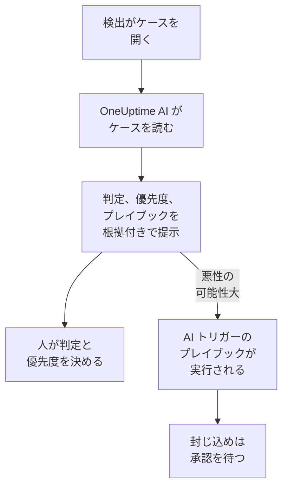

# セキュリティの OneUptime AI

OneUptime AI は、アナリストと同じように各セキュリティケースを読みます。ケースの検出、イベント、エンティティ、脅威インテリジェンスに加え、その周りのホストや人も読みます。何が起きたのか、本物らしいかを伝え、優先度とプレイブックを提案し、すべての主張に裏付けとなる根拠を示します。自分では何も変えません。判定と優先度を決め、プレイブックを実行するのは人です。さらに、ひとつの文から検出ルールの下書きを作り、 AI に質問 でセキュリティデータについての質問に答えます。

:::cards
- [ケースをトリアージする](#ケースをトリアージする): OneUptime AI が何を読み、何を結論づけ、何を決してしないか。
- [新しいケースを自動でトリアージする](#新しいケースを自動でトリアージする): 検出が開いたケースを、開いた時点ですべてトリアージ。
- [トリアージを受けてプレイブックを実行する](#トリアージを受けてプレイブックを実行する): 「悪性の可能性大」と読まれたケースに対応します。
- [検出ルールを下書きする](#検出ルールを下書きする): 捕まえたいものを書けば、Sigma ルールを読めます。
- [セキュリティページの AI に質問](#セキュリティページの-ai-に質問): ケースとイベントについて、普段の言葉で質問できます。
:::

## 仕組み

トリアージは読むだけです。プロジェクト自身の AI で動きます。 **AI を有効化** 、プロジェクトの LLM プロバイダー、AI クレジット、1 日あたりの AI の上限です。

## 始める前に

- **プロジェクト設定 → AI → AI 機能** で **AI を有効化** がオンになっていること。オフのときは、セキュリティに OneUptime AI のものは何も表示されず、何も実行されません。
- OneUptime AI が使える LLM プロバイダーが **プロジェクト設定 → AI → LLM プロバイダー** にあること。OneUptime Cloud では用意されています。
- トリアージを始めるには、セキュリティケースを扱えるロールが必要です。Project Owner、Project Admin、Security Admin、Security Member のいずれかです。Security Viewer はすべてのトリアージを読めますが、始めることはできません。[ロール](/docs/permissions/reference#ロール) を参照してください。

## ケースをトリアージする

ケースを開くと、ページの上部に **OneUptime AI** カードがあります。

| カードの表示 | 意味 |
| --- | --- |
| **まだトリアージされていません** | まだトリアージが実行されていません。 **AI でトリアージ** で始めます。 |
| **このケースをトリアージ中** | OneUptime AI がケースを読んでいます。各チェックは実行中に表示されます。 |
| **悪性の可能性大** などの判定 | トリアージが完了しました。 **再トリアージ** でケースを最初から読み直します。 |
| **トリアージが完了しませんでした** | 実行が止まりました。 **再試行** で別の実行を始めます。 |

Security Viewer にも同じカードが表示されます。 **AI でトリアージ** と **再試行** はグレー表示のままで、その横にトリアージを開始できる人を示す一文が表示されます。 **再トリアージ** と **優先度を設定** は表示されません。

トリアージが読むもの:

- ケース: タイトル、優先度、ステータス、エンティティ、ATT&CK の対応
- ケースの検出: 新しい順に、それぞれのサンプルイベント付きで
- ケースのユーザー、ホスト、アドレスに関するセキュリティイベントと脅威インテリジェンス
- ケースのユーザー、ホスト、アドレスのリスクと、今週それを高めたもの
- ケースのホストとアドレスに一致する OneUptime 上のホストと、その所有者
- ケースが宣言したインシデント、ノート、保護されたエンティティ、有効なプレイブック。

インシデントの調査と同じように、OneUptime のほかの部分も読めます。ログ、トレース、メトリクス、ホスト、そしてプロジェクトの MCP サーバーの読み取り専用ツールです。

### 何を結論づけるか

| 判定 | 意味 | 提案するクローズ時の判定 |
| --- | --- | --- |
| 悪性の可能性大 | 根拠が悪意のある、または許可されていないアクティビティを示している | True Positive |
| 良性の可能性大 | 管理作業やチームが実行するスキャンのように、本物だが想定内のアクティビティに見える | Benign Positive |
| 誤検知の可能性大 | 検出が通常のアクティビティを読み違えたように見える | False Positive |
| 判定不能 | 判断できるだけの根拠がなく、人が確認する必要がある | なし |

判定は OneUptime AI のものであり、ケースの判定にはなりません。 **Close Case** は提案された判定から始まり、選ぶのは人です。判定の下に、カードには次のものがあります。

- **提案された優先度** 。ケースの優先度が違うときは **優先度を設定** が表示されます。
- **提案されたプレイブック** 。 **プレイブックを実行** で、必要な承認をすべて経て、あなたとして実行します。そのプレイブックがすでにこのケースで実行中のときは、 **プレイブックを実行** の代わりに、その実行の状態（ **承認待ち** など）が表示されます。実行はケースの **Playbooks** にあり、もう一度実行すると同じ承認を再び求めることになります。
- レポート: 何が起きたか、どれだけ確かか、次に何をするか。各主張の後に C1 のような引用が付きます。
- **確認した根拠** : トリアージが実行したすべてのクエリ。引用を押すとそのクエリが開き、クエリを展開すると、トリアージが読んだ期間について、あなたの権限でもう一度実行されます。
- **このケースについて質問** 。このケースについて AI に質問 を開きます。

どのケース一覧でも、各ケースのタイトルの横に判定が表示され、 **AI の判定** で絞り込めます。

### 決してしないこと

トリアージはケースを何も変えません。ステータス、優先度、担当者、判定、ノートのどれもです。プレイブックを実行することも、誰かを封じ込めることもありません。提案したプレイブックは、人が実行したとき、または後述のトリガーで実行されます。

### AI を操るために書かれたテキスト

イベント、アラート、エンティティの値はプロジェクトの外から届き、攻撃者が書くこともできます。OneUptime AI はそれらをすべてデータとして読み、指示としては扱いません。ケースのデータの一部が AI への指示のように読める場合、カードはまずそのことを伝え、「良性の可能性大」や「誤検知の可能性大」の判定は「判定不能」になり、そのトリアージはプレイブックを開始しません。

## 新しいケースを自動でトリアージする

**製品 → セキュリティイベント → AI → 設定** を開き、 **新しいケースをトリアージ** をオンにします。すると、検出が開いたケースはすべて、開いた時点でトリアージされます。スイッチは切り替えた時点で保存されます。変更できるのは Project Owner と Project Admin です。

新しいプロジェクトではオンで始まり、それ以前に作成されたプロジェクトでは、誰かがオンにするまでオフのままです。手動で開いたケースと、 **テスト攻撃を送信** のテスト攻撃のケースは、誰かが **AI でトリアージ** をクリックしたときにトリアージされます。

## トリアージを受けてプレイブックを実行する

**トリガー** が **悪性の可能性大とトリアージ** のプレイブックは、トリアージがケースを「悪性の可能性大」と読んだときに、そのケースで一度だけ実行されます。 **For Cases At Least** 、 **Only For Detections From** 、 **Only For These Detection Rules** はほかのトリガーと同じように対象を絞り込み、封じ込めのステップはいつもどおり承認を待ちます。次の場合は実行されません。

- AI を操るために書かれたテキストが見つかったトリアージの後
- 同じケースでの 2 回目。ケースが何度トリアージされても同じです
- テスト攻撃のケース。ただし、プレイブックのすべてのステップが OneUptime の中にとどまる場合は除きます。

このトリガーが新しいプレイブックに表示されるのは、プロジェクトの AI がオンのときだけです。

## 検出ルールを下書きする

**検出ルール** の **Sigma ルール（YAML）** フィールドの下で **AI で下書き** をクリックし、ルールで捕まえたいものを書きます。たとえば、5 分以内にひとつの IP アドレスからのサインイン失敗が 10 回、のようにです。 **ルールを下書き** は、保存済みのルールと同じ方法でチェックした Sigma ルールをフィールドに入れます。読んで、必要なら変更し、いつもどおり保存します。保存するまでは何も保存されません。フィールドにすでにルールがあると、ボタンは **AI で下書きし直す** になり、下書きはそのルールを置き換えます。

下書きには、検出ルールを作成できるロールが必要です。

## セキュリティページの AI に質問

**AI に質問** は、今どのセキュリティページにいるかを知っています。ケースではまずケースを読み、 **本物ですか？** のような質問を提案します。ほかのセキュリティイベントのページでは、普段の言葉の質問でセキュリティイベントを検索します。値を脅威インテリジェンスと照合したり、ユーザー、ホスト、アドレスの活動量を調べたり、ケースに使えるプレイブックを一覧したりもできます。

AI に質問 はケースにノートを追加したり、ケースでプレイブックを実行したりできます。どちらもあなたとして行い、毎回事前に確認します。実行したプレイブックは、ほかのプレイブックと同じように承認を待ちます。

ケースがインシデントを宣言すると、インシデントの AI 調査もケースを読みます。何が検出されたか、誰についてか、そして OneUptime AI のトリアージです。

## コストと上限

トリアージは、インシデントの調査と同じ OneUptime AI の作業です。OneUptime Cloud ではプロジェクトの AI クレジットから支払われ、プロジェクト自身の 1 日あたりの AI の上限 ( **プロジェクト設定 → AI → AI 機能** の **1 日あたりの上限** ) に数えられます。インシデントとアラートの 1 日あたりの上限は適用されません。1 つのケースで同時に実行されるトリアージは 1 つだけで、その呼び出しは AI ログ ( **プロジェクト設定 → AI → AI ログ** ) に表示されます。

プロジェクトの AI クレジットが尽きたとき、または 1 日あたりの AI の上限に達したときは、新しいケースはトリアージされません。カードが理由を示し、クレジットが追加されるか上限がリセットされると、 **AI でトリアージ** が再び使えます。

## トラブルシューティング

:::details 新しいケースがトリアージされなかった
**AI を有効化** がオンか、そして **製品 → セキュリティイベント → AI → 設定** の **新しいケースをトリアージ** がオンかを確認してください。手動で開いたケースとテスト攻撃のケースは、誰かが依頼したときだけトリアージされます。ケースを開くと、トリアージを妨げているものがあれば、カードが何が原因か、どこで直せるかを示します。
:::

:::details プロジェクトの AI クレジットが尽きた、または 1 日あたりの AI の上限に達したとカードに表示される
プロジェクトのオーナー、または Manage Billing を持つ人が、 **プロジェクト設定 → AI → AI クレジット** でクレジットを追加するか、 **プロジェクト設定 → AI → AI 機能** で上限を上げるか外せます。その後、ケースで **AI でトリアージ** をクリックしてください。
:::

:::details ケースのテキストが AI への指示のように読めるとカードに表示される
イベントのメッセージやユーザー名など、ケースのデータの一部が AI を操るために書かれていました。OneUptime AI はそれをデータとして読み、判断をあなたに任せました。ケースを閉じる前に、検出と根拠をご自身で確認してください。
:::

:::details AI トリガーのプレイブックが実行されなかった
プレイブックが有効か、トリアージがケースを「悪性の可能性大」と読んだか、そして **For Cases At Least** 、 **Only For Detections From** 、 **Only For These Detection Rules** の設定がケースに合っているかを確認してください。実行はケースごとに 1 回で、AI を操るために書かれたテキストが見つかったトリアージの後には実行されません。
:::

## 次のステップ

:::cards
- [セキュリティケースとプレイブック](/docs/telemetry/security-cases): ケースを扱い、判定を付けて閉じ、プレイブックを作ります。
- [AI SRE](/docs/ai/ai-sre): OneUptime AI がインシデントとアラートをどう調査するか、そしてその上限。
- [AI に質問](/docs/ai/ask-ai): プロジェクトについて普段の言葉で質問できます。
- [LLM プロバイダー](/docs/ai/llm-provider): OneUptime AI が使うモデルを選びます。
:::
