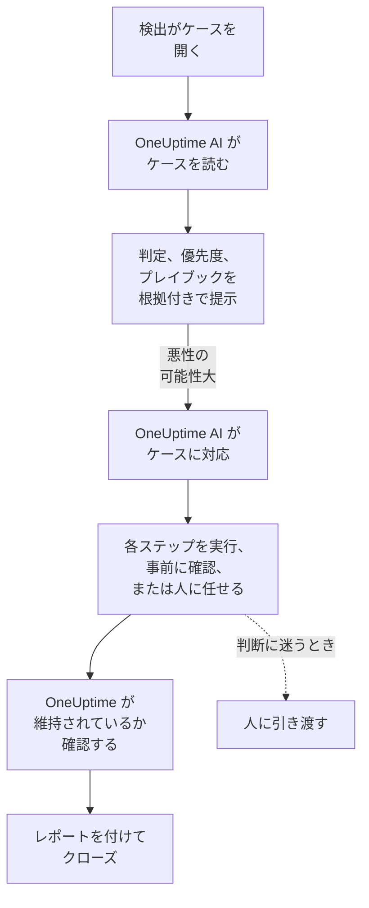

# セキュリティの OneUptime AI

OneUptime AI は、アナリストと同じように各セキュリティケースを読みます。ケースの検出、イベント、エンティティ、脅威インテリジェンスに加え、その周りのホストや人も読みます。何が起きたのか、本物らしいかを伝え、優先度とプレイブックを提案し、すべての主張に裏付けとなる根拠を示します。許可すれば、そのままケースに最後まで対応します。ケースを引き受け、脅威を封じ込め、行ったことが維持されているかを確認し、コードを修正させ、レポートを付けてケースをクローズします。ステップの種類ごとに、設定に従って自動で実行するか、先に人に確認するか、人に任せます。どのステップも人が使うのと同じプレイブックエンジンを通じて実行するため、各ステップは OneUptime AI によるものとしてケースのタイムラインに残り、元に戻せます。さらに、ひとつの文から検出ルールの下書きを作り、 AI に質問 でセキュリティデータについての質問に答えます。

:::cards
- [ケースをトリアージする](#ケースをトリアージする): OneUptime AI が何を読み、何を結論づけ、何を決してしないか。
- [新しいケースを自動でトリアージする](#新しいケースを自動でトリアージする): 検出が開いたケースを、開いた時点ですべてトリアージ。
- [ケースに最後まで対応する](#ケースに最後まで対応する): 封じ込め、確認、修正、クローズまで。選んだものは人が承認します。
- [ケースで OneUptime AI に許可すること](#ケースで-oneuptime-ai-に許可すること): ステップの種類ごとに「オフ」「事前に確認」「自動で実行」から選びます。
- [ケースを人に引き渡すとき](#ケースを人に引き渡すとき): 対応をやめる理由と、誰に通知されるか。
- [OneUptime AI に先に対応させる](#oneuptime-ai-に先に対応させる): OneUptime AI が人を必要とするときだけ通知します。
- [トリアージを受けてプレイブックを実行する](#トリアージを受けてプレイブックを実行する): 「悪性の可能性大」と読まれたケースに対応します。
- [検出ルールを下書きする](#検出ルールを下書きする): 捕まえたいものを書けば、Sigma ルールを読めます。
- [セキュリティページの AI に質問](#セキュリティページの-ai-に質問): ケースとイベントについて、普段の言葉で質問できます。
:::

## 仕組み

トリアージは読むだけです。ケースへの対応は、許可した範囲内で操作を行い、判断に迷った時点でケースを人に引き渡します。どちらもプロジェクト自身の AI で動きます。 **AI を有効化** 、プロジェクトの LLM プロバイダー、AI クレジット、1 日あたりの AI の上限です。

## 始める前に

- **プロジェクト設定 → AI → AI 機能** で **AI を有効化** がオンになっていること。オフのときは、セキュリティに OneUptime AI のものは何も表示されず、何も実行されません。
- OneUptime AI が使える LLM プロバイダーが **プロジェクト設定 → AI → LLM プロバイダー** にあること。OneUptime Cloud では用意されています。
- トリアージを始めるには、セキュリティケースを扱えるロールが必要です。プロジェクト所有者、プロジェクト管理者、セキュリティ管理者、セキュリティメンバーのいずれかです。セキュリティ閲覧者はすべてのトリアージを読めますが、始めることはできません。[ロール](/docs/permissions/reference#ロール) を参照してください。

## ケースをトリアージする

ケースを開くと、ページの上部に **OneUptime AI** カードがあります。

| カードの表示 | 意味 |
| --- | --- |
| **まだトリアージされていません** | まだトリアージが実行されていません。 **AI でトリアージ** で始めます。 |
| **このケースをトリアージ中** | OneUptime AI がケースを読んでいます。各チェックは実行中に表示されます。 |
| **悪性の可能性大** などの判定 | トリアージが完了しました。 **再トリアージ** でケースを最初から読み直します。 |
| **トリアージが完了しませんでした** | 実行が止まりました。 **再試行** で別の実行を始めます。 |

セキュリティ閲覧者にも同じカードが表示されます。 **AI でトリアージ** と **再試行** はグレー表示のままで、その横にトリアージを開始できる人を示す一文が表示されます。 **再トリアージ** と **優先度を設定** は表示されません。

トリアージが読むもの:

- ケース: タイトル、優先度、ステータス、エンティティ、ATT&CK の対応
- ケースの検出: 新しい順に、それぞれのサンプルイベント付きで
- ケースのユーザー、ホスト、アドレスに関するセキュリティイベントと脅威インテリジェンス
- ケースのユーザー、ホスト、アドレスのリスクと、今週それを高めたもの
- ケースのホストとアドレスに一致する OneUptime 上のホストと、その所有者
- ケースが宣言したインシデント、ノート、保護されたエンティティ、有効なプレイブック。

インシデントの調査と同じように、OneUptime のほかの部分も読めます。ログ、トレース、メトリクス、ホスト、そしてプロジェクトの MCP サーバーの読み取り専用ツールです。

ケースを見ることができる全員がそのトリアージを読むため、トリアージは全員が読めるものだけを読みます。ある種類のレコードを所有者やラベルだけで絞って読むチーム、カスタムロール、API キーは、その API キー、またはチームの誰かがセキュリティケースか監査ログを読める場合にだけ数えます。そのどれも所有者やラベルだけで絞って読まない種類のレコードは、すべて読みます。絞って読むものがある場合、所有者やラベルで区別されたホスト、クラスター、サービス、その他のレコードは読まず、名前を挙げることも数えることもありません。誰がセキュリティケースを読めるかはトリアージを実行するたびに判断するため、誰かがそのアクセス権を得る前に書かれたトリアージには、その人から区別されたレコードの名前が含まれることがあります。ケースは常に読み、ケースが宣言したインシデントも、プライベートでない限り読みます。プライベートなインシデントとアラートは読みません。

### 何を結論づけるか

| 判定 | 意味 | 提案するクローズ時の判定 |
| --- | --- | --- |
| 悪性の可能性大 | 根拠が悪意のある、または許可されていないアクティビティを示している | True Positive |
| 良性の可能性大 | 管理作業やチームが実行するスキャンのように、本物だが想定内のアクティビティに見える | Benign Positive |
| 誤検知の可能性大 | 検出が通常のアクティビティを読み違えたように見える | False Positive |
| 判定不能 | 判断できるだけの根拠がなく、人が確認する必要がある | なし |

判定は OneUptime AI のものであり、ケースの判定にはなりません。 **ケースをクローズ** は提案された判定から始まり、選ぶのは人です。判定の下に、カードには次のものがあります。

- **提案された優先度** 。ケースの優先度が違うときは **優先度を設定** が表示されます。
- **提案されたプレイブック** 。 **プレイブックを実行** で、必要な承認をすべて経て、あなたとして実行します。そのプレイブックがすでにこのケースで実行中のときは、 **プレイブックを実行** の代わりに、その実行の状態（ **承認待ち** など）が表示されます。実行はケースの **プレイブック** にあり、もう一度実行すると同じ承認を再び求めることになります。
- レポート: 何が起きたか、どれだけ確かか、次に何をするか。各主張の後に C1 のような引用が付きます。
- **確認した根拠** : トリアージが実行したすべてのクエリ。引用を押すとそのクエリが開き、クエリを展開すると、トリアージが読んだ期間について、あなたの権限でもう一度実行されます。
- **このケースについて質問** 。このケースについて AI に質問 を開きます。

どのケース一覧でも、各ケースのタイトルの横に判定が表示され、 **AI の判定** で絞り込めます。

### 決してしないこと

トリアージはケースを何も変えません。ステータス、優先度、担当者、判定、ノートのどれもです。プレイブックを実行することも、誰かを封じ込めることもありません。提案したプレイブックは、人が実行したとき、または後述のトリガーで実行されます。ケースに対して操作するのは OneUptime AI によるケースへの対応で、これは別の設定です。 [ケースに最後まで対応する](#ケースに最後まで対応する) を参照してください。

### AI を操るために書かれたテキスト

イベント、アラート、エンティティの値はプロジェクトの外から届き、攻撃者が書くこともできます。OneUptime AI はそれらをすべてデータとして読み、指示としては扱いません。ケースのデータの一部が AI への指示のように読める場合、カードはまずそのことを伝え、「良性の可能性大」や「誤検知の可能性大」の判定は「判定不能」になり、そのトリアージはプレイブックを開始しません。また、OneUptime AI はそのケースに対応せず、人に引き渡します。

## 新しいケースを自動でトリアージする

**製品 → セキュリティイベント → AI → 設定** を開き、 **新しいケースをトリアージ** をオンにします。すると、検出が開いたケースはすべて、開いた時点でトリアージされます。スイッチは切り替えた時点で保存されます。変更できるのはプロジェクト所有者とプロジェクト管理者です。

新しいプロジェクトではオンで始まり、それ以前に作成されたプロジェクトでは、誰かがオンにするまでオフのままです。手動で開いたケースと、 **テスト攻撃を送信** のテスト攻撃のケースは、誰かが **AI でトリアージ** をクリックしたときにトリアージされます。

## ケースに最後まで対応する

同じページで **ケースに最後まで対応** をオンにします。すると OneUptime AI は、トリアージで「悪性の可能性大」と判定したケースをそれぞれ引き受け、 **ケースで OneUptime AI に許可すること** で許可した範囲内で対応します。新しいプロジェクトではオンで始まり、それ以前に作成されたプロジェクトでは、誰かがオンにするまでオフのままです。変更できるのはプロジェクト所有者とプロジェクト管理者です。

オンの間は、人が個々のケースで開始することもできます。ケースの **OneUptime AI** カードにある **AI で対応** は、OneUptime AI のトリアージが「悪性の可能性大」「良性の可能性大」「誤検知の可能性大」と判定したケースに対応します。トリアージが「判定不能」だったケース、データが AI への指示のように読めるケース、最高の優先度のケースには表示されません。これらは人が扱うケースです。使うには、セキュリティケースを扱えるロールが必要です。

### 何をするか

OneUptime AI は、ケースの **対応計画** を緊急度の高い順に進めます。 **本当の脅威か確認する** 、 **封じ込める** 、 **原因を修正する** 、 **ケースをクローズする** の順です。各ステップは、 **ケースで OneUptime AI に許可すること** のその種類の行に従って、実行するか、人に確認するか、人に任せます。

| ステップ | OneUptime AI が行うこと |
| --- | --- |
| ケースを引き受ける | ケースを引き受け、優先度をトリアージが提案したものまで上げます。優先度を下げることはなく、最高の優先度まで上げたケースは人に渡します |
| 誤検知の可能性を除外する | OneUptime 自身の事実で疑いの余地がないときだけ完了にします。アドレスが自分たちのものではなく、そこから誰もサインインしていない場合です。それ以外はステップを人に任せます |
| アドレスをブロックする | [ブロックリスト](/docs/telemetry/security-cases#ブロックリスト) を通じて 24 時間ブロックし、ブロックが維持されているかを OneUptime が確認するのを待ちます。ブロックリストを適用するものがない場合は、ステップを人に任せます |
| ユーザーを一時停止する、ホストを封じ込める | ID プロバイダーまたは EDR を通じて、それを行うプレイブックのステップを実行します。そのようなプレイブックがない場合は、ステップを人に任せます |
| インシデントを宣言する | 常に事前に確認します。インシデントは人を呼び出すためです |
| ケースを封じ込め済みにする | 脅威を封じ込めるすべてのステップを OneUptime が確認したとき |
| 攻撃が到達したルートを修正する | 「AI で修正」にプルリクエストを作成させます。マージするのは人です。OneUptime が本番環境で修正を確認するとケースをクローズし、修正が完了したように見えるだけのときは人に確認し、修正が維持されていない間はケースへの対応を続けます |
| MFA を有効にする、アカウントの変更を確認する | 人に任せます。それらが維持されているかを OneUptime に伝える製品がないためです |
| ケースをクローズする | ほかのすべてのステップが完了し、ケースの検出が 24 時間静かになったら、 [クローズレポート](#クローズレポート) を付けて True Positive としてクローズします |

ケースの検出ルールが独自に追加したステップや、DNS フィルターでのドメインのブロックなど OneUptime に実行する手段がないものは、理由を示したうえで人に任せます。

OneUptime AI が実行するステップはすべてプレイブックエンジンを通り、ケースの **プレイブック** ページに、 **OneUptime AI** をトリガーとする 1 ステップの実行として表示されます。そのため、誰が実行するステップとも同じように、承認を待ち、保護対象のエンティティには手を付けず、ケースのタイムラインに表示され、監査ログに残り、元に戻せます。タイムラインには OneUptime AI によるものと表示されます。確認を求めるステップは、ケース上、ケースの **プレイブック** ページ、または Slack や Microsoft Teams でのワンタップで、人の承認を待ちます。

### ケース上の記録

トリアージの下にある **OneUptime AI** カードの **ケースへの対応** に、OneUptime AI がケースにどう対応しているかが表示されます。

| カードの表示 | 意味 |
| --- | --- |
| **OneUptime AI はこのケースに対応していません** | **AI で対応** を押すと、OneUptime AI がケースを引き受けます。 |
| **このケースに対応中** | OneUptime AI が計画を進めています。 **引き継ぐ** で停止し、ケースはあなたの担当になります。 |
| **担当者を待っています** | ステップの承認を誰かに依頼しており、誰かが回答すると続行します。 |
| **人に引き渡し済み** | 対応をやめ、その理由を示します。 |
| **ケースはクローズされています** | OneUptime AI がケースをクローズしたか、人がクローズしました。 **クローズレポート** はステップの上にあります。 |

その下には、実行したステップ、確認したステップ、任せたステップが新しい順に、それぞれ理由とともに表示されます。たとえば **自動で実行しました: 設定で許可されています。** 、 **設定により、人の承認を待ちます。** 、 **OneUptime にはこのステップを実行する手段がないため、人が実行します。** などです。確認を求めたステップには **承認** と **辞退** があり、実行したステップにはその実行へのリンクがあり、そこで元に戻せます。OneUptime が確認するステップには確認の結果が表示され、同じルールのケースで以前に実行したステップには、どれだけ維持されたかが表示されます: 「類似の 15 件のケースのうち 14 件で維持されました。」

### 良性または誤検知と判定したケース

トリアージが「良性の可能性大」または「誤検知の可能性大」と判定したケースで **AI で対応** を使うと、 **ケースをクローズする** の設定に従って、ケースを Benign Positive または False Positive としてクローズします。クローズされると、OneUptime AI は同じく **ケースをクローズする** の設定に従ってケースが行ったブロックを解除し、ケースのきっかけとなった値について、ケースのルールに例外を提案します。例外は常に人を待ちます。 **承認** を押すと、あなたとして追加されます。

## ケースで OneUptime AI に許可すること

**製品 → セキュリティイベント → AI → 設定** の **ケースで OneUptime AI に許可すること** では、ステップの種類ごとに行があり、選んだ時点で保存されます。

- **オフ** : OneUptime AI はこれを人に任せ、そのことをケースに表示します。
- **事前に確認** : 証拠を添えて人に確認し、誰かが承認すると実行します。
- **自動で実行** : 確認せずに実行し、そのことをケースのタイムラインに表示します。

| 行 | 対象 | 新しいプロジェクトの初期値 |
| --- | --- | --- |
| **ケースに対応** | ケースの引き受け、優先度の引き上げ、証拠を添えたステップの完了、封じ込め済みへの移行 | 自動で実行 |
| **アドレスをブロック** | ケースのアドレスをエッジで 24 時間ブロックすること | 事前に確認 |
| **アカウントを封じ込め** | ケースのユーザーの一時停止、またはセッションの終了 | 事前に確認 |
| **ホストを封じ込め** | ケースのホストの封じ込め、または隔離 | 事前に確認 |
| **コードを修正** | 攻撃が到達したルートのプルリクエストを「AI で修正」に作成させること | 自動で実行 |
| **ケースをクローズする** | クローズレポートを付けたケースのクローズと、無害としてクローズされたあとのケースのブロックの解除 | 事前に確認 |

これらの設定は **ケースに最後まで対応** がオンの間に有効になり、オフの間はカードにそのことが表示されます。変更できるのはプロジェクト所有者とプロジェクト管理者です。

**アドレスをブロック** 、 **アカウントを封じ込め** 、 **ホストを封じ込め** を **自動で実行** に設定するには、セキュリティ管理者の権限が必要です。この権限はプロジェクト所有者とプロジェクト管理者も持っています。承認をオフにしたプレイブックのステップと同じように、OneUptime は誰がいつ設定したかを記録します。 **アドレスをブロック** はさらに確認が必要です。 **確認してオンにする** がセキュリティ管理者による確認で、その後、行には確認された日時が表示されます。セキュリティ管理者が確認するまで、OneUptime AI はブロックする前に確認を求めます。

行の設定にかかわらず、OneUptime AI は次のように動作します。

- 保護対象のユーザー、ホスト、アドレスには決して操作せず、ケースを人に引き渡します
- 自動で行う操作は、すべてのケースを合わせて 1 時間に最大 10 件までで、それを超えると次のケースを人に引き渡します
- ブロックは最長 24 時間です
- コードを決してマージしません。プルリクエストはすべて人がマージします
- インシデントを宣言する前と、ルールの例外を追加する前には、常に確認を求めます
- 1 つのケースには一度に 1 つの実行で対応し、サーバーが再起動しても、操作を行う実行が失われることはありません。

## ケースを人に引き渡すとき

OneUptime AI が黙って手を引くことはありません。次の場合は、カードとタイムラインで理由を示したうえで、ケースを人に引き渡します。

- ケースのデータの一部が AI への指示のように読める
- ケースが最高の優先度である
- 次のステップの対象が保護されている
- 1 時間に自動で操作できる上限に達した
- プロジェクトかセキュリティケースで AI がオフになっている、LLM プロバイダーがない、またはプロジェクトの AI クレジットが不足しているか 1 日の AI 上限に達した
- トリアージでケースが本物か判断できなかった
- 実行したステップが維持されていない、開始したステップが完了しなかった、または実行したステップを人が拒否したか元に戻した
- 次に何をすべきか判断できない、またはケースに残っているのがすべて人が行うことである。

ケースの担当者にはすぐに通知されます。担当者がいないときは、そのケースの優先度のケースについて通知を受ける人に通知されます。この通知は **ユーザー設定 → 通知設定** の **OneUptime AI がセキュリティケースを人に引き渡した** です。セキュリティケースのワークスペース通知ルールは、 **OneUptime AI による人への引き渡し** として Slack または Microsoft Teams のチャンネルに投稿します。 **引き継ぐ** では、押した人がケースを担当するため、誰にも通知せずにケースを引き渡します。

**AI で対応** を押すと、OneUptime AI はケースの現状から再び対応します。

OneUptime AI が先に対応している間に保留されたケースは、新しいケースの通知と、OneUptime AI が対応をやめた理由とともに、一度だけ人に届きます。 [OneUptime AI に先に対応させる](#oneuptime-ai-に先に対応させる) を参照してください。

## OneUptime AI に先に対応させる

**製品 → セキュリティイベント → AI → 設定** の **OneUptime AI に先に対応させる** で **先に対応** をオンにします。すると、検出が開いた新しいケースのうち、選んだ優先度未満のものは、誰かに通知される前に OneUptime AI を待ちます。この設定は **新しいケースをトリアージ** と **ケースに最後まで対応** がオンのときに使えます。最初はオフで、変更した時点で保存されます。変更できるのはプロジェクト所有者とプロジェクト管理者です。

- **この優先度未満のケース** : ケースが保留されるには、その優先度がこれより低い必要があります。別の優先度を選ぶまでは高です。
- **この時間が過ぎたら人に通知** : ケースを保留する最長時間で、5、10、15、20、30 分から選びます。最初は 10 分です。

ケースが保留されている間は、新しいケースの通知が待機し、そのケースで自動的に始まるプレイブックの **オンコールを呼び出す** ステップも待機します。ケースには **OneUptime AI が対応中** と、人に通知される時刻が表示され、 **今すぐ呼び出す** を押すとすぐに通知されます。呼び出しが待機しているプレイブックの実行は **OneUptime AI 待ち** になります。

次のいずれかが起きた時点で、保留は終わります。

| 起きたこと | 結果 |
| --- | --- |
| OneUptime AI がケースを封じ込め、封じ込めるすべてのステップを OneUptime が確認する、またはケースがクローズされる | 誰にも通知されません。新しいケースを投稿するチャンネルには、OneUptime AI が行ったことの概要がひとつ届き、待機していた呼び出しのステップはスキップされます |
| OneUptime AI が人を必要とする: ステップの承認を誰かに求める、ケースを人に引き渡す、またはケースへの対応を開始できない | ケースの通知を保留していた全員に、理由と OneUptime AI がすでに行ったことを添えてすぐに通知され、待機していた呼び出しのステップが呼び出します |
| トリアージがケースを「悪性の可能性大」と判定しない、OneUptime がすべてのステップを確認する前にケースが封じ込め済みにされる、または保留時間が尽きる | 理由を添えて、全員にすぐに通知されます |
| 誰かが **今すぐ呼び出す** を押す、ケースが選んだ優先度まで上がる、または **先に対応** か **ケースに最後まで対応** がオフになる | 全員にすぐに通知されます |
| 人がケースを引き受ける: **引き継ぐ** 、割り当て、またはステータスを進める | その人の担当になります。ほかの人には通知されず、チャンネルには新しいケースが知らされ、待機していた呼び出しのステップはスキップされます |

次の場合、ケースは保留されず、いつもどおり人に通知されます。

- 最高の優先度である、または選んだ優先度以上である
- その前の 5 分間にほかのケースが 3 件開いた。進行中の攻撃とみられるため、その時点で保留されていたケースも人に渡ります
- データの一部が AI への指示のように読める
- OneUptime AI が過去 24 時間以内に解決したケースのアドレス、ユーザー、ホストに関するケースである。行ったことが維持されなかったためです
- プロジェクトの AI クレジットが尽きたときなど、OneUptime AI がトリアージや対応をできない
- 人が開いたケース、またはテスト攻撃のケースである。

選んだ優先度以上のケース、人が開いたケース、テスト攻撃のケースを除き、保留されなかった理由はケースのタイムラインに表示されます。対応目標の通知が保留されることはありません。

アドレスのブロック、アカウントとホストの封じ込めは、 **ケースで OneUptime AI に許可すること** で **自動で実行** に設定するまで事前に確認を求めます。そのため、OneUptime AI が確認を求めた時点でケースは人に届きます。 **アドレスをブロック** を **自動で実行** にしてセキュリティ管理者が確認すれば、誰にも通知せずにスキャナーを封じ込められます。

### 週次メール

毎週月曜日に、セキュリティケースを閲覧できるプロジェクト所有者とセキュリティ管理者に、前の週に OneUptime AI がプロジェクトのセキュリティケースで行ったことをまとめたメールが 1 通届きます。先に対応したケースとその結末、対応したケースがどれだけ早く封じ込められたか、ブロックしたアドレスと再び解除されたブロック、人に承認を求めたステップと人がどれだけ早く回答したか、人が元に戻したステップです。メールに含まれるのは数値と、 **製品 → セキュリティイベント → 概要** へのリンクだけです。OneUptime AI が何もしなかった週には、メールは送られません。

## クローズレポート

OneUptime AI は、ケースをクローズするとき、または人にクローズを依頼するとき、トリアージの言葉ではなくケースにある内容からクローズレポートを書きます。何が起きたか、影響、何を行ったか、何を修正したか、今後何を注視すべきかです。レポートはケースのクローズ時のメモになり、タイムラインに表示され、カードでは **クローズレポート** の下に表示されます。 **ケースをクローズする** が **事前に確認** の場合、ケースは人がクローズを承認するまで待ちます。承認する前にレポートを読めます。

## 測定方法

**製品 → セキュリティイベント → 概要** には、OneUptime AI がケースに対応するか確認を求めたことがあれば、過去 30 日間のケースに OneUptime AI がどう対応したかが表示されます。対応したケースのうちの **OneUptime AI が解決** 、それぞれ AI なしの時間と並べた **AI による封じ込めまでの時間** と **AI によるクローズまでの時間** 、そして **依頼した承認** と、人がどれだけ早く回答したか、人が元に戻したステップの数です。

## トリアージを受けてプレイブックを実行する

**トリガー** が **悪性の可能性大とトリアージ** のプレイブックは、トリアージがケースを「悪性の可能性大」と読んだときに、そのケースで一度だけ実行されます。 **対象ケースの最低優先度** 、 **対象とする検出元** 、 **対象とする検出ルール** はほかのトリガーと同じように対象を絞り込み、封じ込めのステップはいつもどおり承認を待ちます。次の場合は実行されません。

- AI を操るために書かれたテキストが見つかったトリアージの後
- 同じケースでの 2 回目。ケースが何度トリアージされても同じです
- テスト攻撃のケース。ただし、プレイブックのすべてのステップが OneUptime の中にとどまる場合は除きます。

このトリガーが新しいプレイブックに表示されるのは、プロジェクトの AI がオンのときだけです。

## 検出ルールを下書きする

**検出ルール** の **Sigma ルール（YAML）** フィールドの下で **AI で下書き** をクリックし、ルールで捕まえたいものを書きます。たとえば、5 分以内にひとつの IP アドレスからのサインイン失敗が 10 回、のようにです。 **ルールを下書き** は、保存済みのルールと同じ方法でチェックした Sigma ルールをフィールドに入れます。読んで、必要なら変更し、いつもどおり保存します。保存するまでは何も保存されません。フィールドにすでにルールがあると、ボタンは **AI で下書きし直す** になり、下書きはそのルールを置き換えます。

下書きには、検出ルールを作成できるロールが必要です。

## セキュリティページの AI に質問

**AI に質問** は、今どのセキュリティページにいるかを知っています。ケースではまずケースを読み、 **本物ですか？** のような質問を提案します。ほかのセキュリティイベントのページでは、普段の言葉の質問でセキュリティイベントを検索します。値を脅威インテリジェンスと照合したり、ユーザー、ホスト、アドレスの活動量を調べたり、ケースに使えるプレイブックを一覧したりもできます。

AI に質問 はケースにノートを追加したり、ケースでプレイブックを実行したりできます。どちらもあなたとして行い、毎回事前に確認します。実行したプレイブックは、ほかのプレイブックと同じように承認を待ちます。

ケースがインシデントを宣言すると、インシデントの AI 調査もケースを読みます。何が検出されたか、誰についてか、そして OneUptime AI のトリアージです。

## コストと上限

トリアージは、インシデントの調査と同じ OneUptime AI の作業です。OneUptime Cloud ではプロジェクトの AI クレジットから支払われ、プロジェクト自身の 1 日あたりの AI の上限 ( **プロジェクト設定 → AI → AI 機能** の **1 日あたりの上限** ) に数えられます。インシデントとアラートの 1 日あたりの上限は適用されません。1 つのケースで同時に実行されるトリアージは 1 つだけで、その呼び出しは AI ログ ( **プロジェクト設定 → AI → AI ログ** ) に表示されます。

プロジェクトの AI クレジットが尽きたとき、または 1 日あたりの AI の上限に達したときは、新しいケースはトリアージされません。カードが理由を示し、クレジットが追加されるか上限がリセットされると、 **AI でトリアージ** が再び使えます。ケースに対応する OneUptime AI は、LLM に問い合わせるのではなく、ケース自身の計画とチェックを読みます。同じ上限で停止し、理由を示したうえでケースを人に引き渡します。

## トラブルシューティング

:::details 新しいケースがトリアージされなかった
**AI を有効化** がオンか、そして **製品 → セキュリティイベント → AI → 設定** の **新しいケースをトリアージ** がオンかを確認してください。手動で開いたケースとテスト攻撃のケースは、誰かが依頼したときだけトリアージされます。ケースを開くと、トリアージを妨げているものがあれば、カードが何が原因か、どこで直せるかを示します。
:::

:::details OneUptime AI がケースに対応しなかった
**製品 → セキュリティイベント → AI → 設定** で **ケースに最後まで対応** がオンになっているか確認してください。OneUptime AI が自らケースを引き受けるのは、トリアージがケースを「悪性の可能性大」と判定したときだけです。ケースを開くと、 **ケースへの対応** に対応していない理由が表示され、 **AI で対応** で対応を依頼できます。
:::

:::details 「アドレスをブロック」が「自動で実行」なのに、ブロックの前に確認を求める
**アドレスをブロック** の **自動で実行** は、セキュリティ管理者が確認してから有効になります。行には確認された日時、またはまだ誰も確認していないことが表示されます。保護対象のアドレスや自分たちのアドレスは決してブロックされず、OneUptime AI はケースを人に引き渡します。ブロックリストを適用するものがない間は、ステップを人に任せます。
:::

:::details プロジェクトの AI クレジットが尽きた、または 1 日あたりの AI の上限に達したとカードに表示される
プロジェクト所有者、または Manage Billing を持つ人が、 **プロジェクト設定 → AI → AI クレジット** でクレジットを追加するか、 **プロジェクト設定 → AI → AI 機能** で上限を上げるか外せます。その後、ケースで **AI でトリアージ** をクリックしてください。
:::

:::details ケースのテキストが AI への指示のように読めるとカードに表示される
イベントのメッセージやユーザー名など、ケースのデータの一部が AI を操るために書かれていました。OneUptime AI はそれをデータとして読み、判断をあなたに任せました。ケースを閉じる前に、検出と根拠をご自身で確認してください。
:::

:::details OneUptime AI が先に対応している間に人に通知された
保留が終わった理由は、ケースのタイムラインに表示されます。OneUptime AI がステップの承認を誰かに求めた、ケースを人に引き渡した、 **この時間が過ぎたら人に通知** の時間内に終わらなかった、または誰かが **今すぐ呼び出す** を押した、のいずれかです。事前に確認するステップは、OneUptime AI が確認を求めた時点で人に届きます。 **ケースで OneUptime AI に許可すること** を参照してください。
:::

:::details 新しいケースが保留されなかった
**先に対応** がオンか、そしてケースが **この優先度未満のケース** で選んだ優先度より低いかを確認してください。最高の優先度のケース、人が開いたケース、テスト攻撃のケースは決して保留されません。それ以外の理由は、ケースのタイムラインに表示されます。
:::

:::details AI トリガーのプレイブックが実行されなかった
プレイブックが有効か、トリアージがケースを「悪性の可能性大」と読んだか、そして **対象ケースの最低優先度** 、 **対象とする検出元** 、 **対象とする検出ルール** の設定がケースに合っているかを確認してください。実行はケースごとに 1 回で、AI を操るために書かれたテキストが見つかったトリアージの後には実行されません。
:::

## 次のステップ

:::cards
- [セキュリティケースとプレイブック](/docs/telemetry/security-cases): ケースを扱い、判定を付けて閉じ、プレイブックを作ります。
- [AI SRE](/docs/ai/ai-sre): OneUptime AI がインシデントとアラートをどう調査するか、そしてその上限。
- [AI に質問](/docs/ai/ask-ai): プロジェクトについて普段の言葉で質問できます。
- [LLM プロバイダー](/docs/ai/llm-provider): OneUptime AI が使うモデルを選びます。
:::
