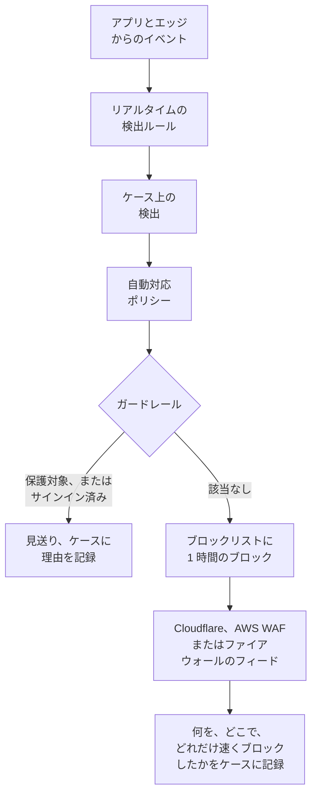

# 自動対応

自動対応ポリシーは、検出が行われた時点で、誰かがケースをトリアージする前に、攻撃してくるアドレスにチャレンジを適用するかブロックします。アプリを探るスキャナーや、パスワードを次々と試すボットは、最初のリクエストから数分以内に追い返されます。どのプロジェクトにも既定のポリシーが 3 つあり、それぞれオンにするまではオフのままで、最初は 1 週間の試行期間から始まります。試行期間中は、対応していたはずの内容を記録するだけです。ガードレールがあるので、ポリシーはオンのままにしておいても安全です。自分のアドレスやサインイン済みのユーザーが使うアドレスには手を付けず、攻撃が単独で扱うべき規模を超えたときは停止して人を呼び出します。

:::cards
- [ポリシーをオンにする](#ポリシーをオンにする): まず 1 週間の試行期間、それからワンクリック。
- [ガードレール](#ガードレール): ポリシーが決してしないことと、停止するとき。
- [ブロックまでの時間](#ブロックまでの時間): 各ポリシーがどれだけ速くブロックするか。カードとケースで確認できます。
- [独自のポリシー](#独自のポリシー): 選んだテクニック、ルール、脅威インテリジェンスに対応します。
:::

## しくみ

ポリシーは、検出がケースに記録された時点、つまりルールが発火した数秒後に対応します。そのブロックは、プレイブックのステップ **アドレスをブロック** と同じように [ブロックリスト](/docs/telemetry/security-cases#ブロックリスト) に追加され、作成者としてポリシーの名前が付きます。ブロックリストを適用する宛先がこれを保持し、ケースのタイムラインと監査ログに表示され、期限が来ると自動で切れます。誰の承認も要りません。ポリシーをオンにした人が、そのブロックを承認したことになります。

## 始める前に

- ブロックリストを適用する宛先: Cloudflare、AWS WAF、または [ブロックリストフィード](/docs/telemetry/blocklist-feeds) を読むファイアウォールやプロキシ。何も適用していない間はページにそう表示され、ポリシーのブロックはどこにも効きません。
- ポリシーのルールが読むイベント: アプリのアクセスログやトレース、または Cloudflare のファイアウォールイベントのようなエッジのイベント、そしてサインイン。[セキュリティイベント](/docs/telemetry/security-events) を参照してください。
- ポリシーをオンにできるロール: セキュリティ管理者、プロジェクト管理者、プロジェクト所有者。セキュリティメンバーとセキュリティ閲覧者は、ポリシーとその対応内容を確認できます。[ロール](/docs/permissions/reference#ロール) を参照してください。

## 既定のポリシー

| ポリシー | 対象 | 動作 | 最初のブロック |
| --- | --- | --- | --- |
| **スキャナー** | Web のスキャンと攻撃の試み (ATT&CK T1595、T1190): SQL インジェクション、パストラバーサル、Log4Shell の試み、および 1 つのアドレスからの多数の Cloudflare マネージドルールのヒット。そのアドレスからのリクエストがすべて拒否されている間に限ります | チャレンジ | 1 時間 |
| **パスワード推測** | ブルートフォースとパスワードスプレー (ATT&CK T1110): 1 つのアドレスからのサインイン失敗、および同じアドレスからのサインイン失敗に続く成功 | ブロック | 1 時間 |
| **既知の悪意あるアドレス** | [脅威インテリジェンス](/docs/telemetry/threat-intelligence) に載っているアドレスに関するすべての検出 | ブロック | 24 時間 |

人はチャレンジを通過できますが、スクリプトやボットは通過できません。スキャナーは、アドレスのリクエストがアプリに 1 件も届いていない間だけチャレンジを適用します。リクエストが通ったアドレスは、人が扱うべきケースです。

スキャナーまたはパスワード推測をオンにすると (試行期間でも本番でも)、対応する **ルールライブラリ** のルールがリアルタイムで実行され、プロジェクトにないルールは追加されます。リアルタイムのルールはイベントが届いた数秒後に発火し、スケジュールのルールは数分遅れて読み取ります。誰かがオフにしたルールはオフのままです。プロジェクトでリアルタイム実行できるルールは最大 50 個です。それを超えるとルールはスケジュールのまま残り、ポリシーのカードの横に **スケジュールで実行** と表示されます。

## ポリシーをオンにする

:::steps
### 自動対応を開く

**製品 → セキュリティイベント → プレイブック → 自動対応** を開きます。各ポリシーにはカードがあり、何をするか、**オフ**、**試行期間**、**試行終了**、**オン** のいずれかを示すチップ、そしてスイッチが表示されます。

### 試行期間を始める

ポリシーのスイッチを切り替えます。7 日間、対応していたはずの内容を記録するだけで、トラフィックには触れません。ケースには "Trial run: the Scanners policy would have challenged 35.205.11.131 for 1 hour." と表示されます。カードには、これまでのアドレス数と、ガードレールが見送った内容が表示されます。

### オンにする

1 週間が過ぎると、カードにポリシーの対応内容が表示されます。たとえば "7 日間で 1,283 個のアドレスにチャレンジを適用していたはずです。サインイン済みのユーザーがいたアドレスも、自分のアドレスもありませんでした。オンにしますか?" のように表示され、セキュリティ担当者にも同じ内容がメールで届きます。**オンにする** をクリックすると、そこからポリシーが対応を始めます。
:::

1 週間の試行期間なしでポリシーをオンにするには、カードの **その他の設定** を開いて **試行期間なしでオンにする** をクリックします。ガードレールは引き続き適用されます。ポリシーをオフにするには、もう一度スイッチを切り替えます。1 週間の試行期間をすべて終えた後に再びオンにすると、すぐに対応します。

## ガードレール

- **自分のアドレスや保護されたアドレスには手を付けません。** **保護対象のエンティティ** の項目と、OneUptime が自動で保護するもの: ホスト、クラウドリソース、プローブ、インターネット上にない範囲、そしてアプリの前にあるエッジです。[ブロックリスト](/docs/telemetry/security-cases#ブロックリスト) を参照してください。
- **過去 30 日間にサインイン済みのユーザーが使ったアドレスには手を付けません。** オフィスのネットワーク、顧客のプロキシ、個人の自宅などです。OneUptime は、ID プロバイダーのサインインと、アプリがサインイン済みのユーザーに応答したリクエスト (トレースやログにユーザー ID があるもの) でアドレスを探します。イベントを読み取れなかった場合や、スクラブルールが照合できない形でアドレスを隠している場合など、確認できないアドレスは人の判断に任せます。
- **戻ってきたアドレスはより長くブロックします。** 最初のブロックは 1 時間、30 日以内に再びブロックされたアドレスは 24 時間、その次は 7 日間です。既知の悪意あるアドレスは 24 時間から始まります。
- **自動ブロックは 1 時間に最大 50 件です。** それを超えると、ポリシーはブロックをやめてセキュリティ担当者を呼び出します。これほど大きな攻撃には人が必要です。その間、ページにそう表示されます。
- **疑わしいときは元に戻します。** ポリシーがブロックしたアドレスからサインイン済みのユーザーが確認されると、ポリシーはブロックを解除してセキュリティ担当者に知らせます。

セキュリティ担当者は、プロジェクトのセキュリティ管理者です。いない場合はプロジェクト所有者になります。ガードレールが見送ったアドレスは、その理由とともにケースに記録されます。

## 宛先がチャレンジできない場合

Cloudflare と AWS WAF はチャレンジできます。ブロックリストフィードを読むファイアウォールはチャレンジできないため、そこではポリシーのチャレンジが同じ期間のブロックになり、ポリシーのカードとケースにそう表示されます。たとえば "FortiGate feed cannot challenge, so it blocks the address there for the same time." のように表示されます。自分で設定したチャレンジがブロックに変わることはありません。

## ブロックまでの時間

ブロックまでの時間は、アドレスの最初のリクエスト (その検出の最も古いイベント) から、エッジでブロックが有効になるまでの時間です。各ポリシーのカードには、過去 30 日間の 50 パーセンタイルと 95 パーセンタイルが日ごとに表示されます。自動対応がブロックしたケースでは、**概要** の **封じ込めまでの時間** の下に "最初のリクエストから 41秒 後に自動でブロック" のように表示され、タイムラインには何を、どこで、どれだけ速くブロックしたかが記録されます: "OneUptime challenged 35.205.11.131 at Cloudflare for 1 hour (Scanners policy), 41 seconds after its first request." ケースの **対応計画** にあるアドレスのステップは完了になり、横に **解除** が表示されます。

## 独自のポリシー

既定のポリシーの下にある **ポリシーを作成** をクリックします。独自のポリシーには **名前** と対象が必要です。

| 項目 | 内容 |
| --- | --- |
| **ATT&CK テクニック** | 検出が持つべきテクニックをカンマ区切りで指定します (例: `T1110, T1190`)。テクニックはそのサブテクニックを含みます。 |
| **アクション** | **その他の項目** 内: **ブロック** または **チャレンジ**。 |
| **最初のブロックの期間** | **その他の項目** 内: 1 時間、24 時間、7 日。戻ってきたアドレスはより長くブロックされます。 |
| **検出ルール** | **その他の項目** 内: または、これらのルールのいずれかによる検出。 |
| **脅威インテリジェンスに載っているアドレスのみ** | **その他の項目** 内: 脅威インテリジェンスに載っているアドレスにだけ対応します。単独で使うと、そうしたアドレスに関するすべての検出に対応します。 |
| **すべてのリクエストが拒否されている間のみ** | **その他の項目** 内: アドレスのリクエストがアプリに 1 件も届いていない間だけ対応します。 |

独自のポリシーはオフで始まり、既定のポリシーと同じく 1 週間の試行期間を経て、同じガードレールを持ちます。**ポリシーを編集** と **ポリシーを削除** はカードにあります。削除しても、そのブロックは期限が切れるまでブロックリストに残ります。

## トラブルシューティング

:::details ポリシーはオンなのに、アドレスをブロックしなかった
ケースのタイムラインを確認してください。アドレスを見送ったポリシーは、サインイン済みのユーザーが使っていたなどの理由を記録しています。宛先がブロックリストを適用していること、そしてポリシーのカードでルールに **リアルタイム** と表示されていることを確認してください。
:::

:::details その 1 時間の自動ブロックを使い切ったとページに表示される
直近 1 時間にポリシーが 50 件の自動ブロックを行い、セキュリティ担当者を呼び出しました。その 1 時間のブロックが古くなるにつれて再開します。攻撃のケースを確認し、1 つのネットワークから来ている場合は **ブロックリスト** から範囲をブロックしてください。
:::

## 次のステップ

:::cards
- [セキュリティケースとプレイブック](/docs/telemetry/security-cases): ポリシーが対応するケースを扱い、手動でブロックします。
- [ブロックリストフィード](/docs/telemetry/blocklist-feeds): ファイアウォールやプロキシでブロックリストを適用します。
- [脅威インテリジェンス](/docs/telemetry/threat-intelligence): 既知の悪意あるアドレスが対応するフィード。
:::
