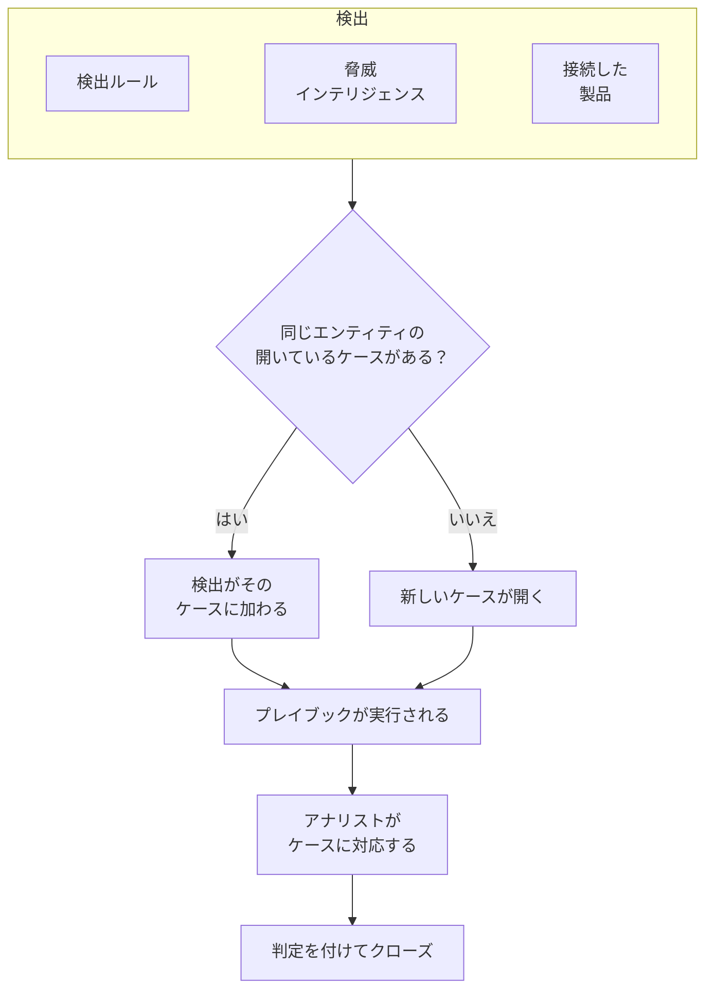

# セキュリティケースとプレイブック (SOAR)

セキュリティイベントは、検出ルール、脅威インテリジェンス、接続したセキュリティ製品が見つけたものをケースに変えます。調べる価値のある事象ごとにケースがひとつでき、同じユーザー、ホスト、アドレスに関する検出はすべてそのケースにまとめられます。アナリストはキューでケースを処理し、プレイブックは自動で、またはクリックひとつでケースに対応します。

:::cards
- [ケースの発生源](#ケースの発生源): 検出ルール、脅威インテリジェンス、接続した製品、エンティティリスク、そして人。
- [ケースに対応する](#ケースに対応する): 担当者を割り当て、エンティティを調べ、判定を付けてクローズします。
- [ケースの優先度とステータス](#ケースの優先度とステータス): 名前、色、順序を変え、独自のものを追加します。
- [通知](#通知): 新しいケース、割り当て、承認待ちのステップについて、誰に知らされるか。
- [プレイブック](#プレイブック): ケースに対して実行されるステップ。重要な場面では承認を挟みます。
- [概要ページ](#概要ページ): いま誰かの対応が必要なものと、ケースがどれだけ速く処理されているか。
:::

## 仕組み

キューを見るには **製品 → セキュリティイベント → セキュリティケース → 未解決のケース** を開きます。 **自分に割り当て済み**、 **未担当**、 **クローズ済みのケース**、 **すべてのケース** はその隣にある独立したページで、それぞれ名前のとおりのケースを一覧表示します。

## 始める前に

ケースとプレイブックの権限は、3 つの Security ロールに従います。Project Owner と Project Admin は、すべての操作ができます。

| ロール | できること |
| --- | --- |
| Security Admin | ケースの削除やプレイブックの設定を含む、すべて |
| Security Member | ケースを開き、割り当て、変更し、クローズする。メモを書き、プレイブックを実行して、そのステップを承認または拒否する |
| Security Viewer | ケース、検出、メモ、プレイブックとその実行の閲覧 |

ケースの作成からプレイブックのステップの承認まで、これらの権限はそれぞれ個別に付与することもできます。 [権限リファレンス](/docs/permissions/reference) を参照してください。

## ケースの発生源

| ソース | ケースが開くとき | オフにする設定 |
| --- | --- | --- |
| 検出ルール | ルールが一致したとき | ルールの **一致したとき** ステップにある **一致したらケースを開く** |
| 脅威インテリジェンス | イベントが既知のインジケーターを含むとき | フィードの **一致したとき** ステップにある **一致したらケースを開く** |
| 接続した製品 | 製品自身のアラートが、接続のしきい値以上で取り込まれたとき | 接続の **ポーリング** ステップで **Open Cases From** を **なし** に設定 |
| エンティティリスク | ユーザー、ホスト、アドレスのリスクがプロジェクトのしきい値に達したとき | **設定 → リスクスコアリング** の **リスクのケース** |
| 人 | 誰かが **セキュリティケース** から、またはイベントのパネルの **ケースを開く** で開いたとき | なし |

どのソースも既定でケースを開きます。ただしエンティティリスクは、それより前に作成されたプロジェクトでは先に **リスクのケース** をオンにします（[エンティティリスク](/docs/telemetry/security-entity-risk)）。接続は、別のレベルを選ばない限り、 **高以上** のアラートに対してケースを開きます。それより低いアラートも、イベントとしては取り込まれます。

### 検出のまとめ方

検出はひとつのエンティティに関するものです。エンティティとは、ブルートフォースのルールにおける IP アドレスのようにルールがグループ化に使う値や、脅威インテリジェンスの一致が示すインジケーターです。エンティティのない検出は単独で扱われます。

- そのエンティティに関する開いているケースがすでにあれば、検出はそのケースに加わります。ケースのエンティティと ATT&CK のマッピングが増え、優先度は検出の優先度まで上がります。下がることはありません。
- そのようなケースがなければ、検出にちなんだ名前で、検出の優先度を持つ新しいケースが開きます。
- 再び発火した検出は、行を追加する代わりに、その行の回数を増やします。

ケースの優先度は、検出の重大度から決まります。そのレベルに対応するプロジェクトの組み込みの優先度になり、名前を変えていても同じです。

| 重大度 | 優先度 |
| --- | --- |
| Critical または Fatal | Critical |
| High | High |
| Medium、Unknown、Other | Medium |
| Low | Low |
| Informational | Informational |

## ケースに対応する

新しいプロジェクトのケースは 4 つのステータスを順に進み、その名前を変えたり独自のものを追加したりできます ( [ケースの優先度とステータス](#ケースの優先度とステータス) を参照)。新規から直接クローズされる誤検知のようにステータスを飛ばすことも、クローズしたケースを再び開くこともできます。

| ステータス | 意味 |
| --- | --- |
| 新規 | まだ誰も見ていない |
| 調査中 | 誰かが何が起きたのかを調べている |
| Contained | 脅威はもう害を及ぼせないが、後始末はまだ残っている |
| クローズ済み | 完了しており、それが何だったかの判定が付いている |

ケースには、インシデントと同じように専用のサイドメニューがあり、ケースの各部分がそれぞれのページになっています。

| サイドメニューのセクション | ページ |
| --- | --- |
| **概要** | **概要**、**タイムライン** |
| **調査** | **検出**、**エンティティ**、**関連シグナル**、**プレイブックの実行** |
| **メモ** | **非公開メモ** |
| **詳細** | **監査ログ**、**ケースを削除** — **詳細** をクリックするまで折りたたまれています |

どのページでも、上部にケースのヘッダーが表示されます。番号、優先度、ステータス、タイトル、 **自分に割り当て**、 **プレイブックを実行**、 **インシデントを宣言**、 **ケースをクローズ** のボタン、そしてその横の ⋯ メニューにある **優先度を設定**、 **他の人に割り当て**、 **ステータスを変更**、 **ケースを編集**、 **ケースを削除** です。そのため、ケースにはどのページからでも対応でき、ケースへのリンクは今までどおり **概要** を開きます。

- **概要**: ケースの説明、ラベル、ステータスのステップ、担当者とケースを開いたもの、そしてケースの数値です。検出の数、開いている期間、確認までと封じ込めまでにかかった時間を示します。
- **OneUptime AI** (**概要** にあります): OneUptime AI がケースをどう読んだか、提案する優先度とプレイブック、そしてその根拠。[セキュリティの OneUptime AI](/docs/telemetry/security-ai) を参照してください。
- **MITRE ATT&CK** (**概要** にあります): 検出が対応付けられた戦術と手法。それぞれ attack.mitre.org の該当ページにリンクしています。
- **タイムライン**: ケースに起きたことのすべてを、誰が行ったかとともに示します。
- **検出**: ケースを開いた、またはケースに加わった検出の内容、その発火回数、一致した最新のイベント。
- **エンティティ**: ケースが対象とするユーザー、ホスト、アドレスと、直近 7 日間のすべてのセキュリティイベントにおけるそれらのアクティビティ。どれも **相関分析** で開けます。
- **関連シグナル**: ケースが示すホスト、クラスター、サービス、メンバー (OneUptime が把握しているもの) と、検出の前後にそれぞれで起きていたこと (ログ、トレース、メトリクス、対応中のもの、変更されたこと)。[関連シグナル](/docs/telemetry/security-connected-signals) を参照してください。
- **プレイブックの実行**: 各プレイブックがケースに対して行ったことをステップごとに示し、承認待ちのステップも表示します。承認待ちの実行がある間は、メニューの **プレイブックの実行** の横にその数が表示されます。
- **非公開メモ**: チームがケースについて書いた内容。
- **監査ログ**: ケースに加えられたすべての変更と、変更した人。[監査ログ](/docs/configuration/audit-logs) を参照してください。
- **ケースを削除**: ケースを、その検出、メモ、タイムライン、プレイブックの実行とともに完全に削除します。記録を残すには、代わりに判定を付けてクローズしてください。

### キューからケースに対応する

ケースに対応するのに、ケースを開く必要はありません。キューの一覧では、ケースの行にある ⋯ メニューに **自分に割り当て**、 **他の人に割り当て**、 **ステータスを変更**、 **優先度を変更** があります。複数のケースにまとめて対応するには、ケースを選択し、 **一括操作** から同じ操作を使います。どのケースを変更したか、どのケースをそのままにしたかとその理由が表示されます。

- ケースを他の人に任せるには、 **他の人に割り当て** を使い、1 人のユーザーかチームを選びます。チームのケースは、チームの誰かが担当するまで **未担当** で待機します。
- ケースをクローズするステータスでは、 **ケースをクローズ** と同じように判定とクローズ時のメモを入力します。
- クローズしたケースは誰にも割り当てられません。もう一度対応するには、 **ステータスを変更** で再オープンします。

### ケースをクローズする

**ケースをクローズ** では、判定と、任意のクローズ時のメモを入力します。

| 判定 | 意味 |
| --- | --- |
| True Positive | 悪意のある、または許可されていないアクティビティが実際に起きた |
| Benign Positive | アクティビティは実際に起きたが、ペネトレーションテストや管理作業のように想定どおりだった |
| False Positive | 検出が誤っていた。ルールまたはデータが通常のアクティビティを読み違えた |
| Undetermined | 判断するための情報が足りなかった |

判定は概要ページで集計されます。ケースが False Positive としてクローズされ続けるルールは、調整が必要なルールです。

Google SecOps のアラートから開いたケースは、接続で **ケースがクローズされたらアラートもクローズする** がオンなら、判定とクローズ時のメモを付けて Google SecOps でもそのアラートをクローズします。 [Google SecOps](/docs/integrations/google-secops#ケースがクローズされたらアラートもクローズする) を参照してください。

### インシデントを宣言する

**インシデントを宣言** は、選んだ重大度で、そのケースについての OneUptime のインシデントを開き、両者を相互にリンクします。インシデントの説明にはケースが記され、ケースのヘッダーにはインシデントへのリンクが表示されます。そこから先は、オンコール、ステータスページ、ポストモーテムが引き継ぎます。ケースを処理でき、かつインシデントを作成できるロールが必要です。

## ケースの優先度とステータス

プロジェクトごとに独自のケース優先度とステータスがあり、 **製品 → セキュリティイベント → 設定 → ケース優先度** と **ケースステータス** で管理します。名前や色を変えたり、ドラッグして並べ替えたり、「Triage」ステータスや **重大** より上の「Emergency」優先度のように独自のものを追加したりできます。新しい名前は、キュー、ケースのページと概要、通知、Slack と Microsoft Teams、プレイブックのメッセージのすべてにすぐ反映されます。

一部は組み込みです。OneUptime がその意味を読み取るためです。名前と色は変えられますが、削除やアーカイブはできず、順序も保たれます。

| 組み込み | OneUptime がそれで行うこと |
| --- | --- |
| 新規のステータス | 新しいケースはここから始まる |
| 確認済みのステータス | ここに達すると、ケースが確認された時刻が記録される。 **再オープン** はクローズしたケースをここに戻す |
| 封じ込めのステータス | ここに達すると、ケースが封じ込められた時刻が記録される |
| クローズのステータス | **ケースをクローズ** はケースを判定付きでここに移す |
| 重大、高、中、低、情報 の優先度 | 検出は、その重大度の優先度でケースを開く。人が開いたケースは中から始まる |

- ステータスの位置によって、そこにあるケースの扱いが決まります。 **扱い** 列に表示されるとおり、確認済みのステータスから下は確認済み、封じ込めのステータスから下は封じ込め済み、クローズのステータスから下はクローズ済みとして扱われます。追加したステータスはクローズのステータスのすぐ上に入り、ケースを閉じるステータスにケースを移すときは、まず判定を求められます。
- 優先度の順位は緊急度で、最も緊急なものが先頭です。 **対象ケースの最低優先度**、通知の選択肢、Slack と Microsoft Teams のルールはこの順序を読みます。追加した優先度は末尾に入り、 **検出の重大度** 列には、どの検出がどの組み込みの優先度でケースを開くかが表示されます。

独自のステータスや優先度を使うのをやめるには、その行の **アーカイブ** を使います。誰も選べなくなり、API、Terraform、MCP も拒否しますが、それを持つケースはそのまま持ち続け、それで絞り込むこともできます。アーカイブした値は、表の下の折りたたまれた **アーカイブ済みのケースステータス** または **アーカイブ済みのケース優先度** のセクションに一覧表示され、 **アーカイブ解除** で元に戻せます。ケースがその値を持っているか、プレイブックがその優先度から実行される間は、 **削除** は拒否されます。

## 通知

OneUptime は、ケースについて 3 つのことを人に知らせます。誰も何かを設定する必要はありません。 **おすすめをオンにする** をクリックしただけのプロジェクトでも、高と重大のケースについて、メールとプッシュで知らせを受けます。

| 通知 | 知らされる人 | 既定 |
| --- | --- | --- |
| 新しいセキュリティケース | プロジェクトのケースを閲覧できる全員。ケースが各自の選んだ優先度以上で開いたとき、またはその優先度以上に上がったとき | メールとプッシュ。高と重大のケースについて |
| 自分に割り当てられたセキュリティケース | ケースが割り当てられた人と、ケースが割り当てられたチームのメンバー | メールとプッシュ |
| 自分の承認を待つプレイブックのステップ | ケースの関係者のうち、そのステップを承認できる人。つまり、ケースが割り当てられた人と、そのチームのメンバーです。そのうち誰も承認できない場合は、プロジェクト内で承認できる全員 | メールとプッシュ |

- 知らされるのは、そのケースを閲覧できる人だけです。Project Owner、Project Admin、そして Security Admin、Security Member、Security Viewer のロールです。一部のラベルに限定されたロールには、それらのラベルが付いたケースについてだけ知らされます。
- 自分が行ったことについては、誰も知らされません。手動でケースを開いた人、ケースを割り当てた人、実行を開始した人には、そのことは通知されません。
- 各自がひとつのケースについて知らされるのは一度だけです。優先度が中で開き、後で重大に上がったケースは、上がった時点で、高または重大を選んだ人に届きます。中を選んだ人には、ケースが開いたときにすでに知らされているため、再び届くことはありません。
- **テスト攻撃を送信** によるテスト攻撃は、誰にも通知しないケースを開きます。
- 重大のケースと承認待ちのステップはすぐに送信され、 [メールのまとめ](/docs/emails/notification-rollup) で保留されることはありません。
- ケースの **タイムライン** には、誰にいつ知らされたかが表示されます。

### 知らされる内容を選ぶ

各自が **ユーザー設定 → 通知設定 → セキュリティ** で、自分で選びます。通知ごとのチャネル (メール、SMS、通話、プッシュ、Telegram、Slack、Microsoft Teams、Webhook) と、 **新しいセキュリティケース** の下で、通知を受ける優先度です。

| 選択肢 | 通知の対象になるケースの優先度 |
| --- | --- |
| 重大のみ | 重大 |
| 高以上 | 重大と高 (既定) |
| 中以上 | 重大、高、中 |
| 低以上 | 情報を除くすべての優先度 |
| すべてのケース | すべての優先度 |

選択肢はプロジェクトのケース優先度に従い、それぞれの名前で表示されます。上は新しいプロジェクトの場合です。

セキュリティケースについては、WhatsApp のメッセージは送信されません。プッシュ通知は OneUptime On-Call アプリ (1.7.0 以降) でケースを開き、そこで承認待ちのプレイブックのステップを承認または拒否し、ケースを引き受けてクローズできます。そのリンクはブラウザーでケースを開きます。

### Slack と Microsoft Teams のチャンネルに投稿する

チャンネルに投稿するには、 **製品 → セキュリティイベント → ワークスペース → Slack** (または **Microsoft Teams**) にルールを追加します。どちらも接続していない場合、このセクションの項目は **Slack または Teams を接続** のひとつだけです。ルールには、投稿先のチャンネル (Microsoft Teams ではチャットも) と、必要であれば対象とするケースを指定します。

| 条件 | 一致する対象 |
| --- | --- |
| セキュリティケースの優先度 | プロジェクトのケース優先度のいずれか (重大、高 など) |
| セキュリティケースのタイトル、セキュリティケースの説明 | ケースのタイトルまたは説明に含まれるテキスト、その先頭のテキスト、または末尾のテキスト |
| セキュリティケースのステータス | プロジェクトのケースステータスのいずれか (新規、クローズ済み など) |
| セキュリティケースのソース | 検出ルール、脅威インテリジェンス、Connected Product、エンティティリスク、手動 のいずれか |
| セキュリティケースのラベル | ケースのラベル |

3 つの通知は、それぞれ、その時点でケースが一致するすべてのルールのチャンネルに投稿されます。 **セキュリティケースの優先度** が **重大** と **高** のいずれかを含む、というルールは、高と重大のケースを開いた時点で投稿し、中のケースは高に上がった時点で投稿します。セキュリティケースに専用のチャンネルが作られることはありません。

## プレイブック

プレイブックは、ケースに対して実行されるステップの一覧です。 **製品 → セキュリティイベント → プレイブック** で、テンプレートから、または空の状態から作成し、そのページでステップを追加します。プレイブックがないプロジェクトでは、空の一覧の代わりにテンプレートが表示されます。プレイブックがあるときは、一覧の **テンプレートから作成** でテンプレートを開けます。プロジェクトにすでにあるものには **追加済み** と表示されます。

### プレイブックが実行されるタイミング

| 実行の契機 | タイミング |
| --- | --- |
| Case Opened | ケースが開いたときに一度 |
| Detection Added | 開いているケースに新しい検出が加わるたび |
| 悪性の可能性大とトリアージ | OneUptime AI のトリアージがケースを「悪性の可能性大」と読んだときに一度 |
| 手動 | 誰かがケースから実行したときだけ |

有効なプレイブックはどれも、ケースの **プレイブックを実行** から手動で実行することもできます。自動で実行されるプレイブックは、対象を絞り込めます。

- **対象ケースの最低優先度**: この優先度以上のケースだけ。
- **対象とする検出元**: ケースの元になった検出がこのソースから来たときだけ。
- **対象とする検出ルール**: 検出がこれらのルールのいずれかから来たときだけ。

無効にしたプレイブックは、自動でも手動でも実行されません。

### ステップ

| カテゴリ | ステップ | 内容 |
| --- | --- | --- |
| ケース | Assign the case | ケースを担当者、チーム、またはその両方に割り当てる |
| ケース | Set the priority | ケースの優先度を上げる、または下げる |
| ケース | Set the status | ケースをプロジェクトの別のステータスに移す。そのステータスでケースが閉じるときは選んだ判定を付ける |
| ケース | Add a note | アナリスト向けのチェックリストなど、ケースにメモを書く |
| ケース | Add labels | ケースにラベルを付ける |
| 調査 | Check entities against threat intel | 各エンティティを脅威インテリジェンスで調べ、一致したら優先度を上げることもできる |
| 調査 | Look up entity activity | 各エンティティの直近の期間のセキュリティイベントを数え、ケースにメモとして残す |
| 通知 | Email people | ケースの概要を、ケースへのリンク付きでユーザーとチームにメールで送る |
| 通知 | Post to Slack | ケースの概要を Slack チャンネルに投稿する |
| 通知 | Post to Microsoft Teams | ケースの概要を Microsoft Teams のチャンネルに投稿する |
| エスカレーション | Page on-call | オンコールポリシーを実行する |
| エスカレーション | インシデントを宣言 | ケースにリンクされた OneUptime のインシデントを開く |
| 封じ込め | Suspend the user in Okta | ケースが対象とするユーザーを Okta で一時停止する |
| 封じ込め | End the user's Okta sessions | ケースが対象とするユーザーを Okta からサインアウトさせ、トークンを失効させる |
| 封じ込め | Contain the host in CrowdStrike | ケースが対象とするホストを CrowdStrike Falcon でネットワークから封じ込める |
| 封じ込め | Isolate the device in Microsoft Defender | ケースが対象とするホストを Microsoft Defender for Endpoint で隔離する |
| 封じ込め | Unsuspend the user in Okta | ケースが対象とするユーザーの Okta での一時停止を解除する |
| 封じ込め | Lift containment in CrowdStrike | ケースが対象とするホストから CrowdStrike Falcon のネットワーク封じ込めを解除する |
| 封じ込め | Release the device in Microsoft Defender | ケースが対象とするホストを Microsoft Defender for Endpoint の隔離から解放する |
| 自動化 | Send a webhook | ケースを JSON として URL に POST する |
| 自動化 | Run a workflow | ケースを入力として OneUptime のワークフローを開始する |

プレイブックのステップは最大 25 個です。ステップは順番に、前のステップが終わるたびにひとつずつ実行されます。どのステップにも、次の設定ができます。

- **承認が必要**: 誰かがケース上で承認するまで、そのステップの前で実行を止めます。誰かを締め出す 4 つのステップでは、Security Admin がオフにしない限り、常にオンです。
- **脅威インテリジェンスに一致した場合のみ**: 同じ実行の前の **エンティティを脅威インテリジェンスと照合** ステップが既知のインジケーターを見つけていない限り、そのステップをスキップします。
- **失敗しても続行**: このステップが失敗しても次のステップを実行します。オフの場合、失敗したステップで実行が止まります。

### 封じ込め

封じ込めステップは、製品への [セキュリティイベントの接続](/docs/telemetry/security-events#セキュリティ製品を接続する) を通じて動作します。その接続には、読み取り以上のアクセス権が必要です。

| ステップ | 接続 | 必要なもの |
| --- | --- | --- |
| Suspend the user in Okta、End the user's Okta sessions、Unsuspend the user in Okta | Okta System Log | ユーザーの管理を許可された API トークン |
| Contain the host in CrowdStrike、Lift containment in CrowdStrike | CrowdStrike Falcon | Hosts の書き込みスコープを持つ API クライアント |
| Isolate the device in Microsoft Defender、Release the device in Microsoft Defender | Microsoft Defender XDR | Machine.Isolate のアクセス許可を持つアプリ |

封じ込めステップが動作するのは、ケースが対象とする次のユーザーまたはホストだけで、ケースに名前が挙がったものすべてではありません。

- ケースの検出のグループ化に使われている値。たとえば、ありえない移動のルールがグループ化に使うアカウントや、接続した製品のアラートが示すホストです。
- ケースのユーザーまたはホストのうち、脅威インテリジェンスがインジケーターとして把握しているもの。

VPN へのブルートフォースのように、アドレスでグループ化されたケースは、どちらにも当たりません。そのケースの封じ込めステップはスキップされ、狙われたアカウントにも、攻撃を受けたゲートウェイにも手を付けません。ステップが対象にするのは最大 10 件のユーザーまたはホストです。それぞれを製品の中で名前によって探し、各対象に何をしたかを実行に記録します。完了、すでに完了、見つからなかった、拒否された、保護されている、のいずれかです。

#### 保護対象のエンティティ

メニューの **プレイブック** の下にある **保護対象のエンティティ** には、緊急アクセス用アカウント、ドメインコントローラー、VPN ゲートウェイなど、どのプレイブックも封じ込めないユーザーとホストが一覧表示されます。値は大文字と小文字を区別せずに一致し、 `*` は任意の文字の並びを表します。 `svc-*` はすべてのサービスアカウントを保護します。ステップは、保護されたユーザーやホストを保護されていると報告し、手を付けません。この一覧は Security Admin が管理します。

#### 承認

誰かを締め出す 4 つのステップは承認を待ちます。そのいずれかで **承認が必要** をオフにできるのは Security Admin だけで、OneUptime は誰がオフにしたかを記録します。承認では、ステップが動作する予定のユーザーやホストが **対象** の下に、すべてチェックされた状態で並びます。ステップが手を付けるべきでないものは、チェックを外してください。保護されたものは選択肢に表示されません。実行を開始した人は、その実行のステップを承認できず、承認は別の人が行います。ただし、開始した人も拒否はできます。

#### 元に戻す

元に戻すステップは、元のステップと同じく、ケースが対象とするユーザーまたはホストに動作します。実行が止まった後は、封じ込められたユーザーやホストのステップに、それ専用のボタンも表示されます。 **一時停止を解除**、 **封じ込めを解除**、 **解放** のいずれかです。終了した Okta セッションは元に戻せません。元に戻した操作はすべて、ケースのタイムラインとプロジェクトの監査ログに残ります。

### メッセージ

メモ、メール、Slack への投稿、Teams への投稿では、ケースの値を使えます。

| プレースホルダー | 置き換わる値 |
| --- | --- |
| `{{case.number}}` | CASE-42 のようなケース番号 |
| `{{case.title}}` | ケースのタイトル |
| `{{case.priority}}` | プロジェクトでの名前のままのケースの優先度 (High など) |
| `{{case.status}}` | プロジェクトでの名前のままのケースのステータス (Investigating など) |
| `{{case.assignee}}` | ケースの担当者 |
| `{{case.url}}` | OneUptime 上のケースへのリンク |
| `{{case.entities}}` | ケースが対象とするユーザー、ホスト、アドレス |
| `{{case.detections}}` | ケースに含まれる検出の数 |

独自のメッセージがないメールや投稿では、ケースの概要が送られます。

### 実行と承認

すべての実行は、そのケースと **製品 → セキュリティイベント → プレイブック → プレイブックの実行** に、ステップごとに一覧表示されます。

| 実行ステータス | 意味 |
| --- | --- |
| キュー投入済み | ワーカーを待っている |
| 実行中 | ステップを実行している |
| 承認待ち | 承認が必要なステップの前で保留されている |
| 成功 | すべてのステップが実行されたか、スキップされた |
| 失敗 | ステップが失敗し、実行が止まった |
| キャンセル済み | 誰かがキャンセルしたか、ステップを拒否した |

承認待ちのステップでは、実行に **承認** と **拒否** が表示され、任意でコメントを添えられます。承認するとそのステップから実行が続き、拒否すると実行が終わります。判断の内容、判断した人、コメントは、ステップ、ケースのタイムライン、プロジェクトの監査ログに残ります。 メニューの **プレイブック** の下にある **承認待ち** は、判断を待っている実行を一覧表示して件数を示し、 **プレイブックの実行** はすべての実行を一覧表示します。 **プレイブックの実行** とプレイブックのページでは、各実行が、どこまで進んだか、またはどのステップで止まったかを示す 1 行になり、 **ステップを表示** でステップを開けます。承認待ちの実行は自動で開きます。

再起動などでワーカーからの応答が途絶えた実行は、再び拾い上げられます。キューに入った実行は 2 分後に再びキューに入れられ、30 分間何も報告しなかった実行は失敗になります。

## 概要ページ

**製品 → セキュリティイベント → 概要** は、この製品を開いたときに最初に表示されるページです。

- 自分に割り当てられた開いているケース、誰も引き受けていない開いているケース、承認待ちのプレイブックのステップ。それぞれの件数から、それを一覧表示するページが開きます。
- 直近 30 日間に開いたケースについての **平均確認時間**、 **平均封じ込め時間**、 **平均クローズ時間**。それぞれ、ケースが開いてから、誰かが引き受けるまで (担当者を割り当てるか、確認済みとして扱われるステータスに移すまで)、封じ込め済みとして扱われるステータスになるまで、クローズ済みとして扱われるステータスになるまでの時間です。まだ待っているケースは平均に含まれません。
- 過去 30 日間に日ごとに開いたケースの数 (優先度別) と、過去 14 日間に日ごとに発生した検出の数 (ソース別)。
- 開いているケースの優先度別とステータス別の数、最も多くの検出結果に名前が挙がったエンティティ、最も多く発火した検出、ケースの背後にある ATT&CK の戦術、直近 30 日間の判定。

それらの上の帯には、セキュリティの設定状況が表示されます。ソース、検出、ケース、プレイブックが、それぞれの数値とともに並びます。まだ設定していないプロジェクトでは、そこに **おすすめをオンにする** と **テスト攻撃を送信** が表示されます。[セキュリティをはじめる](/docs/telemetry/security-getting-started) を参照してください。誰の対応も必要ないときはページに **異常なし** と表示され、グラフは表示するものができた時点で現れます。

## 脅威を見つける

- **エンティティ** は、直近の 1 日、1 週間、1 か月のあいだに検出結果で最も多く名前が挙がったユーザー、ホスト、アドレス、ハッシュをランク付けし、任意の値を 30 日分のイベントから検索します。エンティティを選ぶと、 **相関分析** で開きます。
- **ルールライブラリ** には、ID、エンドポイント、クラウド、ネットワーク、Web、Kubernetes の脅威に対応した既製の検出ルールがあります。どれも、接続したすべてのソースが正規化される項目に合わせて書かれた Sigma ルールです。各行には、ルールが見つけるもの、付いている MITRE ATT&CK の戦術と手法、読み取るイベントと直近 7 日間にそれが届いたかどうか（**受信中** または **未受信**）、重大度が表示されます。カテゴリ、ルールが読み取るデータ、追加済みかどうかで一覧を絞り込んだり、名前、ATT&CK の手法、重大度で検索したりでき、フィルターはページのアドレスに保持されます。ルールを選ぶと、読み取るイベントの送り始め方、実行のしかた、Sigma ルールをまとめた詳細が開きます。 **追加** すると、それがあなたの検出ルールとして、オンの状態で、アラートではなくケースを開く設定で作成されます。ほかのルールと同じく **検出ルール** で変更できます。**おすすめ** の印が付いたルールは、OneUptime がすでに持っているデータから脅威を見つけます。まだ追加していないものは、1 つのボタンでまとめて追加できます。
- **ATT&CK カバレッジ** は MITRE ATT&CK の戦術を一覧表示し、戦術ごとに、有効なルールがカバーする手法の数と、 **ルールライブラリ** にルールがある手法がさらにいくつあるかを示します。戦術を開くとその手法が表示され、 **マトリクス** に切り替えるとマトリクス全体が表示されます。手法を選ぶと、それをカバーするライブラリのルールが表示され、そのルールに絞り込んだ **ルールライブラリ** を開けます。

## 自動化する

- **ワークフロー**: ケースやメモが作成、更新、削除されたときにワークフローを開始できます。 **ワークフローを実行** ステップは、トリガーが Webhook のワークフローを開始します。
- **API**: ケース、メモ、検出、プレイブック、実行、保護対象のエンティティ、ケースの優先度とステータスには、OneUptime のほかの部分と同じ REST API が `/security-case`、 `/security-case-note`、 `/security-detection`、 `/security-playbook`、 `/security-playbook-run`、 `/security-protected-entity`、 `/security-case-priority`、 `/security-case-status` の下にあります。 [API リファレンス](/docs/api-reference/api-reference) を参照してください。
- AI エージェント: MCP サーバーには、ケース、メモ、検出、プレイブック、ケースの優先度とステータスのためのツールがあります。 [MCP サーバー](/docs/ai/mcp-server) を参照してください。
- Terraform: `oneuptime_security_case_priority` と `oneuptime_security_case_status` のリソースで、プロジェクトの優先度とステータスをコードとして管理できます。

## トラブルシューティング

:::details ルールは一致するのにケースが開かない
ルールの **一致したとき** ステップで **一致したらケースを開く** を確認してください。開いているケースがすでにあるエンティティについての検出は、別のケースを開かずにそのケースに加わります。開いているケースの **検出** で探してください。
:::

:::details ケースについて誰にも知らされなかった
ケースの **タイムライン** を見てください。誰に通知されたかが表示されます。 **新しいセキュリティケース** の通知は、ケースが各自の選んだ優先度に達した人に送られます。そのため、優先度が中のケースは、既定の **高以上** のままにしている人には誰にも通知しません。知らされるべき人がセキュリティケースを閲覧できること (Security ロール、または Project Owner か Project Admin) と、その人の **ユーザー設定 → 通知設定 → セキュリティ** でその通知がオンになっていることを確認してください。
:::

:::details プレイブックが実行されなかった
プレイブックが有効になっていること、 **トリガー** の設定が合っていること (Case Opened はケースが開いたときに一度だけ実行されます)、そしてケースが **対象ケースの最低優先度**、 **対象とする検出元**、 **対象とする検出ルール** の設定を満たしていることを確認してください。手動で開いたケースには検出がないので、ソースやルールに限定したプレイブックはそのケースでは実行されません。
:::

:::details 封じ込めステップが失敗した
ケースで実行を開いてください。ステップには、ユーザーやホストごとに、製品が拒否したのか、見つからなかったのか、製品に到達できなかったのかが表示されます。接続の認証情報にその変更を行う権限があることを確認し、接続の行にある **接続をテスト** を使ってください。
:::

:::details 封じ込めステップがスキップされた
ケースがどのユーザーやホストも対象にしていない (たとえばアドレスだけを対象にしている) か、ケースが対象とするユーザーやホストがすべて保護されています。ケースで実行を開いてください。どちらなのかがステップに表示されます。
:::

:::details ステータスや優先度を削除またはアーカイブできない
組み込みのものは名前と色を変えられますが、削除やアーカイブはできません。その **アーカイブ** はロックされ、理由が表示されます。独自のものは、ケースがそれを持っているか、プレイブックがそこから実行される間は削除できません。先にケースを別のものに移すか、アーカイブしてください。
:::

## 次のステップ

:::cards
- [セキュリティイベント](/docs/telemetry/security-events): イベントを送り、検出ルールを書き、セキュリティ製品を接続します。
- [脅威インテリジェンス](/docs/telemetry/threat-intelligence): イベントを STIX/TAXII フィードと照合します。
- [セキュリティの OneUptime AI](/docs/telemetry/security-ai): AI でケースをトリアージし、検出ルールを下書きし、セキュリティについて質問します。
- [権限リファレンス](/docs/permissions/reference): Security ロールと、それぞれにできること。
:::
