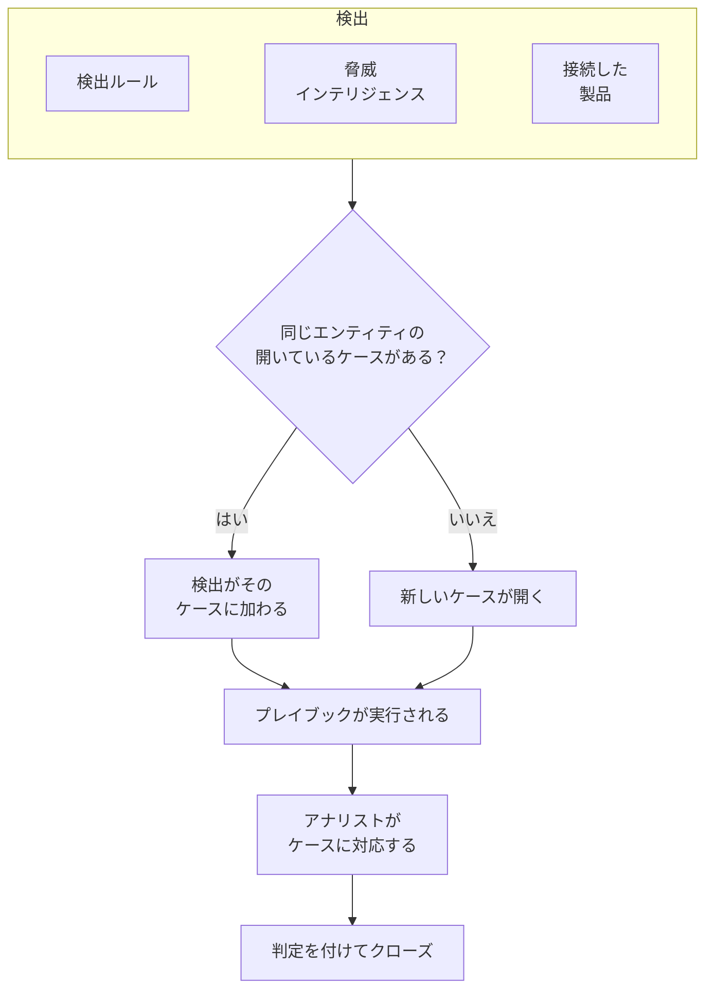

# セキュリティケースとプレイブック (SOAR)

セキュリティイベントは、検出ルール、脅威インテリジェンス、接続したセキュリティ製品が見つけたものをケースに変えます。調べる価値のある事象ごとにケースがひとつでき、同じユーザー、ホスト、アドレスに関する検出はすべてそのケースにまとめられます。アナリストはキューでケースを処理し、プレイブックは自動で、またはクリックひとつでケースに対応します。

:::cards
- [ケースの発生源](#ケースの発生源): 検出ルール、脅威インテリジェンス、接続した製品、そして人。
- [ケースに対応する](#ケースに対応する): 担当者を割り当て、エンティティを調べ、判定を付けてクローズします。
- [プレイブック](#プレイブック): ケースに対して実行されるステップ。重要な場面では承認を挟みます。
- [概要ページ](#概要ページ): いま誰かの対応が必要なものと、ケースがどれだけ速く処理されているか。
:::

## 仕組み

**製品 → セキュリティイベント → Security Cases** を開きます。キューには最初、開いているケースが表示されます。ほかに **Assigned to Me**、 **Unassigned**、 **クローズ済み**、 **すべて** の表示があります。

## 始める前に

ケースとプレイブックの権限は、3 つの Security ロールに従います。Project Owner と Project Admin は、すべての操作ができます。

| ロール | できること |
| --- | --- |
| Security Admin | ケースの削除やプレイブックの設定を含む、すべて |
| Security Member | ケースを開き、割り当て、変更し、クローズする。メモを書き、プレイブックを実行して、そのステップを承認または拒否する |
| Security Viewer | ケース、検出、メモ、プレイブックとその実行の閲覧 |

ケースの作成からプレイブックのステップの承認まで、これらの権限はそれぞれ個別に付与することもできます。 [権限リファレンス](/docs/permissions/reference) を参照してください。

## ケースの発生源

| ソース | ケースが開くとき | オフにする設定 |
| --- | --- | --- |
| 検出ルール | ルールが一致したとき | ルールの **一致したとき** ステップにある **Open a Case on Match** |
| 脅威インテリジェンス | イベントが既知のインジケーターを含むとき | フィードの **一致したとき** ステップにある **Open a Case on Match** |
| 接続した製品 | 製品自身のアラートが、接続のしきい値以上で取り込まれたとき | 接続の **ポーリング** ステップで **Open Cases From** を **なし** に設定 |
| 人 | 誰かが **Security Cases** から、またはイベントのパネルの **Open Case** で開いたとき | なし |

どのソースも既定でオンです。接続は、別のレベルを選ばない限り、 **High and above** のアラートに対してケースを開きます。それより低いアラートも、イベントとしては取り込まれます。

### 検出のまとめ方

検出はひとつのエンティティに関するものです。エンティティとは、ブルートフォースのルールにおける IP アドレスのようにルールがグループ化に使う値や、脅威インテリジェンスの一致が示すインジケーターです。エンティティのない検出は単独で扱われます。

- そのエンティティに関する開いているケースがすでにあれば、検出はそのケースに加わります。ケースのエンティティと ATT&CK のマッピングが増え、優先度は検出の優先度まで上がります。下がることはありません。
- そのようなケースがなければ、検出にちなんだ名前で、検出の優先度を持つ新しいケースが開きます。
- 再び発火した検出は、行を追加する代わりに、その行の回数を増やします。

ケースの優先度は、検出の重大度から決まります。

| 重大度 | 優先度 |
| --- | --- |
| Critical または Fatal | Critical |
| High | High |
| Medium、Unknown、Other | Medium |
| Low | Low |
| Informational | Informational |

## ケースに対応する

ケースは 4 つのステータスを順に進みます。新規から直接クローズされる誤検知のようにステータスを飛ばすことも、クローズしたケースを再び開くこともできます。

| ステータス | 意味 |
| --- | --- |
| 新規 | まだ誰も見ていない |
| 調査中 | 誰かが何が起きたのかを調べている |
| Contained | 脅威はもう害を及ぼせないが、後始末はまだ残っている |
| クローズ済み | 完了しており、それが何だったかの判定が付いている |

ケースのページには、対応に必要なものがすべてそろっています。

- 上部: **Assign to Me**、 **Run Playbook**、 **インシデントを宣言**、 **Close Case** のボタン、ステータスのステップ、そしてその横のメニューにある優先度。
- **検出**: ケースを開いた、またはケースに加わった検出の内容、その発火回数、一致した最新のイベント。
- **エンティティ**: ケースが対象とするユーザー、ホスト、アドレスと、直近 7 日間のすべてのセキュリティイベントにおけるそれらのアクティビティ。どれも **相関分析** で開けます。
- **MITRE ATT&CK**: 検出が対応付けられた戦術と手法。それぞれ attack.mitre.org の該当ページにリンクしています。
- **Playbook Runs**: 各プレイブックがケースに対して行ったことをステップごとに示し、承認待ちのステップも表示します。
- **メモ** と **タイムライン**: チームが書いた内容と、起きたことのすべてを、誰が行ったかとともに示します。

複数のケースをまとめて処理するには、キューでそれらを選択し、 **Assign to Me**、 **Change Status**、 **Change Priority** のいずれかを使います。

### ケースをクローズする

**Close Case** では、判定と、任意のクローズ時のメモを入力します。

| 判定 | 意味 |
| --- | --- |
| True Positive | 悪意のある、または許可されていないアクティビティが実際に起きた |
| Benign Positive | アクティビティは実際に起きたが、ペネトレーションテストや管理作業のように想定どおりだった |
| False Positive | 検出が誤っていた。ルールまたはデータが通常のアクティビティを読み違えた |
| Undetermined | 判断するための情報が足りなかった |

判定は概要ページで集計されます。ケースが False Positive としてクローズされ続けるルールは、調整が必要なルールです。

### インシデントを宣言する

**インシデントを宣言** は、選んだ重大度で、そのケースについての OneUptime のインシデントを開き、両者を相互にリンクします。インシデントの説明にはケースが記され、ケースのヘッダーにはインシデントへのリンクが表示されます。そこから先は、オンコール、ステータスページ、ポストモーテムが引き継ぎます。ケースを処理でき、かつインシデントを作成できるロールが必要です。

## プレイブック

プレイブックは、ケースに対して実行されるステップの一覧です。 **製品 → セキュリティイベント → Playbooks** で、テンプレートから、または空の状態から作成し、そのページでステップを追加します。

### プレイブックが実行されるタイミング

| 実行の契機 | タイミング |
| --- | --- |
| Case Opened | ケースが開いたときに一度 |
| Detection Added | 開いているケースに新しい検出が加わるたび |
| 手動 | 誰かがケースから実行したときだけ |

有効なプレイブックはどれも、ケースの **Run Playbook** から手動で実行することもできます。自動で実行されるプレイブックは、対象を絞り込めます。

- **For Cases At Least**: この優先度以上のケースだけ。
- **Only For Detections From**: ケースの元になった検出がこのソースから来たときだけ。
- **Only For These Detection Rules**: 検出がこれらのルールのいずれかから来たときだけ。

無効にしたプレイブックは、自動でも手動でも実行されません。

### ステップ

| カテゴリ | ステップ | 内容 |
| --- | --- | --- |
| ケース | Assign the case | ケースを担当者、チーム、またはその両方に割り当てる |
| ケース | Set the priority | ケースの優先度を上げる、または下げる |
| ケース | Set the status | ケースを「調査中」「Contained」「クローズ済み」のいずれかに移す。クローズするときは選んだ判定を付ける |
| ケース | Add a note | アナリスト向けのチェックリストなど、ケースにメモを書く |
| ケース | Add labels | ケースにラベルを付ける |
| 調査 | Check entities against threat intel | 各エンティティを脅威インテリジェンスで調べ、一致したら優先度を上げることもできる |
| 調査 | Look up entity activity | 各エンティティの直近の期間のセキュリティイベントを数え、ケースにメモとして残す |
| 通知 | Email people | ケースの概要を、ケースへのリンク付きでユーザーとチームにメールで送る |
| 通知 | Post to Slack | ケースの概要を Slack チャンネルに投稿する |
| 通知 | Post to Microsoft Teams | ケースの概要を Microsoft Teams のチャンネルに投稿する |
| エスカレーション | Page on-call | オンコールポリシーを実行する |
| エスカレーション | インシデントを宣言 | ケースにリンクされた OneUptime のインシデントを開く |
| 封じ込め | Suspend the user in Okta | ケースの各ユーザーを Okta で一時停止する |
| 封じ込め | End the user's Okta sessions | ケースの各ユーザーを Okta からサインアウトさせ、トークンを失効させる |
| 封じ込め | Contain the host in CrowdStrike | ケースの各ホストを CrowdStrike Falcon でネットワークから封じ込める |
| 封じ込め | Isolate the device in Microsoft Defender | ケースの各ホストを Microsoft Defender for Endpoint で隔離する |
| 自動化 | Send a webhook | ケースを JSON として URL に POST する |
| 自動化 | Run a workflow | ケースを入力として OneUptime のワークフローを開始する |

プレイブックのステップは最大 25 個です。ステップは順番に、前のステップが終わるたびにひとつずつ実行されます。どのステップにも、次の設定ができます。

- **Needs Approval**: 誰かがケース上で承認するまで、そのステップの前で実行を止めます。OneUptime の外で動作する 4 つの封じ込めステップでは、既定でオンです。
- **Only If Threat Intel Matched**: 同じ実行の前の **Check entities against threat intel** ステップが既知のインジケーターを見つけていない限り、そのステップをスキップします。
- **Carry On If It Fails**: このステップが失敗しても次のステップを実行します。オフの場合、失敗したステップで実行が止まります。

### 封じ込め

封じ込めステップは、製品への [セキュリティイベントの接続](/docs/telemetry/security-events#セキュリティ製品を接続する) を通じて動作します。その接続には、読み取り以上のアクセス権が必要です。

| ステップ | 接続 | 必要なもの |
| --- | --- | --- |
| Suspend the user in Okta、End the user's Okta sessions | Okta System Log | ユーザーの管理を許可された API トークン |
| Contain the host in CrowdStrike | CrowdStrike Falcon | Hosts の書き込みスコープを持つ API クライアント |
| Isolate the device in Microsoft Defender | Microsoft Defender XDR | Machine.Isolate のアクセス許可を持つアプリ |

封じ込めステップが対象にするのは、ケースのユーザーまたはホストのうち最大 10 件です。それぞれを製品の中で名前によって探し、各対象に何をしたかをケースに記録します。封じ込めた、すでに封じ込められていた、見つからなかった、拒否された、のいずれかです。

### メッセージ

メモ、メール、Slack への投稿、Teams への投稿では、ケースの値を使えます。

| プレースホルダー | 置き換わる値 |
| --- | --- |
| `{{case.number}}` | CASE-42 のようなケース番号 |
| `{{case.title}}` | ケースのタイトル |
| `{{case.priority}}` | Critical、High、Medium、Low、Informational のいずれか |
| `{{case.status}}` | New、Investigating、Contained、Closed のいずれか |
| `{{case.assignee}}` | ケースの担当者 |
| `{{case.url}}` | OneUptime 上のケースへのリンク |
| `{{case.entities}}` | ケースが対象とするユーザー、ホスト、アドレス |
| `{{case.detections}}` | ケースに含まれる検出の数 |

独自のメッセージがないメールや投稿では、ケースの概要が送られます。

### 実行と承認

すべての実行は、そのケースと **製品 → セキュリティイベント → Playbooks → Playbook Runs** に、ステップごとに一覧表示されます。

| 実行ステータス | 意味 |
| --- | --- |
| キュー投入済み | ワーカーを待っている |
| 実行中 | ステップを実行している |
| 承認待ち | 承認が必要なステップの前で保留されている |
| 成功 | すべてのステップが実行されたか、スキップされた |
| 失敗 | ステップが失敗し、実行が止まった |
| キャンセル済み | 誰かがキャンセルしたか、ステップを拒否した |

承認待ちのステップでは、実行に **Approve** と **拒否** が表示され、任意でコメントを添えられます。承認するとそのステップから実行が続き、拒否すると実行が終わります。判断の内容、判断した人、コメントは、ステップとケースのタイムラインに残ります。 **Playbook Runs** は承認待ちの実行を表示した状態で開き、**Playbooks** のメニュー項目には件数が表示されます。

再起動などでワーカーからの応答が途絶えた実行は、再び拾い上げられます。キューに入った実行は 2 分後に再びキューに入れられ、30 分間何も報告しなかった実行は失敗になります。

## 概要ページ

**製品 → セキュリティイベント → 概要** は、この製品を開いたときに最初に表示されるページです。

- 自分に割り当てられた開いているケース、誰も引き受けていない開いているケース、承認待ちのプレイブックのステップ。
- 直近 30 日間に開いたケースについての **平均確認時間**、 **平均封じ込め時間**、 **平均クローズ時間**。それぞれ、ケースが開いてから、誰かが引き受けるまで (担当者を割り当てるか、新規から移すまで)、Contained になるまで、クローズ済みになるまでの時間です。まだ待っているケースは平均に含まれません。
- 過去 30 日間に日ごとに開いたケースの数 (優先度別) と、過去 14 日間に日ごとに発生した検出の数 (ソース別)。
- 開いているケースの優先度別とステータス別の数、直近 30 日間の判定、ケースの背後にある ATT&CK の戦術、最も多く発火した検出、最も多くの検出結果に名前が挙がったエンティティ。

それらの上の帯には、セキュリティの設定状況が表示されます。ソース、検出、ケース、プレイブックが、それぞれの数値とともに並びます。まだ設定していないプロジェクトでは、そこに **おすすめをオンにする** と **テスト攻撃を送信** が表示されます。[セキュリティをはじめる](/docs/telemetry/security-getting-started) を参照してください。誰の対応も必要ないときはページに **異常なし** と表示され、グラフは表示するものができた時点で現れます。

## 脅威を見つける

- **エンティティ** は、直近の 1 日、1 週間、1 か月のあいだに検出結果で最も多く名前が挙がったユーザー、ホスト、アドレス、ハッシュをランク付けし、任意の値を 30 日分のイベントから検索します。
- **Rule Library** には、ID、エンドポイント、クラウド、ネットワーク、Web、Kubernetes の脅威に対応した既製の検出ルールがあります。どれも、接続したすべてのソースが正規化される項目に合わせて書かれた Sigma ルールです。 **ルールを追加** すると、それがあなたの検出ルールとして、オンの状態で、アラートではなくケースを開く設定で作成されます。ほかのルールと同じく **検出ルール** で変更できます。**おすすめ** の印が付いたルールは、OneUptime がすでに持っているデータから脅威を見つけます。まだ追加していないものは、1 つのボタンでまとめて追加できます。
- **ATT&CK Coverage** は MITRE ATT&CK のマトリクスを描き、有効なルールがカバーする手法を強調表示し、ライブラリのルールでカバーできる手法を枠線で示します。

## 自動化する

- **ワークフロー**: ケースやメモが作成、更新、削除されたときにワークフローを開始できます。 **Run a workflow** ステップは、トリガーが Webhook のワークフローを開始します。
- **API**: ケース、メモ、検出、プレイブック、実行には、OneUptime のほかの部分と同じ REST API が `/security-case`、 `/security-case-note`、 `/security-detection`、 `/security-playbook`、 `/security-playbook-run` の下にあります。 [API リファレンス](/docs/api-reference/api-reference) を参照してください。
- AI エージェント: MCP サーバーには、ケース、メモ、検出、プレイブックのためのツールがあります。 [MCP サーバー](/docs/ai/mcp-server) を参照してください。

## トラブルシューティング

:::details ルールは一致するのにケースが開かない
ルールの **一致したとき** ステップで **Open a Case on Match** を確認してください。開いているケースがすでにあるエンティティについての検出は、別のケースを開かずにそのケースに加わります。開いているケースの **検出** で探してください。
:::

:::details プレイブックが実行されなかった
プレイブックが有効になっていること、 **トリガー** の設定が合っていること (Case Opened はケースが開いたときに一度だけ実行されます)、そしてケースが **For Cases At Least**、 **Only For Detections From**、 **Only For These Detection Rules** の設定を満たしていることを確認してください。手動で開いたケースには検出がないので、ソースやルールに限定したプレイブックはそのケースでは実行されません。
:::

:::details 封じ込めステップが失敗した
ケースで実行を開いてください。ステップには、ユーザーやホストごとに、製品が拒否したのか、見つからなかったのか、製品に到達できなかったのかが表示されます。接続の認証情報にその変更を行う権限があることを確認し、接続の行にある **接続をテスト** を使ってください。
:::

## 次のステップ

:::cards
- [セキュリティイベント](/docs/telemetry/security-events): イベントを送り、検出ルールを書き、セキュリティ製品を接続します。
- [脅威インテリジェンス](/docs/telemetry/threat-intelligence): イベントを STIX/TAXII フィードと照合します。
- [権限リファレンス](/docs/permissions/reference): Security ロールと、それぞれにできること。
:::
