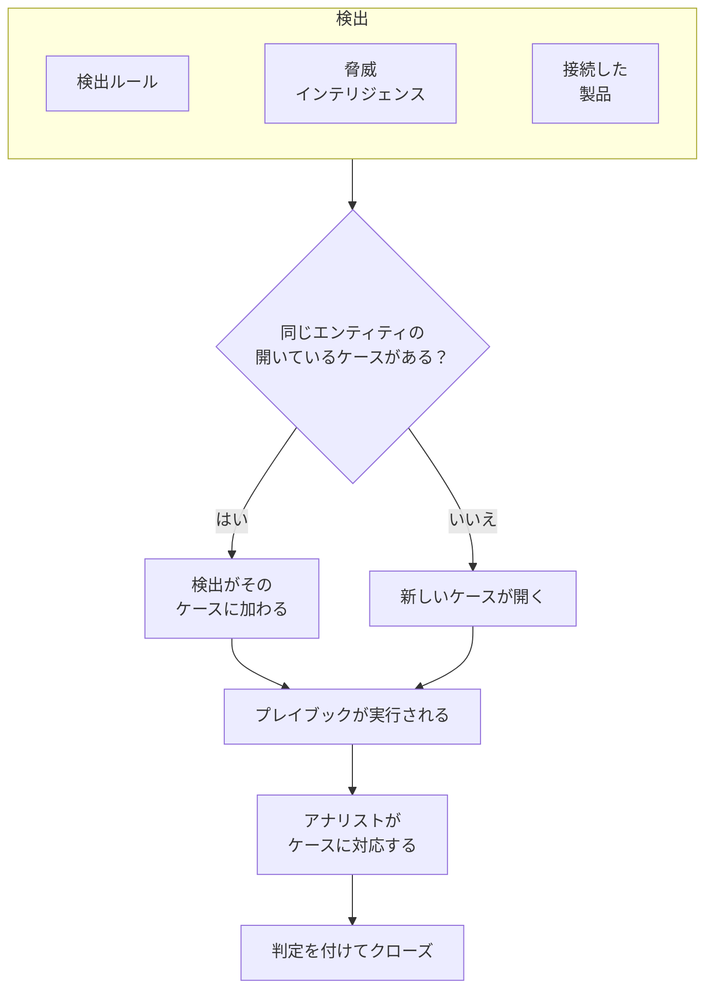

# セキュリティケースとプレイブック (SOAR)

セキュリティイベントは、検出ルール、脅威インテリジェンス、接続したセキュリティ製品が見つけたものをケースに変えます。調べる価値のある事象ごとにケースがひとつでき、同じユーザー、ホスト、アドレスに関する検出はすべてそのケースにまとめられます。アナリストはキューでケースを処理し、プレイブックは自動で、またはクリックひとつでケースに対応します。

:::cards
- [ケースの発生源](#ケースの発生源): 検出ルール、脅威インテリジェンス、接続した製品、エンティティリスク、そして人。
- [ケースに対応する](#ケースに対応する): 担当者を割り当て、エンティティを調べ、判定を付けてクローズします。
- [ケースの優先度とステータス](#ケースの優先度とステータス): 名前、色、順序を変え、独自のものを追加します。
- [対応目標](#対応目標): 各優先度のケースを、どれだけ早く引き受けて封じ込める必要があるか。
- [通知](#通知): 新しいケース、割り当て、対応目標、タスク、承認待ちのステップについて、誰に知らされるか。
- [プレイブック](#プレイブック): ケースに対して実行されるステップ。重要な場面では承認を挟みます。
- [概要ページ](#概要ページ): いま誰かの対応が必要なものと、ケースがどれだけ速く処理されているか。
:::

## 仕組み

キューを見るには **製品 → セキュリティイベント → セキュリティケース → 未解決のケース** を開きます。 **自分の担当**、 **未担当**、 **クローズ済みのケース**、 **すべてのケース** はその隣にある独立したページで、それぞれ名前のとおりのケースを一覧表示します。

## 始める前に

ケースとプレイブックの権限は、3 つの Security ロールに従います。プロジェクト所有者とプロジェクト管理者は、すべての操作ができます。

| ロール | できること |
| --- | --- |
| セキュリティ管理者 | ケースの削除、証拠の削除、プレイブックの設定を含む、すべて |
| セキュリティメンバー | ケースを開き、割り当て、変更し、クローズする。メモを書き、タスクに取り組み、証拠を追加し、プレイブックを実行して、そのステップを承認または拒否する |
| セキュリティ閲覧者 | ケース、検出、メモ、タスク、証拠、プレイブックとその実行の閲覧 |

ケースの作成からプレイブックのステップの承認まで、これらの権限はそれぞれ個別に付与することもできます。 [権限リファレンス](/docs/permissions/reference) を参照してください。

## ケースの発生源

| ソース | ケースが開くとき | オフにする設定 |
| --- | --- | --- |
| 検出ルール | ルールが一致したとき | ルールの **一致したとき** ステップにある **一致したらケースを開く** |
| 脅威インテリジェンス | イベントが既知のインジケーターを含むとき | フィードの **一致したとき** ステップにある **一致したらケースを開く** |
| 接続した製品 | 製品自身のアラートが、接続のしきい値以上で取り込まれたとき | 接続の **ポーリング** ステップで **ケースを開く重大度** を **なし** に設定 |
| ログに書き込むセキュリティ製品 | ファイアウォール、IDS、エンドポイント製品がログに書き込む脅威が、ログのしきい値以上のとき | **ログ** で **ケースを開く重大度** を **なし** に設定 |
| エンティティリスク | ユーザー、ホスト、アドレスのリスクがプロジェクトのしきい値に達したとき | **設定 → リスクスコアリング** の **リスクのケース** |
| 人 | 誰かが **セキュリティケース** から、またはイベントのパネルの **ケースを開く** で開いたとき | なし |

どのソースも既定でケースを開きます。ただしエンティティリスクは、それより前に作成されたプロジェクトでは先に **リスクのケース** をオンにします（[エンティティリスク](/docs/telemetry/security-entity-risk)）。接続は、別のレベルを選ばない限り、 **高以上** のアラートに対してケースを開きます。それより低いアラートも、イベントとしては取り込まれます。**ログ** も、ログ内の脅威について同じように動作します。

### 検出のまとめ方

検出はひとつのエンティティに関するものです。エンティティとは、ブルートフォースのルールにおける IP アドレスのようにルールがグループ化に使う値や、脅威インテリジェンスの一致が示すインジケーターです。エンティティのない検出は単独で扱われます。

- そのエンティティに関する開いているケースがすでにあれば、検出はそのケースに加わります。ケースのエンティティと ATT&CK のマッピングが増え、優先度は検出の優先度まで上がります。下がることはありません。
- そのようなケースがなければ、検出にちなんだ名前で、検出の優先度を持つ新しいケースが開きます。
- 再び発火した検出は、行を追加する代わりに、その行の回数を増やします。

ケースの優先度は、検出の重大度から決まります。そのレベルに対応するプロジェクトの組み込みの優先度になり、名前を変えていても同じです。

| 重大度 | 優先度 |
| --- | --- |
| Critical または Fatal | Critical |
| High | High |
| Medium、Unknown、Other | Medium |
| Low | Low |
| Informational | Informational |

## ケースに対応する

新しいプロジェクトのケースは 4 つのステータスを順に進み、その名前を変えたり独自のものを追加したりできます ( [ケースの優先度とステータス](#ケースの優先度とステータス) を参照)。新規から直接クローズされる誤検知のようにステータスを飛ばすことも、クローズしたケースを再び開くこともできます。

| ステータス | 意味 |
| --- | --- |
| 新規 | まだ誰も見ていない |
| 調査中 | 誰かが何が起きたのかを調べている |
| Contained | 脅威はもう害を及ぼせないが、後始末はまだ残っている |
| クローズ済み | 完了しており、それが何だったかの判定が付いている |

ケースには、インシデントと同じように専用のサイドメニューがあり、ケースの各部分がそれぞれのページになっています。

| サイドメニューのセクション | ページ |
| --- | --- |
| **概要** | **概要**、**タイムライン** |
| **調査** | **経緯**、**検出**、**エンティティ**、**関連シグナル**、**証拠**、**タスク**、**プレイブック** |
| **メモ** | **非公開メモ** |
| **詳細** | **カスタムフィールド**、**監査ログ**、**ケースを削除** — **詳細** をクリックするまで折りたたまれています |

どのページでも、上部にケースのヘッダーが表示されます。番号、優先度、ステータス、タイトル、 **自分に割り当て**、 **プレイブックを実行**、 **インシデントを宣言**、 **ケースをクローズ** のボタン、そしてその横の ⋯ メニューにある **優先度を設定**、 **他の人に割り当て**、 **ステータスを変更**、 **ケースを編集**、 **ケースを削除** です。そのため、ケースにはどのページからでも対応でき、ケースへのリンクは今までどおり **概要** を開きます。ケースの優先度に対応目標がある場合、ヘッダーには次の目標の期限も表示されます ([対応目標](#対応目標))。

- **概要**: ケースの説明、ラベル、ステータスのステップ、担当者とケースを開いたもの、そしてケースの数値です。検出の数、開いている期間、確認までと封じ込めまでにかかった時間を示します。**確認までの時間** と **封じ込めまでの時間** の下には、対応目標に対するケースの状況が表示されます。
- **このケースが開かれた理由** (**概要** にあります): ケースを開いた検出と、そのルールがどう発火するか (しきい値、グループ化に使う値、件数を数える時間枠)、一致したイベントの数、それが何によるもので、いつからいつまでのものか、ルールが探す値、リクエストがどこまで到達したかを示します。 **一致した内容** の下には、イベントそのものが古い順に並びます。各イベントでは、ルールが探す値が強調表示され、そのリクエストがどこまで到達したかと、元になったログ行または製品が示され、 **トレース**、 **ログ**、 **例外** をワンクリックで開けます。元になったログ行は、ログエクスプローラーでその行の位置で開きます。イベントをクリックすると、その全体が、読み取り元のログ行とともに表示されます。イベントの行またはパネルにある **このケースに保管** を使うと、そのイベントが、一致した検出の名前とともにケースの **証拠** ページに保管されます。ケースにすでに保管されているイベントにはそのことが表示され、そこで開けます。検出は発火したときに一致したイベントを最大 25 件保管し、保持期間を過ぎた後もそれらを一覧表示します。あなたのロールに表示されるのは、そのロールで読み取れるソースからのイベントです。多くのグループに対して同時に発火するルールは、相関ルールも含め、そのすべてのグループのイベントを保管します。合計で最大 1,000 件なので、各グループに少なくとも 10 件が保管され、再び発火すると最大 25 件まで増えます。イベントを保管するようになる前の検出では、ルールの一致は、検出のグループについて、ルールが発火した時間枠の中でルール自身の条件に一致したイベントです。脅威インテリジェンスの一致ではそのインジケーターを含むイベントが、接続した製品のアラートでは製品が送ってきたとおりのイベントが一覧表示されます。 **次に確認すべきもの** からは、検出の対象であるアドレスまたはユーザーに関するすべて、それを含むイベントとログ行、検出のログ行を送ったサービスのログ、検出のリクエストのトレース (いずれも検出の時間枠のもの)、そしてケースの **経緯** と **関連シグナル** を開けます。ケースのほかの検出は **このケースのほかの検出** の下に折りたたまれています。
- **対応計画** (**概要** にあります): ケースについていまやるべきことを、緊急度の高い順に、 **本当の脅威か確認する**、 **封じ込める**、 **原因を修正する**、 **ケースをクローズする** の下に分けて示します。各ステップはこのケースに即したもので、ケースのアドレス、ユーザー、ホスト、リクエストがどこまで到達したか、ルールがほかにも発火しうるとしている対象、検出が対応付けられた ATT&CK の戦術と手法、プロジェクトにあるプレイブックをもとにしています。検出ルールが独自に持つステップ (ルールのフォームの **対応ステップ** に書いたもの) は、計画のうちそのステップが属する区分の先頭に表示されます。ルールライブラリのルールには、最初から独自のステップが付いています。OneUptime が実行できるステップには、そのためのボタンがあります。 **自分に割り当て**、ルールとアドレスが入力済みの **例外を追加**、アカウントを停止するかホストを封じ込めるプレイブック、または OneUptime AI が提案するプレイブックに対する **プレイブックを実行**、 **インシデントを宣言**、 **封じ込め済みにする**、 **ケースをクローズ** です。公開アドレスのステップは、宛先がブロックリストを適用していれば、 **24 時間ブロック** のワンクリックでそのアドレスをブロックします (詳しくは [ケースからアドレスをブロックする](#ケースからアドレスをブロックする) を参照)。DNS フィルターでドメインをブロックするなど、OneUptime が実行できないステップには **OneUptime 外** と表示され、値はワンクリックでクリップボードにコピーできます。ステップが完了したらチェックを付けます。そのステップはケースの **タスク** のひとつとして完了済みの状態で残り、誰がいつ行ったかも記録されます。ケースの状態で完了が決まるステップには、自動でチェックが付きます。ケースが割り当てられた、インシデントが宣言された、プレイブックが実行された、ケースが封じ込められた、またはクローズされたときです。脅威を封じ込めるステップがすべて完了すると、計画に **封じ込め済みにする** が表示されます。これを使うと、ケースの封じ込めまでの時間が記録されます。OneUptime AI がケースをトリアージしている場合は、その判定が計画の先頭に表示され、OneUptime AI が提案するステップは計画自身のステップの下に折りたたまれています。ほとんどのステップは OneUptime 自身がチェックし、わかったことを各ステップの横に示します。 [OneUptime によるステップのチェック](#oneuptime-によるステップのチェック) を参照してください。
- **OneUptime AI** (**概要** にあります): OneUptime AI がケースをどう読んだか、提案する優先度とプレイブック、そしてその根拠。[セキュリティの OneUptime AI](/docs/telemetry/security-ai) を参照してください。
- **影響** (**概要** にあります): ケースが危険にさらすもの。ケースのレコードがインターネットから到達されたことを OneUptime が確認したか、それらの所有者、最後に何が変更されたか、そしてリスクにさらされているデータ (ケースが挙げる、またはケースのユーザーとロールが到達できる、機密データを持つデータストア。 [データセキュリティの連携](/docs/data-security/integrations#セキュリティオペレーション) を参照) を示します。開くと、各レコードの呼び出し先と呼び出し元、監視しているモニターとステータスページ、ケースのアドレスが通信したマシンが表示されます。
- **MITRE ATT&CK** (**概要** にあります): 検出が対応付けられた戦術と手法。それぞれ attack.mitre.org の該当ページにリンクしています。
- **タイムライン**: ケースに起きたことのすべてを、誰が行ったかとともに示します。
- **経緯**: OneUptime 全体で起きたことを順番に示します。各検出とその背後のセキュリティイベント、リクエストがどこまで到達したか、発生した例外、ケースが名指すレコードの変更、それらで発生したインシデントとアラート、チームが行ったことです。スキャナーの大量の探索は 1 行にまとめられ、各行からはリクエストのトレースや例外など、その行が示すものを開けます。
- **検出**: ケースを開いた、またはケースに加わった検出の内容、その発火回数、一致した最新のイベント。
- **エンティティ**: ケースが対象とするユーザー、ホスト、アドレスと、直近 7 日間のすべてのセキュリティイベントにおけるそれらのアクティビティ。どれも **相関分析** で開けます。
- **関連シグナル**: ケースが示すホスト、クラスター、サービス、メンバー (OneUptime が把握しているもの) と、検出の前後にそれぞれで起きていたこと (ログ、トレース、メトリクス、対応中のもの、変更されたこと)。[関連シグナル](/docs/telemetry/security-connected-signals) を参照してください。
- **証拠**: ケースに保管されているファイル、リンク、セキュリティイベントです。それぞれ追加した人と日時が表示されます。 **ファイルを追加** は最大 10 MB のファイルをアップロードし、アップロードされた内容の SHA-256 を記録するので、後でダウンロードした人が保管された内容と同じかどうかを確認できます。 **リンクを追加** は別の場所に保管されている証拠を示します。証拠を削除できるのはセキュリティ管理者だけで、ケースの **タイムライン** には何が追加され、何が削除されたかが記録されます。セキュリティイベントは、 **イベント** または [ハント](/docs/telemetry/security-events#ハント) のページで **ケースに追加** を選ぶか、検出が一致したイベントで **このケースに保管** を選ぶとそのときのまま保管され、 **イベントを表示** で開けます。プレイブックの **Preserve the evidence** ステップも、ケースの検出の元になったイベントをここに保管します。
- **タスク**: ケースでやるべきこと、その担当者、完了したかどうかです。タスクを 1 行で追加し、誰かに割り当て、完了したらチェックを付けます。割り当てられた人には通知が届きます (自分で引き受けた場合を除く)。また、メニューの **タスク** の横には未完了のタスクの数が表示されます。プレイブックの **タスクを追加** ステップもタスクを追加します。ケースに既にあるタスクは追加しません。
- **プレイブック**: 各プレイブックがケースに対して行ったことをステップごとに示し、承認待ちのステップも表示します。承認待ちの実行がある間は、メニューの **プレイブック** の横にその数が表示されます。
- **非公開メモ**: チームがケースについて書いた内容。エディターの **テンプレート** メニューから、プロジェクトのメモテンプレートをメモに挿入できます。
- **カスタムフィールド**: このケースについて入力した、プロジェクト独自のフィールドです。 **フィールドを編集** で変更できます。プロジェクトにフィールドがあれば、 **概要** の最後のカードにも表示されます。[カスタムフィールド、メモテンプレート、採番](#カスタムフィールドメモテンプレート採番) を参照してください。
- **監査ログ**: ケースに加えられたすべての変更と、変更した人。[監査ログ](/docs/configuration/audit-logs) を参照してください。
- **ケースを削除**: ケースを、その検出、メモ、タイムライン、プレイブックの実行とともに完全に削除します。記録を残すには、代わりに判定を付けてクローズしてください。

### OneUptime によるステップのチェック

チェックマークは、誰かがステップを実行したことを示します。OneUptime はさらに、ケースの **対応計画** のステップを、実際に起きたことに照らして自らチェックします。ケースが開いている間は毎分、そしてステップにチェックが付いたとき、タスクが変わったとき、プレイブックが何かを封じ込めたときにはすぐにチェックします。チェックした各ステップの横に、計画は OneUptime が見つけたことを示します。

| ステップの横の表示 | 意味 |
| --- | --- |
| **OneUptime がチェック済み** | OneUptime がステップの完了を確認し、それが維持されています。誰もチェックを付ける必要はありません |
| **完了したようです** | OneUptime に見えることはステップの完了と一致しますが、証明にはなりません。 **確認** で、あなたの作業としてチェックが付きます |
| **未完了** | ステップがまだ残っていることが、OneUptime に見えています |
| **OneUptime には判断できません** | OneUptime にはステップをチェックする材料がなく、その理由を **OneUptime がこれをチェックできるようにする方法** とともに示します |
| **維持されなくなった** | ステップは完了していましたが、効かなくなりました。たとえば、ブロックしたアドレスが再び通過した場合です |
| **今のところ不要** | ステップが必要になることは、まだ何も起きていません |

OneUptime が見つけたことの横にある **根拠** を開くと、残りが表示されます。ほかに見えたこと、トレースや読み取った製品へのリンク、チェックした日時です。計画の進捗は、「9 件中 4 件完了、3 件は OneUptime がチェック済み」のように、OneUptime 自身がチェックしたステップを数えます。

| ステップ | OneUptime が読み取るもの |
| --- | --- |
| アドレスをブロックする | 宛先が [ブロックリスト](#ブロックリスト) にあるそのアドレスのブロックを保持し、読み戻して確認したかどうか、そしてアドレスからのリクエストがまだアプリに届いているかどうか (アプリのトレースとアクセスログで確認します)。宛先が保持しているブロックはチェック済みになり、何も適用していないブロックはチェック済みになりません。ブロックなしで静かになったアドレスは完了したように見えます。ブロックされたのかもしれませんし、単に止まっただけかもしれません |
| ほかに通過したものがないか確認する | ケースの最初の検出以降、アドレスからの各リクエストがどう終わったか。アプリがすべてを拒否していれば、ステップはチェック済みです |
| アカウントを停止する | Okta、Microsoft Entra ID または Google Workspace のアカウント。一時停止されているか、無効化され、ケースが開かれた後にセッションが終了されているか |
| ホストをネットワークから切り離す | CrowdStrike Falcon または Microsoft Defender for Endpoint のホスト。封じ込められているか、隔離されているか |
| インシデントを宣言する | ケースが開いている間に、リクエストがアプリのチェックを通過したか、リクエストが届いたサービスのモニターがダウンしたか。そうなるまでは、ステップは今のところ不要です |
| 誤検知を除外する | 何も読み取りません。除外できるのはあなただけです。ステップには、OneUptime がそのアドレスについて知っていることが並びます。あなたのレコードのどれかがそのアドレスを持っているか、それを掲載している脅威インテリジェンスのフィード、過去 30 日間にそれを使ったサインイン済みユーザーです |
| 攻撃されたルートを修正する | アプリのトレースとログにある、そのルートへの攻撃リクエスト。ルートの背後にあるサービスに変更がリリースされる前と後で読み取ります。変更とは、プレイブックの **Fix the code with AI** が作成したプルリクエスト、またはサービスのデプロイや新しいバージョンです。それ以降に同じ攻撃が十分な数だけ拒否されるか、以前はデータベースに到達していた攻撃がデータベースに届かなくなれば、ステップはチェック済みです。それ以降に攻撃がなければ、修正以降に試みはないと示し、完了したように見えます |
| パスワードをリセットする | Okta または Microsoft Entra ID のアカウント。ケースが開かれた後にパスワードが変更され、セッションが終了されているか。Google Workspace はパスワードがいつ変更されたかを示さないため、OneUptime には判断できません |
| アカウントが MFA を使っていることを確認する | 攻撃の対象になった各アカウントの、Okta、Microsoft Entra ID または Google Workspace での状態。有効な要素、MFA の方法、または 2 段階認証プロセスです。すべてのアカウントで MFA がオンなら、ステップは完了したように見えます。サインインの失敗でロックアウトされるかどうかはどの製品も示さないため、それはあなたが確認します |

- OneUptime の外で行ったステップも数えられます。自分のファイアウォールでアドレスをブロックすれば、OneUptime はそのリクエストが止まるのを確認します。Okta でアカウントを停止すれば、OneUptime はそれを読み取ります。
- OneUptime が完了を確認していないステップでも、これまでどおり自分でチェックを付けられます。OneUptime がチェックしたステップには、チェックは不要です。
- 完了したステップが維持されなくなると、計画の一番上にそう表示され、ケースの **タイムライン** に OneUptime が見たことが記録され、ケースの担当者に通知されます。 [通知](#通知) を参照してください。
- アプリが OneUptime にトレースもログも送っていない場合、トレースに各リクエストの送信元アドレスがない場合、またはトレースに訪問者ではなくアプリの前にある Cloudflare やロードバランサーのアドレスが記録されている場合、OneUptime はアドレスのリクエストを見ることができません。アプリのサーバースパンにクライアントのアドレス (`client.address`) を設定してください。Cloudflare の背後では `CF-Connecting-IP` から、ロードバランサーの背後では `X-Forwarded-For` から設定します。
- OneUptime は、アカウントとホストを持つ製品へのプロジェクトの接続を通じて、それらを読み取ります。 [OneUptime による対応](#oneuptime-による対応) が使う接続と同じです。接続がなければ判断できません。
- 応答しない製品や失敗した読み取りが、未完了のステップとして数えられることはありません。ステップには OneUptime が今はチェックできなかったことが表示され、OneUptime は数分後にもう一度試します。
- ルートの修正がチェック済みになるのは、攻撃そのものが拒否されてからです。デプロイだけでは修正になりません。OneUptime は、修正のリリース以降に拒否された攻撃が十分な数になるまで待ちます。十分な数とは、以前の通過率なら、何も変わっていなければほぼ確実に (95%) どれかが通過していたはずの数で、3 件を下回ることはありません。ステップは何件待っているかを示し、修正のリリース後 7 日間ルートを監視します。たとえば「11月27日まで /api/search を監視中」のように表示されます。以前ほとんど通過していなかった場合、攻撃からは修正が効いたことを示せないため、ステップは **完了したようです** のままになり、あなたが確認します。
- OneUptime は、サービスのデプロイを確認できたときに修正のリリースを把握します。デプロイを OneUptime に送るか、アプリのテレメトリーで `service.version` を報告してください ( [デプロイと変更](/docs/telemetry/change-events) を参照)。**Fix the code with AI** が作成したプルリクエストはケースに保持され、そのデプロイはコミットで照合されます。Cloudflare などのエッジで止められたリクエストはアプリに届いていないため、修正については何も示しません。
- Microsoft Entra ID でアカウントの MFA を読み取るには、 [封じ込め](#封じ込め) に記載された権限に加えて、UserAuthenticationMethod.Read.All アプリケーション権限が必要です。

**製品 → セキュリティイベント → 設定 → ケースステータス** の **確認できたらケースを封じ込め済みにする** は、ケースを封じ込めるすべてのステップが **OneUptime がチェック済み** または **今のところ不要** になると、ケースを封じ込め済みにします。封じ込めまでの時間が記録され、ケースの **タイムライン** には、OneUptime が脅威を封じ込めるすべてのステップを確認したことが示されます。完了したように見えるだけのステップやチェックマークだけで、ケースが進むことはありません。この設定はすべてのプロジェクトでオンになっており、プロジェクト所有者またはプロジェクト管理者がオフにできます。オフにすると、誰かが封じ込め済みにするまで、ケースは今の状態のままです。

ケースを閲覧できる人は全員、OneUptime が見つけたことを見られます。誰もそれを編集しません。同意しない人は自分でステップにチェックを付けます。それには、ケースのタスクに対応できるロールが必要です。

### ケースからアドレスをブロックする

ケースの対象となる公開アドレスには、 **対応計画** に専用のステップがあります。Cloudflare、AWS WAF、リストを読み込むファイアウォールなど、宛先がブロックリストを適用している間は、ステップが「Cloudflare で 35.205.11.131 をブロックします。」のようにその宛先を示します。 **24 時間ブロック** はそこでアドレスをブロックし、横のメニューには **代わりにチャレンジ**、 **7 日間ブロック**、 **解除されるまでブロック** があります。これらを選べるのはセキュリティ管理者、プロジェクト管理者、プロジェクト所有者だけです。人はチャレンジを通過できますが、スクリプトや API クライアントは通過できません。ケースの **エンティティ** ページでは、アドレスの **ブロック…** が同じことを行い、期間を尋ねます。

- ブロックはプレイブックのブロックと同じくプレイブックエンジンを通り、ケースの **プレイブック** ページ、 **タイムライン**、監査ログに残ります。セキュリティ管理者、プロジェクト管理者、プロジェクト所有者でない限り、他のユーザーの承認を待ちます。
- ケースのリクエストが名乗っていただけのアドレス、自社のアドレスや保護されたアドレス、すでにブロックで覆われているアドレスについては、理由を示して拒否されます。
- 宛先がブロックを保持すると、ステップは完了となり、場所、開始時刻、実行者、期限が **解除** とともに表示されます。どの宛先も保持していない間は、ステップにその旨が表示され、完了になりません。
- 何もブロックリストを適用していない間は、ステップに Cloudflare、AWS WAF、ファイアウォールの接続方法が表示され、 **ブロック方法** には Cloudflare ダッシュボード、AWS CLI、nginx、nftables でそのアドレスをブロックする方法が表示されます。
- ケースを **誤検知** または **良性の陽性** としてクローズすると、そのケースが行ったブロックを解除するよう提案されます。ブロックはそれぞれ名前付きで、チェックされた状態で表示されます。

### キューからケースに対応する

ケースに対応するのに、ケースを開く必要はありません。キューの一覧では、ケースの行にある ⋯ メニューに **自分に割り当て**、 **他の人に割り当て**、 **ステータスを変更**、 **優先度を変更** があります。複数のケースにまとめて対応するには、ケースを選択し、 **一括操作** から同じ操作を使います。どのケースを変更したか、どのケースをそのままにしたかとその理由が表示されます。

- ケースを他の人に任せるには、 **他の人に割り当て** を使い、1 人のユーザーかチームを選びます。チームのケースは、チームの誰かが担当するまで **未担当** で待機します。
- ケースをクローズするステータスでは、 **ケースをクローズ** と同じように判定とクローズ時のメモを入力します。
- クローズしたケースは誰にも割り当てられません。もう一度対応するには、 **ステータスを変更** で再オープンします。

### ケースをクローズする

**ケースをクローズ** では、判定と、任意のクローズ時のメモを入力します。

| 判定 | 意味 |
| --- | --- |
| True Positive | 悪意のある、または許可されていないアクティビティが実際に起きた |
| Benign Positive | アクティビティは実際に起きたが、ペネトレーションテストや管理作業のように想定どおりだった |
| False Positive | 検出が誤っていた。ルールまたはデータが通常のアクティビティを読み違えた |
| Undetermined | 判断するための情報が足りなかった |

判定は概要ページで集計されます。ケースが False Positive としてクローズされ続けるルールは、調整が必要なルールです。

ケースに未完了のタスクがある間は、 **ケースをクローズ** のダイアログにその数が表示されます。

Google SecOps のアラートから開いたケースは、接続で **ケースがクローズされたらアラートもクローズする** がオンなら、判定とクローズ時のメモを付けて Google SecOps でもそのアラートをクローズします。 [Google SecOps](/docs/integrations/google-secops#ケースがクローズされたらアラートもクローズする) を参照してください。

### インシデントを宣言する

**インシデントを宣言** は、選んだ重大度で、そのケースについての OneUptime のインシデントを開き、両者を相互にリンクします。インシデントの説明にはケースが記され、ケースのヘッダーにはインシデントへのリンクが表示されます。そこから先は、オンコール、ステータスページ、ポストモーテムが引き継ぎます。ケースを処理でき、かつインシデントを作成できるロールが必要です。

## ケースの優先度とステータス

プロジェクトごとに独自のケース優先度とステータスがあり、 **製品 → セキュリティイベント → 設定 → ケース優先度** と **ケースステータス** で管理します。名前や色を変えたり、ドラッグして並べ替えたり、「Triage」ステータスや **重大** より上の「Emergency」優先度のように独自のものを追加したりできます。新しい名前は、キュー、ケースのページと概要、通知、Slack、Microsoft Teams、Mattermost、プレイブックのメッセージのすべてにすぐ反映されます。

一部は組み込みです。OneUptime がその意味を読み取るためです。名前と色は変えられますが、削除やアーカイブはできず、順序も保たれます。

| 組み込み | OneUptime がそれで行うこと |
| --- | --- |
| 新規のステータス | 新しいケースはここから始まる |
| 確認済みのステータス | ここに達すると、ケースが確認された時刻が記録される。 **再オープン** はクローズしたケースをここに戻す |
| 封じ込めのステータス | ここに達すると、ケースが封じ込められた時刻が記録される |
| クローズのステータス | **ケースをクローズ** はケースを判定付きでここに移す |
| 重大、高、中、低、情報 の優先度 | 検出は、その重大度の優先度でケースを開く。人が開いたケースは中から始まる |

- ステータスの位置によって、そこにあるケースの扱いが決まります。 **扱い** 列に表示されるとおり、確認済みのステータスから下は確認済み、封じ込めのステータスから下は封じ込め済み、クローズのステータスから下はクローズ済みとして扱われます。追加したステータスはクローズのステータスのすぐ上に入り、ケースを閉じるステータスにケースを移すときは、まず判定を求められます。
- 優先度の順位は緊急度で、最も緊急なものが先頭です。 **対象ケースの最低優先度**、通知の選択肢、Slack、Microsoft Teams、Mattermost のルールはこの順序を読みます。追加した優先度は末尾に入り、 **検出の重大度** 列には、どの検出がどの組み込みの優先度でケースを開くかが表示されます。

独自のステータスや優先度を使うのをやめるには、その行の **アーカイブ** を使います。誰も選べなくなり、API、Terraform、MCP も拒否しますが、それを持つケースはそのまま持ち続け、それで絞り込むこともできます。アーカイブした値は、表の下の折りたたまれた **アーカイブ済みのケースステータス** または **アーカイブ済みのケース優先度** のセクションに一覧表示され、 **アーカイブ解除** で元に戻せます。ケースがその値を持っているか、プレイブックがその優先度から実行される間は、 **削除** は拒否されます。

## 対応目標

対応目標は、ケースをどれだけ早く処理する必要があるかを定めます。 **確認の目標時間** は新しいケースが誰かに引き受けられるまで待てる時間、 **封じ込めの目標時間** は封じ込めまたはクローズまでにかけてよい時間です。ケースの優先度ごとに独自の目標があり、 **製品 → セキュリティイベント → 設定 → 対応目標** で設定します。優先度の行の **編集** で 2 つの目標を分、時間、日の単位で最長 1 年まで設定でき、空欄は目標なしを意味します。新しいプロジェクトの優先度は、次の目標から始まります。

| 優先度 | 確認の目標時間 | 封じ込めの目標時間 |
| --- | --- | --- |
| Critical | 15 分 | 4 時間 |
| High | 1 時間 | 1 日 |
| Medium | 12 時間 | 3 日 |
| Low | 1 日 | 7 日 |
| Informational | 目標なし | 目標なし |

対応目標の導入前に作成されたプロジェクトには、誰かが設定するまで目標がありません。

- ケースの期限は、ケースが開いた時点で、その優先度の目標から設定されます。後から変更した目標は、その後に開いたケースに適用されます。
- ケースは、誰かが引き受けた時点で確認済みになります。つまり、担当者が割り当てられるか、確認済みとみなされるステータスに移ったときです。封じ込め済みとみなされるステータスに達するか、クローズされた時点で封じ込め済みになります。
- ケースの優先度が変わっても、すでに達成または超過した目標はそのままです。優先度が上がると期限は早まります。新しい目標は変更時点から数えますが、元の期限のほうが早ければそちらが残ります。優先度が下がると期限は後ろにずれ、前に早まることはありません。新しい目標はケースが開いた時点から数えます。目標のない優先度では、上げられたケースの期限は残り、下げられたケースの期限は消えます。
- 一度も封じ込められないままクローズされ、再び開かれたケースには、再オープンの時点から数えた新しい封じ込めの期限が設定されます。
- 目標の最後の 5 分の 1 に入ると、ケースは目標を超過しそうな状態です。ケースの担当者に通知が届き、目標を超過したときにもう一度通知が届きます。 [通知](#通知) を参照してください。

目標が表示される場所:

- ケースのヘッダーには、次の目標と残り時間、または超過している時間が表示されます。時間があるうちは灰色、最後の 5 分の 1 では琥珀色、超過すると赤色です。
- ケースの **概要** の **確認までの時間** と **封じ込めまでの時間** の下: 各目標に対するケースの状況、または目標をどれだけ超過したか。
- キューの一覧: 各ケースの優先度の下の行と、表示して並べ替えに使える **期限** 列。この列を表示している間は、優先度の下の行は表示されません。一覧にこれらが表示されるのは、プロジェクトのいずれかの優先度に目標がある場合だけです。

## カスタムフィールド、メモテンプレート、採番

**製品 → セキュリティイベント → 設定** にある次の 3 つの設定で、ケースをプロジェクト独自のものにできます。

- **カスタムフィールド**: チームがケースごとに入力するフィールドです。ケースが関係する事業部門や、別のツールでのチケットなどです。フィールドには、テキスト、数値、日付、はい/いいえ、リストからの選択、ファイルを保存できます。ケースの **詳細** にある **カスタムフィールド** ページには、各フィールドがケースの値とともに表示され、 **フィールドを編集** で変更できます。キューの一覧では、各フィールドが列になり、 **列** で表示できます。
- **メモテンプレート**: チームがケースごとに書くメモの定型文です。封じ込めのチェックリストや次のシフトへの引き継ぎなどです。ケースの **非公開メモ** では、エディターの **テンプレート** メニューでメモに挿入し、投稿前に編集できます。 **テンプレートを管理** で一覧を開きます。
- **採番**: ケース番号の前に付くテキスト (独自に設定しない限り `CASE-` で、 `CASE-42` のようになります) と、次のケースに付く番号です。別のツールから移行しますか? そのツールの最後のケース番号の次から始めれば、同じ番号が 2 つのケースを指すことはありません。新しいプレフィックスや開始番号は新しいケースにのみ適用され、開始番号はこれまでの最大の番号より大きくする必要があります。

カスタムフィールドとメモテンプレートはセキュリティ管理者が管理し、ケースのフィールドはセキュリティメンバーが入力します。OneUptime Cloud では Growth プラン以上が必要です。採番は、インシデントやアラートと同じくプロジェクト所有者またはプロジェクト管理者が設定します。

## 通知

OneUptime は、ケースについて 6 つのことを人に知らせます。誰も何かを設定する必要はありません。 **おすすめをオンにする** をクリックしただけのプロジェクトでも、高と重大のケースについて、メールとプッシュで知らせを受けます。

| 通知 | 知らされる人 | 既定 |
| --- | --- | --- |
| 新しいセキュリティケース | プロジェクトのケースを閲覧できる全員。ケースが各自の選んだ優先度以上で開いたとき、またはその優先度以上に上がったとき | メールとプッシュ。高と重大のケースについて |
| 自分に割り当てられたセキュリティケース | ケースが割り当てられた人と、ケースが割り当てられたチームのメンバー | メールとプッシュ |
| 自分の承認を待つプレイブックのステップ | ケースの関係者のうち、そのステップを承認できる人。つまり、ケースが割り当てられた人と、そのチームのメンバーです。そのうち誰も承認できない場合は、プロジェクト内で承認できる全員 | メールとプッシュ |
| セキュリティケースの対応目標 | ケースの担当者。つまり、ケースが割り当てられた人と、そのチームのメンバーです。担当者がいない場合は、その優先度の新しいケースについて通知を受ける人 | メールとプッシュ |
| 自分に割り当てられたセキュリティケースのタスク | ケースのタスクを割り当てられた人。ただし、自分で引き受けた場合を除く | メールとプッシュ |
| セキュリティケースのステップが維持されなくなった | ケースの担当者。OneUptime が完了を確認したステップが維持されなくなったときです。つまり、ケースが割り当てられた人と、そのチームのメンバーです。担当者がいない場合は、その優先度の新しいケースについて通知を受ける人 | メールとプッシュ |

- 知らされるのは、そのケースを閲覧できる人だけです。プロジェクト所有者、プロジェクト管理者、そしてセキュリティ管理者、セキュリティメンバー、セキュリティ閲覧者のロールです。一部のラベルに限定されたロールには、それらのラベルが付いたケースについてだけ知らされます。
- 自分が行ったことについては、誰も知らされません。手動でケースを開いた人、ケースを割り当てた人、実行を開始した人には、そのことは通知されません。
- 各自がひとつのケースについて知らされるのは一度だけです。優先度が中で開き、後で重大に上がったケースは、上がった時点で、高または重大を選んだ人に届きます。中を選んだ人には、ケースが開いたときにすでに知らされているため、再び届くことはありません。
- **テスト攻撃を送信** によるテスト攻撃は、誰にも通知しないケースを開きます。
- 重大のケースと承認待ちのステップはすぐに送信され、 [メールのまとめ](/docs/emails/notification-rollup) で保留されることはありません。超過しそうな、または超過した対応目標と、維持されなくなったステップも同様です。
- ケースの **タイムライン** には、誰にいつ知らされたかが表示されます。

### 知らされる内容を選ぶ

各自が **ユーザー設定 → 通知設定 → セキュリティ** で、自分で選びます。通知ごとのチャネル (メール、SMS、通話、プッシュ、Telegram、Slack、Microsoft Teams、Mattermost、Webhook) と、 **新しいセキュリティケース** の下で、通知を受ける優先度です。

| 選択肢 | 通知の対象になるケースの優先度 |
| --- | --- |
| 重大のみ | 重大 |
| 高以上 | 重大と高 (既定) |
| 中以上 | 重大、高、中 |
| 低以上 | 情報を除くすべての優先度 |
| すべてのケース | すべての優先度 |

選択肢はプロジェクトのケース優先度に従い、それぞれの名前で表示されます。上は新しいプロジェクトの場合です。

セキュリティケースについては、WhatsApp のメッセージは送信されません。プッシュ通知は OneUptime On-Call アプリ (1.7.0 以降) でケースを開き、そこで承認待ちのプレイブックのステップを承認または拒否し、ケースを引き受けてクローズできます。そのリンクはブラウザーでケースを開きます。自分の承認を待つステップについてのプッシュ通知は、その承認そのものを証拠とともに開きます。その間に誰かが判断していた場合は、誰がいつ判断し、ステップがどうなったかをケースが示します。

自分の承認を待つステップは、Slack または Microsoft Teams に、そこから承認できるメッセージとして届きます。そのメールには、ステップが何をするのか、なぜなのかが書かれています。 [Slack と Microsoft Teams から承認する](#slack-と-microsoft-teams-から承認する) を参照してください。

### Slack、Microsoft Teams、Mattermost のチャンネルに投稿する

チャンネルに投稿するには、 **製品 → セキュリティイベント → ワークスペース → Slack** (または **Microsoft Teams**、**Mattermost**) にルールを追加します。どれも接続していない場合、このセクションの項目は **ワークスペースを接続** のひとつだけです。ルールには、投稿先のチャンネル (Microsoft Teams ではチャットも) と、必要であれば対象とするケースを指定します。

| 条件 | 一致する対象 |
| --- | --- |
| セキュリティケースの優先度 | プロジェクトのケース優先度のいずれか (重大、高 など) |
| セキュリティケースのタイトル、セキュリティケースの説明 | ケースのタイトルまたは説明に含まれるテキスト、その先頭のテキスト、または末尾のテキスト |
| セキュリティケースのステータス | プロジェクトのケースステータスのいずれか (新規、クローズ済み など) |
| セキュリティケースのソース | 検出ルール、脅威インテリジェンス、Connected Product、エンティティリスク、データセキュリティ、手動 のいずれか |
| セキュリティケースのラベル | ケースのラベル |

タスクの通知を除くすべての通知は、その時点でケースが一致するすべてのルールのチャンネルに投稿されます。 **セキュリティケースの優先度** が **重大** と **高** のいずれかを含む、というルールは、高と重大のケースを開いた時点で投稿し、中のケースは高に上がった時点で投稿します。セキュリティケースに専用のチャンネルが作られることはありません。

ルールの **更新** ステップで、これらの通知のどれを投稿するかを選びます。 **更新を選択** の下に、 **新規ケースと優先度の引き上げ** 、 **割り当て** 、 **承認依頼** 、 **対応目標** のチェックボックスがそれぞれあります。 **主要な更新のみ** は割り当て以外のすべてを投稿します。誰かが対応すべきことだけを知らせたいチャンネル向けです。このステップより前に保存されたルールと新しいルールは、すべての通知を投稿します。

## プレイブック

プレイブックは、ケースに対して実行されるステップの一覧です。 **製品 → セキュリティイベント → プレイブック** で、テンプレートから、または空の状態から作成し、そのページでステップを追加します。プレイブックがないプロジェクトでは、空の一覧の代わりにテンプレートが表示されます。プレイブックがあるときは、一覧の **テンプレートから作成** でテンプレートを開けます。プロジェクトにすでにあるものには **追加済み** と表示されます。

### プレイブックが実行されるタイミング

| 実行の契機 | タイミング |
| --- | --- |
| Case Opened | ケースが開いたときに一度 |
| Detection Added | 開いているケースに新しい検出が加わるたび |
| 悪性の可能性大とトリアージ | OneUptime AI のトリアージがケースを「悪性の可能性大」と読んだときに一度 |
| 手動 | 誰かがケースから実行したときだけ |

有効なプレイブックはどれも、ケースの **プレイブックを実行** から手動で実行することもできます。自動で実行されるプレイブックは、対象を絞り込めます。

- **対象ケースの最低優先度**: この優先度以上のケースだけ。
- **対象とする検出元**: ケースの元になった検出がこのソースから来たときだけ。
- **対象とする検出ルール**: 検出がこれらのルールのいずれかから来たときだけ。

無効にしたプレイブックは、自動でも手動でも実行されません。

### ステップ

| カテゴリ | ステップ | 内容 |
| --- | --- | --- |
| ケース | Assign the case | ケースを担当者、チーム、またはその両方に割り当てる |
| ケース | Set the priority | ケースの優先度を上げる、または下げる |
| ケース | Set the status | ケースをプロジェクトの別のステータスに移す。そのステータスでケースが閉じるときは選んだ判定を付ける |
| ケース | Add a note | アナリスト向けの背景情報など、ケースにメモを書く |
| ケース | Add labels | ケースにラベルを付ける |
| ケース | Add tasks | ケースのチェックリストにタスクを追加する。担当者に割り当てるか、ケースを担当する人に任せる |
| 調査 | Check entities against threat intel | 各エンティティを脅威インテリジェンスで調べ、一致したら優先度を上げることもできる |
| 調査 | Look up entity activity | 各エンティティの直近の期間のセキュリティイベントを数え、ケースにメモとして残す |
| 調査 | Preserve the evidence | ケースの検出の元になったイベントと、そのリクエストのセッションリプレイを保持し、そのトレースと例外をケースに記録する |
| 通知 | Email people | ケースの概要を、ケースへのリンク付きでユーザーとチームにメールで送る |
| 通知 | Notify data store owners | ケースが対象とする各データストアの所有者に、ケースへのリンクをメールで送る |
| 通知 | Post to Slack | ケースの概要を Slack チャンネルに投稿する |
| 通知 | Post to Microsoft Teams | ケースの概要を Microsoft Teams のチャンネルに投稿する |
| 通知 | Post a status page announcement | あなたが書いたお知らせを、選んだステータスページに掲載する |
| エスカレーション | Page on-call | オンコールポリシーを実行する |
| エスカレーション | インシデントを宣言 | ケースにリンクされた OneUptime のインシデントを開く |
| 封じ込め | Suspend the user in Okta | ケースが対象とするユーザーを Okta で一時停止する |
| 封じ込め | End the user's Okta sessions | ケースが対象とするユーザーを Okta からサインアウトさせ、トークンを失効させる |
| 封じ込め | Contain the host in CrowdStrike | ケースが対象とするホストを CrowdStrike Falcon でネットワークから封じ込める |
| 封じ込め | Isolate the device in Microsoft Defender | ケースが対象とするホストを Microsoft Defender for Endpoint で隔離する |
| 封じ込め | Disable the user in Microsoft Entra ID | ケースが対象とするユーザーのアカウントを Microsoft Entra ID で無効にする |
| 封じ込め | Sign the user out of Microsoft Entra ID | ケースが対象とするユーザーをすべての場所で Microsoft Entra ID からサインアウトさせ、更新トークンを取り消す |
| 封じ込め | Suspend the user in Google Workspace | ケースが対象とするユーザーを Google Workspace で停止する |
| 封じ込め | Sign the user out of Google Workspace | ケースが対象とするユーザーを、すべてのブラウザーとデバイスで Google Workspace からサインアウトさせる |
| 封じ込め | Unsuspend the user in Okta | ケースが対象とするユーザーの Okta での一時停止を解除する |
| 封じ込め | Lift containment in CrowdStrike | ケースが対象とするホストから CrowdStrike Falcon のネットワーク封じ込めを解除する |
| 封じ込め | Release the device in Microsoft Defender | ケースが対象とするホストを Microsoft Defender for Endpoint の隔離から解放する |
| 封じ込め | Enable the user in Microsoft Entra ID | ケースが対象とするユーザーのアカウントを Microsoft Entra ID で再び有効にする |
| 封じ込め | Unsuspend the user in Google Workspace | ケースが対象とするユーザーの停止を Google Workspace で解除する |
| 封じ込め | データストアへのパブリックアクセスをブロック | ケースが対象とする各バケットまたはストレージアカウントへのパブリックアクセスを、そのクラウド接続を通じてブロックする |
| 封じ込め | データストアの共有を取り消す | ケースが対象とする各データベースのスナップショットのアカウント外への共有を、そのクラウド接続を通じて停止する |
| 封じ込め | アドレスをブロック | ケースの対象アドレスを、ブロックリストを適用するすべての宛先でブロックまたはチャレンジする |
| 封じ込め | アドレスのブロックを解除 | ケースの対象アドレスのブロックを解除する |
| 自動化 | Send a webhook | ケースを JSON として URL に POST する |
| 自動化 | Run a workflow | ケースを入力として OneUptime のワークフローを開始する |
| 自動化 | Run a runbook | ケースを入力として、OneUptime のランブックのひとつを開始する |
| 自動化 | Fix the code with AI | ケースのリクエストが発生させた例外を修正するプルリクエストを OneUptime AI に依頼する |
| フロー制御 | 実行を停止 | その場所で実行を完了として終了する。後のステップは実行されない |

プレイブックのステップは最大 25 個です。ステップは順番に、前のステップが終わるたびにひとつずつ実行されます。どのステップにも、次の設定ができます。

- **承認が必要**: 誰かがケース上で承認するまで、そのステップの前で実行を止めます。誰かを締め出す 9 つのステップでは、セキュリティ管理者がオフにしない限り、常にオンです。**Run a runbook**、**Post a status page announcement** と 2 つのデータストアのステップは、承認がオンの状態で始まります。システム上でコマンドを実行する、お客様に向けて発信する、またはクラウドの設定を変更するステップだからです。ステップを追加した人がオフにできます。
- **このステップの実行**: **常に** 実行するか、前のステップの結果を受けてのみ実行します。たとえば **エンティティを脅威インテリジェンスと照合** が既知の悪性エンティティを見つけた場合です。 [ステップの結果で分岐する](#ステップの結果で分岐する) を参照してください。
- **失敗しても続行**: このステップが失敗しても次のステップを実行します。オフの場合、失敗したステップで実行が止まります。この設定は **このステップの実行** とともに **その他の項目** の中にあります。

### ステップの結果で分岐する

**このステップの実行** を使うと、前のステップがどう終わったかをステップに待たせることができます。前の各ステップは、その結果を選択肢として示します。

| 前のステップ | その結果 |
| --- | --- |
| エンティティを脅威インテリジェンスと照合 | 既知の悪性エンティティを見つけた、または既知の悪性のものを見つけなかった |
| エンティティのアクティビティを調べる | アクティビティを見つけた、またはアクティビティを見つけなかった |
| その他のステップ | 成功した。 **失敗しても続行** がオンなら、失敗した |

同じステップの反対の結果を待つ 2 つのステップは、if と else になります。脅威インテリジェンスが把握しているユーザーだけを停止し、そうでなければサインインをそのユーザーに確認するタスクを追加する、といった具合です。待っているステップが別の結果で終わると、待つ側のステップはスキップされ、その理由が実行のステップの下に表示されます。スキップされたステップを待つステップも同様です。ステップのカードには何を待っているかが表示され、ほかのステップから待たれているステップは、待つ側の設定が変わるまで、その下へ移動することも削除することもできません。 **既知の悪性インジケーターをエスカレーション** テンプレートは、脅威インテリジェンスに一致した場合だけケースの優先度とステータスを上げます。また、以前の脅威インテリジェンスのスイッチで保存されたステップは、それを **前の脅威インテリジェンスの確認で既知の悪性エンティティが見つかった場合のみ** として保持します。

1 つのステップは最大 5 つの結果を待てます。 **このステップの実行** でそれぞれを選ぶと、 **実行する条件** でその読み方を選べます: **すべて起きた場合** または **いずれか 1 つが起きた場合** 。脅威インテリジェンスがユーザーを把握していて、そのアクティビティも見つかった場合にのみユーザーを停止する、あるいはどちらかの照会で何か見つかったらオンコールを呼び出す、といった使い方です。すべての結果を待つステップは、同じステップの 2 つの結果 (見つけた、見つけなかった など) を待つことはできません。両方がそろう実行はないためです。

### 実行を停止する

**フロー制御** の **実行を停止** は、その場所で実行を完了として終了します。後のステップはスキップされ、それぞれに実行が停止した場所が表示され、実行は成功になります。 **このステップの実行** と組み合わせると、結果を受けてのみ停止します。脅威インテリジェンスが既知の悪性のものを見つけなかったら停止し、そうでなければその下の封じ込めステップを実行させる、といった使い方です。 **停止する理由** に書いた内容は、そこで実行が停止したときにケースのタイムラインに表示されます。承認するものがなく失敗もしないため、 **承認が必要** も **失敗しても続行** もなく、どのステップもこのステップを待てません。常に実行される停止ステップはすべての実行を終了させるため、最後のステップにしか置けません。

### OneUptime による対応

次の 4 つのステップは、接続した製品ではなく OneUptime のほかの機能を通じて動作します。

- **Run a runbook** は、ケースを入力として [ランブック](/docs/runbooks/index) のひとつを開始します。入力は Bash ステップが環境変数として読み取ります（[Webhook を呼び出す](/docs/runbooks/triggers#webhook-を呼び出す) を参照）。`ONEUPTIME_INPUT_IP`、`ONEUPTIME_INPUT_USER`、`ONEUPTIME_INPUT_HOST` は、封じ込めステップと同じルールで選ばれた、ケースが対象とするアドレス、ユーザー、ホストで、対象がない場合は空です。`ONEUPTIME_INPUT_IPS`、`ONEUPTIME_INPUT_USERS`、`ONEUPTIME_INPUT_HOSTS` はケースに名前が挙がったものすべてを JSON で列挙し、`ONEUPTIME_INPUT_CASE_NUMBER`、`ONEUPTIME_INPUT_CASE_TITLE`、`ONEUPTIME_INPUT_CASE_URL` はどのケースかを示します。保護されたユーザーやホストが含まれることはありません。ランブックの実行には、ケースのために **Security playbook** が開始したことが表示されます。
- **Preserve the evidence** は、ケースの各検出の最新のイベントを最大 100 件、現在のままケースの **証拠** ページに保管し、ケースの背後にあるリクエストのセッションリプレイを保持期間を超えて保持し、各リクエストのトレース、各リプレイ、各例外へのリンクを載せたメモをケースに書き込みます。ログとトレースは、プロジェクトがテレメトリを保持する期間より長くは保持できないため、必要なものはそれまでにエクスポートしてください。
- **Post a status page announcement** は、あなたが書いた内容を書いたとおりに、選んだステータスページに掲載します。ケースの内容は何も追加されません。ステータスページの購読者には、**購読者に通知** がオンのときだけ通知されます。
- **Fix the code with AI** は、ケースのリクエストが発生させた例外ごとに、それを修正するプルリクエストを最大 3 件まで OneUptime AI に依頼します。OneUptime AI がオンであること、コードを含み GitHub App で接続されたリポジトリ、ランナーが必要です。これらがない場合、ステップはスキップされ、何が足りないかを示します。各プルリクエストはケースに保持され、対応計画の修正ステップは、それがリリースされて攻撃が拒否されるようになったかを読み取ります。 [OneUptime によるステップのチェック](#oneuptime-によるステップのチェック) を参照してください。 1 つのミスから生じた問題を持つデータセキュリティのケースでは、代わりにその原因を修正する 1 つのプルリクエストを依頼し、コンソールで作成されたデータストアはユーザーの承認に任せます ([原因が 1 つの問題](/docs/data-security/checks-and-issues#原因が-1-つの問題) を参照してください)。

### 封じ込め

封じ込めステップは、読み取り以上のアクセス権が必要な接続を通じて動作します。製品への [セキュリティイベントの接続](/docs/telemetry/security-events#セキュリティ製品を接続する) か、データストアの [クラウド接続](/docs/telemetry/cloud-accounts) です。

| ステップ | 接続 | 必要なもの |
| --- | --- | --- |
| Suspend the user in Okta、End the user's Okta sessions、Unsuspend the user in Okta | Okta System Log | ユーザーの管理を許可された API トークン |
| Contain the host in CrowdStrike、Lift containment in CrowdStrike | CrowdStrike Falcon | Hosts の書き込みスコープを持つ API クライアント |
| Isolate the device in Microsoft Defender、Release the device in Microsoft Defender | Microsoft Defender XDR | Machine.Isolate のアクセス許可を持つアプリ |
| Disable the user in Microsoft Entra ID, Sign the user out of Microsoft Entra ID, Enable the user in Microsoft Entra ID | Microsoft Entra ID | User.Read.All、User.EnableDisableAccount.All、User.RevokeSessions.All のアプリケーションの許可を持つアプリ |
| Suspend the user in Google Workspace, Sign the user out of Google Workspace, Unsuspend the user in Google Workspace | Google Workspace | admin.directory.user と admin.directory.user.security のスコープを持つドメイン全体の委任。そのユーザーを管理する管理者として動作すること |
| データストアへのパブリックアクセスをブロック、データストアの共有を取り消す | データストアのクラウド接続 | **データセキュリティ対応** がオンで、セットアップのコマンドを再実行済みであること |

ユーザーやホストを対象とするステップが動作するのは、ケースが対象とする次のユーザーまたはホストだけで、ケースに名前が挙がったものすべてではありません。

- ケースの検出のグループ化に使われている値。たとえば、ありえない移動のルールがグループ化に使うアカウントや、接続した製品のアラートが示すホストです。
- ケースのユーザーまたはホストのうち、脅威インテリジェンスがインジケーターとして把握しているもの。

VPN へのブルートフォースのように、アドレスでグループ化されたケースは、どちらにも当たりません。そのケースの封じ込めステップはスキップされ、狙われたアカウントにも、攻撃を受けたゲートウェイにも手を付けません。ステップが対象にするのは最大 10 件のユーザーまたはホストです。それぞれを製品の中で名前によって探し、各対象に何をしたかを実行に記録します。完了、すでに完了、見つからなかった、拒否された、保護されている、のいずれかです。Microsoft Entra ID はサインイン名またはメールアドレスでユーザーを探し、管理者のアカウントは Privileged Authentication Administrator ロールも持つアプリにだけ変更させます。Google Workspace はプライマリアドレスまたはエイリアスでユーザーを探します。

**アドレスをブロック** と **アドレスのブロックを解除** は、宛先が適用する [ブロックリスト](#ブロックリスト) を通じて動作するため、専用の接続は不要です。対象は、検出がグループ化に使ったか脅威インテリジェンスが把握しているケースの公開アドレスで、最大 10 件です。リクエストが名乗っていただけのアドレスは対象になりません。ホストやロードバランサーのアドレスなど自社のアドレスは保護され、それが何であるかを示したうえで手を付けません。プレイブックのブロックは期限切れになります。ステップで 1 時間、7 日、30 日のいずれかを指定しない限り、24 時間後です。何も適用していないブロックはステップを失敗させます: 「Not enforced anywhere: connect Cloudflare, AWS WAF or a firewall.」

2 つのデータストアのステップは、ケースが対象とするデータストアに、最大 10 件まで動作します。ケースが取り込んだデータセキュリティの問題のデータストアと、検出がグループ化に使ったデータストアです。**意図的に公開** とマークされたデータストアには手を付けず、データストアの共有のしかたは変えてもデータそのものは変えず、各データストアに何をしたかを実行に記録します ( [露出を解消する](/docs/data-security/integrations#露出を解消する) を参照)。

#### 保護対象のエンティティ

メニューの **プレイブック** の下にある **保護対象のエンティティ** には、緊急アクセス用アカウント、ドメインコントローラー、VPN ゲートウェイ、オフィスのアドレスなど、どのプレイブックも封じ込めず、ブロックリストが決してブロックしないユーザー、ホスト、IP アドレスが一覧表示されます。値は大文字と小文字を区別せずに一致し、 `*` は任意の文字の並びを表します。 `svc-*` はすべてのサービスアカウントを保護します。アドレスのエントリは `203.0.113.0/24` のようなアドレスまたは範囲で、その中のすべてのアドレスを保護します。ステップは、保護されたユーザーやホストを保護されていると報告し、手を付けません。この一覧はセキュリティ管理者が管理します。

#### 承認

誰かを締め出す 9 つのステップは承認を待ちます。そのいずれかで **承認が必要** をオフにできるのはセキュリティ管理者だけで、OneUptime は誰がオフにしたかを記録します。承認では、ステップが動作する予定のユーザーやホストが **対象** の下に、すべてチェックされた状態で並びます。ステップが手を付けるべきでないものは、チェックを外してください。保護されたものは選択肢に表示されません。実行を開始した人は、その実行のステップを承認できず、承認は別の人が行います。ただし、開始した人も拒否はできます。

#### Slack と Microsoft Teams から承認する

承認を待つステップは、 **承認** 、 **拒否** 、 **ケースを開く** のボタンを持つメッセージになります。複数のユーザーまたはホストに作用する場合は、その一部だけを承認することもできます。このメッセージは、 **更新** で **承認依頼** を投稿するすべてのセキュリティケースのルールのチャネルとチャット、そして **自分の承認を待つプレイブックのステップ** に Slack または Microsoft Teams を選んだ各承認者に、そのアカウントの言語で送られます。メッセージには、ステップが何をどの接続を通して行うのか、作用する各ユーザーまたはホストとその理由、対象から外す保護対象、誰または何が依頼したのか、ケースの背後にある証拠 (その背後のリクエストがどこまで到達したか、脅威インテリジェンスが何を知っているか、作用する対象が保護されていないこと)、そして元に戻せるかどうかが書かれています。承認を求めるメールも同じ内容を伝えます。メールのボタンはケース上の承認を開くだけで、何も判断しません。メールスキャナーはリンクをたどるためです。

- 一部だけを承認する場合は、ステップが作用するユーザーまたはホストがすべてチェックされた状態で一覧表示されます。対象から外すものはチェックを外してください。少なくとも 1 つは残します。残せない場合は、代わりにステップを拒否してください。
- ボタンを押すと、OneUptime に接続した Slack または Microsoft Teams のアカウントを通して、あなたとして判断します。まだ接続していない場合は、接続してからもう一度押すよう求められます。プレイブックを実行できるロールと、そのケースを閲覧できることが必要です。実行を開始した人はそれを承認できませんが、拒否はできます。拒否された場合はその理由が示され、Slack ではあなただけに表示されます。
- OneUptime は、すべての操作が Slack または Microsoft Teams から来たことを確認し、判断は一度だけ行います。繰り返された操作、再送された操作、別のステップについてのメッセージ上の操作は何も判断せず、誰かが判断した後の操作には、誰がいつ判断したかが示されます。
- 誰かが Slack、Microsoft Teams、ケース、またはアプリで判断すると、メッセージのすべてのコピーに、誰がいつ承認または拒否したか、続いてステップがどうなり、各ユーザーまたはホストがどうなったかが表示され、ボタンは **ケースを開く** だけになります。判断は、Slack または Microsoft Teams から来たことを含めてケースのタイムラインに、そしてプロジェクトの監査ログに残ります。

Mattermost には、承認がボタンなしのテキストとして届きます。

#### 元に戻す

元に戻すステップは、元のステップと同じく、ケースが対象とするユーザーまたはホストに動作します。実行が止まった後は、封じ込められたユーザーやホストのステップに、それ専用のボタンも表示されます。 **一時停止を解除**、 **封じ込めを解除**、 **解放**、 **有効にする**、 **解除** のいずれかです。サインアウトは元に戻せません。元に戻した操作はすべて、ケースのタイムラインとプロジェクトの監査ログに残ります。OneUptime On-Call アプリでは、ケースにそのプレイブックが封じ込めたものが一覧表示され、それぞれをそこから元に戻せます。

### ブロックリスト

メニューの **プレイブック** の下にある **ブロックリスト** には、プロジェクトがブロックしている IP アドレスと範囲が、その理由、期限、ケース、追加した人または仕組みとともに一覧表示されます。 **アドレスをブロック** は、1 時間、7 日、30 日のいずれかを選ばない限り、アドレスまたは範囲を 24 時間ブロックします。誰かが解除するまでブロックを維持したり、/24 (IPv6 では /48) より広い範囲をブロックしたりできるのは、セキュリティ管理者、プロジェクト管理者、プロジェクト所有者だけで、/8 (IPv6 では /16) より広い範囲は誰もブロックできません。 **解除** は 1 行または複数行をまとめてブロックを終了し、 **延長** は終了時刻を動かします。

プロジェクト自身のアドレスは決してブロックされません。 **保護対象のエンティティ** のエントリ、ホスト、Kubernetes ノード、クラウドリソース、ネットワークデバイスとエンドポイント、アドレス名とプローブ、OneUptime Cloud のプローブ、インターネット上にない範囲、アプリの前段にあるエッジがこれに当たります。これらに該当するブロックは、そのアドレスが何かを示して拒否され、 **保護対象のエンティティ** の **自動的に保護** にそれらが一覧表示されます。アドレスが自分のものかどうかを OneUptime が判断できない場合は、ブロックしません。

**適用先** には、ブロックが適用されている各場所と、そこでブロックが維持されているかどうかが表示されます。 ファイアウォールやプロキシは、数分ごとに取得するシークレット URL である[ブロックリストフィード](/docs/telemetry/blocklist-feeds)を読み取って、ブロックリストを適用します。ブロックリストを適用しているものがない間は、ページにその旨が表示され、ブロックは記録されますが何もブロックしません。ブロック、解除、期限切れはそれぞれプロジェクトの監査ログに残り、ケースがある場合はそのケースのタイムラインにも残ります。ケースのアドレスのブロックはそのケースの **対応計画** にも表示され、そこで **解除** するとブロックが終了します。また、 **キャンペーン** の行にある **アドレスをブロック** は、そのキャンペーンのアドレスをブロックします。

### メッセージ

メモ、メール、Slack への投稿、Teams への投稿では、ケースの値を使えます。

| プレースホルダー | 置き換わる値 |
| --- | --- |
| `{{case.number}}` | CASE-42 のようなケース番号 |
| `{{case.title}}` | ケースのタイトル |
| `{{case.priority}}` | プロジェクトでの名前のままのケースの優先度 (High など) |
| `{{case.status}}` | プロジェクトでの名前のままのケースのステータス (Investigating など) |
| `{{case.assignee}}` | ケースの担当者 |
| `{{case.url}}` | OneUptime 上のケースへのリンク |
| `{{case.entities}}` | ケースが対象とするユーザー、ホスト、アドレス |
| `{{case.detections}}` | ケースに含まれる検出の数 |

独自のメッセージがないメールや投稿では、ケースの概要が送られます。

### 実行と承認

すべての実行は、そのケースと **製品 → セキュリティイベント → プレイブック → プレイブックの実行** に、ステップごとに一覧表示されます。

| 実行ステータス | 意味 |
| --- | --- |
| キュー投入済み | ワーカーを待っている |
| 実行中 | ステップを実行している |
| 承認待ち | 承認が必要なステップの前で保留されている |
| 成功 | すべてのステップが実行されたか、スキップされた。または **実行を停止** ステップが実行を終了させた |
| 失敗 | ステップが失敗し、実行が止まった |
| キャンセル済み | 誰かがキャンセルしたか、ステップを拒否した |

承認待ちのステップでは、実行に **承認** と **拒否** が表示され、任意でコメントを添えられます。承認するとそのステップから実行が続き、拒否すると実行が終わります。判断の内容、判断した人、コメントは、ステップ、ケースのタイムライン、プロジェクトの監査ログに残ります。 メニューの **プレイブック** の下にある **承認待ち** は、判断を待っている実行を一覧表示して件数を示し、 **プレイブックの実行** はすべての実行を一覧表示します。 **プレイブックの実行** 、プレイブックのページ、ケースの **プレイブック** では、各実行が、どこまで進んだか、またはどのステップで止まったかを示す 1 行になり、 **ステップを表示** でステップを開けます。承認待ちの実行と、ケースの最新の実行は自動で開きます。

再起動などでワーカーからの応答が途絶えた実行は、再び拾い上げられます。キューに入った実行は 2 分後に再びキューに入れられ、30 分間何も報告しなかった実行は失敗になります。

## 概要ページ

**製品 → セキュリティイベント → 概要** は、この製品を開いたときに最初に表示されるページです。

- 自分に割り当てられた開いているケース、誰も引き受けていない開いているケース、承認待ちのプレイブックのステップ。それぞれの件数から、それを一覧表示するページが開きます。
- 直近 30 日間に開いたケースについての **平均確認時間**、 **平均封じ込め時間**、 **平均クローズ時間**。それぞれ、ケースが開いてから、誰かが引き受けるまで (担当者を割り当てるか、確認済みとして扱われるステータスに移すまで)、封じ込め済みとして扱われるステータスになるまで、クローズ済みとして扱われるステータスになるまでの時間です。まだ待っているケースは平均に含まれません。
- 過去 30 日間に日ごとに開いたケースの数 (優先度別) と、過去 14 日間に日ごとに発生した検出の数 (ソース別)。
- 開いているケースの優先度別とステータス別の数、リスクスコアで最もリスクの高いエンティティ、最も多く発火した検出、ケースの背後にある ATT&CK の戦術、直近 30 日間の判定。

それらの上の帯には、セキュリティの設定状況が表示されます。ソース、検出、ケース、プレイブックが、それぞれの数値とともに並びます。まだ設定していないプロジェクトでは、そこに **おすすめをオンにする** と **テスト攻撃を送信** が表示されます。[セキュリティをはじめる](/docs/telemetry/security-getting-started) を参照してください。誰の対応も必要ないときはページに **異常なし** と表示され、グラフは表示するものができた時点で現れます。

## 脅威を見つける

- **エンティティリスク** は、ユーザー、ホスト、アドレスをリスクスコアでランク付けし、リスクの高い順に並べます。概要の **リスクの高いエンティティ** は、同じリストの上位を表示します。エンティティを選ぶと、リスクが高い理由を確認できます。リストの下にある **エンティティを調べる** は、ドメインやファイルハッシュも含め、任意の値を 30 日分のイベントから検索し、 **相関分析** で開きます。
- **ルールライブラリ** には、ID、エンドポイント、クラウド、ネットワーク、Web、Kubernetes の脅威に対応した既製の検出ルールがあります。どれも、接続したすべてのソースが正規化される項目に合わせて書かれた Sigma ルールです。各行には、ルールが見つけるもの、付いている MITRE ATT&CK の戦術と手法、読み取るイベントと直近 7 日間にそれが届いたかどうか（**受信中** または **未受信**）、重大度が表示されます。カテゴリ、ルールが読み取るデータ、追加済みかどうかで一覧を絞り込んだり、名前、ATT&CK の手法、重大度で検索したりでき、フィルターはページのアドレスに保持されます。ルールを選ぶと、読み取るイベントの送り始め方、実行のしかた、Sigma ルールをまとめた詳細が開きます。 **追加** すると、それがあなたの検出ルールとして、オンの状態で、アラートではなくケースを開く設定で作成されます。ほかのルールと同じく **検出ルール** で変更できます。**おすすめ** の印が付いたルールは、OneUptime がすでに持っているデータから脅威を見つけます。まだ追加していないものは、1 つのボタンでまとめて追加できます。
- **ATT&CK カバレッジ** は MITRE ATT&CK の戦術を一覧表示し、戦術ごとに、有効なルールがカバーする手法の数と、 **ルールライブラリ** にルールがある手法がさらにいくつあるかを示します。戦術を開くとその手法が表示され、 **マトリクス** に切り替えるとマトリクス全体が表示されます。手法を選ぶと、それをカバーするライブラリのルールが表示され、そのルールに絞り込んだ **ルールライブラリ** を開けます。

## 自動化する

- **ワークフロー**: ケースやメモが作成、更新、削除されたときにワークフローを開始できます。 **ワークフローを実行** ステップは、トリガーが Webhook のワークフローを開始します。
- **API**: ケース、メモ、タスク、証拠、検出、プレイブック、実行、保護対象のエンティティ、ブロック、ケースの優先度とステータスには、OneUptime のほかの部分と同じ REST API が `/security-case`、 `/security-case-note`、 `/security-case-task`、 `/security-case-evidence`、 `/security-detection`、 `/security-playbook`、 `/security-playbook-run`、 `/security-protected-entity`、 `/security-block`、 `/security-case-priority`、 `/security-case-status` の下にあります。 [API リファレンス](/docs/api-reference/api-reference) を参照してください。
- AI エージェント: MCP サーバーには、ケース、メモ、タスク、証拠、検出、プレイブック、ケースの優先度とステータスのためのツールがあります。 [MCP サーバー](/docs/ai/mcp-server) を参照してください。
- Terraform: `oneuptime_security_case_priority` と `oneuptime_security_case_status` のリソースで、プロジェクトの優先度とステータスをコードとして管理できます。

## トラブルシューティング

:::details ルールは一致するのにケースが開かない
ルールの **一致したとき** ステップで **一致したらケースを開く** を確認してください。開いているケースがすでにあるエンティティについての検出は、別のケースを開かずにそのケースに加わります。開いているケースの **検出** で探してください。
:::

:::details ケースについて誰にも知らされなかった
ケースの **タイムライン** を見てください。誰に通知されたかが表示されます。 **新しいセキュリティケース** の通知は、ケースが各自の選んだ優先度に達した人に送られます。そのため、優先度が中のケースは、既定の **高以上** のままにしている人には誰にも通知しません。知らされるべき人がセキュリティケースを閲覧できること (Security ロール、またはプロジェクト所有者かプロジェクト管理者) と、その人の **ユーザー設定 → 通知設定 → セキュリティ** でその通知がオンになっていることを確認してください。
:::

:::details ケースに期限が表示されない
ケースの優先度に対応目標がないか、ケースが開いた後で目標が設定されました。ケースの期限は、ケースが開いた時点で設定されます。テスト攻撃のケースには期限がありません。 [対応目標](#対応目標) を参照してください。
:::

:::details ステップに「OneUptime には判断できません」と表示される
理由はステップの横に表示されます。多くの場合、アプリが OneUptime にトレースもログも送っていないか、トレースにクライアントのアドレスがないか、プロジェクトがアカウントやホストを持つ製品に接続していません。 [OneUptime によるステップのチェック](#oneuptime-によるステップのチェック) を参照してください。
:::

:::details プレイブックが実行されなかった
プレイブックが有効になっていること、 **トリガー** の設定が合っていること (Case Opened はケースが開いたときに一度だけ実行されます)、そしてケースが **対象ケースの最低優先度**、 **対象とする検出元**、 **対象とする検出ルール** の設定を満たしていることを確認してください。手動で開いたケースには検出がないので、ソースやルールに限定したプレイブックはそのケースでは実行されません。
:::

:::details 封じ込めステップが失敗した
ケースで実行を開いてください。ステップには、ユーザーやホストごとに、製品が拒否したのか、見つからなかったのか、製品に到達できなかったのかが表示されます。接続の認証情報にその変更を行う権限があることを確認し、接続の行にある **接続をテスト** を使ってください。
:::

:::details 封じ込めステップがスキップされた
ケースがどのユーザーやホストも対象にしていない (たとえばアドレスだけを対象にしている) か、ケースが対象とするユーザーやホストがすべて保護されています。ケースで実行を開いてください。どちらなのかがステップに表示されます。
:::

:::details 別のステップの後にだけ実行されるステップがスキップされた
待っているステップが別の結果で終わったか、それ自体がスキップされています。たとえば、ステップが既知の悪性エンティティを待っているのに、既知の悪性のものが見つからなかった場合です。ケースで実行を開いてください。スキップされたステップに、どのステップのどの結果を待っていたかが表示されます。変更するには、ステップを編集して **その他の項目** を開きます。
:::

:::details 実行が最後のステップより前に終了した
**実行を停止** ステップが実行されました。待っている結果が出たか、常に実行される設定です。ケースで実行を開いてください。後のステップに実行が停止した場所が表示され、理由を設定していれば停止ステップにその理由が表示されます。停止する条件を変えるには、ステップを編集して **その他の項目** を開きます。
:::

:::details ステータスや優先度を削除またはアーカイブできない
組み込みのものは名前と色を変えられますが、削除やアーカイブはできません。その **アーカイブ** はロックされ、理由が表示されます。独自のものは、ケースがそれを持っているか、プレイブックがそこから実行される間は削除できません。先にケースを別のものに移すか、アーカイブしてください。
:::

## 次のステップ

:::cards
- [セキュリティイベント](/docs/telemetry/security-events): イベントを送り、検出ルールを書き、セキュリティ製品を接続します。
- [脅威インテリジェンス](/docs/telemetry/threat-intelligence): イベントを STIX/TAXII フィードと照合します。
- [セキュリティの OneUptime AI](/docs/telemetry/security-ai): AI でケースをトリアージし、検出ルールを下書きし、セキュリティについて質問します。
- [権限リファレンス](/docs/permissions/reference): Security ロールと、それぞれにできること。
:::
