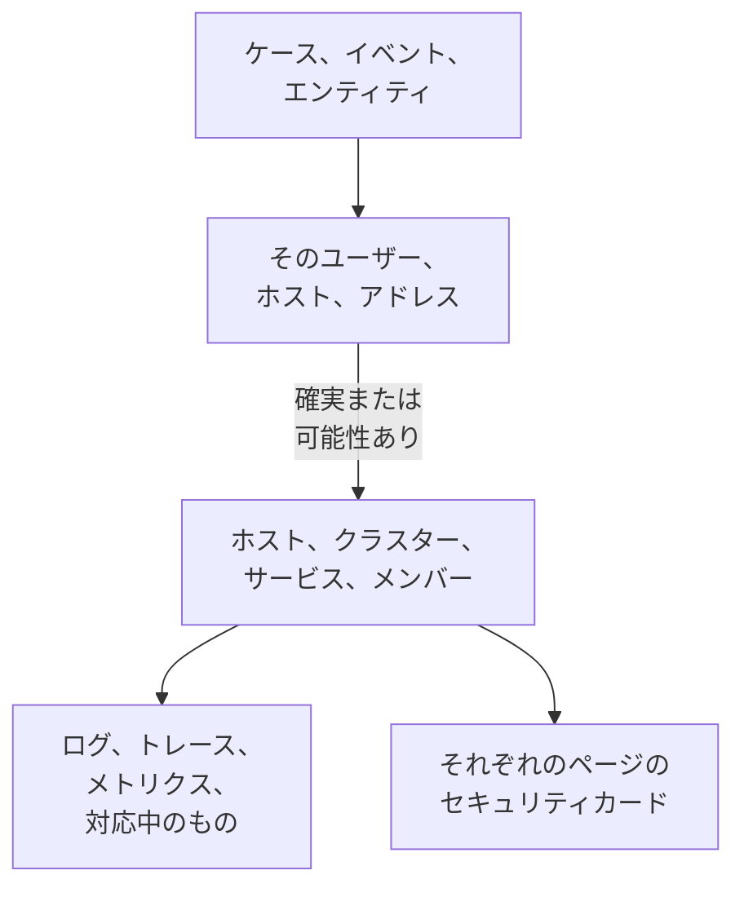

# 関連シグナル

セキュリティケースは、どのユーザー、ホスト、アドレスに関するものかを示します。関連シグナルは、そのうち OneUptime がすでに把握しているもの (ホスト、コンテナホスト、Kubernetes クラスター、ネットワークデバイス、サービス、メンバー) と、ケースの前後にそれぞれで起きていたこと (ログ、トレース、メトリクス、対応中のインシデントとアラート、監視しているモニター、変更されたこと) を示します。逆に、ホスト、クラスター、サービス、メンバーのページには、セキュリティイベントがそれについて見つけたことが表示されます。

:::cards
- [表示される場所](#表示される場所): ケースのページ、イベントのタブ、エンティティのページ、そしてそれらが示すもののページ。
- [値の照合方法](#値の照合方法): 同じレコードとみなすもの、そして可能性があるだけのもの。
- [各レコードに表示される内容](#各レコードに表示される内容): ケースの前後のシグナルと、対応中のもの。
- [誰が何を見られるか](#誰が何を見られるか): どのレコードも、読む人自身のロールで読み取られます。
:::

## 仕組み

OneUptime は各値をプロジェクトのレコードの中から探し、各一致がどれだけ確実かを示し、ケースの前後に各レコードで起きていたことを表示します。

## 始める前に

- セキュリティイベントが届いていて、それが示しうるホスト、Kubernetes クラスター、サービス、メンバーがプロジェクトにあること。[セキュリティをはじめる](/docs/telemetry/security-getting-started) を参照してください。
- セキュリティイベントを読み取れるロールと、表示したい種類のレコードを読み取れるロール。

## 表示される場所

- **関連シグナル**: すべてのセキュリティケースのページです。**製品 → セキュリティイベント → セキュリティケース → 未解決のケース** でケースを開き、メニューの **エンティティ** の次にある **関連シグナル** を開きます。
- **接続済み**: すべてのセキュリティイベントのタブです。**製品 → セキュリティイベント → イベント** でイベントを開きます。イベントが示すものを、その前後 1 時間について一覧表示します。
- **製品 → セキュリティイベント → エンティティリスク** にあるエンティティのページ: 最後のセキュリティイベントの前後に、OneUptime がそのユーザー、ホスト、アドレスをどこで把握しているかを示します。
- ホスト、Docker ホスト、Podman ホスト、Kubernetes クラスター、ネットワークデバイス、サービス、メンバー、インベントリ項目の各ページにある **セキュリティ** カード: それを示す未解決のセキュリティケース、過去 7 日間にそれを示したセキュリティイベントと検出結果の数、そのうち最も重大なもの、そしてリスクです。**セキュリティイベントで開く** でそこを開きます。
- インシデントのページにある **セキュリティ** カード: セキュリティケースがインシデントを宣言した場合 (**宣言元**) や、インシデントの影響を受けるホストやクラスターを未解決のケースが示している場合 (**影響先を示す未解決のケース**) に表示されます。

## 値の照合方法

ケースやイベントが示す各ユーザー、ホスト、アドレスは、プロジェクトのレコードの中から検索されます。

| ケースやイベントが示すもの | 照合先 | 確実さ |
| --- | --- | --- |
| ホスト、コンテナホスト、クラスター、ネットワークデバイスが報告する名前と同じホスト名またはドメイン名 | そのレコード | 確実 |
| ホストであると示さずに与えられた同じ名前 | そのレコード | 可能性あり |
| レコード名の短縮形または完全形 (`web-1` と `web-1.acme.internal` など) | そのレコード | 可能性あり |
| ただ一つのレコードだけが持つパブリック IP アドレス | そのレコード | 確実 |
| プライベート IP アドレス、または複数のレコードが持つ IP アドレス | それを持つ各レコード | 可能性あり |
| メンバーのメールアドレス | そのメンバー | 確実 |
| ログから読み取ったイベントの場合、ログ行の送信元のレコード | そのホスト、クラスター、サービス | 確実 |
| ユーザー名だけのもの、URL、ファイルハッシュ、プロセス | なし: これらでキーが付けられたレコードはありません | - |

- 一致の可能性があるものは、名前の横に **一致の可能性** と表示し、その理由を示します。レコードのページで数えられることはなく、ケースが宣言するインシデントにリンクされることもありません。
- 検索したものの、プロジェクトのレコードではなかったものは **OneUptime にありません** に一覧表示されます。それが該当しうる種類のレコードを読み取れなかった場合、その値がそこに表示されることはありません。
- 1 つのケースに表示されるレコードは最大 10 件で、確実なものが先に並びます。

## 各レコードに表示される内容

- シグナル (それぞれレコードとケースの期間で開きます): **ログ**、**トレース**、**メトリクス**、サービスの **例外**、クラスターの **Kubernetes イベント**、レコードの **トポロジー**、そしてインベントリに項目がある場合はその **インベントリ** 項目。
- 現在そのレコードで対応中のインシデントとアラート、そしてそれを監視しているモニター。それぞれのページを開けます。
- 期間中にそのレコードで変更されたこと: サービスのデプロイ、クラスターのロールアウト、ホストの修正。

| 場所 | 期間 |
| --- | --- |
| ケース | 最初の検出の 30 分前から最後の検出の 30 分後まで。最大でケースの最後の 24 時間 |
| イベント | その前後 30 分 |
| エンティティのページ | 最後のセキュリティイベントの前後 30 分 |
| レコードの **セキュリティ** カード | 過去 7 日間 |

## 誰が何を見られるか

- 関連シグナルとレコードの **セキュリティ** カードには、セキュリティイベントを読み取れるロールが必要です: Security Admin、Security Member、Security Viewer、Project Owner、Project Admin。それ以外の人には、どのページにもセキュリティデータは表示されません。[ロール](/docs/permissions/reference#ロール) を参照してください。
- インシデントの **セキュリティ** カードには、セキュリティケースを読み取れるロールが必要です。
- 各レコードは、あなた自身のロールで読み取られます。あなたのロールで読み取れない種類のレコードは省かれ、ページにその旨が表示されます。今は読み取れなかった種類についても、**再試行** とともにその旨が表示されます。
- レコードのページに **セキュリティ** カードが表示されるのは、セキュリティイベントを使っているプロジェクト (過去 7 日間にセキュリティイベントを受け取ったプロジェクト) だけです。

## ケースが宣言するインシデント

ケースの **インシデントを宣言**、またはインシデントを宣言するプレイブックのステップは、ケースが確実に関連付けられているホスト、Docker ホスト、Podman ホスト、Kubernetes クラスター、サービスにインシデントをリンクします。インシデントはそれらのページに表示され、それらの所有者のルールが適用されます。またフィードには、ケースとリンク先が記載されます。一致の可能性があるだけのものはリンクされません。

## OneUptime AI

OneUptime AI によるケースのトリアージでは、その関連シグナル (ケースが示すホスト、サービス、メンバーで対応中のものと変更されたこと) を読み取ります。インシデントの調査では、そのインシデントを宣言したセキュリティケースと、インシデントの影響を受けるものを示す未解決のケースを読み取ります。[セキュリティの OneUptime AI](/docs/telemetry/security-ai) を参照してください。

## トラブルシューティング

:::details ケースが示すホストが一覧にない
ケースが、ホスト自身が名乗る名前でそのホストを示しているか、そのホストだけが持つパブリックアドレスを示しているかを確認してください。`web-1.acme.internal` に対する `web-1` のような短い名前は一致の可能性として表示され、ユーザー名だけのもの、URL、ファイルハッシュ、プロセスはそもそも検索されません。
:::

:::details 正しいホストが一致の可能性として表示される
一致の可能性は、数えられることもリンクされることもありません。2 台のマシンが共有する名前が、間違ったほうについて何かを伝えることがないようにするためです。ログと検出で、ホストが報告する名前でホストを示すようにしてください。
:::

:::details ホストのページにセキュリティカードがない
このカードは、セキュリティイベントを読み取れるロールに対して、過去 7 日間にセキュリティイベントを受け取ったプロジェクトで表示されます。その期間に何にも示されなかったホストには、その旨を伝える 1 行が表示されます。
:::

:::details ロールでは表示できない種類のレコードがあるとページに表示される
各レコードは、あなた自身のロールで読み取られます。その種類のレコードを読み取れるロールを、Project Owner または Project Admin に依頼してください。
:::

## 次のステップ

:::cards
- [セキュリティケースとプレイブック](/docs/telemetry/security-cases): ケースに対応し、そこからインシデントを宣言します。
- [セキュリティイベント (SIEM)](/docs/telemetry/security-events): ケースの背後にあるイベントと、その読み取り元のログ。
- [エンティティリスク (リスクベースのアラート)](/docs/telemetry/security-entity-risk): エンティティのページ、そのリスク、そして OneUptime 上での所在。
- [セキュリティの OneUptime AI](/docs/telemetry/security-ai): トリアージがケースの示すものをどう読み取るか。
:::
