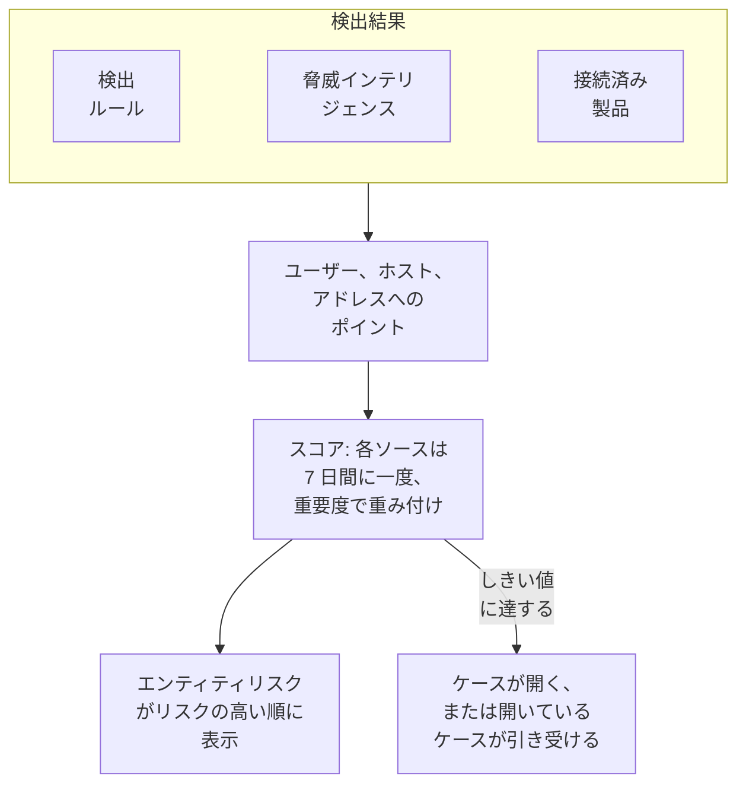

# エンティティリスク (リスクベースのアラート)

1 件の検出結果だけでは、たいてい多くを語りません。サインイン失敗の連続、ホストでの初めての sudo、新しい国からのサインインは、それぞれ一目見る価値があります。同じアカウントが 1 週間のうちに 3 つすべてに現れたら、ケースにする価値があります。エンティティリスクは、検出ルール、脅威インテリジェンス、接続済み製品が各ユーザー、ホスト、IP アドレスについて見つけたものを合算し、リスクの高い順に並べ、リスクがプロジェクトのしきい値に達したエンティティについてケースを開きます。

:::cards
- [スコアの数え方](#スコアの数え方): 重大度ごとのポイントと、各ソースは週に一度。
- [リスクレベルとケース](#リスクレベルとケース): スコアの読み方と、ケースが開くタイミング。
- [エンティティの重要度](#エンティティの重要度): 重要なものは多く、そうでないものは少なく数えます。
- [エンティティのページ](#エンティティのページ): リスクの理由、1 か月の推移、関連するケース。
- [検出ルールのリスクポイント](#検出ルールのリスクポイント): スコアに対するルール独自の重み。
:::

## 仕組み

**製品 → セキュリティイベント → エンティティリスク** を開くと、現在リスクのあるすべてのユーザー、ホスト、IP アドレスが、リスクの高い順に、レベル、重要度、検出元、時刻とともに表示されます。それぞれが専用のページで開きます。

## 始める前に

- セキュリティイベントが届いていて、その中から何かを見つける検出ルール、脅威インテリジェンス、または接続済み製品があること。[セキュリティをはじめる](/docs/telemetry/security-getting-started) を参照してください。
- 誰かを指すフィールドでグループ化する検出ルール: **グループ化のフィールド** (例: `principalUser`、`principalHost`、`principalIp`)、または相関ルールがグループ化するフィールド。何でもグループ化しないルールはリスクを加えません。
- **リスクスコアリング** を変更するには: スイッチとしきい値は Project Owner または Project Admin、エンティティの一覧は検出ルールを作成できるロール。Security Viewer はすべてを閲覧できます。[ロール](/docs/permissions/reference#ロール) を参照してください。

## スコアの数え方

検出結果ごとに、対象のユーザー、ホスト、IP アドレスにリスクポイントが加算されます:

| 検出結果の重大度 | 加算 |
| --- | --- |
| 低 | 10 ポイント |
| 中 | 25 ポイント |
| 高 | 50 ポイント |
| 重大 | 75 ポイント |

- 情報レベルの検出結果は何も加えず、重大度が不明な検出結果は中として数えます。
- 検出ルールのポイントは、そのルールがグループ化する値に加算されます。脅威インテリジェンスの一致は、インジケーターが指す IP アドレスに加算されます。接続済み製品のアラートは、それが指すユーザーとホスト、なければその IP アドレスに加算されます。
- 各ソースは一度だけ数えます。検出ルール、脅威インテリジェンスのフィード、接続済み製品のルールは、何度発火しても 7 日間に一度、加えた最大値で数えます。うるさいルールが 1 つあっても、異なる 3 つのルールより悪く見えることはありません。
- 7 日間何も見つけなかったソースは数えられなくなり、スコアが下がります。スコアは 15 分ごとに確認されるため、新しい検出結果がなくても時間どおりに下がります。

エンティティのスコアは、そのソースの合計を重要度で重み付けしたものです。**テスト攻撃を送信** によるテスト攻撃と、手動で開いたケースはリスクを加えません。

## リスクレベルとケース

各スコアは、プロジェクトのしきい値 (変更しなければ 100) に対するレベルとして読まれます:

| リスクスコア | レベル | 何が起きるか |
| --- | --- | --- |
| 1～49 | 低 | エンティティリスクに表示 |
| 50～99 | 中 | エンティティリスクに表示 |
| 100～199 | 高 | 高のケースが開く |
| 200 以上 | 重大 | 重大のケースが開く |

エンティティのリスクがしきい値に達すると、ソースがエンティティリスクの検出がそのエンティティについて発生します。それはエンティティについて開いているケースに加わるか、`High risk — k.morgan@acme-commerce.example` のようにエンティティの名前を付けたケースを開き、リスクへの寄与が大きいソースを最大 10 件、そのポイント、発火回数、最後の発火時刻とともに一覧にします。

エンティティのリスクについてケースが開いた後は、その背後にあったものは再び数えられません。次のケースが開くのは、それ以降の新しいソースが再びしきい値に達したときだけです。対応済みとして閉じたケースが、同じ検出結果で再び開くことはありません。

しきい値は **製品 → セキュリティイベント → 設定 → リスクスコアリング → リスクのしきい値** で変更します。10 から 10000 の整数です。中はその半分から、重大はその 2 倍から始まり、すべてのページで同じです。

### リスクのケースをオンまたはオフにする

**設定 → リスクスコアリング** の **リスクのケース** は、リスクがケースを開くかどうかを決め、切り替えるとすぐに保存されます。新しいプロジェクトはオンで始まります。エンティティリスクより前に作成されたプロジェクトは、誰かがオンにするまでオフのままで、**エンティティリスク** はその旨を一覧の上に表示します。リスクはどちらの場合もスコア付けされ、表示されます。

## エンティティの重要度

一部のエンティティは他より重要です: ドメインコントローラー、経営陣のアカウント、決済サーバーなど。スキャンが想定内の脆弱性スキャナーのように、重要度の低いものもあります。それらを **設定 → リスクスコアリング → エンティティの重要度** で **エンティティを追加** を使って一覧にします:

| 重要度 | リスクの数え方 |
| --- | --- |
| 低 | ×0.5 |
| 一覧にない | ×1 |
| 高 | ×1.5 |
| 最高 | ×2 |

エントリは値または `*` パターンで、大文字と小文字は区別しません。`dc-*` はすべてのドメインコントローラー、`*@contractors.example` はすべての契約者を指します。**種類** はユーザー、ホスト、IP アドレスのいずれかに絞り込み、空欄ならすべてが対象です。複数のエントリが 1 つのエンティティを指す場合は、最も具体的なものが適用されます。パターンより完全な値、短いパターンより長いパターンが優先です。変更は数分以内にすべてのエンティティのスコアに反映されます。

## エンティティのページ

**エンティティリスク** の行で **表示** をクリックするか、ケースの **エンティティ** ページでエンティティの横のリスクをクリックします:

| 部分 | 表示内容 |
| --- | --- |
| ヘッダー | 種類と重要度、スコアとレベル、スコアの算出方法 |
| **アクティビティ** | 過去 7 日間のセキュリティイベントと検出結果 |
| **リスクを高めているもの** | 各ソース、その重大度、加えるポイント、発火回数、最後の発火時刻 |
| **過去 30 日間のリスク** | 各日の終わりのスコア。レベルごとに色分け |
| **このエンティティのケース** | このエンティティについて開かれたセキュリティケース (新しい順) |

**Open in Correlate** はイベントのグラフを描き、**イベントを検索** はその週の **イベント** を開きます。**リスクをリセット** は、計画したテストの後などにスコアとソースを消去します。次に見つかるものはゼロから数えられ、ケースは変わりません。リセットにはセキュリティデータを削除できるロールが必要で、[監査ログ](/docs/configuration/audit-logs) に記録されます。

OneUptime AI は、ケースをトリアージするときにケースのエンティティのリスクを読みます。[セキュリティの OneUptime AI](/docs/telemetry/security-ai) を参照してください。

## 検出ルールのリスクポイント

検出ルールは、Sigma の `level` から得たレベルのポイントを加えます。ルール独自の重みを与えるには、ルールのフォームを開き、**一致したとき** に進み、**その他の項目** を開いて **リスクポイント** を 0 (リスクを加えない) から 100 の間で設定します。空欄のままにするとレベルのポイントになります。

## トラブルシューティング

:::details エンティティがエンティティリスクに表示されない
過去 7 日間に検出ルール、脅威インテリジェンスのフィード、または接続済み製品がそのエンティティについて何かを見つけたこと、そしてルールがそのエンティティを指すフィールドでグループ化していることを確認してください。情報レベルの検出結果は何も加えず、7 日間何も見つけなかったソースは数えられなくなります。
:::

:::details エンティティのリスクがしきい値に達したのに、ケースが開かない
**設定 → リスクスコアリング** で **リスクのケース** がオンになっていることを確認してください。エンティティのリスクについて以前にケースが開いていた場合、次のケースに数えられるのはそれ以降の新しいソースだけです。
:::

:::details ルールが何度も発火するのに、エンティティのスコアが上がらない
それがこの数え方です。ソースは 7 日間に一度、加えた最大値で数えます。うるさいルールの **リスクポイント** を下げるか、検出結果が想定内のエンティティの重要度を低にしてください。
:::

:::details スコアがソースの合計と一致しない
重要度で重み付けされています。エンティティのページには、ソースの合計と重み (例: ソースから 100 × 2 = 200) が表示されます。
:::

## 次のステップ

:::cards
- [セキュリティケースとプレイブック](/docs/telemetry/security-cases): リスクが開くケースに対応し、判定を付けて閉じます。
- [セキュリティイベント (SIEM)](/docs/telemetry/security-events): 検出ルール、相関分析、すべての検出結果の背後にあるイベント。
- [脅威インテリジェンス (STIX/TAXII)](/docs/telemetry/threat-intelligence): アドレスのリスクに加算される一致。
- [セキュリティの OneUptime AI](/docs/telemetry/security-ai): トリアージがケースのエンティティのリスクを読む方法。
:::
