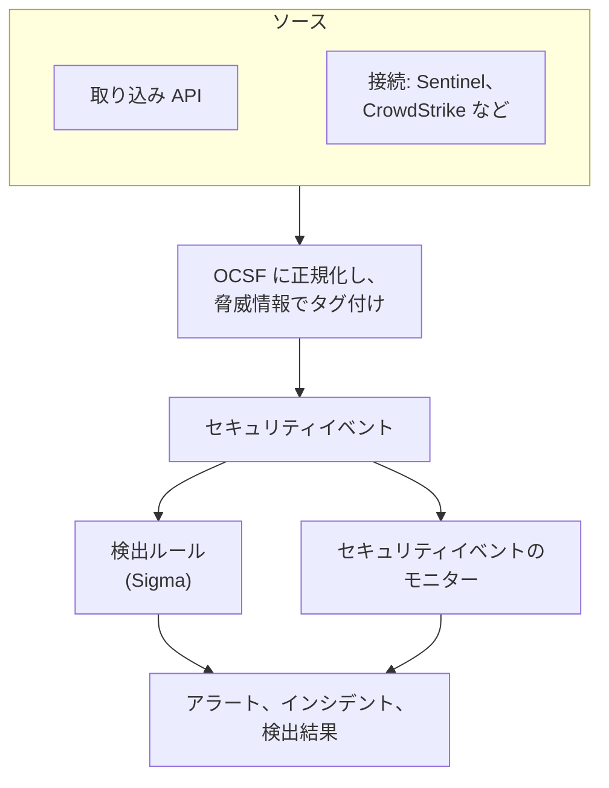
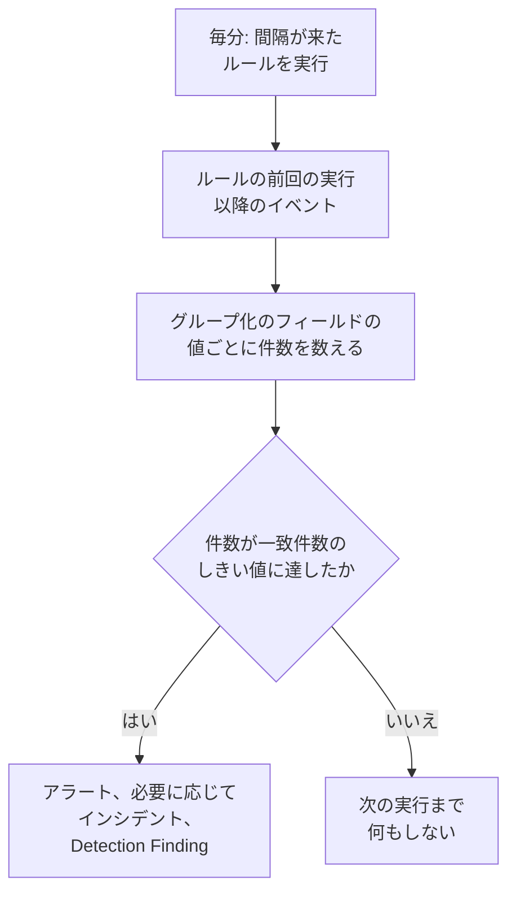

# セキュリティイベント (SIEM)

OneUptime はセキュリティイベントをログ、トレース、メトリクスと並べて保持し、どの形式で届いたかにかかわらず、すべてを同じ形 [OCSF](https://schema.ocsf.io/) (Open Cybersecurity Schema Framework) にそろえます。あらゆるソースからイベントを送り、検索し、重要なものを Sigma 検出ルール、脅威インテリジェンス、モニターでアラートに変えましょう。

:::cards
- [イベントを送る](#セキュリティイベントを送る): HTTPS の POST、Fluent Bit の出力、またはセキュリティ製品との接続。
- [検索と相関分析](#セキュリティイベントを調べる): イベントエクスプローラーと相関分析のグラフ。
- [検出ルール](#検出ルール): アラートを開く Sigma ルール。
- [モニター](#セキュリティイベントのモニター): ローリングウィンドウでの件数と、回復するステータス。
:::

## 仕組み



**オブザーバビリティ** の下にある **製品 → セキュリティイベント** を開きます。タブは次のとおりです。

| タブ | 用途 |
| --- | --- |
| **イベント** | すべてのイベントを検索して絞り込み、ひとつを開いてすべての項目を見る |
| **相関分析** | 同じホスト、ユーザー、IP アドレスを共有するイベントのグラフ |
| **検出ルール** | スケジュールに沿って実行され、アラートを開く Sigma ルール |
| **脅威インテリジェンス** | 既知の悪性インジケーターの STIX/TAXII フィード |
| **モニター** | プロジェクトのセキュリティイベントのモニター |
| **接続** | OneUptime が新しいレコードをポーリングするセキュリティ製品 |
| **セットアップガイド** | イベントを送るためのスニペット。取り込みキーが入力済み |

## 始める前に

セキュリティデータを読めるのは、Project Owner と Project Admin のロール、そして 3 つの Security ロールだけです。それ以外のロールには、セキュリティイベントに何も表示されません。 [ロール](/docs/permissions/reference#ロール) を参照してください。

| ロール | できること |
| --- | --- |
| Security Admin | すべて: イベント、検出ルール、脅威インテリジェンスのフィード、接続 |
| Security Member | イベントと脅威インテリジェンスの閲覧、検出ルールとフィードの作成、変更、削除。接続の設定やセキュリティデータの削除はできない。 |
| Security Viewer | イベント、ルール、フィード、インジケーター、接続の閲覧 |

## セキュリティイベントを送る

:::steps
### 取り込みキーを作成する

**プロジェクト設定 → テレメトリと APM → 取り込みキー** を開き、 **取り込みキーを作成** をクリックします。セキュリティイベントは、ほかのテレメトリと同じキーを使います。

### イベントを送信する

キーを `x-oneuptime-token` に入れて、JSON を `/security-events/v1/ingest` に送ります。

:::tabs
@tab OCSF
```bash
curl -X POST "https://oneuptime.com/security-events/v1/ingest?format=ocsf" \
  -H "Content-Type: application/json" \
  -H "x-oneuptime-token: YOUR_INGESTION_TOKEN" \
  -H "x-oneuptime-service-name: my-security-source" \
  -d '{ "events": [ { "class_uid": 3002, "severity_id": 4, "status": "Failure", "message": "Failed logon for alice", "actor": { "user": { "name": "alice" } }, "src_endpoint": { "ip": "203.0.113.7", "hostname": "laptop-alice" } } ] }'
```
@tab Google UDM
```bash
curl -X POST "https://oneuptime.com/security-events/v1/ingest?format=udm" \
  -H "Content-Type: application/json" \
  -H "x-oneuptime-token: YOUR_INGESTION_TOKEN" \
  -d '{ "events": [ { "metadata": { "event_type": "USER_LOGIN" }, "principal": { "hostname": "laptop-alice", "user": { "userid": "alice" }, "ip": ["203.0.113.7"] }, "security_result": [{ "severity": "HIGH", "action": ["BLOCK"] }] } ] }'
```
@tab Generic JSON
```bash
curl -X POST "https://oneuptime.com/security-events/v1/ingest" \
  -H "Content-Type: application/json" \
  -H "x-oneuptime-token: YOUR_INGESTION_TOKEN" \
  -d '{ "events": [ { "severity": "high", "event_type": "ssh_brute_force", "message": "12 failed SSH logins in 60s", "username": "root", "hostname": "web-01", "src_ip": "203.0.113.7" } ] }'
```
:::

イベントがキューに入ると、エンドポイントは `200` を返します。これらのように時刻なしで送ったイベントは、届いた時点に置かれます。

### イベントタブで見つける

**製品 → セキュリティイベント → イベント** を開きます。数秒以内にイベントが表示され、重大度、クラス、ユーザー、ホスト、IP アドレスが入力されています。
:::

### 形式

| `format` | 読み取るもの | ほかに使える値 |
| --- | --- | --- |
| `ocsf` | OCSF のイベント JSON (`class_uid`、`severity_id` など) | なし |
| `udm` | Google SecOps (Chronicle) の UDM イベント (`metadata.event_type` など) | `chronicle`、`google-secops` |
| `google-secops-alert` | Google SecOps の検出とアラート: SOAR の Webhook と検出ストリーム | `secops-alert`、`detection` |
| `generic` | その他の JSON。一般的な項目名で読み取る | なし |

形式は `?format=`、 `x-oneuptime-security-event-format` ヘッダー、または最上位の `"format"` フィールドで指定します。指定しなければイベントごとに形式が判定されるので、ひとつの Webhook で検出と生のイベントを混在させることができます。

- 本文は、ひとつのイベント、イベントの配列、または `{ "events": [...] }` のいずれかです。
- `x-oneuptime-service-name` ヘッダーは、イベントが属するテレメトリサービスを指定します。指定しなければ、最初のイベントの製品名またはベンダー名にちなんだサービス、または `Security Events` に属します。
- 対応付けられなかったものも破棄されません。ソースのすべての項目がイベントの属性に入ります。

### 汎用 JSON の項目

汎用のイベントは、一般的な項目名で読み取られます。

| イベントの項目 | 次のうち最初に見つかったものから読み取る |
| --- | --- |
| `message` | `message`、`msg`、`summary`、`description`、`title` |
| `severityName` | `severity`、`severity_name`、`level`、`priority`、`risk_level` |
| `time` | `timestamp`、`time`、`@timestamp`、`event_time`、`created_at` |
| `principalUser` | `user`、`username`、`user_name`、`account`、`actor` |
| `principalHost` | `host`、`hostname`、`computer`、`device`、`machine` |
| `principalIp` | `source_ip`、`src_ip`、`client_ip`、`ip` |
| `targetIp` | `destination_ip`、`dest_ip`、`dst_ip`、`target_ip` |
| `className` | `event_type`、`category`、`type`、`action` |
| `ruleName` | `rule`、`rule_name`、`signature`、`detection` |
| `productName` | `product`、`product_name`、`source`、`log_source` |

重大度を表す語は OCSF のレベルに変換されます。 `info` は Informational、 `warning` は Low、 `error` は Medium、 `alert` は Critical、 `emergency` は Fatal として読み取られます。

### Fluent Bit で転送する

auditd、syslog、Falco など、すでに収集しているセキュリティログを送るには、Fluent Bit に `http` 出力を追加します。

```ini title="fluent-bit.conf"
[OUTPUT]
    Name             http
    Match            security.*
    Host             oneuptime.com
    Port             443
    tls              On
    URI              /security-events/v1/ingest
    Format           json
    Json_date_key    timestamp
    Json_date_format iso8601
    Header           x-oneuptime-token YOUR_INGESTION_TOKEN
    Header           x-oneuptime-service-name my-security-source
    Retry_Limit      5
```

**セットアップガイド** タブには、ホストとキーが入力済みのこれらのスニペットがあります。

### セキュリティ製品を接続する

**接続** は、セキュリティ製品をあなたの代わりにポーリングし、その新しいレコードをセキュリティイベントとして取り込みます。接続は製品の設定と暗号化された認証情報を保持し、ワーカーが設定した間隔でポーリングして、取り込み済みのレコードはスキップします。

| 製品 | 取り込むもの | セットアップガイド |
| --- | --- | --- |
| Google SecOps (Chronicle) | ルールによる検出、キュレート済みの検出、アラートを Detection Finding として | [Google SecOps](/docs/integrations/google-secops) |
| Microsoft Sentinel | インシデントを Incident Finding として | [Microsoft Sentinel](/docs/integrations/microsoft-sentinel) |
| Microsoft Defender XDR | アラートを Detection Finding として | [Microsoft Defender XDR](/docs/integrations/microsoft-defender-xdr) |
| CrowdStrike Falcon | アラートを Detection Finding として | [CrowdStrike Falcon](/docs/integrations/crowdstrike-falcon) |
| Splunk Enterprise Security | Notable イベントまたは任意の検索を Detection Finding として | [Splunk Enterprise Security](/docs/integrations/splunk) |
| Elastic Security | 検出アラートを Detection Finding として | [Elastic Security](/docs/integrations/elastic-security) |
| AWS Security Hub | Finding を Detection Finding と Compliance Finding として | [AWS Security Hub](/docs/integrations/aws-security-hub) |
| Okta System Log | サインイン、MFA、アカウント、ポリシーのイベント | [Okta System Log](/docs/integrations/okta) |

- 接続は、レコードが表すアクティビティの時刻ではなく、製品がレコードを作成した時刻で読み取ります。1 時間ごとに実行される SIEM ルールは一致したイベントよりずっと後に検出を作成しますが、それも取り込まれます。
- 最初のポーリングは 24 時間さかのぼるので、新しい接続ではすぐに最近のレコードが表示されます。
- 接続の行にある **接続をテスト** は、製品へのアクセスと OneUptime 自身のワーカーが動いているかを確認し、何も取り込みません。 **今すぐ実行** はすぐにポーリングします。

## イベントが持つもの

すべてのイベントは、型付きの項目とソースのペイロードとともに保存されます。

| グループ | 項目 |
| --- | --- |
| 分類 | `categoryName`、`className`、`activityName`、`statusName` と、それぞれの OCSF ID (`categoryUid`、`classUid`) |
| 重大度 | `severityName` (Unknown、Informational、Low、Medium、High、Critical、Fatal、Other のいずれか) と `severityId` |
| 誰が行ったか | `principalUser`、`principalHost`、`principalIp`、`principalProcess` |
| 何に触れたか | `targetUser`、`targetHost`、`targetIp`、`targetPort`、`targetResource` |
| ソース | `productName`、`vendorName`、`ruleId`、`ruleName`、`eventUid` |
| 内容 | `message`、`mitreTactics`、`mitreTechniques`、`observables`: イベントから取り出したすべてのユーザー、ホスト、IP アドレス、ドメイン、ハッシュ |
| 属性 | ソースのペイロード全体を、ドット区切りのキーに平坦化したもの |

## セキュリティイベントを調べる

**イベント** は、ログやトレースのエクスプローラーと同じテレメトリエクスプローラーです。ウィンドウ内のイベントを重大度別に示すグラフ、ファセットのサイドバー、一覧、そして開いたイベントのすべての項目と属性を表示するパネルがあります。ウィンドウ、フィルター、検索はすべて URL に保存されるので、絞り込んだ表示を共有でき、再読み込みしても残ります。

### 検索

検索バーは、ほかのテレメトリエクスプローラーと同じ書き方に対応しています ( [検索構文](/docs/telemetry/search-syntax) を参照)。

| 構文 | 意味 | 例 |
| --- | --- | --- |
| 自由テキスト | メッセージに含まれる | `failed logon` |
| `"quoted phrase"` | 語をひとまとまりで扱う | `"brute force"` |
| `<field>:<value>` | 型付きの項目 | `severity:Critical` |
| `@<attribute>:<value>` | ソースの属性 | `@threat.matched:true` |
| `-<filter>` | これ以外 | `-severity:Informational` |
| `<field>:(a OR b)` | これらの値のいずれか | `severity:(High OR Critical)` |
| `<field>:a*` | `*` は任意のテキスト、 `?` は任意の一文字 | `host:web-*` |
| `@<attribute>:*` | 属性が存在する | `@threat.indicator_id:*` |
| `@<attribute>:~text` | 属性がテキストを含む | `@finding_info.title:~ransom` |

項目は、短い名前 (`severity`、`class`、`category`、`activity`、`status`、`vendor`、`product`、`rule`、`user`、`host`、`ip`、`targetuser`、`targethost`、`targetip`、`observable`、`tactic`、`technique`) か、 `severityName` や `principalHost` のような項目自体の名前です。それ以外の名前はソースの属性として読み取られます。 `observable:<value>` は、アクティビティのどちら側にあったかにかかわらず、その値に触れているすべてのイベントを見つけます。

### ファセット

サイドバーは、ウィンドウ内のイベントを **ソース**、 **重大度**、 **イベントクラス**、 **カテゴリ**、 **アクティビティ**、 **ステータス**、 **ベンダー**、 **製品**、 **検出ルール**、 **送信元ユーザー**、 **送信元ホスト** ごとに数えます。値をクリックするとそのイベントだけを残し、横のマイナスをクリックすると除外します。グラフとすべての件数は、一覧にあるイベントをそのまま表します。

### 相関分析

**相関分析** は、ホスト、ユーザー、IP アドレスを中心にイベントを描きます。検索した値の周りにイベントクラスを最も高い重大度で示し、同じイベントに含まれるほかの値を外側の輪に配置します。クラスをクリックするとそのイベントの一覧、値をクリックするとその値で次の相関分析を行います。 **イベント** でイベントのパネルにある observable はどれも、その値で **相関分析** を開きます。

## 検出ルール

検出ルールは [Sigma](https://sigmahq.io/) ルールです。疑わしいアクティビティを記述するためのオープンな YAML 形式で、OneUptime がスケジュールに沿ってあなたのイベントに対して実行します。一致するとアラートを開き、必要に応じてインシデントを開き、Detection Finding をイベントに書き戻します。



### ルールを作成する

:::steps
1. **製品 → セキュリティイベント → 検出ルール** を開き、 **検出ルールを作成** をクリックします。
2. **基本情報** で **名前** を付け、 **有効** はオンのままにします。
3. **Sigma ルール** で、ルールの YAML を **Sigma ルール（YAML）** に貼り付けます。保存時に解析されるので、誤りはフォームに表示されます。
4. **評価** で、実行の頻度と必要な一致数を設定します。 [評価の設定](#評価の設定) を参照してください。
5. **一致したとき** で、一致したときの動作を選びます。 **一致したらアラートを作成** (オン)、 **一致したらインシデントを作成** (オフ)、 **一致したら検出結果を書き込む** (オン) と、任意の **アラートの重大度** と **インシデントの重大度** です。
:::

`10.x.x.x` 以外からのログオン失敗に一致する最初のルール:

```yaml title="failed-logon-burst.yml"
title: Failed logon burst
description: Repeated authentication failures from one source.
level: high
tags:
  - attack.t1110
  - attack.ta0006
detection:
  selection:
    className: Authentication
    statusName: Failure
  filter_internal:
    principalIp|startswith: '10.'
  condition: selection and not filter_internal
```

### ルールで表現できること

OneUptime は Sigma のブール演算の中核部分を実行します。

- セレクションは、項目のマップ (すべての項目が一致する必要があり、値のリストはそのいずれかに一致) か、メッセージ内のどこかに一致するキーワードのリストです。
- 条件は、 `and`、 `or`、 `not` と括弧、または `1 of selection_*`、 `all of selection_*`、 `any of them`、 `all of them` でセレクションを組み合わせます。
- 項目の修飾子: `contains`、 `startswith`、 `endswith`、 `all`、 `re`、 `cased`、 `gt`、 `gte`、 `lt`、 `lte`、 `cidr`、 `exists`、 `windash`。テキストは、 `cased` を付けない限り大文字と小文字を区別せずに比較されます。
- 項目は、型付きの項目 (`principalUser`)、その一般的な Sigma の綴り (`CommandLine`、`src_ip`、`Hostname`)、またはイベントにあるとおりに綴った任意の属性キー (`threat.matched`) です。
- `level` は重大度を設定します。 `informational`、 `low`、 `medium`、 `high`、 `critical` のいずれかで、ない場合は `medium` です。 `tags` 内の ATT&CK ID (`attack.t1110`、`attack.ta0006`) は、検出結果の MITRE 項目に入ります。

`| count() by principalIp > 5` のような集計は保存時に拒否されます。代わりに **グループ化のフィールド** と **一致件数のしきい値** を使ってください。 `logsource` は情報としてのみ扱われ、何も絞り込みません。その絞り込みは `className: Authentication` のようにセレクションに入れてください。 `timeframe` は無視されます。ウィンドウはルールの間隔で決まるからです。

### 評価の設定

| 項目 | 内容 |
| --- | --- |
| **評価間隔（分）** | ルールを実行する頻度。分単位の整数で 1〜1440。新しいルールのフォームでは 5 から始まります。 |
| **グループ化のフィールド** | 任意。 `principalHost` のように、この項目の値が同じ一致はまとめて数えられ、アラートが出され、重複が除かれます。何百ものアラートではなく、ホストごとに一件になります。 |
| **ユニーク数を数えるフィールド** | 任意。一致したイベントではなく、この項目の異なる値の数を数えます。空の値は数えません。 |
| **一致件数のしきい値** | グループは、一回の実行の中で件数がこの数に達したときだけ発火します。1〜1000000 で、1 なら一致するたびに発火します。 |

グループ化とユニーク数は、ルールと同じ項目名を受け付けます。これらを使うと、しきい値は「同じものから、1 回の実行で、これだけの数」を意味し、上にモニターを重ねる必要はありません。

| 目的 | グループ化のフィールド | ユニーク数を数えるフィールド | しきい値 |
| --- | --- | --- | --- |
| すべての一致でアラート | 空 | 空 | 1 |
| ホストごとにアラート一件 | `principalHost` | 空 | 1 |
| ブルートフォース: ひとつの IP からのログオン失敗 5 回 | `principalIp` | 空 | 5 |
| パスワードスプレー: ひとつの IP が 5 つの異なるアカウントで失敗 | `principalIp` | `principalUser` | 5 |
| ポートスキャン: ひとつの IP が 20 の異なるポートに接続 | `principalIp` | `targetPort` | 20 |

### ルールが実行されるタイミング

OneUptime は毎分、前回の実行から間隔が経過した有効なルールを確認します。各実行は、イベントの時刻が前回の実行から現在までにあるイベントを読み取り、次へ進みます。

- ウィンドウは連続していて、スライドしません。間隔が 10 分なら、09:58 と 10:01 の失敗は別々の実行に入り、別々に数えられることがあるので、しきい値には余裕を持たせてください。
- ワーカーの停止やルールの再有効化などで間隔が空いた後は、次の実行が空白期間全体を、最大で直近 24 時間までカバーします。
- ルールの前回の実行より前の時刻を持って遅れて届いたイベントは、保存され検索もできますが、そのルールが読み取ることはありません。
- 1 回の実行で発火するグループは最大 100 個で、件数の多いものが選ばれます。

### 重大度

ルールの `level` は、その検出結果の重大度です。 `informational`、 `low`、 `medium`、 `high`、 `critical` は、それぞれ Informational、Low、Medium、High、Critical になります。アラートとインシデントには、プロジェクトの重大度のうちひとつが次の順で割り当てられます。

1. ルールの **アラートの重大度** (または **インシデントの重大度**)。設定されている場合。
2. レベルと同じ名前を持つあなたの重大度。たとえば High。大文字と小文字は区別しません。
3. 順位による割り当て: `critical` と `high` のルールは最も重い重大度、それ以外は最も軽い重大度になります。

> [!TIP]
> アラートの重大度に Sigma のレベル名 (Critical、High、Medium、Low、Informational) を付けておけば、ルールごとの設定なしに、すべてのルールが正しい重大度に割り当てられます。

### アラートと検出結果

発火したグループはそれぞれ、 `[Detection] <rule name> — <group value>` というタイトル、グループ化のフィールドがないルールでは `[Detection] <rule name>` というタイトルのアラートを開きます。アラートが開いているあいだは、そのグループの新たな一致で別のアラートが開くことはありません。ルールに見えるのは一致だけで、攻撃が止まったことはわからないため、アラートは誰かが解決するまで開いたままです。

Detection Finding は、製品 `OneUptime Detections` によるクラス `Detection Finding` (OCSF クラス 2004) のセキュリティイベントで、ルールの MITRE タグ、 `observables` の先頭にグループの値、そして次の属性を持ちます。

| 属性 | 値 |
| --- | --- |
| `oneuptime.detection.rule_id` | 発火したルールの ID |
| `oneuptime.detection.rule_name` | ルールの名前 |
| `oneuptime.detection.match_count` | 検出結果の元になったイベントの数 |
| `oneuptime.detection.distinct_count` | 元になった異なる値の数 (ユニーク数を数えるフィールドを持つルールの場合) |
| `oneuptime.detection.group_value` | グループの値 (グループ化のフィールドを持つルールの場合) |
| `oneuptime.detection.sigma_id` | Sigma ルール自身の `id` |

検出結果は通常のイベントです。 **イベント** で検索し、 **相関分析** で掘り下げられます。新しいルールを静かに試すには、信頼できるようになるまで、検出結果以外のすべての動作をオフにしておきます。

## セキュリティイベントのモニター

セキュリティイベントのモニターは、フィルターに一致するイベントをローリングウィンドウで数え、その件数に通常のモニター条件を適用します。モニターのステータスを変え、アラートやインシデントを開き、オンコール担当者を呼び出します。 **モニター → モニターを作成** で種類に **セキュリティイベント** を選んで作成します。 **セキュリティイベント → モニター** にすべてが一覧表示されます。

フォームには **このテキストを含むイベントを監視**、 **セキュリティイベントを監視する期間**、 **イベントの重大度**、 **イベントクラス** が表示されます。 **テレメトリサービスでフィルター** と **属性でフィルター** は **その他の項目** の中にあり、その見出しにはモニターが使っているものが表示されます。条件では **Security Event Count** を確認します。

| | 検出ルール | セキュリティイベントのモニター |
| --- | --- | --- |
| 一致の対象 | Sigma ルール | 重大度、クラス、メッセージ、サービス、属性のフィルター |
| ウィンドウ | 連続、実行ごとにひとつ | ローリング: 直近 5 秒から 24 時間まで |
| グループごとの件数 | あり ( **グループ化のフィールド** ) | なし: 一致したものすべてでひとつの件数 |
| 開くもの | アラート、インシデント、検出結果 | ステータス、アラート、インシデント |
| 回復 | しない: アラートは解決されるまで開いたまま | する: 件数が戻るとステータスも戻る |

検出そのものは、しきい値付きのルールとして書きます。ローリングウィンドウ、ひとりでに回復するステータス、ステータスページ、条件ごとに異なるオンコールポリシーが必要なときにモニターを使います。

### 検出を見張る

検出結果はイベントなので、モニターでルール自体を見張れます。

- 嵐: クラス `Detection Finding` に対するモニターで、すべての検出結果を数えます。1 時間に 20 の異なるルールが発火するのは、単独のルールでは見えないシグナルです。
- 頻度の変化: ひとつのルールの `oneuptime.detection.rule_id` で絞り込みます。週に一度発火するルールが 1 時間に 50 回発火しているなら、別の対応が必要です。
- 沈黙: いつもはいくつかある検出結果がゼロになったら、たいていはソースが送信をやめています。件数がある数を下回ったかを確認する条件を使ってください。

ルールの行にある **モニターを作成** は、すでにこのように設定された新しいモニターを開きます。クラス `Detection Finding`、ルールの ID (名前を変えると変わってしまう名前は使いません)、そして直近 1 時間です。このようなモニターが数えるのは、その元のイベントではなく、実行ごと、グループごとにひとつの検出結果です。何かが発火する前に一定数のイベントを必要とするなら、ルールの **一致件数のしきい値** を使ってください。

## 脅威インテリジェンス

**脅威インテリジェンス** は、既知の悪性 IP アドレス、ドメイン、URL、メールアドレス、ファイルハッシュの STIX/TAXII フィードを購読します。それらに触れているイベントには、届いた時点でルールやモニターが絞り込みに使える `threat.*` 属性が付き、毎分、最近のイベントがフィードと照合され、ルールと同じようにアラートと検出結果が開きます。 [脅威インテリジェンス](/docs/telemetry/threat-intelligence) を参照してください。

## 保持と課金

セキュリティイベントは、ほかのテレメトリと同じく取り込んだ GB 単位で課金され、テレメトリの保持期間のあいだ保持されます。保持期間は、 **プロジェクト設定 → テレメトリと APM → データ保持** にあるプロジェクトの **デフォルトの保持期間（日数）** 、またはイベントが属するテレメトリサービスに設定した保持期間です。イベントの保持期間が終わると削除されます。

## トラブルシューティング

:::details イベントが表示されない
`x-oneuptime-token` のキーとパス `/security-events/v1/ingest` を確認してください。次に **イベント** のウィンドウを確認します。変更しない限り過去 1 日です。イベントはそれ自身の時刻に配置されるので、古いタイムスタンプのイベントはウィンドウの外になります。
:::

:::details ルールがまったく一致しない
ルールが **有効** になっていることを確認し、その行の **最終評価** と **最終エラー** を読んでください。一致するはずだったイベントを開き、ルールと項目ごとに比べます。単純な値は項目全体と等しくなければならないので、一部だけなら `contains` か `*` を使います。属性はイベントにあるとおりの名前で書きます (`attributes.threat.matched` ではなく `threat.matched`)。しきい値が 1 より大きい場合、一致はひとつの実行の中に収まる必要があります。
:::

:::details ルールは一致したがアラートが開かない
**一致したらアラートを作成** がオフになっているか、同じルールとグループの値のアラートがまだ開いていて、後の一致がそこにまとめられています。ルールがアラートを開くには、プロジェクトにアラートの重大度が少なくともひとつ必要です。
:::

:::details ルールがアラートを開きすぎる
**グループ化のフィールド** の値ごとに個別のアラートが開きます。もっと粗い単位でグループ化する、しきい値を上げる、またはユニーク数を数えるフィールドを追加してください。一致のひとつひとつではなく頻度を気にするなら、 **一致したらアラートを作成** をオフにして、ルールの検出結果にモニターを置きます。
:::

## 次のステップ

:::cards
- [脅威インテリジェンス](/docs/telemetry/threat-intelligence): イベントを STIX/TAXII フィードと照合します。
- [Google SecOps](/docs/integrations/google-secops): Chronicle の検出とイベントを取り込みます。
- [検索構文](/docs/telemetry/search-syntax): 検索バーが理解するすべて。
- [権限リファレンス](/docs/permissions/reference): Security ロールと、それぞれにできること。
:::
