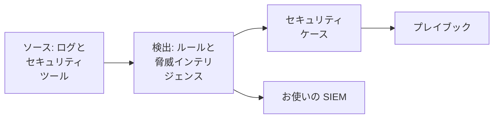

# セキュリティをはじめる

OneUptime は、すでにお持ちのデータ - ログ、お使いのセキュリティツール、OneUptime に送るあらゆるもの - から脅威を見つけ、見つけたものをケースにまとめ、プレイブックで対応します。設定はクリック 2 回で終わり、インストールするものはありません。

:::cards
- [設定する](#設定する): 多くのチームに必要なものを有効にし、テスト攻撃がケースを開くのを確かめます。
- [仕組み](#仕組み): ソース、検出、ケース、プレイブックと、それぞれの役割。
- [ログ](#ログからセキュリティイベントを見つける): OneUptime に送っているログにすでに含まれるセキュリティイベント。
- [SIEM](#oneuptime-が見つけたものを-siem-に送る): OneUptime が見つけたものを Google SecOps に送ります。
:::

## 始める前に

セキュリティを設定するには Project Owner、Project Admin、Security Admin のいずれかのロールが必要です。Security Member と Security Viewer のロールは見つかったものを閲覧できます。[ロール](/docs/permissions/reference#ロール) を参照してください。

## 設定する

:::steps
### 多くのチームに必要なものを有効にする

**製品 → セキュリティイベント** を開きます。**概要** で **おすすめをオンにする** をクリックします。3 つのものが一度に有効になります。**ログからセキュリティイベントを見つける**、推奨の検出ルール、そして **新しいケースを補強** です。**新しいケースを補強** は新しいケースごとに脅威インテリジェンスと照合し、トリアージ用のチェックリストを残すプレイブックです。

### テスト攻撃を送る

**テスト攻撃を送信** をクリックします。ドキュメント用の 1 つのアドレスからの 12 回のサインイン失敗が、実際の処理を通ります。保存され、総当たり攻撃のルールが検出し、ケースが開きます。誰も呼び出されず、どの SIEM にも届きません。

### ケースを開く

**ケースを開く** をクリックします。これが実際の検出結果の見え方です。その根拠となるイベント、対象のアドレス、そして **新しいケースを補強** が見つけたものが表示されます。終わったらテストとしてクローズしてください。
:::

それ以降、**概要** は誰かの対応を待つものから開き、**対応が必要** の下に並べます。自分のオープンなケース、誰も引き受けていないケース、承認を待つプレイブックのステップです。何もなければ **異常なし** と表示されます。

## 仕組み

| 要素 | 場所 | 役割 |
| --- | --- | --- |
| **ソース** | **接続** | ログ、OneUptime が取得するセキュリティ製品、そして送られてくるあらゆるもの |
| **検出** | **検出** | すべてのイベントから脅威を探す Sigma ルールと脅威インテリジェンスのフィード |
| **セキュリティケース** | **セキュリティケース** | 見つかったものを、対象のユーザー、ホスト、アドレスごとにまとめたもの |
| **プレイブック** | **プレイブック** | 新しいケースで実行されるステップ。情報の付加、通知、インシデントの作成、封じ込め |

**概要** の上部では、対応を待つものの下に、各要素がその数値とともに表示されます。ソースと直近 24 時間のイベント、有効なルール、オープンなケース、対応するプレイブックです。設定されていない要素はそう表示され、設定するページを開きます。

## ログからセキュリティイベントを見つける

**接続** の上部にある **ログ** は、インストール不要です。**ログからセキュリティイベントを見つける** を有効にすると、OneUptime はプロジェクトの新しいログを毎分読み取り、認識した行をセキュリティイベントにします。

| ログ | セキュリティイベントになるもの |
| --- | --- |
| SSH サインイン | サーバーの認証ログ、journal、syslog にある SSH サインインの失敗と成功 |
| sudo | 別のユーザーとして実行されたコマンド、間違った sudo パスワード、sudo の使用を許可されていない人 |
| Kubernetes 監査ログ | クラスターの変更、Pod で開かれたシェル、読み取られたシークレット、拒否されたリクエスト |
| AWS CloudTrail | コンソールへのサインイン、AWS アカウントでの変更、AWS が拒否した呼び出し |
| Web 攻撃 | Web サーバーのアクセスログのうち、SQL インジェクション、パストラバーサル、Log4Shell を試みるリクエスト |

ログはそのまま残ります。イベントになるのはセキュリティにとって重要な行だけで、Web サーバーが返したすべてのページや、API のすべての読み取りがイベントになることはありません。

## OneUptime が見つけたものを SIEM に送る

チームがすでに SIEM を使っている場合、OneUptime は見つけたものをそこにも送ります。**接続 → SIEM に送信** で **送信先を追加** をクリックし、Google SecOps のリージョン、インスタンス、サービスアカウントキーを入力して、保存する前に **テストイベントを送信** をクリックします。[Google SecOps にセキュリティイベントを送る](/docs/integrations/google-secops#google-secops-にセキュリティイベントを送る) を参照してください。

## トラブルシューティング

:::details Turn on recommended がグレーアウトしている
ロールに検出ルール、プレイブック、ログのソースを追加する権限がありません。Project Owner、Project Admin、Security Admin に依頼するか、Security Admin のロールを付与してもらってください。
:::

:::details Turn on recommended ですべてをオンにできなかった
カードには、オンにできなかったものとその理由が表示されます。理由は、ロール、プラン、または OneUptime 側の問題のいずれかです。それ以外はすべてオンです。表示された内容を解決してから **再試行** をクリックします。まだ足りないものだけがオンになり、同じものが二重に追加されることはありません。
:::

:::details テスト攻撃でケースが開かなかった
通常はボタンが応答する前にケースが開きます。ルールがまだ追いついていない場合はそう表示され、1 分以内にケースが開きます。もう一度 **セキュリティケース** を確認し、**検出** で総当たり攻撃のルールが有効になっていることを確かめてください。
:::

:::details ログからセキュリティイベントが届かない
**ログからセキュリティイベントを見つける** が有効で、**ログ** に最後に確認した時刻が表示されていることを確かめてください。イベントになるのは上の表にある種類の行だけです。SSH、sudo、監査、CloudTrail、アクセスのいずれのログも送っていないサーバーには、見つけるものがありません。
:::

:::details 概要に最後のセキュリティイベントが数日前と表示される
それ以降、Security には何も届いていません。**接続** を開き、**ログ** と各接続がまだ有効か、それぞれ最後にいつ確認したかを確かめてください。
:::

:::details Security をオンにするカードが消えた
誰かが **却下** で片付けました。まだ何も脅威を監視していない間は、**概要** に **Security を設定** が表示され、カードを戻せます。
:::

## 次のステップ

:::cards
- [セキュリティイベント (SIEM)](/docs/telemetry/security-events): イベントを送り、検索し、検出ルールを書きます。
- [セキュリティケースとプレイブック (SOAR)](/docs/telemetry/security-cases): ケースに対応し、プレイブックで応答します。
- [脅威インテリジェンス (STIX/TAXII)](/docs/telemetry/threat-intelligence): イベントを既知の悪性インジケーターと照合します。
- [Google SecOps](/docs/integrations/google-secops): Google SecOps の検出を取り込み、OneUptime が見つけたものを送ります。
:::
