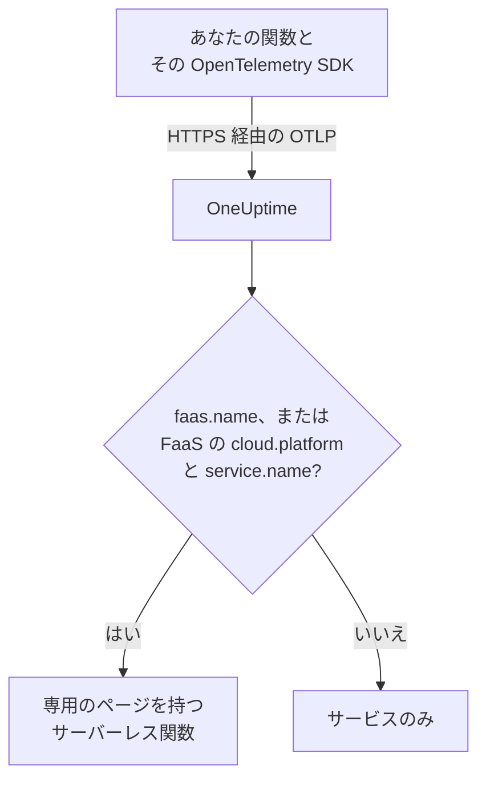

# サーバーレス関数

OneUptime は、サーバーレス関数から OpenTelemetry データを受信した時点でその関数を認識し、トレース、ログ、メトリクスとともに **サーバーレス関数** に一覧表示します。AWS Lambda、Google Cloud Functions、Azure Functions、Cloudflare Workers のほか、OpenTelemetry を送信できるあらゆる FaaS ランタイムで機能します。手動で作成するものはありません。関数をそのランタイム用の OpenTelemetry SDK で計装し、OTLP エクスポーターの送信先を OneUptime にするだけです。

:::cards
- [OneUptime が関数を識別する方法](#oneuptime-が関数を識別する方法): `faas.name`、または FaaS の `cloud.platform` と `service.name` の組み合わせ。
- [関数のテレメトリを送信する](#関数のテレメトリを送信する): エクスポーターの設定と Lambda レイヤー。
- [Azure Functions](#azure-functions): Functions ホストから、Function App ごとに 1 つの関数。
- [トラブルシューティング](#トラブルシューティング): 表示されない関数、またはページが空の関数。
:::

## 仕組み

OneUptime は、各バッチのリソース属性を届いた時点で読み取ります。`faas.name` を持つリソース、または `aws_lambda` や `azure_functions` などの FaaS の `cloud.platform` と `service.name` を併せ持つリソースは、サーバーレス関数です。OneUptime は最初のデータでその関数を作成し、テレメトリをその下に整理します。



## 始める前に

- 取り込みキー。**プロジェクト設定 → テレメトリと APM → 取り込みキー** で作成し、その値をコピーします。
- 関数の言語用の OpenTelemetry SDK、または自動計装レイヤー。

## OneUptime が関数を識別する方法

OneUptime は各関数を `faas.name` リソース属性で識別します。一部のプラットフォームのリソース検出器はこの属性を設定しません ([Azure Functions](#azure-functions) がよくある例です)。そのため、リソースに `faas.name` がなく、`cloud.platform` が FaaS プラットフォームである場合、OneUptime は代わりにその `service.name` を関数の ID として使い、保存するすべてのスパン、ログ、メトリクス、プロファイルにその値を `faas.name` として書き込みます。これにより、関数のページがそのテレメトリをすべて見つけられます:

| 属性 | 必須 | 用途 |
| --- | --- | --- |
| `faas.name` | 次の二つを設定しない限り **はい** | 関数の ID (例: `checkout-handler`) |
| `cloud.platform` | `faas.name` がない場合に `service.name` とともに | `aws_lambda`、`gcp_cloud_functions`、`azure_functions`、`tencent_cloud_scf`、または `alibaba_cloud_fc` |
| `service.name` | `faas.name` のない FaaS の `cloud.platform` で | 関数の ID。テレメトリに `faas.name` として書き込まれます |
| `faas.version` | いいえ | 概要に表示されます |
| `faas.instance` | いいえ | **インスタンス** ページでインスタンスごとに追跡されます |
| `cloud.provider` / `cloud.region` / `cloud.account.id` | いいえ | 概要に表示されます |
| `process.runtime.name` / `process.runtime.version` | いいえ | 概要にランタイムとして表示されます |

自分で設定した `faas.name` が置き換えられることはありません。`cloud.platform` の値は一覧のとおりに綴る必要があり (一部の Azure 検出器が送るドット区切りの `azure.functions` も受け付けます)、`service.name` はリソース属性でなければなりません。`x-oneuptime-service-name` ヘッダーが名前を付けるのはサービスであり、関数ではありません。

> [!NOTE]
> `service.name` も設定する関数は、引き続き **サービス** にも表示されます。**サーバーレス関数** は関数のために作られたビューで、`faas.name` で範囲が決まります。

## 関数のテレメトリを送信する

:::steps
### OTLP エクスポーターの環境変数を設定する

ほとんどの言語の自動計装は、標準の OpenTelemetry 環境変数を読み取ります:

```bash
OTEL_EXPORTER_OTLP_ENDPOINT="https://oneuptime.com/otlp"
OTEL_EXPORTER_OTLP_HEADERS="x-oneuptime-token=YOUR_TELEMETRY_INGESTION_TOKEN"
OTEL_RESOURCE_ATTRIBUTES="faas.name=checkout-handler,faas.version=1.4.2"
```

OneUptime をセルフホストしている場合は、エンドポイントを `https://YOUR-ONEUPTIME-HOST/otlp` に置き換えます。Azure Functions では、`faas.name` を `OTEL_RESOURCE_ATTRIBUTES` に含めないでください。[Azure Functions](#azure-functions) を参照してください。

> [!WARNING]
> 取り込みキーはシークレットです。**サーバー** の取り込みキーを使い、関数の環境変数として設定してください。ブラウザーに届いたキーは、ページのソースを見た人なら誰でも読み取れます。

### OpenTelemetry Lambda レイヤーを追加する (AWS Lambda)

AWS Lambda では、[OpenTelemetry Lambda レイヤー](https://opentelemetry.io/docs/faas/lambda-auto/) を使うのが最も簡単です。関数のランタイム用のレイヤーをアタッチし、次を設定します:

```bash
AWS_LAMBDA_EXEC_WRAPPER=/opt/otel-handler
OTEL_EXPORTER_OTLP_ENDPOINT=https://oneuptime.com/otlp
OTEL_EXPORTER_OTLP_HEADERS=x-oneuptime-token=YOUR_TELEMETRY_INGESTION_TOKEN
```

レイヤーは関数の名前から `faas.name` を設定し、そのリソース検出器が `cloud.platform`、`cloud.region`、`cloud.account.id` を埋めます。ほかのプラットフォームでは、この手順は省略します。

### 関数を呼び出し、データが届くことを確認する

OneUptime がキーを受け付けることを確認します:

```bash
curl -i https://oneuptime.com/otlp/v1/validate \
  -H "x-oneuptime-token: YOUR_TELEMETRY_INGESTION_TOKEN"
```

`"valid": true` を含む `200` は OneUptime がキーを受け付けたことを、`401` はキーが不明、取り消し済み、無効化済み、または期限切れであることを意味します。次に関数を呼び出します。スパン、ログ、メトリクスのいずれかを送信すると、関数は **製品 → インフラストラクチャ → サーバーレス → すべての関数** に表示されます。
:::

## Azure Functions

Azure Functions ホストは自ら OpenTelemetry を送信できるため、Function App は、どの言語で書かれていても、コードを変更せずに呼び出し (トレース、ログ、メトリクス) を報告します。Microsoft のガイドは [Use OpenTelemetry with Azure Functions](https://learn.microsoft.com/en-us/azure/azure-functions/opentelemetry-howto) です。

### Function App の表示のされ方

Azure のリソース検出器 (Functions ホスト自身のもの、`Microsoft.Azure.Functions.Worker.OpenTelemetry` に含まれる .NET 分離ワーカーのもの、`@opentelemetry/resource-detector-azure` に含まれる Node.js 用のもの) は、個々の関数ではなく **Function App** を記述し、どれも `faas.name` を設定しません:

| 属性 | 値 |
| --- | --- |
| `service.name` | Function App の名前。`WEBSITE_SITE_NAME` から |
| `cloud.provider` | `azure` |
| `cloud.platform` | `azure_functions`。Node.js の検出器は `azure.functions` と書き、OneUptime がそれを書き換えます |
| `cloud.region` | アプリのリージョン。`REGION_NAME` から |
| `cloud.resource_id` | `/subscriptions/<subscription>/resourceGroups/<group>/providers/Microsoft.Web/sites/<app>` |
| `faas.instance` | インスタンス。`WEBSITE_INSTANCE_ID` から。Node.js の検出器のみ |

そのため OneUptime は `service.name` で関数を識別し、`faas.name` に Function App の名前を入れ、**Function App ごとに 1 つのサーバーレス関数** を表示します。リソースが記述するのはアプリであり、その関数の 1 つではありません。どのインスタンスも、アプリのどの関数を実行していても同じアプリレベルの属性を報告し、Flex Consumption プランでは一部の関数が専用のインスタンスにスケールアウトすることさえあります。個々の関数はテレメトリ自体に含まれています:

- ホストは呼び出しごとに、実行した関数の名前を付けたスパンを開始します。関数の **トレース** ページでその名前を検索してください。
- ホストは秒単位のヒストグラムである `faas.invoke_duration` を記録し、関数の名前をデータポイント属性 `faas.name` に入れます。**メトリクス** ページまたはダッシュボードで、このメトリクスをその属性でグループ化すると、関数ごとのレイテンシが分かります。

一般的な [最初の手順](#otlp-エクスポーターの環境変数を設定する) の例のように、Function App で `faas.name` を `OTEL_RESOURCE_ATTRIBUTES` に追加しないでください。アプリケーション設定はアプリのすべてのプロセスに届くため、すべての関数のテレメトリがその 1 つの名前を持つことになり、OneUptime は与えられた `faas.name` を決して置き換えません。Microsoft のガイドにも同じことが書かれています。関数固有の値をリソースに置かないでください。設定しなければ、関数にはアプリの名前が付きます。

ホストと .NET 分離ワーカーは、`OTEL_SERVICE_NAME` が設定されていると、アプリの名前の代わりにそれを使います。1 つのアプリのすべてのプロセスを同じ `service.name` にそろえてください。ホストと言語ワーカーはどちらもテレメトリを送信し、2 つ目の名前を報告するワーカーは 2 つ目のサーバーレス関数を作ります。リソースに FaaS の `cloud.platform` がないワーカーは、どのサーバーレス関数にも加わりません。[関数のコードを計装する](#関数のコードを計装する-オプション) を参照してください。

:::steps
### Functions ホストで OpenTelemetry を有効にする

アプリの `host.json` のルートに `"telemetryMode": "OpenTelemetry"` を追加します:

```json title="host.json"
{
  "version": "2.0",
  "telemetryMode": "OpenTelemetry"
}
```

これでホストは、アプリの言語にかかわらず、自身のトレース (呼び出しごとのスパンに加え、トリガーされた関数の背後にある Service Bus と Event Hubs のプロセッサー スパン)、ログ、そして `faas.invoke_duration` を含むメトリクスを送信します。

### ホストの送信先を OneUptime にする

エクスポーターをアプリケーション設定として設定します:

```bash
az functionapp config appsettings set \
  --name my-function-app \
  --resource-group my-rg \
  --settings \
    OTEL_EXPORTER_OTLP_ENDPOINT=https://oneuptime.com/otlp \
    OTEL_EXPORTER_OTLP_PROTOCOL=http/protobuf \
    "OTEL_EXPORTER_OTLP_HEADERS=x-oneuptime-token=YOUR_TELEMETRY_INGESTION_TOKEN"
```

OneUptime をセルフホストしている場合は、エンドポイントを `https://YOUR-ONEUPTIME-HOST/otlp` に置き換えます。`OTEL_EXPORTER_OTLP_PROTOCOL=http/protobuf` は重要です。ホストの .NET エクスポーターの既定は gRPC で、`http/protobuf` にするとエンドポイントの下の `/otlp/v1/traces`、`/otlp/v1/metrics`、`/otlp/v1/logs` に送信します。ホストが OTLP を送信するのは、`OTEL_EXPORTER_OTLP_ENDPOINT` が設定されている間だけです。

> [!WARNING]
> このトークンはシークレットです。**サーバー** の取り込みキーを使ってください。アプリケーション設定は保存時に暗号化されます。トークンを Key Vault に保管する場合は、`OTEL_EXPORTER_OTLP_HEADERS` を `@Microsoft.KeyVault(SecretUri=https://my-vault.vault.azure.net/secrets/oneuptime-otlp-headers/)` のような Key Vault 参照に設定し、アプリのマネージド ID にコンテナーに対する **Key Vault Secrets User** ロールを付与します。参照は保存されたままのシークレットの値に解決されるため、トークンだけでなくヘッダー全体 `x-oneuptime-token=YOUR_TELEMETRY_INGESTION_TOKEN` を保存してください。

Application Insights も引き続き使う場合は、`APPLICATIONINSIGHTS_CONNECTION_STRING` を残してください。両方を設定すると、ホストは同じ OpenTelemetry データを Application Insights と OneUptime に送信します。OneUptime だけに送信するには削除します。

### 関数のコードを計装する (オプション)

ホストはすでにすべての呼び出しをトレースしています。自分のコードから、ホストのものとつながったスパンとログを追加するには、言語ワーカーでも OpenTelemetry を有効にします。ワーカーは同じ `OTEL_EXPORTER_OTLP_*` 設定で送信します:

- **C# (isolated worker)**: NuGet パッケージ `Microsoft.Azure.Functions.Worker.OpenTelemetry`、`OpenTelemetry.Extensions.Hosting`、`OpenTelemetry.Exporter.OpenTelemetryProtocol` を追加し、`Program.cs` で次のようにします: `builder.Services.AddOpenTelemetry().UseFunctionsWorkerDefaults().UseOtlpExporter();`
- **JavaScript / TypeScript**: OpenTelemetry Node.js SDK とその OTLP エクスポーターに加えて `npm install @azure/functions-opentelemetry-instrumentation` を実行し、`package.json` の `main` フィールドが含めるファイルで `AzureFunctionsInstrumentation` を登録します。
- **Java**: Maven の依存関係 `com.microsoft.azure.functions:azure-functions-java-opentelemetry` を追加します。
- **Python**: アプリケーション設定 `PYTHON_ENABLE_OPENTELEMETRY=true` を設定し、Microsoft が挙げる OpenTelemetry パッケージ (`opentelemetry-sdk` や `opentelemetry-exporter-otlp` など) を `requirements.txt` に追加して、`function_app.py` でエクスポーターを構成します。
- **PowerShell**: アプリケーション設定 `OTEL_FUNCTIONS_WORKER_ENABLED=True` を設定し、`profile.ps1` から `AzureFunctions.PowerShell.OpenTelemetry.SDK` モジュールを読み込みます。

Microsoft のガイドには、各言語の完全なコードがあります。.NET ワーカー (`UseFunctionsWorkerDefaults()` 経由) と Python ワーカー (`PYTHON_ENABLE_OPENTELEMETRY` 経由) は、自分のログを自分に任せるようホストに伝えるため、それらのログが二重に送信されることはありません。

ワーカーのスパンとログが関数のページに届くのは、そのリソースがホストのリソースと同じようにアプリを記述している場合、つまり同じ `service.name` と FaaS の `cloud.platform` を持つ場合だけです。.NET 分離ワーカー (`UseFunctionsWorkerDefaults()` 経由) と Microsoft の Node.js の例 (`getResourceDetectors()` に含まれる Azure 検出器経由) は、その両方を報告します。Microsoft の Python の例は Azure 検出器なしでリソースを構築するため、そのままではどちらも報告せず、そのテレメトリが関数に届くことはありません。Python、または Azure Functions のリソース検出器なしで構成したワーカーでは、アプリケーション設定をさらに 2 つ追加します。ホストを含むアプリのすべてのプロセスがこれらを読み取るため、すべてのプロセスが同じ ID を報告します:

```bash
az functionapp config appsettings set \
  --name my-function-app \
  --resource-group my-rg \
  --settings \
    OTEL_SERVICE_NAME=my-function-app \
    "OTEL_RESOURCE_ATTRIBUTES=cloud.provider=azure,cloud.platform=azure_functions"
```

`OTEL_SERVICE_NAME` には Function App 自身の名前を設定します。これは、この設定がない場合にホストと Node.js の検出器が報告する名前なので、関数はすでに持っている ID を保ちます。
:::

### 制限事項

- **C# のインプロセス アプリ** は OpenTelemetry を使えません。まず分離ワーカー モデルに移行してください。
- Azure ポータルの **ログ ストリーミング** は、ホストが OpenTelemetry モードの間は機能しません。また、ポータルの _Recent function invocations_ の一覧には Application Insights 内のテレメトリが必要です。代わりに、OneUptime の関数の **ログ** ページと **トレース** ページを使ってください。
- `telemetryMode` が `OpenTelemetry` になると、`host.json` の `logging.applicationInsights` セクションは適用されなくなります。
- **インスタンス** には `faas.instance` の値が一覧表示されます。上の検出器のうちこれを設定するのは Node.js のものだけなので、ホストと .NET ワーカーからのテレメトリではこのページは空のままです。

## 得られるもの

関数がスパン、ログ、メトリクスのいずれかを送信すると、**サーバーレス関数** に表示されます。その **概要** には次の内容が表示されます:

- **呼び出し**、**エラー率**、**p95 継続時間**。選んだ時間範囲のトレースから算出され、トレンドグラフが付きます。
- **インスタンス**: 関数が報告する `faas.instance` の値のライブ一覧。
- この関数に絞り込まれた、完全な **ログ**、**トレース**、**メトリクス** の各ページ。

## 関数にラベルを付け、所有者を割り当てる

`oneuptime.label.` で始まるリソース属性は、関数のプロジェクトラベルになります。`oneuptime.label.team=payments` はラベル `team:payments` を追加します。属性を `OTEL_RESOURCE_ATTRIBUTES` に追加します:

```bash
OTEL_RESOURCE_ATTRIBUTES="faas.name=checkout-handler,oneuptime.label.team=payments,oneuptime.label.env=production"
```

代わりに名前に基づいて関数にラベルを付けたり所有者を割り当てたりするには、**製品 → インフラストラクチャ → サーバーレス** を開き、サイドメニューの **ラベルルール** と **所有者ルール** を使います。ルールは、自動検出されたものも含め、関数が作成されたときに実行されます。既存の関数にルールを適用するには、そのルールの **今すぐ実行** を使います ([既存のリソースに対してルールを実行する](/docs/configuration/run-rules-now) を参照)。

## トラブルシューティング

:::details 関数がサーバーレス関数に表示されない
次の順に確認します。

1. 変数を設定した後に関数が呼び出されていること。関数がテレメトリを送信するのは、実行中だけです。
2. AWS Lambda では、関数のランタイム用のレイヤーがアタッチされ、`AWS_LAMBDA_EXEC_WRAPPER` が `/opt/otel-handler` になっていること。ラッパーがないと、レイヤーの計装は開始されません。
3. それ以外の環境では、関数のコードが OpenTelemetry SDK または自動計装を読み込んでいること。変数だけでは何も送信されません。
4. リソースが `faas.name`、または FaaS の `cloud.platform` と `service.name` を持っていること。これらがないと、テレメトリは代わりに **サービス** にサービスとして整理されます。
5. 関数が OneUptime の URL に到達できること。プライベートネットワーク上の関数には、NAT ゲートウェイなど、そこへ出ていく経路が必要です。
:::

:::details 関数は一覧にあるが、ページが空である
関数の **概要**、**ログ**、**トレース**、**メトリクス** には、`faas.name` が大文字と小文字も含めて関数の名前と完全に一致するテレメトリが表示されます。FaaS の `cloud.platform` とその `service.name` で名前が決まる関数には、独自の `faas.name` は不要です。OneUptime は届いた時点で `service.name` を `faas.name` としてテレメトリに書き込みます。OneUptime が `faas.name` を埋め始める前に保存されたテレメトリは更新されず、ページに表示されません。関数を呼び出して新しいテレメトリを送信してください。ページ上部の時間範囲も確認してください。
:::

:::details 関数が切断状態と表示される
OneUptime が関数から 15 分間何も受信しないと、関数は切断状態になります。OneUptime は 5 分ごとに確認し、OneUptime 自身がデータを受信していなかった時間は数えません。たまにしか実行されない関数は、実行と実行の間は切断状態です。次のテレメトリが届くと、再び接続状態になります。
:::

## 次のステップ

:::cards
- [OpenTelemetry](/docs/telemetry/open-telemetry): あらゆるアプリケーションからトレース、ログ、メトリクスを送信します。
- [キュー](/docs/telemetry/queues): 関数が発行先や受信元にしているキューとトピック。
- [トレース モニター](/docs/monitor/traces-monitor): 関数の呼び出しの失敗や遅延でアラートを出します。
:::
