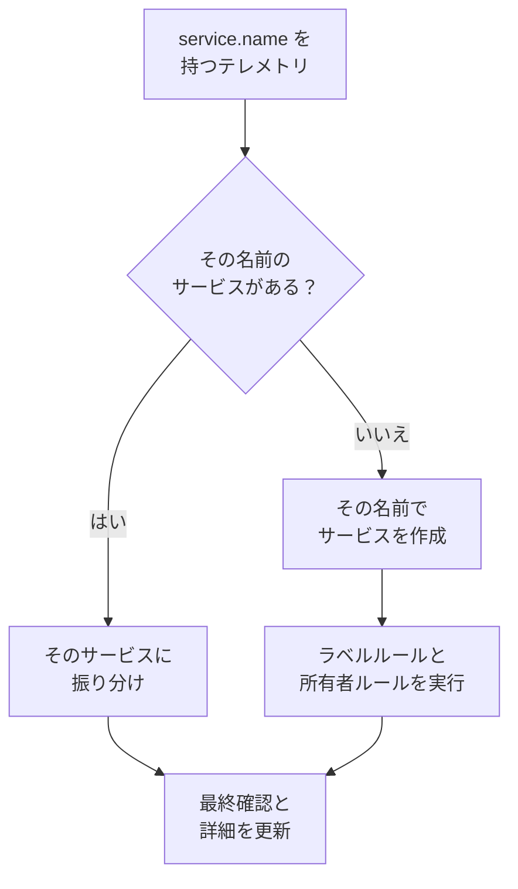

# サービスカタログ

サービスカタログには、運用しているアプリケーションとマイクロサービスが一覧表示されます。OneUptime はサービスのテレメトリが初めて届いたときにそのサービスを追加し、ログ、トレース、メトリクス、例外、インシデント、所有者を 1 つのページにまとめます。誰でも、サービスが何をしているか、誰が所有しているか、どんな状態かを確認できます。

:::cards
- [サービスがカタログに入る仕組み](#サービスがカタログに入る仕組み): 最初のテレメトリに含まれる `service.name`。
- [サービスを探す](#サービスを探す): 一覧、フィルター、列。
- [サービスのページ](#サービスのページ): 1 つのサービスのすべて。
- [サービスをアーカイブまたは削除する](#サービスをアーカイブまたは削除する): 履歴を残すか、取り除くか。
:::

## サービスがカタログに入る仕組み

サービスを作成する必要はありません。テレメトリの各バッチは、送信元のサービスを `service.name` リソース属性で名乗ります。OneUptime はバッチをその名前のサービスに振り分け、プロジェクトにまだそのサービスがなければ作成します。

- **名前がサービスの識別子です。** 大文字と小文字を区別せずに比較されるため、`Checkout-API` と `checkout-api` は 1 つのサービスです。新しい `service.name` は新しいサービスになります。
- **コンテナは自分で名乗ります。** Docker と Podman のエージェントからのテレメトリに `service.name` がない場合、サービスにはそのコンテナの名前が付きます。
- **取り込みキーでサービスを固定できます。** **固定されたサービス名** が設定されたキーで送った OpenTelemetry のデータは、`service.name` が何であってもその名前のサービスに振り分けられます。[取り込みキー](/docs/telemetry/ingestion-keys#ブラウザーキーを制限する) を参照してください。
- **ブラウザーやスマートフォンはサービスではありません。** ブラウザーやモバイルアプリからのテレメトリは、代わりに [RUM アプリケーション](/docs/rum/applications) に属します。
- **ラベルはテレメトリと一緒に届くことがあります。** `oneuptime.label.<name>` という名前のリソース属性は、サービスにラベル `<name>:<value>` を追加します。たとえば `oneuptime.label.team=payments` なら `team:payments` になります。

テレメトリが届くたびに、サービスの **最終確認** が進み、一緒に届いたリソース属性から詳細が更新されます。

| 詳細 | 元の属性 |
| --- | --- |
| サービスのバージョン | `service.version` |
| デプロイ環境 | `deployment.environment.name` または `deployment.environment` |
| サービスの名前空間 | `service.namespace` |
| ランタイム | `process.runtime.name` と `process.runtime.version` |
| テクノロジー | `telemetry.sdk.language`、またはランタイム |
| クラウド | `cloud.provider`、`cloud.platform`、`cloud.region`、`cloud.account.id` |

## 始める前に

- **届いているテレメトリ** に `service.name` が含まれていること。[OpenTelemetry](/docs/telemetry/open-telemetry) を参照してください。`OTEL_SERVICE_NAME` で設定できます。
- **サービスを読み取れるロール。** Project Owner、Project Admin、Project Member、Viewer、Settings Admin、Settings Member、Settings Viewer のいずれか、または Read Service 権限を持つカスタムロール。サービスの作成、変更、削除には、Project Owner、Project Admin、Project Member、Settings Admin、Settings Member のいずれか、または対応するサービスの権限が必要です。

## サービスを探す

**製品 → リソース → サービス** に移動します。**すべてのサービス** には、各サービスが **名前**、**説明**、**テクノロジー**、**最終確認**、**ラベル**、**所有者** とともに表示されます。

- 名前または説明で検索し、一覧の上のバーで所有者やラベルで絞り込みます。
- 複数のサービスを選択すると、まとめてラベルや所有者を追加したり、アーカイブしたりできます。
- サービスをクリックすると、そのページが開きます。

テレメトリが届く前にサービスを追加するには（たとえば先に所有者を設定するため）、**サービスを作成** をクリックし、**名前** に `service.name` となる値をそのまま入力します。ラベルルールと所有者ルールは、検出されたサービスと同じようにこのサービスにも適用されます。保存すると OpenTelemetry のセットアップガイドが開き、すべてのスニペットにその名前が入っています。サービスの最初のデータが届くと、最後のステップの **接続を待つ** にそのことが表示されます。

## サービスのページ

サービスのサイドメニューには 5 つのセクションがあります。

| セクション | ページ |
| --- | --- |
| **基本** | **概要**: スパンから算出したリクエスト数、エラー率、p95 レイテンシ、チャート、詳細。**推奨事項**: サービスの言語に合わせて選んだ、すぐに使えるモニター。**所有者**: サービスに責任を持つ人とチーム。**フィード**: 作成から現在までの変更を含め、サービスに起きたすべてのこと。 |
| **テレメトリ** | このサービスで絞り込み済みの **ログ**、**トレース**、**メトリクス**、**パフォーマンスプロファイル**、**例外**、**ソースマップ**。 |
| **アクティビティ** | サービスに影響する **インシデント**、**アラート**、**定期メンテナンス** のイベント。 |
| **開発者** | **Terraform**、**API**、**AI アシスタント**: コードから管理するサービス。最初は折りたたまれています。 |
| **詳細** | **設定**、**監査ログ**、**サービスを削除**。**詳細** は最初は折りたたまれているので、先に展開してください。 |

所有者はこのページの外でも意味を持ちます。スコープが Owned（所有）のロールは、あなたやあなたのチームが所有するサービスのテレメトリを読み取ります。[テレメトリー](/docs/permissions/index#テレメトリー) を参照してください。

## サービスを変更する

:::steps
### 設定を開く

サービスを開き、サイドメニューの **詳細** を展開して **設定** をクリックします。

### 名前を変えるか説明を付ける

**サービスの詳細** で **詳細を編集** をクリックし、**名前**、**説明**、**ラベル** を変更します。名前は、テレメトリが報告する `service.name` と一致している必要があります。OpenTelemetry の設定でも名前を変えてください。そうしないと、次に届くテレメトリが新しいサービスを作成します。

### 色と技術スタックを選ぶ

**サービス設定** で **設定を編集** をクリックします。**サービスの色** はチャートや一覧でサービスを示します。新しいサービスには専用の色が付きます。**技術スタック** は任意です。空のままにすると、テレメトリから検出された言語が表示されます。
:::

同じページでサービスの保持期間も設定できます。**テレメトリデータの保持期間** と **テレメトリタイプ別の保持期間** のカードで、サービスのテレメトリをプロジェクトのデフォルトの保持期間より長く、または短く保持できます。これらは [Enterprise Edition](/docs/self-hosted/enterprise) と OneUptime Cloud の Scale プランに含まれます。利用できない場合、ページにはこれらで何ができるかが表示され、サービスはプロジェクトの保持期間に従います。

## ラベルと所有者を自動で付ける

ルールは、新しいサービスが作成されるときにラベルと所有者を付けます。検出されたサービスも対象です。ルールは **サービス → 設定 → 所有者ルール** と **サービス → 設定 → ラベルルール** にあります。サイドメニューの **設定** は最初は折りたたまれています。[ラベルルールと所有者ルール](/docs/configuration/label-and-owner-rules) を参照してください。

## サービスをアーカイブまたは削除する

もう監視しないものの履歴は残したいサービスは、アーカイブします。アーカイブしたサービスは **すべてのサービス** に表示されなくなりますが、テレメトリの収集は続きます。サービスの **設定** ページからアーカイブするか、一覧で複数を選択します。元に戻すには、**サービス → 詳細 → アーカイブ済み** を開きます。

> [!WARNING]
> サービスを削除すると、そのソースマップと、そのサービス用に設定したメトリクスのパイプラインルールと LLM コスト予算も削除されます。OneUptime がまだそのテレメトリを受信している場合、サービスは再び追加されますが、付けたラベル、所有者、設定はなくなっています。一覧から外してすべてを残したい場合は、代わりにアーカイブしてください。

## トラブルシューティング

:::details サービスが 2 つ表示される
2 つの `service.name` の値が OneUptime に届いています。たとえば設定の 2 つのバージョンから届いた場合や、片方だけで名前を変えた場合です。テレメトリは名前で照合されます。すべてのインスタンスが同じ `service.name` を報告するようにしてから、不要になったサービスをアーカイブまたは削除してください。
:::

:::details サービスがカタログにない
テレメトリに `service.name` が含まれているか確認してください。ブラウザーやモバイルアプリからのテレメトリは Real User Monitoring に送られます。サービス名のないホストやクラスターのテレメトリは、そのホストやクラスターの下に登録されます。
:::

:::details 最終確認が遅れている
**最終確認** はバッチごとではなく約 1 分ごとに更新されるため、ライブのテレメトリから 1 分ほど遅れることがあります。
:::

## 次のステップ

:::cards
- [ログエクスプローラー](/docs/telemetry/logs-explorer): サービスのログを検索します。
- [トレースエクスプローラー](/docs/telemetry/traces-explorer): そのリクエストを追跡します。
- [例外トラッキング](/docs/telemetry/exceptions): サービスがスローするエラーをトリアージします。
- [ラベルルールと所有者ルール](/docs/configuration/label-and-owner-rules): 新しいサービスにラベルと所有者を付けます。
:::
