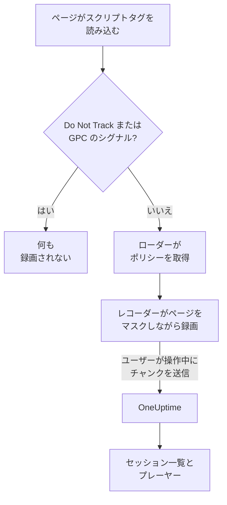
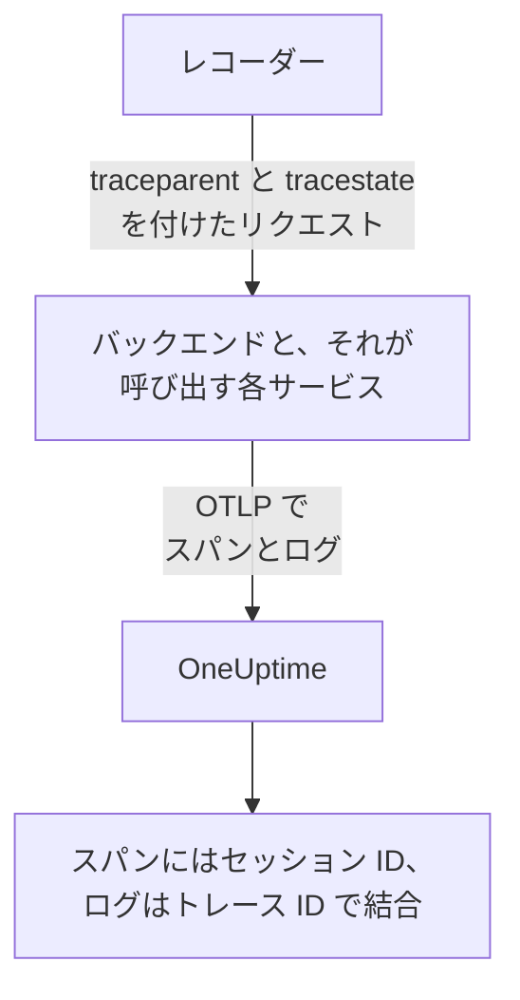
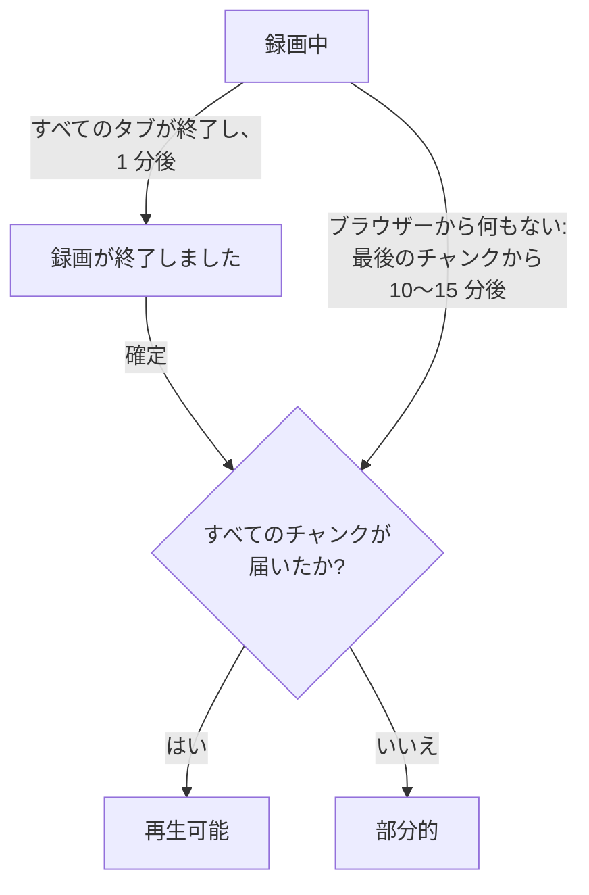
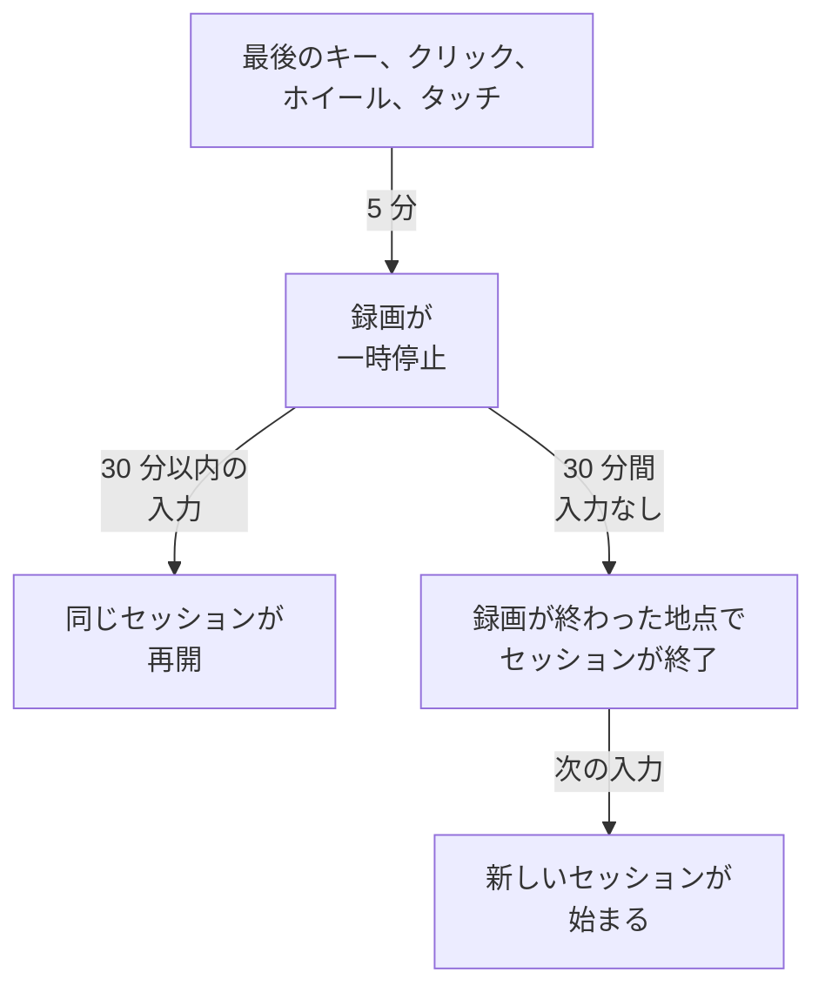

# セッションリプレイ

セッションリプレイは、実際のユーザーが Web アプリや React Native アプリで見たものを録画し、同じセッションのエラー、トレース、ログと並べて再生します。スクリプトタグを追加し、何をマスクするかを選べば、RUM アプリケーションから任意のセッションを視聴できます。

:::cards
- [仕組み](#仕組み): ローダー、ポリシー、そして進行に合わせてアップロードするレコーダー。
- [インストール](#インストール): 各ページのスクリプトタグ、または React Native SDK。
- [プライバシー](#プライバシー): 何がマスクされるか、同意、誰が録画を送信できるか。
- [ほかのテレメトリとの関連付け](#ほかのテレメトリとの関連付け): バックエンドのトレース、ログ、エラーを、コードなしで関連付けます。
- [セッションを視聴する](#セッションを視聴する): セッション一覧、ユーザーページ、ユーザーフロー、プレーヤー。
- [録画の状態](#録画の状態): 何も届かない理由と、予算を使い切る前のアラート。
:::

## 仕組み

ページ上のスクリプトは小さなローダーです。ブラウザーのプライバシーシグナルを確認し、OneUptime からアプリケーションのポリシーを取得し、そのうえで初めてレコーダーを読み込みます。レコーダーはページを録画しながらマスクし、ユーザーが操作している間、チャンク単位でアップロードします。



既定では、問題が起きたセッションだけでなく、すべてのセッションを録画し、進行に合わせてアップロードします。誰も完了しなかったチェックアウト、全員が途中で投げ出したフォーム、顧客が「表示がおかしかった」と言うページが見つかるのは、何も壊れなかったセッションの中です。

保存量を減らすには、アプリケーションのポリシーにある 2 つの設定を組み合わせます。

| 設定 | 既定 | 変わること |
| --- | --- | --- |
| **サンプリング率** | 100 | 録画の対象になるセッションの数です。半分にすると、保存されるバイト数も、保存されるエンドユーザーのデータも半分になります。判定はセッション ID のハッシュによりセッションごとに一度だけ行われるため、セッションが途中までしか録画されないことはありません。 |
| **録画をアップロードするタイミング** | _Always_ | _On error or frustration_ では、レコーダーはメモリー上にリングバッファーを保持し、何か問題が起きたときにだけアップロードします。全員を録画するよりおよそ 15 倍安いコストで、失敗したセッションのほぼすべてに録画が残りますが、問題が起きなかったセッションは視聴できません。 |

## 始める前に

- RUM アプリケーション。 **製品 → リソース → リアルユーザーモニタリング** で作成するか、テレメトリに作成させます。 [アプリケーションの管理](/docs/rum/applications) を参照してください。
- **プロジェクト設定 → テレメトリと APM → 取り込みキー** の **ブラウザー** 取り込みキー。Browser キーは、キーに指定したオリジンからしか機能しません。 [本番環境では許可するオリジンを設定する](#本番環境では許可するオリジンを設定する) を参照してください。

セッションリプレイは既定でオンです。設定は 3 か所にあります。

| 場所 | 内容 |
| --- | --- |
| アプリケーションの **リプレイポリシー** ページ | ポリシー (録画、マスク、同意、トレーシング、制限)、 **録画の状態** の概要、 **録画に含まれるもの** カード、 **インストールをテスト** パネル、 **特定のユーザーの次のセッションを記録** 。 |
| アプリケーションの **ヘルス** ページ | 録画が届いているかどうかと、届いていない場合の理由。 [録画の状態](#録画の状態) を参照してください。 |
| **リアルユーザーモニタリング → 設定 → セッションリプレイ** | すべてのアプリケーションを一度に止めるプロジェクト全体のスイッチと、各アプリケーションのポリシーの読み取り専用の一覧。 |

## インストール

録画したいすべてのページにスクリプトタグを追加します。

:::steps
### ブラウザーキーを作成する

**プロジェクト設定 → テレメトリと APM → 取り込みキー** で **取り込みキーを作成** をクリックし、 **キーの種類** に **ブラウザー** を選び、 **許可されたオリジン** にサイトのオリジンを入力します。次に、キーの **シークレットキー** をコピーします。各画面は [ブラウザーのセットアップ](/docs/rum/browser-setup#セットアップ) で紹介しています。

### スクリプトタグを追加する

キーとアプリケーションの識別子を指定して、すべてのページにタグを置きます。

```html
<script
  src="https://oneuptime.com/telemetry/session-replay/v1/recorder.js"
  data-oneuptime-token="YOUR_TELEMETRY_INGESTION_KEY"
  data-oneuptime-app-identifier="storefront-web"
  crossorigin="anonymous"
  async
></script>
```

`data-oneuptime-app-identifier` は RUM アプリケーションの識別子、つまり `service.name` に使うのと同じ値に一致する必要があります。アプリケーションのサイドメニューの **セッションリプレイ** セクションにある **ドキュメント** ページには、両方の値が入力済みのこのスニペットが、Next.js / React と Google Tag Manager 用のバリエーションとともに表示されます。

### 録画が届くことを確認する

自分のページを開き、数秒間クリックして回ります。1 分ほどで、アプリケーションの **セッションリプレイ** ページに **録画中** の印が付いたセッションが表示されます。表示されない場合は、アプリケーションの **ヘルス** ページが理由を示します。 [録画の状態](#録画の状態) を参照してください。
:::

`/v1/recorder.js` のスクリプトは小さなローダーです。Do Not Track を確認し、アプリケーションのポリシーを取得し、そのうえで初めて `/latest/recorder.js` を読み込みます。ポリシーとレコーダーは `no-store` で配信されるため、どちらの変更も、ブラウザーのキャッシュの期限切れを待たずに次のページ読み込みに届きます。

### スクリプトタグの属性

| 属性 | 必須 | 役割 |
| --- | --- | --- |
| `data-oneuptime-token` | はい | テレメトリの取り込みトークン。 |
| `data-oneuptime-app-identifier` | はい | RUM アプリケーションの識別子。 |
| `data-oneuptime-host` | いいえ | OneUptime のオリジン。省略するとスクリプト自身の `src` から導き出されるため、自分のドメイン経由でスクリプトを配信する場合にだけ必要です。 |
| `data-oneuptime-user-ref` | いいえ | ページ読み込み時にわかっているエンドユーザーの参照 (ユーザー ID。保存したくないメールアドレスは使わない)。後で `identify()` が設定するものと同じで、 [特定のユーザーの次のセッションを録画する](#特定のユーザーの次のセッションを録画する) で機能するのはこの形式だけです。 |
| `data-oneuptime-respect-do-not-track` | いいえ | 既定で Do Not Track と Global Privacy Control を尊重します。シグナルにかかわらず録画するには `"false"` に設定します。 [Do Not Track](#do-not-track) を参照してください。 |
| `data-oneuptime-debug` | いいえ | `"true"` にすると、レコーダーの判断をコンソールに出力します。 [セッションリプレイのトラブルシューティング](/docs/rum/session-replay-troubleshooting) を参照してください。 |
| `data-oneuptime-offline-storage` | いいえ | `"false"` に設定すると、訪問者がオフラインの間に録画したチャンクを、ブラウザーの IndexedDB にも保存せず、メモリーにだけ保持します。 [オフラインモード](#オフラインモード) を参照してください。 |

同じオプションはタグではなくグローバルで渡すこともできます。タグマネージャーやバンドルしたインストールではこちらを使います。

```js
window.__ONEUPTIME_SESSION_REPLAY__ = {
  host: "https://oneuptime.com",
  token: "YOUR_TELEMETRY_INGESTION_KEY",
  appIdentifier: "storefront-web",
  userRef: "user-123", // optional
  respectDoNotTrack: true, // optional
  debug: false, // optional
  offlineStorage: true, // optional; false keeps offline chunks in memory only
};
```

### 正常なインストールの見え方

DevTools → Network を開き、 `session-replay` で絞り込みます。動作しているページでは次のようになります。

1. ページの読み込みごとに **1 つの `GET .../session-replay/v1/config`** 。ポリシーの取得です。
2. **ユーザーが何か操作している間、およそ 15 秒ごとに `POST .../session-replay/v1/chunk`** 。256 KB 分のイベントがたまった場合はそれより早く送られます。アイドル状態のタブはイベントを生まないため POST もありません。Network タブでインストールを判断する前に、マウスを動かすかクリックしてください。
3. タブが非表示になったとき、そしてページがなくなったときにもう一度、 `keepalive` で送られる `POST` 。ページを離れること (タブを閉じる、再読み込みする、別のページに移動する、またはページがブラウザーのバックフォワードキャッシュに入る、つまりすべての `pagehide`) はこれを最後のものとして印を付け、タブの録画が完了したことを OneUptime に伝えます。ユーザーがバックフォワードキャッシュから戻したページは、同じセッションの新しいタブとして録画を続けます。単に非表示になったタブは開いたままなので、ユーザーが戻ると録画が続きます。ボディ全体は 56 KB 未満 (オリジンあたり 64 KB というブラウザーの keepalive クォータのうち、レコーダーの取り分) に収まり、1 回のリクエストに複数のチャンクをフレームとして載せられます。最後のチャンク、大きな最後のチャンクを分割した各部分 (フレームのヘッダーが収まるよう、それぞれ最大 48 KB のイベント)、そしてまだ再試行を待っていたすべてのチャンクです。タブが単に非表示になったときにすでにこの予算を超えているチャンクは、ページがまだ生きていて送信できる間に、通常の経路で送られます。

トリガーが _On error or frustration_ の場合、ステップ 2 はトリガーが発火するまで起こりません。 [トラブルシューティング](#トラブルシューティング) を参照してください。

## React Native へのインストール

React Native SDK は、ネイティブのビュー階層を rrweb 互換の合成イベントとして録画するため、モバイルの録画も Web の録画と同じセッション一覧とプレーヤーで開けます。スクリーンショットは撮りません。プレーヤーは各録画に React Native アプリの印を付け、その **忠実度** タブで、再現できなかったネイティブのサーフェスを説明します。

:::steps
### SDK をインストールする

SDK は iOS と Android の React Native アプリに対応しています。永続的な送信ボックスのためのピア依存関係とともにインストールします。

```bash
npm install @oneuptime/react-native-replay @react-native-async-storage/async-storage
```

Expo を使わない iOS プロジェクトでは、パッケージを追加した後で通常の CocoaPods のインストールを実行します。現在の React Native のバージョンでは、Android は手動の登録なしで自動的にリンクされます。レコーダーは Async Storage に加えてビューツリー用の独自のネイティブモジュールを持つため、Expo のプロジェクトではカスタムの開発ビルドまたは本番ビルド (たとえば EAS Build や prebuild) を使う必要があります。Expo Go は、どちらのネイティブモジュールも固定のバイナリに追加できないため、この SDK を実行できません。

### レコーダーを起動してアプリをラップする

シングルトンを一度起動し、録画したいアプリの部分の上にプロバイダーを置きます。

```tsx
import {
  OneUptimeReplay,
  OneUptimeReplayProvider,
} from "@oneuptime/react-native-replay";

OneUptimeReplay.start({
  host: "https://oneuptime.com",
  token: "YOUR_TELEMETRY_INGESTION_KEY",
  appIdentifier: "storefront-mobile",
  mobileAppIdentifier: "com.example.storefront",
  appName: "Storefront", // optional, shown in session details
  appVersion: "4.2.0", // optional, shown in session details
});

export default function App() {
  return (
    <OneUptimeReplayProvider>
      <Navigation />
    </OneUptimeReplayProvider>
  );
}
```

`appIdentifier` は RUM アプリケーションの識別子です。 `mobileAppIdentifier` は、表示名ではなく、バイナリに含まれる Android のアプリケーション ID または iOS のバンドル ID です。 [`app://` の許可するオリジン](#本番環境では許可するオリジンを設定する) にも同じ値を使ってください。SDK はアプリケーションのリプレイのポリシーを `host` から取得します。サンプリング、トリガー、同意、保持期間、アップロードの予算は引き続きサーバーが管理します。
:::

プロバイダーは折りたたまれないネイティブのルートを持ち、そのビューツリーと、タッチの開始、移動、終了のイベントを録画します。すでに自分でレコーダーのインスタンスを作っている場合は、 `<OneUptimeReplayProvider recorder={recorder}>` で渡します。 `MobileReplayRecorder` も、分離された統合や複数クライアントの統合のためにエクスポートされていますが、ほとんどのアプリはシングルトンを使うべきです。

### React Native API

`OneUptimeReplay` を直接インポートするか、プロバイダーの配下で `useOneUptimeReplay()` を呼び出します。シングルトンは次を公開しています。

| メソッド | 役割 |
| --- | --- |
| `start(options)` | ポリシーを取得して録画を開始します。必須のオプションは `host`、 `token`、 `appIdentifier`、 `mobileAppIdentifier` です。 `appName` と `appVersion` は表示用の任意のメタデータで、 `connectivity` は [オフラインモード](#オフラインモード) のための任意のネットワーク状態のソースです。 |
| `stop()` | 送信できるものをフラッシュし、録画を止め、ライフサイクルのハンドラーを外します。 |
| `identify(userRef, traits?)` | サインインしているユーザーと任意の特性を紐付けます。 **エンドユーザーの身元をキャプチャ** に従います。 |
| `setTags(tags)` / `addTag(key, value)` | セッションの検索可能なタグをすべて置き換えるか、ほかのタグを置き換えずにタグを一つ追加します。 |
| `track(name, properties?)` | アプリのイベントをリプレイのタイムラインに置きます。 |
| `setRoute(route)` | ナビゲーションの後に、スクラブ済みの論理的な画面またはルートを記録します。ナビゲーターのルート変更のコールバックから呼び出します。 |
| `captureSession(reason?)` | _On error or frustration_ で、ユーザーが「問題を報告」を押したときのように、アプリが決めた理由でリングバッファーをアップロードします。 |
| `captureError(error)` | 処理済みの JavaScript エラーを記録し、エラーによる録画をトリガーします。 |
| `grantConsent()` / `revokeConsent()` | アップロードを許可するか、メモリー上のバッファー、保存済みの送信ボックス、セッション、訪問者 ID を直ちに消去します。後の同意は新しい識別子で始まります。 |
| `getSessionId()` / `onSessionChange(listener)` | トレースやログと関連付けるために、同意済みの現在のリプレイセッション ID を読むか、購読します。録画や同意が終わると、リスナーは `null` も受け取ります。 |
| `getDiagnostics()` | 録画したビューの内容は返さずに、レコーダーの状態と最近の判断を返します。 |

SDK は React Native の `AppState` を監視します。バックグラウンドに移ると同意済みのイベントを閉じてフラッシュし、同意前の録画はメモリーにだけ残ります。フォアグラウンドで録画を再開する前に、SDK はキャッシュされた応答を使わずにポリシーを更新します。アクティブな間も定期的にポリシーを更新するので、無効化、同意、サンプリング、ターゲティング、身元の変更は、長く開いたままのアプリでも反映されます。統合が恒久的にアンマウントされるときは `stop()` を呼び出してください。通常の画面間のナビゲーションでは、レコーダーを止めて再起動するのではなく、 `setRoute()` を使います。

**モバイルのセッションがアイドルで終了するとき。** 入力がないまま 5 分たつと、すでに録画は一時停止します ( [アイドル時間](#アイドル時間) を参照)。タッチがなく、録画中に行われた SDK の呼び出し ( `track()`、 `setTags()`、 `identify()` など) もないまま 30 分たつと、セッションが終了します。セッションは録画が終わった最後のアクティビティの地点、一時停止したセッションでは一時停止の地点で終わり、アプリが戻った時点やレコーダーが気付いた時点ではありません。そのため、バックグラウンドや一時停止の時間がセッションの末尾に加わることはありません。フォアグラウンドで開いたままのアプリが 30 分ごとに新しいセッションを始めることもありません。次のセッションは、ユーザーが戻ったとき、つまり最初のタッチ、画面キーボードの表示または非表示、アプリのフォアグラウンドへの復帰、または `captureSession()` の呼び出しで始まります。セッションは新しい画面のスナップショットで始まります。それまで `getSessionId()` は `null` を返し、 `onSessionChange()` は `null` で呼ばれます。その間のエラー、ナビゲーション、 `track()` の呼び出しは録画されません。

モバイルのテレメトリをリプレイと関連付けるには、 `onSessionChange()` で購読し、返された値を OpenTelemetry のインストルメンテーションの `session.id` 属性として設定します。コールバックが呼ばれるたびにその属性を置き換え、値が `null` のときもクリアしてください。リプレイ SDK はネイティブのネットワークを変更せず、自分で OpenTelemetry のプロバイダーを変更することもありません。

### React Native のプライバシーとマスク

モバイルの録画は、意図的に Web のマスクモードより厳格です。ネイティブ UI のテキスト、アクセシビリティの値、入力値、画像のピクセルは決してシリアライズされません。アプリケーションの Web 用マスクモードが読めるテキストを許可する場合でも、サーバーが受け取るのはワイヤーフレームの構造です。ユーザー参照、イベント名、ルート、検索可能なタグなど、呼び出し側が渡すメタデータは API の契約に従うため、これらのフィールドに秘密情報を入れないでください。特に機密性の高いサブツリーは `<ReplayMask>` で囲むと、その領域がプライバシーのプレースホルダーに置き換わり、周囲のレイアウトは保たれます。

同意は、オペレーティングシステムの権限や同意バナーからは推定されません。 _Require explicit_ では、アプリが必要な同意を得たときにだけ `grantConsent()` を呼び出してください。 `revokeConsent()` を呼び出すと、キュー内の未送信のデータと保存済みのデータの両方が、後のセッションを取り消されたセッションに結び付けうる識別子とともに破棄されます。

モバイルのレコーダーは、ビューの境界と種類、タッチの位置、論理的なルート、カスタムイベント、JavaScript のエラーをキャプチャします。次の制限は、常にプレーヤーの忠実度タブで報告されます。

- ネイティブの `Image` のピクセルは不透明です。描かれるのは枠だけです。
- `WebView` の内容は React Native のツリーの外にあります。独自の録画が必要な場合は、ホストされたページに Web のレコーダーをインストールしてください。
- Canvas、Skia、OpenGL、地図、カメラのプレビュー、動画、その他の特殊な描画のサーフェスは不透明です。
- `ReplayMask` や不透明なサーフェスの内側のタッチの軌跡は録画されません。ネイティブのブリッジはタッチの実際のターゲットとその祖先を確認し、そのプライバシーのチェックを完了できない場合はジェスチャーを抑制します。
- Reanimated、native-driver、UI スレッドのアニメーションは、フレームごとに再現されるのではなく、ビューツリーのスナップショットでサンプリングされます。
- フラッシュする前に JavaScript を終了させるネイティブのクラッシュには、ネイティブのクラッシュ SDK が必要です。 `captureError()` が扱うのは処理済みの JavaScript エラーで、プロセスレベルのクラッシュダンプではありません。

## ユーザーを識別する

ページが誰のセッションかを伝えるまで、すべてのセッションは匿名です。それがなくても、一覧は 1 つのブラウザーのセッションを匿名の訪問者 ID の下にまとめられます (下の [匿名の訪問者](#匿名の訪問者) を参照) が、その人の名前を示すものはなく、その人のほかのブラウザーを最初のブラウザーに結び付けるものもありません。わかった時点で `identify()` を呼び出すか、スクリプトの読み込み前にキューに入れてください。どちらの場合も最初のチャンクのアップロード前に適用されるので、セッションは表示された瞬間からユーザーで検索できます。

```js
// After the script has loaded:
OneUptimeReplay.identify("user-123", { plan: "pro", tenant: "acme" });

// Or at any time, whether or not the script has loaded yet:
(window.OneUptimeReplayQueue = window.OneUptimeReplayQueue || []).push([
  "identify",
  "user-123",
  { plan: "pro", tenant: "acme" },
]);
```

- 参照は、セッション一覧に表示され、 `user:` の検索で照合されるものです。特性は、プレーヤーのヘッダーとセッションの詳細パネルに表示されます。
- **身元はページだけでなくセッションに属します。** セッションは訪問中のすべてのページ読み込みとすべてのタブにまたがり、そのいずれかのページが `identify()` を呼ぶと、セッション全体がそのユーザーのものになります。同じ訪問なので、サインイン前のページも含まれます。セッションの以降のすべてのページとタブも、自分では `identify()` を呼ばないもの (サインイン後のリダイレクト先のページ、新しいタブで開いたリンク) を含めて、ユーザーを示します。 **エンドユーザーの身元をキャプチャ** がオンの間、レコーダーは現在のセッションが誰のものかを `localStorage` の `oneuptime.replay.user` に記憶します。保存するのはセッション ID と参照だけで、同意が _Require explicit_ の場合は同意が得られた後だけです。また、そのセッションに限られます。次のセッション (30 分のアイドルまたは 4 時間の上限の後) は、それを開始したページ自体がユーザーを識別していない限り、どこかのページが識別するまで匿名で始まります。そのため、サインイン直後だけでなく、アプリがユーザーを知っているすべてのページ読み込みで `identify()` を呼び出してください。
- **別のユーザーには別のセッション。** `identify()` が、セッションがすでに属しているユーザー以外の人を示した場合 (同じブラウザーで、このタブか別のタブで、ある人がサインアウトし、別の人がサインインした場合)、現在のセッションは最初のユーザーの下に記録されたまま終了し、2 人目のための新しいセッションが始まります。 `onSessionChange` のリスナーに通知され、プレーヤーはこの切り替えを 1 つの録画の終わりと次の録画の始まりとして表示します。同じユーザーを再び識別しても何も変わりません。参照は、サーバーと同じく、両端の空白を取り除いたうえで大文字と小文字を区別して比較されます。
- `identify()` がレコーダーに渡すものは、アプリケーションで **エンドユーザーの身元をキャプチャ** がオン (既定) の間だけ録画とともにアップロードされます。オフの場合、レコーダーは参照と特性をチャンクから除外し、サーバーはその人について **何も** 保存しません。参照も、その鍵付きハッシュも、特性もです。そうしたセッションは本当に仮名化されており、その代償として _ユーザー単位_ では消去できません。消去リクエストに照合するものがないため、代わりに `BySessionId`、 `ByDateRange`、 `ByRumApplication` を使ってください ( [セッションを消去する](#セッションを消去する) を参照)。識別子をまったく保存しないことより、ユーザー単位の消去リクエストに応えられることのほうが重要なら、スイッチをオンのままにしてください。保存される鍵は比較はできても読むことはできない一方向の鍵付きハッシュで、参照そのものを持つのは別のラベルだけです。
- このスイッチにかかわらず、意図的に 1 つの参照がブラウザーから出ます。ページが **読み込み時に** `data-oneuptime-user-ref` または init グローバルの `userRef` で渡す参照は、各ページ読み込みのポリシー取得時にリクエストヘッダーとして送られます。 [特定のユーザーの次のセッションを録画する](#特定のユーザーの次のセッションを録画する) が、レコーダーが存在する前に訪問者を認識するのはこの方法だからです。サーバーはそれを設定済みのターゲットと比較して破棄します。身元のキャプチャがオンで、レコーダーが録画とともに再び送らない限り、セッションには書き込まれません。 `identify()` に渡した参照が、この方法で送られることはありません。
- 特性は 20 キー、キーあたり 40 文字、値あたり 200 文字に制限され、文字列に変換され、アプリケーションのマスクモードを通ります。 _Mask all text_ ではアップロード前にマスクされます。
- ダッシュボードで身元を読み返すには、録画を視聴するのと同じ権限が必要です ( [録画を視聴できるユーザー](#録画を視聴できるユーザー) を参照)。ほかのロールには「Identity hidden」と表示されます。

### 匿名の訪問者

`identify()` を一度も呼ばないページでも、セッションをまとめられる必要があります。そうしないと、 _Anonymous_ が 40 行並んだ一覧からは、1 人が同じエラーを 40 回起こしたのか、40 人が 1 回ずつ起こしたのかがわかりません。そこでレコーダーは、ブラウザーのプロファイルごと、オリジンごとにランダムな訪問者 ID を作ります。小文字の 16 進数 32 文字で、セッションの記録の横の `localStorage` の `oneuptime.replay.visitor` に保存されます。そのため、2 つのホスト名やポートから配信されるサイトは 2 人の訪問者として表示され、それをまとめられるのは `identify()` だけです。レコーダーはこれを、メタデータを運ぶすべてのチャンク、つまり最初のチャンク、最後のチャンク、 `identify()` または `setTags()` の呼び出し後のチャンクで `meta.visitorId` として送ります。サーバーはその形式を確認し、セッションのヘッダーのほかの部分と同じアクセスルールでセッションに保存します。これは意図的にセッション ID より長く残ります。30 分のアイドルと 4 時間の上限による切り替えは新しいセッションを始めますが、新しいセッションは同じ訪問者 ID を持つため、同じブラウザーから 1 週間を隔てた 2 回の訪問は、 [ユーザーページ](#ユーザーページ) とプレーヤーのほかのセッションのメニューにまとめて表示されます ( [プレーヤー](#プレーヤー) を参照)。

それが何でないかを、はっきりさせておきます。

- **身元ではありません。** ランダムで、ブラウザーで作られ、ページが渡したものからもデバイスのものからも導き出されません。同じノートパソコンの 2 つのブラウザーや、スマートフォンとデスクトップを使う同じ人は 2 人の訪問者です。それらをまとめるのは `identify()` だけです。プライベートウィンドウではウィンドウとともに消える新しい ID が作られ、ストレージに何も書き込めない場合 (Safari のプライベートモード、サイトデータのブロック) は、ID は 1 回のページ読み込みの間だけ続きます。
- **エンドユーザーの身元をキャプチャには依存しません。** そのスイッチは、参照と特性がブラウザーから出るかどうかを決めます。訪問者 ID は誰も示さないので、どちらにしても送られます。ID を一切作りたくない場合の答えはレコーダーを使わないことです。アプリケーションのセッションリプレイをオフにするか、 [Do Not Track](#do-not-track) を尊重させてください。
- **セッション ID と同じ同意のルールに従います。** `revokeConsent()` はセッションとともにそれをストレージから削除し、同意が取り消されている間は何も書き込まれず、後の `grantConsent()` は新しい ID を作ります。そのため、同意を取り消して戻ってきたユーザーが、忘れてほしいと頼んだセッションに再び結び付けられることはありません。Do Not Track や Global Privacy Control のもとではレコーダーが動かないため、ID は作られません。
- **自分のリクエストとともに送られることはありません。** レコーダーがページ自身のオリジンへのリクエストに追加するトレースコンテキストが示すのはセッションで、訪問者ではありません ( [自分のリクエストが運ぶもの](#自分のリクエストが運ぶもの) を参照)。訪問者 ID は録画とともに OneUptime にだけ送られます。
- **消去リクエストの対象にはなりません。** リクエストの種類は変わっていません ( [セッションを消去する](#セッションを消去する) を参照)。 `visitor:` の検索で一覧を 1 つのブラウザーのセッションに絞り込み、そこから消去するセッション ID を取ります。

`OneUptimeReplay.getVisitorId()` は現在の ID を返します。レコーダーの起動前、 `stop()` の後、 `revokeConsent()` から次の `grantConsent()` までの間は空文字列を返します。この機能の前にビルドされたレコーダーは何も送らなかったため、それらが録画したセッションの `visitorId` は空です。一覧ではそれらが _Anonymous_ と表示され、ユーザーページでは **リンクされていないセッション** にまとめられます。ID を作るレコーダーは、 `getDiagnostics()` と **ヘルス** ページで、その `capabilities` に `visitor-id` を挙げます。

## JavaScript API

レコーダーは `window.OneUptimeReplay` を公開します。非同期に読み込まれるため、到着前にページが呼び出すものは、すべてコマンドキューを通す必要があります。 `window.OneUptimeReplayQueue` は `[command, ...arguments]` エントリの単純な配列で、レコーダーは起動するとすぐにこれを処理し、下のどのコマンドも名前で受け付けます。

```js
(window.OneUptimeReplayQueue = window.OneUptimeReplayQueue || []).push(
  ["grantConsent"],
  ["identify", "user-123", { plan: "pro" }],
  ["setTags", { build: "1.4.2" }],
  ["onSessionChange", (sessionId, tabId) => console.log(sessionId)],
);
```

`grantConsent`、 `revokeConsent`、 `stop`、 `identify`、 `setTags`、 `addTag` はレコーダーの起動前に適用されるため、キュー内の同意の判断が何かをアップロードするかどうかを決め、キュー内の身元は最初のチャンクから送られます。 `track`、 `captureSession`、 `onSessionChange` は起動直後に実行されます。

| メソッド | 役割 |
| --- | --- |
| `identify(userRef, traits?)` | エンドユーザーをセッションに、つまりそのすべてのページとタブに、最初から紐付けます ( [ユーザーを識別する](#ユーザーを識別する) を参照)。 `traits` は文字列、数値、真偽値の値を持つオブジェクトで (キーは 20 個以下、キーは 40 文字以下、値は 200 文字以下)、 _Mask all text_ ではマスクされ、 **エンドユーザーの身元をキャプチャ** がオンの場合にだけアップロードされます。同じユーザーで再び呼び出すと、次のチャンクで身元 (と新しい特性があればそれ) が再送されます。別のユーザーを示すと、セッションが終わり、その人の新しいセッションが始まります。 |
| `track(name, properties?)` | ビジネスイベント ( `"checkout_failed"`) をタイムラインに記録します。 `name` は 64 文字以下、プロパティのキーは 20 個以下で、値の制限は特性と同じです。15 秒のチャンクあたり最大 50 件で、それを超えるとチャンクは件数付きの「events dropped」マーカーを一つ持ちます。 |
| `setTags(tags)` / `addTag(key, value)` | セッション単位のタグ ( `{ build: "1.4.2", experiment: "new-checkout" }`) で、20 個以下、キーは 32 文字以下、値は 128 文字以下です。セッション一覧で `tag:key=value` で検索でき、セッションの詳細に表示されます。 `setTags` はマップ全体を **置き換える** ため、二回目の `setTags({ experiment })` は、一回目で設定した `build` タグを削除します。 `addTag` は一つのキーを設定し、ほかはそのまま残します。マップは `setTags` の一回の呼び出しで組み立てるか、各値がわかるたびに `addTag` を使ってください。 |
| `captureSession(reason?)` | _On error or frustration_ では、このセッションにリングバッファーからのアップロードを強制します。 _Always_ ではアップロードは変わりませんが、 `reason` (80 文字以下) はタイムラインに印として付きます。独自の「問題を報告」ボタンから使ってください。 |
| `onSessionChange(listener)` | `listener(sessionId, tabId)` は、セッションがあればすぐに呼ばれ、ID が変わるたびに再び呼ばれます。ユーザーが 30 分のアイドルの後に戻ったとき、4 時間の上限、 `identify()` が別のユーザーを示したとき、または同じ訪問者の別のタブが先にセッションを切り替えたときです。購読を解除する関数を返します。 **任意** です。自分のオリジンへのリクエストは、これがなくてもバックエンドのスパン、ログ、例外を録画に関連付けます ( [ほかのテレメトリとの関連付け](#ほかのテレメトリとの関連付け) を参照)。ブラウザー用 OpenTelemetry SDK のスパンなど、ページ自身が生成するテレメトリに `session.id` を設定するために使います。 [ページ自身のブラウザーテレメトリ](#ページ自身のブラウザーテレメトリ) を参照してください。 |
| `grantConsent()` | 同意モード _Require explicit_ でアップロードを許可します。それまでは何もアップロードされません。 |
| `revokeConsent()` | バッファーの内容をすべて破棄し、アップロードを止めます。レコーダーはメモリー内でのみ動き続けるため、後の `grantConsent()` は新しいセッション ID で続きます。 |
| `getSessionId()` | 現在のセッション ID。何も録画していないときは `null` です。セッションの切り替えも追える `onSessionChange()` を優先してください。 |
| `getVisitorId()` | [匿名の訪問者 ID](#匿名の訪問者) です。十六進数 32 文字で、ブラウザーのプロファイルごとに一つ、セッションが切り替わっても同じです。レコーダーの起動前、 `stop()` の後、同意が取り消されている間は `""` です。ランダムで身元ではなく、 **エンドユーザーの身元をキャプチャ** には依存しません。 |
| `stop()` | 最後のチャンクをアップロードし、セッションを封印して、ページの残りの存続期間中は停止します。 |
| `setDebug(enabled)` | 以降、レコーダーの判断をコンソールに出力します。 |
| `getDiagnostics()` | 診断が有効だったかどうかにかかわらず、レコーダーが判断したすべて。下記を参照してください。 |

### `getDiagnostics()`

サポートチケットに最初に貼り付けるものです。設計上、ページの内容は含まれません ( [診断に決して含まれないもの](/docs/rum/session-replay-troubleshooting#診断に決して含まれないもの) を参照)。

```js
copy(JSON.stringify(OneUptimeReplay.getDiagnostics(), null, 2));
```

| フィールド | 意味 |
| --- | --- |
| `state` | `none` (レコーダーが作られなかった)、 `not-started`、 `recording` (メモリーのみ)、 `uploading`、 `paused` (五分間誰もページに触れていないため、次の入力まで何もキャプチャしない。 [アイドル時間](#アイドル時間) を参照)、 `not-sampled`、 `stopped` のいずれか。 |
| `stopReason` | 停止した場合はその理由。 `api` (自分の `stop()`)、 `server-directive`、 `transport-failure`、 `chunk-cap` のいずれか。 |
| `bootstrapDecision` | アーティファクトがレコーダーを作ったか、作らなかった理由。 `started`、 `privacy-signal`、 `directive-stop`、 `already-started`、 `cancelled-before-start` (キュー内の `revokeConsent`/`stop`)、 `not-started` のいずれか。 |
| `decisions` | 各ゲートの回答。 `isSampled`、 `captureTrigger`、 `consentMode`、 `consentState`、 `uploadsAllowed`、 `uploadBlockedBy` ( `consent`、 `transport`、 `null`)、 `lastDirective` とその理由、 `startDecision` ( `recording-and-uploading`、 `recording-into-memory`、 `not-sampled`、 `not-started`)。 |
| `capabilities` | このレコーダーのビルドがキャプチャするもの。 `click-events`、 `web-vitals`、 `custom-events`、 `traits`、 `tags`、 `visibility`、 `visitor-id`。ダッシュボードの **ヘルス** ページには最新のセッションについて同じ一覧が表示されるため、長く開いたままの古いページからの録画を簡単に見つけられます。 |
| `tags`、 `hasTraits`、 `triggerReason`、 `isRecording`、 `isUploading`、 `sessionId`、 `tabId`、 `visitorId`、 `version` | セッションの現在の状態。 `isRecording` は、レコーダーが実際に録画している間だけ true です。 `visitorId` は、レコーダーが存在するまでは `null`、同意が取り消されている間は `""` です。 |
| `records` | 安定したコード付きの直近 250 件の判断。アーティファクトが存在する前のローダーの判断も含みます。各コードは [セッションリプレイのトラブルシューティング](/docs/rum/session-replay-troubleshooting#コード) で説明しています。 |

## プライバシー

**マスクは録画時に、エンドユーザーのデバイス上で、何かがアップロードされる前に行われます。** マスクされたものをサーバーが受け取ることはないため、マスクの判断は後から取り消すことも、さかのぼって適用することもできません。Web では、マスクされるものはモードによって決まります。React Native は常に、 [React Native のプライバシーとマスク](#react-native-のプライバシーとマスク) で説明する、より厳格なワイヤーフレームの構造を送ります。アプリケーションの **リプレイポリシー** ページにある **録画に含まれるもの** カードは、設定した内容についてこれらの判断を平易な文章で言い直します。

ポリシーのプライバシー設定 ( **ポリシーを編集** での名前):

| 設定 | 既定 | 役割 |
| --- | --- | --- |
| **このアプリケーションのセッションを記録** | オン | アプリケーション自身のスイッチ。このアプリケーションの録画を止めるにはオフにします。 |
| **マスクモード** | _Mask sensitive inputs only_ | パスワード、カード、ワンタイムコードのフィールドがマスクされます。ページのほかの部分、その静的なテキスト、通常の入力値は見たとおりに録画されます。 [マスクモードは慎重に選ぶ](#マスクモードは慎重に選ぶ) を参照してください。 |
| **同意** | _Not required_ | アップロードはすぐに始まります。すべてのセッションで同意のやり取りが必要な場合は _Require explicit_ を選んでください。EU のほとんどのデプロイメントでは必要になります。 |
| **録画をアップロードするタイミング** | _Always_ | サンプリングされたすべてのセッションが最初のイベントからアップロードされます。何か問題が起きたときだけアップロードするには _On error or frustration_ を選びます。 |
| **サンプリング率** | 100% | 録画されうるセッションの割合で、コストを調整するダイヤルです。0% と _Always_ の組み合わせでは何も録画されず、そう設定するとポリシーのページが警告します。 |
| **許可されたオリジン** | 空: すべてのオリジン | 録画を送信できる相手を制限するには、ドメインを一覧にします。 [本番環境では許可するオリジンを設定する](#本番環境では許可するオリジンを設定する) を参照してください。 |
| **エンドユーザーの身元をキャプチャ** | オン | ページが渡すエンドユーザーの参照と特性が保存され、名前のわかっている顧客のセッションを見つけられます。録画を仮名のままにするにはオフにします。オフの場合、その人については何も保存されず、ユーザー単位の消去リクエストが照合に使うキーさえ保存されません ( [ユーザーを識別する](#ユーザーを識別する))。ランダムで誰も示さず、どちらにしても送られる [匿名の訪問者 ID](#匿名の訪問者) には影響しません。 |
| **同一オリジンのトレース伝播** | オン | セッションのアップロード中、ページ自身のオリジンへのリクエストは W3C の `traceparent` と、セッションを示す `tracestate` を運ぶため、バックエンドのテレメトリはコードなしで録画に関連付けられます。バックエンドの OpenTelemetry は、呼び出すすべてのサービスに両方を転送します。 [自分のリクエストが運ぶもの](#自分のリクエストが運ぶもの) を参照してください。 |
| **国をキャプチャ** | オン | 国だけで、IP アドレスは決してキャプチャしません。 |
| **キャンバスの内容を記録** | オフ | Canvas と WebGL は録画されません。 |
| **保持期間** | 7 日 | 意図的に、ほかのテレメトリより短くしています。1、14、30、90 日も選べます。 |
| **月間予算（GB）** | 空 | このアプリケーションの暦月あたりのアップロードバイト数の任意の上限。空または 0 は上限なしを意味します。 |

### マスクモードは慎重に選ぶ

> [!WARNING]
> ワイヤーフレームではデバッグに足りないことが多いため、既定では読めるページを録画します。ページに表示されるものはすべて録画に含まれます。注文番号、ヘッダーのメールアドレス、ユーザーのデータを引用したエラーバナーなどです。マークアップが機密として宣言していないフィールドに入力されたものも含まれます。マスクはアップロード前にブラウザーで行われるため、後でより厳格なモードにしても、すでに作られた録画は消去されません。

3 つのモードを、プライバシーの低い順に示します。

| モード | ページの静的なテキスト | 通常の入力値 | パスワード、カード、OTP のフィールド |
| --- | --- | --- | --- |
| Mask sensitive inputs only *(既定)* | 録画される | 録画される | マスクされる |
| Mask inputs only | 録画される | マスクされる | マスクされる |
| Mask all text | マスクされる | マスクされる | マスクされる |

_Mask all text_ では、リプレイはワイヤーフレームです。テキストノード、レコーダーがクリックに付けるラベル、 `identify()` の特性、 `track()` のプロパティはアップロード前にマスクされ、プレーヤーはページの画像も Web フォントもそのアドレスから読み込みません。録画はそれらのアドレスを保持しますが、このモードで録画したセッションはそれらなしで再生されます。例外が 1 つあり、ページが `data:` URL として持っていた画像は録画自体の一部なので、引き続き表示されます。ユーザーがアップロードする文書のプレビューのように、この方法で個人的な画像を表示しうる要素はブロックしてください。スタイルシートは引き続き読み込まれるため、レイアウトの形は保たれます ( [再生中の画像、スタイル、フォント](#再生中の画像スタイルフォント) を参照)。

ページに個人データが表示される場合は、モードを上げるか、該当する要素にマスクまたはブロックのセレクターを追加してください。 [独自のコンテンツに印を付ける](#独自のコンテンツに印を付ける) を参照してください。機密の領域がいくつかしかない場合はセレクターが適切で、それらを列挙できない場合はより厳格なモードが適切です。

### 本番環境では許可するオリジンを設定する

セッションリプレイは、許可するオリジンの一覧が空のまま、つまりあらゆるオリジンからの録画を受け付ける状態でそのまま動作します。使い始めるには便利ですが、本番環境には不適切です。

取り込みトークンは、ページの JavaScript やモバイルアプリのバイナリとしてクライアントに渡されるため、ゲートは 2 つあり、両方が組み合わされます。

- **キーで。** **キーの種類** を **ブラウザー** にして取り込みキーを作成します。Web では、その **許可されたオリジン** ( `https://app.example.com`、またはサブドメイン 1 階層なら `https://*.example.com`) を設定します。React Native では、 `app://com.example.storefront` のようにアプリの正確な身元を追加します。キーには **有効期限** も設定してください。そうすれば、コピーされたトークンは、無期限ではなく、選んだ日付で使えなくなります。
- **アプリケーションで。** **リプレイポリシー → 許可されたオリジン** は、提示されたキーにかかわらず、このアプリケーションに録画を書き込める相手を制限します。同じ Web のオリジンと、正確なモバイルの `app://` の身元をここに追加します。

`app://` のエントリは、文字どおりのプレフィックスに、 `mobileAppIdentifier` として渡された、正規化された Android のアプリケーション ID または iOS のバンドル ID を付けたものです。照合は、空白を取り除き、有効な逆 DNS 形式の識別子を小文字にしたうえで、大文字と小文字を区別せずに行われます。モバイルの身元はワイルドカードを受け付け **ません** 。 `app://*.example.com` は無効です。モバイル SDK はブラウザーの `Origin` を送らず、レコーダーの種類とアプリの身元を専用のヘッダーで送ります。リクエストが本物の `Origin` を持つ場合は常にそのオリジンが優先され、モバイルのヘッダーをブラウザーのオリジンチェックの回避に使うことは決してできません。

モバイルの身元は自己申告の HTTP メタデータであり、Apple や Google によるプラットフォームの構成証明でも、リクエストが署名済みのバイナリから来たことの証明でもありません。クライアントからトークンを取り出した人は、同じアプリの身元のヘッダーを付けた、ブラウザー以外のリクエストを送れます。正確な `app://` のエントリでも、アプリ間の偶発的な使用は防げ、受け付けたいモバイルの身元を分けられますが、真正性の境界とは呼ばないでください。有効期限を設定し、露出したキーをローテーションし、悪用を抑えるためにレートとバイトの予算を有効のままにしてください。サーバーの秘密情報は取り出されうるため、保護のためにアプリに埋め込んではいけません。

リクエストは両方の許可リストを通過する必要があります。Web のリクエストでは、ブラウザーが管理する `Origin` のチェックによって、あるサイトが別のサイトのキーを再利用できなくなります。ネイティブのリクエストでは、上のチェックが自己申告の身元を制限し、分けます。どちらのレコーダーにも本番のトラフィックを流す前に両方の一覧を設定してください。拒否されたアップロードは **ヘルス** ページに `origin-not-allowed` として表示されます。

### 常にマスクされるもの

モードにかかわらず常にマスクされ、設定はできません。

- **パスワード** 。「パスワードを表示」ボタンを押した後もです。一度パスワードのフィールドだったフィールドはマスクされたままで、種類の変更自体も抑制されます。
- **カードのフィールド** 。 `autocomplete` ( `cc-number`、 `cc-csc`、 `cc-exp`) で認識されます。カードの入力は `type="text"` なので、そうしないと種類によるマスクでは見えないからです。
- **ワンタイムコード** ( `autocomplete="one-time-code"`)。
- **ファイル入力の値** 。ブラウザーは実際のファイル名を公開し、ファイル名は個人的なものであることが多いからです。
- **クエリ文字列とフラグメント** 。録画が保持するページの URL と、各ネットワークリクエストの URL から取り除かれ、識別子らしく見えるパスのセグメント (UUID、メールアドレス、長い数字の並び、長い不透明なトークン) は置き換えられます。これはテキストのマスクが及ばない唯一の経路で、そうしなければパスワードリセットのリンクがセッション一覧に載ってしまいます。ページ内のアドレスは別物です。リンクのリンク先がこの方法で消去されるのは _Mask all text_ の場合だけで、ほかの 2 つのモードではページのほかの部分と同様に録画されます。画像、スタイルシート、フォントのアドレスは、リプレイがそこから読み込むため、どのモードでもクエリ文字列を含めてページが書いたとおりに保持されます ( _Mask all text_ ではスタイルシートだけ。 [再生中の画像、スタイル、フォント](#再生中の画像スタイルフォント) を参照)。署名付きトークンのような機密を画像のアドレスに含む要素はブロックしてください。
- **クリップボードのイベント** 。決して録画されません。
- **キー入力のリズム** は量子化されます。キー入力の間隔は、値がマスクされていても入力内容を明かしてしまうからです。
- **リクエストとレスポンスのボディとヘッダー** 。決して録画されません。プレーヤーのネットワークの行が持つのは、メソッド、URL、ステータス、タイミング、バイト数、トレース ID だけです (レコーダーは自分のオリジンへのリクエストにトレースコンテキストを _追加_ します。 [自分のリクエストが運ぶもの](#自分のリクエストが運ぶもの) を参照)。
- **クリックのラベル** 。要素の `aria-label` または表示テキストから取られ、フォームコントロールの値から取られることはなく、マスクされた領域の内側では完全に省かれます。

マスクされた値は長さを保ちません。マスクされたフィールドは固定幅のプレースホルダーなので、パスワードやカード番号の長さを推測するのには使えません。

### 独自のコンテンツに印を付ける

```html
<!-- Not recorded at all: the element and its subtree are omitted. -->
<div class="oneuptime-block">...</div>

<!-- Recorded, but all text inside is masked. -->
<div class="oneuptime-mask">...</div>

<!-- Recorded, but input events inside are dropped. -->
<div class="oneuptime-ignore">...</div>
```

マークアップを変えずに、アプリケーションの **リプレイポリシー** ページで **追加のマスクセレクター** と **ブロックするセレクター** を追加することもできます。既定のマスクモードでは、マークアップが機密として宣言していないコンテンツを守るための主な手段です。

### 自分のリクエストが運ぶもの

レコーダーはリクエストのヘッダーやボディを録画することはありませんが、ページ自身のリクエストの一部にトレースコンテキストを **追加** し、それは OneUptime ではなくバックエンドに送られます。これがバックエンドのテレメトリを録画に関連付けます ( [ほかのテレメトリとの関連付け](#ほかのテレメトリとの関連付け) を参照)。

```text
traceparent: 00-<32 hex trace id>-<16 hex parent id>-01
tracestate:  oneuptime=sid:<32 hex session id>;p:<16 hex parent id>
```

- **どのリクエストか。** セッションの **アップロード中** に行われた、ページの **自身のオリジン** への `fetch` と `XMLHttpRequest` の呼び出しです。ただし、ページ自身の OpenTelemetry のエクスポート ( `/v1/traces`、 `/v1/logs`、 `/v1/metrics` で終わるパスへの `POST` リクエスト) は除きます。 _Require explicit_ での同意前、 `revokeConsent()` の後、 _On error or frustration_ でのトリガーの発火前、サンプリングされていないセッション、 [ページに誰もいないために一時停止](#アイドル時間) している間、 `stop()` の後には、何も追加されません。リクエストがすでに持っている `traceparent` や `tracestate` が置き換えられることはなく、リクエストは自分のものを保ち、レコーダーは欠けているものだけを追加します。 `;p:` が付くのは、レコーダー自身が `traceparent` を作った場合だけです。ほかのオリジンへのリクエストには、そのオリジンを **トレース伝播のオリジン** に挙げない限り何も付かず、挙げた場合もセッション ID を持たない `traceparent` だけが付きます。
- **セッション ID とは何か。** 録画が保存されるのと同じ、16 進数 32 文字のランダムな ID です。その人については何も示さず、30 分のアイドルや 4 時間の上限でセッションが終わるか、 `identify()` が別のユーザーを示すか、 `revokeConsent()` に続く `grantConsent()` が新しいものを作るまで、訪問の間は変わりません。アイドルで終わったセッションは、ユーザーが戻って次のセッションが始まるまで ID を送りません。 [匿名の訪問者 ID](#匿名の訪問者)、ユーザー参照、特性がこの方法で送られることはありません。
- **どこに届くか。** バックエンドの OpenTelemetry は `tracestate` をトレースとともに保持し、トレース ID と同じく、行うすべての呼び出しで、ほかのサービスや、トレースコンテキスト付きで呼び出すサードパーティーの API に転送します。OneUptime は取り込み時に各スパンのメンバーを読み、セッション ID をスパンのセッション ID 列に保存し、保存する trace state からメンバーを取り除きます。
- **何を関連付けるか。** ユーザーを示すバックエンドのスパン、ログ、例外 ( `enduser.id` 属性、ログ行のメールアドレス) は、 **エンドユーザーの身元をキャプチャ** がオフでも、録画からワンクリックの距離になります。そのスイッチが決めるのは録画が保持するものであって、バックエンドがログに書くものではありません。録画をユーザーが誰かと結び付けられないようにしたい場合は、 **同一オリジンのトレース伝播** もオフにしてください。
- **誰が主張できるか。** ほかのトレースコンテキストと同じく、メンバーはクライアントが書きます。セッション ID を知っている人は、それを API に送り、自分のリクエストのスパンをそのセッションの下に記録させることができます。セッション ID は 128 ビットのランダムな値なので、まず ID を手に入れる必要があります。クライアントが示すトレースについても同じです。知っているトレースの `traceparent` を、自分のセッションのメンバーとともに送るリクエストは、そのトレースのバックエンドの行を自分のセッションのパネルと、そのセッションの消去範囲に引き込みます。消去がトレースを丸ごと削除するのは、それが消去されるセッションだけに属する場合に限られます。ほかのセッションと共有されるトレースからは、消去される ID の印が付いた行だけを削除します ( [セッションを消去する](#セッションを消去する) を参照)。

アプリケーションごとにオフにするには、 **リプレイポリシー** ページの **同一オリジンのトレース伝播** を使います。 [自動の関連付けをオフにする](#自動の関連付けをオフにする) を参照してください。

### 同意

```js
// After the user accepts. Nothing is uploaded before this.
window.OneUptimeReplay.grantConsent();

// Drops everything buffered and stops uploading. A later grantConsent()
// continues on a fresh session.
window.OneUptimeReplay.revokeConsent();
```

バナーは通常、レコーダーのスクリプトが読み込まれる前に判断されるため、グローバルを待つのではなく、判断をキューに入れてください。

```js
(window.OneUptimeReplayQueue = window.OneUptimeReplayQueue || []).push(["grantConsent"]);
```

_Require explicit_ では、レコーダーは最初のイベントからメモリーに録画し、同意が届いた時点でバッファー全体をアップロードするため、バナーが承諾される前の数秒も失われません。同意が届くまで、 **ヘルス** ページには「waiting for consent」と表示されます。これはポリシーの回答であり、エラーではありません。

`revokeConsent()` は 3 つのものを忘れ、後の `grantConsent()` は最初の 2 つを作り直します。

- セッション ID。同意を取り消して戻ってきたユーザーが同じセッションに再び結び付けられないようにするためです。
- [匿名の訪問者 ID](#匿名の訪問者)。セッションとともにストレージから削除されます。同意が取り消されている間は何も書き込まれず、 `getVisitorId()` は次の同意まで `""` を返します。そのため、同意し直した後に録画されたセッションは互いにまとめられ、ユーザーが忘れてほしいと頼んだセッションとまとめられることはありません。
- セッションが誰のものだったか ( `oneuptime.replay.user`)。セッションとともにストレージから削除されます。 `identify()` を呼んだページは参照をメモリーに保持し、後の同意で始まるセッションは再びそのユーザーのものになります。取り消されたセッションのユーザーについて、後のページが拾えるものは何も残りません。

同じゲートが、 [レコーダーが自分のリクエストに追加するトレースコンテキスト](#自分のリクエストが運ぶもの) も管理します。 `grantConsent()` の前と `revokeConsent()` の後はセッション ID が送られず、同意し直した後のリクエストは新しいセッションの ID を運び、取り消されたセッションの ID を運ぶことはありません。

### Do Not Track

`navigator.doNotTrack` と `navigator.globalPrivacyControl` は、設定のリクエストより前に尊重されます。スクリプトタグで何も指定しないページは、どちらかのシグナルを送るユーザーに対しては録画を見送り、録画されるはずだったかを調べるためだけにその人についてのリクエストを送ることもしません。ローダーは `privacy-signal` をログに出し、それ以外は何も起きません。

このルールの例外は 1 つです。法的根拠が本当にシグナルに依存しない場合は、 `data-oneuptime-respect-do-not-track="false"` (または init グローバルの `respectDoNotTrack: false`) を設定すると、シグナルにかかわらず録画します。それを指定できるのはページ自身のマークアップだけです。ダッシュボードのポリシーでこれを緩めることはできず、何も指定しないページはシグナルを尊重します。

## Content Security Policy

> [!IMPORTANT]
> サイトが Content Security Policy を送信している場合、それで許可するまでレコーダーは静かに失敗します。ユーザーのブラウザーから OneUptime にエラーが届くことはないため、録画が表示されないときに最初に確認すべき点です。

既存のディレクティブに OneUptime のオリジンを追加してください。置き換えてはいけません。置き換えると、自分のスクリプトがページから締め出されます。

```text
script-src  'self' https://oneuptime.com;
connect-src 'self' https://oneuptime.com;
```

OneUptime をセルフホストしている場合は、代わりに自分のホストを使ってください。

もう 1 点、ポリシーではなくスタイルシートに関わる CSP 関連の注意があります。レコーダーが保持できるのは、読み取れるスタイルシートだけです。別のオリジンのスタイルシートを読み取れるのは、そのサーバーがサイトを許可する `Access-Control-Allow-Origin` ヘッダーを送り、 **かつ** `<link>` に `crossorigin="anonymous"` が付いている場合だけです。そうでない場合、録画はアドレスだけを保持し、リプレイは視聴者のブラウザーでそこから読み込みます。 [再生中の画像、スタイル、フォント](#再生中の画像スタイルフォント) を参照してください。属性はヘッダーが用意できてから追加してください。ヘッダーなしの `crossorigin` は、自分のページにそのスタイルシートを拒否させてしまいます。

アプリケーションの **リプレイポリシー** ページの **インストールをテスト** パネルを使うと、トークン、ポリシーのスイッチ、許可するオリジンの一覧をサーバー側から確認できます。CSP は確認できません。CSP は自分のサイトが自分の訪問者に送るヘッダーであり、サーバー側からは決して見えないからです。CSP によるブロックはパネルに間接的にしか現れません。 `script-src` がレコーダーをブロックすると、パネルの _Recorder loaded on your site_ の行が待機したままになります。 `connect-src` がアップロードをブロックすると、その行は通過しますが、その下の受信した録画の行が待機したままになります。どちらの場合も、ブロックされたページのブラウザーのコンソールに拒否が記録され、それが唯一の確かな証拠です。

## ほかのテレメトリとの関連付け

録画をバックエンドのトレース、ログ、例外に関連付けるには、レコーダーをインストールするだけで十分です。ページにもサービスにも追加するコードはありません。



セッションのアップロード中、ページが **自身のオリジンに** 対して行うすべての `fetch` と `XMLHttpRequest` は、セッションの W3C トレースコンテキストを運びます。

- レコーダーが作成した `traceparent`。ただし、リクエストがすでに持っている場合や、ページ上の別のトレーシングエージェントがそのリクエストをトレースするよう設定されている場合を除きます。後者の場合、レコーダーはそれをエージェントに譲ります。
- `tracestate` のメンバー `oneuptime=sid:<session id>`。ただし、リクエストがすでに `tracestate` を持っている場合を除きます。

レコーダーが `traceparent` を別のエージェントに譲るのは、そのエージェントがリクエストをトレースするよう設定されている場合だけです。ブラウザー用 OpenTelemetry SDK の fetch または XMLHttpRequest のインストルメンテーション、Datadog RUM (起動済みでセッションを追跡しており、リクエストの URL に一致する `allowedTracingUrls` の最初のエントリが `tracecontext` プロパゲーターを使う場合。 `propagatorTypes` のないエントリはこれを使います)、分散トレーシングが有効で既定のヘッダー名 `traceparent` ( `distributedTracingHeaderName`) を使う、アクティブな Elastic APM RUM エージェント、または分散トレーシングが有効な New Relic です。その場合も、レコーダーは自分の `tracestate` のメンバーを追加します。最初の 3 つでは、そのエージェントが実際に W3C の `traceparent` をリクエストとともに送った場合にだけリクエストが関連付けられ、Datadog がそれを送るのは、トレースのサンプリング対象になった追跡中の Datadog セッションだけです。New Relic は `traceparent` とともに独自の `tracestate` を送り、それがメンバーの代わりになるため、New Relic のリクエストにはセッションの印が付かず、トレース ID でしか関連付けられません ( [自動では関連付けられないもの](#自動では関連付けられないもの) を参照)。読み込まれているだけのエージェントは、レコーダーが作成するのを妨げません。自分のオリジンについて `allowedTracingUrls` のエントリがない Datadog RUM、起動前や `trackingConsent` が与えられる前、または追跡していないセッションの場合です。

同一オリジンのリクエストは CORS のプリフライトを行わないため、これらのヘッダーが API の CORS のルールを動かすことはありません。唯一の例外は [別のオリジンへのリダイレクト](#別のオリジンへのリダイレクト) です。

バックエンドの OpenTelemetry SDK は両方のヘッダーを抽出し、リクエストのために記録するすべてのスパンが trace state を受け継ぎ、ほかのサービスへのすべての呼び出しでそれを転送します。そのため OneUptime は取り込み時に、 **W3C のトレースコンテキストを引き継ぐすべてのサービス** のスパンと、それらのスパンに記録された例外に、セッション ID の印を付けます。OTLP のログレコードは trace state を持たないため、バックエンドのログと、ログで報告された例外は、録画を開いたときに **トレース ID で** 録画と結合されます。レコーダーが `traceparent` を作った場合、メンバーは親 ID ( `;p:<parent id>`) も持ちます。そのブラウザーのスパンはエクスポートされないため、取り込みはこの ID を使って、バックエンドの入口のスパンを、親の欠けたスパンではなくルートスパンとして保ちます。メンバーと `session.id` 属性の両方を持つスパンは、メンバーの ID の下に記録されます。 `session.id` はいくつかの LLM の SDK で会話のキーでもあるからです。

その後、プレーヤーの **ログ** 、 **トレース** 、 **エラー** タブに、これらの行が録画の時刻に沿って表示され、 **ネットワーク** タブの各リクエストの行はバックエンドのトレースにリンクします。これらのヘッダーがプライバシーにとって何を意味するかは、 [自分のリクエストが運ぶもの](#自分のリクエストが運ぶもの) で説明しています。

### 別のオリジンの API

別のオリジンへのリクエストには、既定では何も付きません。どんなヘッダーでも追加すると、単純なクロスオリジンリクエストがプリフライト付きのリクエストに変わり、そのヘッダーを許可しない API は、レコーダーをインストールしたせいで失敗し始めてしまうからです。そうした API を関連付けるには、 **ポリシーを編集** の **パフォーマンスとトレーシング** のステップで、 **リプレイポリシー** ページの **トレース伝播のオリジン** にそのオリジンを追加します。 `Access-Control-Allow-Headers` で `traceparent` を許可している API のオリジンだけを挙げてください。明示的な一覧になっているのは、まさにそのためです。

一覧にあるオリジンへのリクエストには `traceparent` だけが付き、 `tracestate` は付かないためセッション ID もありません。そのバックエンドのテレメトリは、録画が観測したトレース ID を通じて、 **トレース ID で** 録画と照合されます。すでに `traceparent` を持つリクエストと、URL の代わりに `Request` オブジェクトを使う `fetch` の呼び出しは、この経路では変更されません。

### ブラウザーで開始されたトレースのサンプリング

レコーダーは、サンプリングのフラグを立てた ( `-01`) `traceparent` を作ります。そうしないと、親の判断に従うバックエンドが、リクエストのすべてのスパンを破棄してしまうからです。その裏返しとして、既定の `ParentBased` サンプラーは、バックエンドが自身のルートトレースをたとえば 10% でサンプリングしていても、レコーダーが開始するすべてのトレースを保持します。アップロード中のすべてのセッションでの同一オリジンへのリクエストと、録画されているかどうかにかかわらず、レコーダーが動いているすべてのセッションでの **トレース伝播のオリジン** へのリクエストです。ページでレコーダーを動かすと、トレースの量と取り込みのコストが増えることがあります。 `OTEL_TRACES_SAMPLER=parentbased_traceidratio` も同じように動作し、比率はルートスパンにだけ適用されます。

ブラウザーで開始されたトレースで比率によるサンプリングを保つには、サンプリングされたリモートの親に対する比率ベースのサンプラーを、 **ページが直接呼び出すサービスにだけ** 設定します。それらが呼び出す各サービスには既定の `ParentBased` サンプラーを残し、最初のホップの判断に従わせます。

:::tabs
@tab Node.js
```js
import {
  ParentBasedSampler,
  TraceIdRatioBasedSampler,
} from "@opentelemetry/sdk-trace-base";

const sampler = new ParentBasedSampler({
  root: new TraceIdRatioBasedSampler(0.1),
  remoteParentSampled: new TraceIdRatioBasedSampler(0.1),
});
```
@tab Java
```java
Sampler sampler = Sampler.parentBasedBuilder(Sampler.traceIdRatioBased(0.1))
    .setRemoteParentSampled(Sampler.traceIdRatioBased(0.1))
    .build();
```
@tab Python
```python
from opentelemetry.sdk.trace.sampling import ParentBased, TraceIdRatioBased

sampler = ParentBased(
    root=TraceIdRatioBased(0.1),
    remote_parent_sampled=TraceIdRatioBased(0.1),
)
```
@tab Go
```go
sampler := sdktrace.ParentBased(
    sdktrace.TraceIDRatioBased(0.1),
    sdktrace.WithRemoteParentSampled(sdktrace.TraceIDRatioBased(0.1)),
)
```
:::

このデリゲートを下流のサービスに設定しないでください。 `TraceIdRatioBased` は言語の SDK ごとにトレース ID のハッシュの仕方が異なります。JavaScript は 32 ビットのワードを XOR し、Go と Python は下位 64 ビットを使い、Java は符号付きの下位 64 ビットの絶対値を使います。別の言語の下流のサービスは、最初のホップが保持したトレースのスパンを破棄し、バックエンドで始まるトレースも再サンプリングしてしまいます。OpenTelemetry の仕様では、このサンプラーはルートスパンにだけ推奨されています。サービス全体で均一なサンプリング率にするには、代わりに OpenTelemetry Collector のテールサンプリングを使ってください。

その後バックエンドが破棄したトレースは OneUptime に届かないため、関連付けられることもありません。あるいは [自動の関連付け](#自動の関連付けをオフにする) をオフにしてください。ページ自身のインストルメンテーションが設定する `traceparent` は、レコーダーではなくそのインストルメンテーションの判断を運びます。

### 自動の関連付けをオフにする

**リプレイポリシー** ページの **トレース伝播のオリジン** の横にある **同一オリジンのトレース伝播** は、すべてのアプリケーションで既定でオンです。オフにすると、次のページ読み込みから、レコーダーは同一オリジンのリクエストに何も追加せず、 **トレース伝播のオリジン** は、そこにある各オリジンについてこれまでどおり動作します。そのため、自分のオリジンをそこに追加していた場合 (このページの以前のバージョンではそうするよう案内していました) はそれも削除してください。そうしないと、自分のリクエストに引き続き `traceparent` が付きます。診断を有効にすると、レコーダーは起動時にどちらが適用されるかを示します。 `enabled` と `reason` を伴う `same-origin-propagation` です ( [セッションリプレイのトラブルシューティング](/docs/rum/session-replay-troubleshooting#コード) を参照)。

### 別のオリジンへのリダイレクト

サーバーが別のオリジンにリダイレクトする同一オリジンのリクエスト (S3、GCS、Azure Blob の署名付き URL に送られるダウンロード、CDN から配信されるアバター) は、追加されたヘッダーを持ったまま転送され、ブラウザーはまずそのオリジンに CORS のプリフライトで許可を求める必要があります。そのオリジンが `traceparent` と `tracestate` を許可していなければ、リクエストは失敗します。

レコーダーはそれに気付きます。ヘッダーを追加したリクエストがネットワークレベルで失敗すると、ページ読み込みの残りの間それらの追加をやめ、 `same-origin-propagation-tripped` をログに出します。ボディのない `fetch` の `GET` または `HEAD` は、ページが行ったとおりに一度だけ再試行され、ページは再試行の結果を受け取ります。ほかは再試行されません。 `XMLHttpRequest` は再試行できず、別のメソッドやボディ付きの `fetch` も同様なので、そのリクエストは失敗します。恒久的に修正するには、相手のオリジンの CORS 設定で `traceparent` と `tracestate` を許可する (S3 ではバケットの `AllowedHeaders`) か、 **同一オリジンのトレース伝播** をオフにし、自分のオリジンを **トレース伝播のオリジン** に追加していた場合はそこからも削除します。

### 自動では関連付けられないもの

- **レコーダーから見えないリクエスト:** ドキュメントのナビゲーションとフォームの送信、ページのサーバーサイドレンダリング、WebSocket と server-sent events、 `navigator.sendBeacon`、Web Workers や Service Workers からのリクエスト。
- **ページ読み込みごとの、レコーダーの起動前に行われたリクエスト。** レコーダーは非同期に読み込まれ、多くの場合ページの最初のリクエストが送られた後になります。
- **セッションがアップロードしていない間に行われたリクエスト:** _Require explicit_ での同意前、 `revokeConsent()` の後、 _On error or frustration_ でのトリガー前 (トリガー前にバッファーされた数秒は、自分のページが設定した `traceparent` でしか関連付けられません)、サンプリングされていないセッション。
- **すでに `tracestate` を持つリクエスト** 。Datadog RUM、Elastic RUM、自分のインストルメンテーションからのもの、そして New Relic がトレースするすべてのリクエストです。レコーダーは別のベンダーのヘッダーには書き込みません。これらのリクエストも、録画がその `traceparent` を観測していれば、トレース ID で関連付けられます。分散トレーシングが有効な New Relic は、追加する各 `traceparent` とともにメンバーの代わりに独自の `tracestate` を送るため、そのリクエストにはどれもセッションの印が付きません。その `XMLHttpRequest` の呼び出しと、 `Request` オブジェクトを使った `fetch` の呼び出しは、引き続きトレース ID で関連付けられます。URL を渡して呼ばれた `fetch` は、New Relic が先に読み込まれた場合 (スニペットがページの `<head>` にある場合)、まったく関連付けられません。そのとき New Relic は、レコーダーが見ることのないリクエストのオプションのコピーにヘッダーを追加するからです。
- **`traceparent` のないリクエスト。** trace state はトレースとともにしか伝わらないため、自分のインストルメンテーションが意図的にトレースしないリクエスト (その `ignoreUrls` にある URL) は関連付けられません。
- **別のトレーシングエージェントがトレースするはずだったのに、W3C の `traceparent` なしで送ったリクエスト。** Datadog RUM がセッションを追跡していて URL がその `allowedTracingUrls` にある場合、または分散トレーシングが有効な Elastic APM RUM エージェントがアクティブな場合、レコーダーは `traceparent` をそのエージェントに譲り、自分の `tracestate` のメンバーだけを追加します。その後エージェントが `traceparent` を送らなければ、バックエンドは単独の `tracestate` を破棄し、何も関連付けられません。Datadog がそれを送るのは、トレースのサンプリング対象にしたセッションだけです。 `traceSampleRate` が 100 未満で、既定の `traceContextInjection: "sampled"` の場合、ほかのセッションのリクエストは関連付けられません。 `traceSampleRate: 100` にすると、Datadog が追跡するすべてのセッションが関連付けられます。 `traceContextInjection: "all"` にすると、Datadog はほかのセッションでも `traceparent` を送りますが、サンプリング対象外の印が付くため、バックエンドがそれらのトレースを保持する場合にだけ関連付けられます (既定の `ParentBased` サンプラーは破棄します)。診断を有効にすると、ページ読み込み中にレコーダーが初めて譲ったときに、 `reason: "agent-stand-down"` を伴う `same-origin-propagation` がそのエージェントを示します。エージェントが別の理由でリクエストを飛ばした場合 (Elastic では、その `disableInstrumentations` にある `fetch` または `xmlhttprequest`) は、自分のオリジンに W3C の `traceparent` を送るように設定してください。
- **ページ自身の OpenTelemetry のエクスポート。** パスが `/v1/traces`、 `/v1/logs`、 `/v1/metrics` で終わる同一オリジンへの `POST` (自分のオリジンのプロキシを通して送るブラウザーのエクスポーター) には、レコーダーの同一オリジンの経路から何も付かないため、ブラウザーのテレメトリをエクスポートしても、バッチごとにバックエンドのトレースが録画に加わることはありません。自分の API への `GET /api/v1/logs` のような、そうしたパスへのほかのリクエストは、いつもどおり関連付けられます。自分のオリジンが **トレース伝播のオリジン** にもある場合 (このページの以前のバージョンではそこに追加するよう案内していました)、それらのエクスポートには引き続きその一覧の `traceparent` が付くので、一覧から自分のオリジンを削除してください。
- **W3C のトレースコンテキストを引き継がないバックエンド:** プロパゲーターに W3C の `tracecontext` が含まれないサービス (Go 用の OpenTelemetry SDK は `otel.SetTextMapPropagator(propagation.TraceContext{})` を呼ぶまで何も伝播しません。B3 のみや X-Ray のみの構成)、そしてバックエンドに届く前に `traceparent` と `tracestate` を取り除くプロキシや CDN。
- [トレース伝播のオリジン](#別のオリジンの-api) に挙げていない **別のオリジンの API** 。
- **本当の意味で自身のオリジンを持たないページ:** サンドボックス化された iframe、 `about:blank`、 `srcdoc`、 `file:` のページ。
- **React Native。** SDK はネットワークをインストルメントしないため、モバイルのテレメトリは `onSessionChange()` を使って自分で関連付けてください ( [React Native API](#react-native-api) を参照)。

### ページ自身のブラウザーテレメトリ

バックエンドのテレメトリにはこれは何も必要ありません。ページで [ブラウザー用 OpenTelemetry SDK](/docs/rum/browser-setup) も動かしている場合、その SDK 自身のスパン (ドキュメントの読み込み、ルートの変更、報告したエラー) は、ヘッダーが触れない別のテレメトリです。それらも録画の下に記録するには、セッションがあればすぐに、そしてセッションが切り替わるたびに呼ばれる `onSessionChange` を使って、各スパンの開始時に `session.id` を付けます。

```js
let replaySessionId = null;

(window.OneUptimeReplayQueue = window.OneUptimeReplayQueue || []).push([
  "onSessionChange",
  (sessionId) => {
    replaySessionId = sessionId;
  },
]);

// Add to the spanProcessors of your WebTracerProvider.
const replaySessionSpanProcessor = {
  onStart: (span) => {
    if (replaySessionId) {
      span.setAttribute("session.id", replaySessionId);
    }
  },
  onEnd: () => {},
  forceFlush: () => Promise.resolve(),
  shutdown: () => Promise.resolve(),
};
```

スパンプロセッサーは、各スパンに、そのスパンの開始時点で有効だった ID を付けます。代わりに ID を `resource.attributes` に書くと、セッションが切り替わったとき、エクスポートのバッチでまだ待っているスパンの印が付け直されてしまいます。自動のヘッダーとは異なり、リスナーはレコーダーが起動するとすぐに、同意やトリガーより前に ID を受け取るため、重要な場合は自分の同意の状態に応じて印を付けるようにしてください。完全なセットアップの中でこれをどこに置くかは [ブラウザーのセットアップ](/docs/rum/browser-setup#トレースをセッションリプレイにつなぐ) で示しています。

### リンクがある場所

ダッシュボードの例外には、そのエラーが起きたセッションの録画がある場合に **ユーザーが見たものを視聴** カードが表示され、エラータブを選んだ状態で、例外の 10 秒前からプレーヤーが開きます。スパンの詳細には **Watch session at this span** があります。ログ行の詳細には、ログ自体がセッション ID を持つ場合、その行の時刻で **View session replay** があり、トレース ID で関連付けられたログはそのトレースを通じて録画にたどり着きます。逆方向では、プレーヤーのネットワーク、ログ、トレース、エラーの各行が、トレースのビュー、その時点のセッションに絞り込まれたログエクスプローラー、または例外グループにリンクします。

## セッションを視聴する

### セッション一覧

アプリケーションの **セッションリプレイ** ページには、選んだ期間 (既定は過去 24 時間) のセッションが新しい順に一覧表示されます。録画が今届いているか、届いていない場合はなぜかは、アプリケーションの **ヘルス** ページにあります ( [録画の状態](#録画の状態) を参照)。一覧が空の場合、空の状態の表示が同じ原因を示します。

各行には次が表示されます。

| 列 | 表示内容 |
| --- | --- |
| **セッション** | 入口のパスと、その下にその後に開いたページを最大三つ (「→ /cart → /checkout → /pay +2」)、続いて開始時刻と、幅に余裕があれば短いセッション ID。脈打つ点は、まだ録画中のセッションを示します。 |
| **ユーザーとデバイス** | アバターと名前。識別されたユーザーの参照、最新のレコーダーからの識別されていないセッションでは _Visitor a1b2c3_ ( [匿名の訪問者 ID](#匿名の訪問者) の先頭の六文字)、セッションがどちらも持たない場合は _Anonymous_、ロールが身元を読めない場合は _Hidden_ です。続いてブラウザー、OS、デバイスの種類、国。名前をクリックすると、一覧がその人に絞り込まれます。識別されたユーザーでは `user:` トークン (検索ボックスに表示されます)、訪問者では `visitor:` トークン、ラベルが自分に隠されている場合は仮名キーのフィルターです。 |
| **期間** | 所要時間、ページ数、クリック数、アイドルの割合 (「idle 40%」)。数値は計測されて初めて表示され、まだ確定していないセッションでは「counting」と表示されます。 |
| **シグナル** | エラー、レイジクリック、デッドクリック、エラークリック、レイジリフレッシュ、トレース、例外グループ、 _Slow_ (パフォーマンス予算の超過)。各バッジは、イベントパネルの対応するタブでプレーヤーを開きます。報告することのない確定済みのセッションは _Clean_ 、まだ確定していないセッションは _Not counted yet_ と表示されます。 |
| **記録** | 視聴できる録画があるかを正直に示すバッジと、トリガーの理由 (「Always-on」「Sampled (25%)」「Error」「Frustration」「Slow page」「Manual」)。 |
| **アクション** | **視聴** が行のボタンです。行の **⋯** メニューには、セッションの完全な ID をコピーできる **ID を表示** があり、セッションにエラーがあった場合は **最初のエラーから視聴** もあります。これはエラータブを選んだ状態で最初のエラーからプレーヤーを開きます。 **視聴** は録画がある場合にだけ提示され、ない場合、行には _Signals only_ と表示されます。行のどこかをクリックすると開き、Cmd/Ctrl クリックで新しいタブで開きます。 |

記録バッジの状態:

| バッジ | 意味 |
| --- | --- |
| **録画中** | セッションはまだ録画中の可能性があります。録画は届くそばから再生され、プレーヤーは 30 秒ごとに更新されます。セッションのすべてのタブが終了してから一分ほどで _録画が終了しました_ に変わります。所要時間、ページ数、シグナルは、セッションが確定したときに集計されます (下記参照)。 |
| **録画が終了しました** — 確定処理中 | セッションのすべてのタブが終了したため、これ以上は何も録画されません。録画はすでに再生でき、所要時間、ページ数、シグナルは、セッションが確定して行が _再生可能_ または _部分的_ になるとすぐに集計されます。 |
| **再生可能** — 6d で期限切れ | 録画は保存されており、保持期間が切れる日付も表示されます。 |
| **部分的** — 約 45s 欠落 | 届かなかったチャンクがあります。プレーヤーは穴を飛ばし、タイムラインに印を付けます。 |
| **メタデータのみ** | セッションのメタデータ (シグナル、デバイス、ページの一覧) だけが残り、録画はもう保存されていません。 |
| **録画が失われました** | セッションは開かれましたが、録画が届かなかったか、処理される前に期限切れになりました。シグナルと数値は正確なままですが、再生するものはありません。 |



**セッションがアイドルで終わるとき。** セッションのどのタブでも、キー、クリック、マウスの移動、ホイール、タッチがないまま 30 分たつと、セッションは終わります。終わるのはレコーダーが気付いた時点ではなく、録画が終わった地点です。そのため、机で開いたままのページは、実際に誰かが費やした時間で一覧に表示され、所要時間は再生できる録画と一致します。録画はそのうち 25 分の間すでに [一時停止](#アイドル時間) していたので、その間は何もキャプチャも保存もされていません。その後、ユーザーが戻るまでタブは何も録画しません。最初のクリック、スクロール、キー入力で、同じ訪問者 ID のまま、新しいスナップショットから新しいセッションが始まります。そのため、一晩開いたままのタブは、30 分ごとに 1 つではなく、1 つのセッションになります。

**セッションが確定するとき。** それ以上何も届かなくなった時点で、セッションの所要時間、ページ数、シグナルが集計され、バッジが _再生可能_ または _部分的_ に決まります。タブが終了するのは、ページがなくなったとき (閉じられた、再読み込みされた、別のページに移動した、またはバックフォワードキャッシュに入った) か、チャンクの上限 (480 チャンク、連続録画でおよそ 2 時間) に達したときで、上限の後、OneUptime はそのタブから何も受け付けません。セッションのすべてのタブが終了すると、OneUptime は同じアプリの次のページがセッションを引き継ぐ場合に備えて 1 分ほど待ちます。引き継がれなければ、行には **録画が終了しました** と表示され、セッションは通常さらに 1 分ほどで確定します。ブラウザーがタブの終了を伝えない場合 (スワイプで閉じたモバイルブラウザー、クラッシュしたブラウザーや、バックグラウンドのタブを破棄したブラウザー)、セッションは代わりに最後のチャンクから 10〜15 分後に確定し、それまでは **録画中** と表示されます。この OneUptime のバージョンが公開するものより古いレコーダーがまだ動いているページが、バックフォワードキャッシュに入った場合も同様です。古いレコーダーはそれを終了として印を付けませんでした。

表示中の一覧のページに確定していないセッションがある間、一覧はフィルターとページを保ったまま 30 秒ごとに自動で更新されます。ただし、ブラウザーのタブが表示されている間だけで、最後に一覧を読み込んだかタブに戻ってから最大 10 分までです。その後は **⋯** メニューの **更新** で読み込み直すと、10 分が再びカウントされます。ポインターが一覧の上にあるか、行にフォーカスがある間は更新を待つので、開こうとしている行が手元で動くことはありません。

一覧の上に並ぶチップで、項目ごとに一覧を絞り込めます。 **シグナル** はセッションを 1 つの種類に絞ります: Errors、Frustration、Identified (ページが `identify()` を呼び出した)、Playable、Slow (パフォーマンスのトリガー)、Live (まだ確定していない: 録画中、または終了して集計中)、Traced (バックエンドのトレース ID を少なくとも 1 つ持つ)。 **ブラウザー** 、 **OS** 、 **デバイス** 、 **国** 、 **トリガー** 、 **期間** は、それぞれ 1 つの値に絞ります。チップの並びの末尾にある **すべてクリア** で、すべてを空にできます。検索ボックスの横にある **⋯** メニューの **並べ替え** セクションでは、新しい順、最長、エラーが最も多い、フラストレーションが最も多い、で一覧を並べ替えられます。ページサイズは 20、50、100 です。

**検索。** 検索ボックスは一覧のヘッダーにある **検索…** の欄です。 `/` でページのどこからでも開け、空のあいだは受け付けるトークンを一覧表示します。自由なテキストとトークンを受け付け、組み合わせることができます。

| トークン | 一致するもの |
| --- | --- |
| `user:jane@acme.com` | 識別されたユーザーの参照。URL に書き込まれることはありません。 |
| `visitor:<id>` | 完全な [匿名の訪問者 ID](#匿名の訪問者) による、あるブラウザーのすべてのセッション。 _Visitor_ の名前、またはユーザーページの行の **セッション** をクリックすると設定され、URL には `visitor` として書き込まれます。 |
| `url:/checkout` または `page:/checkout` | 入口の URL または訪れたルートがそのパスで始まるセッション (完全な `https://` の URL も使えます)。 |
| `tag:build=1.4.2` | `setTags()` / `addTag()` で設定したタグ。複数のタグにはトークンを繰り返します。 |
| `browser:Chrome` `os:macOS` `device:mobile` `country:DE` | デバイスの情報。 `device:` は `desktop`、 `mobile`、 `tablet` のいずれかです。 |
| `trigger:error` | トリガーの理由。 `error`、 `frustration` (または `rage`)、 `slow` (または `performance`)、 `sampled` (または `always`)、 `manual`。 |
| `min:2m` | 最小の所要時間。 `90`、 `90s`、 `2m`、 `1h30m`、 `1:30`。 |
| `id:<sessionId>` | その接頭辞を持つ ID に一覧を絞り込みます。 `Enter` を押すとセッションを直接開きます。 |

トークンのないテキストは形から判断されます。 `/` または `http` で始まるものは URL の接頭辞、 `@` を含むものはユーザー参照、それ以外は、セッション ID の接頭辞、入口と出口の URL、訪れたルート、完全一致のトレース ID、そしてロールが読める場合はユーザーのラベルに対する自由テキスト検索です。自由テキストは 200 文字と 30 日の期間に制限され、それより広い期間では空の一覧ではなく「narrow the range」が返ります。空白を含む値は引用符で囲みます。 ボックスには検索した内容が残り、それ以外はチップに表示されます。 `browser:` 、 `os:` 、 `device:` 、 `country:` 、 `trigger:` 、または `min:` のトークンは入力中から一覧を絞り込み、 `Enter` でそれぞれのチップに移ります。 **⋯** メニューの **フィルター** は同じ項目をフォームとして開き、さらにボックスでは扱えない完全一致のルートのフィルターも追加します。

一覧の URL は状態全体を持つため ( `signal`、 `browser`、 `os`、 `device`、 `country`、 `route`、 `urlPrefix`、 `tag` (繰り返し可)、 `minDuration`、 `trigger`、 `sort`、 `q`、 `visitor`、 `userKey`、 `range` または絶対的な `startTime`/`endTime` の組、そして `page`)、絞り込んだビューをインシデントからリンクできます。URL に決して書き込まれないフィルターはユーザーの参照だけです。書き込まれる 2 つの人物のフィルターは、それ自体では誰も示しません。 `visitor` はレコーダーのランダムな ID で、 `userKey` はサーバーが識別されたユーザーを保存する仮名キーです。これは、ロールから _Hidden_ と見える名前をクリックしたときに一覧が使うフィルターです。生のキーが表示されることはなく、フィルターのラベルは「pseudonymous key」と表示されます。

ロールがエンドユーザーの身元を読めない場合、サーバーは `user:` フィルターを破棄し、一覧は全員について黙って答える代わりに **ユーザーのフィルターは無視されました** という通知を表示します。 `visitor:` と仮名キーのフィルターにはこのゲートがありません。どちらのトークンも、その人が誰かを示さないからです。

**すべてのセッションが匿名のとき。** ページのすべての行が識別されていない場合、一覧の上の控えめな注記がそれを示し ( _No session here is linked to a signed-in user_ )、サインインしているのが誰かをページが知った時点で `OneUptimeReplay.identify()` を呼び出せば、ここでもプレーヤーでも人ごとにセッションがまとめられること、それまでは同じブラウザーのセッションが訪問者 ID でまとめられることを説明します。セットアップガイドとユーザーページへのリンクがあり、閉じるとそのタブでは表示されなくなります。表示には少なくとも 3 行が必要で、ある行の身元がロールから隠されているだけの場合は表示されません。その行は識別された人である可能性が十分あるからです。

### ユーザーページ

ユーザーページは、セッション一覧の隣にある独立したページです。アプリケーションのサイドメニューの **セッションリプレイ** セクションにある **リプレイのユーザー** で、 `.../session-replay-users` にあり、セッション一覧の上の `identify()` のバナーから開けます。同じ期間を人ごとにまとめて表示します。セッション一覧が「何が起きたか」に答えるのに対し、ユーザーページは「誰が問題に遭い、どれくらいの頻度か」に答えます。識別されたユーザーごとに 1 行、 [匿名の訪問者](#匿名の訪問者) ごとに 1 行、そして訪問者 ID を送らなかったレコーダーの録画のための **リンクされていないセッション** の行が最大 1 行です。行は、その人を最後に確認した時刻の順に並びます。グループ化がそれらに対応していないため、ページには検索、並べ替え、フィルターのコントロールがありません。適用されるのは期間だけで、それが 2 つのページが共有する唯一のものです。URL は同じ `range` または `startTime`/`endTime` のキーで期間を持つため、一方のページへのリンクは、もう一方を同じ期間で開きます。

訪問者の行は、誰も識別されなかったセッションだけを数えます。そのセッションを開くと、その人がサインインした後に録画されたものも含め、そのブラウザーのすべてのセッションが表示されるため、一覧の行数は件数より多くなることがあります。

| 列 | 表示内容 |
| --- | --- |
| **ユーザー** | セッション一覧と同じルールによるアバターと名前 (参照、 _Visitor a1b2c3_ 、または _Hidden_ )。その人の最新のセッションのブラウザー、OS、国と、識別されたユーザーの場合は持っていた特性の数。 |
| **セッション** | 期間内のセッション数と、そのうちまだ録画中のもの (「2 live」)。ない場合は、その人を初めて確認した時刻。 |
| **最終確認** | 最新のセッションが始まった時刻。 |
| **時間** | セッション全体で合計した録画時間と、総ページ数。 |
| **シグナル** | セッション全体のエラーとフラストレーションの合計 (エラーのバッジには、それが起きたセッションの数が示されます)。ない場合は _Clean_ 。 |
| **アクション** | **セッション** は、同じ期間で、その人に絞り込んだセッション一覧を開きます。識別されたユーザーでは検索ボックスに `user:<reference>` が、訪問者では `visitor:` が表示され、ラベルが隠されている場合は仮名キーが使われます。参照そのものが URL で送られることはありません。リンクが持つのは仮名キーだけで、一覧は自分のブラウザーのタブから名前を調べます。 **最新を視聴** は最新のセッションをプレーヤーで開きます。 **セッション** が提示されている場合は行の **⋯** メニューから、提示されていない場合は行自体のリンクとして使えます。 |

識別されたユーザーは、サーバーが参照を保存する仮名キーでまとめられるため、身元を読めないロールでもグループ化は機能します。ラベルと特性は、読めるロールにだけ送られ、それ以外では行に _Hidden_ と表示されます。訪問者は訪問者 ID でまとめられます。ここにこのページの正直な限界もあります。匿名で閲覧した後で同じブラウザーでサインインした人は、 `identify()` 前のセッションは訪問者の行で、それ以降はユーザーの行で数えられます。プレーヤーのほかのセッションのメニューは両方をまとめますが、グループ化はまとめません。 **リンクされていないセッション** の行には **セッション** のフィルターがありません。それらのセッションには、グループとして選べるようにするものが何もないからです。それでも **最新を視聴** で最新のものは開けます。

グループ化はブラウザーでセッション一覧をまとめるのではなく、サーバー上で計算されます ( `POST /telemetry/rum/session-replay/users`、一覧と同じ権限)。一覧はキーセットでページングされるため、20 件のセッションのページでは、30 件持っている人について「3 sessions」と表示され、残りの 27 件は読み込んでいないページにあることになるからです。サーバーは期間全体をまとめ、人の単位でページングします。

### ユーザーフロー

**ユーザーフロー** は、アプリケーションのサイドメニューの **セッションリプレイ** セクションの `.../user-flows` にあります。選んだ期間 (既定は 1 週間) の録画から、人がアプリのページからページへどう移動するかを描きます。どこから入り、次にどのページへ行き、どこで離脱し、どこで行き来しているかです。

フローマップには、ステップごとに 1 列があります。ページは、そのステップでのセッション数を高さとする箱で、2 つの箱の間の帯の太さは、その移動をしたセッションの数に比例します。箱から出ている赤い短い線は、そこでアプリを離れたセッションです。灰色のフェードは、パスが最後の列の先へ続くことを意味します。琥珀色の帯は、ほとんどのセッションがすでに見たページに戻った帯です。箱の赤い点は、そのページでエラーが起きたセッションがあったことを意味します。箱や帯にポインターを合わせるとマップ上のトラフィックをたどれ、クリックすると詳細パネルが開きます。

| コントロール | 役割 |
| --- | --- |
| **セッション開始から** | ステップ 1 は各セッションの入口のページです。 |
| **ページの後** | マップを一つのページに固定し、セッションが最初にそのページに達した時点から追います。「 `/pricing` の後、人はどこへ行くか」です。 |
| **ページの前** | セッションが最初にあるページに達した時点からさかのぼって追います。「人はどうやって `/checkout` にたどり着くか」です。アンカーは右側に描かれます。 |
| **ステップ** / **ステップあたりのページ数** | 描く列の数と、残りを **Other pages** にまとめる前に列が名前を挙げるページの数 (クリックすると中身がわかります)。 |
| **セッション** | すべてのセッション、エラーのあるセッションだけ、またはフラストレーションのシグナル (レイジクリック、デッドクリック、エラークリック、レイジリフレッシュ) のあるセッションだけ。 |
| **デバイス** | デスクトップ、モバイル、タブレットのセッションだけ。 |
| **URL 内の ID をグループ化** | 既定でオンです。 `/orders/1042` と `/orders/1043` は一つのページ `/orders/:id` になります。数値、十六進数の ID、英数字の長いトークンは、レコーダーがすでに `[redacted]` に置き換えたすべてのセグメントと同じくまとめられます。 |
| **このページを非表示** | ページの詳細パネルにあります。すべてのパスからそのページを取り除くので、サインインや同意の中間ページがパスを二つに分けなくなります。非表示にしたページはマップの上に一覧され、再び表示できます。 |

ページの詳細パネルには、そのステップでそこに達したセッションの数、そこで離脱した数、そこでエラーが起きた数、期間全体で訪問者がどこから来て次にどこへ行ったか、視聴できる最大 5 件のセッション、そしてそのページを訪れたすべてのセッションに絞り込んだセッション一覧へのリンクが表示されます。帯の場合は、各ページの割合と、まさにその移動をしたセッションが表示されます。

マップの上には、最初に見るべきページを挙げるいくつかの発見事項が表示されます。訪問者がエラーに遭った割合が最も高いページ、どこかへ向かっていたパスが最も多く途切れるページ (注文確認のように、その先へほとんど誰も進まないページは自然な終点として扱われ、挙げられません)、フラストレーションが最も多いページ、そして人が行き来するページの組 (A → B → A) です。各発見事項には少なくとも 3 件のセッションが必要です。クリックすると、マップがそのページに向けられます。マップの下では、 **上位のパス** がパス全体をたどったセッションの数の順に示し、 **ページ** が各ページの入口、出口、離脱率、エラー、フラストレーションを持ち、 **往復** がループを示します。

すべてのコントロールは URL に保持されるので、マップは共有できるリンクになります。

マップの元になるもの: 各録画チャンクは、それが開いていた間に訪れたページを順番に持ち、チャンクはタブをまたいで時刻順に並べられます (レコーダーはページを完全に読み込むたびに新しいタブを始めます)。続けて繰り返されたページ (再読み込みや、1 ページ上の 2 つのチャンク) は 1 回と数え、1 つのチャンク内で同じページを 2 回訪れた場合も 1 回と数えるため、マップが示すのは正確なページビュー数ではなくパスです。エラーとフラストレーションは、チャンクがフラッシュされたページに帰属します。このページは期間内で最新の 5000 件の録画済みセッションを読み、期間内にそれより多い場合はそう伝えます。表示されるのは録画済みのセッションだけなので、サンプリングと録画のトリガーは、セッション一覧と同じようにこのページを形作ります。このページは、セッション一覧と同じ権限とサブスクリプションで `POST /telemetry/rum/session-replay/user-flow` から提供されます。

### プレーヤー

プレーヤーは既定でワイドモードで開きます。RUM のサイドメニューが退き、ステージとイベントパネルが幅を使えます。元に戻すには `W` を押すか、ヘッダーの **ワイド** を使います。ヘッダーは要約カードではなくコンパクトな帯です。ヘッダーが使わない行はすべて録画に回るからです。1 行目には、 **All recordings** (フィルターを保ったまま一覧に戻る)、ユーザー ( [訪問者 ID](#匿名の訪問者) を持つ匿名のセッションでは _Visitor a1b2c3_ 、持たない場合は _Anonymous_ 、ロールが身元を読めない場合は _Identity hidden_ )、この人のほかのセッション、そして **リンクをコピー** 、 **セッションの詳細** 、 **ワイド** 、 **シアター** のボタンがあります。2 行目には、ブラウザー、OS、ビューポート、国、セッションの録画時刻、短いセッション ID、そして再生位置がオフセットと実時刻の両方で示されるので、パネル同士をひと目で照らし合わせられます。

幅 1280px 以上では、プレーヤーはウィンドウに合わせて広がります。ステージは、ヘッダー、タイムライン、コントロールが使わないすべてのピクセルを使うため、録画は固定の枠ではなく、画面が許す限り大きく描かれます。高さが 720px を下回ることはないため、背の低いノートパソコンのウィンドウでは、録画を枠の残りの細い帯に押し込むのではなく、ページが少しスクロールします。コントロールのメニューからタイムラインのシグナルのレーンを隠すと、約 90px が画像に戻ります。その幅より狭い場合、ページは通常の流れに戻ります。ステージは録画の縦横比を保ち、高さはウィンドウの最大 70% で、イベントパネルはその下に移ります。

**この人のほかのセッション。** 身元の横で、ヘッダーはセッションの数を示します (たとえば _3 sessions_ )。同じ人の、このセッションより前の 30 日間から現在までのすべてのセッションです。識別されたユーザーでは仮名のユーザーキーで、そうでない場合は訪問者 ID で、セッションが両方を持つ場合は両方で照合されるため、同じブラウザーでサインインする前に録画されたセッションも含まれます。30 日は検索を軽く保つための固定の期間で、保持期間は最大 90 日に達することがあり、それより古いセッションも一覧の `user:` と `visitor:` のフィルターで見つけられます。数字はドロップダウンを開き、新しい順に一覧します (時刻、入口のページ、ブラウザーとデバイス、所要時間、エラー数、まだ録画中のものには赤い点、画面に表示中のものには _視聴中_ )。横の **Older** / **Newer** ボタンで順にたどれます。 `{` と `}` はキーボードで同じことを行い、 `?` のショートカット一覧に載っています。期間内にほかのセッションがないセッションは _Only session in 30 days_ と表示されます。ユーザーキーも訪問者 ID も持たないセッション (誰も識別しなかったページを古いレコーダーが録画したもの) は、ほかのセッションを調べる手がかりがないため、 _Not linked to other sessions_ と表示されます。録画が最後まで再生され、同じ人により新しいセッションがある場合、ステージの上の終了カードは **Watch again** の横に **Next session by this user** を提示し、 `}` で開くのと同じ録画を開きます。

ステージの上では、URL の帯が再生位置でユーザーがいたページをコピーと開くボタンとともに示し、ラベルが録画されたビューポートと描画の倍率を示します。その横で、ステージの表示方法は 3 つから選べます。 **フィット** はページ全体をステージに合わせて縮小し、 **幅** はステージの幅を埋めて録画を縦にスクロールします (縦に長いページをサムネイルではなく細部まで読む方法です)。 **1:1** は録画されたピクセルのまま描き、両方向にスクロールします (1:1 は定義上 100% なので、そこではラベルが割合を省きます)。 `Z` で 3 つを切り替え、選択は次に開く録画でも保たれます。モバイルの録画は電話の形の枠に描かれます。

その帯の **テキストを選択** を使うと、再生を一時停止し、録画されたページの見えているテキストを、バグ報告、検索、ターミナルにコピーできます。ページは読み取り専用のままです。リンクは移動せず、コントロールとメディアは動作せず、編集、貼り付け、切り取り、ドラッグアンドドロップ、フォームの送信はブロックされます。調べている間のスクロールは終了時にすべて元に戻ります。再生の開始、時刻の移動、録画したタブの切り替えでは、まず選択モードが終了します。コピーによって、録画時にマスクまたはブロックされた内容が明らかになることはありません。 _Mask all text_ の録画には、元の言葉の代わりにプレースホルダーが入ったままです。

再生が一時停止している間、ステージの右下のスクリーンショット用のドックが **画像をコピー** と **ダウンロード** を提示します。どちらもステージの画像を PNG として撮ります。サイズは録画されたビューポート、または高密度の画面ではその 2 倍までで、ポインターはステージが描く位置に入ります。サムネイルで何を撮ったかを確認できます。 **画像をコピー** はそれをクリップボードに入れ、課題やチャットに貼り付けられるようにします。 **ダウンロード** は、セッションと再生位置 (セッションに複数ある場合はタブも) にちなんだ `session-replay-<session>-<offset>.png` という名前で保存します。画像は再生そのものからブラウザーで描き直され、作成のために何かを取得することはないため、ステージより簡素になることがあります。ステージがほかのサイトから読み込んだ画像のほとんどは、ブラウザーがページにそのピクセルを読ませないため同じ大きさの灰色の箱として描かれ、CSS の背景画像と Web フォントは省かれるためテキストは代替フォントで描かれ、ブラウザーがページに読ませない別のサイトのスタイルシートのルールは省かれます。ただし、それが `display: none` や `visibility` で隠すものは隠れたままです。そのため、スクリーンリーダー専用のテキストや、そのスタイルシートが切り取る、変形する、画面外に出すほかのものが、ステージには表示されていなくても画像に現れることがあります。ステージが読み込めなかった画像は壊れた状態で描かれ、まだ読み込み中の画像は空のままです (ステージがまだ前の画像を表示している間にアドレスが変わったばかりのものも含みます)。録画時にマスクまたはブロックされた内容はマスクされたままです。ブラウザーが画像のコピーを許すのは安全なページ ( `https`) だけです。プレーンな http のインストールでは、 **画像をコピー** がそう伝え、代わりに **ダウンロード** を提示します。 **テキストを選択** がオンの間、ドックは場所を移します。

ステージの下のコントロールは 1 行に並びます。再生/一時停止、現在時刻と所要時間、−10s / +10s、速度のメニュー (0.25× から 8×)、 **アイドルをスキップ** 、前 / 次のエラー、次のフラストレーション、すべてのショートカットを示す **?** ボタン、そしてマウスの軌跡、パネルの追従、タイムラインのシグナルのレーン、再生がタブをまたいで続くかどうかのメニューです。

**タイムライン** は、どの録画があり、その中で何が起きたかを示します。

- タイムライン自体は、読み込み済みの部分とまだサーバーにある部分で色分けされます。 **空白** (レコーダーが届けなかった区間) は琥珀色の斜線とラベル (「18s missing」) で示され、再生は穴をまたいで変更を再生するのではなく、2 秒の通知とともにそれを飛ばします。 **アイドル** の区間 (マウス、スクロール、入力、クリックのない 5 秒以上) は灰色の斜線とラベルで示されます。 **アイドルをスキップ** でそれらを飛ばせ、再生位置がその中にあるときは、ステージの上のラベルが同じジャンプを提示します。タブがバックグラウンドにあった区間 (ユーザーが別のタブに切り替えた) は点線で描かれます。誰もページに触れなかったためにレコーダーが止まった **録画は一時停止中です** の区間 ( [アイドル時間](#アイドル時間) を参照) は、縦の縞と破線の枠で描かれます。そこでは何も録画されていないため、再生は常に _Skipped 23m: recording paused while the page was idle_ のような通知とともにそれを飛ばし、イベントパネルは録画が一時停止した地点と再開した地点に印を付けます。
- アクティビティのレーンは、各セグメントでどれだけのことが起きたかを示します。3 つのマーカーのレーンは、Errors (クライアントのエラー、サーバーの例外、エラーログ)、Network / Traces (4xx、5xx、失敗したリクエスト、遅いリクエスト、エラーのあるスパン)、Navigation / Frustration (ルートの変更、レイジクリック、デッドクリック、エラークリック、レイジリフレッシュ) を示します。重なるマーカーは数字付きのピルにまとまります。中が空のマーカーはおおよその位置です。属するセグメントがまだデコードされておらず、読み込まれると塗りつぶされます。コントロールのメニューの **シグナルのレーンを非表示** は、3 つのレーンと凡例を取り除いてその高さを録画に返します。タイムラインには、区間が再生できないことを知らせる色とマーカーが残り、選択は記憶されます。
- ポインターを合わせると、時刻、最も近いルート、2 秒以内のシグナルのプレビューが表示されます。マーカーをクリックするとその 1 秒前に移動してイベントパネルで選択され、ドラッグでシークし、ホイールで 1 秒ずつ進みます。

**タブ。** セッションにはタブごとに 1 つの録画があり、レコーダーはページを読み込むたびに新しいタブ ID を始めます。そのため、4 ページを移動した訪問者は 1 つのセッションの 4 つの「タブ」として届き、2 つのウィンドウを開いた訪問者はさらに追加します。ヘッダーの選択肢は、まだ開いているタブを先に (それぞれまだ録画中であることを示す緑の点付きで)、次に閉じたタブを示します。各ピルは、タブがいたページと続いた時間 (「Tab 3 · /checkout · 30s」) を示し、その上の行がそれらを数えます (「3 tabs · 1 open · 2 closed」)。タブを切り替えても、再生位置はセッションの時計の同じ位置にとどまります。ピルは横にスクロールせず追加の行に折り返し、録画が保存されていないタブは無効になり、そう表示されます。

タブが 6 つを超えると、帯はそれ以上広がりません。開いているタブと視聴中のタブを示し、 _All 11 tabs_ ですべてを一覧する選択画面が開きます。選択画面はタブを開いている、閉じた、録画なしに分けて各見出しに数を付け、ページやタブ番号を入力すると絞り込み、各行に、ページ、タブを開いた時刻、続いた時間、エラーとフラストレーションのシグナル、タブをセッションの時計の上に置く線 (「壊れたときに開いていたタブ」を位置で見つけられます)、そして画面上のタブには **視聴中** を示します。セッションが終わると開いているものはなくなるので、見出しは 1 つの一覧にまとまります。

**訪問全体を再生する。** ページの読み込みごとに別のタブになるため、そのままでは再生が訪問のページごとに止まってしまいます。実際には止まりません。視聴中のタブが終わり、別のタブにそれより後の録画がある場合、プレーヤーはそのタブに進んで再生を続け、どのタブに移ったかを伝えます。そのため、4 ページの訪問も再生を 1 回押すだけで最初から最後まで再生されます。この進行はセッションの時計に従い、各タブには最大 1 回だけ入り、その先に何もなければ止まります。そこでは終了カードが **Watch again** と、同じ人にある場合は **Next session by this user** を提示します。

この動作が押し付けられることはありません。最後で一時停止したタブは一時停止したままで、選択画面で自分でタブを選ぶと、その区間の進行の主導権が戻ります。1 回のページ読み込みずつ見たい場合は、コントロールのドロップダウンの **各タブの最後で停止** でオフにします。選択は記憶され、その場合はヘッダーと終了カードの _Continue in Tab 2_ のラベルで先に進みます。1 回のクリックでタブを切り替えて続けます。進行があなたを動かさない場所でも、このラベルが表示されます。上で述べた一時停止のときと、すでに一度入ったタブの場合です。ユーザーがブラウザーのバックフォワードキャッシュで戻ったページは、別のタブとして表示されます。

**ライブのセッション。** セッションがまだ録画中の間、ヘッダーには赤い **ライブ** のピルが表示され、プレーヤーはアクセスログに余分なエントリーを書かずに 30 秒ごとに新しい録画を取得します。ピルはセッションのすべてのタブが終了してから 1 分ほどで消えます。プレーヤーはセッションが確定するまで 30 秒ごとに確認を続けるため、数値は再読み込みなしで表示されます。

**シアターモードとリンク。** `F` または **シアター** で、イベントパネルを横に置いた全画面になり、 `Esc` で終了します。 **リンクをコピー** (または `C`) は、イベントパネルで選択した行とタブを含め、今の瞬間の URL をコピーするので、同僚はあなたが見ているものをそのまま開けます。URL のパラメーターは、 `t` (開始からの秒数)、 `at` (Unix ミリ秒の絶対時刻。ログや例外からのリンクが使い、 `t` より優先されます)、 `tab`、 `rail`、 `signal`、 `q` (イベントパネルの検索) です。

**セッションの詳細** (`I`) は、3 つのタブを持つサイドパネルを開きます。 **セッション** (情報、観測されたトレース ID と例外グループ、セッションのタグと特性)、 **プライバシー** (マスクモード、同意の状態、セッションを録画したレコーダーのバージョン)、 **忠実度** (別のオリジンのスタイルシート、canvas、iframe、保存するには大きすぎたスナップショット、レコーダーのエラーなど、録画がキャプチャできなかったものについての各通知と、それぞれが再生にとって何を意味するか、そして **不足しているアセット** の下に、視聴中にブラウザーで読み込まれなかった画像とスタイルシート) です。

### イベントパネル

ステージの横で、パネルは起きたことすべてを録画の時計に沿って示し、再生位置に追従する固定の「now」の区切りがあります。行をクリックするとその 1 秒前に移動し、展開すると詳細が表示されます。各タブは取得するとすぐに件数を示し、推測の 0 を示すことはありません。 `R` はどの幅でもパネルを隠したり再び表示したりし、隠すと端に細い **イベント** の帯が残って、そこから再び開けます。(パネル自身のヘッダーにある折りたたみボタンはデスクトップ用なので、狭い画面では `R` を使ってください。)

| タブ | 表示内容 |
| --- | --- |
| **すべて** | 以下のすべてをまとめたもの。 |
| **コンソール** | `console.error` と `console.warn` の出力。引数は浅くシリアライズされ、マスクされます。 |
| **ネットワーク** | すべての `fetch` と XHR。メソッド、URL、ステータス、所要時間、リクエストとレスポンスのバイト数、イニシエーター。リクエストのバックエンドのトレースがある場合、行はそれをその場で示します。ルートスパン、サービス、所要時間、ステータス、スパン数、そのトレースのエラーログです。レコーダーがキャプチャするリクエストはセッションあたり最大 500 件です。 |
| **ナビ** | ルートの変更、完全なページ読み込み、バックフォワードキャッシュからの復元。計測できた場合はページの LCP も付きます。 |
| **操作** | 要素のセレクターとラベル付きのクリック、およびレイジクリック、デッドクリック、エラークリック、レイジリフレッシュ。クリックのラベルが導入される前の録画には座標だけが表示されます。 |
| **パフォーマンス** | Web Vitals (評価付きの LCP、CLS、INP、FCP、TTFB) と、パフォーマンス予算の超過イベント。 |
| **エラー** | 録画のクライアント側のエラーと、セッションに関連付けられたサーバー側の例外 (その ID の印が付いたもの、またはそのトレースのいずれかにあるもの) をまとめたもの。同じメッセージを持ち、互いに二秒以内のクライアントのエラーとサーバーの例外は相互にリンクされますが、統合されることはありません。 |
| **ログ** | このセッションのトレースにあるバックエンドのログをトレース ID で結合したものと、ログエクスプローラーにある、セッション ID を自身で持つすべてのログ。 [ほかのテレメトリとの関連付け](#ほかのテレメトリとの関連付け) を参照してください。 |
| **トレース** | このセッションに関連付けられたバックエンドのトレース。取り込み時にその ID の印が付いたスパンと、そのリクエストが運んだトレースです。トレースごとに一行で、詳細に小さなウォーターフォールが表示されます。 |

ログとトレースのタブ、そしてエラーのタブのサーバー側の半分は、ログ、トレース、例外のページと同じ権限で読まれます。権限のないロールには、その権限を示すロックされたタブが表示されます。サーバーが印を付けた行は、録画自体が観測したトレースに固定することで録画の時計の上に置かれます。パネルは、固定が成功したか (「server times anchored via 6 traces」)、行の時刻がおおよそかを示します。

パネルの検索ボックス (`/`) は、自由なテキストとトークンを受け付けます。 `status:500`、 `status:>=400`、 `status:5xx`、 `status:failed`、 `level:error`、 `kind:network`、 `trace:<id>`、 `method:post`、 `url:/api/orders`、 `service:payment`。範囲の切り替えで、どのタブも再生位置の前後 ±30 秒に絞り込めます。パネルは、自分でスクロールするまで再生位置に追従します。 **追従を再開** のラベル (または `M`) で、追従が再びオンになります。

### キーボードショートカット

プレーヤーで `?` を押すと、この一覧が表示されます。フィールドに入力している間、ショートカットは動作しません。

| キー | 操作 |
| --- | --- |
| `Space`, `K` | 再生または一時停止 |
| `J` / `L` | 10 秒戻る / 進む |
| `ArrowLeft` / `ArrowRight` | 5 秒戻る / 進む |
| `Shift + ArrowLeft` / `Shift + ArrowRight` | 30 秒戻る / 進む |
| `,` / `.` | 1 秒戻る / 進む |
| `0` … `9` | セッションの 0% から 90% の位置に移動 |
| `Home` / `End` | 最初 / 最後に移動 |
| `<` / `>` | 遅く / 速く |
| `S` | 現在のアイドルの区間をスキップ |
| `Shift + S` | アイドルのスキップのオンとオフを切り替え |
| `E` / `Shift + E` | 次 / 前のエラー |
| `N` | 次のフラストレーション |
| `[` / `]` | パネルの現在のタブで前 / 次の行 |
| `{` / `}` | このユーザーの前の / より新しいセッション |
| `J` / `K` (パネルにフォーカス) | パネルの次 / 前の行 |
| `Enter` (パネルにフォーカス) | パネルで選択した行に移動 |
| `Escape` | 選択を解除するか、モーダルを閉じる |
| `F` | シアターモード |
| `W` | ワイドレイアウト |
| `M` | パネルで再生位置に追従 |
| `R` | イベントパネルの表示と非表示を切り替え |
| `Z` | ステージの表示方法を切り替え (フィット、幅、1:1) |
| `/` | パネルを検索 |
| `C` | この瞬間へのリンクをコピー |
| `I` | セッションの詳細 |
| `?` | ショートカットの一覧 |

## 録画の状態

サイドメニューの **セッションリプレイ** セクションにあるアプリケーションの **ヘルス** ページは、「何か録画されているか、されていないならなぜか」にサーバー側から答え、 **リプレイポリシー** ページはポリシーの上に診断を 1 行で繰り返します。診断は原因を 1 つ挙げ、それを数値で示し、行動を 1 つ提示します。理由なしに「disconnected」と言うことはありません。状態は、確認される順に次のとおりです。

| 状態 | 意味 | 対処 |
| --- | --- | --- |
| `disabled-project` | プロジェクト全体のマスタースイッチがオフです。 | **リアルユーザーモニタリング → 設定 → セッションリプレイ** でオンにします。 |
| `disabled-app` | このアプリケーションでセッションリプレイがオフです。 | **リプレイポリシー** でオンにします。 |
| `budget-paused` | アプリケーションの月間予算、またはデプロイメントの日次のバイト上限を使い切りました。動作中のレコーダーには停止が指示されています。 | 予算を引き上げるか、翌日 / 翌月まで待ちます。事前に知るには [ストレージ予算のアラート](#ストレージ予算のアラート) を設定してください。 |
| `refusing` | アップロードは届いていますが拒否されています。診断は主な理由と過去 24 時間の件数を示します。たとえば `origin-not-allowed` (許可するオリジンにないオリジンからの 212 件のアップロード) や `not-sampled` です。 | 理由に従います。許可するオリジンを編集する、サンプリング率を上げる、などです。 |
| `never-loaded` | このアプリケーションのポリシーを取得したブラウザーがまだありません。スクリプトタグがページにないか、識別子が一致しません。 | アプリケーションの **セッションリプレイ** セクションの **ドキュメント** ページにあるセットアップガイドが手順を案内します。 |
| `loaded-never-uploaded` | レコーダーは最近ポリシーを取得しましたが、チャンクが届いたことはありません。詳細はポリシーから理由を説明します。サンプリングが 0%、同意モードが _Require explicit_ でページが同意を与えていない、トリガーが _On error or frustration_ で何も発火していない、または正常なポリシーなのに CSP や広告ブロッカーが取り込みの URL を拒否している、のいずれかです。 | 行動は原因に応じます。 |
| `stale` | レコーダーはポリシーの取得を続けていますが、六時間以上チャンクが届いていません。 | 上と同じ原因が、以前は動いていたページで起きています。何が変わったかを確認してください。 |
| `healthy-quiet` | 六時間以上チャンクがなく、 **かつ** 過去 24 時間にポリシーを取得したページもありませんが、オフのもの、予算超過、拒否もありません。今このアプリケーションで動いているレコーダーはありません。トラフィックの少ないアプリやステージングのアプリ、またはもうページにないスニペットです。ページは両方の静けさを数値で示します。 | ページが配信されているなら、スクリプトタグがまだ付いているか確認します。そうでなければ何もしません。 |
| `healthy` | チャンクが届いています。診断は最新のチャンクの経過時間、今日のセッション数、サンプリング率を示します。 | 何もしません。 |
| `unknown` | ステータスのエンドポイントを読めませんでした。 | 再試行し、ページに表示される権限のエラーを確認します。 |

診断の下で、ページは録画を 4 つの段階、 **Recorder loaded** 、 **Recording allowed** 、 **Chunks received** 、 **Sessions in 24h** に分け、それぞれをサーバーが把握している内容に応じて緑、琥珀、赤で示します。最初に琥珀か赤になっている段階が、録画が止まっている場所です。その下には、ゲートで拒否されたアップロードと受け付けた後に破棄されたチャンクの理由ごとの内訳、今日と今月に使ったバイト数と上限、レコーダーが受け取るとおりのポリシー、公開されているレコーダーのアーティファクトのラベル、最後に報告したレコーダーの機能が表示されます。Valkey から来るカウンターは、Valkey に到達できない場合、0 ではなく **不明** と表示されます。一番下の **ブラウザーに確認** は、 `getDiagnostics()` の出力を受け取り、その中の各コードを説明します。

### ストレージ予算のアラート

2 つのストレージ予算、つまりプロジェクトの日次のアップロード上限と、アプリケーションの任意の **月間予算（GB）** は、静かに適用されます。どちらかを使い切った時点でレコーダーに停止が指示され、録画は単に届かなくなります。それを誰かが、できれば事前に知れるように、OneUptime は 5 分ごとに各予算の使用量をメトリクスとして書き込み、通常の [メトリクス モニター](/docs/monitor/metrics-monitor) がそれに基づいてアラートを出します。

**設定する。** アプリケーションの **セッションリプレイ** の下にある **推奨事項** タブで、4 つの既製のアラートがこれらの予算を監視します。

| 推奨事項 | 重大度 | アラートの条件 |
| --- | --- | --- |
| **Session Replay Daily Budget Nearly Spent** | 警告 | プロジェクトが今日の上限の 80% を使いました。 |
| **Session Replay Daily Budget Spent** | 重大 | プロジェクトの日次の上限を使い切りました。プロジェクトのすべてのレコーダーに 00:00 UTC まで停止が指示されています。 |
| **Session Replay Monthly Budget Nearly Spent** | 警告 | アプリケーションが月間予算の 80% を使いました。 |
| **Session Replay Monthly Budget Spent** | 重大 | アプリケーションの月間予算を使い切りました。レコーダーには、翌月 1 日 (UTC) まで、または予算が引き上げられるまで停止が指示されています。 |

アプリケーションでセッションリプレイがオンである限り、日次のペアはアプリケーションがリプレイを録画した時点で提案され、月間のペアは **リプレイポリシー** ページで **月間予算（GB）** も設定された時点で提案されます。セッションリプレイを使っているアプリケーションでどちらかがない場合は、タブがその理由を示します。日次のペアが提案されると、 **ヘルス** ページの **ストレージの予算** パネルにある **アラートをセットアップ** で、作成済みのものも含め、予算のアラートに絞り込んだタブが開きます。作成した各アラートはアプリケーション上の通常のメトリクスモニターで、それが開くインシデントとアラートが何をすべきかを伝えます。予算を長持ちさせるには、 **サンプリング率** を下げる、 _On error or frustration_ でのみアップロードする、 **リプレイポリシー** で **許可されたオリジン** を絞る (いずれもアップロードを数えられる前に止めます)、または **月間予算（GB）** を引き上げます。日次の上限はダッシュボードからは引き上げられません。セルフホスト環境では `SESSION_REPLAY_MAX_BYTES_PER_PROJECT_PER_DAY` です ( [セルフホストに関する注意](#セルフホストに関する注意) を参照)。

**日次のモニターは 1 つでプロジェクト全体をカバーします。** 日次の上限はアプリケーションではなくプロジェクトに属します。すべてのアプリケーションが一緒にそれを使い、録画している各アプリケーションがプロジェクトの数値を持つため、日次のペアはそのどれにも提案され、どれか 1 つの日次のモニターが全体をカバーします。日次のペアは、セッションリプレイをオンにしておく 1 つのアプリケーションで作成し (そのモニターはそのアプリケーションのために書かれたポイントしか見ません)、ほかのアプリケーションの日次のカードは却下してください。そうしないと、上限に達した 1 日がアプリケーションごとに 1 つのアラートになります。月間のペアは各アプリケーションに属するので、予算を設定するすべての場所で作成してください。

**メトリクス。**

| メトリクス | 単位 | 集計 | 内容 |
| --- | --- | --- | --- |
| `oneuptime.rum.session.replay.budget.project.daily.used.bytes` | `By` | Max | 00:00 UTC 以降にプロジェクトの日次の上限に対して数えられた、セッションリプレイのアップロードのバイト数。すべてのアプリケーションの合計で、レコーダーが送ったとおりの値です (通常は圧縮後)。 |
| `oneuptime.rum.session.replay.budget.project.daily.used.percent` | `%` | Max | 同じ値を日次の上限に対する割合で示したもの。100 以上になると、プロジェクトのすべてのレコーダーに 00:00 UTC まで停止が指示されます。 |
| `oneuptime.rum.session.replay.budget.application.monthly.used.bytes` | `By` | Max | 月の 1 日 (UTC) 以降にアプリケーションの月間予算に対して数えられた、セッションリプレイのアップロードのバイト数。 |
| `oneuptime.rum.session.replay.budget.application.monthly.used.percent` | `%` | Max | 同じ値を、その **月間予算（GB）** に対する割合で示したもの。100 以上になると、レコーダーには翌月 1 日 (UTC) まで、または予算が引き上げられるまで停止が指示されます。 |

割合は 0.01 単位で切り捨てられるため、100 以上は、アップロードのゲートが使い切りとみなすものとちょうど一致します。上限はありません。上限をまたいだアップロードは拒否されますが数えられたままなので、使い切った予算は 100 をわずかに超えることがあり、すでに使った量より低く下げた月間予算は大きく超えて表示されます。

各ポイントは、それを書いた RUM アプリケーションの下に記録されます。推奨事項から作成したモニターが自分のアプリケーションだけを監視するのはこのためです。そのため、プロジェクトの日次の数値は、録画している各アプリケーションに同じ値で 1 回ずつ書かれます。Max で集計し、決して合計しないでください。

| 属性 | 対象 | 値 |
| --- | --- | --- |
| `projectId` | 四つすべて | プロジェクトの ID。 |
| `rumApplicationId` | 月間のペア | アプリケーションの ID。変わることがないので、これで絞り込みます。 |
| `rumApplicationName` | 月間のペア | ポイントが書かれた時点のアプリケーションの名前。空の場合は省かれます。 |

日次のペアは `projectId` だけを持ちます。数値はプロジェクトのもので、日次のポイントには、どのアプリケーションがそれを使ったかを示すものはありません。

**ポイントが書かれないとき。** 欠けたポイントはグラフの穴であり、決して 0 ではありません。

- 今日、または月間のペアでは今月、まだアップロードが数えられていない場合。たとえば 00:00 UTC から今日最初のアップロードまでの間です。
- 使用量のカウンターを Valkey から読めない場合。不明な数値が 0 として書かれることはありません。ヘルスページが 0 ではなく **不明** と表示するのと同じです。開いているアラートは、その期間にポイントがなくなるとすぐに解決し、カウンターが読めて予算がまだしきい値を超えていれば、新しい通知とともに再び開きます。
- アプリケーション ( **リプレイポリシー** ) またはプロジェクト全体 ( **リアルユーザーモニタリング → 設定 → セッションリプレイ** ) でセッションリプレイがオフの場合。
- アプリケーションが一度もリプレイを録画していない場合。
- アプリケーションに月間予算がない場合。設定されていない予算に対しては何も数えられないため、月間のペアはそもそも存在しません。予算を削除すると月間のモニターは静かになり、月間の数値は予算が設定されている間に行われたアップロードだけを数えます。月の途中で初めて設定した予算はその時点から数え、1 日からではありません。一方、同じ月に削除して再び設定した予算は、その月のそれまでの数を引き継ぎます。

**独自のモニターを作る。** 自分で作る [メトリクス モニター](/docs/monitor/metrics-monitor) には、推奨事項が使うのと同じ設定が必要です。

- 最初のポイントが書かれた後、プロジェクトのメトリクスエクスプローラー (メインナビゲーションの **メトリクス** ) とモニターのメトリクスの選択画面でメトリクスを見つけます。アプリケーション自身の **メトリクス** タブにはありません。
- [ローリング時間枠](/docs/monitor/metrics-monitor#ローリング時間枠) を 15 分以上に設定します。ポイントは 5 分ごとに届くため、短い時間枠には 1 つのポイントしか含まれないか、まったく含まれないことがあり、空の時間枠はアラートを解決してしまいます。1 回の実行が遅れるだけで、アラートがばたつくことになります。
- クエリの集計を **最大** に、条件の集計を **Maximum Value** に設定します。 **合計** は読み取り値 (録画している各アプリケーションごとの日次の数値のコピー、条件では時間枠内の各読み取り値) を足し合わせ、 **カウント** は値を使う代わりに読み取り値の数を数えます。
- 1 つのアプリケーションを監視するには月間のペアを `rumApplicationId` で絞り込み、アプリケーションごとにアラートを出すにはそれで [グループ化](/docs/monitor/metrics-monitor#系列ごとのアラートgroup-by) します。日次のペアにはフィルターは不要で、1 つのモニターがプロジェクトをカバーします。
- **データがない場合** (条件の **その他の項目** の下) は **Ignore** のままにします。ここでは穴は普通のことです。その日やその月の最初のアップロードまで、またはカウンターを読めない間は何も書かれません。 **トリガー** にすると、そのたびにアラートが出ます。
- バイト数ではなく割合でアラートを出します。上限は 2 進単位で数えられ (ヘルスページの「GB」は 1024³ バイトです)、グラフはバイトを 10 進単位で表示するため、既定の 1 GB の上限を使い切った日は、グラフでは約 1.07 GB に見えます。

**アラートが開くときと解決するとき。** 超過は次の 5 分ごとの実行で書き込まれるため、アラートはおよそ 6 分以内に開きます。値がしきい値を再び下回ってから 10〜15 分後、しきい値以上の最後の読み取り値が 15 分の時間枠から外れたときに解決します。日次のアラートは 00:10〜00:15 UTC ごろに自然に、月間のアラートは月の 1 日の同じ時刻に、または予算を引き上げてから 10〜15 分後に解決します。00:00 UTC の直前の数分で使い切った日次の上限では、アラートがまったく出ないことがあります。次の実行が書き込む前にその日が終わるからです。

**保持と使用量。** これらの系列はモニターのメトリクスと同じ期間保持されます。既定は **30 日** で、セルフホスト環境では Admin Dashboard の **データ保持** 設定にある **モニターメトリクス保持期間（日）** で設定します。テレメトリの使用量には数えられません。大文字と小文字を区別せず `oneuptime.rum.session.replay.` で始まるメトリクス名はこれらのために予約されています。自分のアプリケーションがそのような名前で送るメトリクスや、メトリクスパイプラインのルールでそのような名前を付けたメトリクスは取り込み時に破棄され、そのような名前を出力とする記録ルールは保存できません。

## パフォーマンスによる録画トリガー

既定のトリガー _Always_ では、サンプリングされたすべてのセッションがアップロードされるため、これらの予算は何が録画されるかを変えません。超過したイベントに、タイムラインと **パフォーマンス** タブで印を付けるだけです。トリガーが _On error or frustration_ の場合、これらはトリガーを、単に *遅かった* セッションにも広げます。 **ポリシーを編集** の **パフォーマンスとトレーシング** のステップで、 **リプレイポリシー** ページから設定します。

| 予算 | 発火する条件 | 推奨される出発点 |
| --- | --- | --- |
| **Largest Contentful Paint の予算（ms）** | ページの LCP が予算を超える | 4000 (「poor」の LCP の境界) |
| **ロングタスクの予算（ms）** | メインスレッドの一つのタスクが、予算以上の時間ブロックする | 200 以上 (ブラウザーが報告するのは 50 ms を超えるタスクだけ) |
| **遅いリクエストの予算（ms）** | `fetch`/XHR が成功するが、予算以上の時間がかかる | API の想定タイムアウト |

各予算は `0` (既定) でオフです。この方法でキャプチャされたセッションは、トリガーの理由 `performance` (一覧では _Slow_ ) で表示されます。失敗したリクエストや中断されたリクエストはここでは数えません。5xx やネットワークエラーは、すでにエラーの経路で発火するからです。

予算とは別に、レコーダーは各ページの Core Web Vitals (good / needs-improvement / poor の評価付きの LCP、CLS、INP、FCP、TTFB) を **パフォーマンス** の行として報告します。Web Vitals だけでアップロードが始まることはありません。CLS と INP はページの存続期間全体を対象とします。訪問者がタブに戻った後にどちらかが大きくなった場合は、新しい行として再度報告され、2 つの行の詳細は互いにリンクします。

レコーダーは Google の `web-vitals` ライブラリと同じ方法で各 Web Vitals を計測するため、同じ訪問について、記録には自社の web-vitals テレメトリと同じ数値が出ます。通常のページ読み込みとは計測の仕方が異なるものが 3 種類あります。

- 訪問者が開く前にブラウザーが事前レンダリングしたページ (Chrome がアドレスバーから開かれると予測したページで行うもの) は、開かれた時点から計測されます。FCP、LCP、TTFB には人目に触れずに待っていた時間が含まれず、LCP の予算も同様です。このページの各 Web Vitals の詳細にも、そのことが示されます。
- バックグラウンドのタブで開かれたページは、FCP、LCP、CLS を報告しません。ブラウザーは非表示のページを表示されるまで描画しないため、これらの数値はページではなくタブを計測することになるからです。
- バックフォワードキャッシュから復元されたページは、独自の値を報告します。TTFB は 0、FCP と LCP は画面に戻った最初のフレームまで、その後にその訪問の CLS と INP です。それぞれの詳細にも、そのことが示されます。

INP はページの読み込みごとではなく、ビューごとに報告されます。シングルページアプリでは、ルートの変更 ( `pushState`、 `replaceState`、戻る/進む、 `#/` のハッシュルート) のたびに現在のビューが閉じて新しいビューが始まるため、5 つのルートをたどる訪問では最大 5 つの INP の行がつき、それぞれにルートが記されます。操作は、それが始まったビューに属します。 `/products` から `/cart` に移動したクリックは、応答が遅かったページである `/products` に数えられます。各 INP の行は、遅い操作が何だったかも示します。ポインターかキーボードか、要素 (クリックと同じように作られ、テキストや属性値を決して含まない `div#checkout > button.pay` のような構造的なセレクター)、そして時間が入力の遅延、処理、表示にどう分かれたかです。ビューは、ユーザーがそこを離れてから約 1 秒後、またはタブが非表示になったときに報告されます。

エラーはトリガーとしてノイズが多すぎることがあります。すべてのページでエラーを投げるサードパーティーのスクリプトがあると、すべてのセッションがアップロードされてしまいます。 **ポリシーを編集** の **記録** のステップで、そのメッセージを **無視するエラーパターン** に挙げてください。この欄は、影響する唯一のトリガーである _On error or frustration_ のときだけ表示されます。それぞれ最大 200 文字の正規表現を最大 20 個並べた JSON 配列で、捕捉されないエラーのメッセージとソースの URL に対して照合されます。たとえば `["ResizeObserver loop"]` です。一致したエラーもセッションには記録されますが、アップロードを開始することはなくなります。ほかのオリジンからの、スタックのない `Script error.` のノイズは自動的に無視されます。

## 特定のユーザーの次のセッションを録画する

名前のわかっている顧客が再現できない問題を報告したときは、エラーを待つのではなく、1 回限りのターゲットを設定します。

:::steps
### ポリシーを開く

アプリケーションの **リプレイポリシー** ページを開き、 **特定のユーザーの次のセッションを記録** を探します。

### ターゲットを設定する

ページが渡すのと同じエンドユーザーの参照を入力し、 **次のセッションを記録** をクリックします。

### 訪問を待つ

そのユーザーの次の訪問が、トリガーの理由 `manual` で、最初のイベントから録画されます。
:::

「設定した」が「保証された」と読まれないよう、制限を挙げておきます。

- ページは **読み込み時に** 参照を渡す必要があります ( `data-oneuptime-user-ref` 属性、または init グローバルの `userRef`)。ターゲットはポリシーの取得時、つまりレコーダーのアーティファクトが存在する前に比較されるからです。後から `identify()` で設定した参照は、そのページ読み込みには間に合いませんが、それでもセッションを `user:` で検索できるようにします。
- 同意は引き続き適用されます。 _Require explicit_ モードのターゲットのセッションは、ページが同意を与えるまで何もアップロードしません。
- ターゲットは 24 時間で期限切れになり、最初に一致したページ読み込みで消費されます。サーバーに保存されるのは参照の鍵付きハッシュだけです。

## アイドル時間

誰も使っていないタブは、5 分後には何もコストがかからなくなります。



- **誰かがいるとみなされるもの。** キーの押下、マウスボタン、マウスの移動、スクロールホイール、ページへのタッチです。ページが自分で行うことは、どれだけページを変えても数えません。クエリのたびに再描画されるダッシュボード、時を刻む時計、自動で回転するカルーセル、フィールドに書き込むフレームワーク、アニメーション、再生中の動画などです。
- **最初の 5 分間は通常どおり録画されます。** ユーザーが去ったかどうかは、しばらくいなくなるまでわからないため、それまではほかの瞬間と同じようにページを録画します。変化のないページは、レコーダーが変化したものしか送らないため、その間は何もアップロードしません。自分で変化するページは、その変化をアップロードします。
- **入力のないまま 5 分たつと、録画は一時停止します。** レコーダーは録画の最後に _録画は一時停止中です_ のマーカーを置き、持っていたものを送り、ページの監視をやめます。DOM の変化も、スナップショットも、コンソール、ネットワーク、エラーのキャプチャも、アップロードも、保存もなく、ページでの処理もありません。一時停止中、ページが自身のオリジンに行うリクエストはセッション ID を持ちません。バックグラウンドのエラーや 5xx はセッションに数えられず、 _On error or frustration_ でアップロードを始めることもなく、 `track()` の呼び出しは捨てられます。一時停止の前に、レコーダーはタブが非表示になったときと同じようにページの Web Vitals を報告するため、去った人が後で閉じたタブにもそれが残ります。
- **次の入力で同じセッションが再開します。** 最後の入力から 30 分以内であれば、ユーザーの次のキー、クリック、スクロール、タッチで、同じセッションと同じタブで、その時点のページの新しいスナップショットから録画が再開し、 _Recording resumed_ のマーカーが続きます。30 分を過ぎるとセッションは録画の終わりで終了しており、その入力は同じ訪問者 ID のもとで新しいセッションを始めます。どちらの場合も、一時停止後の最初のスナップショットは、ユーザーが戻ってきたときのページを示します。誰もいない間に変わったものは録画されません。
- **所要時間は不在ではなく録画を数えます。** 一時停止中に終わったセッションは、タブが閉じられた、 `stop()` が呼ばれた、30 分が経過した、のいずれの場合も _録画は一時停止中です_ のマーカーで終わるため、昼休みの間開いたままのタブが一覧で 1 時間の長さに見えることはありません。続いたセッションは、最初の録画から最後の録画まで、一時停止の区間を中に含んで表示され、一覧のアイドルの割合はその区間をアイドルとして数えます。
- **再生は一時停止の区間を飛ばします。** プレーヤーはタイムライン上にそれを _録画は一時停止中です_ として描き、見るべき録画がないため、 **アイドルをスキップ** の設定にかかわらず、通知とともに自動で飛ばします。何も起きなかった録画である通常のアイドルの区間は、これまでどおり **アイドルをスキップ** に従います。
- **ストレージとコスト。** 一時停止中は何もアップロードされないため、最初の 5 分を超えるアイドル時間は、保存されるバイト数にも、日次と月間の予算にも、ユーザーのブラウザーが送るデータにも何も加えません。保持期間はセッションの開始から数え、アイドル時間には左右されません。
- **設定ではありません。** 5 分と 30 分は固定です。5 分は、スクロールもマウスの移動もせずに 1 つの画面を読む最長の時間を十分に超えており、その後に誰も見ていない状態でページが行うことは、リプレイの目的ではありません。誰もページにいない間の瞬間を録画するには、 `OneUptimeReplay.captureSession()` を呼び出します。すぐに録画が再開し、次の確認時にまだ誰もいなければ、録画は再び一時停止します。
- **React Native** も同じように一時停止します。タッチのないまま 5 分たつと、ビューツリーのサンプリングが止まり ( `getDiagnostics().status` に `paused` と表示)、次のタッチ、画面キーボードの表示や非表示、アプリのフォアグラウンドへの復帰で、同じセッションのまま再開します。画面キーボードが表示されている間は一時停止しません。そこでの入力は、SDK から見えるビューに届かないからです。

ページは次に読み込まれたときにこの動作を取り入れます。OneUptime の更新前から開いたままのタブは、再読み込みされるまでアイドル時間を録画し続けます。

## オフラインモード

どちらのレコーダーも、デバイスが接続を失っても録画を続け、接続が戻ると、録画したものすべてを順番どおりに同じセッションでアップロードします。設定することは何もありません。

- **回線断は失敗ではありません。** OneUptime に届かないリクエストは、回線断がどれだけ続いても、レコーダーのサーキットブレーカーにもチャンクにも数えられません。サーバーからのスロットリングも同じように待ちます。(ブラウザーのレコーダーは、最初のアップロードに成功する前の失敗だけは数えます。アップロードの URL を拒否する広告ブロッカーも同じように見えるからです。)
- **できる限り早くアップロードします。** ブラウザーのレコーダーは、ブラウザーがオフラインと報告している間は何も送らず、ブラウザーの `online` イベントで滞っていた分を送り出します。React Native SDK は穏やかなバックオフで再試行し、アプリがフォアグラウンドに戻ったときにも再試行し、NetInfo のような `connectivity` のソースを渡せばすぐに再試行します: `connectivity: { subscribe: (listener) => NetInfo.addEventListener((state) => listener(state.isConnected)) }`。
- **閉じたタブや終了したアプリでも何も失われません。** ブラウザーのレコーダーは、キューにあるものをブラウザーの IndexedDB (データベース `oneuptime-session-replay`) にも書き込み、オフラインで閉じたタブの最後の数秒も含め、接続のある状態で読み込まれたアプリの次のページがそれをアップロードします。React Native SDK はキューを圧縮して AsyncStorage に保持し、次の起動時にアップロードします。接続なしで起動したアプリは、最後に受け取ったポリシー (3 日以内のもの) で録画し、取得できるようになったら新しいポリシーを取得します。
- **録画は実際の時刻を保ちます。** 飛行中に録画され、着陸後にアップロードされたセッションは、届いた時刻ではなく、実際に起きた時刻でセッション一覧に表示されます。
- **上限があり、プライベートです。** ブラウザーのキューは最大 240 チャンクまたは 4 MB、モバイルの送信ボックスは圧縮後で 240 チャンクまたは 3 MB を保持します。それを超えると最も古いチャンクが破棄され、プレーヤーに空白が表示されます。保存されるのは、アップロードされるはずだったのと同じマスク済みの内容で、送信されないまま 3 日たつと削除され、 `revokeConsent()` で直ちに削除されます。同意を得ていないページは、以前のページが保存したものを何もアップロードしません。キューのチャンクをメモリーにだけ保持するには、 `data-oneuptime-offline-storage="false"` を設定します。

オフラインで _読み込まれた_ Web ページは録画されません。レコーダーは起動する前に、OneUptime からアプリケーションのポリシーを取得する必要があるからです。

## 録画されないもの

これらのほとんどは、何も知らせずに空白のままにするのではなく、プレーヤーの **忠実度** タブで示されます。同じタブの **不足しているアセット** の一覧は、視聴中に読み込まれなかった画像とスタイルシートを示します。

| キャプチャされないもの | 理由 |
| --- | --- |
| Canvas / WebGL | 既定でオフです。アプリケーションごとにオンにできますが、コストが高く、描かれたユーザーのデータをキャプチャするおそれがあります。 |
| 別のオリジンの iframe | 決済の iframe は黒い箱のままです。意図的なものです。 |
| クローズドな shadow root | たどれないため、マスクなしで録画する代わりに録画しません。 |
| 画像 | ファイルではなくアドレスとして保持し、視聴中に元のサイトから読み込みます ( _Mask all text_ では読み込みません)。 `data:` URL として埋め込まれた画像は録画の一部で、どのモードでも表示されます。 [再生中の画像、スタイル、フォント](#再生中の画像スタイルフォント) を参照してください。 |
| Web フォント | 録画するには大きすぎます。フォントのサーバーが許可すれば、再生時に元のアドレスから読み込み ( _Mask all text_ では読み込みません)、許可しなければシステムフォントで代用します。 [再生中の画像、スタイル、フォント](#再生中の画像スタイルフォント) を参照してください。 |
| `<video>` / `<audio>` | リプレイでは再生されません。ソースは期限付きの署名付き URL であることが多く、再生位置を同期できないからです。ページがポスター画像を設定していればそれを表示します ( _Mask all text_ では表示しません)。ページが相対で書いたポスターのアドレスは、まず録画されたページのアドレスを基準に解決されるため、OneUptime ではなく自分のサイトから取得されます。 |
| 別のオリジンのスタイルシート | `Access-Control-Allow-Origin` 付きで配信され、 `crossorigin` 付きでリンクされていない限り録画されません。代わりに再生時に元のアドレスから読み込み、通知がそれを伝えます。 [別のオリジンのスタイルシートを録画する](#別のオリジンのスタイルシートを録画する) を参照してください。 |
| 非常に大きな DOM のスナップショット | レコーダーが保存できなかったスナップショットは報告され、再生は次のスナップショットから始まります。 |
| 上限を超えたシグナル | コンソールの出力、ネットワークのリクエスト、クリックには、セッションごとまたはチャンクごとの上限があります。イベントパネルは、キャプチャが止まった位置に印を付けます。 |
| 開かれる前の事前レンダリングされたページ | Chrome は次に開かれると予測したページを、誰かが開く前に読み込んで実行することがあり、サイトの speculation rules も同じことをします。録画は訪問者がページを開いた時点で、そのとき見えている内容から始まり、一度も開かれないページは何も録画しません。 |
| React Native の画像のピクセル | 画像の枠は不透明なプレースホルダーとして保持され、ユーザーの写真やダウンロードしたピクセルはコピーされません。 |
| React Native の WebView | ネイティブのビューツリーの外にあります。必要なら、ホストされたページを Web のレコーダーで別に録画してください。 |
| React Native の Canvas とカスタム描画 | Skia、OpenGL、地図、カメラや動画のプレビューなどのサーフェスは、不透明なプレースホルダーになります。 |
| React Native のアニメーションのフレーム | ネイティブの動きと UI スレッドの動きは、フレームごとに再現されるのではなく、スナップショットの時点でサンプリングされます。 |

## 再生中の画像、スタイル、フォント

録画はページの構造、テキスト、スタイルを保持しますが、ページが読み込んだファイルは保持しません。画像についてはアドレス ( `src`、 `srcset`、動画の `poster`、ページの CSS の `url()`) を保持し、画像そのものは決して保持しません。レコーダーが読み取れるスタイルシートは録画に丸ごとコピーされます。読み取れないもの、つまり CORS でページと共有されていない別のオリジンのスタイルシートは、アドレスとしてだけ保持されます。Web フォントは、その `@font-face` ルールが示すアドレスとして保持されます。レコーダーが画像やフォントを保存のためにダウンロードすることはありません (ページが `data:` URL として埋め込む画像はマークアップの一部であり、マークアップとともに録画されます)。

**再生時には、それらのファイルを元のアドレスから、視聴中にブラウザーで読み込みます。** 画像 ( `srcset` の候補、動画のポスター、CSS の背景画像を含む)、レコーダーが読み取れなかったスタイルシート、Web フォントは、ページがそれらを読み込んだサイトから、ユーザーのブラウザーが取得したのと同じように取得されます。違うのは、リクエストが自分のブラウザーから、OneUptime のオリジンで行われることです。ページが相対で書いた動画のポスターのアドレス ( `poster="/media/hero.jpg"`) はそのまま録画されるため、プレーヤーは再生前に、録画が保持する録画されたページのアドレス (オリジンとパス) を基準にそれを解決します。これも OneUptime ではなく自分のサイトに送られ、プレーヤーに解決の基準となるページのアドレスがない場合は、ポスターは省かれます。これは、OneUptime が再生中にこれらのファイルを読み込むようになる前に作られたものも含め、すでにある録画でも機能します。読み込むのはプレーヤーなので、録画の側で変えることは何もありません。

それ以外はすべて、リプレイの中でブロックされたままです。スクリプト、 `fetch`、XHR、WebSocket の接続、フレームへのページの読み込み、 `<object>` と `<embed>`、動画と音声、フォームの送信です。録画されたページは、視聴中にコードを実行することも、接続を開くことも、別のページを埋め込むことも、フォームを送信することもできません。

_Mask all text_ では、プレーヤーは画像も Web フォントもそのアドレスから読み込みません。録画はそれらのアドレスを保持しますが、リプレイはそのモードが約束するワイヤーフレームのままで、プレーヤーの下の録画の注記には _Images and web fonts are not loaded_ と表示されます。スタイルシートは引き続き読み込まれるためレイアウトの形は保たれ、ブラウザーはそれらの取得元のサイトに引き続きアクセスします ( [リプレイを視聴すると明らかになること](#リプレイを視聴すると明らかになること) を参照)。例外は、ページが `data:` URL として持っていた画像です。これはアドレスではなく録画の一部なので、ほかのモードと同じくこのモードでも表示されます。ユーザーがアップロードする文書のプレビューのように、この方法で個人的な画像を表示しうる要素はブロックしてください ( [独自のコンテンツに印を付ける](#独自のコンテンツに印を付ける) を参照)。

マスクモードが報告されなかったセッションや、このダッシュボードが認識しないモードのセッションも、念のため画像と Web フォントなしで再生されます。テキストは録画されたとおりに再生されます。プレーヤーは、セッションが報告するマスクモード、つまり最後のページ読み込みのモードに従います。録画中にポリシーが緩められたセッションは、緩められたモードで再生され、画像を読み込みます。

### ファイルがリプレイに表示されるための条件

リクエストはユーザーのブラウザーではなく自分のブラウザーから、サイトのオリジンではなく OneUptime のオリジンで行われるため、ファイルが表示されるのは次の場合だけです。

- **サインインが不要であること。** 自分のブラウザーにはユーザーのセッションが何もないため、サインインしたユーザーしか取得できないファイル (非公開のアバター、添付ファイル、サインインの背後にある画像) は読み込まれません。
- **自分のサイトからの `Referer` を必要としないこと。** リプレイからの画像やスタイルシートのリクエストは `Referer` を持たず、ページの CSS からのリクエスト (背景画像、フォント) は Chrome と Edge では OneUptime のオリジンを持つため、自分のサイトのアドレスしか受け付けないホットリンク保護はそれらを拒否します。 `Referer` のないリクエストと、 `Referer` が OneUptime のオリジンであるリクエストを受け付けるようにしてください。
- **サーバーがほかのサイトでの利用を許していること。** `Cross-Origin-Resource-Policy: same-origin` または `same-site` は、リプレイを含むほかのすべてのサイトを拒否します。静的ファイルには `cross-origin` を送るか、このヘッダーを付けないでください。Web フォントと、ページが `crossorigin` 属性付きで読み込む画像には、 `*` または OneUptime のオリジンを値とする `Access-Control-Allow-Origin` も必要です。
- **まだ存在すること。** リプレイは現在のファイルを要求します。ハッシュ付きのファイルの名前を変えたデプロイ、削除された画像、期限切れの署名付きリンクは、ユーザーがファイルを見た場所に穴を残します。録画を保持する間、前のデプロイのファイルを利用可能にしておけば、これを避けられます。
- **自分のブラウザーから到達できること。** イントラネット上、VPN の背後、IP の許可リストの背後にあるファイルは、それらに到達できるネットワークでしか読み込まれません。
- **ダッシュボードと同じく `https` で配信されていること。** `https` のダッシュボードでは、ブラウザーは `http://` のスタイルシート、フォント、 `srcset` の候補、 `<picture>` 内の画像を混在コンテンツとしてブロックし、ほかの `http://` の画像 (通常の ``、動画のポスター、CSS の背景) は `https://` にアップグレードします。ホストが `https` に応答しない場合は失敗します。
- **自分のブラウザーの中に、それを拒否するものがないこと。** 広告ブロッカーやトラッカーブロッカー、その他の拡張機能は、ほかのどこでもそうするのと同じように、リプレイでも一覧にあるホストのファイルを拒否します。ユーザーがそれを見ていた場合でもです。

SVG スプライトファイルから描かれるアイコン ( `<use href="/icons.svg#close">`) は決して描画されません。ブラウザーは `<use>` がページ自身のオリジンのファイルだけを指すことを許し、リプレイのオリジンは OneUptime のものなので、自分のドメインにあるスプライトも届きません。ページにインライン化されたスプライト ( `<use href="#close">`) は機能します。

**セルフホスト:** OneUptime の前にあるリバースプロキシがダッシュボードに `Content-Security-Policy` ヘッダーを追加する場合、そのポリシーはリプレイの中にも適用されます。その `img-src`、 `style-src`、 `font-src` で、録画したページがファイルを読み込むサイトを許可する必要があります ( `https:` ならすべてカバーします)。許可しないと、それらのファイルは表示されません。

### 別のオリジンのスタイルシートを録画する

レコーダーが読み取れたスタイルシートは録画の一部なので、そのルールは視聴者のブラウザーが何に到達できるかにかかわらず再生されます (それが示す画像やフォントは、引き続きそのアドレスから読み込まれます)。別のオリジンのスタイルシートを録画するには、サイトを許可する `Access-Control-Allow-Origin` ヘッダー ( `*` またはサイトのオリジン) 付きで配信し、 **かつ** `<link>` に `crossorigin="anonymous"` を追加します。

```html
<link rel="stylesheet" href="https://cdn.example.com/app.css" crossorigin="anonymous" />
```

先にヘッダーを設定し、属性だけを追加することは決してしないでください。 `crossorigin` があってヘッダーがないと、ユーザーに対してもリプレイでも、自分のページがスタイルシートを拒否します。

### リプレイを視聴すると明らかになること

これらのファイルを読み込むと、ブラウザーは録画されたページが使ったサイトにアクセスします。

- それらのサイトには、自分の IP アドレスとユーザーエージェント、そして視聴した時刻がわかります。
- 画像やスタイルシートのリクエストは `Referer` を持ちません。プレーヤーは再生前に、録画されたページ自身のリファラーの設定 ( `referrerpolicy` 属性、 `<meta name="referrer">` タグ) も録画から取り除くため、ページ上の何かがそれを戻すこともできません。録画されたページの CSS からのリクエスト (背景画像とフォント) は、Chrome と Edge では OneUptime のオリジン ( `https://oneuptime.com/`、または自分のホスト) を持ち、自身のアドレスから読み込まれたスタイルシートが行うリクエストは、サイト上と同じく、そのスタイルシートのアドレスまでしか持ちません。ほかのサイトへのリクエストが、リプレイの URL やセッション ID を持つことはありません。例外は、ページの CSS が OneUptime のホスト自体に戻って行うリクエストで、Chrome と Edge はそれをプレーヤーの完全なアドレス付きで送ります。
- トラッキングやコンバージョンのピクセルによくあるように、 `width` と `height` の属性がどちらも 1 以下の `` は、再生中に取得されることはありません。ページがトラッカーとして使うそれ以外の画像 (たとえば CSS で縮小または非表示にしたもの) は、リプレイを視聴するたびに自分のブラウザーから再び取得され、ブラウザーがそのサービスのために保存している Cookie とともに送られて、そのサービスで新しいページビュー、コンバージョン、売上として数えられることがあります。そうした要素は **ブロックするセレクター** か `.oneuptime-block` で録画から外してください。
- アドレスはページが書いたとおりに、クエリ文字列も含めて読み込まれるため、まだ有効な署名付きリンクは機能します。要素のアドレスを録画から完全に外すには、 `.oneuptime-block` か **ブロックするセレクター** のエントリーでブロックしてください ( [独自のコンテンツに印を付ける](#独自のコンテンツに印を付ける) を参照)。ブロックした要素はまったく録画されません。スタイルシートに書かれたアドレスには、ブロックは及びません。それは要素ではなくスタイルシートの一部だからです。

### ファイルが読み込まれないとき

プレーヤーがそれを伝えます。画像やスタイルシートがブラウザーで読み込まれない場合、プレーヤーの下の最初の録画の注記がそれを伝え ( _2 images didn't load in this replay_ )、それらの取得元のサイトと、ユーザーのサインインから自分のブラウザーの広告ブロッカーやトラッカーブロッカーまで、ファイルを止めうるものを示します。 **セッションの詳細** (`I`) → **忠実度** → **不足しているアセット** には各アドレスが一覧されます。どちらも、ステージ上のページだけでなく、セッションを開いてからプレーヤーが再生したすべてのタブを対象にします。一覧は最初の 200 件のアドレスを保持します。それを超えると注記がそう伝え (たとえば _At least 200 images didn't load in this replay_ )、一覧は _More failed than this; only the first 200 are listed._ で終わります。どちらも、原因と変えるべきことを説明している [リプレイで画像、アイコン、スタイルが欠けている](/docs/rum/session-replay-troubleshooting#リプレイで画像アイコンスタイルが欠けている) にリンクしています。一覧が扱うのは `` の画像と `<link>` のスタイルシートです。読み込みに失敗した CSS の背景画像やフォント、shadow root やフレームの中のものは表示されないため、ブラウザーの開発者ツールで探してください。ページがブラウザー内で作った画像 (アップロードのプレビューやトークン付きで取得した画像によくある `blob:` アドレス) は、アドレスがユーザーのタブの中でしか意味を持たないため、リプレイで読み込まれることはなく、一覧にも表示されません。

## 保持と削除

録画は既定で 7 日間保持され、アプリケーションごとに 1、14、30、90 日も選べます。期限はチャンクがそれぞれ届いた時刻ではなくセッションの開始から計算されるため、セッションは最後の数分から先に失われるのではなく、まとめて期限切れになります。セッション一覧は各行に期限を表示します (「expires in 6d」)。

セッションの行は録画とともに期限切れになることに注意してください。エラー数、フラストレーションのシグナル、デバイスの情報、その他のメタデータは録画の保持期間を共有し、録画がなくなると一緒になくなります。一方、セッション ID の印が付いたスパンと例外は、アプリケーションのテレメトリの保持期間に従い、それぞれのエクスプローラーでセッション ID によって引き続き検索できます。トレース ID で関連付けられたバックエンドのログは、そのトレース ID で引き続き検索できます。削除はバックグラウンドで実行されるため、期限切れの直後には、プレーヤーが録画の期限切れを説明している間もセッションが一覧に残っていることがあります。行がなくなると、保存したリンクは「expired on ⟨date⟩ under the application's N-day retention」と応答します。

### セッションを消去する

消去の依頼に応えるには、OneUptime の API で消去リクエストを送信します。リソースは `/rum-session-erasure-request` で、ダッシュボードにはまだこのためのフォームがありません。リクエストには `CreateRumSessionErasureRequest` (またはプロジェクトのオーナー / 管理者) が必要で、次を受け取ります。

| フィールド | 値 |
| --- | --- |
| `requestType` | `BySessionId`、 `ByIdentifiedUserKey`、 `ByDateRange`、 `ByRumApplication` のいずれか。 |
| `targetValue` | セッション ID、セッションに保存されているとおりのエンドユーザーのキー (参照の一方向の派生値。生の参照は意図的に受け付けません)、またはアプリケーションの ID。日付の範囲では使いません。 |
| `startDate` / `endDate` | `ByDateRange` の期間。 |
| `rumApplicationId` | リクエストが対象とするアプリケーション。 |

`ByIdentifiedUserKey` には正直に言って 2 つの制限があります。キーはダッシュボードのどこにも表示されません。セッション一覧の API ( `POST /telemetry/rum/session-replay/list`) の各行で `identifiedUserKey` として返されるため、現時点でユーザー単位の消去は、そこでの `user:` の検索と、そのフィールドのコピーから始まります。また、 **エンドユーザーの身元をキャプチャ** がオフの間に録画されたセッションには、キーがまったくありません。その人については何も保存されていないため、セッション ID、日付の範囲、アプリケーションでしか対象にできません。

各リクエストは、その `status` ( `Pending`、 `InProgress`、 `Completed`、 `Failed`)、 `sessionsDeleted` と `chunksDeleted` の件数、 `failureReason` (ある場合) を記録します。 `ReadRumSessionErasureRequest` を持つ人はそれらを確認できます。消去は、録画と、それらのセッションに関連付けられたテレメトリを削除し、リクエストの完了時にまだ届いていない録画は書き込まれずに破棄されます。消去されたセッションへのリンクは、「not found」ではなく「erased」と応答します。関連付けられたテレメトリとは次のものです。

- セッションの ID の印が付いたすべてのスパンとすべての例外。トレースコンテキストを転送した各サービスで [自動的に](#ほかのテレメトリとの関連付け) 印が付いたバックエンドのスパンや、その ID 自体を持つログを含みます。
- 消去されるセッションだけに属する各トレースのログ、例外、スパン。つまり、トレース内の印が付いたすべてのスパンがそれらの ID のいずれかを持ち、トレース内のどれもが、それらのスパンの最初のものより 10 分以上前に、または最後のものより 10 分以上後に始まっていないトレースです。これには、ページが自身のオリジンに行ったリクエストのバックエンドのログが含まれ、それらは印が付いたスパンとトレース ID を共有しています。

消去はトレース ID をそれ以上たどらないため、次のものは残ります。

- 録画が観測したトレース ID によってのみプレーヤーが録画と照合したテレメトリ。そのトレースにはセッション ID を持つものが何もないからです。 [トレース伝播のオリジン](#別のオリジンの-api) に挙げた別のオリジンの API へのリクエスト、すでに `tracestate` を持っていたリクエスト、ページがセッション ID を持たないリクエストに設定したほかのトレース ID です。
- ほかのセッションと共有されるトレース、または最初の印付きスパンの 10 分以上前に始まったか、最後の印付きスパンから 10 分以上続いたトレース (ページが訪問者間で再利用するトレース ID、リクエストが加わった長時間のトレース) の残りの部分。ほかの行はほかの人のものかもしれないため、消去される ID の印が付いた行だけが削除されます。
- 消去が別々のバッチで処理する、消去されるセッションだけが共有するトレースの残りの部分。消去は最大 1000 件のセッションのバッチごとに所有関係を判断するため、それより多くのセッションを対象にする消去 (通常はアプリケーション単位や日付の範囲) では、2 つのセッションが共有するトレースが各バッチで共有されているとみなされることがあり、消去される ID の印が付いた行だけが削除されます。

そうしたテレメトリは、トレース ID で自分で削除するか、テレメトリの保持期間に任せてください。消去が削除するのはこのプロジェクトの行だけです。また、セッションが消去されたときにまだ開いているタブは、そのセッションが終わるまで (30 分のアイドルまたは 4 時間の上限)、消去された ID をリクエストで送り続けるため、消去後に印が付いたバックエンドのスパンは削除されません。それらはテレメトリの保持期間が削除します。

印付けは、ブラウザーのリクエストが通ったすべてのサービスに及ぶため、アプリケーション単位や日付の範囲での消去は、上の制限の範囲内で、そのブラウザーのトラフィックに由来するバックエンドのスパン、ログ、例外も削除します。利用の多いアプリケーションでは、これは大量の行になります。ユーザーキー、日付の範囲、アプリケーションによる消去は、録画とともに期限切れになるセッション一覧からセッションを見つけます (上記参照)。録画が期限切れになった後は、ID が印付きのスパンに残っているため `BySessionId` でテレメトリを消去するか、テレメトリの保持期間に任せてください。

## 録画を視聴できるユーザー

録画の視聴はセッションの一覧表示とは別の権限で、どちらもプロジェクト全体の Viewer ロールでは付与されません。プロジェクトのオーナーと管理者はすべてを持ちます。

| 権限 | できるようになること |
| --- | --- |
| `ReadRumSessionReplay` (_List Session Replays_) | セッション一覧、ユーザーページ、各セッションのメタデータ (件数、シグナル、デバイス、訪問者 ID)。ただし録画と、ユーザーが誰だったかは含みません。サポート担当者は、誰の画面も再生せずに、どのセッションでエラーが起きたかを仕分けられます。 |
| `ReadRumSessionReplayPayload` (_Watch Session Replays_) | 録画の再生と、一覧、プレーヤー、 `user:` フィルターでの、識別されたユーザーの参照と特性の閲覧。 |
| `ReadRumSessionReplayAudit` (_Read Session Replay Audit_) | **リプレイのアクセスログ** 。誰が何を視聴したか。 |
| `DeleteRumSessionReplay` (_Delete Session Replays_) | 録画の削除。 |
| `CreateRumSessionErasureRequest` / `ReadRumSessionErasureRequest` | 消去リクエストの送信と確認。 |

ラベルに基づくアクセスが適用されます。一連のラベルに制限されたメンバーは、そのいずれかを持つアプリケーションにしかアクセスできず、身元のゲートも同じ範囲に従います。付与の範囲が **Owned** に限定されたメンバーは、本人またはそのチームのいずれかが所有するアプリケーションにアクセスでき、これらの権限のいずれかに付けたラベル付きのブロックは、メンバーがほかに何を持っていても、そのラベルを持つアプリケーションを取り除きます。ユーザー、チーム、権限の [テレメトリ](/docs/permissions/index) を参照してください。

すべての再生は、アプリケーションの **リプレイのアクセスログ** ページの監査証跡に記録されます。誰が、どのセッションを、いつ、どの IP アドレスとユーザーエージェントから、どれだけの時間 (プレーヤーが実際に再生している間、15 秒単位で報告されるので、「< 15s」は開いて閉じたことを意味します) 視聴したか、そして理由 (視聴者がどのインシデントや例外から来たか、あった場合) です。ライブのセッションの更新ではエントリーは増えず、プレーヤーを開くたびに 1 件追加されます。

## トラブルシューティング

既定のトリガー _Always_ では、動作しているページは、ユーザーが何か操作している間、およそ 15 秒ごとにチャンクを送ります。アイドル状態のページは何も送らないので、インストールが壊れていると判断する前にページを操作してください。 _On error or frustration_ では、正常なページはページの読み込みごとに OneUptime へのリクエストをちょうど 1 回 (設定の取得) 行い、エラー、5xx、フラストレーションのシグナル、パフォーマンス予算の超過が起きるまでは何も送りません。Network タブから見ると、動いていないインストールとまったく同じに見えます。

どちらの状況かは、2 つのことからわかります。

- **サーバー側からは** 、アプリケーションの **ヘルス** ページ ( [録画の状態](#録画の状態) を参照) と、 **リプレイポリシー** の **インストールをテスト** パネル。
- **ブラウザー側からは** 、レコーダー自身の診断。有効にして再読み込みします。

  ```js
  localStorage.setItem("oneuptime.sessionReplay.debug", "true");
  // then reload the page
  ```

  すると、レコーダーが行うすべての判断が安定したコードとともに出力され、 `OneUptimeReplay.getDiagnostics()` は、それらが起きたときに診断が有効だったかどうかにかかわらず、直近 250 件をレコーダーの `state`、 `decisions`、 `capabilities` とともに返します。ページの内容は含まないので、サポートチケットに安全に貼り付けられます。 **ヘルス** ページには、それを説明してくれるボックスもあります。

[セッションリプレイのトラブルシューティング](/docs/rum/session-replay-troubleshooting) で、各コードとその対処法を説明しています。録画は届いて再生されるのに、画像、アイコン、スタイルが欠けている場合は、 [リプレイで画像、アイコン、スタイルが欠けている](/docs/rum/session-replay-troubleshooting#リプレイで画像アイコンスタイルが欠けている) を参照してください。

## セルフホストに関する注意

- セッションリプレイは、デプロイメントのレベルで既定でオンです。インスタンス全体でオフにするには `SESSION_REPLAY_ENABLED_BY_DEFAULT=false` を設定します。顧客のページですでに動いているレコーダーは、アップロードだけでなく録画も止めます。
- ディスクの使用量を制限するには `SESSION_REPLAY_MAX_BYTES_PER_PROJECT_PER_DAY` を設定します。リプレイはシステムで最大のテーブルで、上限のない構成では ClickHouse が容量の制限による削除に追い込まれることがあります。上限を使い切ると、 **ヘルス** ページに「Uploads paused for today」と表示されます。上限を適用するのはアプリで、 [ストレージ予算のアラート](#ストレージ予算のアラート) の元になる割合は、バックグラウンドのワーカーが自身の変数のコピーから計算するため、両方に同じ値が必要です。Docker Compose では `config.env` に設定します。1 つの `app` コンテナーが両方を実行します。Helm では、チャートの共通の `extraEnv` に設定し、 `app.extraEnv` や `worker.extraEnv` を設定している場合はそちらにも設定します。独自の `extraEnv` を設定したコンポーネントは、チャートの共通のリストに追加するのではなく、それを置き換えるからです。使用量のカウンターは Valkey に保持され、Valkey は既定で永続化なしで動くため、Valkey を再起動するとカウンターがリセットされます。今日の使用量と、各アプリケーションの月の使用量は 0 からやり直しになります。
- 録画は ClickHouse に保存されます。オブジェクトストレージは不要です。
- リバースプロキシが OneUptime のダッシュボードに追加する `Content-Security-Policy` ヘッダーはリプレイの中にも適用されるため、その `img-src`、 `style-src`、 `font-src` で、録画したページが画像、スタイルシート、フォントを読み込むサイトを許可する必要があります。 [再生中の画像、スタイル、フォント](#再生中の画像スタイルフォント) を参照してください。
- `SESSION_REPLAY_DEBUG=true` にすると、このデプロイメントが配信するすべてのレコーダーが、判断をブラウザーのコンソールに出力します。問題が起きているブラウザーのそばに誰もいなくてよい唯一の診断のスイッチなので、コンソールを開けないページで顧客が「何も起きない」と報告したときに役立ちます。サンプリング、マスク、同意など、どのポリシーも変えませんが、レコーダーが動くすべてのページでログを出すため、オンにして新しい読み込みを 1 回分集め、再びオフにしてください。

## 次のステップ

:::cards
- [セッションリプレイのトラブルシューティング](/docs/rum/session-replay-troubleshooting): レコーダーのすべてのコードと、その対処法。
- [ブラウザーのセットアップ](/docs/rum/browser-setup): 同じページに OpenTelemetry のトレース、ログ、Core Web Vitals を追加します。
- [アプリケーションの管理](/docs/rum/applications): 保持期間、ラベル、録画を視聴できるユーザー。
- [メトリクス モニター](/docs/monitor/metrics-monitor): ストレージ予算のメトリクスや、アプリが送るその他のものでアラートを出します。
:::
