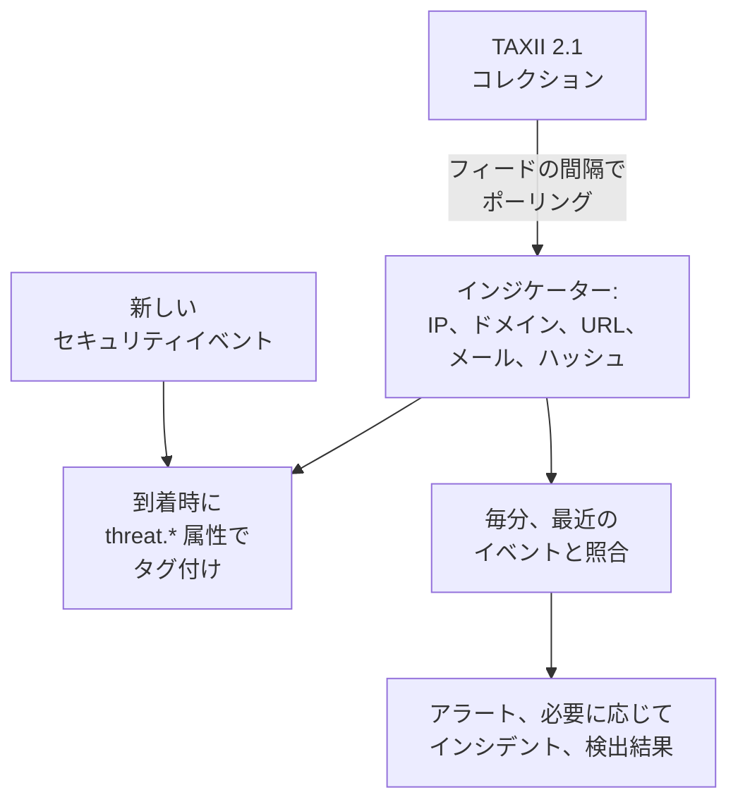

# 脅威インテリジェンス (STIX/TAXII)

脅威インテリジェンスのフィードは、既知の悪性 IP アドレス、ドメイン、URL、メールアドレス、ファイルハッシュを OneUptime に取り込み、 [セキュリティイベント](/docs/telemetry/security-events) がそのどれかに触れたときに知らせます。各フィードは、STIX 2.1 インジケーターを持つ TAXII 2.1 コレクションをひとつ購読します。自前の MISP、OpenCTI、OpenTAXII サーバーでも、プロバイダーのコレクションでもかまいません。OneUptime 自身はフィードの中身を提供しません。Sigma ルールと同じく、コレクションはあなたが用意します。

:::cards
- [フィードを購読する](#フィードを購読する): TAXII サーバー、コレクション、サインイン方法。
- [取り込まれるもの](#取り込まれるもの): OneUptime が保持するインジケーターのパターンと、その期間。
- [一致の見つけ方](#一致の見つけ方): イベントの到着時にタグ付けし、毎分照合します。
- [脅威レベル](#脅威レベル): インジケーターの confidence が重大度になる仕組み。
:::

## 仕組み



## 始める前に

- STIX 2.1 の `indicator` オブジェクトを公開する TAXII 2.1 サーバーと、ポーリングするコレクションの ID。フィードは匿名、bearer トークン、または HTTP の Basic 認証でサインインします。
- CISA AIS のように TLS クライアント証明書 (相互 TLS) を必要とするサーバーには対応していません。MITRE の公開 ATT&CK サーバーはインジケーターではなく手法とグループを公開しているので、そこを指したフィードは空のままです。
- フィードを作成できるロール: Project Owner、Project Admin、Security Admin、Security Member。Security Viewer はフィードとインジケーターを閲覧できます。 [ロール](/docs/permissions/reference#ロール) を参照してください。

## フィードを購読する

:::steps
### 脅威インテリジェンスを開く

**製品 → セキュリティイベント → 脅威インテリジェンス** を開きます。

### フィードを作成する

**脅威インテリジェンスのフィードを作成** をクリックし、 **基本情報**、 **TAXII サーバー**、 **認証**、 **一致したとき** の 4 つのステップを入力します。項目は下の表のとおりです。

### 最初のポーリングを確認する

1〜2 分以内にフィードの行に **最終ポーリング** が表示され、 **前回のポーリングの概要** にポーリングで取得した内容が示されます。インジケーターはフィードの下の **インジケーター** の表に表示されます。
:::

| 項目 | 入力する内容 |
| --- | --- |
| **TAXII API ルート URL** | サーバーの TAXII 2.1 API ルート。たとえば `https://taxii.example.com/api1/`。コレクションはその下でアドレス指定されます。 |
| **コレクション ID** | インジケーターを公開するコレクション。 |
| **ポーリング間隔（分）** | 新しいオブジェクトを取得する頻度。1〜1440 分で、既定は 60 分です。 |
| **最小信頼度** | STIX の `confidence` がこれより低いインジケーターはスキップされます。0〜100 で、0 ならすべてを残します。confidence のないインジケーターは常に通ります。 |
| **API トークン** | トークンを求めるコレクション用の bearer トークン。 |
| **Basic 認証のユーザー名** と **Basic 認証のパスワード** | HTTP の Basic 認証を使うコレクション用。公開コレクションなら、両方ともトークンも空のままにします。 |
| **一致したらアラートを作成** | 既定でオン: 一致したインジケーターごとにアラートを開きます。 |
| **アラートの重大度** | このフィードが開くすべてのアラートの重大度。空にすると、各インジケーターの脅威レベルを使います。 |
| **一致したらインシデントを作成** | 既定でオフ。インシデントはオンコールのエスカレーション、SLA、ステータスページを動かすもので、インジケーターの一致には通常アラートで十分です。 |
| **インシデントの重大度** | **アラートの重大度** と同じで、インシデント用です。 |
| **一致したら検出結果を書き込む** | 既定でオン: 一致するたびにイベントストリームへ検出結果を書き込みます。 |

トークンとパスワードは暗号化され、保存後は二度と表示されません。変更するには、フィードの行で **認証情報を更新** を選び、 **API トークン（Bearer）** 、 **Basic 認証** 、 **匿名（保存された認証情報を消去）** のいずれかを選びます。選んだものがフィードのサインイン方法を置き換えるので、トークンを保存すると保存済みのパスワードは消去され、その逆も同様です。

### フィードのポーリングの仕組み

各ポーリングは、TAXII の `added_after` カーソルを使って前回以降に追加されたオブジェクトを要求し、500 オブジェクトのページを最大 10 ページ読み取ります。そのため大きなコレクションは複数回のポーリングで同期されます。ページが残っているときは **前回のポーリングの概要** に表示されます。大きな初回同期を早く終えるには、追いつくまで **ポーリング間隔（分）** を最小 1 まで下げてください。

ポーリングはユーザーエージェント `OneUptime/<version> (+https://oneuptime.com)` を名乗ります。プロバイダーのファイアウォールが `403` を返す場合は、このエージェントを許可するよう依頼してください。多くのファイアウォールは、名前のないスクリプトに見えるリクエストをブロックします。

無効にしたフィードは、ポーリングも照合もされません。すでに取得済みのインジケーターは、期限が切れるまで新しいイベントにタグを付け続けます。

## 取り込まれるもの

OneUptime が保持するのは、パターンが次のいずれかの型に対する単純な等価比較である STIX の `indicator` オブジェクトです。

| 型 | パターンの例 |
| --- | --- |
| IPv4 アドレス (`ipv4-addr`) | `[ipv4-addr:value = '198.51.100.7']` |
| IPv6 アドレス (`ipv6-addr`) | `[ipv6-addr:value = '2001:db8::7']` |
| ドメイン名 (`domain-name`) | `[domain-name:value = 'evil.example']` |
| URL (`url`) | `[url:value = 'http://evil.example/payload']` |
| メールアドレス (`email-addr`) | `[email-addr:value = 'billing@evil.example']` |
| ファイルハッシュ、SHA-256 (`file-hash-sha256`) | `[file:hashes.'SHA-256' = 'e3b0…b855']` |
| ファイルハッシュ、SHA-1 (`file-hash-sha1`) | `[file:hashes.'SHA-1' = 'da39…0709']` |
| ファイルハッシュ、MD5 (`file-hash-md5`) | `[file:hashes.MD5 = 'd41d…427e']` |

ひとつの `[...]` の中でも複数にまたがっても、 `OR` でつないだ比較は使えます。それぞれの値が個別のインジケーターになります。

```text
[domain-name:value = 'evil.example' OR domain-name:value = 'evil2.example']
[ipv4-addr:value = '198.51.100.7'] OR [url:value = 'http://evil.example/x']
```

それ以外のパターン、つまり `AND`、 `FOLLOWEDBY`、 `NOT`、 `LIKE`、 `MATCHES`、 `WITHIN` のような時間の修飾子、またはほかのオブジェクト型を含むものは、丸ごとスキップされ、 **前回のポーリングの概要** で未対応として数えられます。 `AND` のパターンの一部だけを変換すると、フィードの作成者が意図したよりはるかに広く一致してしまうからです。

### インジケーターが有効な期間

- インジケーターは `valid_from` から `valid_until` まで一致します。 `valid_until` がなければ `valid_from` から 365 日間有効で、再ポーリングしても延長されません。
- 失効したインジケーター、または過去の `valid_until` で更新されたインジケーターは、その更新がポーリングされた時点で一致しなくなります。プロバイダーが更新後のパターンから外した値も同様です。
- 値は小文字で保存され、大文字と小文字にかかわらず一致します。

**インジケーター** の表は、保存されているとおりのインジケーターを、 **ステータス** の **アクティブ**、 **期限切れ**、 **失効済み** とともに一覧表示します。再ポーリングしたインジケーターがしばらく二重に表示されることがあり、期限切れや失効済みの行は、ストレージのクリーンアップで削除されるまで、期限切れから最大で約 1 か月一覧に残ります。照合では常に有効期間と失効を確認するので、そのような行が一致することはありません。

## 一致の見つけ方

### イベントの到着時にタグ付けする

取り込み API や接続から届くすべてのセキュリティイベントは、保存される前にアクティブなインジケーターと照合されます。その observable (イベントから取り出した IP、ホスト、ドメイン、ハッシュ、ユーザー) のどれかがインジケーターの値と等しいと、イベントに次の属性が付きます。

| 属性 | 値 |
| --- | --- |
| `threat.matched` | タグ付けされたイベントでは常に `"true"` |
| `threat.indicator_id` | STIX インジケーターの ID |
| `threat.indicator_type` | インジケーターの型。たとえば `ipv4-addr` や `file-hash-sha256` |
| `threat.indicator_value` | 一致した値 (小文字) |
| `threat.feed` / `threat.feed_id` | インジケーターの取得元のフィード |
| `threat.confidence` | インジケーターの STIX の confidence |
| `threat.match_count` | イベントの observable のうちインジケーターに一致した数 |

ひとつのイベントに複数のインジケーターが一致した場合は、confidence が最も高いものがこれらの値を埋めます。通常の属性なので、 **イベント** で検索し、セキュリティイベントのモニターの絞り込みに使い、検出ルールで使うことができます。

```yaml title="threat-intel-logon.yml"
title: High-confidence indicator in a successful logon
level: critical
detection:
  selection:
    threat.matched: 'true'
    threat.confidence|gte: 80
    className: Authentication
    statusName: Success
  condition: selection
```

タグ付けで使われるのは、イベントが届いた時点で存在するインジケーターだけです。イベントが後からタグ付けし直されることはありません。

### 毎分照合する

毎分、有効な各フィードのアクティブなインジケーターが、イベントの時刻がそのフィードの前回の確認以降にあるイベントと照合されます。これにより、イベントがタグ付けされた後に届いたインテリジェンスも捕まえられます。

- 最初の確認は直近 15 分を対象にします。障害の後は、次の確認で最大で直近 24 時間分を取り戻します。
- 各ウィンドウは一度だけ確認されます。ウィンドウの確認後に届いたインテリジェンスは、それ以降のイベントにだけ適用されます。
- 前回の確認より前の時刻を持って遅れて届いたイベントも、到着時のタグ付けは行われますが、照合はされません。
- 各確認で照合するのは、フィードごとに最大 100 個のインジケーターの値で、最も多くのイベントに現れたものが選ばれます。

### 一致したときに起こること

- `[Threat Intel] <feed name> — <indicator value>` というタイトルのアラート。開いているあいだは、フィードと値の組ごとにひとつです。解決された後は、次の一致で新しいアラートが開きます。アラートは自動では解決されません。
- インシデント。 **一致したらインシデントを作成** がオンの場合だけで、同じように重複が除かれます。
- 脅威インテリジェンスの検出結果。 **一致したら検出結果を書き込む** がオンの場合に、製品 `OneUptime Threat Intel` による `Detection Finding` イベント (OCSF クラス 2004) が、インジケーターの脅威レベルを重大度として、次の属性とともに書き込まれます。

| 属性 | 値 |
| --- | --- |
| `oneuptime.threat.feed_id` / `oneuptime.threat.feed_name` | フィード |
| `oneuptime.threat.indicator_id` | STIX インジケーターの ID |
| `oneuptime.threat.indicator_type` / `oneuptime.threat.indicator_value` | 一致したもの |
| `oneuptime.threat.confidence` | インジケーターの confidence |
| `oneuptime.threat.match_count` | この検出結果の元になったイベントの数 |

検出結果自体が照合されることはないので、ひとつの一致が別の一致を引き起こすことはありません。

## 脅威レベル

インジケーターには Sigma のレベルがありません。代わりに STIX の `confidence` が脅威レベルを決めます。

| インジケーターの confidence | 脅威レベル |
| --- | --- |
| 90〜100 | Critical |
| 70〜89 | High |
| 40〜69 | Medium |
| 1〜39 | Low |
| スコアなし (0 または未設定) | Medium |

スコアのないインジケーターは Medium として扱われます。それでも誰かがフィードに入れることを選んだからです。脅威レベルは検出結果の重大度であり、アラートの重大度をプロジェクトの重大度から次の順で選びます。

1. フィードの **アラートの重大度** (または **インシデントの重大度**)。設定されている場合は、フィードからのすべての一致に適用されます。
2. 脅威レベルと同じ名前を持つあなたの重大度。たとえば High。大文字と小文字は区別しません。
3. 順位による割り当て: Critical と High は最も重い重大度、Medium と Low は最も軽い重大度になります。

脅威レベルはフィードではなく各インジケーターに属するので、ひとつのフィードが同じ分に Critical のアラートと Low のアラートを開くこともあります。 **最小信頼度** は同じ数値で絞り込みます。最小値を 70 にすると、High と Critical のインジケーターに加え、常に通るスコアなしのインジケーターだけが残ります。

## フィードの一致を見張る

フィードの行にある **モニターを作成** は、そのフィードの検出結果を数える新しいセキュリティイベントのモニターを開きます。イベントクラスは `Detection Finding`、 `oneuptime.threat.feed_id` のフィード ID (名前を変えると変わってしまう名前は使いません) で絞り込み、対象は直近 1 時間です。一致が急に増えたときや、活発なフィードが静かになったときに気づくために使います。

## 保持と課金

インジケーターはテレメトリではなく設定なので、取り込んだデータとしては課金されません。一致によって書き込まれる検出結果は通常のセキュリティイベントで、ほかと同じように課金、保持されます。 [セキュリティイベント](/docs/telemetry/security-events#保持と課金) を参照してください。

## トラブルシューティング

:::details ポーリング後に最終エラーが設定される
`401` または `403`: 認証情報が間違っているか、ありません。 **認証情報を更新** で置き換えてください。 `403` は、プロバイダーのファイアウォールがユーザーエージェントをブロックしている場合もあります。 `404`: 通常 `/api1/` のようなパスで終わる **TAXII API ルート URL** と、 **コレクション ID** を確認してください。次にポーリングが成功するとエラーは消えます。
:::

:::details フィードはポーリングされるが、インジケーターが表示されない
**前回のポーリングの概要** を読んでください。オブジェクトを取得していない: コレクションが空か、インジケーターを公開していません。未対応のパターン: プロバイダーが、このページでスキップされると説明しているパターンの機能を使っています。最小 confidence 未満: **最小信頼度** を下げてください。すでに無効: プロバイダーが送ったインジケーターがすでに失効しているか期限切れです。
:::

:::details インジケーターはあるのに何も一致しない
照合では、インジケーターの値をイベントのすべての項目ではなく observable と比べます。一致するはずだったイベントを **イベント** で開き、その observable に値が含まれているか確認してください。一致するのはステータスが **アクティブ** のインジケーターだけです。フィードの **最終一致エラー** も確認してください。
:::

:::details 一致したのにアラートが開かない
**一致したらアラートを作成** がオフになっているか、同じフィードと値のアラートがまだ開いていて、後の一致がそこにまとめられています。フィードがアラートを開くには、プロジェクトにアラートの重大度が少なくともひとつ必要です。
:::

## 次のステップ

:::cards
- [セキュリティイベント](/docs/telemetry/security-events): イベントを送り、検索し、検出ルールを書きます。
- [Google SecOps](/docs/integrations/google-secops): Chronicle の検出とイベントを取り込みます。
- [権限リファレンス](/docs/permissions/reference): Security ロールと、それぞれにできること。
:::
