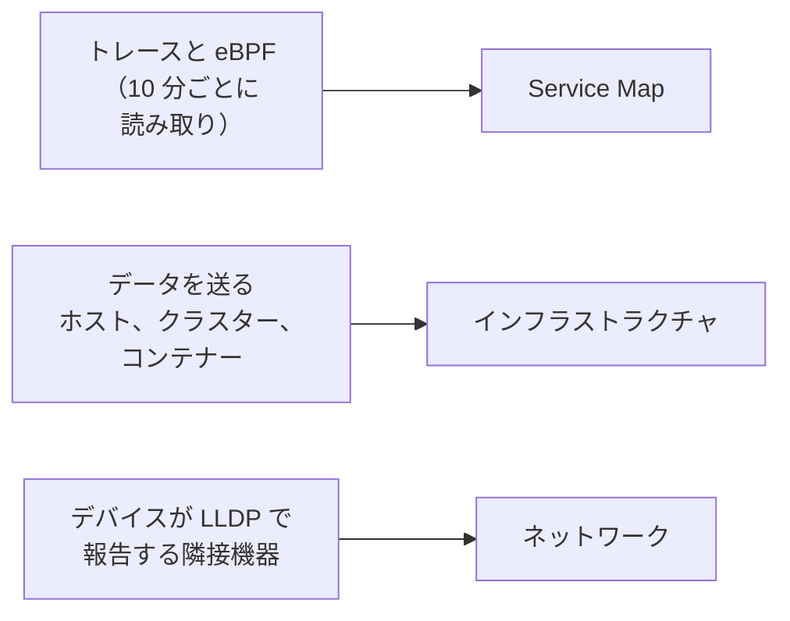

# トポロジー

トポロジーは、システムのつながりを描きます。どのサービスがどのサービスを呼び出すか、何がどこで動いているか、ネットワークデバイスがどう配線されているかです。OneUptime はすでに送っているテレメトリからこれを構築するため、手で描くものは何もありません。エラーやインシデントがどこにあるかも一目でわかります。

:::cards
- [トポロジーを開く](#トポロジーを開く): 1 つのページにある 3 つのビュー。
- [サービスマップを読む](#サービスマップを読む): 誰が誰を呼び出しているか、その呼び出しがどれだけ健全か。
- [インフラストラクチャを調べる](#インフラストラクチャを調べる): 各サービスがどこで動いているか。
- [リソースごとのマップを開く](#リソースごとのマップを開く): 1 つの vCenter、クラスター、ホストを詳しく。
- [ネットワークを見る](#ネットワークを見る): デバイスとそのリンクをリアルタイムで。
:::

## マップの構築方法

トポロジーの各ビューは、それぞれ異なる種類のテレメトリから構築されます。

- **描かれるのはアクティブだったものだけです。** ビューには、期間内にデータを送ったサービスとリソース、およびその期間に見られた接続が表示されます。送信のなかったものも描くには、**非アクティブなものを表示** をオンにします。
- **呼び出しは直近の時間枠で数えます。** OneUptime は 10 分ごとにサービス間の呼び出しを探し、トラフィックの数値は期間全体ではなく直近 15 分を対象にします。
- **ネットワークビューはリアルタイムです。** 現在の接続状態でデバイスを表示するため、期間はありません。

## 始める前に

- **届いているテレメトリ。** サービスマップにはトレースが必要です。[OpenTelemetry](/docs/telemetry/open-telemetry) を参照してください。インフラストラクチャビューにはデータを送るホストまたはクラスターが必要です。[Kubernetes エージェント](/docs/telemetry/kubernetes-agent) を参照してください。ネットワークビューにはネットワークデバイスが必要です。[ネットワークデバイス モニター](/docs/monitor/network-device-monitor) を参照してください。
- **テレメトリを読み取るロール。** Project Owner、Project Admin、Project Member、Viewer、Telemetry Admin、Telemetry Member、Telemetry Viewer、または Read Telemetry Service 権限を持つカスタムロールです。

## トポロジーを開く

**製品 → オブザーバビリティ → トポロジー** に移動します。**インベントリ → トポロジーマップ** でも同じページが開きます。ページは **過去 1 日** の **Service Map** で開きます。

| ビュー | 答える質問 |
| --- | --- |
| **Service Map** | どのサービスが互いに依存しているか |
| **インフラストラクチャ** | インフラストラクチャのどこで何が動いているか |
| **ネットワーク** | ネットワークデバイスがどう接続されているか |

タイムピッカーの横にある **非アクティブなものを表示** は、期間内に送信のなかったものを追加し、更新ボタンはビューを読み込み直します。**表示内容 · このデータについて** では、ビューが何を描き、どのくらいの頻度で計算されるかを説明します。アドレスバーは表示中のビューを覚えているため、共有したリンクでも同じビューが開きます。

## サービスマップを読む

**Service Map** には、データを送ったすべてのサービスと、それらが呼び出すデータベース、API、メッセージブローカーが描かれます。それら自身がテレメトリを送っていなくてもかまいません。矢印は呼び出し元から呼び出し先へ向かい、太い線ほど多くのリクエストを運んでいます。上部の数値は、描かれているサービス、依存関係、接続の数と、そのうち対応が必要な数を示します。

各サービスには、直近 15 分に受け取った呼び出しから計算したステータスが表示されます。

| ステータス | 条件 |
| --- | --- |
| **正常** | 受け取った呼び出しのうち、失敗したのは 1% 以下です。 |
| **Some errors** | 1% を超え 5% 未満が失敗しました。 |
| **High error rate** | 5% 以上が失敗しました。 |
| **Entry point** | 呼び出しを受けていませんが、呼び出しはしています。ウェブフロントエンドやスケジュールされたジョブなどです。 |
| **No calls observed** | 呼び出しの発信も受信もしていません。 |

対応中のインシデントやアラートがあるサービスは、代わりにその数を表示し、**Some errors** や **High error rate** のサービスと同じく、対応が必要なものとして数えられます。

:::steps
### 対応が必要なサービスを見つける

**対応が必要** をクリックすると、それらのサービスと直接の接続だけが残ります。または、マップの上のボックスで名前を検索します。

### サービスを開く

サービスをクリックすると、直近 15 分のリクエスト、エラー、平均レイテンシ、**対応中のインシデント** と **対応中のアラート**、そして **このサービスのトレース** と **インベントリの詳細** へのリンクが表示されます。

### 接続を開く

矢印をクリックすると、リクエストレート、エラー率、平均レイテンシが表示されます。計装済みの 2 つのサービス間の接続には、呼び出し、エラー、レイテンシの **履歴** もあります。
:::

**接続のラベル** は各矢印に数値を書き込みます。**リクエストレート**、**エラー率**、**平均レイテンシ** のいずれかで、ポインターを合わせるまで何も表示しないこともできます。**テーブル** には同じサービスが **リクエスト**、**エラー率**、**平均レイテンシ**、**接続** とともに一覧表示され、**マップに表示** でそのうちの一つを描けます。

## インフラストラクチャを調べる

**インフラストラクチャ** は、サービスがどこで動いているかを示します。クラスター、ホスト、Pod、コンテナー、その他データを送るリソースです。同じワークロードのレプリカは 1 つの項目にまとめられ、どれでも開いて中を見られます。

- **好きな方法で見て回れます。** **リスト** または **マップ** として、インフラストラクチャ全体から 1 つの Pod まで表示できます。上部の数値は、描かれているリソースとワークロードの数、配置できるサービスの数、省いた送信のないリソースの数を示します。
- **リソースを見つけられます。** 名前で検索し、**詳細を表示** をクリックするとそのページが開きます。
- **ビュー間を移動できます。** リソースに表示されたサービスは **Service Map** で開き、サービスが動いているリソースは **インフラストラクチャ** で開きます。

## リソースごとのマップを開く

vCenter、Kubernetes クラスター、ホスト、Docker または Podman のホスト、Docker Swarm・Proxmox・Ceph のクラスター、ストレージアレイには、それぞれ専用の **トポロジー** ページがあります。そのリソースを自身のインベントリから詳しく描きます。何が何の中にあるか、各部分の状態を色で、そして未解決のインシデントとアラートをそれぞれ該当する部分に示します。

- **ツリーとして読めます。** リソースは一番上にあり、各部分の中身はその右側に描かれて線でつながっています。対応が必要なものがある方向の線は赤またはオレンジになります。問題を含む部分は自動で開き、部分の丸いボタンで開閉でき、矢印キーでマップ内を移動できます。
- **対応が必要なものを見つけられます。** **対応が必要** は問題のある部分とそこまでの経路だけを残し、検索ではリソース内のどこにある部分でも見つかります。
- **詳しく見られます。** 部分をクリックすると、それが何かと専用ページへのリンクが表示されます。**これに絞り込む** をクリックすると、その部分と中身、関連するものだけが描かれます。
- **両方向に移動できます。** **トポロジーで開く** でリソースを **インフラストラクチャ** で開き、そこから **vCenter のトポロジーを開く**、**クラスターのトポロジーを開く**、**ホストのトポロジーを開く**、**ストレージアレイのトポロジーを開く** の各ボタンで戻れます。

## ネットワークを見る

**ネットワーク** は、ネットワークデバイスのリアルタイムのマップです。デバイスが LLDP で、Cisco のデバイスでは CDP で報告する隣接機器から構築されます。タイムピッカーはなく、接続は自動的に更新されます。

デバイスをサイトにまとめている場合、ビューはサイトの一覧で開きます。サイトを一つ選ぶか、**すべてのデバイス** に切り替えます。**マップのオプション** でマップのレイアウトと含めるものを選び、**PDF をエクスポート** で表示中のマップを保存します。ネットワークデバイスのページにも同じマップが描かれます。[ネットワークトポロジー](/docs/monitor/network-device-monitor#ネットワークトポロジー) を参照してください。

## トラブルシューティング

:::details サービスマップにサービスは表示されるが接続がない
OneUptime は 10 分ごとにトレースからサービス間の呼び出しを探します。呼び出しとして認識されるのは、OpenTelemetry の HTTP や gRPC の計装のように、リクエストがトレースコンテキスト（`traceparent` ヘッダー）を計装済みのサービスから次のサービスへ運ぶとき、サービスが呼び出すデータベースや API のクライアントスパンを報告するとき、または Kubernetes エージェントが eBPF 付きで動いているときです。
:::

:::details 削除したサービスがまだマップにある
そのサービスは期間内にデータを送っています。短い期間を選ぶか、最後のテレメトリが期間から外れるまで待ってください。**非アクティブなものを表示** をオンにしていると、送信をやめたものもマップに描かれます。
:::

:::details マップの一部しか表示されていないと表示される
非常に大きなプロジェクトではマップの上限に達し、表示しているリソースや接続の数を知らせる通知が出ます。サービスを検索するか、テーブルの **マップに表示** を使って、読み取りやすい部分を描いてください。
:::

## 次のステップ

:::cards
- [サービスカタログ](/docs/telemetry/services): 1 つのサービスのすべて。
- [トレースエクスプローラー](/docs/telemetry/traces-explorer): 各矢印の背後にあるリクエスト。
- [インベントリの概要](/docs/inventory/overview): マップに描かれるすべてのリソース。
- [ネットワークデバイス モニター](/docs/monitor/network-device-monitor): ネットワークをマップに載せます。
:::
