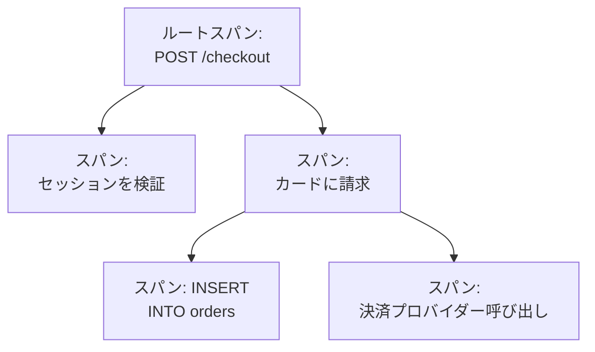

# トレースエクスプローラー

トレースエクスプローラーは、サービスを通ったリクエストを見つけます。遅いもの、失敗したもの、ある顧客のアカウントに触れたものなどです。サービスが送るスパンを検索して絞り込み、トレースを開くと、リクエストのすべてのステップをウォーターフォール、フレームグラフ、サービスマップとして確認できます。

:::cards
- [リクエストを探す](#リクエストを探す): スパンを検索し、サービス、ステータス、種類で絞り込みます。
- [トレースを読む](#トレースを読む): どこで時間がかかり、どのステップが失敗したか。
- [スパンをチャートにする](#スパンをチャートにする): リクエスト数と応答時間を、好きな方法でグループ化。
- [トレースのインサイト](#トレースのインサイト): エラー率、レイテンシ、最も遅いリクエスト。
:::

## トレースとスパン

トレースは、システムを通過する 1 つのリクエストです。HTTP ハンドラー、データベースクエリ、別のサービスの呼び出しなど、リクエストがたどる各ステップがスパンで、スパンはそれを開始したスパンの中に入れ子になります。親を持たない、トレースの最初のスパンがルートスパンで、リクエストの入口です。

エクスプローラーの各行はスパンなので、忙しいサービスはデータベースクエリや内部呼び出しでリストを埋め尽くします。リクエストごとに 1 行だけ表示するには、サイドバーの **スパンタイプ** で **Root spans** を選びます。

エクスプローラーには 4 つのタブがあります。

| タブ | 用途 |
| --- | --- |
| **閲覧者** | スパンを検索して絞り込み、そのトレースを開きます。直近一時間を新しい順に、50 件ずつ表示して開きます。 |
| **インサイト** | サービスごとのリクエスト率、エラー率、レイテンシと、確認する価値のあるリクエスト。 |
| **セットアップガイド** | [取り込みキー](/docs/telemetry/ingestion-keys) のいずれかを使って、OpenTelemetry でトレースを送る方法。 |
| **設定** | 届いたスパンに何が起きるか: **パイプライン**、**破棄フィルター**、**スクラブルール**、**記録ルール**。 |

## 始める前に

- **届いているトレース。** [OpenTelemetry](/docs/telemetry/open-telemetry) でサービスを計装します。**セットアップガイド** タブに、使っている言語向けのコードが表示されます。
- **テレメトリを読み取れるロール。** Project Owner、Project Admin、Project Member、Viewer、Telemetry Admin、Telemetry Member、Telemetry Viewer のいずれか、または Read Telemetry Service Traces 権限を持つカスタムロール。ロールのスコープによって、誰のスパンが見えるかが決まります。[テレメトリー](/docs/permissions/index#テレメトリー) を参照してください。

## リクエストを探す

:::steps
### 閲覧者を開く

**製品 → オブザーバビリティ → トレース** に移動します。**閲覧者** に直近 1 時間のスパンが新しい順に、それぞれのステータス、サービス、名前、所要時間とともに表示されます。

### 時間範囲を選ぶ

タイムピッカーで範囲を選ぶか、リストの上のチャートをドラッグして急増した部分にズームインします。チャートをダブルクリックすると元に戻ります。[時間範囲にズームインする](/docs/telemetry/charts-and-time-ranges) を参照してください。

### 検索する

クエリを入力して Enter を押します。たとえば `service:checkout status:error duration:>500` です。単語だけを書くとスパン名を検索し、`@key:value` は `@http.route:/orders` のように属性を検索します。[検索構文](/docs/telemetry/search-syntax#トレース) を参照してください。

### フィルターで絞り込む

**フィルター** サイドバーの値をクリックすると、チップとして追加されます。サイドバーでは、**サービス**、スパンを送ったホスト、クラスターなどのリソース、**ステータス**、**スパンタイプ**、**例外あり**、**スパンの種類**、**スパン名**、**サービスのインスタンス**、**ホスト名** で絞り込めます。

### スパンを開く

行をクリックすると展開され、属性と、そのスパンが記録したログと例外が表示されます。**See full trace** をクリックすると、トレース全体が開きます。
:::

検索、チップ、時間範囲はページのアドレスに保存されるため、再読み込み、ブックマーク、共有したリンクで同じスパンが開きます。

## トレースを読む

トレースのページは、リクエストの数値から始まります。

| 数値 | 意味 |
| --- | --- |
| 所要時間 | リクエスト全体にかかった時間。 |
| スパン | トレースに含まれるスパンの数。 |
| サービス | リクエストが通ったサービスの数。 |
| エラー | エラーステータスで終わったスパンの数。クリックするとそれらだけを表示します。 |
| 深さ | 入れ子になったスパンの最も深い連なり。 |

その下で、4 つのビューから 1 つを選びます。

| ビュー | 表示内容 |
| --- | --- |
| **ウォーターフォール** | すべてのスパンをタイムライン上に、それを開始したスパンの下に入れ子にして表示します。**Critical path** をオンにすると、リクエストの所要時間を決めたスパンの連なりが強調されます。 |
| **フレームグラフ** | 同じツリーを積み重ねたバーで表示し、幅の広いバーほど時間がかかっています。 |
| **サービスマップ** | リクエストが通ったサービスと、その間の呼び出し。 |
| **操作** | サービスとスパン名の組み合わせを行ごとに、呼び出し数、エラー、自己時間、合計時間とともに表示します。同じ親スパンから 10 回以上呼ばれた操作には印が付きます。多くの場合、N+1 クエリか、まとめて処理できるループです。 |

どのビューでもスパンをクリックするとパネルが開き、属性、イベント、ログ、例外、リンクのタブと、あればプロファイルや LLM 呼び出しのタブが表示されます。ビューの横の検索ボックス（`/` を押す）で、トレースのスパンを名前、ID、サービスで検索できます。**Errors only** をオンにすると、失敗したスパンだけが残ります。

大きなトレースは一度に 500 件のスパンを読み込みます。トレースの一番下のボタンをクリックすると、さらに読み込むか、すべて読み込めます。

> [!TIP]
> **AI でパフォーマンスを修正** は、トレースの中から既知のパフォーマンスのパターンを探します。N+1 クエリ、時間の大半を占める 1 つのスパン、並列に実行できるのに順番に行われている呼び出しです。見つかると、修正のための pull request を開く AI タスクを開始します。[コード](/docs/ai/ai-agent) を参照してください。

## スパンをチャートにする

リストの上のチャートは、スパンの数を時間の経過に沿ってステータス別に表示します。チャートのヘッダーで別の指標を選ぶと、代わりに平均、中央値（P50）、P95 の応答時間を表示できます。

さらに詳しく見るには、リストを **スパン** から **分析** に切り替えます。時系列、トップリスト、テーブルのいずれかを選び、リクエスト数、エラー数、応答時間（平均、P50、P90、P95、P99、最小、最大）を測り、スパン名、サービス、ステータス、スパンの種類、任意の属性でグループ化し、さらに 2 つ目のフィールドでグループ化します。トップリストとテーブルには、上位 5 から 100 のグループが表示されます。

## 追う、保存する、共有する

- リストの上の **一時停止中** をクリックすると、ライブ更新がオンになります。ボタンの表示が **ライブ** に変わり、リストは 10 秒ごとに新しいスパンを確認します。もう一度クリックすると一時停止します。
- **保存済みビュー** は、検索、フィルター、時間範囲を名前を付けて、プロジェクトの全員のために残します。保存済みビューは [ログエクスプローラー](/docs/telemetry/logs-explorer#ビューを保存する) と同じように動作します。
- **ログ** と **メトリクス** のボタンは、同じ時間枠でそれぞれのエクスプローラーを開き、使える範囲で絞り込みを引き継ぎます。ボタンにポインターを合わせると、引き継げないものが表示されます。

## トレースのインサイト

**インサイト** タブは、ある時間範囲のリクエストをまとめます。

- リクエスト数、エラー率、P50、P95、P99 のレイテンシ
- エラー率で並べたサービスのヘルス表（注意が必要なサービスが先頭に来ます）
- 最近失敗したリクエストと、最も遅いリクエスト

タイムピッカーの横のドロップダウンで、一部のサービスに絞り込めます。

## 届いたスパンに何が起きるか

**設定** タブには、ログと同じように、OneUptime が届いたスパンに適用するルールがあります。ルールはその後に届くスパンに作用し、保存済みのスパンには作用しません。各スパンをどれだけの期間保持するかも、届いた時点で決まります。[データ保持](/docs/telemetry/data-retention) を参照してください。

| ルール | 動作 |
| --- | --- |
| **破棄フィルター** | 残したくないスパンを破棄するか、そのサンプルだけを残します。[レコードを破棄またはサンプリングする](/docs/telemetry/drop-filters-and-scrub-rules#レコードを破棄またはサンプリングする) を参照してください。 |
| **スクラブルール** | スパンの属性に含まれる機密データをマスクします。[機密データをスクラブする](/docs/telemetry/drop-filters-and-scrub-rules#機密データをスクラブする) を参照してください。 |
| **パイプライン** | スパンを変更し、情報を補います。各パイプラインはフィルターでスパンを選び、プロセッサーを順番に実行します。 |
| **記録ルール** | スパン数、エラー数、所要時間を毎分、新しいメトリクスに変えます。[ログの記録ルール](/docs/telemetry/log-recording-rules) を参照してください。 |

## トラブルシューティング

:::details トレースにスパンが見つからないと表示される
スパンは通常、リクエストが終わってから 1 分以内に届きます。トレースのページで **更新** をクリックして、もう一度確認してください。
:::

:::details ウォーターフォールの最上位に並ぶスパンがある
それらのスパンは、OneUptime が受け取っていない親スパンを指しています。多くの場合、親を書いたサービスがまだ OneUptime にトレースを送っていないためです。そのサービスも計装してください。
:::

:::details リストの行数がリクエスト数よりずっと多い
各行はリクエストではなくスパンです。リクエストごとに 1 行だけ表示するには、サイドバーの **スパンタイプ** で **Root spans** を選びます。
:::

## 次のステップ

:::cards
- [検索構文](/docs/telemetry/search-syntax): 検索ボックスが理解するすべてのフィルター。
- [トレース モニター](/docs/monitor/traces-monitor): 失敗したリクエストや遅いリクエストのアラートを受け取ります。
- [例外トラッキング](/docs/telemetry/exceptions): スパンが記録したエラーをトリアージします。
- [ログエクスプローラー](/docs/telemetry/logs-explorer): リクエストが書いたログの行を読みます。
:::
