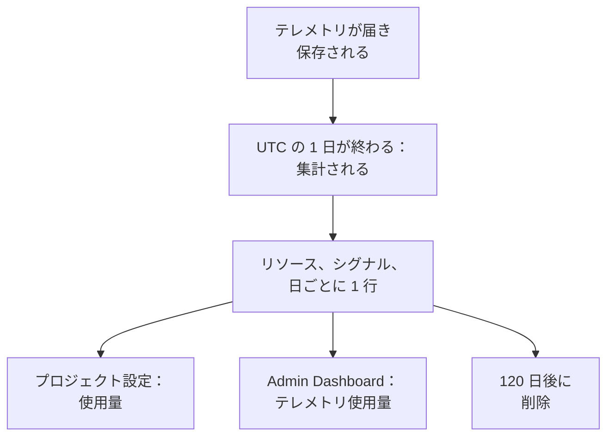

# テレメトリ使用量

各プロジェクト、およびその中の各サービスやリソースが送信しているテレメトリの量を確認できます。対象は、ログ、メトリクス、トレースとその例外、プロファイル、セッションリプレイ、セキュリティイベントです。使用量は課金の有無にかかわらず、すべての OneUptime のインストールで集計されるため、ClickHouse にクエリを実行しなくても、ストレージを圧迫しているものを見つけられます。

:::cards
- [使用量の集計方法](#使用量の集計方法): 1 日 1 回、リソースとシグナルごとに。
- [プロジェクトの使用量を見る](#プロジェクトの使用量を見る): プロジェクト設定 → テレメトリと APM → 使用量。
- [すべてのプロジェクトの使用量を見る](#すべてのプロジェクトの使用量を見る): インスタンス管理者向けの Admin Dashboard。
- [使用量の保持期間](#使用量の保持期間): 変更しない限り 120 日。
:::

## 使用量の集計方法

OneUptime は 1 日 1 回、UTC で 1 日が終わった後に、各プロジェクトの各リソースがその日に送信した量をシグナルごとに集計し、リソース、シグナル、日ごとに 1 行として保存します。



- **1 日は終わってから集計されます。** 各日は翌日の 08:00 UTC ごろまでに集計されるため、今日の使用量は明日表示されます。集計できなかった日は、1 週間にわたって再試行されます。
- **サイズは保存時のサイズです。** 各シグナルは、保存先の行の圧縮前のサイズとして集計されます。セッションリプレイは、レコーダーがアップロードしたバイト数として集計されます。
- **トレースには例外が、プロファイルにはサンプルが含まれます。**
- **OneUptime 自身のテレメトリは集計されません。** モニター、アラート、インシデント、SLO の測定値、データオブザーバビリティの測定値、セッションリプレイの予算メトリクスは、OneUptime 自身が書き込むものです。
- **OneUptime Cloud では、これらの行に基づいてテレメトリが課金されます。** 課金のないインストールでは、使用量は無料で集計され、後から課金を有効にしても、その使用量が請求されることはありません。

## 始める前に

- **プロジェクトのテレメトリを読み取るロール。** プロジェクト所有者、プロジェクト管理者、プロジェクトメンバー、閲覧者、テレメトリ管理者、テレメトリメンバー、テレメトリ閲覧者、または請求ロールのいずれか。ロールはプロジェクト全体に及んでいる必要があり、一部のラベルに限定されたロールでは使用量は表示されません。
- **プロジェクト内のテレメトリ。** 使用量は、プロジェクトの [取り込みキー](/docs/telemetry/ingestion-keys) が送信するテレメトリについて集計されます。

## プロジェクトの使用量を見る

:::steps
### 使用量を開く

**プロジェクト設定 → テレメトリと APM → 使用量** に移動します。サイドメニューの **テレメトリと APM** は最初は折りたたまれているので、クリックして開きます。

### 範囲を選ぶ

ページは **過去 30 日間** で開きます。**テレメトリ使用量** カードの右上にあるボックスで、**過去 7 日間** または **過去 90 日間** を選びます。範囲は、集計済みの最新の日である昨日で終わります。

### 増えたものを見つける

**リソース別の使用量** カードには、範囲内に何かを送信したすべてのサービスとリソースが、量の多い順に一覧表示されます。列の見出しをクリックするとその列で並べ替えられ、リソースの名前をクリックするとそのページが開きます。
:::

このページには 3 つのカードがあります。

| カード | 表示される内容 |
| --- | --- |
| **テレメトリ使用量** | 範囲の **合計**、シグナルごとの合計、シグナルを積み上げた日ごとのチャート。 |
| **リソース別の使用量** | 各 **リソース** とその種類、シグナルごとの列、**合計**、そのテレメトリが保持される **保持期間**。 |
| **テレメトリ使用履歴** | シグナル、リソース、日ごとに一行ずつ。**製品**、**日**、**サービス** のフィルターがあります。 |

サービスを指定しなかったテレメトリは、**不明なサービス** として表示されます。その後削除されたリソースや、ロールで読み取れない種類のリソースは、種類と ID の先頭部分で表示されます。

## 誰が何を見られるか

| ロール | 見られる内容 |
| --- | --- |
| プロジェクト所有者、プロジェクト管理者、請求管理者、請求メンバー、請求閲覧者、Manage Billing | 各リソースが送信した量と保持期間、および OneUptime Cloud ではその費用 |
| プロジェクトメンバー、閲覧者、テレメトリ管理者、テレメトリメンバー、テレメトリ閲覧者 | 各リソースが送信した量と保持期間 |

使用量の費用は OneUptime Cloud でのみ表示されます。課金のないインストールでは、使用量に料金はかかりません。料金については [請求と使用量](/docs/configuration/billing#使用履歴) を参照してください。

## すべてのプロジェクトの使用量を見る

セルフホストのインストールでは、インスタンス管理者が Admin Dashboard ですべてのプロジェクトの使用量を確認できます。

:::steps
### テレメトリ使用量を開く

Admin Dashboard でメニューを開き、**テレメトリ使用量** をクリックします。一覧には、範囲内に何かを送信した各プロジェクトが量の多い順に表示され、シグナルごとの列と **合計** があります。

### 最も多いプロジェクトを見つける

カードの右上で範囲を選び、列の見出しをクリックしてその列で並べ替えます。並べ替えに使えるのは **合計**、各シグナル、名前で並べる **プロジェクト** です。

### プロジェクトを開く

プロジェクトの名前をクリックします。Admin Dashboard の **プロジェクト** の下にあるそのプロジェクトの **テレメトリ使用量** ページに、メンバーが見るのと同じように、日、シグナル、リソースごとの使用量が表示されます。
:::

## 使用量の保持期間

使用量は、課金のオン・オフにかかわらず、変更しない限り 120 日間保持されます。これは使用量の集計値を保持する期間で、テレメトリそのものの保持期間ではありません。テレメトリについては [データ保持](/docs/telemetry/data-retention) を参照してください。

:::steps
### データ保持を開く

Admin Dashboard で **設定 → データ保持** に移動します。

### 日数を設定する

**テレメトリ使用量保持** カードで **テレメトリ使用量保持を編集** をクリックし、**テレメトリ使用量保持期間（日）** に 30 から 1095 までの値を入力して、**変更を保存** をクリックします。120 日にするには空欄のままにします。
:::

それより古い使用量は 1 日 1 回削除されます。保持期間が 30 日より短くなることはないため、集計済みの日が削除されて再び集計されることはありません。

## API で使用量を読み取る

`GET /api/telemetry-usage/project` は、UTC の日の範囲における 1 つのプロジェクトの使用量を、ページの表示と同じ形で返します。上記のいずれかのロールを持つ [API キー](/docs/permissions/index#api-キー) で呼び出します。

```bash
curl 'https://oneuptime.com/api/telemetry-usage/project?startDay=2026-10-01&endDay=2026-10-31' \
  -H "ApiKey: $ONEUPTIME_API_KEY"
```

`startDay` と `endDay` は `YYYY-MM-DD` 形式の日付で、どちらも範囲に含まれます。範囲は最長 1095 日です。応答には、合計、シグナル別の各日、シグナル別の各リソースが GB 単位で含まれます。費用は、課金が有効で、キーが請求を読み取れる場合にのみ含まれます。

## トラブルシューティング

:::details 使用量ページに「まだテレメトリの使用量はありません」と表示される
1 日は、UTC でその日が終わった後、翌日の 08:00 UTC ごろまでに集計されます。今日送信を始めたプロジェクトでは、明日最初の日が表示されます。エクスプローラーで、プロジェクトがテレメトリを受信していることを確認してください。
:::

:::details 数値が ClickHouse のディスク使用量より大きい
使用量は圧縮前の行のサイズです。ClickHouse は保存するデータを圧縮するため、実際に使うディスクは数分の一になります。
:::

:::details リソースが種類と ID で表示される
そのリソースはテレメトリを送信した後に削除されたか、ロールがその種類のリソースを読み取れません。その使用量は引き続き集計されます。
:::

## 次のステップ

:::cards
- [破棄フィルターとスクラブルール](/docs/telemetry/drop-filters-and-scrub-rules): 不要なテレメトリを保存しないようにします。
- [データ保持](/docs/telemetry/data-retention): テレメトリを必要な期間だけ保持します。
- [請求と使用量](/docs/configuration/billing): OneUptime Cloud でのテレメトリの料金。
- [取り込みキー](/docs/telemetry/ingestion-keys): プロジェクトにテレメトリを送ります。
:::
