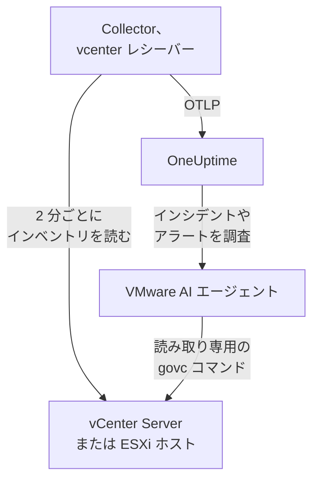

# VMware エージェント

OneUptime の VMware エージェントは VMware vSphere を監視します。対象は vCenter Server、ESXi ホスト、仮想マシン、データストア、クラスター、リソースプール、vSAN です。標準の OpenTelemetry Collector で、その [`vcenter` レシーバー](https://github.com/open-telemetry/opentelemetry-collector-contrib/tree/main/receiver/vcenterreceiver) が読み取り専用ユーザーで vSphere API を読み取り、すべてのメトリクスに vCenter の名前を付与して OneUptime に送信します。vCenter へのプラグインも、VM 内部への導入も不要です。届いたデータに対しては [VMware モニター](/docs/monitor/vmware-monitor) がアラートを出します。

:::cards
- [エージェントのインストール](#エージェントをインストールする): 読み取り専用ユーザーを作成し、インストールスクリプト、Docker Compose、systemd のいずれかを使います。
- [エージェントが収集するもの](#エージェントが収集するもの): すべての vSphere オブジェクト、その識別情報、そのメトリクス。
- [AI エージェント](#ai-エージェント): OneUptime AI が調査中に vCenter を読めるようにします。
- [トラブルシューティング](#トラブルシューティング): 診断スクリプトと、よくある問題。
:::

## 仕組み

1 つのエージェントが 1 つの vSphere エンドポイントを監視します。管理下のすべてのデータセンター、クラスター、ホストをカバーする **vCenter Server**、または vCenter に管理されていない **スタンドアロンの ESXi ホスト** です。vCenter ごとにエージェントを 1 つ実行してください。Collector は収集ごとにインベントリ全体を 1 回巡回し (既定では 2 分ごと)、オブジェクトごとに 1 つのリソースを送信します。同じ Compose ファイルが、OneUptime AI 用の VMware AI エージェントもその横で実行します。Docker を使いたくない場合は、同じ Collector を同じ設定のまま、任意の Linux マシンで systemd サービスとして実行することもできます。



vCenter は最初のデータとともに、エージェントがすべてのメトリクスに `vmware.vcenter.name` として付与する名前で自身を登録します。エージェントをまったく実行せずに vCenter を監視するには、[エージェントなしの VMware](/docs/telemetry/vmware-agentless) を参照してください。プローブの 1 つが読み取り専用アカウントで同じデータを収集します。

## 始める前に

- Docker Engine 20.10 以降と Docker Compose v2 プラグイン。Docker なしでインストールする場合は、systemd 235 以降を備えた Linux マシン (x86_64 または arm64)。いずれの場合も、マシンは HTTPS (TCP 443) で vCenter に到達できる必要があります。
- vCenter Server または ESXi 7.0 以降。レシーバーは vSphere 7 と 8 をサポートします。
- vSphere ユーザーを作成し、最上位の vCenter オブジェクトでそのユーザーにロールを割り当てられるアカウント。
- 取り込みキー。**プロジェクト設定 → テレメトリと APM → 取り込みキー** で作成し、その値をコピーします。

### エージェントを実行する場所

エージェントは HTTPS で vCenter と通信するため、近くで実行する必要はありません。理想的には、vCenter Server Appliance 上でも、監視対象クラスターの VM 内でも実行しないでください。そのクラスターが停止すると、監視も一緒に停止します。別のハードウェア上の小さな管理用 VM、監視用ホスト、または Docker を実行し (Docker なしなら systemd を備えた任意の Linux マシン)、TCP 443 で vCenter に到達できる任意のマシンが適切な置き場所です。オプションの syslog リスナーを使う場合は、ESXi ホストが syslog ポートでエージェントに到達できる必要もあります ([ESXi の syslog を送信する](#オプション-esxi-の-syslog-を送信する) を参照)。

## エージェントをインストールする

:::steps
### 読み取り専用の vSphere ユーザーを作成する

エージェントが行うのは読み取りだけです。対象はインベントリ、パフォーマンスカウンター、vSAN の統計です。管理者ではなく、組み込みの **Read-Only** ロールを持つ専用のアカウントを与えてください。

:::tabs
@tab vSphere Client
1. アカウントを作成します。 _Menu → Administration → Single Sign On → Users and Groups_ を開き、`vsphere.local` ドメイン (または使用している ID ソース) を選び、 **Add** をクリックし、ユーザー名を `oneuptime` にしてパスワードを設定します。ユーザーは `oneuptime@vsphere.local` になります。
2. ロールを割り当てます。 _Hosts and Clusters_ インベントリで最上位の **vCenter Server** オブジェクトを選び、 **Permissions** タブを開き、 **Add** をクリックし、ユーザーを選び、ロールを **Read-Only** に設定して、 **Propagate to children** にチェックを入れます。
@tab govc
管理者の資格情報を持つマシンから実行します:

```bash
govc sso.user.create -p 'a-strong-password' -R ReadOnly oneuptime
govc permissions.set -principal oneuptime@vsphere.local -role ReadOnly -propagate=true /
```
@tab PowerCLI
管理者として vCenter に接続したセッションから実行します:

```powershell
New-SsoPersonUser -UserName oneuptime -Password 'a-strong-password'
New-VIPermission -Entity (Get-Folder -NoRecursion) -Principal 'VSPHERE.LOCAL\oneuptime' -Role ReadOnly -Propagate:$true
```
@tab ESXi Host Client
スタンドアロンの ESXi ホスト (vCenter なし) では、 _Host → Manage → Security & Users → Users_ でユーザーを作成し、 _Host → Manage → Security & Users → Permissions_ で Read-Only ロールを与えます。または、ホストのシェルで `esxcli system account add` を実行し、続けて `esxcli system permission set --id oneuptime --role ReadOnly` を実行します。
:::

> [!IMPORTANT]
> 見落とされがちなのが伝播です。レシーバーはデータセンター、クラスター、ホスト、VM、データストア、リソースプールを巡回し、ユーザーが参照できないオブジェクトはすべて黙って除外されます。伝播なしで vCenter オブジェクトに割り当てた Read-Only ロールでは、インベントリが空になり、ダッシュボードはゼロだらけになります。

### エージェントをインストールして起動する

:::tabs
@tab install.sh
インストールスクリプトをダウンロードし、エージェントを置くマシンで実行します:

```bash
curl -sSL https://raw.githubusercontent.com/OneUptime/oneuptime/master/agents/VMwareAgent/install.sh -o install.sh
bash install.sh
```

スクリプトは、OneUptime の URL、取り込みキー、vCenter の名前、vCenter のエンドポイント、読み取り専用の資格情報 (パスワードはエコーなしで読み取ります)、そして AI エージェントに修正の適用を許可するかどうか (許可する場合は、専用の vSphere ユーザーと、決して変更してはならない VM) を尋ねます。`/opt/oneuptime-vmware-agent` にインストールし、`0600` の `.env` ファイルを書き込み、Docker Compose でエージェントを起動します。各値は入力したとおりに Docker Compose 用に引用符で囲むため、`$`、`#`、空白、引用符を含むパスワードも入力したとおりに機能します。スクリプトを再実行すると、再度尋ねる代わりに既存の `.env` の内容をすべて再利用します。これが [エージェントのアップグレード](#エージェントのアップグレード) の方法です。
@tab Docker Compose
[VMwareAgent ディレクトリ](https://github.com/OneUptime/oneuptime/tree/master/agents/VMwareAgent) から `docker-compose.yml` と `otel-collector-config.yaml` を新しいフォルダーにダウンロードし、その横に `.env` ファイルを作成します。パスワードが入るので、`chmod 600 .env` で非公開にしてください:

```bash title=".env"
ONEUPTIME_URL=YOUR_ONEUPTIME_URL
ONEUPTIME_TELEMETRY_INGESTION_KEY=YOUR_TELEMETRY_INGESTION_TOKEN
VMWARE_VCENTER_NAME=my-vcenter
VCENTER_ENDPOINT=https://vcsa.example.com
VCENTER_USERNAME=oneuptime@vsphere.local
VCENTER_PASSWORD=a-strong-password
VCENTER_INSECURE_SKIP_VERIFY=true
VCENTER_COLLECTION_INTERVAL=2m
```

`$`、`#`、空白、引用符を含むパスワードは単一引用符で囲みます ([vCenter がログインを拒否する](#トラブルシューティング) を参照)。エージェントを起動します:

```bash
docker compose up -d
```
@tab systemd
エージェントに Docker は必要ありません。OpenTelemetry Collector のバイナリ 1 つと設定ファイル 1 つだけです。systemd 235 以降を備えた Linux マシン (x86_64 または arm64。Ubuntu 18.04、Debian 10、RHEL 8 以降) で、エージェントが固定している `otelcol-contrib` のリリースを、同じ `otel-collector-config.yaml` とともに systemd サービスとして実行します。エージェントがそのために同梱するユニット [`oneuptime-vmware-agent-native.service`](https://github.com/OneUptime/oneuptime/blob/master/agents/VMwareAgent/systemd/oneuptime-vmware-agent-native.service) は、capabilities も書き込み先も持たない使い捨ての非特権ユーザーとして Collector を実行します。

Collector、設定、ユニットをダウンロードし、`/opt/oneuptime-vmware-agent` にインストールします:

```bash
cd "$(mktemp -d)"
VERSION=0.161.0   # the collector release the agent pins
ARCH=$(uname -m | sed 's/x86_64/amd64/;s/aarch64/arm64/')
curl -fL -o otelcol-contrib.tar.gz \
  https://github.com/open-telemetry/opentelemetry-collector-releases/releases/download/v${VERSION}/otelcol-contrib_${VERSION}_linux_${ARCH}.tar.gz
curl -fsSLO https://raw.githubusercontent.com/OneUptime/oneuptime/master/agents/VMwareAgent/otel-collector-config.yaml
curl -fsSL -o oneuptime-vmware-agent.service \
  https://raw.githubusercontent.com/OneUptime/oneuptime/master/agents/VMwareAgent/systemd/oneuptime-vmware-agent-native.service

sudo install -d -m 0755 /opt/oneuptime-vmware-agent
sudo tar --no-same-owner --preserve-permissions -xzf otelcol-contrib.tar.gz -C /opt/oneuptime-vmware-agent otelcol-contrib
sudo install -m 0644 otel-collector-config.yaml /opt/oneuptime-vmware-agent/otel-collector-config.yaml
sudo install -m 0644 oneuptime-vmware-agent.service /etc/systemd/system/oneuptime-vmware-agent.service
```

設定は `/opt/oneuptime-vmware-agent/.env` に書きます。Docker でのインストールの `.env` と同じ変数です。パスワードが入るので、開く前に root だけが読めるようにしてください:

```bash
sudo touch /opt/oneuptime-vmware-agent/.env
sudo chmod 600 /opt/oneuptime-vmware-agent/.env
sudoedit /opt/oneuptime-vmware-agent/.env
```

次の内容を書き込みます:

```bash
ONEUPTIME_URL=YOUR_ONEUPTIME_URL
ONEUPTIME_TELEMETRY_INGESTION_KEY=YOUR_TELEMETRY_INGESTION_TOKEN
VMWARE_VCENTER_NAME=my-vcenter
VCENTER_ENDPOINT=https://vcsa.example.com
VCENTER_USERNAME="oneuptime@vsphere.local"
VCENTER_PASSWORD="a-strong-password"
VCENTER_INSECURE_SKIP_VERIFY=true
VCENTER_COLLECTION_INTERVAL=2m
```

このファイルを読むのはシェルではなく systemd です。ユーザー名とパスワードは二重引用符で囲み、`\` はそれぞれ `\\`、`"` はそれぞれ `\"` と書きます (`DOMAIN\user` は `"DOMAIN\\user"` になります)。一方、`$`、`#`、`'`、空白はそのまま書きます。これがどの systemd バージョンでも同じように読まれる形です。古いバージョン (たとえば RHEL 8 のもの) は、単一引用符の中でもバックスラッシュを落とします。続いてエージェントを起動し、起動のたびに開始されるようにします:

```bash
sudo systemctl daemon-reload
sudo systemctl enable oneuptime-vmware-agent
sudo systemctl restart oneuptime-vmware-agent
```

このインストールで実行されるのは Collector だけです。[AI エージェント](#ai-エージェント) はコンテナーイメージとしてのみ提供されます。vCenter ごとにエージェントを 1 つ実行してください。Docker でのインストールから移行する場合は、先にそちらで `docker compose down` を実行してください。そうしないと、すべてのメトリクスが 2 回届きます。
:::

### インストールを確認する

エージェントが動作していることを確認し、Collector のログを読みます:

```bash
docker compose ps
docker logs -f oneuptime-vmware-agent
```

systemd でインストールした場合は、代わりにサービスとそのジャーナルを確認します:

```bash
systemctl status oneuptime-vmware-agent --no-pager
sudo journalctl -u oneuptime-vmware-agent -f
```

Collector が起動すると、ログに次の行が表示されるはずです:

```text
Everything is ready. Begin running and processing data.
```

### OneUptime で vCenter を見つける

最初のインベントリ巡回が完了するまで何も送信されないため、収集間隔 1 回分 (既定では 2 分) 待ちます。その後 **製品 → インフラストラクチャ → VMware → すべての vCenter** を開くと、vCenter がデータセンター、クラスター、ESXi ホスト、仮想マシン、データストア、リソースプールとともに表示されています。
:::

## 環境変数

Docker Compose はこれらを `.env` (`docker-compose.yml` の横にあるもの) から読み取ります。systemd でのインストールでは `/opt/oneuptime-vmware-agent/.env` から読み取り、そのユニットが同じ既定値を与えます。

| 変数 | 必須 | 説明 |
| --- | --- | --- |
| `ONEUPTIME_URL` | はい | OneUptime の URL。`https://oneuptime.com` やセルフホストのインスタンスなど。インスタンスが HTTP のみの場合は、`http://` とそのポートを使います。 |
| `ONEUPTIME_TELEMETRY_INGESTION_KEY` | はい | **プロジェクト設定 → テレメトリと APM → 取り込みキー** で作成した取り込みキー。 |
| `VMWARE_VCENTER_NAME` | はい | OneUptime での vCenter の名前で、すべてのメトリクスに `vmware.vcenter.name` リソース属性として付与されます。変えないでください。あとで変更すると別の vCenter として登録されます。既定は `vmware-vcenter` です。 |
| `VCENTER_ENDPOINT` | はい | vCenter Server またはスタンドアロンの ESXi ホストのスキームとホスト。 **末尾に** `/sdk` **は付けません** (例: `https://vcsa.example.com`)。 |
| `VCENTER_USERNAME` | はい | Read-Only ロールを持つ vSphere ユーザー。例: `oneuptime@vsphere.local` (Active Directory の ID ソースの場合は `DOMAIN\user`)。 |
| `VCENTER_PASSWORD` | はい | そのユーザーのパスワード。`$`、`#`、空白、引用符を含む場合は、Docker でのインストールの `.env` では単一引用符で囲み (`install.sh` が自動で行います)、systemd でのインストールのものでは二重引用符で囲みます ([トラブルシューティング](#トラブルシューティング) を参照)。 |
| `VCENTER_INSECURE_SKIP_VERIFY` | いいえ | `true` は vCenter 既定の自己署名 (VMCA) 証明書を受け入れます。`false` は TLS 検証を有効なままにします。既定は `false` です。 |
| `VCENTER_COLLECTION_INTERVAL` | いいえ | インベントリ全体を読み取る間隔。非常に大きな vCenter では `5m` か `10m` に上げます。既定は `2m` です。 |

AI エージェント自身の設定は [AI エージェント](#ai-エージェント) にあります。

## エージェントが収集するもの

`VCENTER_COLLECTION_INTERVAL` ごとに、レシーバーは vSphere のインベントリ全体を巡回し、オブジェクトごとに OpenTelemetry のリソースを 1 つ送信します。各オブジェクトの識別情報はその **リソース属性** にあります (`vcenter.datacenter.name`、`vcenter.cluster.name`、`vcenter.host.name`、`vcenter.vm.name` / `vcenter.vm.id`、`vcenter.datastore.name`、`vcenter.resource_pool.name` / `vcenter.resource_pool.inventory_path`)。エージェントがさらに `vmware.vcenter.name` を追加するため、OneUptime はすべてを vCenter の下に整理します:

| vSphere オブジェクト | 識別情報 (リソース属性) | メトリクス |
| --- | --- | --- |
| データセンター | `vcenter.datacenter.name` | `vcenter.datacenter.cluster.count`、`vcenter.datacenter.host.count`、`vcenter.datacenter.vm.count`、`vcenter.datacenter.datastore.count`、`vcenter.datacenter.disk.space`、`vcenter.datacenter.cpu.limit`、`vcenter.datacenter.memory.limit` |
| クラスター | + `vcenter.cluster.name` | `vcenter.cluster.cpu.effective`、`vcenter.cluster.cpu.limit`、`vcenter.cluster.memory.effective`、`vcenter.cluster.memory.limit`、`vcenter.cluster.host.count`、`vcenter.cluster.vm.count`、`vcenter.cluster.vm_template.count`、`vcenter.cluster.vsan.*` (スループット、操作、レイテンシ、輻輳) |
| ESXi ホスト | + `vcenter.host.name` (ホストがクラスターに属する場合は `vcenter.cluster.name` も) | `vcenter.host.cpu.usage` / `.capacity` / `.utilization` / `.reserved`、`vcenter.host.memory.usage` / `.utilization` / `.capacity`、`vcenter.host.disk.latency.avg` / `.latency.max` / `.throughput`、`vcenter.host.network.usage` / `.throughput` / `.packet.rate` / `.packet.drop.rate` / `.packet.error.rate`、`vcenter.host.vsan.*` |
| 仮想マシン | + `vcenter.host.name`、`vcenter.vm.name`、`vcenter.vm.id` (インスタンス UUID)、`vcenter.resource_pool.*` または `vcenter.virtual_app.*` | `vcenter.vm.disk.usage`、`vcenter.vm.disk.utilization`、`vcenter.vm.memory.usage` / `.utilization` / `.ballooned` / `.swapped` / `.swapped_ssd`。パワーオンの VM のみ: `vcenter.vm.cpu.usage`、`vcenter.vm.cpu.readiness`、`vcenter.vm.cpu.utilization`、`vcenter.vm.disk.latency.avg` / `.latency.max` / `.throughput`、`vcenter.vm.network.*`、`vcenter.vm.vsan.*` |
| VM テンプレート | `vcenter.vm_template.name`、`vcenter.vm_template.id` | `vcenter.vm.disk.usage` のみ |
| データストア | + `vcenter.datastore.name` | `vcenter.datastore.disk.usage`、`vcenter.datastore.disk.utilization` |
| リソースプール | + `vcenter.resource_pool.name`、`vcenter.resource_pool.inventory_path` | `vcenter.resource_pool.cpu.usage` / `.cpu.shares`、`vcenter.resource_pool.memory.usage` / `.memory.shares` / `.memory.ballooned` / `.memory.swapped` / `.memory.granted` |

カウントと容量のメトリクスは **データポイント属性** で分かれます。これはまさに、モニターの条件でフィルターやグループ化に使うものです:

| 属性 | 値 | 付与されるメトリクス |
| --- | --- | --- |
| `direction` | ディスクは `read` / `write`、ネットワークは `transmitted` / `received` | ディスクのレイテンシとスループット、ネットワークのスループットとパケットレート |
| `disk_state` | `available` / `used` | `vcenter.datastore.disk.usage`、`vcenter.vm.disk.usage`、`vcenter.datacenter.disk.space` |
| `status` | `red` / `yellow` / `green` / `gray` (vSphere でのオブジェクトの全体ステータス) | `vcenter.datacenter.cluster.count` / `.host.count` / `.vm.count` |
| `power_state` | ホスト: `on` / `off` / `standby` / `unknown`、VM: `on` / `off` / `suspended` / `unknown` | `vcenter.datacenter.host.count` / `.vm.count`、`vcenter.cluster.vm.count` |
| `effective` | `true` / `false` (文字列として保存) | `vcenter.cluster.host.count` |
| `object` | NIC、ディスク、vCPU のインスタンス (例: `vmnic0`) | ホストと VM のデバイスごとのディスクとネットワークの系列 |
| `cpu_reservation_type` | `total` / `used` | `vcenter.host.cpu.reserved` |
| `type` | メモリ: `guest` / `host` / `overhead`、`private` / `shared`、vSAN: `read` / `write` / `unmap` | リソースプールのメモリの系列、vSAN のレイテンシと操作 |

単位はレシーバー独自の OTLP 単位で、OneUptime が表示用に換算します。CPU の使用量と容量は `MHz`、使用率と CPU レディは `%`、ホスト、VM、リソースプールのメモリは `MiBy`、クラスターとデータセンターのメモリおよびすべてのディスク容量は `By`、ホストと VM のディスクレイテンシは `ms`、vSAN のレイテンシは `us` (マイクロ秒) です。モニターの条件では、識別属性には `resource.` の接頭辞が付き (`resource.vcenter.host.name`、`resource.vmware.vcenter.name`)、データポイント属性は接頭辞なしのままです (`disk_state`、`power_state`、`status`)。

`vcenter.host.memory.capacity` はアップストリームでは既定でオフですが、同梱の設定ではオンにしています。OneUptime がホストのメモリ使用率の計算でこの値で割るためです。`otel-collector-config.yaml` のコメントには、その他のオプションのメトリクス (`vcenter.vm.cpu.time`、`vcenter.vm.memory.granted`、`vcenter.host.memory.active`、`vcenter.host.memory.ballooned`、`vcenter.host.memory.granted`、`vcenter.vm.network.broadcast.packet.rate`、`vcenter.vm.network.multicast.packet.rate`) が記載されています。どれも同じ方法でオンにできます。

### VM の電源状態

レシーバーは VM の電源状態のメトリクスを送信しません。`vcenter.vm.cpu.*` を送信するのは **パワーオンの VM だけ** なので、OneUptime は各収集で届いたものから状態を推定します。CPU メトリクスを報告した VM は **電源オン**、メモリとディスクの使用量だけを報告した VM は **電源オフ** です (またはサスペンド中です。vSphere はここで両者を区別しません)。VM テンプレートには電源状態がありません。この推定は **1 回の収集をまとめて** 読むため、同梱の `batch` プロセッサーは `send_batch_size` を大きくし、意図的に `send_batch_max_size` を設定していません。1 回の収集が 2 つのエクスポートに分かれると、インベントリのカウントがゼロになり、VM が「オフ」になってしまいます。batch の設定は同梱のままにしてください。

## OneUptime での vCenter


**概要** ページは、まず「この vCenter は正常か」に答えます。有効なホスト、容量で重み付けしたホストの CPU とメモリ、最も使用率の高いデータストア、VM の最悪の CPU レディ時間です。何かが劣化していれば原因のオブジェクトを示すので、自分で探す必要はありません。

### ESXi ホスト


### 仮想マシン


パワーオフの仮想マシンとテンプレートも一覧に表示されます。vCenter が CPU カウンターを報告するのはパワーオンの VM だけなので、それらの CPU 列には誤解を招くゼロではなく N/A が表示されます。

### データストア


## オプション — ESXi の syslog を送信する

既定ではエージェントはメトリクスだけを送信するため、vCenter の **ログ** ページは空のままです。ESXi ホスト (と vCenter 自体) は任意のリスナーに syslog を転送できます。同梱の `otel-collector-config.yaml` には、コメントアウトされた `syslog` レシーバーのペア (ポート 5514 の TCP と UDP、ESXi 独自の形式である RFC 3164) があり、コメントアウトされた `logs` パイプラインにつながっています。このパイプラインが `vmware.vcenter.name` を付与するので、ログは vCenter に届きます。

:::steps
### レシーバーを有効にする

2 つの `syslog/*` レシーバーと `logs` パイプラインのコメントを外します (`otel-collector-config.yaml` 内)。

### ポートを開く

`ports:` ブロック (`docker-compose.yml` 内) のコメントを外してマシンが `5514/tcp` と `5514/udp` を公開するようにし、`docker compose up -d` を実行します。systemd の場合は Collector がマシン上で直接待ち受けるため、公開するポートはありません。代わりに `sudo systemctl restart oneuptime-vmware-agent` を実行します。マシンのファイアウォールで、ESXi の管理ネットワークに対してポートを開きます。

### 各 ESXi ホストの送信先をエージェントにする

vSphere Client でホストを選び、 _Configure → System → Advanced System Settings_ を開き、`Syslog.global.logHost` を編集して `udp://<agent-host>:5514` に設定します (または `tcp://<agent-host>:5514`。複数の送信先はカンマで区切ります)。続いて _Configure → System → Firewall → Edit → syslog_ で送信トラフィックを許可します。または、各ホストで `esxcli` を使います:

```bash
esxcli system syslog config set --loghost='udp://<agent-host>:5514'
esxcli system syslog reload
esxcli network firewall ruleset set --ruleset-id=syslog --enabled=true
```

PowerCLI でクラスター全体に設定する場合: `Get-VMHost | Get-AdvancedSetting -Name Syslog.global.logHost | Set-AdvancedSetting -Value 'udp://<agent-host>:5514' -Confirm:$false`。
:::

syslog レシーバーは 1 つのトランスポートでしか待ち受けないため、TCP と UDP は 2 つのレシーバーになっています。一方だけで足りる場合は、もう一方をコメントアウトしたままにします。TLS の syslog (`ssl://`) は、エージェントの手前で終端してください。レシーバー自体はプレーンな TCP と UDP で通信します。標準の Collector イメージは syslog をそのまま読むので、カスタムイメージは不要です。

## プロジェクトラベルで vCenter にタグを付ける

`oneuptime.label.` で始まるリソース属性は、vCenter のプロジェクトラベルになります。`oneuptime.label.<dimension>=<value>` はラベル `<dimension>:<value>` です。`resource` プロセッサー (`otel-collector-config.yaml` 内) に、`vmware.vcenter.name` と並べて属性を追加します:

```yaml
processors:
  resource:
    attributes:
      # ...existing attributes...
      - key: oneuptime.label.team
        value: platform
        action: upsert
      - key: oneuptime.label.env
        value: production
        action: upsert
```

Collector は起動時にしか設定を読み込みません。`docker compose restart oneuptime-vmware-agent` を実行するか、systemd の場合は `sudo systemctl restart oneuptime-vmware-agent` を実行してください。すると、vCenter に `team:platform` と `env:production` のラベルが表示されます。ラベルは大文字と小文字を区別せずに照合されるため、既存の `Production` ラベルは重複せずに再利用されます。また、OneUptime で誰かが追加したラベルをエージェントが削除することはありません。

## systemd サービスとして実行する

Docker でのインストールも systemd の下で実行でき、マシンの起動時に開始し、失敗時に再起動するようにできます。そのユニットは Docker Compose をラップし、インストールスクリプトが配置する `/opt/oneuptime-vmware-agent` にエージェントがあることを前提としています:

```bash
sudo curl -fsSL https://raw.githubusercontent.com/OneUptime/oneuptime/master/agents/VMwareAgent/systemd/oneuptime-vmware-agent.service -o /etc/systemd/system/oneuptime-vmware-agent.service
sudo systemctl daemon-reload
sudo systemctl enable --now oneuptime-vmware-agent
```

Docker なしのインストールは、すでに専用のユニットを持つ systemd サービスです。

## エージェントのアップグレード

エージェントは、そのファイルが固定している Collector のバージョンを **エージェントバージョン** として報告します。それがこの OneUptime のリリースが固定しているバージョンより古い場合、vCenter の **概要** ページと **すべての vCenter** の一覧で、その横に警告マークが表示されます。マークを選択すると、これらのコマンドが表示されます。ファイルがバージョンを報告するようになる前にインストールしたエージェントは、この方法でアップグレードするまでバージョンが表示されません。

Collector は `docker-compose.yml` で (Docker なしの場合はダウンロードしたリリースで) 固定され、その設定はその横にあるファイルなので、プルするだけではエージェントは新しくなりません:

:::tabs
@tab install.sh
`install.sh` を再実行してください。既存の `.env` のすべての値を再利用し (何も尋ねられません)、`docker-compose.yml` と `otel-collector-config.yaml` を更新し、エージェントを作り直すため、Collector は新しい設定を読み込みます。

```bash
curl -sSL https://raw.githubusercontent.com/OneUptime/oneuptime/master/agents/VMwareAgent/install.sh -o install.sh
bash install.sh
```
@tab Docker Compose
エージェントのフォルダーで両方のファイルを再度ダウンロードし (それらに加えた変更があれば、もう一度行います)、イメージをプルしてエージェントを作り直します:

```bash
curl -fsSLO https://raw.githubusercontent.com/OneUptime/oneuptime/master/agents/VMwareAgent/docker-compose.yml
curl -fsSLO https://raw.githubusercontent.com/OneUptime/oneuptime/master/agents/VMwareAgent/otel-collector-config.yaml
docker compose pull
docker compose up -d --force-recreate
```
@tab systemd
インストールのコマンドを再実行します。この OneUptime が固定しているリリースを最新の `otel-collector-config.yaml` とユニットとともにダウンロードし、`.env` はそのまま残します (設定に加えた変更があれば、もう一度行います)。その後、サービスを再起動します:

```bash
cd "$(mktemp -d)"
VERSION=0.161.0   # the collector release the agent pins
ARCH=$(uname -m | sed 's/x86_64/amd64/;s/aarch64/arm64/')
curl -fL -o otelcol-contrib.tar.gz \
  https://github.com/open-telemetry/opentelemetry-collector-releases/releases/download/v${VERSION}/otelcol-contrib_${VERSION}_linux_${ARCH}.tar.gz
curl -fsSLO https://raw.githubusercontent.com/OneUptime/oneuptime/master/agents/VMwareAgent/otel-collector-config.yaml
curl -fsSL -o oneuptime-vmware-agent.service \
  https://raw.githubusercontent.com/OneUptime/oneuptime/master/agents/VMwareAgent/systemd/oneuptime-vmware-agent-native.service

sudo install -d -m 0755 /opt/oneuptime-vmware-agent
sudo tar --no-same-owner --preserve-permissions -xzf otelcol-contrib.tar.gz -C /opt/oneuptime-vmware-agent otelcol-contrib
sudo install -m 0644 otel-collector-config.yaml /opt/oneuptime-vmware-agent/otel-collector-config.yaml
sudo install -m 0644 oneuptime-vmware-agent.service /etc/systemd/system/oneuptime-vmware-agent.service
sudo systemctl daemon-reload
sudo systemctl restart oneuptime-vmware-agent
```
:::

## エージェントのアンインストール

:::tabs
@tab Docker Compose
```bash
cd /opt/oneuptime-vmware-agent
docker compose down
```
@tab systemd
```bash
sudo systemctl disable --now oneuptime-vmware-agent
sudo rm /etc/systemd/system/oneuptime-vmware-agent.service
sudo systemctl daemon-reload
sudo rm -r /opt/oneuptime-vmware-agent
```
:::

その後、不要になった場合は vCenter で `oneuptime` ユーザーの権限を削除し、AI エージェント専用のユーザーを作成していればそれも削除します。

## AI エージェント

エージェントの `docker-compose.yml` は **VMware AI エージェント** (`oneuptime-vmware-ai-agent`、イメージ `oneuptime/resource-ai-agent:release`) も実行します。OneUptime AI がこの vCenter のインシデントやアラートを調査する間、これを通じて読み取り専用の `govc` コマンド (`govc vm.info web-01`、`govc events -n 50 /DC/vm/web-01`、`govc metric.sample -n 12 /DC/vm/web-01 cpu.usage.average`) を実行し、許可した場合に限り、VM をパワーオンに戻すなどの修正を適用します。Collector と同じく `VMWARE_VCENTER_NAME` という名前の vCenter として登録され、OneUptime では vCenter の **AI → AI エージェント** ページに表示されます。

- **AI 調査はデフォルトで有効です**。エージェントが接続すると、OneUptime AI はこれを使ってこの vCenter のインシデントやアラートを調査し、vCenter の **概要** ページにエージェントの状態が表示されます。止めるには、エージェントを実行している場所で `ONEUPTIME_AI_INVESTIGATION=false` を設定する (AI エージェントのページの **AI に許可する操作** の下にある **変更** で方法が表示されます) か、エージェントを省きます。
- **vSphere のロールが越えられない上限です**。調査は Collector の **Read-Only** ユーザー (`VCENTER_USERNAME` / `VCENTER_PASSWORD`) でログインし、このユーザーは読み取り以外何もできません。修正には、VM のパワーオン、パワーオフ、リセットができるロール (`VirtualMachine.Interact.PowerOn`、`PowerOff`、`Reset`) を持つ AI エージェント専用のユーザーが必要です。そのロールは AI が修正してよいフォルダーにだけ割り当て、`ONEUPTIME_AI_VCENTER_USERNAME` / `ONEUPTIME_AI_VCENTER_PASSWORD` として設定します。
- `ONEUPTIME_AI_ALLOW_WRITES=true` を設定しない限り **読み取り専用** です。`ONEUPTIME_AI_WRITE_TARGETS` (VM 名とホスト名、またはインベントリのパス) で修正が触れてよい範囲を制限します。`VCENTER_ENDPOINT` のホストの名前を持つ VM (通常は vCenter アプライアンス) は決して変更せず、アプライアンスをその名前でしか識別しません。`VCENTER_ENDPOINT` が IP アドレスの場合や、アプライアンスの VM の名前が異なる場合は、その VM をエージェントが動いている VM とともに `ONEUPTIME_AI_PROTECTED_TARGETS` に入れてください。`ONEUPTIME_AI_FIXES` (同じ `.env` 内) で修正の実行方法を指定します。`ask-for-approval` (人が 1 件ずつ承認)、`automatic`、`bypass-approval` のいずれかで、AI エージェントのページには読み取り専用で表示されます ([エージェントが設定する AI に許可する操作](/docs/ai/infrastructure-ai-agents#what-ai-may-do-set-by-the-agent))。
- 検証をスキップせずに vCenter の証明書を検証するには、その CA をコンテナーにマウントして `VCENTER_CA_FILE` を設定します。複数のデータセンターを持つ vCenter では `GOVC_DATACENTER` を設定します。
- UID 1000 で capabilities なしで動作し、ゲスト操作、スナップショット、`esxcli`、VM を作成または破棄するものは一切実行しません。OneUptime AI を使わない場合は、`oneuptime-vmware-ai-agent` サービスを `docker-compose.yml` から削除してください。
- Docker なしのインストールには AI エージェントがありません。AI エージェントはコンテナーイメージとしてのみ提供されるためです。追加するには、vCenter に到達できる任意のマシンで Docker を使って実行します。`docker-compose.yml` をダウンロードし、その横に `.env` を置いて、`/opt/oneuptime-vmware-agent/.env` の設定を Docker Compose が求める単一引用符付きで書き込み、`docker compose up -d oneuptime-vmware-ai-agent` で AI エージェントだけを起動します (すでに動いている Collector は起動しません)。

実行できるコマンド、修正の仕組み、トラブルシューティングの方法: [Infrastructure AI Agents](/docs/ai/infrastructure-ai-agents#vmware-vcenter)。修正用ロールの正確なコマンドは、エージェントの README に記載されています。

## トラブルシューティング

:::details まず診断スクリプトを実行する
エージェントには、経路全体を確認するスクリプト [`troubleshoot.sh`](https://github.com/OneUptime/oneuptime/blob/master/agents/VMwareAgent/troubleshoot.sh) が付属しています。コンテナーランタイム、vCenter が応答して資格情報を受け付けるか、すべてのメトリクスに付与された vCenter 名、トークンの形式、Collector 自身のメトリクス、そして OneUptime が取り込みキーを受け付けるかどうかを確認します。最も重要なのは最後の確認です。OneUptime は不正なキーを `401` で拒否し (無効化されたキーやブラウザーキーでは `422`)、Collector はどちらも恒久的なエラーとして扱います。バッチを破棄して `Exporting failed` のエラーを 1 つログに出すだけなので、コンテナーが正常なままだと見落としやすくなります。スクリプトはエージェントのネットワーク内から `GET <url>/otlp/v1/validate` を問い合わせて `200` (有効) または `401` (無効) を直接受け取り、古いサーバーでは `POST /fluentd/v1/logs` にフォールバックします。同じ方法で `<VCENTER_ENDPOINT>/sdk/vimServiceVersions.xml` も要求するため、DNS、ファイアウォール、TLS の障害が、Collector が遭遇するのとまったく同じ形で現れます。

```bash
curl -sSL https://raw.githubusercontent.com/OneUptime/oneuptime/master/agents/VMwareAgent/troubleshoot.sh -o troubleshoot.sh
bash troubleshoot.sh    # add -d <dir> if you installed outside /opt/oneuptime-vmware-agent
```

最後に、最も可能性の高い原因を示す判定を出力します。
:::

:::details Docker なしでインストールした場合
診断スクリプトには Docker が必要です。Docker なしでは Collector がマシン上で直接動くため、同じ経路を直接確認します。サービスとそのログ、Collector 自身のネットワーク経路での vCenter の API、OneUptime が取り込みキーを受け付けるか (`"valid":true` と `"keyType":"Server"`)、そして Collector 自身のカウンターです。このカウンターは `127.0.0.1:8890` で提供され、`8888` ではないため、別の Collector と並べて動かせます:

```bash
systemctl status oneuptime-vmware-agent --no-pager
sudo journalctl -u oneuptime-vmware-agent -n 100 --no-pager
curl -sk https://<vcenter-host>/sdk/vimServiceVersions.xml
curl -s -H "x-oneuptime-token: <key>" https://<oneuptime-host>/otlp/v1/validate
curl -s http://127.0.0.1:8890/metrics | grep -E 'otelcol_(receiver_accepted|exporter_sent|exporter_send_failed)_metric_points'
```

ログはコンテナーのものと同じように読めるので、以下の項目が当てはまります。再起動を繰り返すサービスは、その理由をログに出します。`Failed with result 'resources'` は systemd が `/opt/oneuptime-vmware-agent/.env` を読めないことを意味し、`cannot unmarshal the configuration` または `requires positive value` は、その中の値が Collector の受け付けない値であることを意味します。systemd は独自の規則で `.env` を読み、古いバージョン (たとえば RHEL 8 のもの) は単一引用符の中でもバックスラッシュを落とします。ユーザー名とパスワードは二重引用符で囲み、`\` はそれぞれ `\\`、`"` はそれぞれ `\"` と書いてください。これが、どのバージョンでも書いたとおりに読まれる唯一の形です。Collector はマシンの CA ストアを信頼するので、TLS 検証を有効なままにできます。vCenter のルート証明書 (`.0` ファイル。`certs/lin/` の下にあり、`https://<vcenter>/certs/download.zip` に含まれます) を、`/usr/local/share/ca-certificates/` に `.crt` という名前で追加して Debian と Ubuntu では `update-ca-certificates` を実行するか、`/etc/pki/ca-trust/source/anchors/` に追加して RHEL では `update-ca-trust` を実行し、その後サービスを再起動します。
:::

:::details OneUptime に vCenter が表示されない
1. Collector のログを確認します: `docker logs oneuptime-vmware-agent`。ログインエラー (`incorrect user name or password`、`InvalidLogin`) は資格情報の誤り、`x509: certificate signed by unknown authority` は自己署名証明書に対して TLS 検証が有効になっていること、`connection refused` または `no such host` は `VCENTER_ENDPOINT` の誤り、エクスポート時の `401` は取り込みキーの誤りを意味します。
2. エージェントのネットワークから vCenter が応答するか確認します。Collector のイメージにはシェルも curl もないため、同じネットワーク内のコンテナーから問い合わせます: `docker run --rm --network container:oneuptime-vmware-agent curlimages/curl -sk https://<vcenter-host>/sdk/vimServiceVersions.xml` で、`urn:vim25` を含む XML ドキュメントが出力されるはずです。
3. `VMWARE_VCENTER_NAME` が設定されているか確認します。vCenter は `vmware.vcenter.name` リソース属性で見つけられます。
4. 収集間隔を 1 回分待ちます。最初のインベントリ巡回が完了するまで何も送信されません。
:::

:::details vCenter が切断状態と表示される
OneUptime が vCenter から 15 分間何も受信しないと、vCenter は切断状態になります。OneUptime は 5 分ごとに確認し、OneUptime 自身がデータを受信していなかった時間は数えません。Collector が動作していること、ログにエクスポートエラーがないこと、そして収集が `VCENTER_COLLECTION_INTERVAL` 以内に完了していることを確認してください (下の大規模インベントリの項目を参照)。次のデータが届くと、vCenter は再び接続状態になります。
:::

:::details x509 または TLS のエラー
vCenter アプライアンスは、自身の VMCA が発行した証明書を提示し、どの Docker イメージもそれを信頼しません。`VCENTER_INSECURE_SKIP_VERIFY=true` を設定するか (プライベートな管理ネットワークでは実用的な選択です)、vCenter のマシン証明書を Collector のイメージが信頼する CA の証明書に置き換えます。エンドポイントを `http://` の URL に向けることは **しないでください**。vCenter は API を HTTPS でのみ提供します。
:::

:::details vCenter がログインを拒否する (401 または InvalidLogin)
完全なプリンシパル (`oneuptime@vsphere.local`、Active Directory の ID ソースなら `DOMAIN\user` / `user@domain.example`) を使い、`.env` でのパスワードの書き方を確認してください。Docker Compose v2 は引用符なしの値と二重引用符の値の中の `$VAR` 参照を展開し、空白の後に続く `#` をコメントの始まりとして読みます。そのため、`$`、`#`、空白、引用符を含むパスワードは単一引用符で囲む必要があります (`VCENTER_PASSWORD='p@ss$word'`)。`install.sh` が書き込むのもこの形です。パスワード自体に単一引用符が含まれる場合は二重引用符で囲み、`$` はそれぞれ `$$` と書き、`"` / `\` はバックスラッシュでエスケープします。ロックされたアカウント (失敗した試行が多すぎる) は正しいパスワードも拒否します。 _Administration → Single Sign On → Users and Groups_ を確認してください。
:::

:::details ホストは表示されるが VM、データストア、クラスターが表示されない (NoPermission)
Read-Only ロールが **Propagate to children** なしで vCenter オブジェクトに割り当てられたか、vCenter のルートより狭いオブジェクトに割り当てられています。ユーザーが参照できないオブジェクトは黙って除外されます。伝播を有効にして最上位の vCenter オブジェクトの権限を修正してください。次の収集でインベントリが埋まります。
:::

:::details すべての VM がパワーオフと表示される
VM の電源状態は、メモリとディスクのデータポイントと同じ収集で届く `vcenter.vm.cpu.*` データポイントから推定されます ([VM の電源状態](#vm-の電源状態) を参照)。`batch` プロセッサーを変更して `send_batch_max_size` を追加した場合、大きなインベントリが複数のエクスポートに分かれ、CPU のデータポイントが残りとは別のリクエストに入ってしまいます。同梱の batch 設定に戻してください。
:::

:::details 大規模なインベントリ: 収集が遅い、vpxd.stats.maxQueryMetrics のエラー
各収集はインベントリ全体を巡回し、オブジェクトのバッチごとにパフォーマンスクエリを 1 回実行します。数千台の VM を持つ vCenter では:

- `VCENTER_COLLECTION_INTERVAL` を `5m` か `10m` に上げます。間隔より長くかかった収集は重ねて実行されるのではなくスキップされるため、短すぎる間隔は欠落を生むだけです。
- レシーバーはパフォーマンスクエリごとに最大 `max_query_metrics: 256` 件のエンティティを要求します。vCenter はこれを `vpxd.stats.maxQueryMetrics` で制限します (vCenter 7 と 8 の既定は 256)。管理者がこの値を下げていると、Collector は `The maximum number of performance metrics per query exceeded` をログに出します。`max_query_metrics` (`otel-collector-config.yaml` 内) をそれに合わせて下げるか、 _vCenter → Configure → Advanced Settings_ で vCenter の設定を上げてください。
- Collector のメモリに注意してください。同梱の `memory_limiter` は 512 MiB まで許容します。リミッターがデータを破棄しているとログに出た場合は、`limit_mib` を上げます (そしてコンテナーにより多くのメモリを割り当てます)。
:::

:::details スタンドアロンの ESXi ホストを監視する (vCenter なし)
`VCENTER_ENDPOINT` をホスト自体 (`https://esxi01.example.com`) に向け、Read-Only ロールを持つローカルの ESXi ユーザーを使います。1 台のホストが知っているものはすべて収集されます。ホスト、その VM、データストア、リソースプールです。スタンドアロンのホストにはデータセンターやクラスターのオブジェクトがないため、それらのページは空のままです。また vCenter の REST API もないため、診断スクリプトは資格情報の確認を判定不能と報告します (その場合の答えは Collector のログにあります)。
:::

:::details メトリクスが別の vCenter に入る
OneUptime は vCenter を `vmware.vcenter.name` で登録し、エージェントはその値を `VMWARE_VCENTER_NAME` から取ります。最初のデータの後で変更すると、最初の vCenter の名前が変わるのではなく、2 つ目の vCenter が作成されます。
:::

:::details エージェントなしでメトリクスを送信する
vSphere には独自の OpenTelemetry プッシュがないため、エージェント (または `vcenter` レシーバーを備えた任意の OpenTelemetry Collector) が入り口になります。すでに Collector を運用している場合は、このエージェントを実行する代わりに、そのどれかに `vcenter` レシーバーを追加します。`vcenter` レシーバーと `resource` プロセッサーを、同梱の `otel-collector-config.yaml` から自分の設定にコピーしてください。`vmware.vcenter.name` リソース属性が OneUptime に vCenter を登録し、`service.name` / `service.instance.id` の削除がデータをサービスの下に整理されないようにします。どちらも残してください。
:::

## 次のステップ

:::cards
- [VMware モニター](/docs/monitor/vmware-monitor): ホスト、VM、データストア、クラスター、データセンター、vSAN でアラートを出します。
- [エージェントなしの VMware](/docs/telemetry/vmware-agentless): 代わりにプローブに vCenter を収集させます。
- [Infrastructure AI Agents](/docs/ai/infrastructure-ai-agents): VMware AI エージェントが実行できるコマンドと、修正の仕組み。
- [ホスト OpenTelemetry Collector](/docs/telemetry/host-otel-collector): VM 内部、またはエージェントのマシンを OS の視点で見ます。
:::
