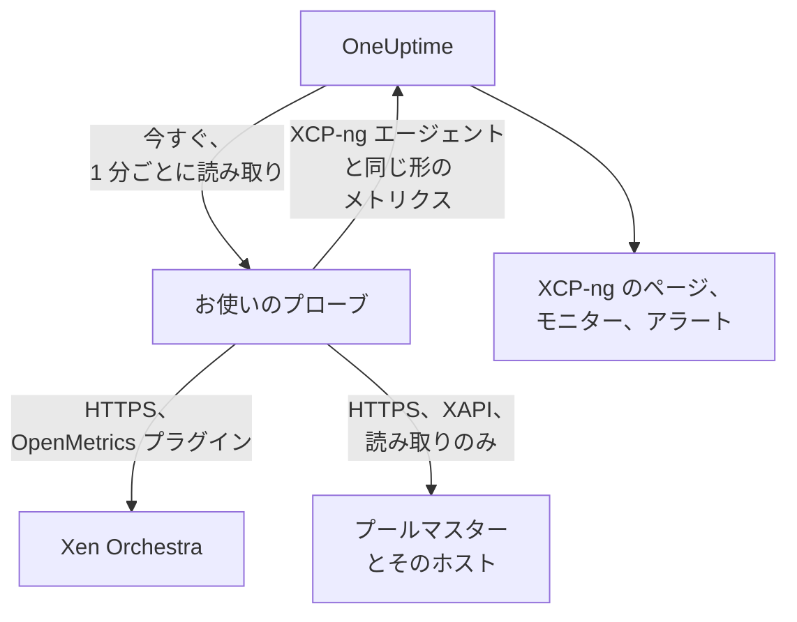

# エージェントなしの XCP-ng

何もインストールせずに XCP-ng プールを監視します。OneUptime のプローブがプールを読み取ります。読み取り元は、プールを管理する Xen Orchestra か、Xen Orchestra のないプールではプールマスター上の XAPI です。各プールには、[XCP-ng エージェント](/docs/telemetry/xcp-ng) が送信するプールと同じページ、[XCP-ng モニター](/docs/monitor/xcp-ng-monitor)、テンプレートが用意されます。インストール、アップグレード、常時稼働の手間がかかるエージェントはありません。

:::cards
- [始める前に](#始める前に): Xen Orchestra またはプールに到達できるプローブと、読み取り専用のアクセス。
- [Xen Orchestra を接続する](#xen-orchestra-を接続する): 管理するすべてのプールを 1 つの接続で。
- [Xen Orchestra のないプールを接続する](#xen-orchestra-のないプールを接続する): 1 つのプールを、そのマスターから読み取ります。
- [トラブルシューティング](#トラブルシューティング): 各メッセージの意味と解決方法。
:::

## しくみ

プローブは 1 分ごとに各接続を読み取り、読み取った内容を OneUptime に送信します。

- **Xen Orchestra**: プローブは、プラグインのシークレットを使って Xen Orchestra の OpenMetrics プラグインを読み取ります。XCP-ng エージェントとまったく同じ方法なので、Xen Orchestra が管理する各プールは同じ系列で届きます。
- **プールの XAPI**: プローブはプールマスターにログインし、Xen Orchestra のプラグイン自身が行う読み取りを行います。プールのレコードと、稼働中の各ホストのメトリクスを、そのホストから読み取ります。それをプラグインが提供するのと同じ系列に変換するので、プールは Xen Orchestra 経由とまったく同じように読み取られます。さらに、VM のクラッシュや HA が失ったホストなど、プールの XAPI メッセージをプールのフィードに載せます。

各プールは、エージェントのプールと同様に、最初の読み取りで UUID によって登録され、**XCP-ng → すべてのプール** に表示されます。

## どの方法で接続するか

| | プローブからの Xen Orchestra | プローブからのプールの XAPI | XCP-ng エージェント |
|---|---|---|---|
| 実行するもの | すでに実行しているプローブ、または新しいプローブ | すでに実行しているプローブ、または新しいプローブ | 専用マシン上のエージェント |
| 読み取る対象 | Xen Orchestra が管理するすべてのプール | 1 つのプール | Xen Orchestra が管理するすべてのプール |
| 必要なもの | OpenMetrics プラグインのシークレットと、任意で読み取り専用の API トークン | プールのアカウント: root、または read-only ロールを持つ Active Directory ユーザー | OpenMetrics プラグインのシークレット |
| シークレットの保管場所 | OneUptime で暗号化され、プローブにのみ送信 | OneUptime で暗号化され、プローブにのみ送信 | エージェントの `.env` ファイル |
| プールのフィードへの XAPI メッセージ | 含まれない | 含まれる | 含まれない |

3 つとも同じ系列を送信します。プールは一度にそのうちの 1 つだけが読み取るため、どれが読み取っても履歴は 1 本の線のままです。

## 始める前に

- **アドレスに TCP 443 で到達できるプローブ。** 通常は同じネットワーク内の [カスタムプローブ](/docs/probe/custom-probe) です。OneUptime Cloud の共有プローブが XCP-ng のシークレットを受け取ることはないため、自分のプローブを追加してください。セルフホストのインスタンスでは、インスタンス自身のプローブも読み取れます。
- **Xen Orchestra の場合:** OpenMetrics プラグインを有効にした Xen Orchestra 6.9 以降。[OpenMetrics プラグインを有効にする](/docs/telemetry/xcp-ng#openmetrics-プラグインを有効にする) に従い、そのシークレットをコピーします。任意で、組み込みロール **Read only** を持つ Xen Orchestra ユーザーの API トークン。OneUptime はそれが読み取りだけであることを確認し、期限が切れる前に警告します。
- **Xen Orchestra のないプールの場合:** XCP-ng 8.2 以降と、そのマスターのアドレス。XAPI のロールは Active Directory ユーザーにのみ適用されるため、唯一のローカルアカウントである `root` はプール内のすべてを変更できます。読み取り専用でアクセスするには、プールを Active Directory に参加させ、ユーザーに `read-only` ロールを付与します。

> [!IMPORTANT]
> プールは Xen Orchestra 経由か XAPI 経由のどちらかで接続し、両方では接続しないでください。プールを 2 番目に読み取る接続は、そのプールを最初の接続に任せます。

## Xen Orchestra を接続する

:::steps
### 接続を開く
OneUptime で **XCP-ng → 接続** を開き、**XCP-ng を接続** をクリックします。

### Xen Orchestra を選ぶ
**読み取る対象** で **Xen Orchestra** を選びます。ブラウザで開くときの **Xen Orchestra のアドレス** (例: `https://xo.example.com`) を入力し、そこに到達できるプローブを選びます。

### プラグインのシークレットを入力する
**OpenMetrics シークレット** を貼り付けます。読み取り専用ユーザーの **API トークン** があれば追加します。

### 接続をテストして証明書を信頼する
**接続をテスト** をクリックします。Xen Orchestra は自己署名の証明書を使うため、テストでその証明書が表示されます。フィンガープリントを確認してから、**この証明書を信頼** をクリックします。結果には、Xen Orchestra が提供するプールが、ホスト、VM、ストレージリポジトリとともに一覧表示されます。

### 名前を付けて接続する
名前の既定値は Xen Orchestra のホスト名で、読み取る各プールにも表示されます。**XCP-ng を接続** をクリックすると、接続のページが開きます。
:::

## Xen Orchestra のないプールを接続する

:::steps
### 接続から始める
OneUptime で **XCP-ng → 接続** を開き、**XCP-ng を接続** をクリックします。

### プールを選ぶ
**読み取る対象** で **Xen Orchestra のないプール** を選びます。**プールマスターのアドレス** (例: `https://10.0.0.10`) を入力し、そこに到達できるプローブを選びます。

### アカウントを入力する
**ユーザー名** と **パスワード** を入力します。`root`、または read-only ロールを持つ Active Directory ユーザーを、`EXAMPLE\oneuptime` のようにドメイン付きで入力します。

### 接続をテストしてマスターの証明書を信頼する
**接続をテスト** をクリックします。各 XCP-ng ホストは自己署名の証明書を使うため、テストでマスターの証明書が表示されます。フィンガープリントを確認してから、**この証明書を信頼** をクリックします。結果には、マスターが実行している XCP-ng と、アカウントが読み取れるものが示され、アカウントがプールを変更できる場合は警告が表示されます。

### プールに名前を付けて接続する
**XCP-ng を接続** をクリックすると、接続のページが開きます。
:::

接続のページには、読み取りの状況が表示されます。1 分以内に始まる最初の読み取りまでは **確認中**、その後は **収集中** と表示され、読み取ったプールが **読み取るプール** に表示されます。

プローブがオフラインまたは古すぎて、20 分間どのプローブも接続を読み取りに来ない場合、ページには **収集されていません** と表示され、その旨が示されます。どのプローブも接続を読み取れない場合は、すぐに **収集されていません** と表示され、変更すべき点が示されます。シークレット、ユーザー名、パスワードのいずれかがない、読み取るプローブが設定されていない、そのプローブには読み取りが許可されていない (OneUptime Cloud の共有プローブや別のプロジェクトのプローブ)、またはそのプローブが切断されている、のいずれかです。

## エージェントがすでに送信しているプール

XCP-ng エージェントが登録したプールは、そのプールを最初に読み取る接続に引き継がれます。履歴は 1 本の線のまま続き、プールのフィードにはエージェントを停止できることが示されます。

> [!WARNING]
> プローブがプールを読み取るようになったら、XCP-ng エージェントを停止してください。両方が動いている間は、すべてのメトリクスが 2 回届きます。

元に戻すには、プールの **設定** ページを開きます。その **データ収集** カードには、プローブが読み取るプールには **XCP-ng エージェントを使用** が、エージェントが送信するプールには **プローブで収集** が表示されます。エージェントに戻したプールは、接続が何を読み取っても、エージェントのままです。

## 証明書

プローブが証明書の検証を省略することはありません。すべての接続で完全な TLS ハンドシェイクを行い、そのうえで次のようにします。

- 信頼する証明書がない場合、証明書は、入力したアドレスに対して、プローブのマシンが信頼する認証局が発行したものでなければなりません。
- 信頼する証明書がある場合、アドレスは SHA-256 フィンガープリントで識別されるその証明書そのものを提示しなければなりません。証明書にどの名前が記載されていても同じです。Xen Orchestra 自身の証明書はどのアドレスも記載していないため、この方法で信頼されます。

フィンガープリントを確認するには、プローブのマシンで `openssl s_client -connect xo.example.com:443 </dev/null | openssl x509 -noout -fingerprint -sha256` を実行し、証明書そのものと比較します。プールマスターでは `openssl x509 -noout -fingerprint -sha256 -in /etc/xensource/xapi-ssl.pem` です。

プールの場合、信頼するのはマスターの証明書です。プール自身が各ホストの提供する証明書を一覧しており、プローブはほかの各ホストをその証明書に固定して読み取ります。別のホストがマスターになると、プローブは、前回の読み取りでプールが保証したホストにだけ追従します。証明書が変わると、読み取りは **証明書が変わりました** で停止し、新しい証明書が表示されます。接続のページでその証明書を信頼するまで、何も送信されません。

## 保存されたシークレット

シークレット、トークン、パスワードは暗号化された書き込み専用の値です。誰も読み戻すことはできず、API が返すこともありません。これらは接続を読み取るプローブにだけ送信され、プローブはメモリにのみ保持します。

保存されたシークレットは、入力したときのアドレスに、そのプローブ経由で、その証明書に対してだけ送信されます。**接続を編集** でアドレス、プローブ、信頼する証明書を変更すると再入力が必要になるため、接続を編集できる人がシークレットを別の場所に送ることはできません。また、再入力されなかった保存済みの API トークンは破棄されます。保存済みのアドレスでプローブが見つけた証明書を信頼する場合は、シークレットは保持されます。**API トークンを削除** はトークンを OneUptime から削除します。Xen Orchestra でも失効させてください。

## API トークン

API トークンは任意です。メトリクスはプラグインのシークレットを通じて届きます。トークンがある場合、読み取りのたびに最大 1 時間に 1 回トークンを確認します。

- **読み取りだけを行うこと。** ユーザーが管理者であるトークンや、ロールが何かを変更できるトークンは、テストに失敗し、接続のページに問題として表示されます。OneUptime は読み取り専用のトークンだけを保持します。
- **OneUptime に必要なものを読み取れること。** Xen Orchestra は、ユーザーが読み取れないリストに空のリストで応答するため、トークンはアラーム、メッセージ、バックアップログを読み取れる必要があります。組み込みロール **Read only** は 3 つすべてを読み取ります。
- **期限が切れるとき。** Xen Orchestra はトークンの期限が切れた瞬間にそのトークンを破棄します。その 2 週間前に、接続のページと、接続が読み取る各プールのフィードがそのことを知らせます。同じユーザーの新しいトークンを作成し、**接続を編集** で入力してください。

## リファレンス

| 設定 | 既定値 | 説明 |
|---|---|---|
| 読み取り間隔 | 1 分 | 1 ～ 60 分。1 分ごとは XCP-ng エージェントと同じです。大きな Xen Orchestra は負荷を下げるために間隔を長くしてください。 |
| 同時読み取り数 | プローブあたり 4 | 間隔より遅い読み取りはスキップされ、積み重なることはありません。 |
| 最大の読み取り | 約 48 MiB | それより大きな Xen Orchestra には XCP-ng エージェントが必要です。 |
| XAPI メッセージ | 1 回の読み取りで 200 | プールを接続した時点から、それぞれ 1 回ずつ、古いものから順に届けます。 |
| 接続テスト | 開始まで 90 秒 | 時間内にどのプローブも取得しなかったテストや、150 秒を超えて実行されたテストは、失敗として返されます。 |

## トラブルシューティング

:::details 証明書が信頼されていません
Xen Orchestra と XCP-ng ホストは、既定で自己署名の証明書を使います。表示されたフィンガープリントを証明書と照合してから、**この証明書を信頼** をクリックしてください。
:::

:::details 証明書が変わりました
新しい証明書を信頼するまで、何も送信されません。証明書を更新した場合は、新しいフィンガープリントを確認して信頼し、**接続を編集** でシークレットを再入力してください。
:::

:::details Xen Orchestra がシークレットを拒否しました
Xen Orchestra の **Settings → Plugins → openmetrics** からシークレットをもう一度コピーし、**接続を編集** で入力してください。
:::

:::details OpenMetrics プラグインが応答しません
Xen Orchestra の **Settings → Plugins** で **openmetrics** を読み込み、再起動後も戻るよう **Auto-load** を有効にしてください。
:::

:::details この Xen Orchestra には OpenMetrics プラグインがありません
プラグインには Xen Orchestra 6.9 以降と、Xen Orchestra Appliance では Premium ライセンスが必要です。ない場合は、代わりに各プールを XAPI で接続してください。
:::

:::details 接続されているプールがありません
Xen Orchestra は接続済みのプールを報告していません。Xen Orchestra でプールを追加するか再接続してから、もう一度テストしてください。
:::

:::details API トークンで Xen Orchestra を変更できます
OneUptime は読み取り専用のトークンだけを保持します。組み込みロール **Read only** のコピーだけを持ち、ほかのロールを持たないユーザーのトークンを作成してください。
:::

:::details API トークンでアラーム、メッセージ、バックアップを読み取れません
トークンのユーザーに、3 つすべてを読み取れる Xen Orchestra の組み込みロール **Read only** のコピーを付与してください。
:::

:::details API トークンの期限が切れました
Xen Orchestra で読み取り専用ユーザーの新しいトークンを作成し、**接続を編集** で入力してください。その間もメトリクスは届き続けます。
:::

:::details XAPI がログインを拒否しました
ユーザー名とパスワードを確認してください。Active Directory ユーザーは `EXAMPLE\oneuptime` のようにドメイン付きで書きます。
:::

:::details このホストはプールマスターではありません
プールのメンバーは、メッセージに示されるマスターのアドレスで応答します。そのアドレスを入力して、もう一度テストしてください。
:::

:::details このアカウントはプールを読み取れません
Active Directory ユーザーにプールの read-only ロールを付与するか、そのロールを持つアカウントを使用してください。
:::

:::details プローブに応答がありません
プローブのネットワークから TCP 443 でアドレスに到達できません。ファイアウォールで許可するか、同じネットワークのプローブを選んでください。
:::

:::details プローブがこれを取得しませんでした
プローブがオフラインか、XCP-ng の読み取りより古いバージョンの OneUptime を実行しています。**カスタムプローブ** の表で接続されていることを確認し、更新してください。
:::

:::details この接続は大きすぎて、プローブから読み取れません
メトリクスが、プローブの 1 回のアップロードの上限を超えています。この接続には [XCP-ng エージェント](/docs/telemetry/xcp-ng) を使用してください。
:::

## 次のステップ

:::cards
- [XCP-ng モニター](/docs/monitor/xcp-ng-monitor): プール、ホスト、VM、ストレージリポジトリでアラートを出します。
- [カスタムプローブ](/docs/probe/custom-probe): プールのネットワークでプローブを実行します。
- [XCP-ng エージェント](/docs/telemetry/xcp-ng): 代わりにエージェントで Xen Orchestra を読み取ります。
:::
