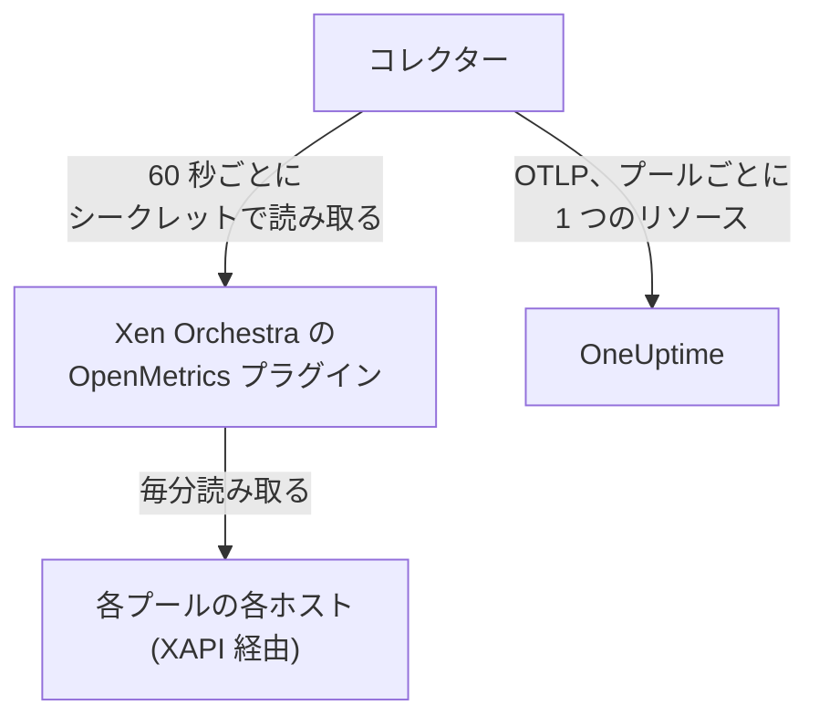

# XCP-ng エージェント

OneUptime の XCP-ng エージェントは、Xen Orchestra が管理する XCP-ng プールと、そのホスト、VM、ストレージリポジトリ、仮想ディスクを監視します。これは標準の OpenTelemetry Collector で、Xen Orchestra 自身の OpenMetrics プラグインをプラグインのシークレットで読み取り、読み取った内容を OneUptime に送ります。OneUptime では各プールがそのインベントリとともに表示されます。プールや Xen Orchestra のパスワードがエージェントに渡ることはありません。届いたデータには [XCP-ng モニター](/docs/monitor/xcp-ng-monitor) でアラートを出せます。 何もインストールせずに OneUptime のプローブで同じプールを読み取るには、[エージェントなしの XCP-ng](/docs/telemetry/xcp-ng-agentless) を参照してください。

:::cards
- [エージェントをインストールする](#エージェントをインストールする): プラグインを有効にしてから、インストールスクリプトか Docker Compose を使います。
- [Xen Orchestra の証明書](#xen-orchestra-の証明書): エージェントが Xen Orchestra を信頼する方法。チェックを省略することはありません。
- [エージェントが収集するもの](#エージェントが収集するもの): プラグインのすべての系列と、実際にはレートであるカウンター。
- [トラブルシューティング](#トラブルシューティング): 診断スクリプトと、よくある問題。
:::

## 得られるもの

- **プールごとに個別に。** Xen Orchestra が管理する各プールは、OneUptime で XCP-ng プールになり、XAPI の UUID で識別され、Xen Orchestra での名前で表示されます。1 つの Xen Orchestra の背後にある 2 つのプールは 2 つのプールであり、OneUptime でプールの名前を変えても問題ありません。テレメトリは UUID でプールに結び付きます。
- **そのインベントリ。** プールのホスト、VM、ストレージリポジトリ、仮想ディスクと、その状態やメトリクス。コントロールドメイン (dom0) は VM として報告され、プールのページでは表示を求めない限り非表示になります。
- **Xen Orchestra ごとに 1 つのエージェント。** プラグインはその Xen Orchestra が接続しているすべてのプールを提供するため、1 つのエージェントですべてを読み取れます。後から接続したプールは次の読み取りで表示されます。

## 仕組み

エージェントは、1 台のマシンで Docker Compose を使って実行する 1 つのコンテナです。OneUptime 独自のイメージを持たない、標準の OpenTelemetry Collector です。60 秒ごとに、プラグインのシークレットを Bearer トークンとして、Xen Orchestra 自身のアドレスと証明書で `/openmetrics/metrics` を要求します。プラグインは XAPI を通じて各ホストのメトリクスを 60 秒の解像度で読み取ります。コレクターはプールの系列を残し、プールごとにまとめて、OTLP で OneUptime に送ります。



各プールは最初のデータで自身を登録します。登録には、エージェントがその系列に `xcp_ng.pool.id` として付ける UUID と、Xen Orchestra が付けた名前 `xcp_ng.pool.name` が使われます。Xen Orchestra で名前のないプールは、名前を変えるまで「Pool」に UUID の先頭を付けた名前になります。

## 始める前に

- 監視したいプールに接続され、OpenMetrics プラグインを備えた Xen Orchestra 6.9 以降。Xen Orchestra Appliance (XOA) では、プラグインに Premium ライセンスが必要です。ソースからビルドした Xen Orchestra にはプラグインが含まれています。
- HTTPS で Xen Orchestra に到達できるマシン上の、Docker Compose v2 プラグイン付きの Docker Engine 20.10 以降、`curl`、`openssl`。
- エージェントが接続するアドレスを記載した、Xen Orchestra の証明書。Xen Orchestra が自分用に作る自己署名証明書にはアドレスが記載されていないため、現在の TLS クライアントはどれもそれを検証できません。また、ソースからビルドした Xen Orchestra は、証明書を与えるまで平文の HTTP で応答します。[Xen Orchestra の証明書](#xen-orchestra-の証明書) を参照してください。
- 取り込みキー。**プロジェクト設定 → テレメトリと APM → 取り込みキー** で作成し、その値をコピーします。
- そのマシンから OneUptime の URL への送信方向の HTTPS。

### サポートされるバージョン

| | サポート | 理由 |
| --- | --- | --- |
| Xen Orchestra | 6.9 以降、OpenMetrics プラグイン `xo-server-openmetrics` 1.9 付き | このプラグインは Xen Orchestra の再起動後もシークレットを保持し、読み取り時のメモリリークの修正を含み、プールのページが読むすべての系列 (ホストと VM の状態、ストレージリポジトリ、仮想ディスク) を提供します。古いプラグインは再起動時に新しいシークレットを作ることがあり、だれかがコピーし直すまでエージェントを締め出していました。 |
| XCP-ng | 8.3 LTS | Vates が 2028 年 11 月 30 日までサポートします。XCP-ng 8.2 は 2025 年 9 月 16 日にサポートが終了しました。 |
| XenServer | まだ試していません | Xen Orchestra は管理する XenServer プールを同じ系列で報告するため動作するはずですが、OneUptime でまだ試した人はいません。 |

### エージェントを実行する場所

エージェントは HTTPS で Xen Orchestra と通信するため、Docker と Xen Orchestra への経路があればどのマシンでも実行できます。Xen Orchestra のマシン自体、監視用ホスト、小さな管理用 VM などです。監視対象のプール上で VM が動いていないマシンを選ぶのがおすすめです。プールが停止したとき、監視も一緒に止まってはいけません。1 つのエージェントは 1 つの Xen Orchestra を読み取ります。複数の場合は [複数の Xen Orchestra を読み取る](#複数の-xen-orchestra-を読み取る) を参照してください。

## OpenMetrics プラグインを有効にする

エージェントは、Xen Orchestra の OpenMetrics プラグインを通じて、プラグインのシークレットで各プールを読み取ります。

:::steps
### プラグインを有効にする

Xen Orchestra で *Settings → Plugins* を開き、**openmetrics** を見つけて有効にします。初回起動時にシークレットが作られ、Xen Orchestra は再起動後もそれを保持します。

### シークレットをコピーする

プラグインの設定を開き、**Prometheus secret** をコピーします。次の手順でエージェントに渡します。そこに独自のシークレットを入力して保存することもできます。シークレットは秘密にしてください。持っている人はだれでも各プールのメトリクスを読み取れます。

### 応答を確認する

プラグインは Xen Orchestra 自身のアドレスと証明書で `/openmetrics/metrics` に応答し、シークレットを送る要求にだけ応えます。ヘルスチェックにはシークレットが不要なので、この要求に限って `-k` で証明書のチェックを省略できます。エージェントがそうすることはありません。

```bash
curl -k https://xo.example.com/openmetrics/health
```

プラグインが動作している間は `{"status":"ok"}` が返ります。`404` はプラグインが有効になっていないことを意味します。
:::

## エージェントをインストールする

:::steps
### エージェントをインストールして起動する

各 OneUptime は、自分のリリースのエージェントのインストールスクリプトとファイルを配布します。以下のコマンドは `https://oneuptime.com` からダウンロードするので、セルフホストの OneUptime ではこのアドレスを自分の URL に置き換えてください。インストールスクリプトはまず `install.sh` として保存されるので、実行する前に内容を読めます。

:::tabs
@tab install.sh
インストールスクリプトをダウンロードし、エージェントを置くマシンで実行します:

```bash
curl -fsSL https://oneuptime.com/install/xcp-ng-agent -o install.sh
bash install.sh
```

スクリプトは、OneUptime の URL、取り込みキー、ブラウザーで開くときの Xen Orchestra のアドレス (`https://xo.example.com` や `https://10.0.0.5:8443` など)、プラグインのシークレット (入力中は表示されません)、OneUptime でのこの Xen Orchestra の名前を尋ねます。次に Xen Orchestra の証明書を読み取ります。このマシンがすでに信頼している証明書は、その CA バンドルで検証されます。それ以外の証明書は SHA-256 フィンガープリントとともに表示され、Xen Orchestra のマシン上のフィンガープリントと照合したうえで **y** と答えると、その証明書だけを信頼します。チェックを無効にすることはありません。最後に、何かをインストールする前に、シークレットを使ってプラグインにメトリクスを要求し、Xen Orchestra が報告するプールの名前を示します。インストール先は `/opt/oneuptime-xcp-ng-agent` で、権限 `0600` で `.env` ファイルと `xo-ca.pem` (エージェントが Xen Orchestra に対して信頼する証明書) を書き込み、Docker Compose でエージェントを起動します。スクリプトをもう一度実行すると、改めて尋ねずにその `.env` の内容をすべて再利用します。これが [エージェントのアップグレード](#エージェントのアップグレード) の方法です。
@tab Docker Compose
お使いの OneUptime から、`docker-compose.yml` と `otel-collector-config.yaml` を新しいフォルダーにダウンロードします:

```bash
mkdir oneuptime-xcp-ng-agent && cd oneuptime-xcp-ng-agent
curl -fsSLO https://oneuptime.com/install/xcp-ng-agent/docker-compose.yml
curl -fsSLO https://oneuptime.com/install/xcp-ng-agent/otel-collector-config.yaml
```

その隣に `.env` ファイルを作成します。プラグインのシークレットを含むため、`chmod 600 .env` で非公開にします。

```bash title=".env"
ONEUPTIME_URL=YOUR_ONEUPTIME_URL
ONEUPTIME_TELEMETRY_INGESTION_KEY=YOUR_TELEMETRY_INGESTION_TOKEN
XO_SCHEME=https
XO_ADDRESS=xo.example.com
XO_OPENMETRICS_SECRET='your-plugin-secret'
XO_NAME='Xen Orchestra'
XO_TLS_SERVER_NAME=
XCP_NG_AGENT_CONTAINER_NAME=oneuptime-xcp-ng-agent
```

`XO_ADDRESS` は Xen Orchestra の `host` または `host:port` で、`https://` は付けません。プラグインのシークレットは一重引用符で囲み、その中の `$` はすべて `$$` と書きます。コレクターは値をもう一度読み取るため、`$` を変数の始まりと見なしてしまいます。`'` を含むシークレットは一重引用符で囲めません。インストールスクリプトに書かせるか、Xen Orchestra で別のシークレットを選んでください。

次に、Xen Orchestra の証明書を `xo-ca.pem` として `docker-compose.yml` の隣に保存します。エージェントは Xen Orchestra をこのファイルだけで検証します。Xen Orchestra 自身の証明書を信頼するには、それを読み取り、使う前にフィンガープリントを Xen Orchestra のマシン上のものと照合します。

```bash
openssl s_client -connect xo.example.com:443 -servername xo.example.com </dev/null 2>/dev/null \
  | openssl x509 -out xo-ca.pem
openssl x509 -in xo-ca.pem -noout -fingerprint -sha256
```

独自の CA が証明書を発行した場合は、代わりにその CA の証明書を `xo-ca.pem` にコピーします。パブリック CA が発行した場合は、このマシンの CA バンドルをコピーします (`cp /etc/ssl/certs/ca-certificates.crt xo-ca.pem`)。エージェントを起動します。

```bash
docker compose up -d
```
:::

### エージェントが実行中であることを確認する

```bash
docker compose ps
docker logs -f oneuptime-xcp-ng-agent
```

`docker compose ps` にコレクター `oneuptime-xcp-ng-agent` が表示されます。起動すると、ログに次の行が表示されるはずです。

```text
Everything is ready. Begin running and processing data.
```

### OneUptime でプールを見つける

**製品 → インフラストラクチャ → XCP-ng → すべてのプール** を開きます。Xen Orchestra が報告する各プールは、最初の読み取りの約 1 分後に、Xen Orchestra での名前で、そのホスト、VM、ストレージとともに表示されます。プールの **トポロジー** ページでは、それらが 1 つのマップとして描かれます。[トポロジー](/docs/telemetry/topology#リソースごとのマップを開く) を参照してください。
:::

## Xen Orchestra の証明書

エージェントは読み取りのたびに Xen Orchestra の証明書を `xo-ca.pem` だけで検証し、チェックを省略することはありません。プラグインのシークレットはすべての要求に含まれるためです。`xo-ca.pem` には次の 3 つのいずれかが入ります。

- **Xen Orchestra 自身の証明書**。SHA-256 フィンガープリント (`XO_TLS_FINGERPRINT`) で固定され、エージェントはその証明書だけを信頼します。
- **それを発行した CA** (`XO_CA_FILE`)。独自の CA の証明書の場合です。
- **このマシンの CA バンドル**。パブリック CA の証明書など、このマシンがすでに信頼している証明書の場合です。

いずれの場合も、証明書にはエージェントが接続するアドレスが記載されている必要があります。エージェントは、現在のすべての TLS クライアントと同じく、証明書の発行先の名前であるサブジェクト代替名 (subject alternative names) を検証し、サブジェクト自体は見ません。Xen Orchestra が自分用に作る自己署名証明書には名前がないため、固定してもしなくてもエージェントはそれを信頼できず、`x509: certificate is not valid for any names` で失敗します。インストールスクリプトはこのような証明書で停止し、その理由を示します。

### アドレスを記載した証明書を Xen Orchestra に与える

独自の CA かパブリック CA の証明書を使うか、Xen Orchestra のマシン上で、Xen Orchestra の名前とアドレスをサブジェクト代替名に入れた自己署名証明書を作成します。

```bash
sudo mkdir -p /etc/ssl/xo
sudo openssl req -x509 -newkey rsa:2048 -nodes -days 825 \
  -subj "/CN=xo.example.com" \
  -addext "subjectAltName=DNS:xo.example.com,IP:10.0.0.5" \
  -keyout /etc/ssl/xo/key.pem -out /etc/ssl/xo/cert.pem
```

xo-server の HTTPS リスナーに 2 つのファイルを指定します。これらのファイルは xo-server を実行するユーザー (既定では root) が読み取れる必要があります。設定は専用の設定ファイルに書きます。XOA では `/etc/xo-server/config.httpscert.toml`、ソースからビルドした Xen Orchestra では xo-server の `config.toml` の隣です。Xen Orchestra のリスナーには番号が付いており、2 番目の `http.listen.1` が HTTPS リスナーです。

```toml
[http.listen.1]
port = 443
cert = '/etc/ssl/xo/cert.pem'
key = '/etc/ssl/xo/key.pem'
```

次に `systemctl restart xo-server` で xo-server を再起動し、エージェントをインストールするか、インストールスクリプトをもう一度実行します。スクリプトは新しい証明書を読み取り、確認用にフィンガープリントを表示します。または、XOA のように Xen Orchestra 自身に Let's Encrypt の証明書を要求させることもできます (Xen Orchestra のドキュメントを参照)。この証明書は公的に信頼されているため、エージェントには設定が不要です。証明書が `XO_ADDRESS` のアドレスとは別の名前で Xen Orchestra を記載している場合は、`XO_TLS_SERVER_NAME` にその名前を設定します。インストールスクリプトは可能なら証明書からこれを埋めます。

固定した証明書が更新されると、エージェントは新しい証明書を信頼するまで Xen Orchestra の読み取りを止めます。インストールスクリプトをもう一度実行すると、新しいフィンガープリントを表示して停止し、何も変更しません。そのフィンガープリントを Xen Orchestra のマシンで確認してから、それを指定してスクリプトをもう一度実行します: `XO_TLS_FINGERPRINT=<new fingerprint> bash install.sh`。Docker Compose でインストールした場合は、`xo-ca.pem` を書き直して `docker compose up -d --force-recreate` を実行します。

## 環境変数

インストールスクリプトはこれらを `/opt/oneuptime-xcp-ng-agent/.env` に書き込みます。Docker Compose でのインストールでは、`.env` (`docker-compose.yml` の隣にあるもの) から読み取ります。変数を変更したら、そのフォルダーで `docker compose up -d` を実行します。

| 変数 | 必須 | 説明 |
| --- | --- | --- |
| `ONEUPTIME_URL` | はい | OneUptime の URL。`https://oneuptime.com` やセルフホストのインスタンスなど。インスタンスが HTTP のみの場合は、`http://` とそのポートを使います。 |
| `ONEUPTIME_TELEMETRY_INGESTION_KEY` | はい | **プロジェクト設定 → テレメトリと APM → 取り込みキー** で作成した取り込みキー。 |
| `XO_URL` | インストールスクリプト | ブラウザーで開くときの Xen Orchestra のアドレス (`https://xo.example.com` や `https://10.0.0.5:8443` など)。インストールスクリプトはここから `XO_SCHEME` と `XO_ADDRESS` を導きます。 |
| `XO_SCHEME` | いいえ | `https` (既定)。`http` は検証環境でのみ使ってください。その場合、シークレットは暗号化されずにネットワークを流れます。 |
| `XO_ADDRESS` | はい | Xen Orchestra の `host` または `host:port` (スキームなし)。 |
| `XO_OPENMETRICS_SECRET` | はい | OpenMetrics プラグインのシークレットで、Bearer トークンとして送られます。中の `$` はすべて `$$` と書きます。 |
| `XO_NAME` | いいえ | OneUptime でのこの Xen Orchestra の名前。読み取る各プールに `xen_orchestra.name` として付けられ、各プールの **設定** に表示されます。既定は Xen Orchestra のアドレスです。 |
| `XO_TLS_FINGERPRINT` | インストールスクリプト | Xen Orchestra 自身の証明書の SHA-256 フィンガープリント。`openssl x509 -fingerprint -sha256` が表示する形式で、コロンは省略できます。エージェントがその証明書だけを信頼する場合に使います。インストールスクリプトは一致しない証明書を拒否します。 |
| `XO_CA_FILE` | インストールスクリプト | Xen Orchestra の証明書を発行した CA バンドル。インストールスクリプトは証明書をこれで検証し、`xo-ca.pem` にコピーします。 |
| `XO_TLS_SERVER_NAME` | いいえ | `XO_ADDRESS` が証明書に記載されていないアドレスの場合に、Xen Orchestra の証明書を検証する名前。空の場合は `XO_ADDRESS` のホスト。 |
| `XCP_NG_AGENT_CONTAINER_NAME` | いいえ | エージェントのコンテナ名。既定は `oneuptime-xcp-ng-agent` です。同じマシン上で別の Xen Orchestra を読み取るエージェントには専用の名前が必要です ([複数の Xen Orchestra を読み取る](#複数の-xen-orchestra-を読み取る) を参照)。設定しない場合、インストールスクリプトは新しいエージェントにそのフォルダーにちなんだ名前を付け、スクリプトを再実行してもその名前を維持します。 |

## エージェントが収集するもの

エージェントは毎分プラグインを読み取ります。プラグインは XAPI を通じて各ホストのラウンドロビンデータベースを 60 秒の解像度で読み取ります。エージェントは `xcp_*` の系列を残し、各系列のプールを送信先のリソースに移して、`xcp_ng.pool.id` (プールの UUID で、変わることはありません) と `xcp_ng.pool.name` にします。

| カテゴリ | 系列 |
| --- | --- |
| プール | `xcp_pool_connected`。Xen Orchestra がプールに接続している間存在します |
| ホスト | `xcp_host_status` (電源の状態と有効かどうか)、`xcp_host_uptime_seconds`、`xcp_host_cpu_average`、`xcp_host_cpu_core_usage`、`xcp_host_load`、`xcp_host_load_average`、`xcp_host_memory_*`、`xcp_host_running_vcpus`、物理インターフェースごとの `xcp_host_network_*`、ストレージリポジトリごとの `xcp_host_disk_*`、`xcp_host_power_consumption_watts` |
| VM | `xcp_vm_status`、`xcp_vm_uptime_seconds`、`xcp_vm_cpu_usage`、`xcp_vm_cpu_core_usage`、`xcp_vm_runstate_*` (CPU の競合)、`xcp_vm_memory_*`、インターフェースごとの `xcp_vm_network_*`、ディスクごとの `xcp_vm_disk_*`、`xcp_vm_power_consumption_watts` |
| ストレージ | `xcp_sr_physical_size_bytes`、`xcp_sr_physical_usage_bytes`、`xcp_sr_virtual_size_bytes`、`xcp_vdi_virtual_size_bytes`、`xcp_vdi_physical_usage_bytes` |
| XOSTOR | `xcp_xostor_*`。XOSTOR を実行しているプールで |

コントロールドメインは `is_control_domain="true"` の VM として報告されます。Xen Orchestra の各系列は、その名前とラベル (`uuid`、`host_name`、`vm_name`、`sr_name`、`tags` など) を保持します。[XCP-ng モニター](/docs/monitor/xcp-ng-monitor#収集されるメトリクス) にそのすべてが載っています。

### レートであるカウンター

Xen Orchestra は 8 つのスループットの系列をカウンターとして型付けし、`_total` という名前を付けていますが、それぞれに XAPI の 1 秒あたりのレートが入っています: `xcp_host_network_receive_bytes_total`、`xcp_host_network_transmit_bytes_total`、`xcp_vm_network_receive_bytes_total`、`xcp_vm_network_transmit_bytes_total`、`xcp_vm_network_receive_errors_total`、`xcp_vm_network_transmit_errors_total`、`xcp_vm_disk_read_bytes_total`、`xcp_vm_disk_write_bytes_total`。カウンターとして読むと、ネットワークとディスクのスループットのグラフはすべて誤りになります。下がるレートがカウンターのリセットとして読まれるためです。エージェントの `transform/xcp-ng-rates` プロセッサーは、名前と値を変えずにこれらをゲージに変えるので、OneUptime はそれらを本来のレート (1 秒あたりのバイト数またはエラー数) として保存します。OneUptime は、自分で構成したコレクターからまだカウンターとして届く系列も変換します。

### OneUptime が追加するもの

OneUptime は、各プールのデータが届くたびに 4 つの 0/1 系列を導き出し、アラートテンプレートがそれを読み取ります。

| 系列 | 1 になる条件 |
| --- | --- |
| `xcp_ng.host.running` | Xen Orchestra がホストを Running と報告している間。Halted の間、または状態が Unknown の間は 0 |
| `xcp_ng.host.enabled` | ホストが有効な間。メンテナンスモード中や退避中で、XAPI がそこで VM を起動しない間は 0 |
| `xcp_ng.vm.running` | VM が Running の間。Halted、Paused、Suspended の間は 0 |
| `xcp_ng.vm.stopped_after_running` | 過去 24 時間に実行されていた VM が Halted または Paused の間 |

また、各ポイントに `xcp_ng.scope` (`pool`、`host`、`vm`、`sr`、`vdi`、`xostor` のいずれか) と `xcp_ng.id` (そのオブジェクトの UUID) を付けます。モニターとダッシュボードはこれで絞り込みます。[リソースの識別](/docs/monitor/xcp-ng-monitor#リソースの識別) を参照してください。

### エージェントが保持しないもの

- どのプールにも属さない Xen Orchestra 自身のプロセスの系列 (`xo_*`) と、コレクター自身の読み取りの系列。
- Xen Orchestra が IPMI で読み取るホストの電力。プラグインはこの値をプールなしで送るため、これもどのプールにも属しません。各 VM の推定シェア `xcp_vm_power_consumption_watts` は保持されます。

## プールのページに表示されるもの

**製品 → インフラストラクチャ → XCP-ng → すべてのプール** からプールを開きます。メニューの内容は次のとおりです。

| ページ | 表示内容 |
| --- | --- |
| **概要** | プールのヘルスと対応が必要な事項、ホスト、VM、ストレージ、最も負荷の高い VM とホスト、読み取り元の Xen Orchestra とエージェントのバージョン。 |
| **ホスト**、**VM**、**ストレージ** | 各ホスト、VM、ストレージリポジトリ。それぞれに専用のページとグラフがあります。**VM** は表示を求めない限りコントロールドメインを非表示にし、ストレージリポジトリのページにはその仮想ディスクが表示されます。 |
| **トポロジー** | プール、そのホスト、各ホスト上の VM、それらが使うストレージリポジトリを 1 つのマップとして表示します。 |
| **リソース使用量** | プールのホスト、VM、ストレージ、ディスク、ネットワークの時系列グラフ。ホスト、VM、ストレージリポジトリごとに 1 本の線です。 |
| **推奨事項** | 有効にできる [アラートテンプレート](/docs/monitor/xcp-ng-monitor#既製のアラートテンプレート)。それぞれ 1 つのモニターです。 |
| **メトリクス**、**ログ** | エクスプローラーに表示されるプールのすべての系列で、そのプールに絞り込まれています。エージェントはメトリクスだけを送るため、**ログ** にはプールの `xcp_ng.pool.id` を付けて送ったログだけが表示されます。 |
| **インシデント**、**アラート**、**定期メンテナンス** | プールに言及しているもの。 |
| **フィード** | OneUptime でプールに起きたこと。追加、変更、アーカイブ、復元の日時、所有者、プールに対して実行された所有者ルールとラベルルール。 |
| **所有者** | 手動または所有者ルールで、プールについて通知を受ける人。 |
| **設定** | 名前、読み取り元の Xen Orchestra、そこでの名前、エージェントのバージョン、テレメトリの保持期間。 |
| **ドキュメント** | この設定手順。URL とキーは入力済みです。 |

プールの **概要** は、対応が必要な事項からヘルスを **正常**、**機能低下**、**異常** のいずれかで示し、それらを **対応が必要** の下に緊急度の高い順に表示します。

- **重大:** Halted のホスト、または Xen Orchestra が状態を判断できない (Unknown) ホスト。使用率が 95% を超え、VM が書き込めなくなったストレージリポジトリ。
- **確認推奨:** 無効になっている、メンテナンスモード中、または退避中のホスト。過去 24 時間に実行されていて Halted または Paused になった VM。使用率が 90% を超えて Storage Repository Near Full アラートが発火するストレージリポジトリ、またはシンプロビジョニングでサイズを超えて割り当てられたストレージリポジトリ。

一時停止した VM (Suspended) は意図して一時停止されたものなので数えません。1 日だれも実行を見ていない VM や、コントロールドメインも同様です。ISO ライブラリとリムーバブルメディアには VM のディスクがないため、プールのストレージの数値からは除外されます。

Xen Orchestra がプールを 15 分間報告しなくなると、プールは **切断済み** になり、ページには最後に報告された内容が残ります。Xen Orchestra の報告に現れなくなったホスト、VM、ストレージリポジトリ、仮想ディスクは、15 分後にインベントリから外れます。VM を停止しても削除されることはありません。

## プールにプロジェクトラベルを付ける

`oneuptime.label.` で始まるリソース属性は、エージェントが読み取るすべてのプールのプロジェクトラベルになります。`oneuptime.label.<dimension>=<value>` はラベル `<dimension>:<value>` です。属性は `resource` プロセッサー (`otel-collector-config.yaml` 内) の `oneuptime.agent.version` の隣に追加します。

```yaml
processors:
  resource:
    attributes:
      # ...existing attributes...
      - key: oneuptime.label.team
        value: platform
        action: upsert
      - key: oneuptime.label.env
        value: production
        action: upsert
```

コレクターは起動時にだけ設定を読み込みます。`docker compose restart oneuptime-xcp-ng-agent` を実行してください。プールにラベル `team:platform` と `env:production` が表示されます。ラベルは大文字と小文字を区別せずに比較されるため、既存のラベル `Production` は重複せずに再利用され、エージェントがだれかが OneUptime で追加したラベルを削除することはありません。インストールスクリプトを再実行すると、編集した `otel-collector-config.yaml` は置き換えられ、元のファイルは隣に `otel-collector-config.yaml.bak.<timestamp>` として保存されます。

## 複数の Xen Orchestra を読み取る

1 つのエージェントは 1 つの Xen Orchestra と、それが管理するすべてのプールを読み取ります。同じマシンから 2 つ目の Xen Orchestra を読み取るには、2 つのコンテナは同じ名前を共有できないため、2 つ目のエージェントを別の `.env` と別のコンテナ名で別のフォルダーにインストールします (`INSTALL_DIR=/opt/oneuptime-xcp-ng-agent-lab XCP_NG_AGENT_CONTAINER_NAME=oneuptime-xcp-ng-agent-lab bash install.sh` など)。`XCP_NG_AGENT_CONTAINER_NAME` を指定しない場合、スクリプトはフォルダーにちなんでコンテナに名前を付けます。この例では同じ名前になります。スクリプトはその名前をそのエージェントの `.env` に保存するため、エージェントをアップグレードするためにスクリプトを再実行しても名前は維持されます。また、`container_name` を以前 `docker-compose.yml` で編集したエージェントも、その名前を維持します。Docker Compose の場合は、代わりに `XCP_NG_AGENT_CONTAINER_NAME` を各エージェントの `.env` で設定します。それぞれに別の `XO_NAME` を付けると、各プールの **設定** にどの Xen Orchestra が読み取っているかが表示されます。診断スクリプトには `-d` でフォルダーを渡します。

同じプールを管理する 2 つの Xen Orchestra を通じて、2 つのエージェントに同じプールを読み取らせないでください。OneUptime では UUID によって 1 つのプールになり、二重に報告されてしまいます。

## systemd サービスとして実行する

マシンとともにエージェントを起動し、失敗したときに再起動させるには、その systemd ユニットをインストールします。ユニットは、インストールスクリプトが置く `/opt/oneuptime-xcp-ng-agent` にエージェントがあることを前提としています。

```bash
sudo curl -fsSL https://oneuptime.com/install/xcp-ng-agent/systemd/oneuptime-xcp-ng-agent.service -o /etc/systemd/system/oneuptime-xcp-ng-agent.service
sudo systemctl daemon-reload
sudo systemctl enable --now oneuptime-xcp-ng-agent
```

## エージェントのアップグレード

エージェントは、ファイルで固定されたコレクターのバージョンを **エージェントバージョン** として、各プールの **概要** と **設定** に報告します。この OneUptime リリースが固定するバージョンより古い場合は、その横に警告マークが表示されます。マークを選ぶと次のコマンドが表示されます。

コレクターのイメージは `docker-compose.yml` で固定され、その設定は隣のファイルにあるため、pull だけではエージェントは更新されません。`install.sh` をもう一度実行してください。既存の `.env` のすべての値を再利用し (何も聞き直しません)、Xen Orchestra の証明書を同じ方法で検証し、`docker-compose.yml` と `otel-collector-config.yaml` を更新し (編集したファイルは `<file>.bak.<timestamp>` として保持されます)、イメージを pull してエージェントを再作成するので、コレクターは新しい設定を読み込みます。`/opt/oneuptime-xcp-ng-agent` 以外にインストールしたエージェントには、そのフォルダーを指定します: `INSTALL_DIR=<folder> bash install.sh`。コンテナ名はそのまま維持されます。

```bash
curl -fsSL https://oneuptime.com/install/xcp-ng-agent -o install.sh
bash install.sh
```

Docker Compose でインストールした場合は、エージェントのフォルダーで両方のファイルをダウンロードし直し (加えていた変更はやり直してください)、イメージを pull してからエージェントを再作成します。`.env` と `xo-ca.pem` はそのまま残ります。

```bash
curl -fsSLO https://oneuptime.com/install/xcp-ng-agent/docker-compose.yml
curl -fsSLO https://oneuptime.com/install/xcp-ng-agent/otel-collector-config.yaml
docker compose pull
docker compose up -d --force-recreate
```

## エージェントのアンインストール

```bash
cd /opt/oneuptime-xcp-ng-agent
docker compose down
```

その後、ほかに読み取るものがなければ、Xen Orchestra で OpenMetrics プラグインを無効にします。

## トラブルシューティング

:::details まず診断スクリプトを実行する
エージェントにはスクリプト [`troubleshoot.sh`](https://oneuptime.com/install/xcp-ng-agent/troubleshoot.sh) が付属しており、データが流れる順にチェーン全体を確認します。コンテナ、エージェント自身のネットワークからの Xen Orchestra のアドレス、プラグインのヘルスチェック、`xo-ca.pem` に対する Xen Orchestra の証明書と、固定した証明書がまだ表示される証明書と同じかどうか、プラグインのシークレット、Xen Orchestra が報告するプール、取り込みキーの形式、コレクター自身のメトリクス、そして OneUptime が取り込みキーを受け付けるかどうかです。最後のチェックが最も重要です。OneUptime は誤ったキーを `401` (無効化されたキーやブラウザー用キーは `422`) で拒否し、コレクターはどちらも恒久的なエラーとして扱います。バッチを破棄して `Exporting failed` というエラーを 1 つだけ記録するため、コンテナが正常なままだと見落としがちです。スクリプトはエージェントのネットワークから `GET <url>/otlp/v1/validate` を呼び出して即座に `200` (有効) か `401` (無効) を得て、古いサーバーでは `POST /fluentd/v1/logs` にフォールバックします。シークレットやキーを表示することはありません。

```bash
curl -fsSL https://oneuptime.com/install/xcp-ng-agent/troubleshoot.sh -o troubleshoot.sh
bash troubleshoot.sh    # add -d <dir> if you installed outside /opt/oneuptime-xcp-ng-agent
```

最後に、最も可能性の高い原因を示す判定を出力します。
:::

:::details Xen Orchestra がシークレットを拒否する (401)
コレクターが `server returned HTTP status 401 Unauthorized` を記録します。*Settings → Plugins → openmetrics* からシークレットをコピーし直し、`XO_OPENMETRICS_SECRET` (`.env` 内) に、一重引用符で囲み `$` をすべて `$$` と書いて設定してから、エージェントのフォルダーで `docker compose up -d` を実行します。6.8 より前の Xen Orchestra は再起動時に新しいシークレットを作ることがありました。アップグレードしてください。
:::

:::details プラグインが応答しない (404、500、502、503)
Xen Orchestra は応答しますが、OpenMetrics プラグインが応答しません。*Settings → Plugins → openmetrics* でプラグインを有効にし、Xen Orchestra が 6.9 以降であることを確認します。XOA ではプラグインに Premium ライセンスが必要です。プラグインが動作していれば、`/openmetrics/health` はシークレットなしで `{"status":"ok"}` を返します。
:::

:::details 証明書のエラー
- `x509: certificate is not valid for any names`: Xen Orchestra 自身の自己署名証明書のように、証明書にアドレスが記載されていません。[アドレスを記載した証明書を Xen Orchestra に与えます](#アドレスを記載した証明書を-xen-orchestra-に与える)。
- `x509: certificate is valid for <names>, not <address>`: それらの名前のいずれかで接続するか、`XO_TLS_SERVER_NAME` にそのいずれかを設定します。
- `x509: cannot validate certificate for <IP> because it doesn't contain any IP SANs`: `XO_ADDRESS` が、証明書に記載されていない IP アドレスです。`XO_TLS_SERVER_NAME` に証明書に記載された名前を設定するか、それを行うインストールスクリプトを再実行します。
- `x509: certificate signed by unknown authority`: `xo-ca.pem` に、この証明書もそれを発行した CA も含まれていません。証明書が更新されたか、ファイルに別の証明書が入っています。Xen Orchestra のマシンで新しいフィンガープリントを確認し、それを指定してインストールスクリプトを実行するか (`XO_TLS_FINGERPRINT=<new fingerprint> bash install.sh`)、ファイルを書き直します。
- `unable to read CA cert`: `xo-ca.pem` がないか、読み取れません。インストールスクリプトを再実行します。
:::

:::details 読み取りがタイムアウトする (context deadline exceeded)
Xen Orchestra がメトリクスの収集にエージェントの上限である 50 秒を超えたため、その読み取りでは何も送られません。多くの場合、いずれかのプールのホストが Xen Orchestra に応答していません。Xen Orchestra でプールのホストを確認してください。エージェントは 1 分後にもう一度読み取ります。
:::

:::details プールが切断済みになっている
OneUptime は、15 分間何も読み取られなかったプールを切断済みとします。OneUptime は 5 分ごとに確認し、OneUptime 自身がデータを受信していなかった時間は数えません。

1. この Xen Orchestra のすべてのプールが切断済みなら、エージェントを確認します。エージェントのフォルダーで `docker compose ps` と `docker logs oneuptime-xcp-ng-agent` を実行します。
2. 1 つだけなら、Xen Orchestra がそれを報告しなくなっています。Xen Orchestra の *Settings → Servers* で、プールのサーバーが接続されている必要があります。プールのホスト、VM、ストレージは、Xen Orchestra が最後に報告したままになります。
:::

:::details プールが見つからない
Xen Orchestra は接続しているプールだけを報告し、エージェントはその Xen Orchestra だけを読み取ります。Xen Orchestra の *Settings → Servers* でプールのサーバーを接続してください。次の読み取りで OneUptime にプールが表示されます。別の Xen Orchestra が管理するプールには、その Xen Orchestra の隣に専用のエージェントが必要です。
:::

:::details スループットのグラフがおかしい
レートを含む 8 つの `_total` 系列は、ゲージとして OneUptime に届く必要があります。付属の `otel-collector-config.yaml` を独自のものに置き換えた場合は、`transform/xcp-ng-rates` プロセッサーを残してください。これらは 1 秒あたりのバイト数またはエラー数として、そのまま読んでください。これらの 1 秒あたりのレートは、レートのレートになってしまいます。
:::

:::details エージェントなしでメトリクスを送信する
エージェントはコレクターの標準的な設定 1 つでできているため、すでに実行しているコレクターでも同じことができます。付属の設定から読み取りジョブとプロセッサーを自分の設定にコピーしてください。リソース属性 `xcp_ng.pool.id` は OneUptime に各プールを登録し、`groupbyattrs` プロセッサーは各プールを 1 つのリソースにまとめ、`service.name` と `service.instance.id` の削除はデータがサービスの下に入るのを防ぎます。この 3 つと `transform/xcp-ng-rates` を残してください。
:::

## プラグインがまだ扱わないもの

Xen Orchestra の OpenMetrics プラグインはメトリクスを提供するため、XCP-ng プールで注意すべきことの一部はまだ含まれていません。

- XOSTOR 以外の **アラーム**、**HA の状態**、**プールマスター**、**未適用のパッチ**、**バックアップ**、**スナップショット**、ホストの物理インターフェース (PIF) の **リンク状態**。これらは Xen Orchestra の REST API から取得します ([#10997](https://github.com/OneUptime/oneuptime/issues/10997))。
- Xen Orchestra のない **プール**、またはプラグインに必要な Premium ライセンスのない XOA の背後にあるプール。OneUptime のプローブがこれらを XAPI から直接読み取ります ([#10999](https://github.com/OneUptime/oneuptime/issues/10999))。[エージェントなしの XCP-ng](/docs/telemetry/xcp-ng-agentless) を参照してください。
- VMware と同じく、OneUptime のプローブが Xen Orchestra のプラグインを自分で読み取る **エージェントなしの接続** ([#10996](https://github.com/OneUptime/oneuptime/issues/10996))。同じページで説明しています。

## 次のステップ

:::cards
- [XCP-ng モニター](/docs/monitor/xcp-ng-monitor): プール、ホスト、VM、ストレージリポジトリのアラート。
- [Proxmox エージェント](/docs/telemetry/proxmox): Proxmox VE クラスターを同じ方法で監視します。
- [ホスト OpenTelemetry Collector](/docs/telemetry/host-otel-collector): VM の内側から見たオペレーティングシステムの状態。
:::
