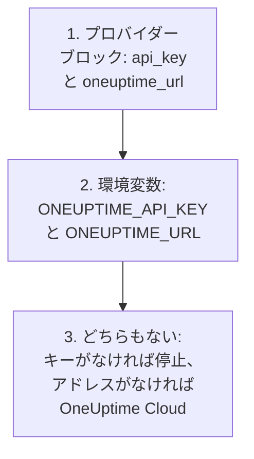
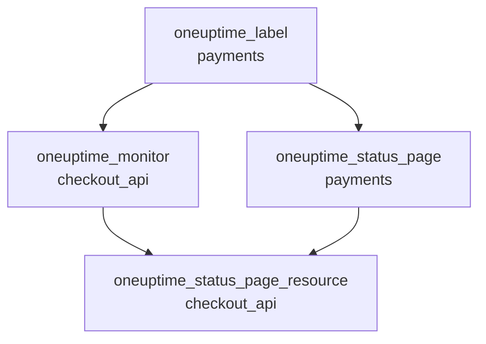

# 完全ガイド

このガイドでは、最初の apply の後に来ることを扱います。プロバイダーが API キーを見つける方法、1 つまたは複数のプロジェクト向けに構成を組み立てる方法、リソースどうしの参照、管理していないレコードの読み取り、state を安全に保つ方法、アップグレードの方法です。プロバイダーを初めて使う場合は、[クイック スタート](/docs/terraform/quick-start) から始めてください。

:::cards
- [プロバイダーを設定する](#プロバイダーを設定する): API キーとアドレス、そしてプロバイダーがそれを読む場所。
- [構成を組み立てる](#構成を組み立てる): ファイル、プロジェクト、1 つのブロックからの多数のリソース。
- [すでにあるものを読み取る](#すでにあるものを読み取る): データソースと、検索が一致する仕組み。
- [state を安全に保つ](#state-を安全に保つ): リモートバックエンドと、決してコミットしてはいけないもの。
:::

## プロバイダーを設定する

プロバイダーは 2 つの設定を受け取ります。それぞれプロバイダーブロックから、なければ環境変数から取得します。

| 設定 | 環境変数 | どちらも設定されていない場合 |
| --- | --- | --- |
| `api_key` | `ONEUPTIME_API_KEY` | 何もプランされないうちにプロバイダーが止まります: `Missing API Key` |
| `oneuptime_url` | `ONEUPTIME_URL` | `https://oneuptime.com`、つまり OneUptime Cloud |



`oneuptime_url` は `/api` を付けない OneUptime のアドレスです。プロバイダーは、アドレスにスキームがなければ `https://` を、末尾には `/api` を付けます。`api_key` は機密値なので、Terraform が出力することはありません。

キーは管理するプロジェクトの API キーで、構成にある各種類のレコードを作成、読み取り、変更、削除できる必要があります。[プロジェクトの API キーを作成する](/docs/terraform/quick-start#プロジェクトの-api-キーを作成する) を参照してください。セルフホストの OneUptime のマスター API キーはどのプロジェクトにも属さないため、それを使った作成は `ProjectId required` で失敗します。

### プロバイダーにキーを渡す

:::tabs
@tab 環境変数
```bash
export ONEUPTIME_API_KEY="<your-api-key>"
# Only on a self-hosted OneUptime:
export ONEUPTIME_URL="https://oneuptime.example.com"
```

```hcl title="main.tf"
provider "oneuptime" {}
```
@tab Terraform 変数
```hcl title="variables.tf"
variable "oneuptime_api_key" {
  description = "API key of the OneUptime project"
  type        = string
  sensitive   = true
}

provider "oneuptime" {
  api_key = var.oneuptime_api_key
}
```

```hcl title="terraform.tfvars"
oneuptime_api_key = "<your-api-key>"
```
:::

環境変数を使えば、キーはどのファイルにも残りません。変数ファイルは自分のマシンでは便利です。`terraform.tfvars` を `.gitignore` に追加してください。パイプラインでは、ファイルを書く代わりに `TF_VAR_oneuptime_api_key` を設定します。

### CI/CD で実行する

ジョブには、キーをシークレットとして環境変数 `ONEUPTIME_API_KEY` に渡します。

:::tabs
@tab GitHub Actions
```yaml title=".github/workflows/oneuptime.yml"
name: OneUptime
on:
  push:
    branches: [main]

jobs:
  apply:
    runs-on: ubuntu-latest
    env:
      ONEUPTIME_API_KEY: ${{ secrets.ONEUPTIME_API_KEY }}
    steps:
      - uses: actions/checkout@v4
      - uses: hashicorp/setup-terraform@v3
      - run: terraform init -input=false
      - run: terraform plan -input=false -out=tfplan
      - run: terraform apply -input=false tfplan
```
@tab GitLab CI
```yaml title=".gitlab-ci.yml"
apply:
  image:
    name: hashicorp/terraform:latest
    entrypoint: [""]
  rules:
    - if: $CI_COMMIT_BRANCH == $CI_DEFAULT_BRANCH
  script:
    - terraform init -input=false
    - terraform plan -input=false -out=tfplan
    - terraform apply -input=false tfplan
```
:::

GitHub では **Settings → Secrets and variables → Actions** でシークレットを追加し、GitLab では同じ名前のマスクされた CI/CD 変数を追加します。state は [リモートバックエンド](#state-を安全に保つ) に置き、各実行が前回の実行の残した state から始まるようにします。

## 構成を組み立てる

うまく機能する構成の一例です。

```text
oneuptime/
├── main.tf          # the terraform and provider blocks
├── variables.tf     # input variables
├── outputs.tf       # the IDs other configurations need
├── shared.tf        # labels, teams and monitor statuses
├── monitors.tf      # monitors and monitor groups
├── status-pages.tf  # status pages and their domains
└── on-call.tf       # on-call policies and escalation rules
```

- **プロジェクトごとに 1 つの構成。** API キーは 1 つのプロジェクトに属するので、構成は自然に 1 つのプロジェクトを管理します。
- **共有するレコードは 1 回だけ。** ラベル、チーム、モニターステータスは 1 つのファイルで定義し、ほかの場所ではそのアドレスで参照します。

### 複数のプロジェクトを管理する

1 つの構成から複数のプロジェクトを管理するには、プロジェクトごとにプロバイダーのエイリアスを作り、それぞれにそのプロジェクトのキーを設定します。リソースは、使うエイリアスを `provider` で指定します。

```hcl
provider "oneuptime" {
  alias   = "production"
  api_key = var.production_api_key
}

provider "oneuptime" {
  alias   = "staging"
  api_key = var.staging_api_key
}

resource "oneuptime_label" "staging_critical" {
  provider = oneuptime.staging

  name  = "critical"
  color = "#FF5733"
}
```

`production_api_key` と `staging_api_key` は、上と同じように `sensitive` を付けた変数として宣言します。

### 1 つのブロックから多数のリソースを作る

`for_each` は map の各エントリーにつき 1 つのリソースを作ります。これらのモニターは条件を共有し、名前とアドレスだけが異なります。

```hcl
variable "websites" {
  type = map(string)
  default = {
    homepage = "https://example.com"
    docs     = "https://docs.example.com"
  }
}

resource "oneuptime_monitor" "website" {
  for_each = var.websites

  name                = "Website: ${each.key}"
  monitor_type        = "Website"
  monitoring_interval = "*/5 * * * *"

  monitor_steps = [{
    monitor_destination      = each.value
    monitor_destination_type = "URL"

    criteria = [
      {
        name                  = "Offline"
        filter_condition      = "Any"
        change_monitor_status = true
        monitor_status_id     = data.oneuptime_monitor_status.offline.id

        filters = [
          {
            check_on    = "Is Online"
            filter_type = "False"
          }
        ]
      }
    ]
  }]
}
```

map にサイトを追加すると、次の apply でそのモニターが作成されます。1 つ取り除くと、そのモニターは削除されます。

## ほかのリソースを参照する

別のリソースの属性を参照するリソースは、そのリソースに依存します。Terraform はこの参照に従って作業の順序を決めます。ここでは、モニターとステータスページがラベルを参照しているので、ラベルが最初に作成され、最後に削除されます。



```hcl
resource "oneuptime_label" "payments" {
  name        = "payments"
  description = "Payment infrastructure"
  color       = "#2ECC71"
}

resource "oneuptime_monitor" "checkout_api" {
  name         = "Checkout API"
  description  = "Availability of the checkout API"
  monitor_type = "Manual"
  labels       = [oneuptime_label.payments.id]
}

resource "oneuptime_status_page" "payments" {
  name                  = "Payments Status"
  page_title            = "Payments Status"
  is_public_status_page = true
  labels                = [oneuptime_label.payments.id]
}

resource "oneuptime_status_page_resource" "checkout_api" {
  status_page_id = oneuptime_status_page.payments.id
  monitor_id     = oneuptime_monitor.checkout_api.id
  display_name   = "Checkout API"
}
```

`depends_on` が必要になることはまれです。Terraform が属性から読み取れない順序がある場合にだけ追加してください。`labels` のような ID のリストはセットなので、順序を入れ替えても何も変わりません。

## すでにあるものを読み取る

すべてのリソースには同じ名前のデータソースがあります。データソースは、この構成が管理していないレコード (ダッシュボードや別の構成で作られたもの) を読み取るので、管理を引き継がずにそれを参照できます。

```hcl
data "oneuptime_label" "critical" {
  name = "critical"
}

data "oneuptime_monitor_status" "offline" {
  is_offline_state = true
}

data "oneuptime_status_page" "main" {
  id = "5f8a1b2c-3d4e-4f6a-8b9c-0d1e2f3a4b5c"
}

resource "oneuptime_monitor" "database" {
  name         = "Database Health"
  monitor_type = "Manual"
  labels       = [data.oneuptime_label.critical.id]
}
```

検索が一致する仕組み:

| 指定するもの | 見つかるもの | エラー |
| --- | --- | --- |
| `id` | その ID を持つレコード | どのレコードも持っていなければ `Not Found` |
| ほかの単純な引数 (いくつでも) | そのすべてに一致するただひとつのレコード | 一致しなければ `Not Found`、複数一致すれば `Ambiguous Match` |
| `id` とほかの引数、または何も指定しない | なし | `Invalid Lookup` |

単純な引数とは、テキスト、数値、真偽値のことです。名前、優先度、`is_offline_state` のようなフラグなどです。リスト、JSON の値、タイムスタンプ、シークレットでは検索できません。レコードを読み取るだけでなく管理を引き継ぐには、[インポート](/docs/terraform/importing-resources) してください。

## state を安全に保つ

Terraform の state には、Terraform が管理するすべてのものの ID と属性が、シークレットも含めて入っています。state はロック付きのリモートバックエンドに置き、チームで 1 つの state を共有し、2 つの実行が同時に書き込まないようにします。標準的なバックエンドならどれでも使えます。たとえば S3 バケットです。

```hcl
terraform {
  backend "s3" {
    bucket       = "my-terraform-state"
    key          = "oneuptime/production.tfstate"
    region       = "us-east-1"
    encrypt      = true
    use_lockfile = true
  }
}
```

`use_lockfile` には Terraform 1.10 または OpenTofu 1.10 以降が必要です。それより前は、S3 バックエンドは DynamoDB テーブル (`dynamodb_table`) でロックします。

- **state を手で編集しないでください。** `terraform state mv` と `terraform state rm` を使います。
- **`terraform.tfstate` や、シークレットを含む `.tfvars` ファイルは決してコミットしないでください。**

## ドリフトと、ドリフトにならないもの

`terraform plan` は OneUptime と構成を比べ、違いを一覧表示します。次の違いは表示されません。

- **時刻は時点として比較されます。** `2030-06-01T02:00:00Z` と、同じ時点をサーバーが書いた形は等しいとみなされます。
- **サーバーが追加する既定値** は、モニターのステップでも JSON の値でも、あなたが書いたものとの違いにはなりません。
- **サーバーが最新に保つもの** (モニターの現在のステータスなど) も違いにはなりません。

一方、実行のたびに計算する値は違いになります。`timestamp()` は実行のたびに新しい時刻を返すので、プランには常に表示されます。代わりに固定の時刻を書いてください。

```hcl
resource "oneuptime_scheduled_maintenance_event" "database_upgrade" {
  title       = "Database upgrade"
  description = "Planned PostgreSQL upgrade"
  starts_at   = "2030-06-01T02:00:00Z"
  ends_at     = "2030-06-01T04:00:00Z"
}
```

## プロバイダーをアップグレードする

:::steps
### リリースノートを読む

[Terraform Registry](https://registry.terraform.io/providers/oneuptime/oneuptime) と [プロバイダーの GitHub リリース](https://github.com/OneUptime/terraform-provider-oneuptime/releases) に、変更点が載っています。

### バージョン制約を上げる

`{{TERRAFORM_PROVIDER_VERSION}}` は、すでにすべての {{TERRAFORM_PROVIDER_MAJOR}}.x リリースを使います。新しいメジャーバージョンには新しい制約が必要です。

### 新しいバージョンをダウンロードする

```bash
terraform init -upgrade
```

### 適用する前にプランを作成する

`terraform plan` を実行し、空のとき、または想定どおりの変更だけが表示されたときにだけ適用します。
:::

セルフホストの OneUptime では、先に OneUptime をアップグレードし、その後でプロバイダーをアップグレードします。プロバイダーはお使いの OneUptime より新しくてはいけません。[セルフホスト セットアップ](/docs/terraform/self-hosted) を参照してください。

## 次のステップ

:::cards
- [モニターステップ](/docs/terraform/monitor-steps): モニターが何をチェックし、各結果が何を意味するかを決めます。
- [例](/docs/terraform/examples): よく使うリソースのすぐに使える構成。
- [リソースのインポート](/docs/terraform/importing-resources): ダッシュボードで作ったものを Terraform の管理下に置きます。
- [トラブルシューティング](/docs/terraform/troubleshooting): よくあるエラーとその直し方。
:::
