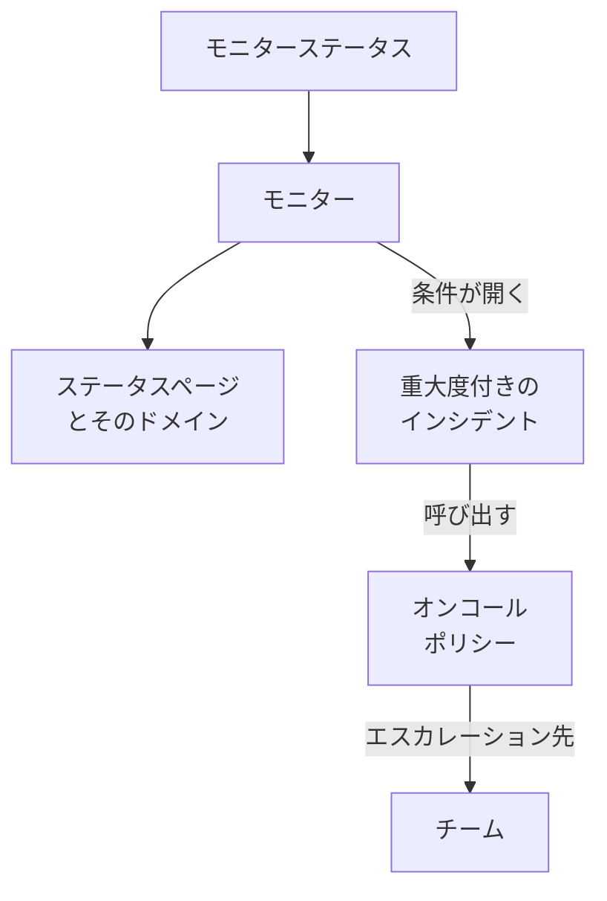

# 例

多くのプロジェクトが最初に作るリソースの、すぐに使える構成です。どのブロックも、下のプロバイダー設定の上にそのまま適用できます。ほとんどはプロバイダーのエンドツーエンドテストから取ったもので、変更のたびに本物の OneUptime に適用されています。

:::cards
- [モニター](#モニター): ウェブサイト、API、ping、ポート、SSL 証明書、heartbeat、手動のモニター。
- [ステータスページ](#ステータスページ): グループとモニターのあるステータスページと、カスタムドメイン。
- [チームとオンコール](#チームとオンコール): チームと、それを呼び出すオンコールポリシー。
- [インシデントとメンテナンス](#インシデントとメンテナンス): 重大度、状態、宣言したインシデント、メンテナンスの時間帯。
:::



## プロバイダーの設定

どの例も、API キーを環境変数 `ONEUPTIME_API_KEY` に入れた次の設定を前提にしています。

```hcl title="main.tf"
terraform {
  required_providers {
    oneuptime = {
      source  = "oneuptime/oneuptime"
      version = "{{TERRAFORM_PROVIDER_VERSION}}"
    }
  }
}

provider "oneuptime" {
  # On a self-hosted OneUptime, add your OneUptime's address:
  # oneuptime_url = "https://oneuptime.example.com"
}
```

## ラベル

ラベルはレコードを並べ替えたり絞り込んだりします。ほとんどのリソースは、`labels` にラベル ID のセットを受け付けます。

```hcl
resource "oneuptime_label" "production" {
  name        = "production"
  description = "Production infrastructure"
  color       = "#FF5733"
}
```

## モニター

下のモニターは、どのプロジェクトにも最初からあるステータスのうち 3 つを、データソースで読み取ってステータスに使います。

```hcl
data "oneuptime_monitor_status" "operational" {
  name = "Operational"
}

data "oneuptime_monitor_status" "degraded" {
  name = "Degraded"
}

data "oneuptime_monitor_status" "offline" {
  name = "Offline"
}
```

各モニターの `monitor_steps` は、何をチェックし、各結果をどう判定するかを表します。すべての属性は [モニターステップ](/docs/terraform/monitor-steps) で説明しています。

### ウェブサイトモニター

サイトが応答しなければ offline、200 で応答すれば online です。エンドツーエンドテスト `35-monitor-with-steps` が、これらのチェックを持つモニターを適用します。

```hcl
resource "oneuptime_monitor" "website" {
  name                = "Website"
  description         = "Homepage availability and status code"
  monitor_type        = "Website"
  monitoring_interval = "*/5 * * * *"
  labels              = [oneuptime_label.production.id]

  monitor_steps = [{
    monitor_destination      = "https://example.com"
    monitor_destination_type = "URL"
    request_type             = "GET"

    criteria = [
      {
        name                  = "Offline"
        description           = "The website does not respond"
        filter_condition      = "Any"
        change_monitor_status = true
        monitor_status_id     = data.oneuptime_monitor_status.offline.id

        filters = [
          {
            check_on    = "Is Online"
            filter_type = "False"
          }
        ]
      },
      {
        name                  = "Online"
        description           = "The website responds with 200"
        filter_condition      = "All"
        change_monitor_status = true
        monitor_status_id     = data.oneuptime_monitor_status.operational.id

        filters = [
          {
            check_on    = "Is Online"
            filter_type = "True"
          },
          {
            check_on    = "Response Status Code"
            filter_type = "Equal To"
            value       = "200"
          }
        ]
      }
    ]
  }]
}
```

### API モニター

ヘッダーと JSON ボディ付きの `POST` で、応答が遅いときは degraded になります。エンドツーエンドテスト `35-monitor-with-steps` が、これに似た API モニターを適用します。

```hcl
resource "oneuptime_monitor" "orders_api" {
  name         = "Orders API"
  description  = "Health check of the orders API"
  monitor_type = "API"

  monitor_steps = [{
    monitor_destination      = "https://api.example.com/v1/health"
    monitor_destination_type = "URL"
    request_type             = "POST"
    request_headers = {
      "Content-Type" = "application/json"
      "Accept"       = "application/json"
    }
    request_body = jsonencode({ check = "health" })

    criteria = [
      {
        name                  = "Offline"
        description           = "The API does not answer, or answers with an error"
        filter_condition      = "Any"
        change_monitor_status = true
        monitor_status_id     = data.oneuptime_monitor_status.offline.id

        filters = [
          {
            check_on    = "Is Online"
            filter_type = "False"
          },
          {
            check_on    = "Response Status Code"
            filter_type = "Greater Than Or Equal To"
            value       = "500"
          }
        ]
      },
      {
        name                  = "Slow"
        description           = "The API takes more than two seconds"
        filter_condition      = "All"
        change_monitor_status = true
        monitor_status_id     = data.oneuptime_monitor_status.degraded.id

        filters = [
          {
            check_on    = "Response Time (in ms)"
            filter_type = "Greater Than"
            value       = "2000"
          }
        ]
      },
      {
        name                  = "Online"
        description           = "The API answers in time"
        filter_condition      = "All"
        change_monitor_status = true
        monitor_status_id     = data.oneuptime_monitor_status.operational.id

        filters = [
          {
            check_on    = "Is Online"
            filter_type = "True"
          }
        ]
      }
    ]
  }]
}
```

### Ping モニター

Ping モニターは、URL の代わりにホスト名か IP アドレスを受け付けます。

```hcl
resource "oneuptime_monitor" "gateway" {
  name         = "Gateway"
  description  = "The gateway answers ping"
  monitor_type = "Ping"

  monitor_steps = [{
    monitor_destination      = "gateway.example.com"
    monitor_destination_type = "Hostname"

    criteria = [
      {
        name                  = "Unreachable"
        filter_condition      = "Any"
        change_monitor_status = true
        monitor_status_id     = data.oneuptime_monitor_status.offline.id

        filters = [
          {
            check_on    = "Is Online"
            filter_type = "False"
          }
        ]
      },
      {
        name                  = "Reachable"
        filter_condition      = "All"
        change_monitor_status = true
        monitor_status_id     = data.oneuptime_monitor_status.operational.id

        filters = [
          {
            check_on    = "Is Online"
            filter_type = "True"
          }
        ]
      }
    ]
  }]
}
```

### ポートモニター

ポートモニターは、チェックする `port` を数値で追加します。

```hcl
resource "oneuptime_monitor" "database_port" {
  name         = "Database port"
  description  = "PostgreSQL accepts connections"
  monitor_type = "Port"

  monitor_steps = [{
    monitor_destination      = "db.example.com"
    monitor_destination_type = "Hostname"
    port                     = 5432

    criteria = [
      {
        name                  = "Closed"
        filter_condition      = "Any"
        change_monitor_status = true
        monitor_status_id     = data.oneuptime_monitor_status.offline.id

        filters = [
          {
            check_on    = "Is Online"
            filter_type = "False"
          }
        ]
      },
      {
        name                  = "Open"
        filter_condition      = "All"
        change_monitor_status = true
        monitor_status_id     = data.oneuptime_monitor_status.operational.id

        filters = [
          {
            check_on    = "Is Online"
            filter_type = "True"
          }
        ]
      }
    ]
  }]
}
```

### SSL 証明書モニター

ダッシュボードで新しく作る SSL 証明書モニターと同じく、証明書が有効でなければ offline、有効期限まで 14 日以内なら degraded です。

```hcl
resource "oneuptime_monitor" "certificate" {
  name         = "example.com certificate"
  description  = "The TLS certificate of example.com"
  monitor_type = "SSL Certificate"

  monitor_steps = [{
    monitor_destination      = "https://example.com"
    monitor_destination_type = "URL"

    criteria = [
      {
        name                  = "Not valid"
        description           = "Expired, self-signed, untrusted or not reachable"
        filter_condition      = "Any"
        change_monitor_status = true
        monitor_status_id     = data.oneuptime_monitor_status.offline.id

        filters = [
          {
            check_on    = "Is Not A Valid Certificate"
            filter_type = "True"
          }
        ]
      },
      {
        name                  = "Expires soon"
        description           = "Valid, and expires in 14 days or less"
        filter_condition      = "All"
        change_monitor_status = true
        monitor_status_id     = data.oneuptime_monitor_status.degraded.id

        filters = [
          {
            check_on    = "Is Valid Certificate"
            filter_type = "True"
          },
          {
            check_on    = "Expires In Days"
            filter_type = "Less Than Or Equal To"
            value       = "14"
          }
        ]
      },
      {
        name                  = "Valid"
        filter_condition      = "All"
        change_monitor_status = true
        monitor_status_id     = data.oneuptime_monitor_status.operational.id

        filters = [
          {
            check_on    = "Is Valid Certificate"
            filter_type = "True"
          }
        ]
      }
    ]
  }]
}
```

### 手動モニター

手動モニターは何もチェックしません。ステータスは自分で設定します。`monitor_steps` は必要ありません。

```hcl
resource "oneuptime_monitor" "payment_provider" {
  name         = "Payment provider"
  description  = "Set by hand during the provider's incidents"
  monitor_type = "Manual"
}
```

### Heartbeat モニター

受信リクエストモニターは、リクエストを送る代わりに受け取るのを待ちます。ここでは、毎晩報告してくるバックアップジョブです。25 時間リクエストが来なければ offline になります。

```hcl
resource "oneuptime_monitor" "nightly_backup" {
  name         = "Nightly backup"
  description  = "The backup job sends a heartbeat when it finishes"
  monitor_type = "Incoming Request"

  monitor_steps = [{
    criteria = [
      {
        name                  = "No heartbeat"
        filter_condition      = "Any"
        change_monitor_status = true
        monitor_status_id     = data.oneuptime_monitor_status.offline.id

        filters = [
          {
            check_on    = "Incoming Request"
            filter_type = "Not Recieved In Minutes"
            value       = "1500"
          }
        ]
      },
      {
        name                  = "Heartbeat received"
        filter_condition      = "All"
        change_monitor_status = true
        monitor_status_id     = data.oneuptime_monitor_status.operational.id

        filters = [
          {
            check_on    = "Incoming Request"
            filter_type = "Recieved In Minutes"
            value       = "1500"
          }
        ]
      }
    ]
  }]
}

output "nightly_backup_heartbeat_key" {
  value     = oneuptime_monitor.nightly_backup.incoming_request_secret_key
  sensitive = true
}
```

ジョブは、`terraform output -raw nightly_backup_heartbeat_key` が出力するキーを使って、`https://oneuptime.com/heartbeat/YOUR_SECRET_KEY` にリクエストを送ります。[受信リクエスト モニター](/docs/monitor/incoming-request-monitor) を参照してください。サーバーモニターのエージェントも、同じように `server_monitor_secret_key` で認証します。

### モニターグループ

モニターグループは、一連のモニターをひとつのステータスで表示します。

```hcl
resource "oneuptime_monitor_group" "storefront" {
  name        = "Storefront"
  description = "Everything the shop needs"
}

resource "oneuptime_monitor_group_resource" "website" {
  monitor_group_id = oneuptime_monitor_group.storefront.id
  monitor_id       = oneuptime_monitor.website.id
}

resource "oneuptime_monitor_group_resource" "orders_api" {
  monitor_group_id = oneuptime_monitor_group.storefront.id
  monitor_id       = oneuptime_monitor.orders_api.id
}
```

## ステータスページ

### グループとモニターのあるステータスページ

ステータスページはリソースを表示し、それをグループに分けることができます。エンドツーエンドテスト `42-status-page-resources` がこの構成を適用します。

```hcl
resource "oneuptime_status_page" "public" {
  name                  = "Public Status"
  description           = "Customer-facing status page"
  page_title            = "System Status"
  page_description      = "Check our system status and incident history"
  is_public_status_page = true
}

resource "oneuptime_status_page_group" "services" {
  status_page_id = oneuptime_status_page.public.id
  name           = "Services"
}

resource "oneuptime_status_page_resource" "website" {
  status_page_id       = oneuptime_status_page.public.id
  status_page_group_id = oneuptime_status_page_group.services.id
  monitor_id           = oneuptime_monitor.website.id
  display_name         = "Website"
}
```

### カスタムドメイン

3 つのリソースが連携します。プロジェクトのドメイン、ステータスページ、そして両者を結ぶステータスページのドメインです。`full_domain` と CNAME 検証トークンはサーバーが入れるので、設定しないでください。エンドツーエンドテスト `12-status-page-domain` と `25-status-page-with-domain` がこの構成を適用します。

```hcl
resource "oneuptime_domain" "company" {
  domain = "example.com"
}

resource "oneuptime_status_page_domain" "status" {
  domain_id      = oneuptime_domain.company.id
  status_page_id = oneuptime_status_page.public.id
  subdomain      = "status"
}

output "status_page_address" {
  # The subdomain and the domain, such as status.example.com.
  value = oneuptime_status_page_domain.status.full_domain
}
```

新しいドメインは、ステータスページがそのドメインで応答する前に DNS 検証を通る必要があります。

## チームとオンコール

### チームとそのメンバー

```hcl
resource "oneuptime_team" "sre" {
  name        = "SRE"
  description = "Site reliability engineering"
}

variable "alice_user_id" {
  description = "Alice's user ID, the last part of the address of her page under Users"
  type        = string
}

resource "oneuptime_team_member" "alice" {
  team_id = oneuptime_team.sre.id
  user_id = var.alice_user_id
}
```

すでにプロジェクトにいる人は、すぐにチームに加わります。それ以外の人は招待され、承諾した時点でチームに加わります。エンドツーエンドテスト `33-team-crud` がこのチームを適用します。

### チームを呼び出すオンコールポリシー

ポリシーの最初のルールがチームを呼び出し、誰も応答しなければ、ポリシーは最大 2 回まで最初からやり直します。

```hcl
resource "oneuptime_on_call_policy" "primary" {
  name                                             = "Primary on-call"
  description                                      = "First line for production incidents"
  repeat_policy_if_no_one_acknowledges             = true
  repeat_policy_if_no_one_acknowledges_no_of_times = 2
}

resource "oneuptime_escalation_rule" "first_line" {
  on_call_duty_policy_id    = oneuptime_on_call_policy.primary.id
  name                      = "Page the SRE team"
  description               = "Moves on after 5 minutes without an acknowledgement"
  order                     = 1
  escalate_after_in_minutes = 5
}

resource "oneuptime_team_on_call_duty_escalation_rule" "sre" {
  on_call_duty_policy_id                 = oneuptime_on_call_policy.primary.id
  on_call_duty_policy_escalation_rule_id = oneuptime_escalation_rule.first_line.id
  team_id                                = oneuptime_team.sre.id
}
```

モニターの条件は、開くインシデントの `on_call_policy_ids` を通してポリシーを呼び出します。[インシデントとアラート](/docs/terraform/monitor-steps#インシデントとアラート) を参照してください。

## インシデントとメンテナンス

### 重大度と状態

重大度はインシデントの影響の大きさを表し、状態はインシデントがたどる段階です。`order` は、それぞれが並ぶ位置です。

```hcl
resource "oneuptime_incident_severity" "sev1" {
  name        = "SEV-1"
  description = "Full outage, all hands"
  color       = "#E74C3C"
  order       = 1
}

resource "oneuptime_incident_state" "mitigated" {
  name        = "Mitigated"
  description = "Impact contained, fix in progress"
  color       = "#F39C12"
  order       = 3
}
```

`oneuptime_alert_severity` と `oneuptime_alert_state` は、アラートについて同じように動作します。エンドツーエンドテスト `03-incident-severity` と `04-incident-state` がこれらを適用します。

### インシデントを宣言する

インシデントを開くのはふつうモニターですが、インシデントもリソースなので、ゲームデーに向いています。本物のインシデントなので、訓練はステータスページに出さないでください。

```hcl
resource "oneuptime_incident" "drill" {
  title                     = "Disaster recovery drill"
  description               = "A game day: we fail over the database"
  incident_severity_id      = oneuptime_incident_severity.sev1.id
  is_visible_on_status_page = false

  should_status_page_subscribers_be_notified_on_incident_created = false
}
```

エンドツーエンドテスト `28-incident-crud` がインシデントを適用します。

### 予定メンテナンス

固定の時刻を持ち、ステータスページに表示されるメンテナンスの時間帯です。

```hcl
resource "oneuptime_scheduled_maintenance_event" "database_upgrade" {
  title                       = "Database maintenance"
  description                 = "Planned PostgreSQL upgrade: writes pause briefly"
  starts_at                   = "2030-06-01T02:00:00Z"
  ends_at                     = "2030-06-01T04:00:00Z"
  is_visible_on_status_page   = true
  monitors                    = [oneuptime_monitor.website.id]
  change_monitor_status_to_id = data.oneuptime_monitor_status.degraded.id
}
```

時刻は RFC 3339 で書き、同じ時点を別の書き方にしても変更にはなりません。エンドツーエンドテスト `30-scheduled-maintenance-crud` がメンテナンスイベントを適用します。

イベントの間、そのモニターをあるステータスにしておくには、`monitors` でモニターを結び付け、`change_monitor_status_to_id` にモニターステータスのひとつを設定します。モニターはイベントの開始時にそのステータスになり、終了時に稼働中に戻ります。イベントが始まるまでは、Terraform は `change_monitor_status_to_id` をその場で変更します。イベントが始まった後はモニターがすでにそのステータスにあり、それを変える apply は「Change Monitor Status to can no longer be changed: this event has already started.」で失敗します。

## プローブ

独自のプローブは、自分のネットワークからチェックを実行します。そのキーはプローブがサインインに使うシークレットなので、変数で渡します。

```hcl
variable "probe_key" {
  description = "The key the probe signs in with"
  type        = string
  sensitive   = true
}

resource "oneuptime_probe" "eu_west" {
  key           = var.probe_key
  name          = "EU West"
  description   = "Probe in our eu-west-1 network"
  probe_version = "1.0.0"

  should_auto_enable_probe_on_new_monitors = true
}
```

`PROBE_ID` にプローブの `id` を、`PROBE_KEY` にキーを設定してプローブを実行します。[カスタム プローブ](/docs/probe/custom-probe) を参照してください。エンドツーエンドテスト `23-probe-crud` がプローブを適用します。

## 次のステップ

:::cards
- [モニターステップ](/docs/terraform/monitor-steps): モニターのチェックと条件のすべての属性。
- [リソースのインポート](/docs/terraform/importing-resources): ダッシュボードで作ったものを Terraform の管理下に置きます。
- [完全ガイド](/docs/terraform/complete-guide): データソース、state、CI/CD、アップグレード。
:::
