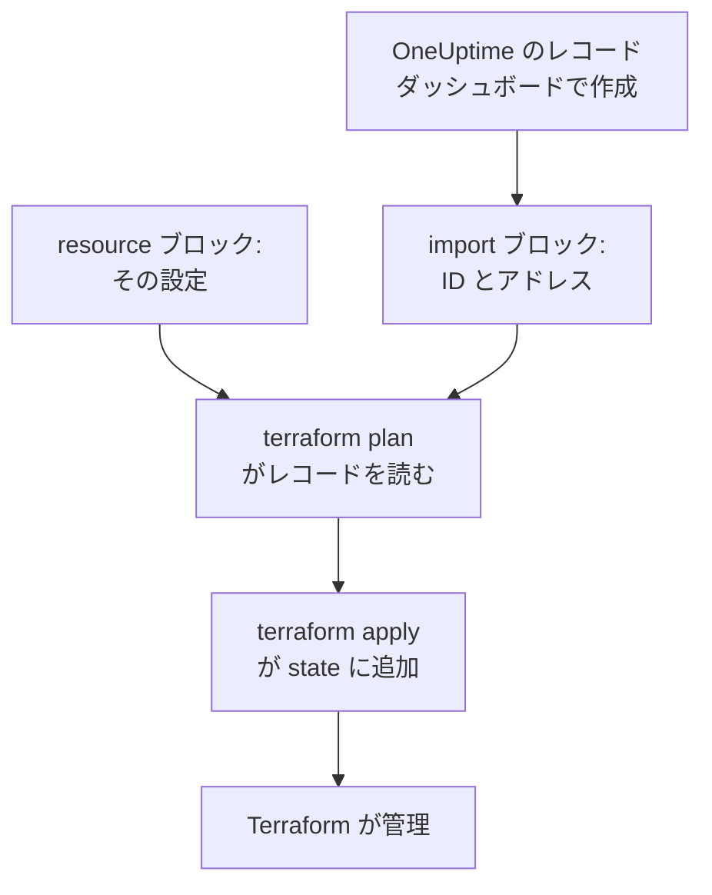
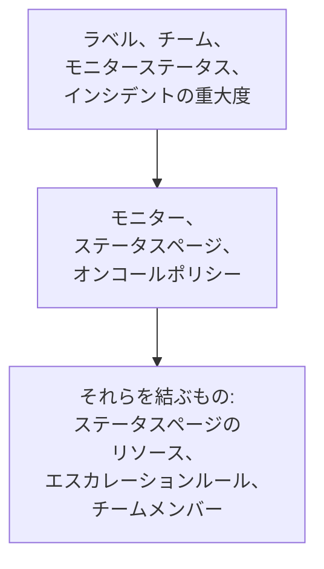

# リソースのインポート

OneUptime を Terraform で管理するために、最初から作り直す必要はありません。すでにあるモニター、ステータスページ、チーム、その他のレコードをインポートすれば、そこからは Terraform がそのままの状態で管理します。インポートは読み取るだけです。計画した変更を適用するまで、OneUptime では何も変わりません。

:::cards
- [インポートの仕組み](#インポートの仕組み): インポートが読み取るものと、あなたが書くもの。
- [リソースを 1 つインポートする](#リソースを-1-つインポートする): ダッシュボードのリソースのページから、4 つのステップで。
- [多数のリソースをインポートする](#多数のリソースをインポートする): リスト全体の import ブロックと、Terraform が代わりに書く構成。
- [リソースの管理をやめる](#リソースの管理をやめる): 削除せずにダッシュボードへ戻します。
:::

## インポートの仕組み

インポートは、OneUptime にすでにあるレコードを、構成内の `resource` ブロックに結び付けます。レコードの ID と、そのレコードを置くアドレスを書いた `import` ブロックを書きます。次の `terraform plan` は ID でレコードを読み取り、それがインポートされることを、レコードと構成の違いすべてとあわせて表示します。`terraform apply` がそれを Terraform の state に追加し、以後そのレコードは Terraform が作成したものと同じように管理されます。



`resource` ブロックは、レコードがすでにそうであるとおりに書きます。違いがある箇所では、プランにインポートと変更が表示され、それを適用すると OneUptime のレコードが変更されます。

### インポートできるもの

プロバイダーのリソースはすべて ID でインポートできますが、`oneuptime_file` は例外です。OneUptime の API はファイルを読み戻せないため、プロバイダーは `Import Not Supported` と応答します。データソースはインポートされません。レコードを管理せずに構成で使うには、代わりに [データソース](/docs/terraform/complete-guide#すでにあるものを読み取る) で読み取ります。

## 始める前に

- **Terraform 1.5 以降、または OpenTofu 1.6 以降。** このページの `import` ブロックにはこれらのバージョンが必要です。それより古い Terraform では [コマンドライン](#コマンドラインからインポートする) からインポートします。
- **インポートするものを読み取れる API キー。** インポートはプロバイダーのキーで各レコードを読み取ります。インポート後に管理するには、変更と削除の権限も必要です。[プロジェクトの API キーを作成する](/docs/terraform/quick-start#プロジェクトの-api-キーを作成する) を参照してください。
- **構成内のプロバイダー。** [クイック スタート](/docs/terraform/quick-start#terraform-を-oneuptime-に向ける) のとおりに設定します。

## リソースを 1 つインポートする

ダッシュボードは、表示中のリソースの構成を `import` ブロックとあわせて書き出すので、手で書くことはほとんどありません。

:::steps
### リソースの Terraform ページを開く

ダッシュボードでモニター、ステータスページ、またはほかのリソースを開きます。そのサイドメニューで **開発者**、次に **Terraform** を開きます。

### 構成をコピーする

このページは、リソースの現在の設定から `resource` ブロックを書き、その ID を入れた `import` ブロックを書きます。両方を `.tf` ファイルに入れます。

```hcl title="status-pages.tf"
resource "oneuptime_status_page" "public_status" {
  name       = "Public Status"
  page_title = "Acme Status"

  # Secrets are not shown here: master_password, embedded_overall_status_token.
  # Terraform leaves them as they are in OneUptime.
}

import {
  to = oneuptime_status_page.public_status
  id = "68a1b2c3-d4e5-4f6a-8b9c-0d1e2f3a4b02"
}
```

既定値と異なる設定が書き出され、各 ID の後のコメントがその ID の指すレコードを示します。シークレットは表示されません。リソースに必要なシークレットは `sensitive` と指定した変数から読み取られ、省いたものはコメントに書かれます。

### プランを実行する

`terraform plan` を実行します。最後に `Plan: 1 to import, 0 to add, 0 to change, 0 to destroy.` と表示されれば、Terraform がレコードを見つけ、構成がそれと一致しています。

### 適用する

`terraform apply` を実行します。ステータスページが Terraform の state に入り、次のプランは `No changes.` と応答します。その後は `import` ブロックを削除しても、リソースの出どころのメモとして残してもかまいません。リソースが管理下に入れば、このブロックはもう何もしません。
:::

### ブロックを自分で書く

ダッシュボードを使わない場合は、両方のブロックを自分で書きます。リソースに必要な属性で `resource` ブロックを書き始め、`terraform plan` を実行します。構成がレコードと異なる箇所では、プランはインポートの隣に変更を表示します。

```text
  # oneuptime_label.critical will be updated in-place
  # (imported from "68a1b2c3-d4e5-4f6a-8b9c-0d1e2f3a4b03")
  ~ resource "oneuptime_label" "critical" {
      ~ color = "#FF5733" -> "#000000"
    }

Plan: 1 to import, 0 to add, 1 to change, 0 to destroy.
```

レコードの値を構成にコピーし (ここでは `color = "#FF5733"`)、プランにインポートだけが表示され変更がなくなるまで、もう一度プランを実行します。レコードの ID は 3 か所にあります。

| 場所 | 方法 |
| --- | --- |
| リソースのページ | 詳細カードの最後に **ID** の行があります。ID か、その横のコピーボタンをクリックすると、ID 全体がコピーされます。 |
| アドレスバー | ID はリストの名前の後に続きます: `/dashboard/<project-id>/monitors/<monitor-id>`。 |
| API | すべてのレコードは `_id` に ID を持っています。 |

## 多数のリソースをインポートする

ある種類のモニター、ステータスページ、その他のリソースをすべてインポートするには、そのリストから始めます。

:::steps
### リストの Terraform ページを開く

リストを開き、そのサイドメニューで **開発者**、**Terraform** の順に開きます。たとえば **モニター → 開発者 → Terraform** です。

### import ブロックをコピーする

このページは、レコードごと (最初の 100 件) に `import` ブロックを書き、アドレスはレコードの名前から作られます。これらを `imports.tf` のような専用のファイルに入れます。

```hcl title="imports.tf"
import {
  to = oneuptime_monitor.homepage
  id = "68a1b2c3-d4e5-4f6a-8b9c-0d1e2f3a4b01"
}

import {
  to = oneuptime_monitor.checkout_api
  id = "68a1b2c3-d4e5-4f6a-8b9c-0d1e2f3a4b05"
}
```

### Terraform に構成を書かせる

Terraform が書き出す構成のファイル名を付けてプランを実行します。そのファイルはまだ存在していてはいけません。Terraform は新しいファイルにしか書き込みません。

```bash
terraform plan -generate-config-out=monitors.tf
```

Terraform は各レコードを読み取って `resource` ブロックを書きます。対象は、対応するブロックがまだない各 `import` ブロックです。構成の生成は実験的な機能だと警告するので、書かれた内容を読んでください。

### 確認して適用する

新しいファイルで、ほかのレコードの ID を、`labels = [oneuptime_label.critical.id]` のようにそのリソースへの参照に置き換えます。こうすると Terraform は作業の順序がわかります。インポートだけが表示されるまで `terraform plan` を実行し、それから `terraform apply` を実行します。
:::

### プロジェクト全体

プロジェクトはリストごとにインポートし、ほかから参照されるレコードから始めます。そうすれば、各リソースブロックは前にあるものを ID ではなくアドレスで参照できます。



モニターステータスやインシデントの重大度のように、どのプロジェクトにも最初からあるレコードは、インポートするよりデータソースで読み取るほうがよいことがよくあります。そうすれば Terraform はそれらを参照できますが、変更も削除もしません。`terraform plan` が `No changes.` と応答すれば、プロジェクトのインポートは完了です。

## コマンドラインからインポートする

`terraform import` はリソースを 1 つずつインポートし、Terraform と OpenTofu のどのバージョンでも動作します。先に `resource` ブロックを書き、ブロックのアドレスとレコードの ID を付けてコマンドを実行します。

```bash
terraform import oneuptime_status_page.public_status 68a1b2c3-d4e5-4f6a-8b9c-0d1e2f3a4b02
terraform import oneuptime_label.critical 68a1b2c3-d4e5-4f6a-8b9c-0d1e2f3a4b03
terraform import oneuptime_team.sre 68a1b2c3-d4e5-4f6a-8b9c-0d1e2f3a4b04
```

どれも `Import successful!` で終わります。`import` ブロックと違い、このコマンドは先に確認するプランなしで、すぐに state を書き込みます。その後で `terraform plan` を実行し、プランが `No changes.` と応答するまで構成を変更してください。

## リソースの管理をやめる

リソースを削除せずにダッシュボードへ戻すには、その `resource` ブロックを、レコードを残す `removed` ブロックに置き換えます。

```hcl
removed {
  from = oneuptime_team.sre

  lifecycle {
    destroy = false
  }
}
```

プランには、チームが Terraform の管理から外れることが表示され、何も破棄されません。それを適用してから、`removed` ブロックを削除します。`destroy = false` を指定した `removed` ブロックには、Terraform 1.7 以降または OpenTofu 1.10 以降が必要です。それより古いバージョンでは、代わりに `terraform state rm oneuptime_team.sre` を実行します。

> [!WARNING]
> `resource` ブロックを削除すると、次の apply で OneUptime のそのレコードが削除されます。Terraform では、`destroy = false` のない `removed` ブロックも同じことをします。`lifecycle` ブロックは必ず書いてください。

## 知っておくと良いこと

- **インポートは何も変えませんが、次の apply は変えます。** インポートの隣に変更が表示されたプランを適用すると、OneUptime のレコードが変更されます。まずプランにインポートだけが表示されるようにしてください。
- **シークレットは読み戻されません。** モニターシークレットの `secret_value` のように、OneUptime が決して返さないシークレットは、インポート後の state にありません。構成でそれを設定していると、最初のプランに変更として表示され、適用するとシークレットがもう一度書き込まれます。
- **レコード 1 つにつき構成は 1 つ。** 2 つの構成にインポートされたレコードは、apply のたびにそれぞれの構成の内容に戻されます。
- **インポートしたレコードは管理対象のレコードです。** `terraform destroy` は、Terraform が作成したレコードと同じように、それらを OneUptime から削除します。

## トラブルシューティング

:::details メッセージ「Cannot import non-existent remote object」
その ID のレコードがないか、プロバイダーの API キーにそのレコードを読む権限がありません。OneUptime はどちらの場合も同じように応答します。ID と、キーがその種類のレコードを読めることを確認してください。
:::

:::details メッセージ「Import Not Supported」
`oneuptime_file` はインポートできない唯一のリソースです。これは対象から外し、代わりに Terraform に新しいファイルを作成させてください。
:::

:::details メッセージ「Invalid ID format」
レコードの ID ではないもの、たとえば名前が渡されています。インポートには ID、つまり `68a1b2c3-d4e5-4f6a-8b9c-0d1e2f3a4b02` のような UUID を渡します。リソースのページからコピーしてください。
:::

:::details メッセージ「Target generated file already exists」
`-generate-config-out` に、すでに存在するファイルを指定しています。新しいファイルを指定するか、そのファイルの内容を別の場所へ移してファイルを削除してください。
:::

:::details メッセージ「Resource already managed by Terraform」
`terraform import` に、すでに state にあるアドレスが渡されました。レコードを別のアドレスにインポートするか、`terraform state list` でそのアドレスの中身を確認してください。
:::

## 次のステップ

:::cards
- [完全ガイド](/docs/terraform/complete-guide): データソース、リソース間の参照、state。
- [モニターステップ](/docs/terraform/monitor-steps): インポートしたモニターのチェック内容を読み、変更します。
- [例](/docs/terraform/examples): よく使うリソースのすぐに使える構成。
- [トラブルシューティング](/docs/terraform/troubleshooting): よくあるエラーとその直し方。
:::
