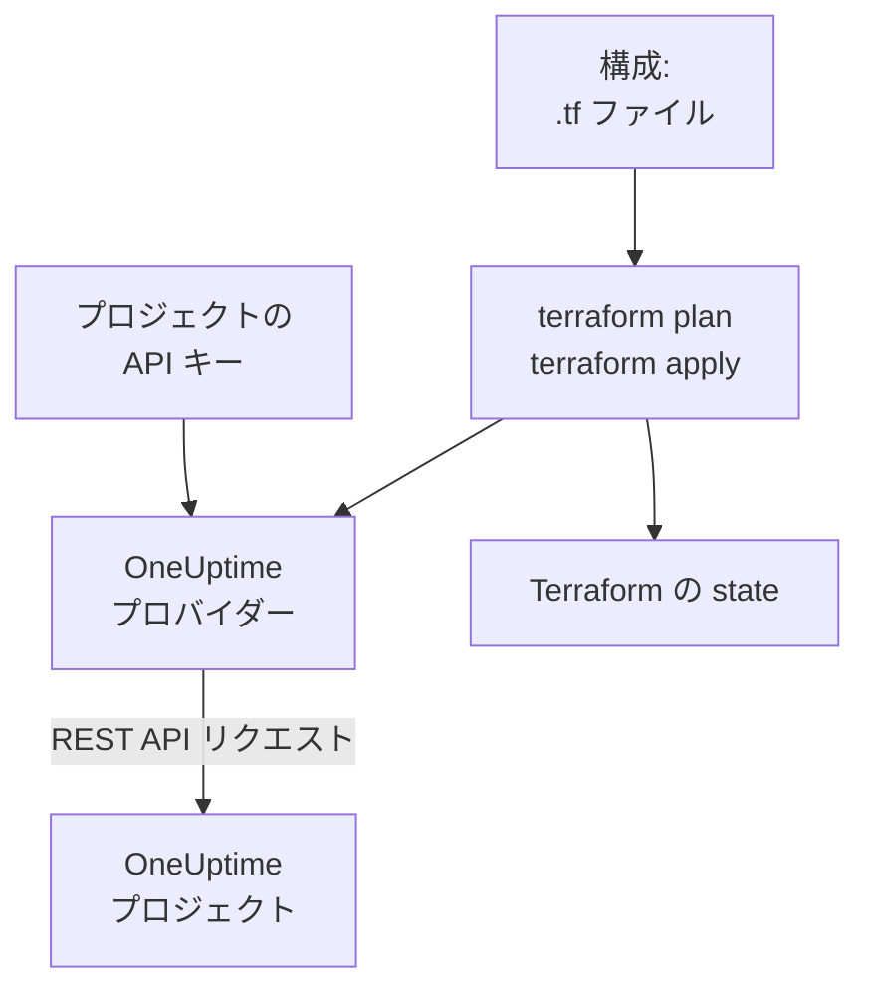

# Terraform 概要

OneUptime の Terraform プロバイダーは、OneUptime プロジェクトをコードとして管理します。モニター、ステータスページ、オンコールポリシー、チーム、ラベルなど、プロジェクトのレコードを `.tf` ファイルに記述し、`terraform plan` で何が変わるかを確認して、`terraform apply` で変更を反映します。OneUptime Cloud でもセルフホストの OneUptime でも動作し、Terraform だけでなく OpenTofu でも使えます。

:::cards
- [プロバイダーのしくみ](#プロバイダーのしくみ): 構成、プラン、そしてその裏で送られる API リクエスト。
- [プロバイダーをインストールする](#プロバイダーをインストールする): プロバイダーブロックと、選ぶべきバージョン。
- [ダッシュボードに書かせる](#ダッシュボードに書かせる): すでにあるものの構成と import ブロック。
- [管理できるもの](#管理できるもの): リソース、データソース、そして属性の書き方。
:::

## プロバイダーのしくみ

プロバイダーは、Terraform がレジストリからダウンロードするプラグインです。`terraform apply` のとき、プランの各変更を、プロジェクトの API キーを使った OneUptime REST API へのリクエストに変換します。Terraform は作成したものを state に保存するので、次のプランにはそれ以降に変わったものだけが表示されます。



API キーは 1 つのプロジェクトに属し、Terraform がそのプロジェクトで何を読み取り、何を変更できるかを決めます。そのため、1 つの構成が管理するのは 1 つのプロジェクトです。複数のプロジェクトを管理するには、プロバイダーにプロジェクトごとの [エイリアス](/docs/terraform/complete-guide#複数のプロジェクトを管理する) を付けます。

## はじめる前に

- **Terraform 1.5 以降、または OpenTofu 1.6 以降。** ダッシュボードが書き出す `import` ブロックには、これらのバージョンが必要です。
- **プロジェクトの API キー。** [クイック スタート](/docs/terraform/quick-start#プロジェクトの-api-キーを作成する) で、**プロジェクト設定 → 詳細 → API キー** での作成方法を説明しています。
- **OneUptime Cloud では Growth プラン以上。** プロジェクトの API キーはこのプランでのみ動作します。

## プロバイダーをインストールする

プロバイダーを `.tf` ファイルに追加します。`terraform init` は Terraform Registry から、`tofu init` は OpenTofu Registry からダウンロードします。

```hcl title="main.tf"
terraform {
  required_providers {
    oneuptime = {
      source  = "oneuptime/oneuptime"
      version = "{{TERRAFORM_PROVIDER_VERSION}}"
    }
  }
}

provider "oneuptime" {
  # The API key comes from the ONEUPTIME_API_KEY environment variable.
  # On a self-hosted OneUptime, add your OneUptime's address:
  # oneuptime_url = "https://oneuptime.example.com"
}
```

キーはファイルに書かないでください。Terraform を実行する前にエクスポートするか、`sensitive` を付けた変数で渡します。プロバイダーにキーとアドレスを渡す方法は、[完全ガイド](/docs/terraform/complete-guide#プロバイダーを設定する) にすべて載っています。

### バージョンを選ぶ

プロバイダーのバージョンは OneUptime のバージョンに従います。プロバイダー {{TERRAFORM_PROVIDER_MAJOR}}.x は OneUptime {{TERRAFORM_PROVIDER_MAJOR}}.x から作られます。上の制約 `{{TERRAFORM_PROVIDER_VERSION}}` は最新の {{TERRAFORM_PROVIDER_MAJOR}}.x リリースを使い、OneUptime Cloud にはこれが適しています。セルフホストの OneUptime では、お使いの OneUptime より新しくない最新のプロバイダーを使ってください。固定する方法は [セルフホスト セットアップ](/docs/terraform/self-hosted) で説明しています。

## ダッシュボードに書かせる

すでにあるリソースを手で書く必要はありません。OneUptime ダッシュボードのすべてのリソース (モニター、ステータスページ、ワークフロー、オンコールポリシーなど) には、サイドメニューに **開発者** セクションがあり、開くまでは折りたたまれています。その **Terraform** ページが、あなたのプロジェクトの内容を入れた構成を書いてくれます。

:::steps
### リソースを開く

Terraform で管理したいモニター、ステータスページ、その他のリソースを開きます。

### Terraform ページを開く

サイドメニューで **開発者**、続いて **Terraform** を開きます。

### 構成をコピーする

このページは、リソースの現在の設定から構成を書き出し、`import` ブロックも付けます。各 ID の後のコメントは、その ID が指すレコードの名前です (`incident_severity_id = "..." # Critical Incident`)。

### プランを作成して適用する

`terraform plan` を実行すると、リソースがインポートされ、変更は何もないことが表示されます。適用すれば、それ以降は Terraform がそのリソースを管理します。
:::

構成の下の **さらに活用する** には、そのリソースの隣によく追加されるものが、リソースのアドレスを参照する形で載っています。インシデントの担当チーム、ステータスページ用のモニターのグループ、オンコールポリシー用のエスカレーションルールなどです。

一覧ページ (たとえば **インシデント** や **モニター**) にも同じセクションがあります。そこでは **Terraform** ページが、多くの人が設定する項目を入れた新しいリソースを、プロジェクト自身のレコードを使って書き出します。重大度の 1 つを使ったインシデントや、ダッシュボードで新しいモニターが受け取る条件をステータスにつないだモニターなどです。すぐに使える **よく使われる構成** (グループとモニターのあるステータスページ、チームを呼び出すオンコールポリシー、毎週のオンコールローテーション) と、すでにあるリソースごとの `import` ブロック (最初の 100 件) も用意され、`terraform plan -generate-config-out` にそのまま使えます。どちらのページも、お使いの OneUptime 向けのプロバイダーブロックを提供します。正しい `oneuptime_url` と、お使いの OneUptime に合うバージョン制約です。

これらのページにシークレットが表示されることはありません。構成にシークレットが必要な場合 (たとえばモニターの `Authorization` ヘッダー)、`sensitive` を付けた Terraform 変数から読み取ります。不要なシークレットは省かれ、Terraform は OneUptime にある値をそのまま残します。

同じセクションには、リソース用の `curl` コマンドが載った **API** ページと、Claude、GitHub Copilot、Cursor を [MCP サーバー](/docs/ai/mcp-server) につなぐ **AI アシスタント** ページもあります。

## 管理できるもの

プロバイダーには、OneUptime API で作成できるレコードの種類ごとに、`oneuptime_<name>` という名前のリソースがあります。多くの構成は次のリソースから始まります。

| リソース | 内容 |
| --- | --- |
| `oneuptime_monitor` | モニター: ウェブサイト、API、ping、ポート、SSL 証明書、サーバー、受信リクエスト、手動、その他すべてのタイプ |
| `oneuptime_monitor_status` | Operational、Degraded、Offline などのモニターステータス |
| `oneuptime_monitor_group` | ひとつのステータスで表示されるモニターのグループ |
| `oneuptime_status_page` | 公開または非公開のステータスページ |
| `oneuptime_status_page_domain` | ステータスページのカスタムドメイン |
| `oneuptime_domain` | ステータスページ用に検証されたプロジェクトのドメイン |
| `oneuptime_label` | レコードを並べ替えたり絞り込んだりするためのラベル |
| `oneuptime_team`, `oneuptime_team_member` | チームと、そのメンバー |
| `oneuptime_on_call_policy`, `oneuptime_escalation_rule` | オンコールポリシーと、それが順に呼び出すルール |
| `oneuptime_incident`, `oneuptime_incident_severity`, `oneuptime_incident_state` | インシデントと、その重大度と状態 |
| `oneuptime_alert`, `oneuptime_alert_severity`, `oneuptime_alert_state` | アラートと、その重大度と状態 |
| `oneuptime_scheduled_maintenance_event` | 予定メンテナンスの時間帯 |
| `oneuptime_probe` | 自分のネットワークからチェックする独自のプローブ |

[Terraform Registry](https://registry.terraform.io/providers/oneuptime/oneuptime/latest/docs) には、すべてのリソースとその属性がすべて載っています。

### すでにあるものを読み取る

すべてのリソースには、`data "oneuptime_label"` のように同じ名前のデータソースがあります。データソースは、この構成が管理していないレコード、たとえばダッシュボードで作ったレコードを読み取ります。`id` か、ほかの単純な引数で検索します。指定した引数はすべて一致する必要があり、すべてに一致するレコードはちょうど 1 件でなければなりません。

```hcl
data "oneuptime_monitor_status" "offline" {
  name = "Offline"
}

# Any plain argument works. Set several, and all of them must match.
data "oneuptime_monitor_status" "offline_state" {
  is_offline_state = true
}
```

一致が 0 件、または 2 件以上の場合は、空の答えや任意の答えではなくエラーになります。ルールは [完全ガイド](/docs/terraform/complete-guide#すでにあるものを読み取る) にあります。

### 名前が変わったリソース

リソース名では IoT や vCenter のような語を分割しません。`oneuptime_iot_fleet` と `oneuptime_vcenter` です。古いプロバイダーでは `oneuptime_io_t_fleet` と `oneuptime_v_center` でした (それぞれのラベルルール、オーナー、フィードも同様です)。古い名前も非推奨のエイリアスとして引き続き動作し、それを使うプランはその旨を表示します。切り替えるには、構成でリソースの名前を変えて `moved` ブロックを追加します。Terraform は既存のリソースを置き換えずにそのまま引き継ぎます。

```hcl
# Was: resource "oneuptime_io_t_fleet" "factory"
resource "oneuptime_iot_fleet" "factory" {
  name = "Factory floor"
}

moved {
  from = oneuptime_io_t_fleet.factory
  to   = oneuptime_iot_fleet.factory
}
```

リソースを別のタイプに移すには Terraform 1.8 以降が必要です。それより古いエンジンでは、当面は古い名前のままにしてください。引き続き動作します。

## 属性の書き方

属性は OneUptime API に従い、snake_case で書きます。

| 値の種類 | 書き方 | 例 |
| --- | --- | --- |
| テキスト、数値、真偽値 | そのまま | `is_public_status_page = false` |
| 別のレコードへの参照 | その ID。通常は別のリソースの `id` | `incident_severity_id = oneuptime_incident_severity.sev1.id` |
| 参照のリスト | ID のセット。順序は関係ありません | `labels = [oneuptime_label.critical.id]` |
| 色、ドメイン、その他のラップされた値 | 単純な値 | `color = "#FF5733"` |
| 日付と時刻 | RFC 3339 形式のテキスト | `starts_at = "2030-06-01T02:00:00Z"` |
| モニターのチェック | 型付きのネストした属性: [モニターステップ](/docs/terraform/monitor-steps) を参照 | `monitor_steps = [{ ... }]` |
| その他の構造化された設定 | `jsonencode()` で書いた JSON | `log_monitor = jsonencode({ ... })` |

次の 2 種類の値はサーバーのもので、書く必要はありません。

- **リソース内部の ID。** モニターのステップと条件、およびそのインシデントとアラートのテンプレートには、サーバーが付けてすべての apply で維持する ID があります。そのため、インシデントは自分を起こした条件を指し続けます。
- **サーバーが最新に保つもの。** モニターの現在のステータスや、最後に heartbeat を受け取った時刻は、`terraform plan` から `terraform apply` の終わりまでの間に変わることがあります。プロバイダーは、あなたが設定していないものについては計画された値を保ち、次の refresh でサーバーの値を読み取ります。そのため、これが apply を失敗させたり、変更として表示されたりすることはありません。

## ヘルプ

- バグや機能のリクエスト: [github.com/OneUptime/oneuptime/issues](https://github.com/OneUptime/oneuptime/issues)。
- プロバイダーは、[OneUptime のメインリポジトリ](https://github.com/OneUptime/oneuptime) にある OneUptime の OpenAPI 仕様から生成されます。公開されているプロバイダーのリポジトリは読み取り専用なので、問題はメインリポジトリに報告してください。

## 次のステップ

:::cards
- [クイック スタート](/docs/terraform/quick-start): API キーを作成し、10 分で最初のリソースを適用します。
- [完全ガイド](/docs/terraform/complete-guide): 認証、プロジェクトの構成、データソース、state、アップグレード。
- [モニターステップ](/docs/terraform/monitor-steps): モニターが何をチェックし、各結果が何を意味するかを決めます。
- [例](/docs/terraform/examples): よく使うリソースのすぐに使える構成。
- [リソースのインポート](/docs/terraform/importing-resources): ダッシュボードで作ったものを Terraform の管理下に置きます。
:::
