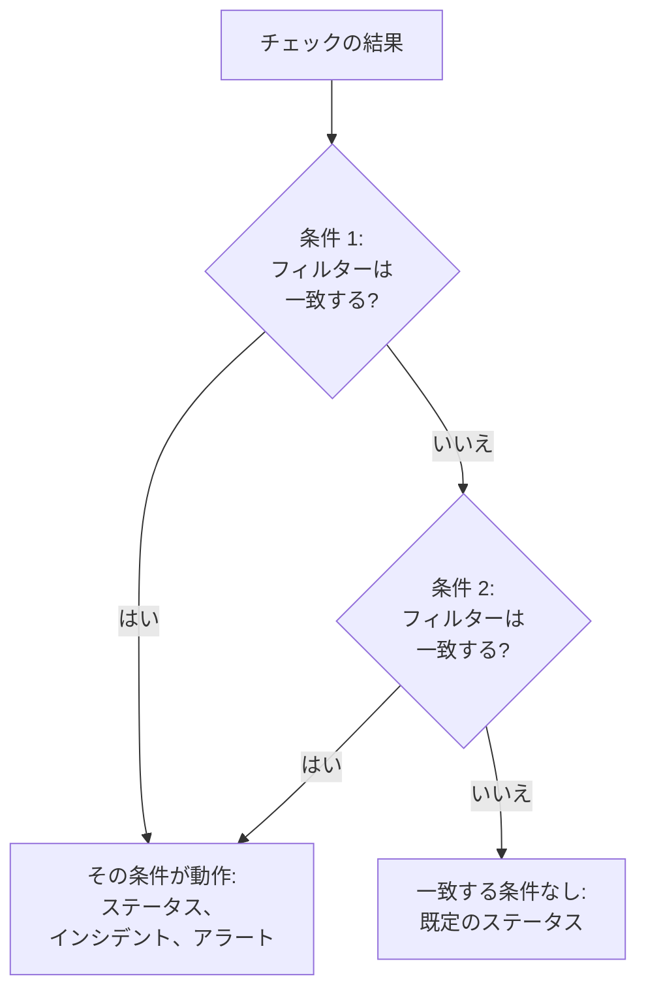
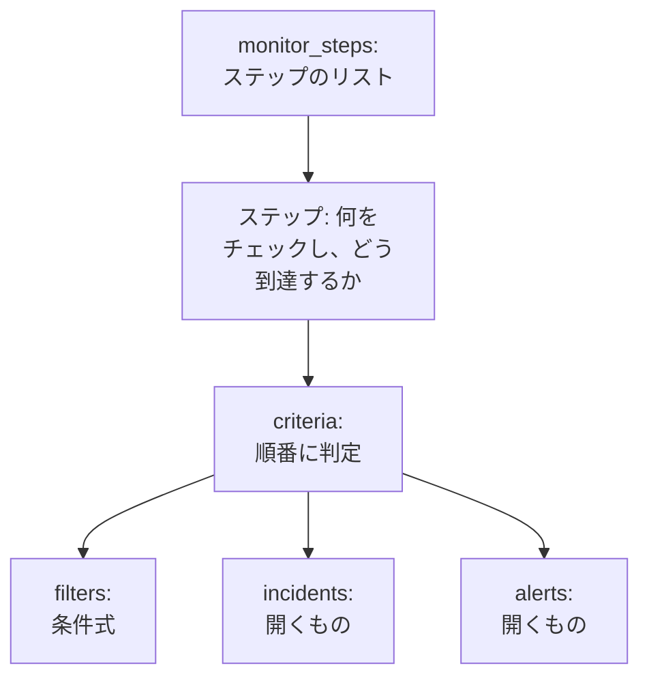

# モニターステップ

`monitor_steps` は `oneuptime_monitor` の属性で、モニターが何をチェックし、各結果をどう判定するかを表します。チェックするアドレス、送信するリクエスト、そして結果をモニターステータス、インシデント、アラートに変える条件です。このページでは、そのすべての部分を説明します。

:::cards
- [チェックの判定のしかた](#チェックの判定のしかた): 順番に並んだ条件と、最初に一致したもの。
- [ステップを書く](#ステップを書く): その形、完全な例、値についての 2 つのルール。
- [フィルターのリファレンス](#フィルターのリファレンス): フィルターがチェックできるものと、比較のしかた。
- [よくある間違い](#よくある間違い): いちばんよく起きる失敗と、その直し方。
:::

## チェックの判定のしかた

各チェックは結果を返します。プローブの応答、スクリプトの戻り値、またはチェックが読み取るテレメトリーです。ステップの条件は、それを順番に判定します。フィルターが最初に一致した条件が、何が起きるかを決めます。モニターのステータスを変えたり、インシデントやアラートを開いたりできます。そのチェックでは、それより後の条件は見られません。



したがって、条件の順序は重要です。アラートを出す条件を先に、最も重大なものを最初に、正常を表す条件を最後に置きます。理由と、ただひとつの例外は [条件の属性](#条件の属性) で説明しています。

## ステップを書く

`monitor_steps` は、HCL にそのまま書く型付きオブジェクトのリストです。`jsonencode()` も、`{_type, value}` のラッパーも、camelCase のキーも、書くべき ID もありません。プロバイダーが HCL を API の形式に変換し、サーバーがすべてのステップ、条件、インシデントテンプレート、アラートテンプレートに ID を付けます。サーバーはすべての apply でこれらの ID を維持します。各条件とテンプレートを、置き換える相手と名前で、名前がなければ位置で対応付けるので、プローブの結果はそのステップに残り、インシデントは自分を起こした条件を指し続けます。



役に立つ最小のステップは、1 つのアドレスをチェックし、1 つのフィルターを持つ条件を 1 つ持ちます。

```hcl
resource "oneuptime_monitor" "example" {
  name         = "Example"
  description  = "The smallest monitor_steps"
  monitor_type = "Website"

  monitor_steps = [{
    monitor_destination      = "https://example.com"
    monitor_destination_type = "URL"
    request_type             = "GET"

    criteria = [
      {
        name             = "Check if online"
        description      = "The website responds"
        filter_condition = "All"

        filters = [
          {
            check_on    = "Is Online"
            filter_type = "True"
          }
        ]
      }
    ]
  }]
}
```

`monitor_steps` のどこでも、2 つのルールが当てはまります。

- **使わないものは書かない。** 設定しない属性は API に送られません。プレースホルダーとして `[]`、`{}`、`""` を書かないでください。プロバイダーは空の文字列、リスト、map を拒否するので、値がないことは常に「未設定」を意味します。
- **フィルターの値は文字列。** フィルターの `value` は、数値であっても文字列です。`value = 200` ではなく `value = "200"` と書きます。`port` のような数値の設定は数値です。

:::details monitor_steps が JSON だったプロバイダー 1.x からの移行
プロバイダー 1.x では、`monitor_steps` は `jsonencode({ _type = "MonitorSteps", value = { ... } })` で書いた JSON 文字列でした。このページの型付き属性で書き直してください。`_type` と `value` のラッパーを外し、camelCase のキーを snake_case で書き (`monitorDestination` は `monitor_destination` と `monitor_destination_type` に、`filterCondition` は `filter_condition` に、`checkOn` は `check_on` になります)、すべての `id` を削除します。今はすべての ID をサーバーが付けるので、issue [#2291](https://github.com/OneUptime/oneuptime/issues/2291) のハードコードされたランダムな ID の問題もなくなりました。JSON 文字列として保存された state は自動ではアップグレードされません。新しい構成を適用してください。
:::

### 完全な例

このウェブサイトモニターは、プロバイダーのエンドツーエンドテストにあるウェブサイトモニター (テスト `35-monitor-with-steps`) と同じものをチェックします。サイトが応答しなければ offline、200 で応答すれば online です。

```hcl
resource "oneuptime_monitor_status" "operational" {
  name                 = "Operational"
  description          = "Monitor is operational"
  color                = "#2ecc71"
  priority             = 1
  is_operational_state = true
}

resource "oneuptime_monitor_status" "offline" {
  name                 = "Offline"
  description          = "Monitor is offline"
  color                = "#e74c3c"
  priority             = 3
  is_operational_state = false
}

resource "oneuptime_monitor" "website" {
  name         = "Website"
  description  = "Website monitor with explicit steps"
  monitor_type = "Website"

  monitor_steps = [{
    monitor_destination      = "https://example.com" # what to check
    monitor_destination_type = "URL"                 # URL, Hostname or IP
    request_type             = "GET"                 # the HTTP method

    criteria = [ # judged in order: the first match decides
      {
        name                  = "Offline"
        description           = "Check if website is offline"
        filter_condition      = "Any"
        change_monitor_status = true
        create_incidents      = false
        create_alerts         = false
        monitor_status_id     = oneuptime_monitor_status.offline.id

        filters = [
          {
            check_on    = "Is Online"
            filter_type = "False"
          }
        ]
      },
      {
        name                  = "Online"
        description           = "Check if website is online"
        filter_condition      = "All" # All: every filter, Any: at least one
        change_monitor_status = true
        create_incidents      = false
        create_alerts         = false
        monitor_status_id     = oneuptime_monitor_status.operational.id

        filters = [
          {
            check_on    = "Is Online"
            filter_type = "True"
          },
          {
            check_on    = "Response Status Code"
            filter_type = "Equal To"
            value       = "200" # a string, even for a number
          }
        ]
      }
    ]
  }]
}
```

条件は、ここで `oneuptime_monitor_status.offline.id` がしているようにリソースを通してステータスを参照するか、プロジェクトにすでにあるステータスを [データソース](/docs/terraform/complete-guide#すでにあるものを読み取る) で参照します。

## ステップの属性

`monitor_steps` の各項目は、チェックするものをひとつ表します。

| 属性 | 型 | 使用するタイプ | 備考 |
| --- | --- | --- | --- |
| `monitor_destination` | string | ウェブサイト、API、Ping、IP、ポート、SSL 証明書、NTP | チェックする URL、ホスト名、または IP アドレス。`monitor_destination_type` が必要です。 |
| `monitor_destination_type` | string | 同上 | `URL`、`Hostname`、`IP` のいずれかで、モニタータイプが受け付けるものに合わせます。ウェブサイト、API、SSL 証明書のモニターには URL、Ping、IP、ポート、NTP のモニターにはホスト名か IP アドレスです。 |
| `port` | number | ポート、NTP | チェックする TCP ポート (`443` など)。NTP では、タイムサーバーが応答する UDP ポートで、未設定なら `123` です。 |
| `request_type` | string | ウェブサイト、API | HTTP メソッド: `GET`、`POST`、`PUT`、`DELETE`、`HEAD`、`PATCH`。未設定ならサーバーは `GET` を使います。 |
| `request_headers` | map(string) | ウェブサイト、API | 送信するヘッダー: `{ "Accept" = "application/json" }`。 |
| `request_body` | string | API | テキストで書いたリクエストボディ。 |
| `do_not_follow_redirects` | bool | ウェブサイト、API | リダイレクトをたどらず、最初の応答で止めます。 |
| `allow_self_signed_certificates` | bool | ウェブサイト、API | 自己署名の TLS 証明書を受け入れます。 |
| `tls_client_certificate` | string | ウェブサイト、API | 相互 TLS 用のクライアント証明書: PEM、または `{{monitorSecrets.name}}` の参照。 |
| `tls_client_key` | string (機密) | ウェブサイト、API | クライアント証明書の秘密鍵。証明書と一緒に設定します。 |
| `tls_client_key_passphrase` | string (機密) | ウェブサイト、API | 秘密鍵のパスフレーズ。 |
| `request_timeout_in_ms` | number | プローブが行うチェック | 試行ごとにかけられる時間 (ミリ秒)。プローブは 60000 を超える値を 60000 に下げます。 |
| `retry_count` | number | プローブが行うチェック | 最初の試行が失敗した後の再試行回数。`0` なら一度だけ、`3` なら最大四回チェックします。プローブは 3 を超える値を 3 に下げます。 |
| `custom_code` | string | Custom JavaScript Code、Synthetic | ステップが実行するスクリプト。 |
| `screen_size_types` | list(string) | Synthetic | `Mobile`、`Tablet`、`Desktop`。 |
| `browser_types` | list(string) | Synthetic | `Chromium` と `Firefox`。 |
| `retry_count_on_error` | number | Synthetic | スクリプトが失敗したときの再試行回数。`0` なら一度だけ実行します。 |
| `criteria` | list (必須) | すべて | 各結果の判定のしかた: [条件の属性](#条件の属性) を参照。 |

### モニタータイプごとの設定

アドレス以外にも設定することがあるモニタータイプは、その設定 (ログのクエリ、データベース接続、監視するクラスターなど) を専用の属性に、`jsonencode()` で書いた生の JSON として持ちます: `log_monitor`、`trace_monitor`、`llm_monitor`、`metric_monitor`、`exception_monitor`、`profile_monitor`、`dns_monitor`、`domain_monitor`、`dnssec_monitor`、`sql_monitor`、`database_monitor`、`external_status_page_monitor`、`network_device_monitor`、`kubernetes_monitor`、`docker_monitor`、`docker_swarm_monitor`、`host_monitor`、`podman_monitor`、`proxmox_monitor`、`vmware_monitor`、`ceph_monitor`、`storage_array_monitor`、`iot_monitor`。

その JSON はダッシュボードのものと同じで、キーは camelCase です。中の ID は、API と同じく `{ _type = "ObjectID", value = "..." }` と書きます。1 つのサービスのエラーを数える Logs モニターの例です。

```hcl
resource "oneuptime_service" "checkout" {
  name = "checkout"
}

resource "oneuptime_monitor" "checkout_errors" {
  name         = "Checkout errors"
  monitor_type = "Logs"

  monitor_steps = [{
    log_monitor = jsonencode({
      attributes          = {}
      body                = "error"
      severityTexts       = ["Error"]
      telemetryServiceIds = [{ _type = "ObjectID", value = oneuptime_service.checkout.id }]
      lastXSecondsOfLogs  = 300
    })

    criteria = [
      {
        name             = "Errors found"
        filter_condition = "Any"

        filters = [
          {
            check_on    = "Log Count"
            filter_type = "Greater Than"
            value       = "0"
          }
        ]
      }
    ]
  }]
}
```

> [!TIP]
> この JSON を正しく書くいちばん簡単な方法: ダッシュボードでモニターを設定してから、その **開発者** セクションと **Terraform** を開きます。このページが、`jsonencode()` も含めてモニターの `monitor_steps` を書き出します。

## 条件の属性

`criteria` の各項目はひとつのルールです。フィルターが一致したら、ルールの内容を実行します。

条件は上から判定され、最初に一致したものが決めます。したがって、アラートを出す条件を先に、最も重大なものを最初に (クリティカル、次に警告)、正常を表す条件を最後に置きます。正常を表す条件を先頭に置くことは、決してアラートを出さないモニターを作ってしまういちばんよくある原因です。`Is Online` が `True` や、メトリクスの値が `Greater Than` `0` のような広いルールはほぼすべてのチェックに一致し、その下の条件は一度も見られません。最後に置けば、上のどれにも一致しなかったときだけ一致します。これが望ましい動作です。

グループ化されたメトリクスモニターだけは例外です。メトリクスモニターのクエリがグループ化されている (`metric_monitor` の JSON の `metricViewConfig.queryConfigs[].metricQueryData.groupByAttributeKeys` に `groupByAttributeKeys` が設定されている) 場合、モニターはグループ (ホスト、コンテナ、マウントポイント) ごとにアラートまたはインシデントを開き、すべての条件が判定されます。そのため、同じチェックで クリティカルの条件と警告の条件が別々のホストに対して発動することがあります。両方に違反したホストでも、呼び出されるのは最初に一致した条件による一度だけなので、最も重大なものを先に置くことは変わりません。[メトリクス モニター](/docs/monitor/metrics-monitor) を参照してください。

| 属性 | 型 | 内容 |
| --- | --- | --- |
| `name` | string (必須) | ダッシュボードに表示される名前。 |
| `description` | string | ダッシュボードに表示される説明。 |
| `filter_condition` | string (必須) | `All`: すべてのフィルターが一致する必要があります。`Any`: ひとつで十分です。 |
| `filters` | list (必須) | 条件式。少なくともひとつ必要です: [フィルターのリファレンス](#フィルターのリファレンス) を参照。 |
| `change_monitor_status` | bool | 一致したときにモニターのステータスを変えるかどうか。 |
| `monitor_status_id` | string | 変更先の `oneuptime_monitor_status` の ID。`change_monitor_status` が `true` のときに設定します。 |
| `create_incidents` | bool | 一致したときにインシデントを開くかどうか。 |
| `incidents` | list | 開くインシデント。`create_incidents = true` でない限り書きません。 |
| `create_alerts` | bool | 一致したときにアラートを開くかどうか。 |
| `alerts` | list | 開くアラート。`create_alerts = true` でない限り書きません。 |
| `is_enabled` | bool | 未設定ならサーバー側で `true`。判定に使わずに条件を残しておくには `false` を設定します。 |
| `incident_grouping` | string (JSON) | 受信リクエストモニターのみ: リクエストで見つかった値ごとにインシデントを開きます (`jsonencode({ groupByJSONPath = "..." })` など)。 |
| `open_for_every_email` | bool | 受信メールモニターのみ: `true` にすると、一度に一つではなく、一致したメールごとにインシデント (とアラート) を開きます。 |

### インシデントとアラート

`incidents` の項目は、`title` と `description` (どちらも必須)、`incident_severity_id`、`auto_resolve_incident`、`remediation_notes`、`on_call_policy_ids`、`label_ids`、`owner_team_ids`、`owner_user_ids`、`show_incident_on_status_page`、`is_private` を受け付けます。`alerts` の項目も同じものを受け付けますが、`alert_severity_id` と `auto_resolve_alert` があり、`show_incident_on_status_page` はありません。

この条件はモニターを offline にし、オンコールポリシーを呼び出すインシデントを開き、サイトが戻ったらそれを解決します。

```hcl
criteria = [
  {
    name                  = "Offline"
    description           = "The site is unreachable"
    filter_condition      = "Any"
    change_monitor_status = true
    monitor_status_id     = oneuptime_monitor_status.offline.id
    create_incidents      = true

    filters = [
      {
        check_on    = "Is Online"
        filter_type = "False"
      }
    ]

    incidents = [
      {
        title                 = "Website is down"
        description           = "The website did not respond to the probe."
        incident_severity_id  = oneuptime_incident_severity.critical.id
        auto_resolve_incident = true
        on_call_policy_ids    = [oneuptime_on_call_policy.primary.id]
      }
    ]
  }
]
```

## フィルターのリファレンス

フィルターには `check_on` (何を見るか)、`filter_type` (どう比較するか)、`value` (何と比較するか。文字列で書きます。`True` や `False` のような真偽のチェックでは書きません) があります。

フィルターは、最新のチェックの代わりに時間枠を判定することもできます。`evaluate_over_time = true` を設定し、`evaluate_over_time_minutes` に時間枠の長さを、`evaluate_over_time_type` に時間枠の読み方を指定します: `Average`、`Sum`、`Maximum Value`、`Minimum Value`、`All Values`、`Any Value`。

`All Values` は時間枠内のすべてのチェックがルールに違反したことを意味するので、時間枠がデータで埋まってはじめて一致します。作成したばかりのモニターは、最初のチェックで一致するのではなく、時間枠が埋まるのを待ちます。時間枠はモニターの `monitoring_interval` の 2 倍以上にしてください。そうしないと時間枠にはチェックが 1 回しか入らず、「すべての値」は「いずれかの値」と同じ意味になります。`Any Value` は、ルールに違反したチェックが 1 回あれば一致します。これは意図した動作です。

`evaluate_over_time_no_data_policy` は、時間枠に十分なデータがない間にフィルターがどうするかを決めます。`Ignore` (既定) は一致せず、`Trigger` は heartbeat と同じようにデータがないことを障害として扱い、`Treat As Zero` は時間枠を 1 つのゼロとして比較します。

### フィルターがチェックできるもの

各モニタータイプで最もよく使う `check_on` の値です。ダッシュボードの条件エディターも同じものを提示し、そこにはすべてが並びます。

| モニタータイプ | `check_on` の値 |
| --- | --- |
| ウェブサイト / API | `Is Online`、`Response Time (in ms)`、`Response Status Code`、`Response Body`、`Response Header`、`Response Header Value`、`JavaScript Expression`、`Is Request Timeout` |
| Ping / IP | `Is Online`、`Response Time (in ms)`、`Packet Loss (in %)`、`Jitter (in ms)`、`Is Request Timeout` |
| ポート | `Is Online`、`Response Time (in ms)` (ダッシュボードの合計接続時間)、`Port DNS Lookup Time (in ms)`、`Port TCP Connect Time (in ms)`、`Is Request Timeout` |
| SSL 証明書 | `Is Valid Certificate`、`Is Not A Valid Certificate`、`Is Self Signed Certificate`、`Is Expired Certificate`、`Expires In Days`、`Expires In Hours` |
| 受信リクエスト | `Incoming Request`、`Request Body`、`Request Header`、`Request Header Value`、`JavaScript Expression` |
| 受信メール | `Email Received`、`Email Subject`、`Email From Address`、`Email To Address`、`Email Body` |
| サーバー | `Is Online`、`CPU Usage (in %)`、`Memory Usage (in %)`、`Disk Usage (in %)` (`disk_path` と一緒に)、`Server Process Name` |
| ログ | `Log Count` |
| トレース | `Span Count` |
| 例外 | `Exception Count` |
| プロファイル | `Profile Count` |
| AI / LLM | `Bad AI Answers (in %)`、`Bad AI Answers`、`AI Answers` |
| メトリクス | `Metric Value` (メトリクスのフィルターは `metric_monitor_options` に JSON を受け付けます) |
| カスタム コード / Synthetic | `Result Value` (返されたデータのひとつのフィールドを比較できます。`custom_code_monitor_options` の JSON で指定します。例: `jsonencode({ resultValuePath = "status" })` — 下記参照)、`Error`、`Execution Time (in ms)` |
| DNS | `DNS Is Online`、`DNS Response Time (in ms)`、`DNS Record Value`、`DNS Record Exists` |
| ドメイン | `Domain Expires In Days`、`Domain Is Expired`、`Domain Registrar`、`Domain Name Server` |
| DNSSEC | `DNSSEC Chain Is Valid`、`DNSSEC DS Record Exists At Parent`、`DNSSEC Signature Expires In Days` |
| SQL クエリ | `SQL Is Online`、`SQL Query Row Count`、`SQL Query Scalar Value` |
| データベースの健全性 | `Database Is Online`、`Database Metric` (系列を指定する JSON を `database_monitor_options` に書きます。例: `jsonencode({ metricType = "oneuptime.monitor.database.connections.used.percent" })`)、`Database Collection Error` |
| 外部ステータスページ | `External Status Page Is Online`、`External Status Page Active Incidents`、`External Status Page Component Status` |
| NTP | `NTP Is Online`、`NTP Is Synchronized`、`NTP Stratum`、`NTP Clock Offset (in ms)`、`NTP Response Time (in ms)`、`NTP Root Dispersion (in ms)` (`NTP Is Online` と `NTP Is Synchronized` は `value` を取りません) |
| ネットワーク機器 (SNMP) | `SNMP Device Is Online` (ping または SNMP に応答する)、`SNMP Walk Is Succeeding` (応答するがウォークできないときは false)、`SNMP OID Value` (SNMP のフィルターは `snmp_monitor_options` に JSON を受け付けます) |

### フィルターの比較のしかた

| 種類 | `filter_type` の値 |
| --- | --- |
| 真偽値 | `True`、`False` |
| 数値 | `Equal To`、`Not Equal To`、`Greater Than`、`Less Than`、`Greater Than Or Equal To`、`Less Than Or Equal To` |
| テキスト | `Contains`、`Not Contains`、`Starts With`、`Ends With`、`Is Empty`、`Is Not Empty` |
| Heartbeat | `Recieved In Minutes`、`Not Recieved In Minutes` (API の綴りのまま) |
| サーバーのプロセス | `Is Executing`、`Is Not Executing` |
| スクリプト | `Evaluates To True` |
| 異常 (メトリクス、ログ、トレース用) | `Anomalously High`、`Anomalously Low`、`Anomalous` |

SSL 証明書の有効期限が 14 日以内になったときに一致するフィルター:

```hcl
filters = [
  {
    check_on    = "Expires In Days"
    filter_type = "Less Than Or Equal To"
    value       = "14"
  }
]
```

プロバイダーはプランの時点で `check_on`、`filter_type`、その他の固定リストをチェックするので、入力ミスは API に何かが送られる前にエラーになります。値は、ダッシュボードの条件エディターの選択肢に API が付けている名前です。

### スクリプトの結果のフィールドを 1 つ比較する

カスタム コード モニターや Synthetic モニターのスクリプトは `data` を返し、`Result Value` フィルターがそれを比較します。`data` がオブジェクトや配列のときは、`custom_code_monitor_options` で比較するフィールドを 1 つ指定します。これはダッシュボードの Result Value フィルターの **フィールドパス** です。ネストしたフィールドにはドットを、配列の要素には `[n]` を使います。値全体を比較するには、この属性を書きません。

```hcl
monitor_steps = [{
  custom_code = <<-EOT
    const response = await axios.get("https://api.example.com/health");
    // For example { status: "UP", checks: [{ name: "db", latency: 12 }] }
    return { data: response.data };
  EOT

  criteria = [
    {
      name             = "Unhealthy"
      filter_condition = "Any"
      filters = [
        {
          check_on                    = "Result Value"
          filter_type                 = "Not Equal To"
          value                       = "UP"
          custom_code_monitor_options = jsonencode({ resultValuePath = "status" })
        },
        {
          check_on                    = "Result Value"
          filter_type                 = "Greater Than"
          value                       = "500"
          custom_code_monitor_options = jsonencode({ resultValuePath = "checks[0].latency" })
        }
      ]
    }
  ]
}]
```

`Greater Than` などの数値の条件は数値のフィールドにしか一致せず、返されたデータにないフィールドは `Is Empty` にしか一致しません。パスと条件のしくみは [返されたデータでアラートを出す](/docs/monitor/custom-code-monitor#返されたデータでアラートを出す) を参照してください。

## よくある間違い

1. **空のプレースホルダー。** `incidents = []`、`request_headers = {}`、`description = ""` は拒否されます。代わりに属性を書かないでください。
2. **文字列を入れる場所に数値。** フィルターの `value` は、数値であっても文字列です: `value = "200"`。`port`、`retry_count`、`request_timeout_in_ms`、`evaluate_over_time_minutes` のような数値の設定は数値を取ります。
3. **宛先タイプの誤り。** 素のホスト名に `monitor_destination_type = "URL"` を使ったり、完全な URL に `Hostname` を使ったりすると、チェックは失敗します。ウェブサイトと API のモニターは URL を、Ping、IP、ポートのモニターはホスト名か IP アドレスを取ります。
4. **ステータスのないステータス変更。** `monitor_status_id` のない `change_monitor_status = true` は一致しますが、変更先のステータスがありません。
5. **ID。** `monitor_steps` のどの項目にも `id` 属性はありません。古い JSON から移行する場合は削除してください。ID はサーバーが付けます。
6. **手書きの JSON。** `log_monitor` などの設定は `jsonencode()` で書きます。そうすれば Terraform が引用符を付け、JSON を毎回同じ形で書きます。`metric_monitor` には、ダッシュボードが書くオブジェクト全体を渡してください。サーバーが正規化します。

## どの条件にも一致しないとき

どの条件にも一致しないチェックは、モニターを既定のステータスにします。プロジェクトの稼働中ステータスで、ダッシュボードが新しいモニターに選ぶものです。自動解決を有効にした条件による未解決のインシデントも解決されます。すべての結果を自分で決めるには、このページの例のように、リストの最後を広い正常の条件で締めくくります。

## ステップのないモニター

`monitor_steps` は省略できますが、これなしで作成したモニターには結果を判定する条件がありません。プローブはステップのないモニターを飛ばし、モニターは開始時のステータスのままになります。state ではこの属性は空のままで、プランもきれいなままです。手動モニターにはステップは必要ありません。ステータスは自分で設定します。それ以外のタイプは、何かをチェックするために少なくとも 1 つのステップが必要です。

## 通信フォーマット

プロバイダーの裏で、API は今も独自の JSON を使っており、そこではリッチなオブジェクトがすべて `{_type, value}` でラップされています。

```json
{
  "_type": "MonitorSteps",
  "value": {
    "monitorStepsInstanceArray": [
      {
        "_type": "MonitorStep",
        "value": {
          "monitorDestination": { "_type": "URL", "value": "https://example.com" },
          "requestType": "GET",
          "monitorCriteria": {
            "_type": "MonitorCriteria",
            "value": { "monitorCriteriaInstanceArray": [ { "_type": "MonitorCriteriaInstance", "value": { "...": "..." } } ] }
          }
        }
      }
    ]
  }
}
```

プロバイダーは書き込み時に HCL からこれを組み立て、読み取り時には HCL に戻します。その際、サーバーが管理するもの (ID と、サーバーが追加する既定値) は省きます。これを目にするのは、`monitorSteps` を読むスクリプトなどで API の応答を自分で読むときだけです。

## 次のステップ

:::cards
- [例](/docs/terraform/examples): すぐに使える Ping、ポート、SSL 証明書、API のモニター。
- [完全ガイド](/docs/terraform/complete-guide): データソース、state、アップグレード。
- [メトリクス モニター](/docs/monitor/metrics-monitor): メトリクスのクエリ、グループ化、異常検知。
- [トラブルシューティング](/docs/terraform/troubleshooting): モニターの apply 後の一貫しない結果も含めて。
:::
