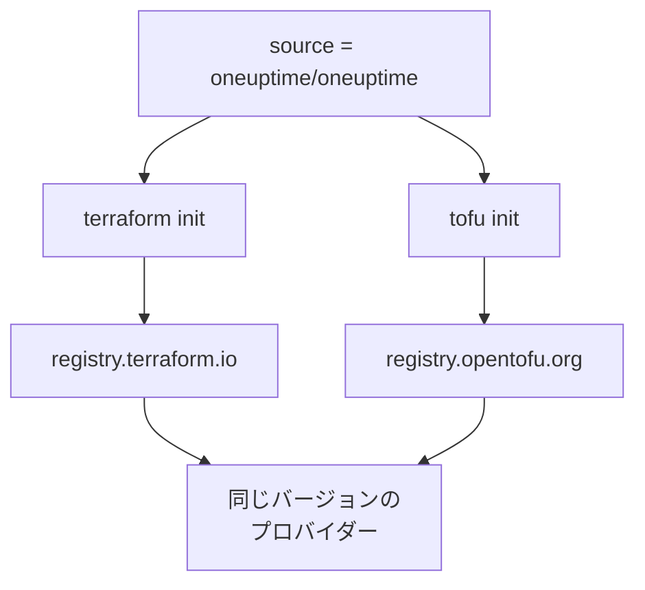

# OpenTofu

OneUptime プロバイダーは、Terraform と同じように [OpenTofu](https://opentofu.org) でも動作します。[OpenTofu Registry](https://search.opentofu.org/provider/oneuptime/oneuptime/latest) で公開されており、すべてのリリースは公開前に、両方で同じエンドツーエンドテストに合格しています。構成は変わりません。`tofu` を、このドキュメントが `terraform` を実行しているすべての場所で実行してください。

:::cards
- [OpenTofu でプロバイダーを使う](#opentofu-でプロバイダーを使う): 同じ構成を `tofu` で実行します。
- [Terraform との違い](#terraform-との違い): レジストリ、ロックファイル、`.tofu` ファイル、バージョン。
- [構成を OpenTofu に移す](#構成を-opentofu-に移す): 既存の構成を 4 つのステップで切り替えます。
- [再利用できるモジュール](#再利用できるモジュール): 1 つのサービスのためのモニター、オンコールポリシー、ステータスページ。
:::

## OpenTofu でプロバイダーを使う

OpenTofu 1.6 以降が必要です。Terraform と同じようにプロバイダーを宣言します。

```hcl title="main.tf"
terraform {
  required_providers {
    oneuptime = {
      source  = "oneuptime/oneuptime"
      version = "{{TERRAFORM_PROVIDER_VERSION}}"
    }
  }
}

provider "oneuptime" {
  # The API key comes from the ONEUPTIME_API_KEY environment variable.
  # On a self-hosted OneUptime, add your OneUptime's address:
  # oneuptime_url = "https://oneuptime.example.com"
}
```

それから `tofu` で実行します。

```bash
export ONEUPTIME_API_KEY="<your-api-key>"
tofu init
tofu plan
tofu apply
```

`tofu init` は OpenTofu Registry からプロバイダーをダウンロードします。[クイック スタート](/docs/terraform/quick-start)、[完全ガイド](/docs/terraform/complete-guide)、[モニターステップ](/docs/terraform/monitor-steps)、[例](/docs/terraform/examples)、[リソースのインポート](/docs/terraform/importing-resources) の内容はすべてそのまま当てはまり、ダッシュボードの **Terraform** ページが書く構成も変更なしで動作します。

### ソースアドレスにレジストリを含めない

`source = "oneuptime/oneuptime"` はレジストリを指定しないので、各エンジンは自分のレジストリから読み取ります。



ホスト名は書かないでください。ホスト名を書くと、どのエンジンもそのレジストリを使います。`registry.terraform.io/oneuptime/oneuptime` と書くと、OpenTofu も Terraform Registry からダウンロードし、Terraform は OpenTofu Registry のコピーを `authentication signature from unknown issuer` で拒否します。

## Terraform との違い

| 項目 | OpenTofu の場合 |
| --- | --- |
| レジストリ | `oneuptime/oneuptime` は `registry.opentofu.org/oneuptime/oneuptime` で、Terraform Registry と同じバージョンを公開しています。 |
| 署名 | `tofu init` は署名の検証をスキップしたと表示します。OpenTofu Registry にはこのプロバイダーの署名鍵がないため、OpenTofu はレジストリのチェックサムでダウンロードを検証します。 |
| `terraform` ブロック | `terraform` のままです。言語の一部であり、OpenTofu はそのまま読み取ります。 |
| `.tofu` ファイル | OpenTofu 1.8 以降は `.tofu` ファイルも読み取ります。また `.tf` ファイルは、同じ名前の `.tofu` ファイルがあれば読み飛ばします。Terraform は `.tf` ファイルしか読み取りません。 |
| `required_version` | OpenTofu のバージョンは 1.6.0 から始まるので、Terraform 向けに書いた `>= 1.5.0` はどの OpenTofu も受け入れます。 |
| ロックファイル | `registry.opentofu.org/oneuptime/oneuptime` が書かれます。エンジンを切り替えるとそのエントリが書き換わるので、変更をコミットしてください。 |
| State | OpenTofu は、Terraform が書いた state をそのまま読み取ります。 |
| 変数 | `TF_VAR_name` は OpenTofu でも変数を設定します。 |
| CLI 構成ファイル | `~/.tofurc` か `~/.terraformrc`、または `TF_CLI_CONFIG_FILE` で指定したファイル。 |
| `removed` ブロック | その `lifecycle` ブロックには OpenTofu 1.10 以降が必要です。これがないと、Terraform はレコードを破棄しますが、OpenTofu はリソースを忘れてレコードを残します。 |
| 名前が変わったリソースタイプへの移動 | `moved` ブロックで `oneuptime_io_t_fleet` から `oneuptime_iot_fleet` へ、またはほかの名前が変わったタイプ間で移動するには、OpenTofu 1.12 以降が必要です。 |

## 構成を OpenTofu に移す

Terraform が管理する構成は、state ごとそのまま OpenTofu に移せます。

:::steps
### OpenTofu をインストールする

OpenTofu をインストールします。プロバイダーには 1.6 で十分ですが、`oneuptime_io_t_fleet` から `oneuptime_iot_fleet` のように、リソースを名前が変わったタイプへ移動するには 1.12 以降が必要です。

### tofu で初期化する

構成のフォルダーで `tofu init` を実行します。OpenTofu Registry からプロバイダーをダウンロードし、ロックファイルを変更したと表示します。プロバイダーのエントリは OpenTofu Registry を指すようになります。

### プランを実行する

`tofu plan` を実行します。Terraform が残した state を読み取り、`No changes.` と応答します。

### ロックファイルをコミットする

`.terraform.lock.hcl` をコミットし、これからは CI も含めて `tofu` で構成を実行します。
:::

## 再利用できるモジュール

OneUptime のリポジトリの [`Examples/opentofu/`](https://github.com/OneUptime/oneuptime/tree/master/Examples/opentofu) には、すぐに実行できる構成と、1 つのサービスを設定するモジュールがあります。このモジュールは、渡した各アドレスの Web サイトモニター、作成するすべてのものに付けるラベル、エスカレーションルールが 1 つあるオンコールポリシー、モニターを一覧表示するステータスページを作ります。普通の HCL なので、Terraform でも動作します。

```hcl title="main.tf"
module "storefront" {
  source = "github.com/OneUptime/terraform-provider-oneuptime//modules/monitoring-and-incident-response?ref=vX.Y.Z"

  service_name          = "storefront"
  status_page_is_public = true

  monitors = {
    homepage = { url = "https://example.com" }
    checkout = { url = "https://example.com/checkout" }
    api      = { url = "https://api.example.com/health", expected_status_code = "204" }
  }
}
```

`vX.Y.Z` は、[プロバイダーのリリース](https://github.com/OneUptime/terraform-provider-oneuptime/releases) の最新のものなど、公開済みのプロバイダーのバージョンに置き換えてください。モジュールはプロバイダーと一緒に公開され、そのリポジトリはリリースごとに変わります。

モジュールは、モニターステータスやインシデントの重大度を作成しません。どのプロジェクトにも最初からあるもの、`Operational`、`Offline`、`Critical Incident` を名前で検索します。プロジェクトでそれらの名前を変えている場合は、`operational_monitor_status_name`、`offline_monitor_status_name`、`incident_severity_name` を設定してください。

モジュールのエスカレーションルールは、誰を呼び出すかを指定するまで誰も呼び出しません。モジュールの出力を使ってチームを追加します。

```hcl title="main.tf"
resource "oneuptime_team" "storefront" {
  name = "Storefront"
}

resource "oneuptime_team_on_call_duty_escalation_rule" "storefront" {
  on_call_duty_policy_id                 = module.storefront.on_call_policy_id
  on_call_duty_policy_escalation_rule_id = module.storefront.escalation_rule_id
  team_id                                = oneuptime_team.storefront.id
}
```

## 次のステップ

:::cards
- [クイック スタート](/docs/terraform/quick-start): API キーを作成し、最初のリソースを適用します。
- [レジストリの使用](/docs/terraform/registry): バージョンの番号の付け方とロックファイル。
- [セルフホスト セットアップ](/docs/terraform/self-hosted): 自分の OneUptime と、オフラインのマシン向けのミラー。
- [トラブルシューティング](/docs/terraform/troubleshooting): よくあるエラーとその直し方。
:::
