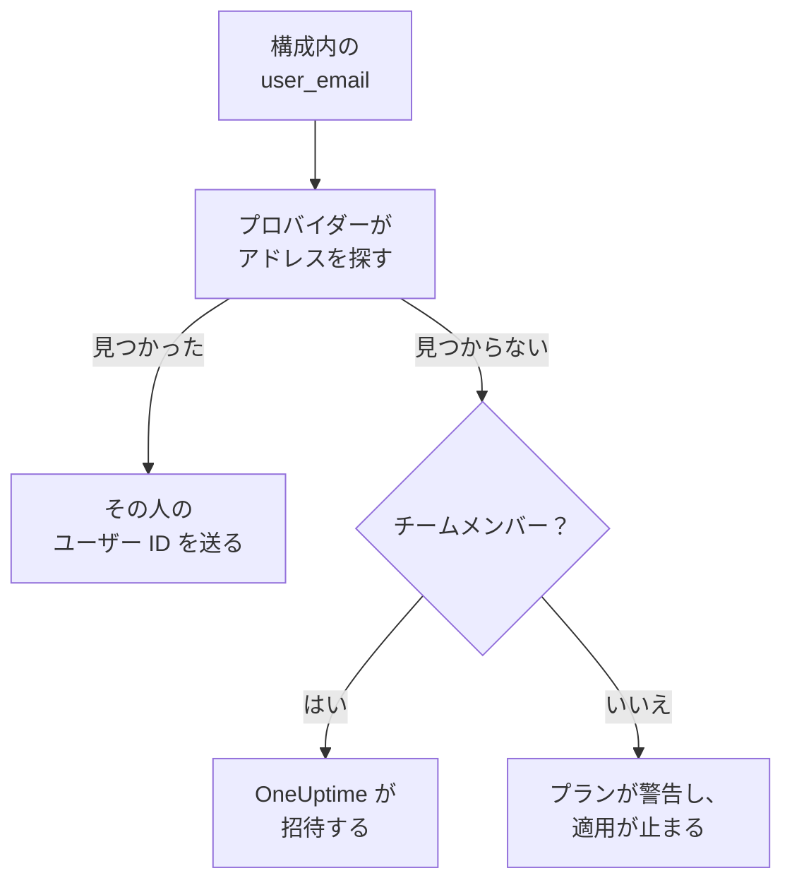

# ユーザーとチーム

プロジェクトに誰がいるかを Terraform の構成に記録します。チームとそのメンバー、オンコールの担当者、何を誰が所有するかです。一人ひとりをメールアドレスで指定すると、プロバイダーがその人を見つけ、プロジェクトに新しく加わる人を招待します。

:::cards
- [メールアドレスで人を指定する](#メールアドレスで人を指定する): すべてのユーザー ID の横にある属性。
- [人を迎え入れる](#人を迎え入れる): 誰かを招待し、チーム、オンコールの当番、所有するものを渡します。
- [人を送り出す](#人を送り出す): 誰かを外すことと、そのとき OneUptime が一緒に外すもの。
- [すでにいるメンバーをインポートする](#すでにいるメンバーをインポートする): そのチームとアドレスで。
:::

## 仕組み

プロバイダーは、API キーのプロジェクトの人、つまりメンバーとプロジェクトに招待された人の中からアドレスを探します。見つけた人の ID を API に送ります。プロジェクトの誰も持たないアドレスで指定したチームメンバーは、代わりにそのアドレスを招待します。



検索されるのは API キー自身のプロジェクトだけです。その外の人が見つかることはなく、プロバイダーには、あるアドレスがほかの場所にアカウントを持つかどうかもわかりません。

## 始める前に

- **プロジェクトのチームを読み取れる API キー。** プロバイダーはチームを通じて人を見つけます。
- **新しい人を追加するには、人を招待できるキー。** [メンバーの招待](/docs/permissions/inviting-people) を参照してください。

## メールアドレスで人を指定する

人を指定するリソースはすべて、ユーザー ID の横にその人のメールアドレスも受け付けます。どちらか一方を指定します。

| ユーザー ID | メールアドレス |
| --- | --- |
| `user_id` | `user_email` |
| `owner_users` | `owner_user_emails` |
| `assigned_to_user_id` | `assigned_to_user_email` |
| `override_user_id` | `override_user_email` |

アドレスは大文字と小文字を区別せずに見つかり、書いたとおりに state に保持されます。ユーザー ID は自動で入るので、ほかのリソースから参照できます。

## 人を迎え入れる

この構成は、プロジェクトに新しく加わる Alice をチームに追加し、初日からオンコールの当番を割り当て、すでにプロジェクトにいる Bob をモニターのオーナーにします。

```hcl title="people.tf"
resource "oneuptime_team" "sre" {
  name        = "SRE"
  description = "Site reliability engineering"
}

# New to the project: OneUptime invites her.
resource "oneuptime_team_member" "alice" {
  team_id    = oneuptime_team.sre.id
  user_email = "alice@example.com"
}

resource "oneuptime_on_call_policy_schedule" "weekly" {
  name     = "SRE weekly"
  timezone = "UTC"
}

resource "oneuptime_on_call_schedule_layer" "weekly" {
  on_call_duty_policy_schedule_id = oneuptime_on_call_policy_schedule.weekly.id
  name                            = "Weekly"
  starts_at                       = "2030-01-07T09:00:00Z"
  hand_off_time                   = "2030-01-14T09:00:00Z"
}

# Named through her membership, so she is invited first.
resource "oneuptime_on_call_schedule_layer_user" "alice" {
  on_call_duty_policy_schedule_id       = oneuptime_on_call_policy_schedule.weekly.id
  on_call_duty_policy_schedule_layer_id = oneuptime_on_call_schedule_layer.weekly.id
  user_id                               = oneuptime_team_member.alice.user_id
}

resource "oneuptime_monitor" "api" {
  name         = "Public API"
  monitor_type = "Manual"
}

# In the project already: named by his address.
resource "oneuptime_monitor_user_owner" "api" {
  monitor_id = oneuptime_monitor.api.id
  user_email = "bob@example.com"
}
```

`terraform apply` は、ダッシュボードからの招待と同じように Alice をメールで招待します。アカウントがなければ OneUptime が作成します。`has_accepted_invitation` は承諾するまで `false` のままで、承諾してもプランの変更にはなりません。すでにプロジェクトにいる人は、新しいチームにすぐ加わります。

この構成で招待する人をオンコールに入れたりオーナーにしたりするには、`user_id = oneuptime_team_member.<name>.user_id` でその人のメンバーシップを参照します。こうすると Terraform は、ほかの場所で指定する前にその人を招待します。プロジェクトの誰も持たないアドレスは、プランでは警告、適用ではエラーになります。

## 人を探す

データソース `oneuptime_user` は `email`、`name`、`id` のいずれかで人を探し、その人のユーザー ID、名前、参加済みかどうか、所属するチームを読み取ります。

```hcl
data "oneuptime_user" "alice" {
  email = "alice@example.com"
}

output "alice_teams" {
  value = data.oneuptime_user.alice.team_ids
}
```

ほかのデータソースも、レコードが指す人のアドレスで、その ID と並んでレコードを見つけます。次の例は、SRE チームでの Alice のメンバーシップを読み取ります。

```hcl
data "oneuptime_team_member" "alice" {
  team_id    = oneuptime_team.sre.id
  user_email = "alice@example.com"
}
```

## 人を送り出す

その人のメンバーシップを構成から削除して適用します。プロジェクトの最後のチームから外れるとプロジェクトからも外れ、OneUptime はその人をすべてのオンコールスケジュール、エスカレーションルール、代理から外し、所有しているものからも外します。終わったインシデント、アラート、メンテナンスイベントを除くすべてです。その人を指定するブロックも同じ変更で削除してください。削除しないと、次のプランがもうプロジェクトにいない人のためにそれらを作り直します。

その人の OneUptime アカウントはその人のものとして残り、離れるのはプロジェクトだけです。メンバーを残す必要があるチームは、承諾済みの最後のメンバーを外させません。

## すでにいるメンバーをインポートする

メンバーシップの ID はどの画面にも表示されないので、チームの ID とその人のアドレスでインポートします。

```bash
terraform import oneuptime_team_member.alice 6b1d1c2e-4f3a-4b5c-8d6e-7f8091a2b3c4/alice@example.com
```

アドレスは書いたとおりに残るので、構成と同じように書いてください。メンバーシップ自身の ID でもインポートでき、その場合アドレスは OneUptime から小文字で読み取られます。

オーナーやオンコールの行も同じように、属しているものでインポートします。モニターのオーナーは、モニターの ID とその人のアドレスでインポートします。オーナーチームや、エスカレーションルールが呼び出すチームのように、チームやスケジュールを指す行は、両方の ID でインポートします。

```bash
terraform import oneuptime_monitor_user_owner.api 68a1b2c3-d4e5-4f6a-8b9c-0d1e2f3a4b01/bob@example.com
terraform import oneuptime_escalation_rule_team.sre 68a1b2c3-d4e5-4f6a-8b9c-0d1e2f3a4b06/6b1d1c2e-4f3a-4b5c-8d6e-7f8091a2b3c4
```

## アドレスが変わったとき

OneUptime でアドレスを変えた人も、Terraform にとっては同じ人のままです。新しいアドレスを書くまで何も変わらず、書いたときに変わるのは `user_email` だけです。

## トラブルシューティング

:::details プランが、アドレスがまだこのプロジェクトにないと言う
プロジェクトにも招待された人にも、そのアドレスを持つ人はいません。まず `oneuptime_team_member` でその人を招待してください。そのメンバーシップが同じ構成にあるなら、アドレスの代わりに `user_id = oneuptime_team_member.<name>.user_id` で参照します。OneUptime でアドレスを変えた人なら、新しいアドレスを使ってください。
:::

:::details 適用が、ユーザーはすでにこのチームに招待されていると言う
その人はすでにチームにいます。作成する代わりにそのメンバーシップをインポートしてください。[すでにいるメンバーをインポートする](#すでにいるメンバーをインポートする) のとおりです。
:::

## 次のステップ

:::cards
- [リソースのインポート](/docs/terraform/importing-resources): プロジェクトの残りも Terraform の管理下に置きます。
- [メンバーの招待](/docs/permissions/inviting-people): OneUptime での招待の仕組み。
- [例](/docs/terraform/examples): よく使うリソースの、すぐに使える構成。
:::
