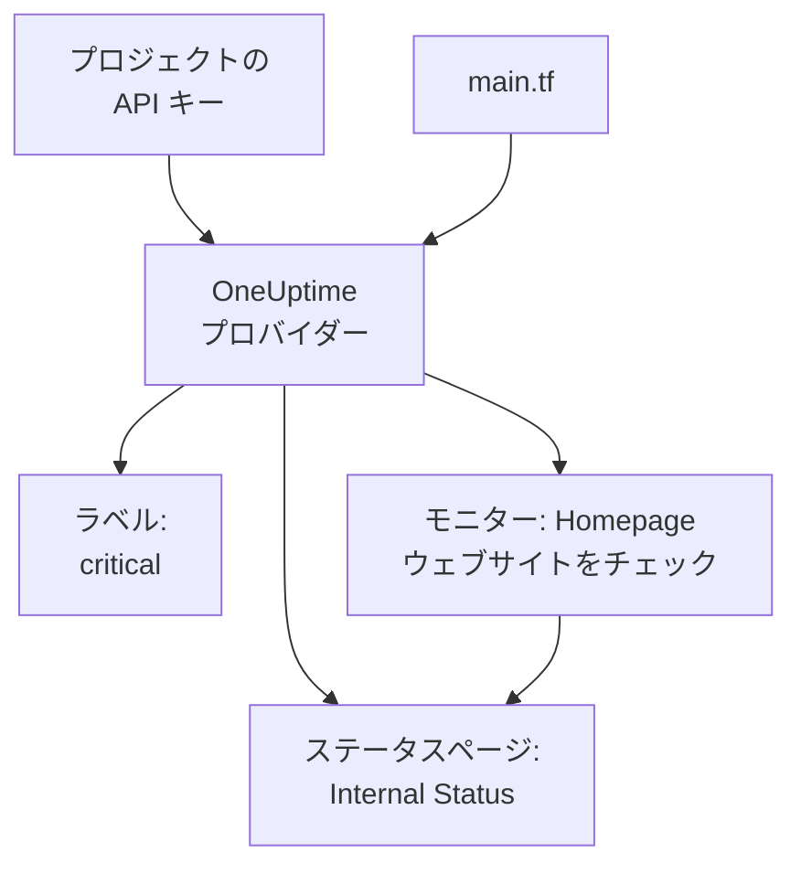

# クイック スタート

このガイドでは、何もない状態から Terraform で管理される OneUptime プロジェクトまで、約 10 分で進みます。API キーを作成し、Terraform をプロジェクトに向け、ラベル、ウェブサイトをチェックするモニター、それを表示する非公開のステータスページを適用します。その後、そのうちの 1 つを変更し、最後に片付けます。

:::cards
- [はじめる前に](#はじめる前に): Terraform、プロジェクト、API キーが使えるプラン。
- [最初のリソースを作成する](#最初のリソースを作成する): API キーから適用済みのプランまで、6 つのステップで。
- [リソースを変更する](#リソースを変更する): 構成を編集し、プランを作成して適用します。
- [トラブルシューティング](#トラブルシューティング): 最初の実行で止まる可能性のあるエラー。
:::



## はじめる前に

- **Terraform 1.5 以降、または OpenTofu 1.6 以降。** OpenTofu では、このガイドで `terraform` を実行する箇所で `tofu` を実行します。
- **OneUptime プロジェクト。** [oneuptime.com](https://oneuptime.com) またはご自身の OneUptime 上にあり、API キーを作成できるもの。
- **OneUptime Cloud では Growth プラン以上。** プロジェクトの API キーはこのプランでのみ動作します。

## 最初のリソースを作成する

:::steps
### プロジェクトの API キーを作成する

OneUptime ダッシュボードで **プロジェクト設定 → 詳細 → API キー** を開き、**API キーを作成** をクリックします。`terraform` のような **名前** を付け、**アクセス** で **プロジェクト管理者** を選びます。Terraform は管理するすべての種類のレコードを作成、読み取り、変更、削除し、**プロジェクト管理者** はそのすべてを行えます。権限を絞ったキーにするには、**権限は後で選択** を選び、キーのページで必要な権限だけを追加します。

キーの有効期限は今日から 1 年後です。別の日付を選ぶには、作成する前に **その他の項目** を開くか、後でキーのページで日付を変更します。キーを作成するとそのページが開くので、**API キーの詳細** カードから **API キー** をコピーします。

### キーを Terraform で使えるようにする

キーがファイルに残らないように、Terraform を実行するシェルの環境変数 `ONEUPTIME_API_KEY` にキーを入れます。

:::tabs
@tab Linux
```bash
export ONEUPTIME_API_KEY="<your-api-key>"
```
@tab macOS
```bash
export ONEUPTIME_API_KEY="<your-api-key>"
```
@tab Windows
```powershell
$env:ONEUPTIME_API_KEY = "<your-api-key>"
```
:::

### Terraform を OneUptime に向ける

空のフォルダーを作り、その中に `main.tf` という名前のファイルを作ります。

```hcl title="main.tf"
terraform {
  required_providers {
    oneuptime = {
      source  = "oneuptime/oneuptime"
      version = "{{TERRAFORM_PROVIDER_VERSION}}"
    }
  }
}

provider "oneuptime" {
  # The API key comes from ONEUPTIME_API_KEY.
  # On a self-hosted OneUptime, add your OneUptime's address:
  # oneuptime_url = "https://oneuptime.example.com"
}
```

セルフホストの OneUptime では、プロバイダーのバージョンを選ぶ前に [セルフホスト セットアップ](/docs/terraform/self-hosted) を読んでください。

### リソースを記述する

これらのブロックを `main.tf` に追加します。どのプロジェクトにも最初からあるモニターステータスのうち 2 つを読み取り、ラベル、`https://example.com` を 5 分ごとにチェックするモニター (ここにはご自身のウェブサイトを入れてください)、そのモニターを表示する非公開のステータスページを作成します。

```hcl title="main.tf"
data "oneuptime_monitor_status" "operational" {
  name = "Operational"
}

data "oneuptime_monitor_status" "offline" {
  name = "Offline"
}

resource "oneuptime_label" "critical" {
  name        = "critical"
  description = "Resources that page on-call when down"
  color       = "#FF5733"
}

resource "oneuptime_monitor" "homepage" {
  name                = "Homepage"
  description         = "Checks that the homepage responds"
  monitor_type        = "Website"
  monitoring_interval = "*/5 * * * *"
  labels              = [oneuptime_label.critical.id]

  monitor_steps = [{
    monitor_destination      = "https://example.com"
    monitor_destination_type = "URL"
    request_type             = "GET"

    criteria = [
      {
        name                  = "Offline"
        description           = "The homepage does not respond"
        filter_condition      = "Any"
        change_monitor_status = true
        monitor_status_id     = data.oneuptime_monitor_status.offline.id

        filters = [
          {
            check_on    = "Is Online"
            filter_type = "False"
          }
        ]
      },
      {
        name                  = "Online"
        description           = "The homepage responds"
        filter_condition      = "All"
        change_monitor_status = true
        monitor_status_id     = data.oneuptime_monitor_status.operational.id

        filters = [
          {
            check_on    = "Is Online"
            filter_type = "True"
          }
        ]
      }
    ]
  }]
}

resource "oneuptime_status_page" "internal" {
  name                  = "Internal Status"
  description           = "Status of our internal services"
  page_title            = "Service Status"
  is_public_status_page = false
}

resource "oneuptime_status_page_resource" "homepage" {
  status_page_id = oneuptime_status_page.internal.id
  monitor_id     = oneuptime_monitor.homepage.id
  display_name   = "Homepage"
}

output "monitor_id" {
  value = oneuptime_monitor.homepage.id
}
```

モニターの `monitor_steps` は、何をチェックし、各結果が何を意味するかを表します。チェックのたびに、最初に一致した条件がステータスを決めます。各部分は [モニターステップ](/docs/terraform/monitor-steps) で説明しています。

### プランを作成して適用する

:::tabs
@tab Terraform
```bash
terraform init
terraform plan
terraform apply
```
@tab OpenTofu
```bash
tofu init
tofu plan
tofu apply
```
:::

`init` はプロバイダーをダウンロードします。プランは `Plan: 4 to add, 0 to change, 0 to destroy.` で終わります。`yes` と入力して適用します。完了すると、Terraform は新しいモニターの ID を出力します。

### ダッシュボードを確認する

OneUptime ダッシュボードで:

- **モニター** に、`critical` ラベルの付いた `Homepage` が表示されます。最初のチェックは数分以内に届きます。
- **ステータスページ** に、`Homepage` を表示する `Internal Status` が表示されます。
- **プロジェクト設定 → 基本 → ラベル** に、設定した色の `critical` が表示されます。

もう一度 `terraform plan` を実行します。答えは `No changes.` です。OneUptime の内容は構成のとおりです。
:::

## リソースを変更する

変更するのはダッシュボードではなく構成です。`main.tf` でラベルの `color` を `"#2ECC71"` にしてから、プランを作成して適用します。

```bash
terraform plan
terraform apply
```

プランは `Plan: 0 to add, 1 to change, 0 to destroy.` で終わり、ラベルはその場で変更されます。Terraform が管理するリソースに誰かがダッシュボードで加えた変更は次のプランに表示され、適用すると構成の内容に戻ります。

## 片付ける

試しに使っただけなら、構成が作成したものを削除します。

```bash
terraform destroy
```

これでラベル、モニター、ステータスページ、そのリソースが削除されます。2 つのモニターステータスは残ります。データソースは読み取るだけだからです。

## トラブルシューティング

:::details メッセージ「Missing API Key」
プロバイダーが API キーを見つけられませんでした。Terraform を実行するシェルで `ONEUPTIME_API_KEY` をエクスポートするか、プロバイダーブロックで `api_key` を設定して、コマンドをもう一度実行します。
:::

:::details メッセージ「the OneUptime API returned status 400: Invalid API Key」
キーの入力を誤っているか、期限切れか、削除されたか、`oneuptime_url` が指すものとは別の OneUptime のキーです。キーのページからもう一度コピーするか、新しいキーを作成してください。
:::

:::details メッセージ「the OneUptime API returned status 402: API keys need the Growth plan」
OneUptime Cloud では、プロジェクトの API キーは Growth プラン以上でのみ動作します。**プロジェクト設定 → 請求と請求書 → 請求** でプロジェクトをアップグレードすれば、同じキーがまた使えるようになります。
:::

:::details メッセージ「the OneUptime API returned status 422: You do not have permissions to create Monitor」
キーにその種類のレコードの権限がありません。キーのページで **プロジェクト管理者** か、メッセージに書かれた権限を付与してください。
:::

:::details メッセージ「No monitor status matches {name = "Offline"}」
プロジェクトのモニターステータスの名前が違います。**モニター → 設定 → モニターステータス** に表示される名前を使うか、代わりに `is_offline_state = true` でステータスを検索してください。
:::

## 次のステップ

:::cards
- [完全ガイド](/docs/terraform/complete-guide): 認証、プロジェクトの構成、データソース、state、アップグレード。
- [モニターステップ](/docs/terraform/monitor-steps): モニターが何をチェックし、各結果が何を意味するかを決めます。
- [例](/docs/terraform/examples): よく使うリソースのすぐに使える構成。
- [リソースのインポート](/docs/terraform/importing-resources): ダッシュボードで作ったものを Terraform の管理下に置きます。
:::
