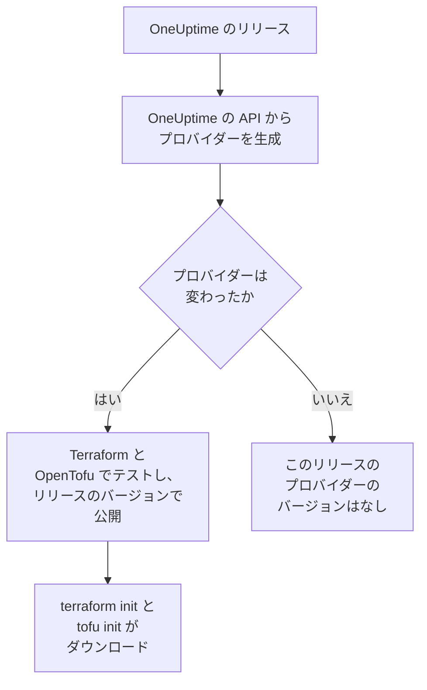

# レジストリの使用

OneUptime プロバイダーは [Terraform Registry](https://registry.terraform.io/providers/oneuptime/oneuptime) と [OpenTofu Registry](https://search.opentofu.org/provider/oneuptime/oneuptime/latest) で公開されています。`terraform init` と `tofu init` がそこからダウンロードするので、手でインストールするものはありません。このページでは、何が公開されているか、バージョンの番号の付け方、新しいバージョンへの移り方を説明します。

:::cards
- [公開されているもの](#公開されているもの): 各プラットフォーム向けのプロバイダー、そのリファレンス、そのバージョン。
- [バージョンの番号の付け方](#バージョンの番号の付け方): プロバイダーのバージョンは、それを公開した OneUptime のリリースです。
- [ロックファイル](#ロックファイル): すべてのマシンがインストールするバージョンとチェックサム。
- [新しいバージョンに移る](#新しいバージョンに移る): 変更点を読み、ダウンロードして、プランを実行します。
:::

## 公開されているもの

OneUptime の各リリースは、OneUptime 自身の API からプロバイダーを生成します。プロバイダーが変わった場合、そのリリースは、Terraform と OpenTofu のエンドツーエンドテストに合格した後で、リリースのバージョンでプロバイダーを公開します。



| 何を | どこで |
| --- | --- |
| Linux、macOS、Windows、FreeBSD、OpenBSD、Solaris 向けのプロバイダー | `terraform init` と `tofu init` がダウンロードし、OneUptime が署名したチェックサムが付きます |
| すべてのリソースとデータソースのリファレンスと、そのすべての属性 | レジストリのドキュメント。モニター、ステータスページ、インシデント、オンコールなど、製品ごとにまとめられています |
| OpenTofu でプロバイダーを使うためのガイド | レジストリのガイド |
| すべてのバージョン (新しい順) | レジストリのバージョン一覧 |

リファレンスには、各属性が何かが載っています。このドキュメントでは、それらを組み合わせて使う方法を説明します。[Terraform 概要](/docs/terraform/index) から始めてください。

## バージョンの番号の付け方

プロバイダーのバージョンは、それを公開した OneUptime のリリースのバージョンです。プロバイダー {{TERRAFORM_PROVIDER_MAJOR}}.0.20 は OneUptime {{TERRAFORM_PROVIDER_MAJOR}}.0.20 とともに公開されました。プロバイダーが変わらなかったリリースは何も公開しないため、バージョンには抜けがあり、正確なバージョンを 1 つだけ指定する制約は、存在しないバージョンを指すことがあります。代わりに範囲を書いてください。

| 使っているもの | 制約 | Terraform がインストールするもの |
| --- | --- | --- |
| OneUptime Cloud | `{{TERRAFORM_PROVIDER_VERSION}}` | 最新の {{TERRAFORM_PROVIDER_MAJOR}}.x のプロバイダー |
| セルフホストの OneUptime | 自分の OneUptime のバージョンで終わる範囲。たとえば `>= {{TERRAFORM_PROVIDER_MAJOR}}.0, <= {{TERRAFORM_PROVIDER_MAJOR}}.0.40` | 自分の OneUptime より新しくない最新のプロバイダー |

セルフホストの OneUptime では、自分の OneUptime より新しいプロバイダーが、その OneUptime にまだない設定を送ることがあります。範囲の書き方は [セルフホスト セットアップ](/docs/terraform/self-hosted#プロバイダーのバージョンを選ぶ) で説明しています。

```hcl title="main.tf"
terraform {
  required_providers {
    oneuptime = {
      source  = "oneuptime/oneuptime"
      version = "{{TERRAFORM_PROVIDER_VERSION}}"
    }
  }
}
```

ソースアドレスはレジストリを指定しません。Terraform は Terraform Registry から、OpenTofu は OpenTofu Registry から読み取り、どちらも同じバージョンを公開しています。

## ロックファイル

`terraform init` は、選んだバージョンとダウンロードのチェックサムを `.terraform.lock.hcl` に記録します。このファイルをコミットしてください。そうすれば、別のバージョンを選ぶまで、すべてのマシンと CI の実行が正確にそのバージョンをインストールします。チェックサムはレジストリが公開するすべてのプラットフォームを対象とするので、1 つのロックファイルで Linux、macOS、Windows のマシンに対応できます。

```hcl title=".terraform.lock.hcl"
provider "registry.terraform.io/oneuptime/oneuptime" {
  version     = "{{TERRAFORM_PROVIDER_MAJOR}}.0.20"
  constraints = "{{TERRAFORM_PROVIDER_VERSION}}"
  hashes = [
    "h1:...",
    "zh:...",
  ]
}
```

ロックファイルにはレジストリが書かれます。OpenTofu は `registry.opentofu.org/oneuptime/oneuptime` と書き、Terraform は同じところに `registry.terraform.io/oneuptime/oneuptime` と書きます。そのため、エンジンを切り替えるとロックファイルが変わります。`init` はエントリを置き換え、その変更をコミットするよう求めます。

## 新しいバージョンに移る

:::steps
### 変更点を読む

[OneUptime のリリース](https://github.com/OneUptime/oneuptime/releases) には、プロバイダーを含め、各リリースで何が変わったかが書かれています。[プロバイダーのリリース](https://github.com/OneUptime/terraform-provider-oneuptime/releases) は、前のリリースからの変更へのリンクを示します。

### ダウンロードする

```bash
terraform init -upgrade
```

`init -upgrade` は、制約が許す最新のバージョンを選んで表示し、`.terraform.lock.hcl` を更新します。制約 `{{TERRAFORM_PROVIDER_VERSION}}` は {{TERRAFORM_PROVIDER_MAJOR}}.x のすべてのリリースを受け入れます。新しいメジャーバージョンには新しい制約が必要です。

### 適用する前にプランを実行する

`terraform plan` を実行し、プランが空か、予想どおりの変更だけを示すときに限って適用します。更新されたロックファイルをコミットしてください。
:::

セルフホストの OneUptime では、まず OneUptime をアップグレードし、その後でプロバイダーの範囲の上限を上げます。

## コードの場所

プロバイダーは、[OneUptime のメインリポジトリ](https://github.com/OneUptime/oneuptime) で OneUptime の API から生成され、各バージョンはそれを公開したリリースからビルドされます。プロバイダー自身のリポジトリ [OneUptime/terraform-provider-oneuptime](https://github.com/OneUptime/terraform-provider-oneuptime) には生成器が書いたものが入っているので、変更はメインリポジトリで行います。問題は、ドキュメントの問題も含めて [github.com/OneUptime/oneuptime/issues](https://github.com/OneUptime/oneuptime/issues) に報告してください。

## 次のステップ

:::cards
- [セルフホスト セットアップ](/docs/terraform/self-hosted): 自分の OneUptime 向けのバージョンの範囲と、オフラインのマシン向けのミラー。
- [OpenTofu](/docs/terraform/opentofu): 同じプロバイダーと構成を `tofu` で。
- [完全ガイド](/docs/terraform/complete-guide): 認証、プロジェクトの構成、データソース、state、アップグレード。
- [トラブルシューティング](/docs/terraform/troubleshooting): よくあるエラーとその直し方。
:::
