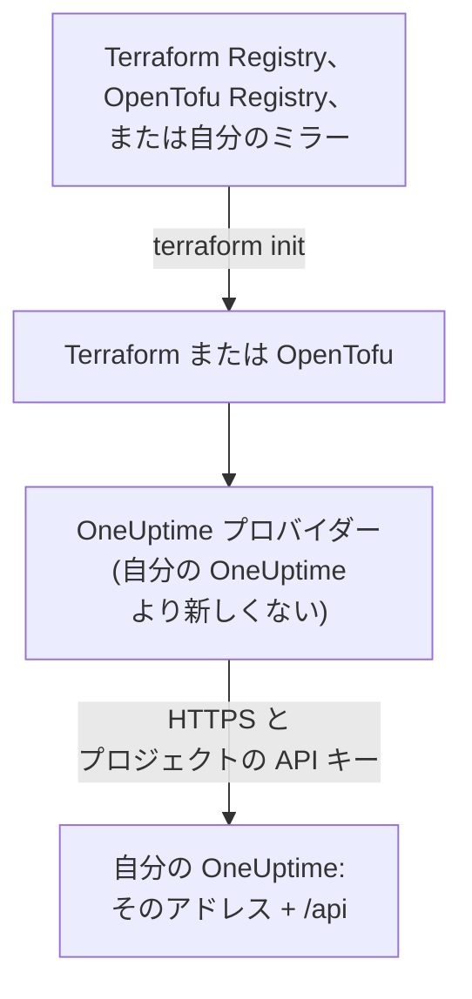

# セルフホスト セットアップ

プロバイダーは、自分の OneUptime でも OneUptime Cloud と同じように動作します。リソースも属性も、プロジェクトの API キーも同じです。自分で設定するのは、OneUptime のアドレス、それに合うプロバイダーのバージョン、そして必要に応じて、インターネットに接続できないマシン向けのミラーと、プライベート認証局の信頼です。

:::cards
- [プロバイダーを自分の OneUptime に向ける](#プロバイダーを自分の-oneuptime-に向ける): そのアドレスと、プロジェクトの API キー。
- [プロバイダーのバージョンを選ぶ](#プロバイダーのバージョンを選ぶ): OneUptime より新しくない、最新のプロバイダー。
- [インターネットに接続できない場合](#インターネットに接続できない場合): プロバイダーをネットワーク内にミラーします。
- [TLS と証明書](#tls-と証明書): プライベート認証局、プロキシ、平文の HTTP。
:::



## プロバイダーを自分の OneUptime に向ける

`oneuptime_url` には、ダッシュボードを開くときのアドレス、つまりパスのないスキームとホストを設定します。アドレスにスキームがなければプロバイダーが `https://` を付け、最後に `/api` を付けるので、`https://oneuptime.example.com` ではすべてのリクエストが `https://oneuptime.example.com/api` に送られます。

```hcl title="main.tf"
terraform {
  required_providers {
    oneuptime = {
      source  = "oneuptime/oneuptime"
      version = "{{TERRAFORM_PROVIDER_MATCHING}}"
    }
  }
}

provider "oneuptime" {
  oneuptime_url = "https://oneuptime.example.com"
  # The API key comes from the ONEUPTIME_API_KEY environment variable.
}
```

アドレスは環境変数 `ONEUPTIME_URL` から渡すこともできるので、1 つの構成で複数のインストールを指せます。

```bash
export ONEUPTIME_URL="https://oneuptime.example.com"
export ONEUPTIME_API_KEY="<your-api-key>"
```

アドレスは、インストールが提供されているホストです。Docker Compose では `HOST` と `HTTP_PROTOCOL` (`config.env` 内)、Helm チャートでは `host` と `httpProtocol` (values 内) です。

キーは、管理するプロジェクトの API キーで、OneUptime Cloud と同じく、自分の OneUptime のダッシュボードの **プロジェクト設定 → 詳細 → API キー** で作成します。セルフホストの OneUptime のマスター API キーはどのプロジェクトにも属さないため、それを使った作成は `ProjectId required` で失敗します。

> [!TIP]
> このブロックは自分の OneUptime が書いてくれます。ダッシュボードで任意のリソースかリストを開き、そのサイドメニューで **開発者**、**Terraform** の順に開いてください。表示されるプロバイダーブロックには、自分の OneUptime のアドレスと、それに合うバージョンの範囲が入っています。

## プロバイダーのバージョンを選ぶ

自分の OneUptime より新しくない、公開済みの最新のプロバイダーを使います。プロバイダーのバージョンは OneUptime のバージョンに従います。プロバイダーを変更する OneUptime のリリースは、そのリリース自身のバージョン番号でプロバイダーを公開します。自分の OneUptime より新しいプロバイダーは、その OneUptime にまだない設定を送ることがあります。

そのため、ダッシュボードと同じように、自分の OneUptime のバージョンで終わる範囲を書きます。上のブロックは `{{TERRAFORM_PROVIDER_MATCHING}}` を使っています。これは、このドキュメントの提供元の OneUptime に合う範囲で、自分の OneUptime でこのドキュメントを読んでいるなら、その範囲がそのまま使えます。そうでなければ、自分のバージョンを書き入れます。

:::steps
### 自分の OneUptime のバージョンを調べる

自分の OneUptime に問い合わせます。

```bash
curl https://oneuptime.example.com/version
```

応答は `{"version":"{{TERRAFORM_PROVIDER_MAJOR}}.0.40","commit":"..."}` のような JSON です。マスター管理者であれば、管理者ダッシュボードのヘッダーにあるエディションラベルを開いて確認することもできます: [現在のバージョンを確認する](/docs/installation/upgrading#現在のバージョンを確認する) を参照してください。

### 範囲に書き入れる

範囲はメジャーバージョンから始まり、自分のバージョンで終わります。OneUptime {{TERRAFORM_PROVIDER_MAJOR}}.0.40 の場合:

```hcl title="main.tf"
terraform {
  required_providers {
    oneuptime = {
      source  = "oneuptime/oneuptime"
      version = ">= {{TERRAFORM_PROVIDER_MAJOR}}.0, <= {{TERRAFORM_PROVIDER_MAJOR}}.0.40"
    }
  }
}
```

Terraform は範囲内の最新のプロバイダーを使います。プロバイダーを変更しなかった OneUptime のリリースはプロバイダーを公開しませんが、範囲は存在しないバージョンを飛ばします。

### プロバイダーをダウンロードする

`terraform init` を実行します。インストールしたバージョンが表示され、`.terraform.lock.hcl` に記録されます。
:::

アップグレードするときは、まず OneUptime をアップグレードします。その後で範囲の上限を新しいバージョンに上げ、`terraform init -upgrade` を実行します。

## インターネットに接続できない場合

Terraform を実行するマシンがレジストリに到達できないときは、プロバイダーを一度ネットワーク内にコピーし、Terraform をそのコピーに向けます。

:::steps
### プロバイダーをミラーする

インターネットに接続できるマシンで、構成のあるフォルダーから、自分のマシンが動くすべてのプラットフォーム向けにプロバイダーをダウンロードします。`-platform` を付けないと、コマンドは自分のプラットフォーム向けのプロバイダーしかダウンロードしません。

:::tabs
@tab Terraform
```bash
terraform providers mirror -platform=linux_amd64 -platform=darwin_arm64 /srv/terraform-mirror
```
@tab OpenTofu
```bash
tofu providers mirror -platform=linux_amd64 -platform=darwin_arm64 /srv/terraform-mirror
```
:::

フォルダーには、`registry.terraform.io/oneuptime/oneuptime/` のように、レジストリのアドレスの下にプロバイダーが入ります。これをネットワーク内にコピーします。

### Terraform をミラーに向ける

OneUptime プロバイダーはフォルダーから、それ以外はいつもどおりインストールする CLI 構成ファイルを書きます。

:::tabs
@tab Terraform
```hcl title="mirror.tfrc"
provider_installation {
  filesystem_mirror {
    path    = "/srv/terraform-mirror"
    include = ["registry.terraform.io/oneuptime/oneuptime"]
  }
  direct {
    exclude = ["registry.terraform.io/oneuptime/oneuptime"]
  }
}
```
@tab OpenTofu
```hcl title="mirror.tfrc"
provider_installation {
  filesystem_mirror {
    path    = "/srv/terraform-mirror"
    include = ["registry.opentofu.org/oneuptime/oneuptime"]
  }
  direct {
    exclude = ["registry.opentofu.org/oneuptime/oneuptime"]
  }
}
```
:::

このファイルを、Terraform と OpenTofu の両方が読む `TF_CLI_CONFIG_FILE` で指定します: `export TF_CLI_CONFIG_FILE=/etc/terraform/mirror.tfrc`。

### 初期化する

`terraform init` を実行すると、ミラーからプロバイダーがインストールされます。ロックファイルにこのプラットフォームのチェックサムしかないという警告が出ます。すべてのプラットフォームのチェックサムを記録するには、インターネットに接続できるマシンで `terraform providers lock` を同じ `-platform` オプション付きで実行し、`.terraform.lock.hcl` を構成と一緒にコミットします。
:::

バージョンの範囲を上げるたびに、ミラーを作り直してください。

## TLS と証明書

プロバイダーは、Terraform を実行するマシンのトラストストアで自分の OneUptime の証明書を検証します。検証を省略する設定はありません。証明書がプライベート認証局のものであれば、Terraform を実行するすべてのマシンと CI ランナーのトラストストアに、その認証局を追加します。

:::tabs
@tab Debian / Ubuntu
```bash
sudo cp my-ca.crt /usr/local/share/ca-certificates/
sudo update-ca-certificates
```
@tab RHEL / Fedora
```bash
sudo cp my-ca.crt /etc/pki/ca-trust/source/anchors/
sudo update-ca-trust
```
:::

CI コンテナーのように、Linux でトラストストアを変更できない場所では、自分の認証局と公開の認証局を含むファイルを `SSL_CERT_FILE` に設定します。macOS と Windows では、認証局をシステムの証明書ストアに追加します。

- **プロキシ。** プロバイダーはリクエストを `HTTPS_PROXY` のプロキシ経由で送りますが、`NO_PROXY` のホストには直接送ります。OneUptime の前に置くリバースプロキシは、すべての `/api` パスと `APIKey` ヘッダーを変更せずに通す必要があります。
- **平文の HTTP。** `http://` のアドレスもテスト用のインストールなら動作します。API キーはリクエストごとに送られるので、それ以外では HTTPS を使ってください。

## トラブルシューティング

:::details メッセージ「x509: certificate signed by unknown authority」
Terraform を実行するマシンが、自分の OneUptime の証明書を信頼していません。[TLS と証明書](#tls-と証明書) のとおりに認証局を追加してください。
:::

:::details メッセージ「invalid character '<' looking for beginning of value」
API の代わりに Web ページが応答しました。`oneuptime_url` にパスが含まれているか、プロキシが応答しています。自分の OneUptime のアドレスだけを設定してください。
:::

:::details メッセージ「no available releases match the given constraints」
バージョン制約に合う公開済みのプロバイダーがありません。たとえば、OneUptime が公開したことのないバージョンを 1 つだけ指定した制約です。[プロバイダーのバージョンを選ぶ](#プロバイダーのバージョンを選ぶ) のとおりに範囲を書いてください。
:::

:::details メッセージ「ProjectId required」
キーがマスター API キーで、どのプロジェクトにも属していません。**プロジェクト設定 → 詳細 → API キー** でプロジェクトの API キーを作成してください。
:::

ほかのエラーとそれぞれの意味は [トラブルシューティング](/docs/terraform/troubleshooting) にあります。

## 次のステップ

:::cards
- [クイック スタート](/docs/terraform/quick-start): API キーを作成し、最初のリソースを適用します。
- [レジストリの使用](/docs/terraform/registry): プロバイダーの公開先と、バージョンの番号の付け方。
- [トラブルシューティング](/docs/terraform/troubleshooting): よくあるエラーとその直し方。
- [アップグレード](/docs/installation/upgrading): プロバイダーの範囲を上げる前に、自分の OneUptime をアップグレードします。
:::
