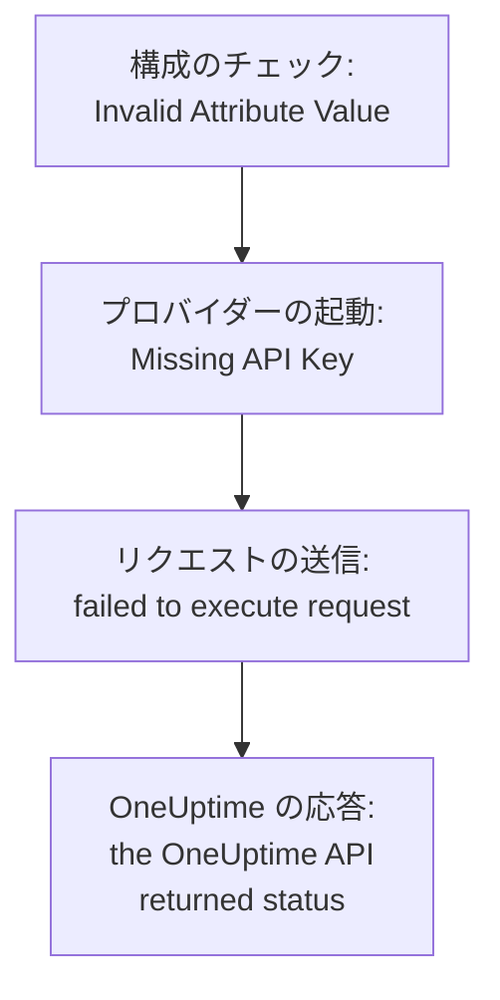

# トラブルシューティング

Terraform が表示したメッセージ、または起きたことを下の表で探してください。各行から対処法へ進めます。表の後の各セクションでは、エラーを発生元ごとにまとめて説明します。

:::cards
- [エラーを探す](#エラーを探す): このページのすべてのメッセージと症状、その対処法。
- [API キー、権限、プラン](#api-キー権限プラン): OneUptime がプロバイダーのキーを拒否するとき。
- [落ち着かないプラン](#落ち着かないプラン): 何度も戻ってくる変更と、state から消えるリソース。
- [セルフホストの OneUptime への接続](#セルフホストの-oneuptime-への接続): アドレス、証明書、プロキシ。
:::

## エラーを探す

| メッセージまたは症状 | 対処 |
| --- | --- |
| `Missing API Key` | プロバイダーにキーを渡します: [`Missing API Key` または `Invalid API Key`](#missing-api-key-または-invalid-api-key) を参照 |
| `Invalid API Key` | キーをもう一度コピーするか、新しく作成します: [`Missing API Key` または `Invalid API Key`](#missing-api-key-または-invalid-api-key) を参照 |
| `ProjectId required` | マスターキーではなく、プロジェクトの API キーを使います: [`ProjectId required`](#projectid-required) を参照 |
| `You do not have permissions to create Monitor` | メッセージに書かれた権限をキーに付与します: [キーに権限が足りない](#キーに権限が足りない) を参照 |
| `API keys need the Growth plan` | プロジェクトを Growth プランに戻します: [支払いが必要](#支払いが必要) を参照 |
| 単一のリソースや設定に対する `402` | プランをアップグレードするか、設定を既定値のままにします: [支払いが必要](#支払いが必要) を参照 |
| `This project has been blocked` | マスター管理者にプロジェクトのブロック解除を依頼します: [ブロックされたプロジェクト](#ブロックされたプロジェクト) を参照 |
| `references records that are not in this project` | 自分のプロジェクトのレコードの ID を使います: [別のプロジェクトの ID](#別のプロジェクトの-id) を参照 |
| データソースからの `Not Found` または `Ambiguous Match` | 検索の引数を直します: [何も見つからない、または複数見つかる検索](#何も見つからないまたは複数見つかる検索) を参照 |
| `Cannot import non-existent remote object` | ID とキーの権限を確認します: [リソースのインポート](/docs/terraform/importing-resources#トラブルシューティング) を参照 |
| `Provider produced inconsistent result after apply` | プロバイダーをアップグレードします: [apply 後の一貫性のない結果](#apply-後の一貫性のない結果) を参照 |
| 追加していないリソースをプランが作成する | キーがそれを読めなくなり、OneUptime は `404` と応答しました。キーに読み取りアクセスを戻してから、`terraform import` でリソースをインポートします: [リソースが state から消え、次の apply で再作成される](#リソースが-state-から消え次の-apply-で再作成される) を参照 |
| apply 後に `priority` や `order` が変わる | それぞれに、ほかのどれも持っていない番号を付けます: [動いてしまう優先度や順序](#動いてしまう優先度や順序) を参照 |
| `Invalid Configuration for Read-Only Attribute` | 構成からその属性を削除します: [読み取り専用の属性](#読み取り専用の属性) を参照 |
| `has been renamed to` | `moved` ブロックを使ってリソースタイプの名前を変えます: [名前が変わったリソースタイプ](#名前が変わったリソースタイプ) を参照 |
| Terraform で作成したモニターにチェックが表示されない | OneUptime をアップグレードします: [ステップ ID より前に作られたモニター](#ステップ-id-より前に作られたモニター) を参照 |
| `must contain at least 1 elements` | 空にするのではなく、属性を省略します: [空の値](#空の値) を参照 |
| ダッシュボードの JSON が `.tf` ファイルにある | HCL で書き直します: [ダッシュボードの JSON](#ダッシュボードの-json) を参照 |
| `no available releases match the given constraints` | 単一の正確なバージョンではなく、バージョンの範囲を使います: [公開されなかったバージョン](#公開されなかったバージョン) を参照 |
| `x509: certificate signed by unknown authority` | 自分の認証局を信頼させます: [証明書](#証明書) を参照 |
| `invalid character '<' looking for beginning of value` | `oneuptime_url` を OneUptime そのものに向けます: [API の代わりに Web ページ](#api-の代わりに-web-ページ) を参照 |
| `connection refused` または `Client.Timeout exceeded` | アドレス、ネットワーク、プロキシを確認します: [失敗する接続](#失敗する接続) を参照 |

## エラーの読み方

エラーは失敗したステップを示し、そのメッセージは発生元を示します。



- `Invalid Attribute Value` のように、リクエストより前に出るエラーは構成に関するものです。プロバイダーは OneUptime と通信する前に構成をチェックします。
- `failed to execute request` は、リクエストに応答が返ってこなかったことを意味します: [セルフホストの OneUptime への接続](#セルフホストの-oneuptime-への接続) を参照してください。
- `the OneUptime API returned status` は OneUptime の応答です。ステータスとその後のメッセージが、OneUptime が何を拒否したかを示します。

プロバイダーは、何をしていたかを示します。変更では `Unable to create monitor` や `Unable to update monitor`、リソースの読み取りでは `Unable to parse label response` です。OneUptime が拒否した読み取りは `Parse Error` という概要で報告されますが、その後のメッセージは OneUptime の応答であり、解析の問題ではありません。

## API キー、権限、プラン

### `Missing API Key` または `Invalid API Key`

`Missing API Key` は、プロバイダーがリクエストを送る前に停止させます。プロバイダーブロックの `api_key` も、環境変数 `ONEUPTIME_API_KEY` も設定されていません。Terraform を実行するシェルで変数をエクスポートするか、`sensitive` と指定した変数でキーを渡してください。

`Invalid API Key` は、OneUptime が知らないキーに対する応答です。入力を誤ったキー、期限切れまたは削除されたキー、あるいは `oneuptime_url` が指すものとは別の OneUptime のキーです。**プロジェクト設定 → 詳細 → API キー** にあるキーのページからもう一度コピーするか、新しいキーを作成してください。

### `ProjectId required`

プロバイダーには、管理するプロジェクトの API キーが必要です。プロジェクトはそのキーから決まります。セルフホストの OneUptime のマスター API キーはどのプロジェクトにも属さないため、それを使った作成はすべて `ProjectId required` で失敗します。[プロジェクトの API キーを作成する](/docs/terraform/quick-start#プロジェクトの-api-キーを作成する) のとおりにプロジェクトの API キーを作成し、代わりにそれを使ってください。

### キーに権限が足りない

`You do not have permissions to create Monitor` やそれに似たメッセージは、ステータス `422` とともに返されます。キーには、その種類のレコードに対してその操作を行う権限がありません。メッセージには、それを許可する権限が書かれています。**プロジェクト設定 → 詳細 → API キー** でキーのページを開き、そのいずれか、または **プロジェクト管理者** を付与してください。インポートに必要なのは読み取り権限だけです。

### 支払いが必要

- **すべてのリクエストで 402 Payment Required** — `API keys need the Growth plan...`: OneUptime Cloud でプロジェクトが **Growth** より下のプランにあり、プロジェクトの API キーは、プロバイダーのキーも含めて、そのプランより下では動作しなくなります。プロジェクトが Growth に戻るまで、`terraform plan` も含め、プロバイダーの呼び出しはすべて拒否されます。戻れば同じキーがまた動作し、構成を変える必要はありません。**プロジェクト設定 → 請求と請求書 → 請求** でアップグレードするか、その間はダッシュボードでプロジェクトを管理してください。[プラン未満の API キーと SCIM](/docs/api-reference/api-reference#プラン未満の-api-キーと-scim) を参照してください。
- **402 Payment Required** — OneUptime のプランの上限に達したか、構成がプランに含まれない設定 (非公開のステータスページ、メールレポート、公開ダッシュボード、IP 許可リストなど) を有効にしています。`terraform apply` がその設定でリソースを作成する場合も、後で変更する場合も同じです。Terraform は OneUptime のメッセージをそのまま表示します。プランをアップグレードするか、構成を減らしてください。

このような設定を既定値に戻すこと、つまり機能をオフにすることはどのプランでもできます。そのため、有料機能をオフにする構成は、試用期間が終わった後やプランが下がった後でも適用できます。

プランで販売されていて、プランが下がった後もプロジェクトに残るリソース (SSO プロバイダー、SCIM 接続、API キー、オンコールスケジュール、Slack と Microsoft Teams のルールとサマリー) も同様です。プランより下では (プロバイダーの API キー自体が必要とする Growth にプロジェクトがまだある間は)、プロジェクトがすでに持っているものは引き続き読み取りができ (そのため `terraform plan` と `import` は動作します)、削除ができ (そのため構成から外すことや `terraform destroy` は適用できます)、`is_enabled` 属性があるものはオフにできます。作成、変更、再度オンにすることは、引き続き 402 で応答されます。

テンプレート、カスタムフィールド、モニターグループなど、プランで販売されるほかのリソースは、読み取りにもプランが必要です。そのため、それらを更新するプランは 402 で応答します。それでも削除はできます。たとえば `terraform destroy -refresh=false` を使います。

Growth より下では、API キーの権限は 1 つずつ削除できません。ブロック権限を削除するとキーのアクセスが広がってしまうためです。権限のリソースに `terraform state rm` を実行してからキーを破棄すれば、その権限もキーと一緒に消えます。

### ブロックされたプロジェクト

`This project has been blocked. Please contact your administrator.` はステータス `403` とともに返されます。マスター管理者がプロジェクトをブロックしており、ブロックが解除されるまで、マスター管理者以外は誰もそのプロジェクトで操作できません。プロジェクトの API キーも同じです。

## レコードと検索

### 別のプロジェクトの ID

リソースが指定する ID (モニターのラベル、ステータスページグループのステータスページ、ネットワークデバイスのサイト、エスカレーションルールのチームなど) は、API キーが属するプロジェクトのレコードでなければなりません。別のプロジェクトのレコードの ID、存在しない ID、キーが読み取れないレコードの ID には、どれも同じ応答が返り、その応答にはフィールドと ID が示されます。

```text
This network device references records that are not in this project: Network Site "…". Please pick values from this project and try again.
```

これは通常、ID が別のプロジェクトの構成や state からコピーされたか、レコードが Terraform の外で削除されたことを意味します。リテラルの ID ではなく、同じ構成内のリソースやデータソース (`oneuptime_label.critical.id`) でレコードを参照し、もう一度適用してください。ユーザーとして指定する人は、プロジェクトのメンバーでなければなりません。

### 何も見つからない、または複数見つかる検索

データソースはレコードをちょうど 1 つ見つけるか、プランを止めます。`Not Found` は、その `id` のレコードがないか、設定した引数に一致するレコードがないことを示し、`Ambiguous Match` は、複数が一致することを示します。引数を直すか、引数を増やして検索を 1 つに絞るか、`id` でレコードを検索してください。ルールは [既存のものを読み取る](/docs/terraform/complete-guide#すでにあるものを読み取る) にあります。

## 落ち着かないプラン

### apply 後の一貫性のない結果

`Provider produced inconsistent result after apply` は、プロバイダーがプランしたものと異なる値を返したことを意味します。古いプロバイダーは、サーバーが計算する値でこれを起こしていました。サーバーが `monitor_steps` の中に追加する既定値、サーバーが別の形式で書いていたタイムスタンプ、`probe_version` のようにラップされた値、そして受信リクエストモニターが最後にハートビートを受け取った時刻のように、サーバーが最新に保つ属性です。また、API が 10 進数をテキストで送ると null として読んでいたため、ステータスページのバーの色ルールの apply は、毎回 `uptime_percent_greater_than_or_equal_to` で失敗していました。現在のプロバイダーはこれらすべてに対応しています。タイムスタンプは時刻として比較され、ラベルのリストは集合として扱われ、数値は書いたとおりに読み戻され、設定していない属性は、次のリフレッシュでサーバーの値を読むまでプランした値を保ちます。

:::steps
1. プロバイダーをアップグレードします: プロバイダーの要件に `version = "{{TERRAFORM_PROVIDER_VERSION}}"` を残したまま、`terraform init -upgrade` を実行します。
2. もう一度適用します。失敗した apply で tainted とマークされたリソースは 1 回だけ置き換えられ、その後のプランは空になります。代わりにリソースをそのまま残すには、先にそのアドレスを指定してマークを外します: `terraform untaint oneuptime_status_page_history_chart_bar_color.operational`。
:::

現在のプロバイダーでもこのように失敗する場合は、[github.com/OneUptime/oneuptime/issues](https://github.com/OneUptime/oneuptime/issues) に報告してください。プロバイダーのバージョン、リソースタイプ、失敗する最小の `resource` ブロック、エラー全体を添えてください。エラーには値が変わった属性が示されており、それが送っていただくもののうちで最も役に立ちます。

### リソースが state から消え、次の apply で再作成される

ID による読み取りは、存在しないレコードに対しても、API キーが読み取れないレコードに対しても `404` を返します。API は、見せないレコードについては何も伝えません。Terraform は、リフレッシュ時の `404` を、Terraform の外で削除されたリソースとみなします。リソースを state から外し、次の `terraform apply` で、まだ存在するものの隣にもう一度作成します。

これは、リソースを管理するキーがそのリソースを読めなくなったときに起こります。キーの読み取り権限が、そのリソースに付いていないラベルや、キーのチームが所有するリソースに限定された場合、ブロックによってリソースが取り上げられた場合、あるいはリソースのラベルや所有者が変わった場合です。

**プランの前に:**

- キーが管理するリソースタイプごとに、管理するすべてのリソースに届く読み取り権限をキーに付与します。スコープを **すべて** にするか、それらのリソースに付いているラベルに限定します。キーの更新権限と削除権限は、読み取れるものにしか及びません。
- 適用する前にプランを読んでください。追加していないのに作成が予定されているリソースは、キーが読めなくなったリソースです。

**state がすでにリソースを失っている場合:** キーに読み取りアクセスを戻してから、適用するのではなくリソースを [インポート](/docs/terraform/importing-resources) します。こうすると Terraform は 2 つ目を作らずに、存在するものを引き継ぎます。すでにコピーが作成されている場合は、不要なほうを削除してください。

### 動いてしまう優先度や順序

モニターステータス、インシデントとアラートの状態と重大度、そしてダッシュボードで並べ替えるほかのリストは、各番号を 1 回だけ持ちます。ほかのどれも持っていない番号は、書いたとおりに保たれます。ほかのものがすでに持っている番号はそれを引き継ぎ、間にあるものはダッシュボードでのドラッグと同じように 1 つずつ下がります。そのため、同じ番号で構成した 2 つは、apply のたびに入れ替わります。

`101`、`102`、`103` のように、間をあけてそれぞれに固有の番号を付け、Terraform が管理するものの順序は、ダッシュボードでドラッグするのではなく Terraform で変更してください。

### 読み取り専用の属性

`Invalid Configuration for Read-Only Attribute` は、OneUptime だけが書く属性を構成が設定しているときにプランを止めます。誰がレコードを作成したか、誰がアーカイブ、解決、確認したかは、リクエストから記録されます。サインインしている人が記録され、API キーで行ったリクエストでは誰も記録されません。Terraform は API キーでサインインします。そのため、`created_by_user_id` をはじめ `_by_user_id` で終わる属性はすべて、リソースやデータソースから読み取れますが、設定はできません。`archived_at` も同じです。`is_archived` を設定するとリソースがアーカイブされた時刻が記録され、変更せずにもう一度適用してもその時刻は保たれます。リソースブロックからその属性を削除してください。リソースのほかの部分は何も変わりません。

### 名前が変わったリソースタイプ

`has been renamed to` は、リソースタイプの名前が新しくなったことを警告します。リソースタイプでは、IoT や vCenter のような単語を分割せずに使うようになりました。`oneuptime_iot_fleet` と `oneuptime_vcenter` です。古いプロバイダーはこれらを分割していました (`oneuptime_io_t_fleet`、`oneuptime_v_center`)。古い名前も、非推奨のエイリアスとして引き続き動作します。何も置き換えずに切り替えるには、構成でリソースの名前を変え、移動したことを Terraform に伝えます。

```hcl
resource "oneuptime_iot_fleet" "factory" {
  name = "Factory floor"
}

moved {
  from = oneuptime_io_t_fleet.factory
  to   = oneuptime_iot_fleet.factory
}
```

すると `terraform plan` には、移動だけが表示され、ほかの変更は表示されません。リソースタイプ間の移動には、Terraform 1.8 以降または OpenTofu 1.12 以降が必要です。それより古いバージョンでは古い名前のままにしてください。引き続き動作します。データソースも同じように名前が変わりました。名前を変えるだけで、ほかは何も変える必要はありません。

### ステップ ID より前に作られたモニター

モニターのステップ内の ID (各ステップ、条件、インシデントとアラートのテンプレートの ID) は、サーバーが付けるものです。古いバージョンの OneUptime は条件にしか ID を付けず、しかも書き込みのたびに新しい ID を付けていました。そのため、API で書き込まれたモニターは、プロバイダーが作ったモニターがすべてそうだったように、ID のないステップのまま保存されていました。プローブはそのモニターをチェックし続け、ステータスも変わり続けましたが、モニターのページはチェックを見つけられず、インシデントは自動で解決できず、`monitor_steps` を変更する `terraform apply` は、そのたびに開いているインシデントを条件から切り離していました。

現在の OneUptime は、作成時にそれぞれに ID を付け、apply のたびにそれを保ち、アップグレード時に既存のモニターの欠けている ID を補います。構成は何も変わりません。書くべき ID は今もありません。古い動作で開いたままになったインシデントは、それを開いた条件がまだあれば、モニターが次に回復したときに閉じます。以前の apply で条件が置き換えられたインシデントは、一度だけ手動で解決する必要があります。

## プロバイダーが拒否する構成

### 空の値

プロバイダーは、`monitor_steps` やその各部分にある空のリスト、マップ、テキストを拒否します。たとえば `monitor_steps = []`、`request_headers = {}`、`request_body = ""` です。

```text
Attribute monitor_steps list must contain at least 1 elements, got: 0
```

代わりに属性を省略してください。存在しない属性は未設定として扱われます。各部分に何を指定できるかは [モニターステップ](/docs/terraform/monitor-steps) に載っています。

### ダッシュボードの JSON

ダッシュボードや API がリソースについて表示する JSON は、API が送るものであって、Terraform の構成ではありません。Terraform では属性名がスネークケースで、値の書き方も異なり、多くのフィールドはサーバーのものです。`.tf` ファイルに貼り付けても動作しません。

- リソースを引き継ぐには、[インポートします](/docs/terraform/importing-resources)。ダッシュボードの **Terraform** ページが構成を書いてくれます。
- 新しく書くには、[例](/docs/terraform/examples) から始めます。
- モニターのステップには、[モニターステップ](/docs/terraform/monitor-steps) で説明している型付きの `monitor_steps` 属性を書きます。`{_type, value}` のラッパーを外し、camelCase のキーを snake_case で書き、`id` はすべて省きます。

## バージョンとレジストリ

### 公開されなかったバージョン

`no available releases match the given constraints` は、公開されたどのバージョンもバージョン制約に合わないことを意味します。OneUptime のすべてのリリースがプロバイダーを公開するわけではありません。プロバイダーが変わらなかったリリースは何も公開しないため、正確なバージョンを 1 つだけ指定する制約は、存在しないバージョンを指すことがあります。代わりに範囲を使ってください。

```hcl
terraform {
  required_providers {
    oneuptime = {
      source  = "oneuptime/oneuptime"
      version = "{{TERRAFORM_PROVIDER_VERSION}}"
    }
  }
}
```

セルフホストの OneUptime では、[セルフホスト セットアップ](/docs/terraform/self-hosted#プロバイダーのバージョンを選ぶ) にあるとおり、範囲の上限を OneUptime のバージョンにします。バージョンの番号の付け方は [レジストリの使用](/docs/terraform/registry#バージョンの番号の付け方) で説明しています。

## セルフホストの OneUptime への接続

### 証明書

`x509: certificate signed by unknown authority` は、Terraform を実行するマシンが、OneUptime が提示する証明書 (通常はプライベート認証局の証明書) を信頼していないことを意味します。プロバイダーは、そのマシンのトラストストアで証明書を検証します。Terraform を実行するすべてのマシンと CI ランナーで、そこに認証局を追加してください: [TLS と証明書](/docs/terraform/self-hosted#tls-と証明書) を参照してください。検証を省略する設定はありません。

### API の代わりに Web ページ

`invalid character '<' looking for beginning of value` は、プロバイダーが API を期待したところに Web ページが応答したことを意味します。`oneuptime_url` のホストの後に `/dashboard` のようなパスが付いているか、OneUptime の前にあるプロキシが代わりに応答しています。`oneuptime_url` には、`https://oneuptime.example.com` のように OneUptime のアドレスだけを設定してください。`/api` はプロバイダーが自分で追加します。

### 失敗する接続

`failed to execute request` に `connection refused`、`no such host`、`Client.Timeout exceeded` が付いている場合は、応答が返ってこなかったことを意味します。アドレスとポートが正しく、Terraform を実行する場所から到達できることを確認し、マシンがプロキシ経由でインターネットに出る場合は `HTTPS_PROXY` を設定してください。プロバイダーは、各応答を最大 60 秒待ちます。応答がないとき、または応答が `429`、`502`、`503`、`504` のときは、読み取りや削除を最大 3 回試しますが、作成や変更は再試行しません。作成がこのように失敗した後は、作成されていた場合に備えて、もう一度適用する前にダッシュボードを確認してください。

## 詳しい情報を得る

プロバイダーは警告を Terraform のログに書き込みます。警告を見るには `TF_LOG_PROVIDER=WARN` を付けてコマンドを実行し、ファイルに残すには `TF_LOG_PATH` も付けます。

```bash
TF_LOG_PROVIDER=WARN TF_LOG_PATH=terraform.log terraform plan
```

`OneUptime rejected a column in the select; dropping it and retrying` は、OneUptime がプロバイダーのキーに送らなかった列を示します。通常は権限が足りないためです。その属性は state で空のままになるため、プランのたびに変更として表示されることがあります。

## それでも解決しない場合

[github.com/OneUptime/oneuptime/issues](https://github.com/OneUptime/oneuptime/issues) で issue を作成し、プロバイダーのバージョン (`terraform version` が `init` の後に表示します)、リソースブロック、エラー全体を添えてください。プロバイダーは OneUptime のコードから生成されるため、その issue はメインリポジトリで管理されています。

## 次のステップ

:::cards
- [リソースのインポート](/docs/terraform/importing-resources): ダッシュボードで作ったものを引き継ぎ、インポートのエラーを直します。
- [セルフホスト セットアップ](/docs/terraform/self-hosted): 自分の OneUptime のアドレス、バージョン、証明書。
- [完全ガイド](/docs/terraform/complete-guide): 認証、データソース、state、アップグレード。
- [モニターステップ](/docs/terraform/monitor-steps): モニターのチェックのすべての属性。
:::
