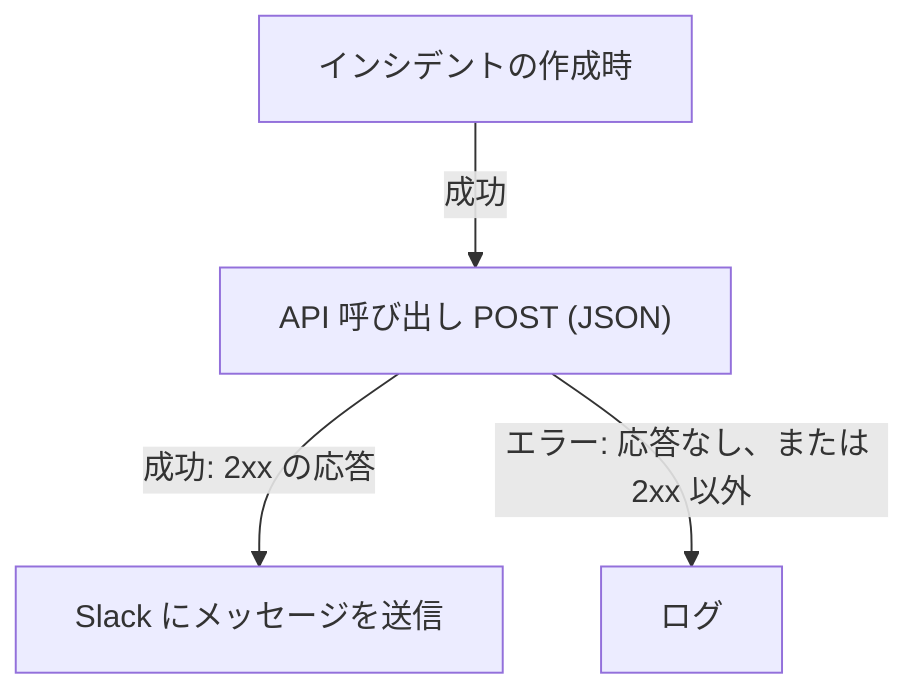
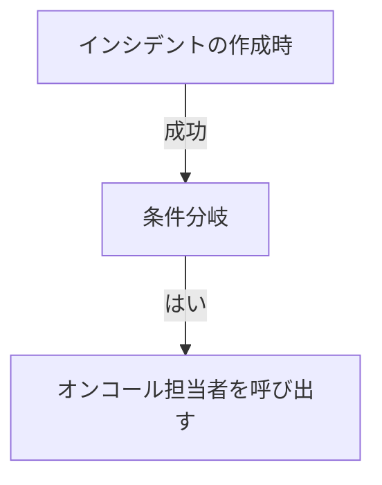

# ワークフロー コンポーネント

コンポーネントは、トリガーの後に追加するブロックです。それぞれが 1 つの仕事 — メッセージの送信、API の呼び出し、条件のチェック、OneUptime のレコードの変更 — を行い、その後、出力のどれか 1 つを選んで、そこに接続されたブロックへ進みます。このページはそのカタログです。各ブロックに何が必要か、何を返すか、どの出力をいつ選ぶかを説明します。

作業中にこのページを開いておく必要はあまりありません。各ブロックの設定の最後には **使い方** があり、ブロックが何をするか、設定手順、あなたのワークフローから組み立てた例、よくある間違いが示されます。ブロックの追加と接続については、[ワークフローを作成する](/docs/workflows/authoring) を参照してください。

:::cards
- [メッセージを送る](#slack): Slack、Microsoft Teams、Discord、Telegram、IRC、Mattermost、メール。
- [API を呼び出す](#api): 任意の HTTP API にリクエストを送り、応答を読みます。
- [ロジックを加える](#conditions): 値で分岐する、データを整形する、待つ、ログに残す。
- [OneUptime のレコードを扱う](#oneuptime-データコンポーネント): モニター、インシデントなどを検索、作成、更新、削除します。
:::

## どのコンポーネントを使うべきか

| やりたいこと                                                  | 使うもの                                                          |
| ------------------------------------------------------------- | ----------------------------------------------------------------- |
| チャットツールに投稿する                                      | [Slack](#slack)、[Microsoft Teams](#microsoft-teams)、[Discord](#discord)、[Telegram](#telegram)、[IRC](#irc)、[Mattermost](#mattermost) |
| 自前のメールサーバーからメールを送る                          | [Email](#email)                                                   |
| 人、チーム、またはオンコール中の人を呼び出す | [Paging](#paging) |
| その他の API や自前のサービスを呼び出す                       | [API](#api)                                                       |
| テキストを要約、分類、下書きする                              | [Generate Text with AI](#generate-text-with-ai)                   |
| 値に応じて別々の経路に進む                                    | [Conditions](#conditions)                                         |
| 値に応じて複数の経路のどれかに進む                                | [Switch / Case](#switch-case)                                     |
| 数行の JavaScript がそう言うときだけ先に進む                  | [Check With JavaScript](#check-with-javascript)                   |
| 2 つのブロックのあいだでデータを整形する                      | [JSON](#json) または [Custom Code](#custom-code)                  |
| 次のブロックの前に待つ                                        | [Sleep](#sleep)                                                   |
| 別のワークフローを開始する                                    | [Execute Workflow](#execute-workflow)                             |
| インシデント、モニターなどのレコードを読み書きする            | [OneUptime データコンポーネント](#oneuptime-データコンポーネント)      |
| 別のツールの問題に対してインシデントやアラートを開き、確認し、解決する | [他のツールからのインシデントとアラート](#他のツールからのインシデントとアラート) |
| Zabbix の問題を確認する、またはクローズする                    | [Zabbix](#zabbix)                                                 |
| OpenStack クラウドへの修正を人に承認してもらう                 | [OpenStack の修正を提案する](#propose-an-openstack-fix)             |

専用のブロックは汎用のものに勝ります。Slack ブロックは Slack の制限を知っており、レコードのブロックはレコードのフィールドを知っているため、同じ仕事をする **API** ブロックよりも分かりやすいエラーとログが得られます。

## 各ブロックの動き

ブロックは、その前のブロックが自分に接続された出力を選んだときに実行されます。設定を読み、仕事をして、出力のどれか 1 つを選びます。次に実行されるのは、その出力に接続されたブロックだけです。



- **設定** は入力するものです。**（任意）** と表示された設定は空のままにできます。あまり使わない設定は **その他の項目** の下に折りたたまれています。
- **出力** は下端の点です。ほとんどのブロックには **成功** と **エラー** があり、[Conditions](#conditions) には **はい** と **いいえ** が、[Switch / Case](#switch-case) にはケースごとに 1 つと **デフォルト** があります。
- **戻り** は、API の **レスポンスボディ** のように、ブロックが後続のブロックに渡す値です。後続のブロックは `{{local.components.<block ID>.returnValues.<value ID>}}` で読みます。設定の **{ }** ボタンで挿入できます。[変数](/docs/workflows/variables#コンポーネントの出力前のブロックのデータ) を参照してください。

**エラー** を選んだブロックは、失敗を **エラー** に接続されたブロックに引き渡し、実行はそこで続きます。 **エラー** に何も接続されていなければ、実行は失敗します。ほかに進めていた処理はそのまま実行され、その後、実行はステータス **エラー** で終わり、実行の **ステップ** にあるブロックの項目に理由が表示されます。一方、空のままの必須設定や、決して機能しない設定は、実行をエラーで停止させます。

## API

任意の URL に HTTP リクエストを送ります。メソッドごとにブロックがあります: **API 呼び出し GET (JSON)**、**API 呼び出し POST (JSON)**、**API 呼び出し PUT (JSON)**、**API 呼び出し PATCH (JSON)**、**API 呼び出し DELETE (JSON)**。

| 設定                | 役割                                                                                                                                 |
| ------------------- | ------------------------------------------------------------------------------------------------------------------------------------ |
| **URL**             | 呼び出すアドレス。`http` または `https`。                                                                                            |
| **リクエストボディ**    | 送信する JSON。通常、必要なのは `POST`、`PUT`、`PATCH` のリクエストだけです。                                                        |
| **リクエストヘッダー** | API キーなど、一緒に送るヘッダー。**その他の項目** の下にあります。値は実行のログでは隠されます。                                    |
| **自己署名証明書を許可する** | **その他の項目** の下にあり、既定ではオフです。オンにすると、ブロックはサーバーが示すどの証明書も受け入れるので自己署名証明書が使えますが、ホスト名も有効期間も確認しなくなり、ネットワーク経路上の誰もがヘッダーを含むリクエストを読み、応答を書き換えられます。 |
| **CA 証明書** | **自己署名証明書を許可する** がオフの間、**その他の項目** の下にあります。サーバーの証明書に署名した CA の証明書（PEM）、または自己署名の場合はサーバー自身の証明書です。ブロックはその証明書だけを信頼し、ホスト名と有効期間は引き続き確認します。 |

| 出力        | タイミング                                                                                     |
| ----------- | ---------------------------------------------------------------------------------------------- |
| **成功** | サーバーが 2xx のステータスで応答した。                                                        |
| **エラー**   | リクエストが失敗した。サーバーに到達できなかったか、別のステータスで応答した。                 |

いずれの場合も、ブロックは **レスポンスステータス**、**レスポンスヘッダー**、**レスポンスボディ** を返し、失敗したときは理由を含む **エラー** も返します。JSON の応答のフィールドを読むには、`{{local.components.api-get-1.returnValues.response-body.id}}` のように、その名前を参照に付け加えます。

ブロックが読み取る応答は最大 10 MB です。それより大きい応答は読み取らず、ブロックは理由とともに **エラー** に進みます。

リダイレクトはたどらないので、応答するアドレスをブロックに指定してください。リクエストは OneUptime から送信されます。プライベートネットワークのアドレスに解決される URL は、セルフホスト環境の管理者が許可しない限り拒否され、実行は理由とともに停止します。[送信ネットワークアクセス](/docs/workflows/configuration#送信ネットワークアクセス) を参照してください。

自分で署名した証明書や自社の CA が署名した証明書を持つサーバーは、ブロックが信頼するまで拒否されます。ブロックは **エラー** に進み、何も送信されず、**エラー** が何を変えればよいかを示します。署名した証明書を **CA 証明書** に貼り付けてください。CA の証明書か、自己署名の場合はサーバー自身の証明書です。するとブロックはホスト名と有効期間も含めてサーバーの証明書をそれで確認するので、あなたのサーバーになりすましているだけのサーバーは引き続き拒否されます。 **自己署名証明書を許可する** は、証明書を貼り付けられない場合にだけオンにしてください。どちらもこのブロックのリクエストだけに適用され、他のブロック、OneUptime の他のリクエスト、送信プロキシへの接続には適用されません。このような証明書を持つサーバーは通常は自社のネットワーク内にあり、ブロックがそこに届くのは、上で述べたとおり、セルフホスト環境の管理者がプライベートネットワークのアドレスを許可した場合だけです。

**ID で API 呼び出し GET (JSON)** は、Webhook が送ってきた課題キーのように、別の場所から来た ID で 1 件の項目を読み取ります。 **URL** の ID が入る位置に `{id}` を置き（例: `https://your-domain.atlassian.net/rest/api/3/issue/{id}`）、ID を **ID** に入れます。ブロックが ID を差し込むのは、それが英字、数字、ハイフン、アンダースコアだけの 200 文字以内の単純な ID のときだけで、その場合でもパーセントエンコードします。 `x/../users` のようなそれ以外の値は、リクエストを送る前に **エラー** を選ぶので、外部から来たテキストがリクエストの行き先を変えることはできません。それ以外は **API 呼び出し GET (JSON)** と同じように動作し、同じ値を返します。

## AI

### Generate Text with AI

プロンプトと、任意の JSON コンテキストから、1 つのテキスト応答を生成します。ブロックはプロジェクトの既定の LLM プロバイダーを使い、プロジェクトにない場合はインストール全体のグローバルプロバイダーを使います。プロバイダーは **プロジェクト設定 → AI → LLM プロバイダー** で一元的に設定し、そのキーやエンドポイントがブロックの設定になることはありません。

| 設定                      | 役割                                                                                                                                                              |
| ------------------------- | ----------------------------------------------------------------------------------------------------------------------------------------------------------------- |
| **システム指示**   | モデルの役割、口調、制約についての任意の指示。                                                                                                                   |
| **プロンプト**                | タスク。書いたとおりに送られるので Markdown も使え、変数や前のブロックの値を含めることもできます。                                                              |
| **コンテキスト**               | 意図して送る任意の JSON。メッセージの終わりを示す明示的な区切りの後に付け加えられ、信頼できないデータとして扱われます。                                          |
| **温度**           | **その他の項目** の下にあります。`0` から `1` までのばらつき。既定値は、予測可能な自動化のための `0.2` です。現行の Claude モデル（Opus 4.7 以降とすべての Claude 5 モデル）は自分でサンプリングを決めます。OneUptime はそれらへのリクエストから **温度** を除くため、これらのモデルには効果がありません。 |
| **最大出力トークン数** | **その他の項目** の下にあります。`1` から `4096` まで。既定値は `1024` です。                                                                                   |

System Instructions、Prompt、シリアライズされた Context は、合計で 50,000 文字に制限されます。これらに base64 で埋め込まれた画像（インシデントの説明に含まれる合成モニターのスクリーンショットなど）は、計測の前に `[image omitted: PNG, 340 KB]` のような短い注記に置き換えられます。モデルが読むのはテキストであって画像ではないからです。何が省かれたかは実行のログに記録されます。プロバイダーへのリクエストは最大 60 秒で、試行は 1 回です。プロジェクトごとに同時に実行できるワークフローの AI リクエストは最大 3 つです。

返すのは、**レスポンス**（生成されたテキスト）、**プロバイダー** と **モデル**（応答したもの）、**合計トークン** と **補完トークン**（プロバイダーが報告した使用量）、**LLM ログ ID**（AI ログ内のこの呼び出しのエントリー）、**エラー** です。

**成功** を応答を使うブロックに、**エラー** を代替処理に接続してください。検証、アクセス、プロバイダー、予算、課金、タイムアウトの失敗はすべてその経路をたどります。ブロックはツールを渡さないため、モデルが自分で OneUptime に問い合わせたり、API を呼び出したり、データを変更したりすることはできません。

> [!WARNING]
> モデルの出力は信頼できないテキストです。顧客に届く前に確認し、自由形式の AI テキストだけで破壊的な操作を決めさせないでください。プロバイダーに送られるもの、ログに残るもの、費用については [AI コンポーネント](/docs/workflows/configuration#ai-コンポーネント) を参照してください。

## Slack

受信 Webhook を通して Slack チャンネルにメッセージを投稿します。

| 設定                           | 役割                                                                                                                                                                                                         |
| ------------------------------ | ------------------------------------------------------------------------------------------------------------------------------------------------------------------------------------------------------------ |
| **Slack 受信 Webhook URL** | 投稿先チャンネルの Webhook。`https://hooks.slack.com/services/` で始まる必要があります。Slack の [作成ガイド](https://api.slack.com/messaging/webhooks) は数分で終わります。                                |
| **メッセージのテキスト**               | 送信するテキスト。書いたとおりに送られるので、Slack 独自の書式を使ってください: `*bold*`、`_italic_`、`~strikethrough~`、`<https://example.com|a link>`。Slack の 1 セクション（3,000 文字）より長いテキストは複数に分けて送られます。10 セクションを超えると切り詰められ、"… (truncated — see OneUptime for the full text)" で終わります。 |

**成功** は Slack がメッセージを受け付けたとき、**エラー** は Slack が拒否したときに発火し、Slack の理由が **エラー** に入ります。これらのブロックは、プロジェクトの Slack 接続ではなく、設定にある Webhook を通して投稿します。

## Microsoft Teams

Microsoft Teams のチャンネルにメッセージを投稿します。ブロック名は **Teams にメッセージを送信** です。

| 設定                           | 役割                                                                                                                                                                                                                                          |
| ------------------------------ | --------------------------------------------------------------------------------------------------------------------------------------------------------------------------------------------------------------------------------------------- |
| **Teams 受信 Webhook URL** | 投稿先チャンネルの Webhook。`office.com`、`office365.com`、`logic.azure.com`、`environment.api.powerplatform.com` 上の `https` URL です。Microsoft のガイドで [Teams Workflows を使った作成方法](https://support.microsoft.com/en-us/teams/apps-service/create-incoming-webhooks-with-workflows-for-microsoft-teams) を確認できます。 |
| **メッセージのテキスト**               | 送信するテキスト。受信 Webhook が受け付けるサイズ（送信時の形で約 12,000 文字）を超えるメッセージは切り詰められ、"… (truncated — see OneUptime for the full text)" で終わります。                                                               |

## Discord

受信 Webhook を通して Discord チャンネルにメッセージを投稿します。

| 設定                             | 役割                                                                                                                                               |
| -------------------------------- | -------------------------------------------------------------------------------------------------------------------------------------------------- |
| **Discord 受信 Webhook URL** | チャンネルの Webhook。`discord.com` または `discordapp.com` 上の `https` URL です。                                                                |
| **メッセージのテキスト**                 | 送信するテキスト。Discord の上限である 2,000 文字を超えるメッセージは切り詰められ、"… (truncated — see OneUptime for the full text)" で終わります。 |

## Telegram

ボットを使って Telegram のチャットにメッセージを送ります。

| 設定                   | 役割                                                                                                                                               |
| ---------------------- | -------------------------------------------------------------------------------------------------------------------------------------------------- |
| **Telegram ボットトークン** | BotFather がボットに発行したトークン。例: `123456789:ABCdef…`。それ以外の形式のトークンは実行を停止させますが、トークンがログに書かれることはありません。 |
| **チャット ID**            | 投稿先のチャット。その ID か、チャンネルの `@username` です。先にボットをグループまたはチャンネルに追加してください。個人に送るには、その人が先にボットとのチャットを開始している必要があります。 |
| **メッセージのテキスト**       | 送信するテキスト。Telegram の上限である 4,096 文字を超えるメッセージは切り詰められ、"… (truncated — see OneUptime for the full text)" で終わります。 |

Telegram がメッセージを拒否すると、Telegram の理由とともに **エラー** が発火します。

## IRC

Libera.Chat、OFTC、自前のサーバーなど、任意の IRC ネットワークの IRC チャンネルにメッセージを投稿します。IRC には Webhook がないため、ブロックが自分でサーバーに接続し、チャンネルに入り、メッセージを送って、また退出します。

| 設定             | 役割                                                                                                                                                                                                                                               |
| ---------------- | -------------------------------------------------------------------------------------------------------------------------------------------------------------------------------------------------------------------------------------------------- |
| **IRC サーバー**   | サーバーのホスト名。例: `irc.libera.chat`。名前だけを指定し、`ircs://` もポートも付けません。                                                                                                                                                      |
| **チャネル**      | 投稿先のチャンネル。例: `#ops`。チャンネルである必要があります。ここに入力したニックネームは、個人宛てのメッセージになるのではなく拒否されます。                                                                                                   |
| **メッセージのテキスト** | 送信するテキスト。各行は個別の IRC メッセージとして送られ、長い行は収まるように分割されます。1 つのメッセージは最大 15 行の IRC 行として送られ、それより長いものは切り詰められて、最後の行にそのことが示されます。IRC には Markdown がないためテキストは書いたとおりに送られますが、太字や色など IRC 独自の書式コードは使えます。 |

**その他の項目** の下:

| 設定                                     | 役割                                                                                                                                                                                                               |
| ---------------------------------------- | ------------------------------------------------------------------------------------------------------------------------------------------------------------------------------------------------------------------ |
| **ニックネーム**                             | メッセージの差出人。既定値は `OneUptime` です。ニックネームが使用中の場合、ブロックはアンダースコアや数字を付け加えたもので試し、さらに長いニックネームを受け付けないサーバーに対しては末尾の文字をそれに置き換えて試します。 |
| **ポート**                                 | サーバーのポート。既定値は `6697`、**TLS を無効にする** をオンにした場合は `6667` です。                                                                                                                                |
| **TLS を無効にする**                          | ブロックは TLS で接続し、サーバーの証明書を確認します。TLS を提供していないサーバーの場合だけオンにしてください。パスワードがあれば暗号化されずに送られます。自前の認証局の証明書を信頼させるには、セルフホスト環境で代わりに `NODE_EXTRA_CA_CERTS` を設定します。 |
| **チャネルキー**                          | キーのあるチャンネルのキー（モード `+k`）。                                                                                                                                                                        |
| **参加せずに送信**                 | チャンネルに入らずに投稿するので、チャンネルにはブロックの出入りが見えません。外部からのメッセージを受け付けるチャンネル（モード `+n` なし）でのみ機能します。                                                     |
| **サーバーパスワード**                      | 接続時にサーバーやバウンサーが求めるパスワード。                                                                                                                                                                  |
| **SASL ユーザー名** と **SASL パスワード**   | SASL を使うネットワークで自分のアカウントにログインします。Libera.Chat は一部のクラウドや VPN のアドレスからの接続に SASL を要求します。両方入力するか、どちらも入力しないでください。                             |

**成功** は、サーバーがすべての行を受け付けたときに発火します。ブロックは最後の行の後にサーバーへ ping への応答を求めて、これを確認します。サーバーは順番に応答するため、メッセージの拒否があればそれが先に届きます。ZNC のようなバウンサーは自分で ping に応答するため、ブロックはその背後のネットワークからの応答をさらに 1 秒待ちます。

**エラー** は、サーバーに到達できないとき、または接続、ニックネーム、パスワード、チャンネル、メッセージをサーバーが拒否したときに発火します。理由は、サーバーが示した場合はサーバー自身の言葉で渡されます。一方、**IRC サーバー**、**チャネル**、**メッセージのテキスト** の欠落や、決して機能しない設定は、実行を停止させます。

ブロックの実行はそれぞれ独立した接続で、IRC ネットワークは 1 つのアドレスからの接続頻度を制限しています。メッセージが集中すると "Reconnecting too fast" のような理由で拒否されることがあり、他の拒否と同じく **エラー** をたどります。1 分間に何度も発火しうるワークフローでは、伝えたいことを 1 つのメッセージにまとめるか、自前のサーバー経由で送ってください。

パスワードは [シークレットのグローバル変数](/docs/workflows/variables#グローバル変数) に保存し、設定ではその変数を使ってください。いずれにしても実行のログでは隠されます。ループバック（`localhost`、`127.0.0.1`）、リンクローカル、クラウドメタデータのアドレスへの接続は拒否されます。OneUptime Cloud では、プライベートネットワークのアドレスにあるサーバーや、そこに解決される名前も拒否されます。セルフホスト環境では、`DATA_SOURCE_BLOCK_PRIVATE_ADDRESSES` が `true` に設定されていない限り、自分のネットワーク上の IRC サーバーに到達できます。

## Mattermost

受信 Webhook を通して、Mattermost Cloud または自前のサーバー上の Mattermost チャンネルにメッセージを投稿します。

| 設定                                | 役割                                                                                                                                                                                                                                                                               |
| ----------------------------------- | ---------------------------------------------------------------------------------------------------------------------------------------------------------------------------------------------------------------------------------------------------------------------------------- |
| **Mattermost 受信 Webhook URL** | 投稿に使う Webhook。Mattermost の Integrations にある Incoming Webhooks に表示されるとおりのもので、サーバーのアドレスの後に `/hooks/` と Webhook の ID が続きます。Mattermost のガイドで [作成方法](https://docs.mattermost.com/developers/integrate/webhooks/incoming) を確認できます。 |
| **メッセージのテキスト**                    | 送信するテキスト。書いたとおりに送られ、Mattermost は Markdown を解釈します: `**bold**`、`_italic_`、リンク、表、`:rotating_light:` などの絵文字。Mattermost の投稿は 1 件につき 16,383 文字までなので、それより長いメッセージは収まるように切り詰められ、"… (truncated — see OneUptime for the full text)" で終わります。 |

**その他の項目** の下:

| 設定         | 役割                                                                                                                                                                                                          |
| ------------ | ------------------------------------------------------------------------------------------------------------------------------------------------------------------------------------------------------------- |
| **チャネル**  | Webhook 自身のチャンネル以外の場所に投稿します。チャンネルの URL に表示されるとおりの名前（例: `town-square`）か、ダイレクトメッセージなら `@` に続けてユーザー名を入力します。チャンネルに固定された Webhook は、他のチャンネルへの投稿を拒否します。 |
| **ユーザー名** | 投稿者として表示する名前。Mattermost がこれを使うのは、システム管理者がインテグレーションによるユーザー名の上書きを許可している場合だけです。                                                                 |
| **アイコン URL** | 投稿に表示する画像で、`https` のアドレスを指定します。Mattermost がこれを使うのは、システム管理者がインテグレーションによるプロフィール画像アイコンの上書きを許可している場合だけです。                       |

**成功** は Mattermost がメッセージを受け付けたときに発火します。**エラー** は、サーバーに到達できないとき、または Mattermost がメッセージを拒否したときに発火し、Mattermost の理由を渡します。一方、**Mattermost 受信 Webhook URL** や **メッセージのテキスト** の欠落、受信 Webhook のものではない URL、決して機能しない設定は、実行を停止させます。

Webhook の URL は [シークレットのグローバル変数](/docs/workflows/variables#グローバル変数) に保存してください。URL を知っていれば誰でもそのチャンネルに投稿できるからです。いずれにしても実行のログでは隠されます。メッセージは OneUptime から送信され、リダイレクトはたどりません。ループバック（`localhost`、`127.0.0.1`）、リンクローカル、クラウドメタデータのアドレスにある Webhook は拒否されます。プライベートネットワークのアドレスにあるものも、セルフホスト環境の管理者が `ALLOW_PRIVATE_NETWORK_WEBHOOKS` または `PRIVATE_NETWORK_WEBHOOK_ALLOWLIST` で許可しない限り拒否されます。[プライベートネットワークへのアクセス](/docs/self-hosted/private-network-access) を参照してください。

## Email

ブロックで指定した SMTP サーバーを通してメールを送ります。ブロック名は **メールを送信** です。

| 設定                                    | 役割                                                                                                  |
| --------------------------------------- | ----------------------------------------------------------------------------------------------------- |
| **送信元メールアドレス**                          | 送信者。例: `Alerts <alerts@company.com>`。                                                           |
| **宛先メールアドレス**                            | 受信者のアドレス。複数のアドレスはカンマまたはセミコロンで区切ります。                                |
| **件名**                             | 件名。                                                                                                |
| **メール本文**                          | HTML として送られるメッセージ。                                                                       |
| **SMTP ホスト** と **SMTP ポート**          | 接続するメールサーバー。                                                                              |
| **SMTP ユーザー名** と **SMTP パスワード**  | 任意。両方入力するか、どちらも入力しないでください。                                                  |
| **暗黙的 TLS を使う**                    | 暗黙の TLS（通常はポート 465）ではオンにします。STARTTLS（通常はポート 587）ではオフのままにします。    |

**成功** は SMTP サーバーがメッセージを受け付けたときに発火します。**エラー** は、SMTP ホストが拒否されたとき、サーバーに到達できないとき、またはサーバーがメッセージを拒否したときに発火し、エラーメッセージを渡します。一方、**宛先メールアドレス**、**送信元メールアドレス**、**SMTP ホスト**、**SMTP ポート** の欠落は実行を停止させます。

ブロックは設定にあるサーバーへ直接接続します。プロジェクトの [SMTP](/docs/emails/smtp) 設定や OneUptime 自身のメールサーバーは使わず、送ったメールは通知ログに表示されません。何をしたかを確認するには、ワークフローの [実行履歴](/docs/workflows/runs-and-logs) を見てください。

ループバック（`localhost`、`127.0.0.1`）、リンクローカル、クラウドメタデータのアドレスへの接続は拒否されます。OneUptime Cloud では、プライベートネットワークのアドレスにある SMTP ホストや、そこに解決される名前も拒否されます。セルフホスト環境では、`DATA_SOURCE_BLOCK_PRIVATE_ADDRESSES` が `true` に設定されていない限り、自分のネットワーク上のメールサーバーに到達できます。拒否されたホストは **エラー** の出力をたどり、何も送られません。

## Paging

ワークフローから人を呼び出します。呼び出された人には、それぞれのオンコールルールに従って電話、SMS、プッシュ通知、メールが届き、誰かが確認するまで続きます。誰を呼び出すかの指定方法ごとにブロックがあります。 **コンポーネントを追加** パネルで `page` を検索してください。

| ブロック                    | 呼び出す相手 |
| --------------------------- | ------------ |
| **ユーザーを呼び出す**              | 指定した人。 |
| **チームを呼び出す**             | チームの全メンバー。 |
| **オンコール担当者を呼び出す** | ブロックの実行時に、オンコールスケジュールでオンコール中の人。 |
| **オンコールポリシーを開始**  | オンコールポリシー。エスカレーションルールに沿って呼び出し、設定どおりに繰り返します。 |

最初の 3 つは、指定した全員を同時に呼び出し、その後はほかの誰も呼び出しません。エスカレーションが必要なら **オンコールポリシーを開始** を使います。

条件を満たすときだけ呼び出すには、ブロックの前に [If / Else](#conditions) を置き、呼び出したい側の出力をブロックに接続します。経路が 3 つ以上なら、[Switch / Case](#switch-case) が値ごとに経路を選び、経路ごとに別の人を呼び出せます。



ワークフローの作成時、 **オンコール** の下のテンプレートにこのワークフローが用意されています。 **ケース分岐** で重大度ごとに呼び出すテンプレートもあります。 **ワークフローを作成** ダイアログは、テンプレートの呼び出しブロックごとに誰を呼び出すかを尋ねるので、ワークフローはそれが設定された状態で開きます。ビルダーで追加した呼び出しブロックには、誰を呼び出すかを選ぶまで **クリックしてセットアップ** と表示されます。

| 設定 | 役割 |
| ---- | ---- |
| **ユーザー**、**チーム**、**オンコールスケジュール** または **オンコールポリシー** | 呼び出す相手です。各ブロックに、その名前に対応する設定があります。名前で選ぶか、行末の **{ }** を押して前のブロックの値を追加します。値には 1 つまたは複数の ID を入れられ、 **ユーザー** ではメールアドレスも使えます。 |
| **呼び出しの対象** | 呼び出しの対象です。 **新しいアラート**、**インシデント**、**アラート** から選びます。呼び出しを確認すると、その対象も確認済みになります。 |
| **タイトル** と **メッセージ** | 新しいアラート用です。OneUptime がこの 2 つからアラートを作成し、ほかのアラートと同じようにアラート一覧に残ります。 |
| **インシデント ID** または **アラート ID** | 既存のインシデントまたはアラート用です。通常はワークフローの開始元のもので、`{{local.components.incident-on-create-1.returnValues.model._id}}` のように指定します。 |
| **呼び出しの役割** | 既存のインシデントまたはアラート用で、 **その他の項目** の下にあります。 **対応者** は対応を引き受けます。 **オブザーバー** はほかの人が対応する間、状況を知らされます。呼び出しを確認しても見たことを示すだけで、インシデントやアラートは確認済みになりません。 |
| **重大度** | 新しいアラート用で、 **その他の項目** の下にあります。各人のオンコールルールのうち、どれで呼び出すかを決めます。空のままにすると、プロジェクトで最も重大な重大度になります。 |

インシデントまたはアラートから始まるワークフローに追加したブロックは、あらかじめそのレコードについて呼び出すよう設定されているので、あとは誰を呼び出すかを指定するだけです。

**成功** は、1 人以上を呼び出すか、ポリシーが 1 つ開始すると実行されます。 **エラー** は誰も呼び出せなかったときに実行され、ブロックの **エラー** の値に理由が入ります。たとえば、スケジュールにオンコール中の人がいない場合です。 **概要** は、誰を呼び出し、誰を除外したかを 1 文で伝えるので、そのままチャンネルに投稿できます。 **呼び出したユーザー** は呼び出した人の一覧です。

不在の人は呼び出されません。その人のユーザーオーバーライドが代理に指定した人が、代わりに呼び出されます。オンコールポリシーや別の呼び出しがすでにその件で呼び出している人は重ねて呼び出されず、それでも **呼び出したユーザー** に含まれます。その呼び出しが応答のないまま終わると、ブロックの呼び出しが自らその人を呼び出します。1 回の呼び出しで指定できるのは、人、チーム、スケジュールを合わせて最大 100 件です。[各人への連絡方法](/docs/on-call/escalation-rules#各人への連絡方法) を参照してください。

オンコールポリシーを使わない呼び出しは、ポリシーの実行と並んで **直接呼び出し** として表示されます。インシデントまたはアラートのオンコールログ、そのフィードと Slack または Microsoft Teams のチャンネル、そして呼び出された各人のログに表示されます。30 分間は開いたままで、その後も呼び出しが送信されている間は開いています。それまでに誰も確認しなければ、ほかの誰も呼び出さずに終了します。

> [!WARNING]
> **ワークフローを実行** は、ワークフローがオンでもオフでも実際に人を呼び出します。 **このステップだけを実行** も同じです。テスト中は自分自身を指定してください。

## Custom Code

他のブロックで必要なことができないときに、数行の JavaScript を実行します。ブロック名は **カスタム JavaScript を実行** です。

| 設定                | 役割                                                                                                                                 |
| ------------------- | ------------------------------------------------------------------------------------------------------------------------------------ |
| **JavaScript コード** | あなたのコード。`return` で返したものがブロックの **値** になります。`await` を使えます。                                        |
| **引数**       | コードに渡す値の JSON オブジェクトで、コードはそれを `args` として読みます。変数や前のブロックの値はここに入れてください。コード自体はそれらを読めません。 |

```json title="Arguments"
{ "title": "{{local.components.incident-on-create-1.returnValues.model.title}}" }
```

```javascript title="JavaScript Code"
const words = args.title.split(" ");

return {
  shortTitle: words.slice(0, 5).join(" "),
  wordCount: words.length,
};
```

後続のブロックは、短いタイトルを `{{local.components.javascript-1.returnValues.returnValue.shortTitle}}` として読みます。

コードは、`args`、`console.log`（実行のログに書き込まれます）、HTTP リクエスト用の `axios`、`crypto`、`sleep` を備えたサンドボックスで実行されます。ファイルシステムもプロセスもなく、リクエストには API ブロックと同じアドレスのルールが適用されます。既定では 5 秒で、セルフホスト環境では `WORKFLOW_SCRIPT_TIMEOUT_IN_MS` で変更できます。

**成功** は返された **値** とともに発火し、**エラー** はコードが例外を投げたか時間切れになったときに、メッセージを **エラー** に入れて発火します。より重いスクリプトには、代わりに [Runbook](/docs/runbooks/index) を使ってください。

## Check With JavaScript

数行の JavaScript を実行し、その戻り値に応じて **はい** または **いいえ** に進みます。 [Custom Code](#custom-code) ブロックとその後ろの [If / Else](#conditions) を 1 つにまとめたブロックです。別のツールが送ってきた内容を読み、ワークフローが手を出すべきでないものを飛ばす場合など、1 つの比較では判断できないときに使います。

| 設定                | 内容 |
| ------------------- | ---- |
| **JavaScript コード** | あなたのコード。 `return true` で **はい** に進みます。値も渡すには、 `proceed: true` と値、 `reason` を持つオブジェクトを返します。 |
| **引数**       | コードに渡す値の JSON オブジェクト。コードはそれを `args` として読みます。 **カスタム JavaScript を実行** と同じです。 |

```javascript title="JavaScript Code"
if (args.environment !== "production") {
  return { proceed: false, reason: "Not production, so nothing was sent." };
}

return { proceed: true, title: args.title.toUpperCase() };
```

**はい** に進むのは `true` か、 `proceed` が `true` のオブジェクトだけです。それ以外は、数値やテキストであっても **いいえ** に進みます。ブロックは、コードが返したものである **値** を返し、後続のブロックはそれを `{{local.components.javascript-check-1.returnValues.returnValue.title}}` として読みます。また **理由** として、コードの `reason`、またはコードが返したものを 1 文で返し、実行の **ステップ** タブは、それを選ばれた出力の横に表示します。

コードは **カスタム JavaScript を実行** と同じように実行されます。同じサンドボックスで、同じ `args`、 `console.log`、 `axios` を使え、時間制限も同じです。例外を投げたか時間切れになると、ブロックは **エラー** に進みます。

## JSON

テキストと JSON を相互に変換するか、2 つの JSON オブジェクトを結合します。

| ブロック         | 受け取るもの                             | 返すもの                                                                                                   |
| ---------------- | ---------------------------------------- | ---------------------------------------------------------------------------------------------------------- |
| **JSON をテキストに** | **JSON**（オブジェクト）                 | **テキスト**: 文字列にしたオブジェクト。次のブロックがテキストを期待するときに便利です。                       |
| **テキストを JSON に** | **テキスト**（複数行も可）                   | **JSON**: パースしたオブジェクト。フィールドを読めるようになります。テキストとして届いた JSON に使います。 |
| **JSON をマージ**   | **JSON 1** と **JSON 2**                 | **JSON**: 両方のキーを持つ 1 つのオブジェクト。両方にあるキーは **JSON 2** が優先されます。                 |

**テキストを JSON に** は、テキストが JSON でないときに **エラー** をたどります。入力の欠落や、オブジェクトではない **JSON をマージ** への入力は、実行を停止させます。

## Conditions

比較で分岐します。**コンポーネントを追加** パネルでは、このブロックは **人気** の下の **条件分岐** という名前です。3 つ以上の経路から選ぶには [Switch / Case](#switch-case) を使います。

設定は文として読めます: **条件** *チェックする値* *比較* *比較する値*、なら **はい** へ、そうでなければ **いいえ** へ進みます。設定の下に条件が言葉で読み上げられるので、意図どおりかを確認できます。キャンバス上でもブロックは条件を表示します。例: *条件 environment is equal to “production”*。

| 設定               | 役割                                                                                                                                     |
| ------------------ | ---------------------------------------------------------------------------------------------------------------------------------------- |
| **確認する値** | 通常は前のブロックの値です。フィールドの **{ }** を押して選ぶか、`{{` と入力します。                                                     |
| **比較**     | どう比較するかを言葉で。比較の一覧は以下のとおりです。                                                                                   |
| **比較対象**   | 比較の相手。同じように入力または選択します。**が空**、**が空でない**、**が真**、**が偽** では使いません。                          |
| **比較の型**       | 比較の下に折りたたまれています: **テキスト**、**数値**、**真 / 偽**。`2026-10-01` と書いた日付を順序付けるには **テキスト** を、`200` と `200.0` を等しくするには **数値** を選びます。 |

比較:

- **と等しい** と **と等しくない**
- テキスト用: **を含む**、**を含まない**、**で始まる**、**で終わる**
- 数値用: **より大きい**、**以上**、**より小さい**、**以下**
- **が空** と **が空でない**。値がそもそもあるかどうかをチェックします
- **が真** と **が偽**

数値の比較は数値を、テキストの比較はテキストを比べるので、**比較の型** が必要になることはまれです。値は次のように比較されます。

- テキストとしては大文字と小文字が区別されます: `Error` は `error` ではありません。
- 数値としては、数値でないテキストは `0` として扱われます。そのような値が入力されていると、設定が指摘します。
- 真偽値としては、`true` だけが真として扱われます。
- **が空** は、値がまったくない、空白のテキスト、空のリストや空のオブジェクト、Webhook が送らなかったフィールドのように前のブロックになかった値で満たされます。`0` と `false` は値なので空ではありません。

**はい** は条件が満たされたとき、**いいえ** は満たされないときに実行されます。設定がこれらの名前になる前に組まれたブロックは、以前とまったく同じように動作します。古い選択肢が 1 つ提供されなくなりました。値を **Null** や **未定義** として比較するもので、値の中身を無視していました。それをまだ使っているブロックは開いたときにそう表示します。値がないことをチェックするには **が空** を選んでください。

## Switch / Case

値に応じて複数の経路のどれかに進みます。**コンポーネントを追加** パネルでは、このブロックは **人気** の下の **ケース分岐** という名前です。

1 つの値を上から順に各ケースと比較し、最初に一致したケースへ進みます。どのケースにも一致しなければ **デフォルト** へ進みます。実行される経路は 1 つだけです。2 つのケースに一致する値は、そのうち最初のケースへ進みます。

| 設定               | 役割 |
| ------------------ | ---- |
| **確認する値** | 各ケースと比較される値で、通常は前のブロックの値です。フィールドの **{ }** を押して選ぶか、`{{` と入力します。 |
| **ケース**          | 経路ごとの比較と値で、上から順に確認されます。**ケースを追加** を押すと追加でき、ケースはつまみをドラッグして移動できます。1 つのブロックに設定できるケースは最大 25 個です。 |

各ケースはキャンバス上の出力で、その値にちなんだ名前が付きます。**と等しい** `production` のケースは出力 *production* に、**より大きい** `500` のケースは *is greater than 500* になります。**デフォルト** は常に最後の出力です。各出力を次に実行するものに接続してください。

ケースが一致するのは、同じ比較と値の [If / Else](#conditions) が **はい** へ進む場合とまったく同じです。比較の種類も、値の比べ方も同じです。**比較の型** はケースの下に折りたたまれていて、ケースごとに選べます。

接続のあるケースを削除すると、そのケースがどのブロックにつながっていたかが設定に表示され、**元に戻す** でケースを戻せます。保存すると、ケースと一緒にその接続も削除されます。ビルダーのチェックは、何も接続されていないケースと、上のケースと同じ条件のために選ばれることのないケースを指摘します。

何も接続されていない出力に進んだ実行は、**デフォルト** の場合も含め、そこでエラーなく終わります。実行の **ステップ** タブには、どのケースがなぜ一致したかが表示されます。例: *Case 2 matched: the value is equal to “staging”. Case 1 did not.*

## Sleep

次のブロックの前で実行を一時停止します。別のシステムが追いつくのを少し待つときや、後でフォローアップするときに使います。

**日**、**時間**、**分**、**秒** は合計されます。最長の待ち時間は 30 日で、それより長い場合は 30 日に短縮され、実行のログにそのことが記録されます。

待っているあいだ、実行は **待機中** のステータスで脇に置かれ、時間になると再び取り上げられるので、長い待ちが何かを止めることはありません。その間にワークフローがオフにされたかアーカイブされた実行は、目覚めたときにキャンセルされます。ワークフローがオフのあいだに開始したテスト実行は、オフであることを理由にキャンセルされることはありません。

## Log

実行のログに値を書き込みます。他には何も変えないので、値に何が入っていたかを見る一番簡単な方法です。

**値** が書き込む内容です。複数行にでき、`{{local.components.webhook-1.returnValues.request-body}}` のように前のブロックの値を含められます。ブロックは終わると **送信** をたどります。

## Execute Workflow

同じプロジェクトの別のワークフローを開始します。あなたのワークフローは、もう一方の完了を待たずに続行します。

| 設定          | 役割                                                                                                                                      |
| ------------- | ----------------------------------------------------------------------------------------------------------------------------------------- |
| **ワークフロー**  | 開始するワークフロー。有効になっている必要があり、引数を受け取るには **手動** トリガーが必要です。                                       |
| **引数** | 渡す JSON。もう一方のワークフローの手動トリガーは、各キーを個別の値として渡します: `{"customerId": "42"}` なら `{{local.components.manual-1.returnValues.customerId}}` を読みます。 |

**送信** は、もう一方のワークフローがキューに入るとすぐに発火します。**エラー** は、それができないときに発火します。存在しない、オフまたはアーカイブ済み、または開始するとループになる場合です。

共通のロジックを共有するために使ってください。「インシデントチャンネルに投稿する」ワークフローを一度作り、それを必要とするすべてのワークフローから開始します。互いを開始するワークフローの連鎖は自分自身に戻ることができず、深さは最大 10 です。[設定と安全性](/docs/workflows/configuration#他のワークフローを呼び出す際の上限) を参照してください。

## 他のツールからのインシデントとアラート

別のツールが知らせてくる問題ごとに、インシデントまたはアラートを 1 件ずつ、そのツール自身がその問題に付けた ID で対応付けて保ちます。 **ほかのツールからのインシデント** と **ほかのツールからのアラート** は Zabbix、Huntress、Jira、Dynamics 365 のテンプレートの土台で、ワークフローの [Webhook トリガー](/docs/workflows/triggers#webhook) を呼び出せるツールなら何にでも使えます。 **コンポーネントを追加** パネルでは **ほかのツールから** の下にあります。

実行のたびに、ブロックには 1 つのイベントが渡されます。 **何が起きたか** と、ツールでの問題の ID である **外部 ID** です。ブロックはその ID を保持しているレコードを探し、 **何が起きたか** の内容を実行します。

| What Happened | ブロックの動作 |
| ------------- | -------------- |
| `open`、 `problem`、 `firing`、 `triggered`、 `created` | **タイトル**、 **説明**、 **重大度** からインシデントを開くか、アラートを作成します。その ID を保持するレコードがすでにあれば何もしません。 |
| `acknowledge`、 `acknowledged` | レコードを最初の確認済み状態に移し、 **メモ** を理由として履歴に残します。 |
| `resolve`、 `resolved`、 `recovery`、 `ok`、 `closed` | レコードを最初の解決済み状態に移し、 **メモ** を理由として履歴に残します。 |
| `note`、 `update`、 `comment` | **メモ** をプライベートノートとしてレコードに追加します。 |
| あなたの状態のいずれかの名前 | レコードをその状態に移します。これらの語と同じ名前の前には `state:` を付けます（例: `state: Open`）。 |

| 出力 | タイミング |
| ---- | ---------- |
| **オープン済み**（アラートのブロックでは **作成** ） | 新しいレコードを開きました。新しい問題だけが呼び出すよう、ここに呼び出しブロックを接続します。 |
| **更新済み** | レコードを別の状態に移したか、ノートを追加しました。 |
| **変更なし** | することがありませんでした。その ID を保持するレコードがない、レコードがすでにその状態かそれより先にある、または **何が起きたか** が空です。 |
| **エラー** | レコードを読み取れないか、変更できませんでした。ここに何も接続されていなければ、実行は失敗します。 |

レコードは前にしか進まず、解決済みのレコードはまったく動かないため、両方のツールが変更しても、一方がもう一方の変更を取り消すことはありません。レコードは ID をカスタムフィールドに保持し（ **外部 ID フィールド** が別のものを指定しない限り `externalId` ）、書き込まれるのはそのフィールドだけなので、レコードのほかのカスタムフィールドは値を保ちます。レコードが保持する ID で新しいレコードが開かれることは、そのレコードが解決済みになった後でも二度とありません。Zabbix のイベント ID や Huntress のレポート番号のように、問題ごとに新しい ID を使ってください。代わりにレコード自身の ID で操作するには、Jira のテンプレートが課題のラベルにある ID でそうしているように、それを **インシデント ID** または **アラート ID** に入れます。

**重大度** は、重大度の 1 つを名前か ID で（大文字と小文字は区別しません）、またはその中での位置で指定します: `most severe`、 `middle`、 `least severe`。こうして、ツール独自のレベルが、あなたが名前を付けた重大度に振り分けられます。空のまま、またはどれにも当たらない場合は最も重い重大度になり、実行のログにそう記録されます。新しいインシデントはステータスページに表示されず、その購読者にも通知されません。別のツールのテキストはそのツールの利用者向けに書かれているからです。表示するには **ステータスページに表示** をオンにします。

**その他の項目** では、 **理由** はレコードが移るときに履歴に残る理由で、このとき **メモ** はその横にプライベートノートとして追加されます。確認や解決のときに何かを伝えるツール向けです。 **カスタムフィールド** は新しいレコードに JSON オブジェクトでカスタムフィールドを追加し、 **ラベル** はそのラベルの ID をカンマ区切りで、 **影響を受けるリソース** は対象のリソースを指定します（ **インシデントを作成（1 件）** と同じです）。 **解決せずにメモを追加** はノートを追加し、レコードの解決はチームに任せます。ブロックは、何をしたかを 1 文で表す **概要** と、レコード自体を返すので、後続のブロックはその ID を `{{local.components.incident-from-another-tool-1.returnValues.record._id}}` として読みます。

## Zabbix

Zabbix の API を通じて、Zabbix の問題を確認またはクローズするか、メッセージを追加します。ブロック名は **Zabbix の問題を更新** で、 [Zabbix のテンプレート](/docs/integrations/zabbix) はこれを使って、OneUptime で起きたことを Zabbix に返します。

| 設定 | 内容 |
| ---- | ---- |
| **Zabbix URL** | Zabbix を開くアドレス（例: `https://zabbix.example.com`）。リクエストはその `api_jsonrpc.php` に送られます。 |
| **API トークン** | 問題の確認、コメント、クローズができる Zabbix ユーザーの API トークン。シークレット変数に保存してください。 |
| **イベント ID** | 問題のイベント ID。通常は、インシデントやアラートがカスタムフィールドに保持しているものです。 |
| **実行する操作** | `acknowledge`、 `close`、 `message` のいずれか。空のままだと Zabbix は更新されません。 |
| **メッセージ** | Zabbix が問題に残す内容。最大 2,048 文字で、それより長いメッセージは切り詰められます。 |
| **Zabbix 6.0** | **その他の項目** にあります。Zabbix 6.0 はトークンを `Authorization` ヘッダーではなくリクエストの本文から読むため、6.0 ではこれをオンにし、アップグレードしたらオフに戻します。Zabbix 7.2 以降は本文のトークンを拒否するからです。 |

確認またはクローズする前に、ブロックはまず問題を読み取ります。Zabbix がすでに解決した問題や、確認だけを求めたときにすでに確認済みの問題はそのままにし、ブロックは **変更なし** に進みます。Zabbix にない問題や、トークンのユーザーが見られない問題でも同じです。トリガーが問題の手動クローズを許可していない問題は、代わりに確認され、Zabbix が回復を検知するまで開いたままだとメッセージに書かれます。

**更新済み** は Zabbix が更新を受け付けたときに、 **エラー** は Zabbix に接続できなかったか更新を拒否したときに、Zabbix の理由とともに発火します。Zabbix は拒否したリクエストにも成功ステータスで応答するため、ブロックはステータスではなく Zabbix の応答内容を読みます。ブロックは、何をしたかを 1 文で表す **概要** を返します。

## OpenStack

### Propose an OpenStack fix

アラートやインシデントの対象である OpenStack クラウドに対する変更を一つ、人に承認してもらうよう依頼します。変更そのものは決して行いません。修正は、そのアラートやインシデントの上と、投稿先のチャネルで、OneUptime AI が提案する修正と同じように、クラウドの修正モードにかかわらず待機します。ワークフローが、自分で提案したものを承認することはできません。

AI モデルは不要で、OneUptime AI が提案する修正と同じルールを通ります。コマンドポリシー、エージェントの書き込み対象と保護対象、そして変更が触れるものをエージェントが読み取った結果です。まだ稼働しているホストの退避や、エージェントが全体を読み取れない退避は、提案されません。

| 設定 | 内容 |
| -------------------- | ------------------------------------------------------------------------------------------------------------------------------------------------------------------------------------------------------------ |
| **アラート ID** | 修正の対象となるアラート。通常はトリガーが返した ID です。これか **インシデント ID** のどちらかを入力すると、クラウドはそのレコードにリンクされているものから決まります。 |
| **インシデント ID** | 修正の対象となるインシデント。通常はトリガーが返した ID です。これか **アラート ID** のどちらかを入力します。 |
| **コマンド** | 提案する変更。OneUptime が受け付ける唯一の書き方で指定します。[修正で行える変更](/docs/telemetry/openstack#修正)を参照してください。前のブロックの値を使え、それらが入力された後に読み取られます。 |
| **理由** | 承認する人が最初に読む内容。空のままだと、どのワークフローが依頼したかが表示されます。 |
| **OpenStack クラウド ID** | **その他の項目** にあります。複数のクラウドにリンクされたレコード、またはどれにもリンクされていないレコードの場合のみ指定します。 |

**提案 ID**(承認待ちの修正)、**ティア**(OneUptime がコマンドを読み取った結果による Safe または Riskier)、**すでに待機中**(そのクラウドで同じ変更がすでに待機していた場合は true で、二つ目は追加されません)を返します。

**成功** は、人に依頼した時点で、その答えを待たずに発火します。**エラー** は何も提案されなかった場合に発火し、理由は **エラー** に入ります。コマンドが拒否された、そのクラウドではまだ修正が許可されていない、またはプロジェクトのワークフローが直近一時間に 20 件の修正を提案した、のいずれかです。

[失敗している OpenStack のコンピュートサービスをスケジューリングから外すことを提案する](/docs/workflows/authoring)テンプレートが、出発点になります。

## OneUptime データコンポーネント

OneUptime のレコードの種類ごと（モニター、インシデント、アラート、ステータスページ、オンコールポリシーなど多数）に、**コンポーネントを追加** パネルにはこれらのコンポーネントがあります。**OneUptime のリソース** の下でレコードの種類をクリックするか（表示されていないものは **すべてのリソースを参照** にあります）、種類の名前で検索します。各タイトルはレコードの種類から生成されるため、Monitor のセットは次のようになります。

| コンポーネント           | 役割                                                                           |
| ------------------------ | ------------------------------------------------------------------------------ |
| **モニターを検索（1 件）**     | クエリに一致するレコードを 1 件読み取ります。                                  |
| **モニターを検索（複数）**   | クエリに一致するレコードの一覧を読み取ります。                                 |
| **モニターを作成（1 件）**   | JSON オブジェクトからレコードを 1 件追加します。                               |
| **モニターを作成（複数）** | JSON 配列から複数のレコードを追加します。                                      |
| **モニターを更新（1 件）**   | 書き込むデータを一致するレコード 1 件に適用します。                            |
| **モニターを更新（複数）** | 書き込むデータを一致するレコードに、**上限** まで適用します。                 |
| **モニターを削除（1 件）**   | 一致するレコードを 1 件削除します。                                            |
| **モニターを削除（複数）** | 一致するレコードを **上限** まで削除します。                                  |

同じセットから 4 つのトリガー — **モニターの作成時**、**モニターの更新時**、**モニターの作成時または更新時**、**モニターの削除時** — も得られます。[トリガー](/docs/workflows/triggers#oneuptime-のイベントトリガー) を参照してください。

種類が提供するのは、そのモデルが許可するコンポーネントだけです。読み取り専用の種類には 2 つの Find コンポーネントしかないため、パネルで **モニターを削除（1 件）** が見つからない場合、その種類はそれを許可していません。

これが、ワークフローが OneUptime のデータを読み書きする方法です。たとえば CI ツールからの Webhook は、**インシデントを作成（1 件）** を使って失敗の詳細を含むインシデントを開けます。

これらのコンポーネントは、ワークフローのプロジェクトのプロジェクト管理者として動作します。プロジェクト管理者に許されないことや、プランに含まれないことは拒否され、実行のログに理由が記録されます。[ワークフローのステップができること](/docs/workflows/configuration#ワークフローのステップができること) を参照してください。

### テンプレートからインシデントを宣言する

**インシデントを作成（1 件）** は、[インシデントテンプレート](/docs/incidents/settings#インシデントテンプレート) の 1 つからインシデントを宣言できます。ステップの最初の設定である **インシデントテンプレート** でテンプレートを選んでください。テンプレートは、**JSON オブジェクト** が省いたすべてのフィールド — タイトル、説明、重大度、初期状態、モニターやその他のリソース、オンコールポリシー、ラベル、ステータスページ、カスタムフィールド — を埋め、その所有者がインシデントの所有者になります。**JSON オブジェクト** で設定したものは状態も含めてテンプレートより優先されるため、テンプレートを選んだ場合、**JSON オブジェクト** には違いがある部分だけを入れればよく、空のままでもかまいません。

インシデントは、宣言元のテンプレートを `createdIncidentTemplateId` に記録します。この列を設定するのは OneUptime です。**JSON オブジェクト** でこれを送るステップは拒否され、実行のログが **インシデントテンプレート** を案内します。別のプロジェクトのテンプレートや削除されたテンプレートの場合、ステップは **エラー** の出力をたどり、インシデントテンプレートを含まないプランでは、必要なプランとともにステップが拒否されます。[テンプレートの適用方法](/docs/incidents/settings#テンプレートが適用されるしくみ) を参照してください。

### 対象のリソースをリンクする

**インシデントを作成（1 件）** と **アラートを作成（1 件）** には **影響を受けるリソース** 設定があります。レコードが対象とするホスト、ネットワークデバイス、クラスター、データベース、サービスを、名前、アドレス、ID でカンマ区切りで指定します。直接入力するか、別のツールからのアラートが名指しするホストのように、前のステップから取り込みます。各エントリは、レコードが持てるすべての種類のリソースから、値全体として大文字と小文字を区別せずに探されます。名前で探し、ネットワークデバイスはポーリングされるアドレスや DNS 名でも、ホストはエージェントが報告する名前や IP アドレスのいずれかでも、クラウドリソースはプロバイダーの ID でも探します。エントリが一致したリソースはすべて、**JSON オブジェクト** とテンプレートがすでにリンクしているものに加えてリンクされます。最初の 25 件のエントリから最大 50 件です。

何にも一致しないエントリがあってもステップは止まりません。レコードはそのまま作成され、実行のログに各エントリが何をリンクしたか、どれが何にも一致しなかったかが記録されます。アーカイブされたリソースはリンクされません。モニターは検索されません。**JSON オブジェクト** で指定してください（インシデントでは `monitors`、アラートでは `monitorId`）。モニターをインシデントにリンクすると、その監視が一時停止するためです。

### 最初から誰が所有するか

**インシデントを作成（1 件）** と **アラートを作成（1 件）** には **所有者ユーザー** と **所有者チーム** の設定があります。レコードの作成時点からそれを所有する人とチームです。選ぶか、前のステップから取ります。ユーザーの ID かメールアドレス、チームの ID、カンマで区切った複数、またはリストです。レコードの作成は約 1 分後に、その時点の所有者全員に知らされます。ここで選んだ所有者は必ずそこに含まれますが、後のステップで追加した所有者は、そのステップが 1 分以上後に実行されると知らせを受け取れず、代わりにプロジェクト所有者に知らされます。

ステップはレコードが保存される前に、ワークフローのプロジェクトのプロジェクト管理者として、それらを追加してよいかを確認します。追加できない所有者がいると作成は拒否されます。プロジェクトのメンバーでない人や、プロジェクトのチームではないチームは除かれ、実行のログにそう記録されます。レコードはそのまま作成されます。こうして追加された所有者には追加されたことは知らされず、レコードが作成されたという通知を受け取ります。

## レコードを扱う

データコンポーネントの各フィールドは、レコード自身の **列** 名を使います。ダッシュボードのフォームのラベルではなく、API と同じ名前です。ID の列は `_id` です。列名を入力できる場所ではどこでも `id` という綴りもエイリアスとして受け付けますが、レコードが返すのは `_id` なので、取り出すときはそちらを読んでください。

```json
{ "_id": "00000000-0000-0000-0000-000000000000" }
```

**クエリ** は、コンポーネントがどのレコードを対象にするかを決めます。キーは列、値は一致させる内容です。

```json
{ "monitorType": "Website", "isEnabled": true }
```

クエリは常に、ワークフローが実行されているプロジェクトに限定されます。別のプロジェクトのレコードには届かず、クエリにプロジェクトを自分で加える必要もありません。

Create One の **JSON オブジェクト**、Create Many の **JSON 配列**、Update コンポーネントの **データ (JSON オブジェクト)** は、同じキーで書き込むフィールドを運びます。

```json
{ "name": "Checkout API", "monitorType": "Website" }
```

列ではないキーは、拒否されるのではなく無視されます。実行のログに捨てられたものが記録されるので、フィールドが反映されないときはそこを確認してください。Find コンポーネントとトリガーの **引き渡すフィールド** は一覧から選びます。その **JSON として編集** には、同じ列のキーが値 `true` 付きで表示されます: `{"_id": true, "name": true}`。関連レコードのフィールドは、`{"monitor": {"name": true}}` のようにそのキーの下に書きます。`{"monitor": true}` は ID だけを渡します。

**カスタムフィールド** は 1 つの列 `customFields` で、各カスタムフィールドの値をそのフィールド名の下に保持します。Update コンポーネントは指定したカスタムフィールドだけを変更し、それ以外は値を保ちます。

```json
{ "customFields": { "Notification Count": 1 } }
```

これは **Notification Count** を設定し、レコードの他のカスタムフィールドはそのままにします。カスタムフィールドを消すには `null` を設定し、すべて消すには `customFields` 自体を `null` にします。同じレコードの別々のカスタムフィールドを同時に更新する 2 つのワークフローは、どちらも反映されます。これは Update コンポーネントだけの動作です。OneUptime API は `customFields` を丸ごと書き込むため、API へのリクエストには残したいすべてのカスタムフィールドを含める必要があります。

プロジェクトの各カスタムフィールドは、コンポーネントがレコードのフィールドを示すすべての場所で、独立したフィールドとして表示されます。コンポーネントが書き込むフィールドでは型に応じた入力とドロップダウン固有の選択肢とともに、クエリの条件で、後のステップが使える値で、そしてトリガーが監視するフィールドで表示されるので、1 つのカスタムフィールドが変わったときにワークフローを実行できます。ファイルのカスタムフィールドはレコードにアップロードするものなので、JSON のまま残る唯一の種類です。

これらのキーを自分で入力することはほとんどありません。コンポーネントの設定では、**フィールドを追加**（クエリでは **条件を追加**）がモデルの列を名前で、それぞれが受け取る値の種類とともに表示します。名前、列のキー、フィールドの役割で検索し、**Enter** を押すと最も一致するものが追加されます。作成時には、レコードの作成に欠かせないフィールドが先に並び、次にモデルの主要なフィールド（省略するとモデルが自分で埋めるもの）、その後に残りが続きます。

インシデントの重大度のように別のレコードを指すフィールドでは、プロジェクトのレコードが名前で一覧表示されます。1 つ選ぶと、その ID が自動で書き込まれます。インシデントのラベルのようなレコードのリストも同じように動作します。代わりに前のステップの値を使うには、リストの横の `{ }` を押します。

OneUptime が自分で埋めるフィールドは、レコードを書き込むときには表示されません: レコードの `_id`、**作成日時**、**更新日時**、**作成したユーザー**、スラッグ、レコード番号、通知のステータスです。誰がいつレコードを作成、アーカイブ、解決したかは、ワークフローが設定するものではありません。ワークフローが作成したレコードは誰も作成していない扱いになり、ワークフローが他のフィールドと一緒にこれらのフィールドの値を送っても無視され、それ以外に何も送らない Update はそれらの名前を挙げたメッセージで失敗します。更新では、レコードの作成後に変更できるフィールドだけが表示されます。クエリでは、絞り込みに役立つため、ID、タイムスタンプ、**作成したユーザー** が引き続き表示されます。**削除日時** はどこにも表示されません。レコードは完全に削除されるため、常に空だからです。

**スキップ** と **上限** は、Find Many、Update Many、Delete Many にある 2 つの数値フィールドで、**その他の項目** の下にあります。`Skip: 0` と `Limit: 100` で、最初の 100 件の一致を取ります。**上限** の既定値は `10` で、Update Many と Delete Many では、返ってくる件数だけでなく実際に書き込まれるレコードの件数を制限します。つまり `Items Deleted: 10` は、10 件が一致したのではなく 10 件が削除されたという意味です。10 件を超えて変更したいときは **上限** を上げてください。

クエリによる Delete One と Delete Many が履歴を空にすることはありません。モニターのステータスイベントと、インシデント、アラート、メンテナンスイベント、エピソードの状態の履歴では、レコードの現在の状態は削除されず、過去 90 日間の一部にかかるモニターのステータスイベントはすべて残ります。そのため、ステータスページでモニターがグレーになることはありません。残った件数は実行のログに記録されます。特定のイベントを 1 件削除するには、その `_id` でクエリしてください。

**成功** と **エラー** が示すのは、クエリが実行されたかどうかであって、何が見つかったかではありません。何にも一致しないクエリは `0` を返し、それでも **成功** から出ます。これはエラーではありません。何かが一致したかどうかで分岐するには、返された件数を **条件分岐** ブロックで読みます。

## 次のステップ

:::cards
- [変数](/docs/workflows/variables): ブロック間で値を渡し、シークレットを切り離します。
- [実行履歴](/docs/workflows/runs-and-logs): 実行で各ブロックが何を受け取り、何を返したかを確認します。
- [設定と安全性](/docs/workflows/configuration): 上限、権限、ステップにできること。
:::
