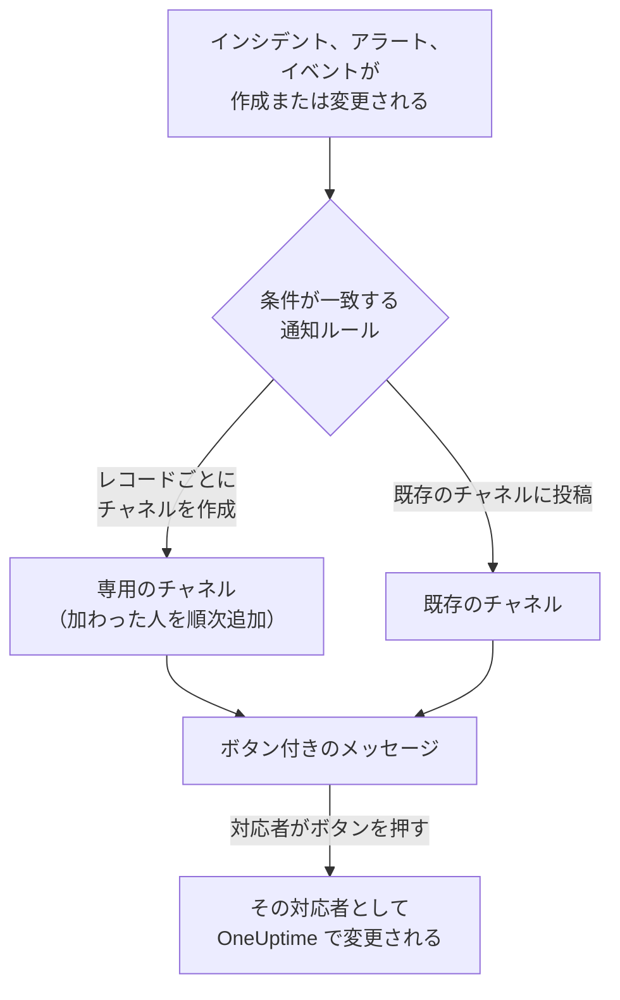

# Mattermost

OneUptime を Mattermost サーバーに接続すると、インシデント、アラート、エピソード、定期メンテナンス、モニター、オンコールの更新をチャネルに投稿し、インシデントごとに専用のチャネルを用意し、対応者が Mattermost を離れずに確認、解決、メモの追加、状態の変更を行えるようになります。

:::cards
- [Mattermost を接続する](#mattermost-を接続する): OneUptime 用のボットアカウントを作成し、そのトークンでプロジェクトを接続します。
- [自分のアカウントを接続する](#自分の-mattermost-アカウントを接続する): 自分の Mattermost アカウントを OneUptime アカウントにリンクします。
- [通知ルール](#通知ルール): どのイベントをどこに投稿し、どれに専用のチャネルを用意するかを決めます。
- [Mattermost から操作する](#mattermost-からインシデントアラートイベントを操作する): OneUptime のメッセージにあるボタンです。
- [ネットワークとセルフホスティング](#ネットワークとセルフホスティング): 各サーバーが到達できる必要がある宛先です。
:::

## しくみ

この動作には 2 つの接続が必要です。

- **プロジェクトの接続** は 1 回だけ行います。Mattermost サーバー上の、OneUptime が投稿するチームにいるボットアカウントです。このボットがメッセージを投稿し、チャネルを作成し、そこにメンバーを追加します。
- **各メンバー自身の接続** は、その人の Mattermost アカウントを OneUptime アカウントにリンクしたものです。ボタンは、その人として、プロジェクトでのその人の権限で動作します。

1 つの Mattermost チームを、本番環境とステージング環境のように複数のプロジェクトに接続できます。ボタンは、そのメッセージが扱うレコードのプロジェクトで動作します。

## 始める前に

- **プロジェクトを接続できるロール:** **プロジェクト所有者**、**プロジェクト管理者**、**プロジェクトメンバー** のいずれか。接続の解除には **プロジェクト所有者** または **プロジェクト管理者** が必要です。
- **ボットアカウントを作成できる Mattermost サーバー**、または代わりに作成してくれる Mattermost の管理者。Mattermost Cloud とセルフホストの Mattermost のどちらでも使えます。
- **OneUptime Cloud の Growth プラン** (通知ルールとサマリーに必要)。

Mattermost のために OneUptime 側のサーバーで設定するものはありません。各プロジェクトが、それぞれ自分の Mattermost サーバーとボットアカウントを使います。

## Mattermost を接続する

:::steps
### Mattermost でボットアカウントを作成する

Mattermost で **System Console** > **Integrations** > **Bot Accounts** を開き、 **Enable Bot Account Creation** がオンになっていることを確認します。次に **Integrations** > **Bot Accounts** > **Add Bot Account** に移動し、名前を `oneuptime` にして保存します。Mattermost はボットのアクセストークンを一度だけ表示するので、コピーしてください。

### ボットをチームに追加する

OneUptime に投稿させたいチームに、人を追加するときと同じようにボットを追加します。 **Main Menu** > **Invite People** で `@oneuptime` を招待してください。OneUptime がチャネルを作成して投稿するのは、そのチームの中だけです。

### プロジェクトを接続する

OneUptime で **プロジェクト設定** > **ワークスペース** > **Mattermost** に移動し、 **Mattermost と接続** をクリックします。サーバーのアドレス (例: `https://chat.example.com`) とボットのアクセストークンを入力します。OneUptime は、何かを保存する前に、サーバーに問い合わせてトークンを確認します。ボットが複数のチームに参加している場合は、どのチームに投稿するかを OneUptime が尋ねます。

### 通知ルールを追加する

**インシデント** > **ワークスペース** > **Mattermost** に移動し、ルールを作成します。たとえば、新しいインシデントごとに Mattermost チャネルを作成し、対応する全員を参加させるルールです。[通知ルール](#通知ルール) を参照してください。
:::

ボットのアクセストークンは OneUptime のサーバーにだけ、プロジェクトのほかのシークレットとともに暗号化して保存され、二度と表示されません。サーバーのアドレス、チーム、ボットのユーザー名は、Mattermost の設定ページでプロジェクトの全員に表示されます。

プロジェクトが接続できる Mattermost チームは 1 つだけです。別のチームや別のサーバーに移すには、先に接続を解除します。 **プロジェクト設定** > **ワークスペース** > **Mattermost** で **⋯** > **Mattermost の接続を解除** を選びます。接続を解除すると、各メンバー自身の Mattermost アカウントの接続も解除され、その Mattermost の通知方法と、それを使うオンコールルールも削除されます。通知ルールとサマリーは、再接続するときのために保持されます。

## 自分の Mattermost アカウントを接続する

Mattermost には、OneUptime からあなたを案内できるサインイン画面がありません。そのため、代わりに OneUptime のボットが、あなたの Mattermost アカウントにリンク付きのダイレクトメッセージを送ります。

:::steps
1. **ユーザー設定** > **ワークスペース** > **Mattermost** に移動します。OneUptime は、あなたのメールアドレスを持つ Mattermost アカウントを探します。見つかった場合は **@your-username にリンクを送信** をクリックします。見つからない場合は **リンクを送信** をクリックし、Mattermost のユーザー名を入力します。
2. Mattermost で OneUptime ボットからのダイレクトメッセージを開き、 **Connect my account** をクリックします。
3. リンクで OneUptime が開き、OneUptime があなたのアカウントを接続します。
:::

リンクは、リクエストしたときと同じブラウザーで開いてください。リンクはそのブラウザーでのみ、1 回だけ、15 分間だけ機能します。これにより、リクエストした人が両方のアカウントを持っていることが証明されるため、誰もほかの人の Mattermost アカウントを接続できません。リンクをリクエストしていない場合は、無視してください。リクエストしたブラウザーで開かれるまで、何も接続されません。

アカウントの接続は、このプロジェクトに属します。同じ Mattermost チームに接続された別のプロジェクトでは、そのプロジェクトでも接続してください。

## Mattermost で呼び出しを受ける

オンコール中にダイレクトメッセージで呼び出しを受けるには、Mattermost を通知方法の 1 つとして追加します。

:::steps
1. 自分の Mattermost アカウントを接続します ([自分の Mattermost アカウントを接続する](#自分の-mattermost-アカウントを接続する) を参照)。
2. **ユーザー設定** > **通知方法** に移動し、 **ワークスペースアプリ** タブを開いて **Mattermost アカウントを追加** をクリックします。
3. その行の **テストメッセージを送信** をクリックします。メッセージはプロジェクトのボットからのダイレクトメッセージとして届きます。
:::

追加するとすぐにオンコールルールに加わるので、それ以降の呼び出しは Mattermost に届きます。どの呼び出しを受け取るかは **ユーザー設定** > **オンコールルール** で変更します。各呼び出しには、確認用のリンクとエスカレーション用のリンクがあります。Mattermost アカウントの接続を解除すると、この通知方法と、それを使うオンコールルールが削除されます。

## 通知ルール

通知ルールは、どのイベントを Mattermost のどこに投稿するかを決めます。各製品にはそれぞれのルールがあり、メニューの **ワークスペース** > **Mattermost** にあります。 **インシデント** ( **インシデントエピソード** と **概要** タブを含む)、 **アラート** ( **アラートエピソード** と **概要** を含む)、 **定期メンテナンス**、 **モニター**、 **オンコール**、 **セキュリティイベント** です。動作は Slack のルールと同じです。条件、送信先、チャネルに参加する人については [通知ルール](/docs/workspace-connections/slack#通知ルール) を参照してください。

ルールが作成するチャネルには、そのレコードの名前が付きます。インシデント INC-42 は `inc-42` になります。Mattermost で使えるのは英小文字、数字、`-` と `_` で、64 文字までです。先頭と末尾は英字か数字でなければなりません。ルールのフォームには入力に合わせて名前が表示されます。同じ名前のチャネルがすでにある場合 (アーカイブ済みのチャネルなど)、OneUptime は `-2`、`-3` のように番号を付けます。非公開のインシデント、アラート、エピソードには非公開のチャネルが作成されます。

既存のチャネルに投稿するには、チャネルのアドレスに表示されるとおりの名前 (例: `chat.example.com/team/channels/incidents` なら `incidents`) か、その表示名を入力します。OneUptime は公開チャネルに初めて投稿するときに自分で参加します。非公開チャネルには、ルールが投稿する前に Mattermost でボットを追加してください。

ルールのチャネルに人が参加するときは、その人が接続した Mattermost アカウントが使われ、それがなければその人のメールアドレスを持つ Mattermost アカウントが使われます。後者は、サーバーがボットにメールアドレスを表示する場合に限ります ( **System Console** > **Site Configuration** > **Users and Teams** > **Show Email Address** )。OneUptime は、追加できなかった人の名前を、チャネル内の 1 つのメッセージで、アカウントを接続するリンクとともに示します。

ルールの行の **ルールをテスト** は、Slack と同じく、そのルールのテストメッセージをルールが指定するチャネルに投稿します。

OneUptime のメッセージが、引用した内容で誰かに通知することはありません。`@channel`、`@here`、`@someone` を含む名前や説明は書かれたとおりに表示され、誰にも通知されません。

## Mattermost からインシデント、アラート、イベントを操作する

OneUptime のメッセージにはボタンと、使う人の少ない操作のための **More actions** メニューがあります。どのボタンもあなたとして、プロジェクトでのあなたの権限で動作し、あなただけに見えるメッセージで応答します。

| レコード | ボタンとメニュー |
| --- | --- |
| **インシデント** | **Acknowledge**、 **Resolve**、 **Add Note**、メニューには **Change Severity** と **Change State** |
| **アラート** | **Acknowledge**、 **Resolve**、 **Add Note**、 **Change State**、 **Execute On-Call Policy** |
| **インシデントエピソード、アラートエピソード** | **Acknowledge**、 **Resolve**、 **Add Note**、 **Change State**、 **Execute On-Call Policy** |
| **定期メンテナンス** | **Mark as Ongoing**、 **Mark as Complete**、 **Add Note**、 **Change State** |

**Add Note**、 **Change State**、 **Change Severity**、 **Execute On-Call Policy** は Mattermost でフォームを開きます。インシデントや定期メンテナンスイベントのメモは、ステータスページに表示される公開メモにも、非公開メモにもできます。プライベートインシデントのメモは常に非公開で、アラートのメモも常に非公開です。どのメッセージにも、そのレコードを OneUptime で開くリンクがあり、それ以外の操作はそこで行えます。

Mattermost アカウントがまだ接続されていない場合は、ボタンがそのことを **ユーザー設定** > **ワークスペース** > **Mattermost** へのリンクとともに伝えます。アカウントを接続してから、もう一度ボタンを押してください。

ボタンが押されるたびに、押した人とともに **プロジェクト設定** > **通知** > **通知ログ** の **ワークスペース** タブに記録されます。

## ネットワークとセルフホスティング

2 つのサーバーが互いに通信します。

- **OneUptime が Mattermost サーバーを呼び出します。** 投稿、チャネルの作成、メンバーの追加のためです。OneUptime Cloud では、Mattermost サーバーにインターネットから到達できる必要があります。セルフホストの OneUptime は、その運用者が `ALLOW_PRIVATE_NETWORK_WEBHOOKS` または `PRIVATE_NETWORK_WEBHOOK_ALLOWLIST` でプライベートアドレスを許可すると、プライベートネットワーク上の Mattermost サーバーに到達できるようになります。OneUptime が自身のマシン上のアドレスやクラウドのメタデータアドレスを呼び出すことはなく、リダイレクトをたどることもありません。
- **Mattermost サーバーが OneUptime を呼び出します。** 誰かがボタンを押したり、フォームを送信したりしたときです。呼び出し先は `https://<your OneUptime>/api/mattermost/interactive` と `/api/mattermost/dialog` です。OneUptime のアドレスがプライベートアドレスの場合は、Mattermost の **System Console** > **Environment** > **Developer** > **Allow untrusted internal connections to** にそのホストを追加してください。追加しないと、ボタンは動作しません。

OneUptime が投稿するすべてのボタンには、投稿先の Mattermost チームに対する署名が付いており、押されたときに確認されます。OneUptime が署名していない操作や、別のチームから送られた操作は、何も行いません。

## トラブルシューティング

| 表示される内容 | 対処法 |
| --- | --- |
| **Mattermost did not accept the access token** | ボットのトークンをもう一度コピーします。Mattermost はトークンを一度しか表示しないので、必要なら **Integrations** > **Bot Accounts** で新しいトークンを作成してください。 |
| **The bot account is not a member of any team** | Mattermost でボットをチームに追加してから、もう一度接続します。 |
| **OneUptime could not reach the Mattermost server** | アドレスと、OneUptime がそのアドレスに到達できることを確認します。[ネットワークとセルフホスティング](#ネットワークとセルフホスティング) を参照してください。 |
| **The bot is not a member of the private Mattermost channel** | Mattermost でボットをそのチャネルに追加します。 |
| ボタンが何もしない、または Mattermost が操作を完了できなかったと表示する | Mattermost から OneUptime に到達できません。[ネットワークとセルフホスティング](#ネットワークとセルフホスティング) を参照してください。 |
| リンク付きのダイレクトメッセージが届かない | ユーザー名と、あなたがいるチームにボットがいることを確認します。 |
