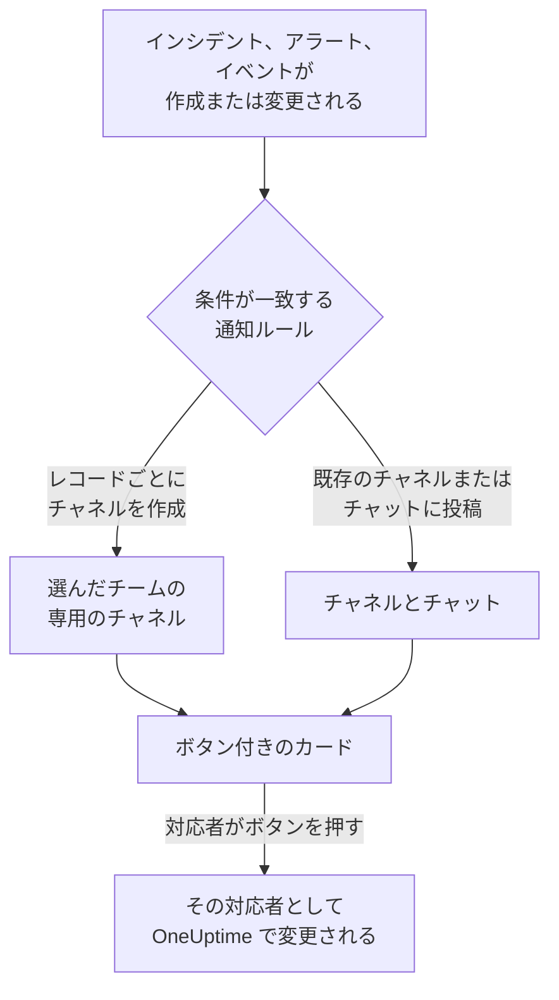

# Microsoft Teams

OneUptime を Microsoft Teams に接続すると、インシデント、アラート、エピソード、定期メンテナンス、モニター、オンコールの更新をチャネルとチャットに投稿し、インシデントごとに専用のチャネルを用意し、対応者が Teams から操作できるようになります。確認、解決、メモの追加、オンコールの呼び出し、インシデントの宣言、OneUptime AI への質問ができます。

:::cards
- [Microsoft Teams を接続する](#microsoft-teams-を接続する): 管理者の同意、自分のサインイン、各チームへのアプリの追加。
- [全員に接続を依頼する](#全員に接続を依頼する): アカウントを接続していないメンバー全員に、まとめてメッセージを送ります。
- [通知ルール](#通知ルール): どのイベントをどこに投稿し、どれに専用のチャネルを用意するかを決めます。
- [OneUptime ボットと話す](#oneuptime-ボットと話す): ボットとのチャットでのコマンド、質問、フォーム。
- [オンコールタグ](#オンコールタグ): チームのタグをオンコール担当者と一致させ、呼び出せるようにします。
- [Microsoft Teams からインシデント、アラート、イベントを操作する](#microsoft-teams-からインシデントアラートイベントを操作する): OneUptime のカードにあるボタンです。
:::

## しくみ

この動作には 3 つのものが必要です。

- **プロジェクトの接続** は 1 回だけ行います。Microsoft 365 の管理者が組織に対して OneUptime アプリに同意します。
- **各チームの OneUptime アプリ** は、通知を受け取りたいチームごとに必要です。Microsoft は、ボットが追加されたチームにしか投稿を許可しません。
- **各メンバー自身の接続** は、その人の Microsoft Teams アカウントを OneUptime アカウントにリンクしたものです。ボタン、コマンド、リアクションは、その人として、プロジェクトでのその人の権限で動作します。

1 つの Microsoft 365 組織を、本番環境とステージング環境のように複数のプロジェクトに接続できます。カードのボタンは、そのカードが送信されたプロジェクト (カードが扱うインシデントのプロジェクトなど) で動作します。ボットへのメッセージは、送信されたチャネル (インシデントのチャネルなど) のプロジェクトで動作し、それ以外では、送信者の Microsoft Teams アカウントが接続されている唯一のプロジェクトで動作します。どれとも判断できない場合、ボットは送信者にどのプロジェクトのことかを尋ね、その人が参加している各プロジェクトのボタンを表示します。選ぶと、そのプロジェクトで続行します。OneUptime AI との会話では、選んだプロジェクトがその後の質問にも使われ、質問がないまま 1 時間たつまで続きます。

## 始める前に

- **プロジェクトを接続できるロール:** **プロジェクト所有者**、 **プロジェクト管理者**、 **プロジェクトメンバー** のいずれか。アンインストールには **プロジェクト所有者** または **プロジェクト管理者** が必要です。
- **Microsoft 365 の管理者** (組織全体に対して 1 回、管理者の同意を付与する)。
- **OneUptime Cloud の Growth プラン** (通知ルールとサマリーに必要)。[Growth プラン未満の通知ルール](#growth-プラン未満の通知ルール) を参照してください。
- **セルフホストのサーバーでは**、先にそのサーバー用に設定した Teams ボット。[Microsoft Teams 統合](/docs/self-hosted/microsoft-teams-integration) を参照してください。

## Microsoft Teams を接続する

:::steps
### 管理者の同意を付与する

**プロジェクト設定** > **ワークスペース** > **Microsoft Teams** に移動し、 **管理者の同意を付与** をクリックします。Microsoft 365 の管理者がサインインし、組織に対して OneUptime アプリを許可します。その後、カードに **管理者の同意が完了しました** と表示されます。ワークスペースが接続されるまでは、インシデント、アラート、定期メンテナンス、モニター、オンコールの各メニューの **ワークスペース** セクションに **Slack または Teams を接続** があり、ここからもこのページに移動できます。

### 自分のアカウントを接続する

**Microsoft Teams で接続** をクリックし、職場のアカウントでサインインします。OneUptime は組織のチームを読み取ります。 **チームを表示** でその一覧を表示できます。

### 各チームに OneUptime アプリを追加する (必須)

アカウントを接続するだけでは十分ではありません。Microsoft は、OneUptime ボットが追加されたチームにしか投稿を許可しないので、通知を受け取りたいチームごとに次の操作を行います。

- Microsoft Teams で、 **チーム名** (チャネル名ではありません) の横にある "..." をクリックします。
- **Manage team** > **Apps** > **More apps** を選び、 **OneUptime** を見つけて **Add** をクリックします。

OneUptime Cloud では、 **Teams ストアを開く** で Microsoft Teams ストアのアプリが開き、そこで **Add to a team** を使っても同じことができます。セルフホストのサーバーでは、代わりに **アプリマニフェストの Zip をダウンロード** のパッケージをインストールします。サーバーのボットが含まれているのはこのパッケージだけです。テスト通知で OneUptime アプリがチームにインストールされていないと表示される場合は、この手順が抜けています。

### ほかのメンバーを接続する

各メンバーは **ユーザー設定** > **ワークスペース** > **Microsoft Teams** で **自分のアカウントを Microsoft Teams に接続** を使って自分の Microsoft Teams アカウントをリンクし、自分としてインシデントを操作したりダイレクトメッセージを受け取ったりします。このセクションは、プロジェクトが Microsoft Teams に接続されると表示されます。チーム全員にまとめて接続してもらうには、[全員に接続を依頼する](#全員に接続を依頼する) を参照してください。

### 通知ルールを追加する

**インシデント** > **ワークスペース** > **Microsoft Teams** に移動します。 **ワークスペース** セクションにはプロジェクトが接続したチャットワークスペースだけが表示されるので、 **Microsoft Teams** は接続後に表示されます。ルールを作成し (たとえば、インシデントが作成されたときに Teams チャネルに投稿するルール)、その行の **ルールをテスト** をクリックします。
:::

> [!NOTE]
> OneUptime を自分用にインストールしたり、チャットに追加したりするのは別のインストールで、チームのチャネルへの投稿はできるようになりません。 **プライベートチャネル** では、チャネル自体にアプリを追加する必要があります。チャネルを開き、"..." > **Manage channel** > **Apps** > **Add an app** を選びます。 **共有チャネル** は通知を受け取れません。Microsoft Teams は共有チャネルでのボットをサポートしていません。

## 全員に接続を依頼する

管理者を含め、誰もほかの人の Microsoft Teams アカウントを接続することはできません。各自が自分のアカウントにサインインします。チーム全員に接続してもらうには、 **プロジェクト所有者** または **プロジェクト管理者** が **プロジェクト設定** > **ワークスペース** > **Microsoft Teams** で全員にまとめて依頼します。 **Members' Microsoft Teams accounts** カードには、接続済みのメンバーの数が表示されます。 **Ask everyone to connect** を押すと、まだ接続していない各メンバーに OneUptime ボットがメッセージを送ります。メッセージには、ワンクリックでアカウントを接続できる **Connect Microsoft Teams account** ボタンがあります。

- **メッセージを受け取る人。** Microsoft Teams アカウントを接続しておらず、OneUptime アプリが追加されたチームにいる、プロジェクトのメンバー全員です。そのチームでは、メールアドレスまたはユーザープリンシパル名 (UPN) でその人を見つけます。過去 24 時間以内に依頼を受けた人には再度依頼しないため、翌日にもう一度依頼すると、まだ接続していない人にだけリマインドが届きます。
- **カードが示すこと。** 送信中はメッセージの送信状況を、送信後は依頼した人とメッセージを受け取ったメンバーの数を示します。OneUptime が見つけられなかったメンバーは、カードに名前が表示されます。そのメンバーのチームにアプリを追加するか、本人に **ユーザー設定** > **ワークスペース** > **Microsoft Teams** で接続してもらいます。
- **ボタンが接続するもの。** ボタンを押してサインインした人の Microsoft Teams アカウントを、その人自身の OneUptime アカウントに接続します。メッセージをほかの人に転送しても、元の宛先のメンバーには何も接続されません。

## 通知ルール

通知ルールは、どのイベントを Microsoft Teams のどこに投稿するかを決めます。各製品にはそれぞれのルールがあり、メニューの **ワークスペース** > **Microsoft Teams** にあります。

| 製品 | **Microsoft Teams** ページのタブ |
| --- | --- |
| **インシデント** | **インシデント**、 **インシデントエピソード**、 **概要** |
| **アラート** | **アラート**、 **アラートエピソード**、 **概要** |
| **定期メンテナンス** | ルールの一覧 1 つ |
| **モニター** | ルールの一覧 1 つ |
| **オンコール** | ルールの一覧 1 つ |

ルールの作成は 4 つのステップで進みます。

| ステップ | 設定する内容 |
| --- | --- |
| **基本** | **ルール名** と **ルールの説明**。 |
| **条件** | ルールの対象となるイベント。たとえば重大度、状態、ラベル、モニター、タイトル内の語句で絞り込みます。条件は、イベントが作成されたときと、OneUptime がそのイベントについて更新を投稿するたびに確認されます。そのため、確認済みインシデント向けのルールは、インシデントが確認されたときに動作します。新しいルールはすべてのイベントが対象です (たとえば **すべてのインシデント**)。絞り込むには **条件に一致するインシデントのみ** を選び、条件を追加します。条件が 2 つ以上ある場合は、 **一致条件** で、すべて一致する必要があるか、どれか 1 つでよいかを決めます。 |
| **送信先** | 投稿先。選んだチームの既存のチャネル、選んだチャット、選んだチームにインシデントごとに作成するチャネル (アラート、エピソード、イベント、モニター、オンコールポリシーも同様)、またはそれらの組み合わせです。ステップの下にある **このルールの動作** が、ルールのカードと同じく、動作を文章で示します。 |
| **ビデオ通話** | インシデントとアラートのみ。それぞれに通話を開始します。[ビデオ通話](/docs/workspace-connections/video-calls) を参照してください。 |

ルールが作成するチャネルには、そのレコードの名前が付きます。インシデント INC-42 は `inc-42`、アラート ALT-7 は `alt-7` になり、番号プレフィックスのないプロジェクトではインシデント 42 が `incident-42` になります。 **チャネル名のプレフィックス** に入力した文字はその前に付き、`prod-` なら `prod-inc-42` になります。フォームには入力に合わせて名前が表示されます。定期メンテナンスイベントでは、プレフィックスが番号プレフィックスの代わりになり、SM-5 は `sm-5`、`maint-` なら `maint-5` になります。OneUptime が残すのは文字、数字、スペース、`-` と `_` で、Microsoft Teams が受け付ける 50 文字までです。チームに同じ名前のチャネルがすでにある場合 (別のプロジェクトのチャネルや、過去 30 日以内に削除されたチャネルなど)、OneUptime は `-2`、`-3` のように番号を付けます。

ルールのチャネルは、イベントが初めてそのルールに一致したときに作成されます。イベントの作成時か、まだ進行中のイベントが更新によって一致したときです。確認済みインシデント向けのルールは、インシデントが確認されたときにチャネルを作成します。Microsoft Teams ではチームのチャネルがチームの全員に表示されるため、OneUptime はチャネルに人を 1 人ずつ追加しません。ルールのフォームの **チャネルに参加するメンバー** にあるとおり、選んだチームの全員がチャネルを開けます。非公開のインシデント、アラート、エピソードには非公開のチャネルが作成され、そのメンバーだけに表示されます。メンバーは Microsoft Teams で追加してください。

オンコール担当者に知らせるには、ルールのフォームの **オンコール担当者をメンションする** で、その担当者のオンコールスケジュールを選びます。チャネルが作成されると、OneUptime はレコードの最初のメッセージのすぐ後に、それらのスケジュールでオンコールの人を @メンションするメッセージをチャネルに投稿し、Microsoft Teams がその人に通知します。誰も呼び出されません。OneUptime は、その人が OneUptime に接続した Microsoft Teams アカウントで、それがなければメールアドレスで、チーム内の各人を特定します。チームにいない人はそのチームのチャネルを開けないため、代わりにメッセージの中で理由とともに名前が示されます。非公開チャネルはそのメンバーしか開けないため、オンコール担当者を Microsoft Teams でそのチャネルに追加してください。

その後のレコードの更新 (状態の変更、メモ、新しい所有者) は、そのレコードのチャネルに投稿され、ルールが指定する既存のチャネルとチャットにも、ルールの条件が一致している間は投稿されます。OneUptime は Microsoft Teams のチャネルをアーカイブできないため、レコードが終わってもルールのチャネルは残ります。Microsoft Teams でアーカイブするか削除してください。

専用のチャネルを持つインシデント、アラート、エピソード、定期メンテナンスイベントでは、OneUptime のページのヘッダーの状態ボタンの横に **Microsoft Teams で開く** が表示されます。そのチャネルを新しいタブで、Microsoft Teams アプリまたはブラウザーで開きます。専用のチャネルが 2 つあるレコードでは、ボタンの下に両方が一覧表示されます。Slack と Microsoft Teams の両方にチャネルがあるレコードでは、代わりに **チャネルを開く** ボタンが 1 つだけ表示され、すべてのチャネルが一覧表示されます。ルールが投稿する既存のチャネルとチャットは表示されません。

レコードのページには **Microsoft Teams のチャネル** カードもあり、チャネルを開ける人が示されます。チームの全員か、非公開チャネルならそのメンバーで、メンバーはチャネルの所有者が Microsoft Teams で追加します。OneUptime は Microsoft Teams のチャネルにいる人を変更しません。Slack のチャネルなら、カードにチャネルにいる人が表示され、人を追加できます。 [レコードのチャネルにいる人](/docs/workspace-connections/slack#レコードのチャネルにいる人) を参照してください。

チャネルとチャットは読みやすいままです。それぞれの更新は一度だけ投稿され、レコードの最初の状態は、そのレコードを知らせるカードの中にあり、別のカードにはなりません。オンコールポリシーの実行はひとつのカードで、エスカレーションが進むにつれて編集されます。誰が呼び出されたか、何回どの方法で呼び出されたか、誰が呼び出されなかったかとその理由、そして誰が確認したかが示されます。新しいカードが投稿されるのは、誰かが対応しなければならないときだけです。つまり、あるエスカレーションルールが誰にも届かなかったときか、誰も確認しないまま実行が終わったときです。レコードの所有者やステータスページの購読者に通知したことは、OneUptime のレコードのフィードに残ります。

**プロジェクト設定** > **ワークスペース** > **Microsoft Teams** には、OneUptime がチームで見られるチャネルと、追加されたチャットが表示され、それぞれの横に **テストを送信** があります。チャットは、Microsoft Teams でそのチャットに OneUptime アプリが追加されると表示されます。 **チャットを更新** で新しいチャットとその現在の名前を取り込みます。

## ルールのテスト

ルールの行の **ルールをテスト** は、そのルールのテストメッセージをルールが指定するチャネルに投稿し、届くことを確かめられるようにします。イベントごとにチャネルを作るルールなら、テストでもチャネルを 1 つ作り、ルールの対象者を招待します。

**プロジェクト設定** > **ワークスペース** > **Microsoft Teams** のチャネルの横にある **テストを送信** と同じく、通知ルールを作成する権限が必要です。 **プロジェクト所有者**、 **プロジェクト管理者**、 **プロジェクトメンバー**、 **設定管理者**、 **設定メンバー**、またはカスタムロールの **Create Workspace Notification Rule** と **Read Workspace Notification Rule** です。ルールを見ることしかできない人 ( **閲覧者** など) には **ルールをテスト** がロックされ、ツールチップに必要なものが表示されます。API はその人のテストを "You do not have permission to send test notifications in this project." で拒否します。OneUptime Cloud では、ルールのテストにはルールの追加と同じく **Growth** プランが必要です。

OneUptime Cloud では、チャネルやチャットの横にある **テストを送信** にも **Growth** プランが必要です。チャネルへの投稿はルールとサマリーが行うことだからです。サマリーの **今すぐテストを送信** には、サマリーを作成する権限 (カスタムロールの **Create Workspace Notification Summary** と **Read Workspace Notification Summary**) と、OneUptime Cloud では **Growth** プランが必要です。それ以外の人にはロックされ、ツールチップに必要なものが表示されます。読み取り専用で接続された MCP クライアントは、どのテストも送信できません。

## サマリー

**インシデント** > **ワークスペース** > **Microsoft Teams** (および **アラート**) の **概要** タブは、指定したチャネルに定期的なまとめを投稿します。インシデントやアラートの件数、確認と解決までの速さ、リンク付きの一覧が含まれます。新しいサマリーは毎週送信され、直近 7 日間を対象にします。 **最初のレポートの送信時刻** を空欄のままにすると、最初のサマリーは次の週・日・月の始めの 09:00 に送信されます。いつ送信されるかはフォームに表示されます。

サマリーは **タイムゾーン** の時計で送信されます。タイムゾーンの初期値はあなたのタイムゾーンです。サマリーはそこで一年中同じ時刻を保ちます。ベルリンの 09:00 に設定したサマリーは、夏時間で時計が切り替わった後もベルリン時間の 09:00 に送信され、メッセージ内の日付もベルリンの日付です。API では `timezone` を IANA タイムゾーン名 (例: `Europe/Berlin`) で送信します。タイムゾーンを指定せずに作成したサマリーは作成者のプロフィールのタイムゾーンを使い、API キーで作成した場合は UTC を使います。

サマリーのフォームは 4 つのステップです。 **基本情報** (名前、チャネル、その **チーム名** )、 **スケジュール**、 **コンテンツ** ( **含める内容** )、 **フィルター** (対象にするインシデントやアラート) です。

## Growth プラン未満の通知ルール

OneUptime Cloud では、通知ルールとサマリーは **Growth** プラン以上で利用できます。それより下のプランのプロジェクトは、すでにあるルールとサマリーを保持し、それらは引き続き Microsoft Teams に投稿します。そのため、各製品 (インシデント、アラート、定期メンテナンス、オンコール、モニター) の **Microsoft Teams** ページには、プランについての注記とその下に一覧 ( **まだ設定されている通知ルール**、 **まだ設定されているサマリー** ) が表示されます。ルールを削除するか、サマリーをオフにするか削除してください。ルールとサマリーの追加や変更には **Growth** が必要です。

## Microsoft Teams で呼び出しを受ける

オンコール中にダイレクトメッセージで呼び出しを受けるには、Microsoft Teams を通知方法の 1 つとして追加します。

:::steps
1. 自分の Microsoft Teams アカウントを接続します ([Microsoft Teams を接続する](#microsoft-teams-を接続する) を参照)。
2. **ユーザー設定** > **通知方法** に移動し、 **ワークスペースアプリ** タブを開いて **Microsoft Teams アカウントを追加** をクリックします。
3. その行の **テストメッセージを送信** をクリックします。メッセージが Microsoft Teams のチャットに届きます。
:::

追加するとすぐにオンコールルールに加わるので、それ以降の呼び出しは Microsoft Teams に届きます。どの呼び出しを受け取るかは **ユーザー設定** > **オンコールルール** で変更します。

## メッセージをメモとして保存する

OneUptime がインシデント、アラート、エピソード、定期メンテナンスイベントのために作成したチャネルで、メッセージや返信にリアクションすると、OneUptime はそれをそのレコードのメモとして保存します。リアクションは 1 分以内に検出され、スレッドへの返信で知らせます。

| リアクション | 保存される形式 |
| --- | --- |
| 📌 または 📍 | チームだけが見られる非公開メモ |
| 📣 または 📢 | ステータスページに表示される公開メモ。インシデントと定期メンテナンスイベントのみ。プライベートインシデントでは非公開メモになり、確認メッセージがその理由を伝えます。 |

メモには Microsoft Teams で表示されていたとおりのメッセージが残ります。書式、リンク、コード、メンションされた人の名前、そしてファイルや画像へのリンクです。公開メモでは、ファイルと画像はチームの中でしか開けないため含まれません。

メモはメッセージを書いた人の言葉として残ります。その人の Microsoft Teams アカウントが接続されていれば OneUptime の名前で、そうでなければ Teams に表示される名前で示されます。非公開メモは、保存がどれだけ後でも、タイムラインのメッセージが投稿された時点に置かれます。公開メモは保存した時点に置かれ、ステータスページにもその時点から表示されます。誰が保存したかはタイムラインに表示されます。メッセージはすでにチャネルにあるため、メモがチャネルに投稿し直されることはありません。

メモはあなたとして、あなたの権限で保存され、OneUptime アプリがチームに追加されている必要があります。Microsoft Teams アカウントがまだ接続されていない場合、OneUptime はあなたをメンションした返信で接続を求め、接続するとすぐにメッセージを保存するボタンを添えます。

## OneUptime ボットと話す

個人チャットでボットにメッセージを送るか、チャネルやグループチャットで OneUptime を @メンションします。チャネルやグループチャットでは、メンションされたときだけ応答します。

| メッセージ | ボットの動作 |
| --- | --- |
| `help` | できることの一覧を表示します。 |
| `incident [title or number]` | タイトルを入力した状態でインシデントのフォームを開きます。 `42` や `INC-42` のようなインシデントの番号を指定すると、代わりにそのインシデントを表示します。 [Microsoft Teams からインシデントを管理する](#microsoft-teams-からインシデントを管理する) を参照してください。 |
| `maintenance [title]` | タイトルを入力した状態で定期メンテナンスのフォームを開きます。 |
| `oncall` | 表示できる各オンコールスケジュールで、今オンコールの人、いつまでか、次は誰かを一覧表示します。 |
| `page [who] [message]` | @メンションした人を、メッセージの内容で呼び出します。または、誰を呼び出すかを選ぶカードを送ります。[Microsoft Teams から誰かを呼び出す](#microsoft-teams-から誰かを呼び出す) を参照してください。 |
| `ask [question]`、または普段の言葉での任意の質問 | OneUptime AI が、ログ、トレース、メトリクス、インシデント、モニターについて回答します。たとえば「今ダウンしているモニターは?」です。回答は読み取るだけです。 |
| `show active incidents`、 `show active alerts` | 現在開いているものを一覧表示します。 |
| `show scheduled maintenance`、 `show ongoing maintenance` | 予定されている、または進行中のメンテナンスイベントを一覧表示します。 |

`show` の一覧を除き、これらは Slack で `/oneuptime` の後に続く単語です。`create incident` と `create maintenance` も引き続き使えます。OneUptime AI への質問には、自分の Microsoft Teams アカウントの接続と、プロジェクトで AI がオンになっていることが必要です。アカウントが接続されていない場合、ボットはスレッドやチャットごとに一度だけ、**Connect Microsoft Teams account** ボタンで接続を求めます。[AI に質問](/docs/ai/ask-ai) を参照してください。

## Microsoft Teams のあなたのホーム

OneUptime ボットに `home` と入力すると、ボットはあなたのホームで答えます。あなたが見られる範囲でプロジェクトの状況を示すカードです。

- **あなたのオンコール。** 今オンコールになっているオンコールスケジュールとその終了時刻、またはあなたの次のシフトです。
- **未解決のもの。** あなたが読める最新の未解決のインシデントとアラートで、それぞれ OneUptime のページへのリンクが付きます。
- **ボタン。** **Declare incident** と **Page someone** は `incident` と `page` と同じように、 **Who's on call** は `oncall` と同じように答え、 **Refresh** はカードをその場で読み直します。

OneUptime アプリを自分用に追加すると、ボットがすぐにあなたのホームを送ります。ホームと `show` の一覧はあなたとして読むので、あなた自身の Microsoft Teams アカウントの接続が必要です。接続するまで、ボットは **Connect Microsoft Teams account** ボタンで答えます。 **ユーザー設定** > **ワークスペース** > **Microsoft Teams** の **Microsoft Teams で OneUptime を開く** は、Teams でアプリを開きます。

アプリがチームに追加されると、ボットはそこであいさつします。質問のしかたと、チームのチャネルに投稿する通知ルールの追加場所を伝えます。

## Microsoft Teams からインシデントとメンテナンスを作成する

OneUptime ボットに `incident` または `maintenance` と入力すると、個人チャット、チャネル、グループチャットのどこでも、入力した人のためのフォームが開きます。フォームはその人として入力されます。その人の Microsoft Teams アカウントが接続されている OneUptime アカウント ([Microsoft Teams を接続する](#microsoft-teams-を接続する) を参照) として、そのアカウントのプロジェクトでの権限で送信されます。アカウントが接続されていない人や、OneUptime アカウントがもうプロジェクトのメンバーでない人には、フォームの代わりに、その人をメンションした返信でどうすればよいかが伝えられます。

- **使える人。** OneUptime でインシデントを宣言できる人、または定期メンテナンスイベントを作成できる人です。インシデントには **プロジェクト所有者**、 **プロジェクト管理者**、 **プロジェクトメンバー**、 **インシデント管理者**、 **インシデントメンバー** (カスタムロールでは **Create Incident**)、イベントには **定期メンテナンス管理者** と **定期メンテナンスメンバー** ( **Create Scheduled Maintenance** ) です。それ以外の人にはそう伝えられ、フォームは届きません。
- **フォームが提示するもの。** 各一覧 (重大度、モニター、モニターのステータス、オンコールポリシー、ラベル) には、OneUptime の同じ一覧と同じく、フォームを求めた人が読めるものが含まれ、カードの "not shown" の注記もそれだけを数えます。一部のラベルに限定されたロールなら、それらのラベルが付いたモニターとオンコールポリシーです。まったく読めない一覧は外されます。アーカイブされたオンコールポリシーは提示されません。
- **フォームで指定できるもの。** チャネルやグループチャットでは、そこにいる誰でもフォームを送信でき、送信した人として、その人自身の権限で送信されます。インシデントやイベントはその権限で作成され、その人の操作として記録されます。その人が読めないモニター、オンコールポリシー、ラベル、重大度、ステータス、または別のプロジェクトのものは、プロジェクトにないものとして拒否され、何も作成されません。ボットは "One of the values you picked ... is not available in this project any more. Please pick it again." と返します。

インシデント、アラート、エピソードの **Execute On-Call Policy** も同じように動作します。オンコールポリシーを実行する権限 ( **プロジェクト所有者**、 **プロジェクト管理者**、 **プロジェクトメンバー**、 **オンコール管理者**、 **オンコールメンバー**、またはカスタムロールの **Create On-Call Duty Policy Execution Log** ) と、そのインシデント、アラート、エピソードを読む権限が必要で、その人が読める有効なオンコールポリシーが提示されます。カードからモニターやオンコールポリシーを表示するときも、ボタンを押した人として読み取ります。

## Microsoft Teams から誰かを呼び出す

チャネルやグループチャットでは、`@OneUptime page @Nawaz Dhandala The checkout API is throwing 500s` が Nawaz をすぐに呼び出します。OneUptime はメッセージをタイトルにしたアラートを作成し、@メンションした各人には、その人自身のオンコールルールに従って、電話、SMS、プッシュ通知、またはメールが、誰かがアラートを確認するまで届きます。

- **すぐに呼び出される人。** @メンションした人と、@メンションしたタグが連動するスケジュールでオンコール中の人で、その後にメッセージが続く場合です ( [オンコールタグ](#オンコールタグ) を参照)。OneUptime は、その人の Microsoft Teams アカウントが接続されている OneUptime アカウントで、それがなければ Microsoft Teams でのその人のメールアドレスで、人を特定します。プロジェクト外の人が呼び出されることはありません。
- **それ以外はカードが届きます。** 誰も @メンションしていない (ボットとの個人チャットなど)、メッセージがない、表示できるオンコールスケジュールに連動していないタグを指定した、または OneUptime が特定できない人がいる場合は、ボットが **Page someone** カードで応答します。カードには入力した内容が記入され、選べなかった人が示されます。人、チーム、オンコールスケジュール (今その中でオンコールの人を呼び出します)、またはオンコールポリシー (エスカレーションルールに従って呼び出します) を選んで送信します。会話にいる人なら誰でも、自分としてカードを送信できます。呼び出しが済むとカードは削除されるので、同じカードで二度呼び出されることはありません。
- **表示される場所。** 会話には、呼び出しが 1 つのカードとして表示され、最新の状態に保たれます。誰がどのように呼び出されたか、誰が確認したかがわかります。ボットがそれを投稿できない場合は、ボットの返信で、誰が呼び出されたかがアラートへのリンクとともに伝えられます。
- **呼び出せる人。** オンコールポリシーの実行とアラートの作成の両方ができる人です。 **プロジェクト所有者**、 **プロジェクト管理者**、 **プロジェクトメンバー**、または **オンコールメンバー** と **アラートメンバー** の組み合わせ (カスタムロールでは **Create On-Call Duty Policy Execution Log** と **Create Alert** ) です。オンコールポリシーを介さずに人、チーム、スケジュールを直接呼び出すには、さらにプロジェクトのすべてのオンコールポリシーへのアクセスが必要です。それ以外の人には返信でそう伝えられ、誰も呼び出されません。OneUptime Cloud では、呼び出しには Growth プランが必要です。それより下のプランでは、OneUptime が必要なプランを示し、誰も呼び出されません。

## オンコールタグ

`@Payments on-call` のような Microsoft Teams のタグを、1 つ以上のオンコールスケジュールで現在オンコールの担当者と一致させると、そのチームの誰でもタグを @メンションして担当者に連絡できます。OneUptime は引き継ぎやオーバーライドのたびにタグのメンバーを変更し、15 分ごとに確認します。

:::steps
### タグをスケジュールに接続する

**オンコール** > **オンコールスケジュール** でスケジュールを開きます。 **Microsoft Teams のタグ** カードで **タグを接続** をクリックし、チームを選んでタグの名前を入力します。その名前のチームのタグか、OneUptime が作成する新しいタグになります。タグのメンバーは、すぐにオンコール担当者に置き換えられます。

### セカンダリースケジュールにも接続する

プライマリーとセカンダリーの両方のオンコール担当者を含めるには、セカンダリースケジュールのページでも同じタグを接続します。1 つのタグはいくつでもスケジュールに連動できます。
:::

- **カードに表示される内容。** 各タグの現在のメンバー、そのチーム、連動しているほかのスケジュール、そして **最新** かどうかです。タグにはそのチームのメンバーしか入れられないため、チームにいないオンコール担当者は理由とともに示されます。
- **オンコール担当者がいないとき。** OneUptime は、誰かがオンコールになるまでタグから全員を外します。Microsoft Teams は空のタグを作成できないため、新しいタグにはチームのオンコール担当者が必要です。
- **タグを呼び出す。** `@OneUptime page @Payments on-call The checkout API is down` は、タグが連動するスケジュールでオンコール中の人を呼び出します。 [Microsoft Teams から誰かを呼び出す](#microsoft-teams-から誰かを呼び出す) を参照してください。
- **Microsoft 365 に必要なもの。** タグを変更するには、アプリの `TeamworkTag.ReadWrite.All` アクセス許可が必要です。Microsoft 365 管理者が **プロジェクト設定** > **ワークスペース** > **Microsoft Teams** の **管理者の同意を付与** で付与します。OneUptime がタグを管理できるようになる前に組織が同意していた場合は、もう一度同意してください。
- **接続できる人。** スケジュールを編集できるロールです。 **プロジェクト所有者**、 **プロジェクト管理者**、 **プロジェクトメンバー**、 **オンコール管理者**、 **オンコールメンバー**、またはカスタムロールの **Edit On-Call Duty Policy Schedule** です。OneUptime Cloud では、接続には **Growth** プランが必要です。
- **切断するとき。** OneUptime はタグの変更をやめます。タグとそのメンバーは、Microsoft Teams にそのまま残ります。

## Microsoft Teams からインシデントを管理する

インシデントのカードには 4 つのボタン **Acknowledge Incident**、 **Resolve Incident**、 **Add Note**、 **View Incident** があり、残りは三点ボタンのメニューにあります。

| メニュー項目 | 動作 |
| --- | --- |
| **Change Severity** | インシデントの重大度を設定します。 |
| **Change Incident State** | インシデントを後の状態に進めます。 |
| **Assign Role** | インシデントで誰かにロールを与えます。たとえば **Incident Commander** です。 1 人だけのロールは、その人に移ります。 |
| **Page Someone** | インシデントについて、人、チーム、スケジュールで今オンコールの人、またはオンコールポリシーを、誰かが確認するまで呼び出します。 |
| **Edit Custom Fields** | インシデントのカスタムフィールドを設定します。各フィールドにはインシデントの値が入っています。空のままにしたフィールドはクリアされます。 |

ボットに入力した `incident 42` は、インシデント 42 とこれらのボタンとメニューで答えます。番号は OneUptime の表示どおりに入力します: `42`、 `#42`、 `INC-42` 。インシデント専用のチャンネルでは、 `incident` だけでそのインシデントを表示します。

- **使える人。** Slack と同じく、 OneUptime で同じ変更ができる人です。 [Slack からインシデントを管理する](/docs/workspace-connections/slack#slack-からインシデントを管理する) を参照してください。各項目はカードで答え、カードは押した人が見られるインシデントの内容で入力されています。会話の誰でも、自分として、自分の権限でカードを送信できます。
- **その後の動き。** 変更は OneUptime と同じように、カードを送信した人として行われ、インシデントのフィードが何が変わったかを伝えます。ボットはその人をメンションした返信でそれを伝え、誰も 2 回送信しないようにカードを削除します。 **Page Someone** は誰が呼び出されたか、または誰も呼び出されなかった理由を伝えます。すでに解決済みのインシデントでは誰も呼び出されません。
- **Microsoft Teams での違い。** カードはフィールドの下に何が問題かを表示できません。合わない値は返信で伝えられ、カードは修正して再送信できるように残ります。日付と時刻のフィールドは、自分のタイムゾーンでの日と時刻です。古い Teams クライアントでは、メニューがボタンとして表示されます。 `incident 42` は会話の中で答えるため、会話の全員がインシデントを見られます。
- **メニューより前に投稿されたカード。** そのカードには **Execute On-Call Policy** ボタンが残り、引き続き動作します。 **Page Someone** でもオンコールポリシーを呼び出せます。アラートとエピソードは自分のボタンを保持します。

## Microsoft Teams からインシデント、アラート、イベントを操作する

OneUptime のカードのボタンは、個人チャット、チャネル、グループチャットのどこでも、押した人として動作します。その人の Microsoft Teams アカウントが接続されている OneUptime アカウントとして、そのアカウントのプロジェクトでの権限で動作します。インシデント、アラート、エピソードの **Acknowledge**、 **Resolve**、 **Change State**、 **Add Note**、 **Execute On-Call Policy**、そして定期メンテナンスイベントの **Mark as Ongoing**、 **Mark as Complete**、 **Change State**、 **Add Note** は、それぞれ OneUptime で同じ操作を行ったときと同じ変更を行い、その変更は OneUptime でその人の操作として記録されます。レコードの状態タイムラインとフィードには誰が状態を変更したかが表示され、メモもその人のものになります。リアクションでメッセージから保存したメモも、同じように投稿されます。

- **使える人。** OneUptime で同じ変更を行える人です。インシデントの確認、解決、状態の変更には、その状態を変更する権限が必要です。 **プロジェクト所有者**、 **プロジェクト管理者**、 **プロジェクトメンバー**、 **インシデント管理者**、 **インシデントメンバー**、またはカスタムロールの **Create Incident State Timeline** です。アラート、エピソード、定期メンテナンスイベントには、それぞれの種類に対応する同じ権限 (たとえば **Create Alert State Timeline** ) が必要で、メモにはその種類のメモを投稿する権限が必要です。OneUptime の状態パネルと同じく、インシデントやアラート自体を編集する権限は求めません。それ以外の人にはそう伝えられ、何も変わりません。
- **対象のレコード。** OneUptime と同じく、その人が読めるレコードです。一部のラベルに限定されたロールなら、それらのラベルが付いたインシデント、アラート、エピソード、イベントです。ほかのレコードのボタンは理由を伝え、何も変わりません。その人のロールが及ばないインシデントでは "your access in this project does not include this incident. Ask a project admin for access to it."、その人がオーナーではないプライベートなインシデントでは "this incident is private, so only its owners and the project's owners and admins can see it. Ask one of them to add you as an owner."、その後削除されたインシデントでは "the incident was not found. It may have been deleted." と返されます。OneUptime Cloud では、プロジェクトのプランに含まれない変更は、必要なプランを示して拒否されます。
- **Change State が提示するもの。** その人が読める状態のうち、レコードが次に移れる状態を、プロジェクトの順序で提示します。今の状態より前の状態は提示されません。これはインシデント、アラート、定期メンテナンスイベントと同様にエピソードでも同じです。状態の変更でレコードが一覧の上に戻ることはないからです ([順序は表示上の好みではなく、実際の制約](/docs/incidents/states-and-severities#順序は表示上の好みではなく実際の制約) を参照)。読める状態が 1 つもない場合、ボットは "No incident states are available to you in this project. Ask a project admin for access to them." と伝え、レコードが到達できる最後の状態にある場合は "There is no later state to move this incident to." と伝えます。どちらの場合も空のカードは表示されません。
- **プライベートインシデントでの Add Note。** プライベートインシデントには公開メモを追加できないため、カードはメモの種類を尋ねず、非公開メモを追加します。プライベートになる前に送られたカードも非公開メモを追加し、そのことを伝えます。[プライベートインシデントには非公開メモだけ](/docs/incidents/notes-owners-and-feed#プライベートインシデントには非公開メモだけ) を参照してください。
- **Escalate.** カードの **Escalate** は、カードの対象のインシデント、アラート、エピソードについて、そのオンコールポリシーを、押した人として、 **Execute On-Call Policy** と同じ権限で実行します。どれも対象にしていないカードには "This on-call policy can only be executed for an incident, an alert or an episode. Open the record you are paging about and use Execute On-Call Policy there." と返され、誰も呼び出されません。
- **返答が届く場所。** 同じ会話 (チャネルではカードのスレッド) で、その人をメンションした返信が届くので、Microsoft Teams がその人に通知します。遅すぎたボタンの操作には、誰がいつ先に行ったかが伝えられます。たとえば "Incident INC-2 was already acknowledged by Simon Lee at 6:07 PM." です。
- **アカウントが接続されていない場合。** 返信は **Connect Microsoft Teams account** ボタンで接続を求めます。このボタンは OneUptime のその人自身の Microsoft Teams 設定を開き、必要なら OneUptime にサインインした後、1 ステップでアカウントを接続します。その後 OneUptime は、その人が押した操作をその人として完了し、同じ会話で返信します。フォームを開くボタンやコマンドの場合は、もう一度押すか入力するよう求めます。ボタンは 30 分間、1 回だけ、押した Microsoft アカウントに対してのみ機能します。

## 接続を解除する

- **切断** は自分の Microsoft Teams アカウントのリンクだけを解除し、あわせて自分の Microsoft Teams の通知方法を削除します。
- **プロジェクト設定** > **ワークスペース** > **Microsoft Teams** の **Microsoft Teams から OneUptime をアンインストール** は、プロジェクトの接続を解除します。OneUptime は Microsoft Teams への投稿をやめ、 **ワークスペース** メニューにも表示されなくなります。通知ルールとサマリーは、再接続するときのために保持されます。

> [!WARNING]
> アンインストールすると、プロジェクトのすべてのメンバーの Microsoft Teams アカウントのリンクも解除され、Microsoft Teams の通知方法と、それを使っていたオンコールルールも削除されます。プロジェクトが接続できる Microsoft 365 の組織は 1 つだけです。別の組織に移すには、先にアンインストールしてください。

## トラブルシューティング

:::details テストで OneUptime アプリがチームにインストールされていないと表示される
ボットがそのチームにいないため、Microsoft が投稿を拒否しました。チームにアプリを追加します ([Microsoft Teams を接続する](#microsoft-teams-を接続する) を参照)。プライベートチャネルの場合は、チャネル自体に追加します。1 つのチームに追加しても、ほかのチームには何の効果もありません。
:::

:::details Microsoft Teams が接続されなかった
Microsoft から接続されないまま戻ってくると、開始したページに **Microsoft Teams は接続されませんでした** と表示され、1 つの文で理由が説明されます。権限がない、リンクがすでに使われたか期限切れ、別の Microsoft 365 の組織にサインインした、または組織にまだチームがない、のいずれかです。それぞれの文と対処法は [接続が完了しなかった](/docs/self-hosted/microsoft-teams-integration#接続が完了しなかった) を参照してください。
:::

:::details ボットにアカウントが接続されていないと言われる
ボットの返信の **Connect Microsoft Teams account** を押すと 1 ステップで接続できます。または、 **ユーザー設定** > **ワークスペース** > **Microsoft Teams** の **自分のアカウントを Microsoft Teams に接続** を使ってリンクしてください。どちらの場合も、プロジェクトが接続されている組織にサインインします。その組織のゲストであれば、ゲストとしてサインインします。ゲストで、以前に自分の組織のアカウントを接続した場合は、もう一度接続してください。
:::

:::details セルフホストのサーバーですべての通知が失敗する
チームにインストールした Teams アプリは、サーバーが生成したパッケージである必要があり、Microsoft からサーバーのボットのエンドポイントに到達できる必要があります。[Microsoft Teams 統合](/docs/self-hosted/microsoft-teams-integration#トラブルシューティング) のトラブルシューティングを参照してください。
:::

## 次のステップ

:::cards
- [Slack](/docs/workspace-connections/slack): Slack での同じ通知と操作。
- [ビデオ通話](/docs/workspace-connections/video-calls): すべてのインシデントに通話を用意し、更新とともに投稿します。
- [Microsoft Teams 統合](/docs/self-hosted/microsoft-teams-integration): セルフホストのサーバーで Teams ボットを設定します。
- [インシデントの宣言](/docs/incidents/declaring-incidents): インシデントが始まるすべての方法と、そのときに実行されるもの。
:::
