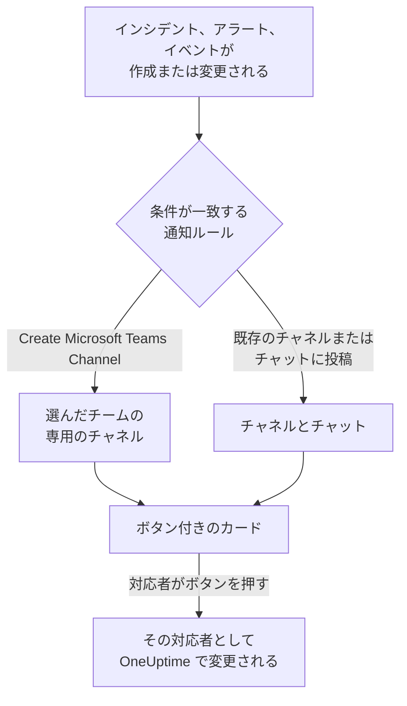

# Microsoft Teams

OneUptime を Microsoft Teams に接続すると、インシデント、アラート、エピソード、定期メンテナンス、モニター、オンコールの更新をチャネルとチャットに投稿し、インシデントごとに専用のチャネルを用意し、対応者が Teams から操作できるようになります。確認、解決、メモの追加、オンコールの呼び出し、インシデントの宣言、OneUptime AI への質問ができます。

:::cards
- [Microsoft Teams を接続する](#microsoft-teams-を接続する): 管理者の同意、自分のサインイン、各チームへのアプリの追加。
- [通知ルール](#通知ルール): どのイベントをどこに投稿し、どれに専用のチャネルを用意するかを決めます。
- [OneUptime ボットと話す](#oneuptime-ボットと話す): ボットとのチャットでのコマンド、質問、フォーム。
- [Microsoft Teams からインシデント、アラート、イベントを操作する](#microsoft-teams-からインシデントアラートイベントを操作する): OneUptime のカードにあるボタンです。
:::

## しくみ

この動作には 3 つのものが必要です。

- **プロジェクトの接続** は 1 回だけ行います。Microsoft 365 の管理者が組織に対して OneUptime アプリに同意します。
- **各チームの OneUptime アプリ** は、通知を受け取りたいチームごとに必要です。Microsoft は、ボットが追加されたチームにしか投稿を許可しません。
- **各メンバー自身の接続** は、その人の Microsoft Teams アカウントを OneUptime アカウントにリンクしたものです。ボタン、コマンド、リアクションは、その人として、プロジェクトでのその人の権限で動作します。

## 始める前に

- **プロジェクトを接続できるロール:** **Project Owner**、 **Project Admin**、 **Project Member** のいずれか。アンインストールには **Project Owner** または **Project Admin** が必要です。
- **Microsoft 365 の管理者** (組織全体に対して 1 回、管理者の同意を付与する)。
- **OneUptime Cloud の Growth プラン** (通知ルールとサマリーに必要)。[Growth プラン未満の通知ルール](#growth-プラン未満の通知ルール) を参照してください。
- **セルフホストのサーバーでは**、先にそのサーバー用に設定した Teams ボット。[Microsoft Teams 統合](/docs/self-hosted/microsoft-teams-integration) を参照してください。

## Microsoft Teams を接続する

:::steps
### 管理者の同意を付与する

**プロジェクト設定** > **ワークスペース** > **Microsoft Teams** に移動し、 **管理者の同意を付与** をクリックします。Microsoft 365 の管理者がサインインし、組織に対して OneUptime アプリを許可します。その後、カードに **管理者の同意が完了しました** と表示されます。ワークスペースが接続されるまでは、インシデント、アラート、定期メンテナンス、モニター、オンコールの各メニューの **ワークスペース** セクションに **Slack または Teams を接続** があり、ここからもこのページに移動できます。

### 自分のアカウントを接続する

**Microsoft Teams で接続** をクリックし、職場のアカウントでサインインします。OneUptime は組織のチームを読み取ります。 **チームを表示** でその一覧を表示できます。

### 各チームに OneUptime アプリを追加する (必須)

アカウントを接続するだけでは十分ではありません。Microsoft は、OneUptime ボットが追加されたチームにしか投稿を許可しないので、通知を受け取りたいチームごとに次の操作を行います。

- Microsoft Teams で、 **チーム名** (チャネル名ではありません) の横にある "..." をクリックします。
- **Manage team** > **Apps** > **More apps** を選び、 **OneUptime** を見つけて **Add** をクリックします。

OneUptime Cloud では、 **Teams ストアを開く** で Microsoft Teams ストアのアプリが開き、そこで **Add to a team** を使っても同じことができます。セルフホストのサーバーでは、代わりに **アプリマニフェストの Zip をダウンロード** のパッケージをインストールします。サーバーのボットが含まれているのはこのパッケージだけです。テスト通知で OneUptime アプリがチームにインストールされていないと表示される場合は、この手順が抜けています。

### ほかのメンバーを接続する

各メンバーは **ユーザー設定** > **ワークスペース** > **Microsoft Teams** で **自分のアカウントを Microsoft Teams に接続** を使って自分の Microsoft Teams アカウントをリンクし、自分としてインシデントを操作したりダイレクトメッセージを受け取ったりします。このセクションは、プロジェクトが Microsoft Teams に接続されると表示されます。

### 通知ルールを追加する

**インシデント** > **ワークスペース** > **Microsoft Teams** に移動します。 **ワークスペース** セクションにはプロジェクトが接続したチャットワークスペースだけが表示されるので、 **Microsoft Teams** は接続後に表示されます。ルールを作成し (たとえば、インシデントが作成されたときに Teams チャネルに投稿するルール)、その行の **ルールをテスト** をクリックします。
:::

> [!NOTE]
> OneUptime を自分用にインストールしたり、チャットに追加したりするのは別のインストールで、チームのチャネルへの投稿はできるようになりません。 **プライベートチャネル** では、チャネル自体にアプリを追加する必要があります。チャネルを開き、"..." > **Manage channel** > **Apps** > **Add an app** を選びます。 **共有チャネル** は通知を受け取れません。Microsoft Teams は共有チャネルでのボットをサポートしていません。

## 通知ルール

通知ルールは、どのイベントを Microsoft Teams のどこに投稿するかを決めます。各製品にはそれぞれのルールがあり、メニューの **ワークスペース** > **Microsoft Teams** にあります。

| 製品 | **Microsoft Teams** ページのタブ |
| --- | --- |
| **インシデント** | **インシデント**、 **インシデントエピソード**、 **概要** |
| **アラート** | **アラート**、 **アラートエピソード**、 **概要** |
| **定期メンテナンス** | ルールの一覧 1 つ |
| **モニター** | ルールの一覧 1 つ |
| **オンコール** | ルールの一覧 1 つ |

ルールの作成は 4 つのステップで進みます。

| ステップ | 設定する内容 |
| --- | --- |
| **基本** | **ルール名** と **ルールの説明**。 |
| **条件** | ルールが発動するイベント。たとえば重大度、状態、ラベル、モニター、タイトル内の語句で絞り込みます。条件がなければ、すべてのイベントで発動します。条件が 2 つ以上ある場合は、 **一致条件** で、すべて一致する必要があるか、どれか 1 つでよいかを決めます。 |
| **送信先** | 投稿先。選んだチームの既存のチャネル、選んだチャット、選んだチームに新しく作成するチャネル、またはそれらの組み合わせです。 |
| **ビデオ通話** | インシデントとアラートのみ。それぞれに通話を開始します。[ビデオ通話](/docs/workspace-connections/video-calls) を参照してください。 |

ルールが作成するチャネルの名前は、 **New Microsoft Teams Channel Name** にレコードの番号を続けたもの (例: `oneuptime-incident-42`) です。ルールが招待する人を受け入れるのは、作成されたチャネルだけです。非公開のインシデント、アラート、エピソードには非公開のチャネルが作成されます。その後のレコードの更新 (状態の変更、メモ、新しい所有者) は、そのレコードのチャネルとチャットに投稿されます。

**プロジェクト設定** > **ワークスペース** > **Microsoft Teams** には、OneUptime がチームで見られるチャネルと、追加されたチャットが表示され、それぞれの横に **テストを送信** があります。チャットは、Microsoft Teams でそのチャットに OneUptime アプリが追加されると表示されます。 **チャットを更新** で新しいチャットとその現在の名前を取り込みます。

## ルールのテスト

ルールの行の **ルールをテスト** は、そのルールのテストメッセージをルールが指定するチャネルに投稿し、届くことを確かめられるようにします。イベントごとにチャネルを作るルールなら、テストでもチャネルを 1 つ作り、ルールの対象者を招待します。

**プロジェクト設定** > **ワークスペース** > **Microsoft Teams** のチャネルの横にある **テストを送信** と同じく、通知ルールを作成する権限が必要です。 **Project Owner**、 **Project Admin**、 **Project Member**、 **Settings Admin**、 **Settings Member**、またはカスタムロールの **Create Workspace Notification Rule** と **Read Workspace Notification Rule** です。ルールを見ることしかできない人 ( **Viewer** など) には **ルールをテスト** がロックされ、ツールチップに必要なものが表示されます。API はその人のテストを "You do not have permission to send test notifications in this project." で拒否します。OneUptime Cloud では、ルールのテストにはルールの追加と同じく **Growth** プランが必要です。

OneUptime Cloud では、チャネルやチャットの横にある **テストを送信** にも **Growth** プランが必要です。チャネルへの投稿はルールとサマリーが行うことだからです。サマリーの **今すぐテストを送信** には、サマリーを作成する権限 (カスタムロールの **Create Workspace Notification Summary** と **Read Workspace Notification Summary**) と、OneUptime Cloud では **Growth** プランが必要です。それ以外の人にはロックされ、ツールチップに必要なものが表示されます。読み取り専用で接続された MCP クライアントは、どのテストも送信できません。

## サマリー

**インシデント** > **ワークスペース** > **Microsoft Teams** (および **アラート**) の **概要** タブは、指定したチャネルに定期的なまとめを投稿します。インシデントやアラートの件数、確認と解決までの速さ、リンク付きの一覧が含まれます。新しいサマリーは毎週送信され、直近 7 日間を対象にします。 **最初のレポートの送信時刻** を空欄のままにすると、最初のサマリーは次の週・日・月の始めの 09:00 に送信されます。いつ送信されるかはフォームに表示されます。

サマリーは **タイムゾーン** の時計で送信されます。タイムゾーンの初期値はあなたのタイムゾーンです。サマリーはそこで一年中同じ時刻を保ちます。ベルリンの 09:00 に設定したサマリーは、夏時間で時計が切り替わった後もベルリン時間の 09:00 に送信され、メッセージ内の日付もベルリンの日付です。API では `timezone` を IANA タイムゾーン名 (例: `Europe/Berlin`) で送信します。タイムゾーンを指定せずに作成したサマリーは作成者のプロフィールのタイムゾーンを使い、API キーで作成した場合は UTC を使います。

サマリーのフォームは 4 つのステップです。 **基本情報** (名前、チャネル、その **チーム名** )、 **スケジュール**、 **コンテンツ** ( **含める内容** )、 **フィルター** (対象にするインシデントやアラート) です。

## Growth プラン未満の通知ルール

OneUptime Cloud では、通知ルールとサマリーは **Growth** プラン以上で利用できます。それより下のプランのプロジェクトは、すでにあるルールとサマリーを保持し、それらは引き続き Microsoft Teams に投稿します。そのため、各製品 (インシデント、アラート、定期メンテナンス、オンコール、モニター) の **Microsoft Teams** ページには、プランについての注記とその下に一覧 ( **まだ設定されている通知ルール**、 **まだ設定されているサマリー** ) が表示されます。ルールを削除するか、サマリーをオフにするか削除してください。ルールとサマリーの追加や変更には **Growth** が必要です。

## Microsoft Teams で呼び出しを受ける

オンコール中にダイレクトメッセージで呼び出しを受けるには、Microsoft Teams を通知方法の 1 つとして追加します。

:::steps
1. 自分の Microsoft Teams アカウントを接続します ([Microsoft Teams を接続する](#microsoft-teams-を接続する) を参照)。
2. **ユーザー設定** > **通知方法** に移動し、 **ワークスペースアプリ** タブを開いて **Microsoft Teams アカウントを追加** をクリックします。
3. その行の **テストメッセージを送信** をクリックします。メッセージが Microsoft Teams のチャットに届きます。
:::

追加するとすぐにオンコールルールに加わるので、それ以降の呼び出しは Microsoft Teams に届きます。どの呼び出しを受け取るかは **ユーザー設定** > **オンコールルール** で変更します。

## メッセージをメモとして保存する

OneUptime がインシデント、アラート、エピソード、定期メンテナンスイベントのために作成したチャネルで、メッセージや返信にリアクションすると、OneUptime はそれをそのレコードのメモとして保存します。リアクションは 1 分以内に検出され、スレッドへの返信で知らせます。

| リアクション | 保存される形式 |
| --- | --- |
| 📌 または 📍 | チームだけが見られる非公開メモ |
| 📣 または 📢 | ステータスページに表示される公開メモ。インシデントと定期メンテナンスイベントのみ。 |

メモはあなたとして、あなたの権限で保存されるので、自分の Microsoft Teams アカウントが接続され、OneUptime アプリがチームに追加されている必要があります。

## OneUptime ボットと話す

個人チャットでボットにメッセージを送るか、チャネルやグループチャットで OneUptime を @メンションします。チャネルやグループチャットでは、メンションされたときだけ応答します。

| メッセージ | ボットの動作 |
| --- | --- |
| `help` | できることの一覧を表示します。 |
| `ask <question>`、または普段の言葉での任意の質問 | OneUptime AI が、ログ、トレース、メトリクス、インシデント、モニターについて回答します。たとえば「今ダウンしているモニターは?」です。回答は読み取るだけです。 |
| `create incident [title]` | タイトルを入力した状態でインシデントのフォームを開きます。 |
| `create maintenance [title]` | タイトルを入力した状態で定期メンテナンスのフォームを開きます。 |
| `show active incidents`、 `show active alerts` | 現在開いているものを一覧表示します。 |
| `show scheduled maintenance`、 `show ongoing maintenance` | 予定されている、または進行中のメンテナンスイベントを一覧表示します。 |

OneUptime AI への質問には、プロジェクトで AI がオンになっている必要があります。[AI に質問](/docs/ai/ask-ai) を参照してください。

## Microsoft Teams からインシデントとメンテナンスを作成する

OneUptime ボットに `create incident` または `create maintenance` と入力すると、個人チャット、チャネル、グループチャットのどこでも、入力した人のためのフォームが開きます。フォームはその人として入力されます。その人の Microsoft Teams アカウントが接続されている OneUptime アカウント ([Microsoft Teams を接続する](#microsoft-teams-を接続する) を参照) として、そのアカウントのプロジェクトでの権限で送信されます。アカウントが接続されていない人や、OneUptime アカウントがもうプロジェクトのメンバーでない人には、フォームの代わりにどうすればよいかが伝えられます。

- **使える人。** OneUptime でインシデントを宣言できる人、または定期メンテナンスイベントを作成できる人です。インシデントには **Project Owner**、 **Project Admin**、 **Project Member**、 **Incident Admin**、 **Incident Member** (カスタムロールでは **Create Incident**)、イベントには **Scheduled Maintenance Admin** と **Scheduled Maintenance Member** ( **Create Scheduled Maintenance** ) です。それ以外の人にはそう伝えられ、フォームは届きません。
- **フォームが提示するもの。** 各一覧 (重大度、モニター、モニターのステータス、オンコールポリシー、ラベル) には、OneUptime の同じ一覧と同じく、フォームを求めた人が読めるものが含まれ、カードの "not shown" の注記もそれだけを数えます。一部のラベルに限定されたロールなら、それらのラベルが付いたモニターとオンコールポリシーです。まったく読めない一覧は外されます。アーカイブされたオンコールポリシーは提示されません。
- **フォームで指定できるもの。** チャネルやグループチャットでは、そこにいる誰でもフォームを送信でき、送信した人として、その人自身の権限で送信されます。インシデントやイベントはその権限で作成され、その人の操作として記録されます。その人が読めないモニター、オンコールポリシー、ラベル、重大度、ステータス、または別のプロジェクトのものは、プロジェクトにないものとして拒否され、何も作成されません。ボットは "One of the values you picked ... is not available in this project any more. Please pick it again." と返します。

インシデント、アラート、エピソードの **Execute On-Call Policy** も同じように動作します。オンコールポリシーを実行する権限 ( **Project Owner**、 **Project Admin**、 **Project Member**、 **On-Call Admin**、 **On-Call Member**、またはカスタムロールの **Create On-Call Duty Policy Execution Log** ) と、そのインシデント、アラート、エピソードを読む権限が必要で、その人が読める有効なオンコールポリシーが提示されます。カードからモニターやオンコールポリシーを表示するときも、ボタンを押した人として読み取ります。

## Microsoft Teams からインシデント、アラート、イベントを操作する

OneUptime のカードのボタンは、個人チャット、チャネル、グループチャットのどこでも、押した人として動作します。その人の Microsoft Teams アカウントが接続されている OneUptime アカウントとして、そのアカウントのプロジェクトでの権限で動作します。インシデント、アラート、エピソードの **Acknowledge**、 **Resolve**、 **Change State**、 **Add Note**、 **Execute On-Call Policy**、そして定期メンテナンスイベントの **Mark as Ongoing**、 **Mark as Complete**、 **Change State**、 **Add Note** は、それぞれ OneUptime で同じ操作を行ったときと同じ変更を行い、その変更は OneUptime でその人の操作として記録されます。レコードの状態タイムラインとフィードには誰が状態を変更したかが表示され、メモもその人のものになります。リアクションでメッセージから保存したメモも、同じように投稿されます。

- **使える人。** OneUptime で同じ変更を行える人です。インシデントの確認、解決、状態の変更には、その状態を変更する権限が必要です。 **Project Owner**、 **Project Admin**、 **Project Member**、 **Incident Admin**、 **Incident Member**、またはカスタムロールの **Create Incident State Timeline** です。アラート、エピソード、定期メンテナンスイベントには、それぞれの種類に対応する同じ権限 (たとえば **Create Alert State Timeline** ) が必要で、メモにはその種類のメモを投稿する権限が必要です。OneUptime の状態パネルと同じく、インシデントやアラート自体を編集する権限は求めません。それ以外の人にはそう伝えられ、何も変わりません。
- **対象のレコード。** OneUptime と同じく、その人が読めるレコードです。一部のラベルに限定されたロールなら、それらのラベルが付いたインシデント、アラート、エピソード、イベントです。ほかのレコードや別のプロジェクトのレコードのボタンには、そのレコードが "was not found in this project, or you do not have access to it." と返され、何も変わりません。OneUptime Cloud では、プロジェクトのプランに含まれない変更は、必要なプランを示して拒否されます。
- **Change State が提示するもの。** その人が読める状態のうち、レコードが次に移れる状態を、プロジェクトの順序で提示します。今の状態より前の状態は提示されません。これはインシデント、アラート、定期メンテナンスイベントと同様にエピソードでも同じです。状態の変更でレコードが一覧の上に戻ることはないからです ([順序は表示上の好みではなく、実際の制約](/docs/incidents/states-and-severities#順序は表示上の好みではなく実際の制約) を参照)。読める状態が 1 つもない場合、ボットは "No incident states are available to you in this project. Ask a project admin for access to them." と伝え、レコードが到達できる最後の状態にある場合は "There is no later state to move this incident to." と伝えます。どちらの場合も空のカードは表示されません。
- **Escalate.** カードの **Escalate** は、カードの対象のインシデント、アラート、エピソードについて、そのオンコールポリシーを、押した人として、 **Execute On-Call Policy** と同じ権限で実行します。どれも対象にしていないカードには "This on-call policy can only be executed for an incident, an alert or an episode. Open the record you are paging about and use Execute On-Call Policy there." と返され、誰も呼び出されません。

## 接続を解除する

- **切断** は自分の Microsoft Teams アカウントのリンクだけを解除し、あわせて自分の Microsoft Teams の通知方法を削除します。
- **プロジェクト設定** > **ワークスペース** > **Microsoft Teams** の **Microsoft Teams から OneUptime をアンインストール** は、プロジェクトの接続を解除します。OneUptime は Microsoft Teams への投稿をやめ、 **ワークスペース** メニューにも表示されなくなります。通知ルールとサマリーは、再接続するときのために保持されます。

> [!WARNING]
> アンインストールすると、プロジェクトのすべてのメンバーの Microsoft Teams アカウントのリンクも解除され、Microsoft Teams の通知方法と、それを使っていたオンコールルールも削除されます。プロジェクトが接続できる Microsoft 365 の組織は 1 つだけです。別の組織に移すには、先にアンインストールしてください。

## トラブルシューティング

:::details テストで OneUptime アプリがチームにインストールされていないと表示される
ボットがそのチームにいないため、Microsoft が投稿を拒否しました。チームにアプリを追加します ([Microsoft Teams を接続する](#microsoft-teams-を接続する) を参照)。プライベートチャネルの場合は、チャネル自体に追加します。1 つのチームに追加しても、ほかのチームには何の効果もありません。
:::

:::details Microsoft Teams が接続されなかった
Microsoft から接続されないまま戻ってくると、開始したページに **Microsoft Teams は接続されませんでした** と表示され、1 つの文で理由が説明されます。権限がない、リンクがすでに使われたか期限切れ、別の Microsoft 365 の組織にサインインした、または組織にまだチームがない、のいずれかです。それぞれの文と対処法は [接続が完了しなかった](/docs/self-hosted/microsoft-teams-integration#接続が完了しなかった) を参照してください。
:::

:::details ボットにアカウントが接続されていないと言われる
プロジェクトが接続されている組織にサインインした状態で、 **ユーザー設定** > **ワークスペース** > **Microsoft Teams** の **自分のアカウントを Microsoft Teams に接続** を使ってリンクしてください。別の組織のゲストアカウントは同じアカウントではありません。
:::

:::details セルフホストのサーバーですべての通知が失敗する
チームにインストールした Teams アプリは、サーバーが生成したパッケージである必要があり、Microsoft からサーバーのボットのエンドポイントに到達できる必要があります。[Microsoft Teams 統合](/docs/self-hosted/microsoft-teams-integration#トラブルシューティング) のトラブルシューティングを参照してください。
:::

## 次のステップ

:::cards
- [Slack](/docs/workspace-connections/slack): Slack での同じ通知と操作。
- [ビデオ通話](/docs/workspace-connections/video-calls): すべてのインシデントに通話を用意し、更新とともに投稿します。
- [Microsoft Teams 統合](/docs/self-hosted/microsoft-teams-integration): セルフホストのサーバーで Teams ボットを設定します。
- [インシデントの宣言](/docs/incidents/declaring-incidents): インシデントが始まるすべての方法と、そのときに実行されるもの。
:::
