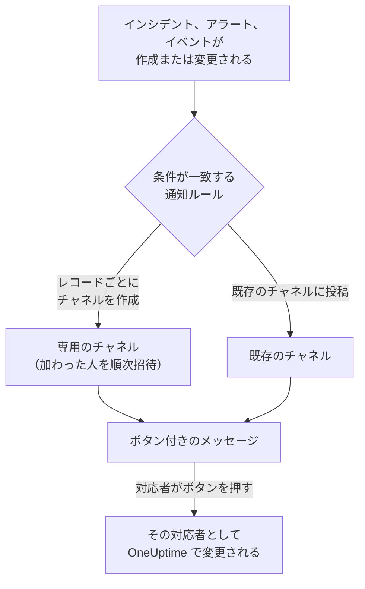

# Slack

OneUptime を Slack に接続すると、インシデント、アラート、エピソード、定期メンテナンス、モニター、オンコールの更新をチャネルに投稿し、インシデントごとに専用のチャネルを用意し、対応者が Slack を離れずに操作できるようになります。確認、解決、メモの追加、オンコールの呼び出し、インシデントの宣言ができます。

:::cards
- [Slack を接続する](#slack-を接続する): ワークスペースに OneUptime をインストールしてから、自分のアカウントをリンクします。
- [全員に接続を依頼する](#全員に接続を依頼する): アカウントを接続していないメンバー全員に、まとめてメッセージを送ります。
- [通知ルール](#通知ルール): どのイベントをどこに投稿し、どれに専用のチャネルを用意するかを決めます。
- [レコードのチャネルにいる人](#レコードのチャネルにいる人): レコードのページから、チャネルにいる人を確認し、参加し、人を追加します。
- [/oneuptime コマンド](#oneuptime-コマンド): インシデントを宣言し、メンテナンスを予定し、オンコール担当者を確認し、AI に質問します。
- [オンコールユーザーグループ](#オンコールユーザーグループ): ユーザーグループをオンコール担当者と一致させ、呼び出せるようにします。
- [Slack からインシデント、アラート、イベントを操作する](#slack-からインシデントアラートイベントを操作する): OneUptime のメッセージにあるボタンです。
:::

## しくみ

この動作には 2 つの接続が必要です。

- **プロジェクトの接続** は 1 回だけ行います。Slack ワークスペースにインストールした OneUptime のアプリです。このアプリがメッセージを投稿し、チャネルを作成し、メンバーを招待します。
- **各メンバー自身の接続** は、その人の Slack アカウントを OneUptime アカウントにリンクしたものです。ボタン、コマンド、絵文字リアクションは、その人として、プロジェクトでのその人の権限で動作します。

1 つの Slack ワークスペースを、本番環境とステージング環境のように複数のプロジェクトに接続できます。ボタンやフォームは、対象のレコードのプロジェクトで動作します。コマンドや OneUptime へのメッセージは、それが書かれたチャネル (インシデントのチャネルなど) のプロジェクトで動作し、それ以外では、あなたの Slack アカウントが接続されている唯一のプロジェクトで動作します。どれとも判断できない場合、OneUptime はどのプロジェクトのことかを尋ね、あなたが参加している各プロジェクトのボタンを表示します。選ぶと、そのプロジェクトで続行します。OneUptime AI との会話では、選んだプロジェクトがそのスレッドの残りでも使われます。

## 始める前に

- **プロジェクトを接続できるロール:** **プロジェクト所有者**、**プロジェクト管理者**、**プロジェクトメンバー** のいずれか。アプリのアンインストールには **プロジェクト所有者** または **プロジェクト管理者** が必要です。
- **アプリをインストールできる Slack ワークスペース**。
- **OneUptime Cloud の Growth プラン** (通知ルールとサマリーに必要)。[Growth プラン未満の通知ルール](#growth-プラン未満の通知ルール) を参照してください。
- **セルフホストのサーバーでは**、先にそのサーバー用に設定した Slack アプリ。[Slack 統合](/docs/self-hosted/slack-integration) を参照してください。

## Slack を接続する

:::steps
### Slack ワークスペースに OneUptime をインストールする

**プロジェクト設定** > **ワークスペース** > **Slack** に移動し、 **Slack で接続** をクリックします。ワークスペースを選び、OneUptime を許可します。Slack から同じページに戻ると、プロジェクトが接続されたワークスペースの名前が表示されます。ワークスペースが接続されるまでは、インシデント、アラート、定期メンテナンス、モニター、オンコールの各メニューの **ワークスペース** セクションに **Slack または Teams を接続** があり、ここからもこのページに移動できます。

### 自分の Slack アカウントを接続する

アプリをインストールすると、インストールした人のアカウントがリンクされます。ほかのメンバーは **ユーザー設定** > **ワークスペース** > **Slack** で **Connect my account with Slack** を使って自分の Slack アカウントをリンクし、自分としてインシデントを操作したりダイレクトメッセージを受け取ったりします。このセクションは、プロジェクトが Slack に接続されると表示されます。チーム全員にまとめて接続してもらうには、[全員に接続を依頼する](#全員に接続を依頼する) を参照してください。

### 通知ルールを追加する

**インシデント** > **ワークスペース** > **Slack** に移動します。 **ワークスペース** セクションにはプロジェクトが接続したチャットワークスペースだけが表示されるので、 **Slack** は接続後に表示されます。ルールを作成します。たとえば、新しいインシデントごとに Slack チャネルを作成し、対応する全員 (呼び出された人、インシデントコマンダー、所有者) を参加させるルールです。[通知ルール](#通知ルール) を参照してください。

### ルールをテストする

ルールの行で **ルールをテスト** をクリックします。ルールが指定するチャネルにテストメッセージが届きます。[ルールのテスト](#ルールのテスト) を参照してください。
:::

## 全員に接続を依頼する

管理者を含め、誰もほかの人の Slack アカウントを接続することはできません。各自が自分のアカウントにサインインします。チーム全員に接続してもらうには、 **プロジェクト所有者** または **プロジェクト管理者** が **プロジェクト設定** > **ワークスペース** > **Slack** で全員にまとめて依頼します。 **Members' Slack accounts** カードには、接続済みのメンバーの数が表示されます。 **Ask everyone to connect** を押すと、まだ接続していない各メンバーに、OneUptime から Slack のダイレクトメッセージが届きます。メッセージには、ワンクリックでアカウントを接続できる **Connect Slack account** ボタンがあります。

- **メッセージを受け取る人。** Slack アカウントを接続していない、プロジェクトのメンバー全員です。Slack では、その人のメールアドレスで見つけます。過去 24 時間以内に依頼を受けた人には再度依頼しないため、翌日にもう一度依頼すると、まだ接続していない人にだけリマインドが届きます。
- **カードが示すこと。** 送信中はメッセージの送信状況を、送信後は依頼した人とメッセージを受け取ったメンバーの数を示します。OneUptime がメールアドレスで Slack 上に見つけられなかったメンバーは、カードに名前が表示されます。これらのメンバーは、 **ユーザー設定** > **ワークスペース** > **Slack** で自分で接続します。
- **ボタンが接続するもの。** ボタンを押してサインインした人の Slack アカウントを、その人自身の OneUptime アカウントに接続します。メッセージをほかの人に転送しても、元の宛先のメンバーには何も接続されません。

## 通知ルール

通知ルールは、どのイベントを Slack のどこに投稿するかを決めます。各製品にはそれぞれのルールがあり、メニューの **ワークスペース** > **Slack** にあります。

| 製品 | **Slack** ページのタブ |
| --- | --- |
| **インシデント** | **インシデント**、 **インシデントエピソード**、 **概要** |
| **アラート** | **アラート**、 **アラートエピソード**、 **概要** |
| **定期メンテナンス** | ルールの一覧 1 つ |
| **モニター** | ルールの一覧 1 つ |
| **オンコール** | ルールの一覧 1 つ |

ルールの作成は 4 つのステップで進みます。

| ステップ | 設定する内容 |
| --- | --- |
| **基本** | **ルール名** と **ルールの説明**。 |
| **条件** | ルールの対象となるイベント。たとえば重大度、状態、ラベル、モニター、タイトル内の語句で絞り込みます。条件は、イベントが作成されたときと、OneUptime がそのイベントについて更新を投稿するたびに確認されます。そのため、確認済みインシデント向けのルールは、インシデントが確認されたときに動作します。新しいルールはすべてのイベントが対象です (たとえば **すべてのインシデント**)。絞り込むには **条件に一致するインシデントのみ** を選び、条件を追加します。条件が 2 つ以上ある場合は、 **一致条件** で、すべて一致する必要があるか、どれか 1 つでよいかを決めます。 |
| **送信先** | 投稿先。チャネル名を指定する **既存のチャネルに投稿** 、参加する人を指定する **インシデントごとにチャネルを作成する** (アラート、エピソード、イベント、モニター、オンコールポリシーも同様)、またはその両方です。ステップの下にある **このルールの動作** が、ルールのカードと同じく、動作を文章で示します。 |
| **ビデオ通話** | インシデントとアラートのみ。それぞれに通話を開始します。[ビデオ通話](/docs/workspace-connections/video-calls) を参照してください。 |

ルールが作成するチャネルには、そのレコードの名前が付きます。インシデント INC-42 は `inc-42`、アラート ALT-7 は `alt-7` になり、番号プレフィックスのないプロジェクトではインシデント 42 が `incident-42` になります。 **チャネル名のプレフィックス** に入力した文字はその前に付き、`prod-` なら `prod-inc-42` になります。フォームには入力に合わせて名前が表示されます。定期メンテナンスイベントでは、プレフィックスが番号プレフィックスの代わりになり、SM-5 は `sm-5`、`maint-` なら `maint-5` になります。Slack で使えるのは英小文字、数字、`-` と `_` で、80 文字までです。同じ名前のチャネルがすでにある場合 (別のプロジェクトのチャネルやアーカイブ済みのチャネルなど)、OneUptime は `-2`、`-3` のように番号を付けます。

ルールのチャネルは、イベントが初めてそのルールに一致したときに作成されます。イベントの作成時か、まだ進行中のイベントが更新によって一致したときです。確認済みインシデント向けのルールは、インシデントが確認されたときにチャネルを作成します。非公開のインシデント、アラート、エピソードには非公開のチャネルが作成されます。

**チャネルに参加するメンバー** には、ルールがチャネルに追加する人が並びます。チャネルの作成時だけでなく、レコードに加わるたびに追加されます。 **オンコール対応者 (呼び出され次第)** 、 **インシデントコマンダーなどのインシデントロール (割り当てられ次第)** (インシデントとインシデントエピソード)、 **所有者 (追加され次第)** で、新しいルールではすべてオンです。さらに **ほかに招待する人** のユーザー、チーム、オンコールスケジュールが、チャネルの作成時に加わります。インシデントコマンダーは通常、誰かが最初にインシデントを確認したときに割り当てられ、そのときチャネルに加わります。インシデントロールに専用のチェックボックスができる前に保存されたルールは、所有者かオンコール対応者を追加するときにインシデントロールも追加し、そのチェックボックスはオンで表示されます。ルールが投稿する既存のチャネルには、誰も追加されません。

**ほかに招待する人** のオンコールスケジュールについては、チャネルの作成時にそのスケジュールでオンコールの人が、スケジュールのページに表示されるとおりに参加し、呼び出されることはありません。一部のインシデントのチャネルにだけ人を追加するには、別のルールにその条件とその人を指定し、 **チャネル名のプレフィックス** を最初のルールと同じにします。チャネルの作成時にインシデントが一致するルールはそのチャネルを共有し、各ルールがそれぞれ指定した人を追加します。

その後のレコードの更新 (状態の変更、メモ、新しい所有者) は、そのレコードのチャネルに投稿され、ルールが指定する既存のチャネルにも、ルールの条件が一致している間は投稿されます。 **インシデントが解決したらチャネルをアーカイブする** がオンなら (アラート、エピソード、イベント、モニター、オンコールポリシーにも同様の設定があります)、チャネルを作成したルールが、レコードが解決、完了、削除されたときに、その時点の条件にかかわらずチャネルをアーカイブします。すでに解決済みとして作成されたインシデント、アラート、エピソードには専用のチャネルは作成されませんが、作成のメッセージはルールが指定するチャネルに送られます。[確認済みまたは解決済みの状態で宣言されたインシデント](/docs/incidents/declaring-incidents#確認済みまたは解決済みの状態で宣言されたインシデント) を参照してください。

専用のチャネルを持つインシデント、アラート、エピソード、定期メンテナンスイベントでは、OneUptime のページのヘッダーの状態ボタンの横に **Slack で開く** が表示されます。そのチャネルを新しいタブで、Slack アプリまたはブラウザーで開きます。専用のチャネルが 2 つあるレコードでは、ボタンの下に両方が一覧表示されます。Slack と Microsoft Teams の両方にチャネルがあるレコードでは、代わりに **チャネルを開く** ボタンが 1 つだけ表示され、すべてのチャネルが一覧表示されます。ルールが投稿する既存のチャネルは表示されません。

チャネルは読みやすいままです。それぞれの更新は一度だけ投稿され、レコードの最初の状態は、そのレコードを知らせるメッセージの中にあり、別のメッセージにはなりません。オンコールポリシーの実行はひとつのメッセージで、エスカレーションが進むにつれて編集されます。誰が呼び出されたか、何回どの方法で呼び出されたか、誰が呼び出されなかったかとその理由、そして誰が確認したかが示されます。新しいメッセージが投稿されるのは、誰かが対応しなければならないときだけです。つまり、あるエスカレーションルールが誰にも届かなかったときか、誰も確認しないまま実行が終わったときです。Slack アカウントを OneUptime に接続していない人は、その人のメールアドレスを持つ Slack アカウントで追加されます。どちらの方法でも OneUptime が見つけられない人や、Slack のゲストは、チャネルに追加できません。OneUptime はそのことをチャネルごとに一度だけ、該当する全員の名前を挙げるひとつのメッセージで伝え、一覧が増えるとそのメッセージを編集します。そのメッセージの **Connect Slack account** リンクを本人に送ると、1 ステップでアカウントを接続できます。レコードの所有者やステータスページの購読者に通知したことは、OneUptime のレコードのフィードに残ります。

**プロジェクト設定** > **ワークスペース** > **Slack** には OneUptime が見られるチャネルが表示され、それぞれの横に **テストを送信** があります。OneUptime は公開チャネルに初めて投稿するときに自分で参加します。非公開チャネルは、Slack で OneUptime のアプリを招待した後にだけ一覧に表示され、投稿できるようになります。

## レコードのチャネルにいる人

専用の Slack チャネルを持つインシデント、アラート、エピソード、定期メンテナンスイベントには、OneUptime のページに **Slack チャネル** カードがあります。カードには、Slack でチャネルを開くリンクとしてのチャネル、非公開かどうか、そしてチャネルにいる人が、あなたを先頭に表示されます。Slack 管理者がいなくても、カードから次のことができます。

- **チャネルに参加** は、あなたがチャネルにいないときに、あなたを追加します。
- **メンバーを追加** は、プロジェクトの人とチームの一覧を開きます。人を選ぶとその人が、チームを選ぶとチームの全員が追加されます。

追加するのは OneUptime のアプリで、ルールのチャネルに人を追加するときと同じです。アプリは自分が作成したチャネルに残り続けるので、全員が退出した非公開チャネルでもこの方法で入れます。

- **人を追加できる人。** レコードを編集できる人です。インシデントなら **プロジェクト所有者**、 **プロジェクト管理者**、 **プロジェクトメンバー**、 **インシデント管理者**、 **インシデントメンバー**、またはカスタムロールの **Edit Incident** で、アラート、エピソード、イベントにはそれぞれ同じ権限が必要です (たとえば **Edit Alert**)。それ以外の人には、チャネルにいる人と、チャネルに入る方法が表示されます。
- **追加できる人。** OneUptime が Slack で見つけられる人です。その人が接続した Slack アカウントで、それがなければ Slack が持っているその人のメールアドレスで見つけます。追加できなかった人は、たとえば Slack がチャネルに入れないゲストのように、理由とともにカードに示されます。
- **記録されること。** 誰が誰によって追加されたかが、レコードのフィード ( **チャネル メンバー追加済み** ) と、 **プロジェクト設定** > **通知** > **通知ログ** の **ワークスペース** タブに記録されます。
- **人を外すとき。** OneUptime は人を追加するだけです。チャネルから人を外すときは Slack で行います。

## ルールのテスト

ルールの行の **ルールをテスト** は、そのルールのテストメッセージをルールが指定するチャネルに投稿し、届くことを確かめられるようにします。イベントごとにチャネルを作るルールなら、テストでもチャネルを 1 つ作り、ルールの対象者を招待します。

**プロジェクト設定** > **ワークスペース** > **Slack** のチャネルの横にある **テストを送信** と同じく、通知ルールを作成する権限が必要です。 **プロジェクト所有者**、 **プロジェクト管理者**、 **プロジェクトメンバー**、 **設定管理者**、 **設定メンバー**、またはカスタムロールの **Create Workspace Notification Rule** と **Read Workspace Notification Rule** です。ルールを見ることしかできない人 ( **閲覧者** など) には **ルールをテスト** がロックされ、ツールチップに必要なものが表示されます。API はその人のテストを "You do not have permission to send test notifications in this project." で拒否します。OneUptime Cloud では、ルールのテストにはルールの追加と同じく **Growth** プランが必要です。

OneUptime Cloud では、チャネルの横にある **テストを送信** にも **Growth** プランが必要です。チャネルへの投稿はルールとサマリーが行うことだからです。サマリーの **今すぐテストを送信** には、サマリーを作成する権限 (カスタムロールの **Create Workspace Notification Summary** と **Read Workspace Notification Summary**) と、OneUptime Cloud では **Growth** プランが必要です。それ以外の人にはロックされ、ツールチップに必要なものが表示されます。読み取り専用で接続された MCP クライアントは、どのテストも送信できません。

## サマリー

**インシデント** > **ワークスペース** > **Slack** (および **アラート**) の **概要** タブは、指定したチャネルに定期的なまとめを投稿します。インシデントやアラートの件数、確認と解決までの速さ、リンク付きの一覧が含まれます。新しいサマリーは毎週送信され、直近 7 日間を対象にします。 **最初のレポートの送信時刻** を空欄のままにすると、最初のサマリーは次の週・日・月の始めの 09:00 に送信されます。いつ送信されるかはフォームに表示されます。

サマリーは **タイムゾーン** の時計で送信されます。タイムゾーンの初期値はあなたのタイムゾーンです。サマリーはそこで一年中同じ時刻を保ちます。ベルリンの 09:00 に設定したサマリーは、夏時間で時計が切り替わった後もベルリン時間の 09:00 に送信され、メッセージ内の日付もベルリンの日付です。API では `timezone` を IANA タイムゾーン名 (例: `Europe/Berlin`) で送信します。タイムゾーンを指定せずに作成したサマリーは作成者のプロフィールのタイムゾーンを使い、API キーで作成した場合は UTC を使います。

サマリーのフォームは 4 つのステップです。 **基本情報** (名前とチャネル)、 **スケジュール**、 **コンテンツ** ( **含める内容** )、 **フィルター** (対象にするインシデントやアラート) です。

## Growth プラン未満の通知ルール

OneUptime Cloud では、通知ルールとサマリーは **Growth** プラン以上で利用できます。それより下のプランのプロジェクトは、すでにあるルールとサマリーを保持し、それらは引き続き Slack に投稿します。そのため、各製品 (インシデント、アラート、定期メンテナンス、オンコール、モニター) の **Slack** ページには、プランについての注記とその下に一覧 ( **まだ設定されている通知ルール**、 **まだ設定されているサマリー** ) が表示されます。ルールを削除するか、サマリーをオフにするか削除してください。ルールとサマリーの追加や変更には **Growth** が必要です。

## Slack で呼び出しを受ける

オンコール中にダイレクトメッセージで呼び出しを受けるには、Slack を通知方法の 1 つとして追加します。

:::steps
1. 自分の Slack アカウントを接続します ([Slack を接続する](#slack-を接続する) を参照)。
2. **ユーザー設定** > **通知方法** に移動し、 **ワークスペースアプリ** タブを開いて **Slack アカウントを追加** をクリックします。
3. その行の **テストメッセージを送信** をクリックします。メッセージが Slack のダイレクトメッセージに届きます。
:::

追加するとすぐにオンコールルールに加わるので、それ以降の呼び出しは Slack に届きます。どの呼び出しを受け取るかは **ユーザー設定** > **オンコールルール** で変更します。

## メッセージをメモとして保存する

インシデント、アラート、エピソード、定期メンテナンスイベントのチャネルでメッセージにリアクションすると、OneUptime はそのメッセージをそのレコードのメモとして保存し、スレッドへの返信で知らせます。

| リアクション | 保存される形式 |
| --- | --- |
| 📌 ピンの絵文字、または Slack 自身の **Pin to channel** | チームだけが見られる非公開メモ |
| 📢 メガホンまたはスピーカーの絵文字 | ステータスページに表示される公開メモ。インシデントと定期メンテナンスイベントのみ。プライベートインシデントでは非公開メモになり、確認メッセージがその理由を伝えます。 |

メモには Slack で表示されていたとおりのメッセージが残ります。書式、リンク、コード、メンションされた人やチャネルの名前、そしてファイルや画像へのリンクです。公開メモでは、ファイルと画像はチームの中でしか開けないため含まれません。

メモはメッセージを書いた人の言葉として残ります。その人の Slack アカウントが接続されていれば OneUptime の名前で、そうでなければ Slack に表示される名前で示されます。非公開メモは、保存がどれだけ後でも、タイムラインのメッセージが投稿された時点に置かれます。公開メモは保存した時点に置かれ、ステータスページにもその時点から表示されます。誰が保存したかはタイムラインに表示されます。メッセージはすでにチャネルにあるため、メモがチャネルに投稿し直されることはありません。

メモはあなたとして、あなたの権限で保存されます。Slack アカウントがまだ接続されていない場合、OneUptime はあなただけに見えるメッセージで接続を求め、接続するとすぐにメッセージを保存するボタンを添えます。何人がリアクションしても、メッセージが保存されるのは 1 回だけです。

## /oneuptime コマンド

OneUptime の Slack コマンドは `/oneuptime` の一つだけです。その後に入力する単語で何をするかが決まり、それ以外の内容は OneUptime AI への質問になります。

| コマンド | 動作 |
| --- | --- |
| `/oneuptime help` | コマンドの一覧を例とともに表示します。 |
| `/oneuptime incident [title or number]` | タイトルを入力した状態でインシデントのフォームを開きます。 `42` や `INC-42` のようなインシデントの番号を指定すると、代わりにそのインシデントを表示します。 [Slack からインシデントを管理する](#slack-からインシデントを管理する) を参照してください。 |
| `/oneuptime maintenance [title]` | タイトルを入力した状態で定期メンテナンスのフォームを開きます。 |
| `/oneuptime oncall` | 表示できる各オンコールスケジュールで、今オンコールの人、いつまでか、次は誰かを一覧表示します。 |
| `/oneuptime page [who] [message]` | @メンションした人を、メッセージの内容で呼び出します。または、誰を呼び出すかを選ぶフォームを開きます。[Slack から誰かを呼び出す](#slack-から誰かを呼び出す) を参照してください。 |
| `/oneuptime ask [question]`、または任意の質問 | OneUptime AI が、ログ、トレース、メトリクス、インシデント、モニターについて回答します。 |

`help` と `oncall` への回答は、コマンドの下に自分だけに見えるメッセージとして表示されます。`incidnet` のように、最初の単語がコマンドのつづり間違いに見える場合は、OneUptime AI の回答ではなく、似ているコマンドが返されます。インシデントとメンテナンスのフォームは自分として動作します。[Slack からインシデントとメンテナンスを作成する](#slack-からインシデントとメンテナンスを作成する) を参照してください。

> [!NOTE]
> `/oneuptime incident` と `/oneuptime maintenance` は、他の Slack アプリの同名コマンドと競合することがあった `/incident` と `/maintenance` に代わるものです。以前のマニフェストから作成した Slack アプリでは、アプリが更新されるまでそれらが残り、同じフォームを開きます。[古いマニフェストから作成したアプリ](/docs/self-hosted/slack-integration#古いマニフェストから作成したアプリ) を参照してください。

## Slack の OneUptime ホーム

Slack のサイドバーの **Apps** から OneUptime を開くと、 **Home** タブに、あなたが見られる範囲でプロジェクトの状況が表示されます。開くたびに読み直されます。

- **あなたのオンコール。** 今オンコールになっているオンコールスケジュールとその終了時刻、またはあなたの次のシフトです。
- **未解決のもの。** あなたが読める最新の未解決のインシデントとアラートで、それぞれ OneUptime のページへのリンクが付きます。
- **ボタン。** **Declare incident** 、 **Schedule maintenance** 、 **Page someone** は `/oneuptime incident` 、 `/oneuptime maintenance` 、 `/oneuptime page` と同じフォームを開き、 **Who's on call** は `/oneuptime oncall` と同じように答えます。

ホームはあなたとして読むので、あなた自身の Slack アカウントの接続が必要です。接続するまで、ホームには **Connect Slack account** ボタンが表示され、接続するとすぐにあなたのホームが表示されます。

複数のプロジェクトに接続された Slack ワークスペースでは、ホームは一度に 1 つのプロジェクトを表示します。あなたの Slack アカウントがそのうち 2 つ以上で接続されている場合、プロジェクト名の横にある **Switch project** メニューに、あなたがメンバーになっている他のプロジェクトが表示されます。1 つ選ぶとそのホームが表示され、それ以降もあなたがそこのメンバーである限り、ホームはそのプロジェクトで開きます。選ぶまでは、あなたのプロジェクトのうち最初に Slack に接続されたものが表示されます。

誰かが OneUptime をチャネルに追加すると、OneUptime はそこにあいさつを投稿します。質問のしかたと、そのチャネルに投稿する通知ルールの追加場所を伝えます。初めて **Messages** タブを開くと、OneUptime はそこで歓迎のメッセージを送ります。Slack で何をするかと、始め方を伝えます。

## Slack から OneUptime AI に質問する

ログ、トレース、メトリクス、インシデント、モニターについて普段の言葉で質問できます。チャネルで OneUptime を @メンションするか、ダイレクトメッセージを送ると、スレッドで回答します。 `/oneuptime ask which monitors are down?` は回答をチャネルに投稿します。どちらも自分の Slack アカウントの接続と、プロジェクトで AI がオンになっていることが必要です。Slack での回答は読み取るだけです。何かを変更するにはボタンを使ってください。[AI に質問](/docs/ai/ask-ai) を参照してください。

OneUptime は、自分に向けられたものにだけ応答します。

- **自分の会話では、返信するだけです。** スレッドではなくチャネルで質問すると、その下のスレッドで会話が始まります。そこで返信すれば、OneUptime を改めてメンションしなくても続けて質問でき、ほかの人は OneUptime をメンションすれば会話に加われます。
- **それ以外のスレッドでは、OneUptime をメンションします。** インシデントのメッセージの下のスレッドなどでは、毎回メンションしてください。そこで人どうしが書き込んだ内容には応答しません。
- **Slack アカウントが接続されていない場合。** OneUptime は会話ごとに一度だけ、あなただけに見えるメッセージで、**Connect Slack account** ボタン付きで接続を求めます。

## Slack からインシデントとメンテナンスを作成する

`/oneuptime incident` と `/oneuptime maintenance` は、あなたが入力して自分として送信するフォームを開きます。自分の Slack アカウントが接続されている OneUptime アカウント ([Slack を接続する](#slack-を接続する) を参照) として、そのアカウントのプロジェクトでの権限で送信されます。Slack アカウントが接続されていない場合や、OneUptime アカウントがもうプロジェクトのメンバーでない場合は、OneUptime がコマンドを実行した場所に、あなただけに見えるメッセージでどうすればよいかを伝え、フォームは開きません。 **Create New Incident** と **Create Scheduled Event** のショートカットも同じフォームを開きます。

- **使える人。** OneUptime でインシデントを宣言できる人、または定期メンテナンスイベントを作成できる人です。インシデントには **プロジェクト所有者**、 **プロジェクト管理者**、 **プロジェクトメンバー**、 **インシデント管理者**、 **インシデントメンバー** (カスタムロールでは **Create Incident**)、イベントには **定期メンテナンス管理者** と **定期メンテナンスメンバー** ( **Create Scheduled Maintenance** ) です。それ以外の人にはコマンドを実行した場所でそう伝えられ、フォームは開きません。
- **フォームが提示するもの。** 各一覧 (重大度、モニター、モニターのステータス、オンコールポリシー、ラベル) には、OneUptime の同じ一覧と同じく、あなたが読めるものが含まれます。一部のラベルに限定されたロールなら、それらのラベルが付いたモニターとオンコールポリシーです。まったく読めない一覧はフォームから外されます。アーカイブされたオンコールポリシーは提示されません。
- **フォームで指定できるもの。** インシデントやイベントはあなた自身の権限で作成され、あなたの操作として記録されます。読めないモニター、オンコールポリシー、ラベル、重大度、ステータス、または別のプロジェクトのものは、アクセスが変わる前に開いたフォームからであっても、プロジェクトにないものとして拒否され、何も作成されません。理由は OneUptime がチャンネルで、あなただけに見えるメッセージで伝えます。

インシデント、アラート、エピソードの **Execute On-Call Policy** も同じように動作します。オンコールポリシーを実行する権限 ( **プロジェクト所有者**、 **プロジェクト管理者**、 **プロジェクトメンバー**、 **オンコール管理者**、 **オンコールメンバー**、またはカスタムロールの **Create On-Call Duty Policy Execution Log** ) と、そのインシデント、アラート、エピソードを読む権限が必要で、あなたが読める有効なオンコールポリシーが提示されます。

## Slack から誰かを呼び出す

`/oneuptime page @nawaz The checkout API is throwing 500s` は、Nawaz をすぐに呼び出します。Nawaz には、本人のオンコールルールに従って電話、SMS、プッシュ通知、またはメールが届き、そのどれもが、誰が、どのチームまたはスケジュールを通じて呼び出したかと、あなたのメッセージを伝えます。呼び出しが何についてのものかは、コマンドを実行する場所で決まります。

- **インシデントやアラートの専用のチャネルでは** (OneUptime がそのために作成したチャネルです)、呼び出しはそのインシデントやアラートについてのものになり、新しいものは何も作成されません。そこではメッセージは任意で、 `/oneuptime page @nawaz` だけで十分です。呼び出した人たちは、そのうちの誰かが応答するまで呼び出されます。応答は呼び出しそのものからでも、インシデントやアラートを確認することでもかまいません。ほかの人が確認しても呼び出しは止まりませんが、解決すると止まります。
- **それ以外の場所では**、たとえば別のチャネル、ダイレクトメッセージ、アプリの **Home** タブ、解決済みのインシデントやアラートのチャネルでは、OneUptime がメッセージをタイトルにしたアラートを作成し、誰かがアラートを確認するまで呼び出します。フォームにそう表示され、誰かが呼び出される前に、あなただけに見える返信でも伝えられます。
- **すぐに呼び出される人。** @メンションした人と、@メンションしたユーザーグループが連動するスケジュールでオンコール中の人で、その後にメッセージが続く場合、またはインシデントやアラートの専用のチャネルでメッセージがない場合です ( [オンコールユーザーグループ](#オンコールユーザーグループ) を参照)。OneUptime は、その人の Slack アカウントが接続されている OneUptime アカウントで、それがなければ Slack が持っているその人のメールアドレスで、人を特定します。プロジェクト外の人が呼び出されることはありません。
- **それ以外はフォームが開きます。** 誰も @メンションしていない、呼び出しにメッセージが必要なのにメッセージがない、 `@here` や、表示できるオンコールスケジュールに連動していないユーザーグループを指定した、または OneUptime が特定できない人がいる場合は、入力した内容が記入された状態で **Page someone** フォームが開き、選べなかった人が示されます。インシデントやアラートの専用のチャネルでは、フォームはそのインシデントやアラートとともに開きます。人、チーム、オンコールスケジュール (今その中でオンコールの人を呼び出します)、またはオンコールポリシー (エスカレーションルールに従って呼び出します) を選んで送信します。`/oneuptime page Primary The disk is full` のように最初に入力した名前は、その名前のスケジュール、チーム、またはポリシーを選びます。
- **表示される場所。** チャネルには、呼び出しが 1 つのメッセージとして表示され、最新の状態に保たれます。誰がどのように呼び出されたか、各チームの名前とその後に続くメンバー、あなたのメッセージ、誰が確認したかがわかります。OneUptime が投稿できない場所、たとえば招待されていないプライベートチャネルでは、あなただけに見えるメッセージで、誰が呼び出されたかがインシデントやアラートへのリンクとともに伝えられます。
- **呼び出せる人。** インシデントやアラートの専用のチャネルでは、オンコールポリシーを実行でき ( **プロジェクト所有者**、 **プロジェクト管理者**、 **プロジェクトメンバー**、 **オンコール管理者**、 **オンコールメンバー**、またはカスタムロールの **Create On-Call Duty Policy Execution Log** )、そのインシデントやアラートを読める人です。それ以外の場所では呼び出しがアラートを作成するので、アラートを作成する権限も必要です。 **プロジェクト所有者**、 **プロジェクト管理者**、 **プロジェクトメンバー**、または **オンコールメンバー** と **アラートメンバー** の組み合わせ (カスタムロールでは **Create On-Call Duty Policy Execution Log** と **Create Alert** ) です。オンコールポリシーを介さずに人、チーム、スケジュールを直接呼び出すには、さらにプロジェクトのすべてのオンコールポリシーへのアクセスが必要です。それ以外の人にはコマンドを実行した場所でそう伝えられ、誰も呼び出されません。OneUptime Cloud では、呼び出しには Growth プランが必要です。それより下のプランでは、OneUptime が必要なプランを示し、誰も呼び出されません。

## オンコールユーザーグループ

`@payments-oncall` のような Slack のユーザーグループを、1 つ以上のオンコールスケジュールで現在オンコールの担当者と一致させると、誰でもそのグループを @メンションして担当者に連絡できます。OneUptime は引き継ぎやオーバーライドのたびにグループのメンバーを変更し、15 分ごとに確認します。

:::steps
### ユーザーグループをスケジュールに接続する

**オンコール** > **オンコールスケジュール** でスケジュールを開きます。 **Slack のユーザーグループ** カードで **ユーザーグループを接続** をクリックし、ワークスペースのユーザーグループを選ぶか、名前とハンドルを指定して **新しいユーザーグループを作成** を選びます。グループのメンバーは、すぐにオンコール担当者に置き換えられます。

### セカンダリースケジュールにも接続する

プライマリーとセカンダリーの両方のオンコール担当者を含めるには、セカンダリースケジュールのページでも同じグループを接続します。1 つのグループはいくつでもスケジュールに連動できます。
:::

- **カードに表示される内容。** 各グループの現在のメンバー、連動しているほかのスケジュール、そして **最新** かどうかです。グループに入れられないオンコール担当者は、理由とともに示されます。OneUptime は接続済みの Slack アカウントで、それがなければ Slack が持っているメールアドレスで人を見つけます。また、Slack ではゲストをユーザーグループに入れられません。
- **オンコール担当者がいないとき。** Slack では空のユーザーグループを保持できないため、OneUptime は誰かがオンコールになるまでグループをオフにし、その後オンに戻します。
- **グループを呼び出す。** `/oneuptime page @payments-oncall The checkout API is down` は、グループが連動するスケジュールでオンコール中の人を呼び出します。 [Slack から誰かを呼び出す](#slack-から誰かを呼び出す) を参照してください。
- **Slack に必要なもの。** ユーザーグループは Slack の有料プランの機能で、ワークスペースによってはオーナーと管理者しか変更できません。どちらに当たるか、どうすればよいかはカードに表示されます。OneUptime がユーザーグループを管理できるようになる前に Slack を接続した場合は、 **プロジェクト設定** > **ワークスペース** > **Slack** で一度だけ接続し直してください。
- **接続できる人。** スケジュールを編集できるロールです。 **プロジェクト所有者**、 **プロジェクト管理者**、 **プロジェクトメンバー**、 **オンコール管理者**、 **オンコールメンバー**、またはカスタムロールの **Edit On-Call Duty Policy Schedule** です。OneUptime Cloud では、接続には **Growth** プランが必要です。
- **切断するとき。** OneUptime はグループの変更をやめます。グループとそのメンバーは、Slack にそのまま残ります。

## Slack からインシデントを管理する

インシデントのメッセージには 4 つのボタン **Acknowledge Incident**、 **Resolve Incident**、 **Add Note**、 **View Incident** があり、残りはその後ろにある三点ボタンのメニューにあります。

| メニュー項目 | 動作 |
| --- | --- |
| **Change Severity** | インシデントの重大度を設定します。 |
| **Change Incident State** | インシデントを後の状態に進めます。 |
| **Assign Role** | インシデントで誰かにロールを与えます。たとえば **Incident Commander** です。 1 人だけのロールは、その人に移ります。 |
| **Page Someone** | インシデントについて、人、チーム、スケジュールで今オンコールの人、またはオンコールポリシーを、任意のメッセージとともに呼び出します。人はそのうちの誰かが応答するまで呼び出され、ポリシーは誰かがインシデントを確認するまで呼び出します。 |
| **Edit Custom Fields** | インシデントのカスタムフィールドを設定します。各フィールドにはインシデントの値が入っています。空のままにしたフィールドはクリアされます。 |

`/oneuptime incident 42` は、インシデント 42 をこれらのボタンとメニューとともに、自分だけに見えるメッセージで表示します。番号は OneUptime の表示どおりに入力します: `42`、 `#42`、 `INC-42` 。インシデント専用のチャンネルでは、 `/oneuptime incident` だけでそのインシデントを表示します。

- **使える人。** OneUptime で同じ変更ができる人です。 **Change Severity** と **Edit Custom Fields** には、インシデントを編集する権限が必要です。 **プロジェクト所有者**、 **プロジェクト管理者**、 **プロジェクトメンバー**、 **インシデント管理者**、 **インシデントメンバー**、またはカスタムロールの **Edit Incident** です。 **Assign Role** には **Create Incident Member** が必要で、 1 人だけのロールを移すには **Delete Incident Member** も必要です。 **Page Someone** には **Execute On-Call Policy** と同じものが必要です。それ以外の人には理由が伝えられ、フォームは開きません。
- **フォームに表示されるもの。** プロジェクトで自分が読めるものです。インシデントのモニターからコピーされるカスタムフィールドは、再びコピーされるため含まれません。フォームに入るのは 40 フィールドまでで、残りは OneUptime で編集します。
- **その後の動き。** フォームは閉じ、変更は OneUptime と同じように自分として行われます。インシデントのフィードと、それに伴ってインシデントのチャンネルが、何が変わったかを、各カスタムフィールドの新しい値とともに伝えます。数値の代わりにテキストを入れたなど、フィールドに合わない値はフィールドの下に示され、フォームは開いたままです。 **Page Someone** は誰が呼び出されたか、または誰も呼び出されなかった理由を伝えます。すでに解決済みのインシデントでは誰も呼び出されません。
- **メニューより前に投稿されたメッセージ。** そのメッセージには **Execute On-Call Policy** ボタンが残り、引き続き動作します。 **Page Someone** でもオンコールポリシーを呼び出せます。アラートとエピソードは自分のボタンを保持します。

## Slack からインシデント、アラート、イベントを操作する

OneUptime の Slack メッセージのボタンも、あなたとして動作します。自分の Slack アカウントが接続されている OneUptime アカウントとして、そのアカウントのプロジェクトでの権限で動作します。インシデント、アラート、エピソードの **Acknowledge**、 **Resolve**、 **Change State**、 **Add Note**、 **Execute On-Call Policy**、そして定期メンテナンスイベントの **Mark as Ongoing**、 **Mark as Complete**、 **Change State**、 **Add Note** は、それぞれ OneUptime で同じ操作を行ったときと同じ変更を行い、その変更は OneUptime であなたの操作として記録されます。レコードの状態タイムラインとフィードには、あなたが状態を変更したことが表示され、メモもあなたのものになります。絵文字リアクションでメッセージから保存したメモも、同じように投稿されます。

- **使える人。** OneUptime で同じ変更を行える人です。インシデントの確認、解決、状態の変更には、その状態を変更する権限が必要です。 **プロジェクト所有者**、 **プロジェクト管理者**、 **プロジェクトメンバー**、 **インシデント管理者**、 **インシデントメンバー**、またはカスタムロールの **Create Incident State Timeline** です。アラート、エピソード、定期メンテナンスイベントには、それぞれの種類に対応する同じ権限 (たとえば **Create Alert State Timeline** ) が必要で、メモにはその種類のメモを投稿する権限が必要です。それ以外の人にはそう伝えられ、何も変わりません。
- **対象のレコード。** OneUptime と同じく、あなたが読めるレコードです。一部のラベルに限定されたロールなら、それらのラベルが付いたインシデント、アラート、エピソード、イベントです。ほかのレコードのボタンは理由を伝え、何も変わりません。ロールが及ばないインシデントでは "your access in this project does not include this incident. Ask a project admin for access to it."、オーナーではないプライベートなインシデントでは "this incident is private, so only its owners and the project's owners and admins can see it. Ask one of them to add you as an owner."、その後削除されたインシデントでは "the incident was not found. It may have been deleted." と返されます。OneUptime Cloud では、プロジェクトのプランに含まれない変更は、必要なプランを示して拒否されます。
- **Change State が提示するもの。** あなたが読める状態のうち、レコードが次に移れる状態を、プロジェクトの順序で提示します。今の状態より前の状態は提示されません。これはインシデント、アラート、定期メンテナンスイベントと同様にエピソードでも同じです。状態の変更でレコードが一覧の上に戻ることはないからです ([順序は表示上の好みではなく、実際の制約](/docs/incidents/states-and-severities#順序は表示上の好みではなく実際の制約) を参照)。読める状態が 1 つもない場合は "No incident states are available to you in this project. Ask a project admin for access to them." と伝えられ、レコードが到達できる最後の状態にある場合は "There is no later state to move this incident to." と伝えられます。どちらの場合も空のフォームは開きません。
- **プライベートなインシデントやエピソードでの Add Note。** プライベートなインシデントやエピソードには公開メモを追加できないため、フォームはメモの種類を尋ねず、非公開メモを追加します。プライベートになる前に開かれたフォームも非公開メモを追加し、そのことを伝えます。[プライベートインシデントには非公開メモだけ](/docs/incidents/notes-owners-and-feed#プライベートインシデントには非公開メモだけ) を参照してください。
- **返答が届く場所。** ボタンのあるメッセージの下に、あなただけに見えるメッセージで届きます。Slack がそれを受け付けないときだけ、ダイレクトメッセージで届きます。遅すぎたボタンの操作には、誰がいつ先に行ったかが伝えられます。たとえば "Incident INC-2 was already acknowledged by Simon Lee at 6:07 PM." です。
- **Slack アカウントが接続されていない場合。** 返答は **Connect Slack account** ボタンで接続を求めます。このボタンは OneUptime のあなた自身の Slack 設定を開き、必要なら OneUptime にサインインした後、1 ステップでアカウントを接続します。その後 OneUptime は、あなたが押した操作をあなたとして完了し、同じメッセージの下に返答します。フォームを開くボタンやコマンドの場合は、もう一度押すか実行するよう求めます。ボタンは 30 分間、1 回だけ、押した Slack アカウントに対してのみ機能します。別の人として Slack にサインインしている場合は、何も接続しません。

## 接続を解除する

- **切断** は自分の Slack アカウントのリンクだけを解除し、あわせて自分の Slack の通知方法を削除します。
- **プロジェクト設定** > **ワークスペース** > **Slack** の **Slack から OneUptime をアンインストール** は、プロジェクトの接続を解除します。OneUptime は Slack への投稿をやめ、 **ワークスペース** メニューにも表示されなくなります。通知ルールとサマリーは、再接続するときのために保持されます。

> [!WARNING]
> アンインストールすると、プロジェクトのすべてのメンバーの Slack アカウントのリンクも解除され、Slack の通知方法と、それを使っていたオンコールルールも削除されます。Slack で呼び出されていた人は、Slack を再び追加するまで、ほかの通知方法で呼び出されます。

## あなたの Slack データ

OneUptime は、インストール時にあなたが許可した権限で、これらの機能に必要なものだけを Slack から読み取ります。

- **OneUptime 宛てのメッセージ。** OneUptime を @メンションしたメッセージ、ダイレクトメッセージで送ったメッセージ、OneUptime との会話でのあなたの返信を、そのスレッドやダイレクトメッセージの以前のメッセージとあわせて読み取り、OneUptime AI が回答できるようにします。Slack は OneUptime が参加しているチャネルとグループ DM のほかのメッセージも送ってきますが、OneUptime はそれらに回答せず、保持もしません。
- **メモとして保存するメッセージ。** インシデント、アラート、エピソード、定期メンテナンスイベントのチャネルで 📌 か 📢 でリアクションしたメッセージや、ピン留めしたメッセージを、投稿者の名前とともにそのレコードのメモとして保存します。
- **チャネルと人の名前。** 投稿先を選べるようにするための、投稿できるチャネルの名前、誰が何を書いたか、何をしたかを示すための人の名前、そしてレコードの専用チャネルにいる人です。チャネルにいる人は、レコードのページに表示するときに読み取ります。
- **メールアドレス。** Slack が持っているその人のメールアドレスです。その人が Slack アカウントを接続していないときに、その Slack アカウントを OneUptime アカウントと照合して、呼び出したり、オンコールユーザーグループに入れたり、レコードのチャネルに追加したり、アカウントの接続を依頼したりするために使います。
- **ユーザーグループ。** オンコールスケジュールに使うグループを選べるようにするための、ワークスペースのユーザーグループと、接続したグループを現在オンコールの担当者と一致させるための、そのグループのメンバーです。

OneUptime が保持するもの (ワークスペースの名前、そのチャネル、ユーザーが接続した Slack アカウント、メモ、ユーザーグループ) は、プロジェクトとともに保存されます。OneUptime によるデータの取り扱いについては [プライバシーポリシー](https://oneuptime.com/legal/privacy) を参照してください。

## トラブルシューティング

:::details ルールが何も投稿しない
**ルールをテスト** でルールの条件を確認します。テストが届くなら、ルールの条件がイベントに一致しなかったということです。届かない場合は、Slack のページに理由が表示されます。非公開チャネルの場合は、まず Slack で OneUptime のアプリをそのチャネルに招待してください。OneUptime が投稿したすべてのメッセージと、Slack が拒否したすべてのメッセージは、 **プロジェクト設定** > **通知** > **通知ログ** の **ワークスペース** タブに表示されます。
:::

:::details ルールのチャネルに参加していない人がいる
ルールのカードの **次に** に、ルールが招待する人が示されます。それぞれの人は、レコードに加わったときにチャネルに参加します。呼び出された人は呼び出されたとき、インシデントコマンダーは割り当てられたとき、所有者は追加されたとき、そしてチャネルの作成時にすでにレコードにいた人は作成時です。接続したアカウントでもメールアドレスでも OneUptime が Slack で見つけられない人は追加できません。OneUptime はその人の名前をチャネル内で示し、アカウントを接続するリンクを添えます。今すぐ追加するには、レコードの **Slack チャネル** カードで **メンバーを追加** を押します。
:::

:::details 非公開チャネルから全員が退出した
OneUptime でインシデント、アラート、エピソード、イベントを開き、その **Slack チャネル** カードで **チャネルに参加** を押してから、 **メンバーを追加** でほかの人を呼び戻します。必要なのはレコードを編集する権限で、Slack 管理者は要りません。OneUptime のアプリはまだチャネルにいて、そのアプリが人を追加します。OneUptime がチャネルを見られないとカードに表示された場合は、チャネルが削除されたか、アプリがチャネルから外されています。チャネルにいる人が `/invite @OneUptime` と入力すると、アプリを戻せます。
:::

:::details Slack が接続されなかった
Slack から接続されないまま戻ってくると、開始したページに **Slack は接続されませんでした** と表示され、1 つの文で理由が説明されます。権限がない、リンクがすでに使われたか期限切れ、別のワークスペースにサインインした、またはサーバーが Slack 用に設定されていない、のいずれかです。それぞれの文と対処法は [接続が完了しなかった](/docs/self-hosted/slack-integration#接続が完了しなかった) を参照してください。
:::

:::details ボタンやコマンドで Slack アカウントが接続されていないと表示される
その返答の **Connect Slack account** を押すと 1 ステップで接続できます。または **ユーザー設定** > **ワークスペース** > **Slack** で **Connect my account with Slack** を使ってリンクしてください。プロジェクトのメンバーでなくなっている場合は、OneUptime がそう伝え、あなたの代わりに何も操作しません。
:::

:::details スレッドでの返信に OneUptime が応答しない
メンションのない返信に応答するのは、OneUptime AI とのあなた自身の会話、つまりチャネルで質問したその下のスレッドだけです。それ以外のスレッド（インシデントのメッセージの下のスレッドなど）では、OneUptime を @メンションしてください。Slack アカウントが接続されていない場合、OneUptime が接続を求めるのは会話ごとに一度だけで、メッセージのたびではありません。そのメッセージの **Connect Slack account** を押すか、**ユーザー設定** > **ワークスペース** > **Slack** でリンクしてください。[Slack から OneUptime AI に質問する](#slack-から-oneuptime-ai-に質問する) を参照してください。
:::

:::details 通知は届くが、ボタンとコマンドが何もしない
セルフホストのサーバーでは、ボタン、フォーム、コマンドのために Slack から OneUptime に到達できる必要があります。通知に必要なのは送信方向のアクセスだけです。[セルフホスト環境のネットワークアクセス](/docs/self-hosted/slack-integration#セルフホスト環境のネットワークアクセス) を参照してください。
:::

## 次のステップ

:::cards
- [Microsoft Teams](/docs/workspace-connections/microsoft-teams): Microsoft Teams での同じ通知と操作。
- [ビデオ通話](/docs/workspace-connections/video-calls): すべてのインシデントに通話を用意し、更新とともに投稿します。
- [Slack 統合](/docs/self-hosted/slack-integration): セルフホストのサーバーで Slack アプリを設定します。
- [インシデントの宣言](/docs/incidents/declaring-incidents): インシデントが始まるすべての方法と、そのときに実行されるもの。
:::
