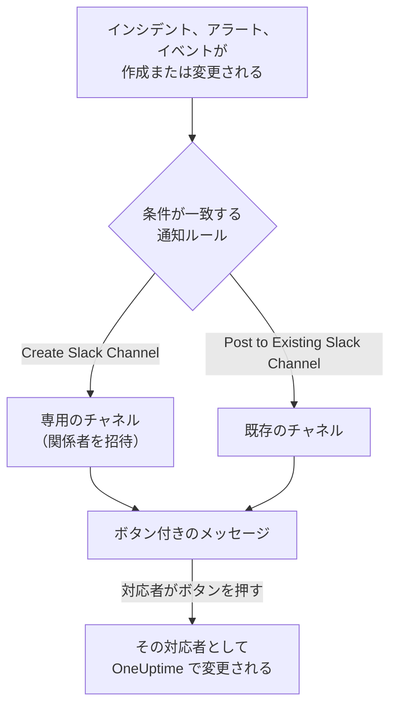

# Slack

OneUptime を Slack に接続すると、インシデント、アラート、エピソード、定期メンテナンス、モニター、オンコールの更新をチャネルに投稿し、インシデントごとに専用のチャネルを用意し、対応者が Slack を離れずに操作できるようになります。確認、解決、メモの追加、オンコールの呼び出し、インシデントの宣言ができます。

:::cards
- [Slack を接続する](#slack-を接続する): ワークスペースに OneUptime をインストールしてから、自分のアカウントをリンクします。
- [通知ルール](#通知ルール): どのイベントをどこに投稿し、どれに専用のチャネルを用意するかを決めます。
- [Slack からインシデントとメンテナンスを作成する](#slack-からインシデントとメンテナンスを作成する): `/incident` と `/maintenance` を自分として使います。
- [Slack からインシデント、アラート、イベントを操作する](#slack-からインシデントアラートイベントを操作する): OneUptime のメッセージにあるボタンです。
:::

## しくみ

この動作には 2 つの接続が必要です。

- **プロジェクトの接続** は 1 回だけ行います。Slack ワークスペースにインストールした OneUptime のアプリです。このアプリがメッセージを投稿し、チャネルを作成し、メンバーを招待します。
- **各メンバー自身の接続** は、その人の Slack アカウントを OneUptime アカウントにリンクしたものです。ボタン、コマンド、絵文字リアクションは、その人として、プロジェクトでのその人の権限で動作します。

## 始める前に

- **プロジェクトを接続できるロール:** **Project Owner**、**Project Admin**、**Project Member** のいずれか。アプリのアンインストールには **Project Owner** または **Project Admin** が必要です。
- **アプリをインストールできる Slack ワークスペース**。
- **OneUptime Cloud の Growth プラン** (通知ルールとサマリーに必要)。[Growth プラン未満の通知ルール](#growth-プラン未満の通知ルール) を参照してください。
- **セルフホストのサーバーでは**、先にそのサーバー用に設定した Slack アプリ。[Slack 統合](/docs/self-hosted/slack-integration) を参照してください。

## Slack を接続する

:::steps
### Slack ワークスペースに OneUptime をインストールする

**プロジェクト設定** > **ワークスペース** > **Slack** に移動し、 **Slack で接続** をクリックします。ワークスペースを選び、OneUptime を許可します。Slack から同じページに戻ると、プロジェクトが接続されたワークスペースの名前が表示されます。ワークスペースが接続されるまでは、インシデント、アラート、定期メンテナンス、モニター、オンコールの各メニューの **ワークスペース** セクションに **Slack または Teams を接続** があり、ここからもこのページに移動できます。

### 自分の Slack アカウントを接続する

アプリをインストールすると、インストールした人のアカウントがリンクされます。ほかのメンバーは **ユーザー設定** > **ワークスペース** > **Slack** で **Connect my account with Slack** を使って自分の Slack アカウントをリンクし、自分としてインシデントを操作したりダイレクトメッセージを受け取ったりします。このセクションは、プロジェクトが Slack に接続されると表示されます。

### 通知ルールを追加する

**インシデント** > **ワークスペース** > **Slack** に移動します。 **ワークスペース** セクションにはプロジェクトが接続したチャットワークスペースだけが表示されるので、 **Slack** は接続後に表示されます。ルールを作成します。たとえば、新しいインシデントごとに Slack チャネルを作成し、インシデントの所有者を招待するルールです。[通知ルール](#通知ルール) を参照してください。

### ルールをテストする

ルールの行で **ルールをテスト** をクリックします。ルールが指定するチャネルにテストメッセージが届きます。[ルールのテスト](#ルールのテスト) を参照してください。
:::

## 通知ルール

通知ルールは、どのイベントを Slack のどこに投稿するかを決めます。各製品にはそれぞれのルールがあり、メニューの **ワークスペース** > **Slack** にあります。

| 製品 | **Slack** ページのタブ |
| --- | --- |
| **インシデント** | **インシデント**、 **インシデントエピソード**、 **概要** |
| **アラート** | **アラート**、 **アラートエピソード**、 **概要** |
| **定期メンテナンス** | ルールの一覧 1 つ |
| **モニター** | ルールの一覧 1 つ |
| **オンコール** | ルールの一覧 1 つ |

ルールの作成は 4 つのステップで進みます。

| ステップ | 設定する内容 |
| --- | --- |
| **基本** | **ルール名** と **ルールの説明**。 |
| **条件** | ルールが発動するイベント。たとえば重大度、状態、ラベル、モニター、タイトル内の語句で絞り込みます。条件がなければ、すべてのイベントで発動します。条件が 2 つ以上ある場合は、 **一致条件** で、すべて一致する必要があるか、どれか 1 つでよいかを決めます。 |
| **送信先** | 投稿先。チャネル名を指定する **Post to Existing Slack Channel**、新しいチャネルの名前と招待する人を指定する **Create Slack Channel**、またはその両方です。 |
| **ビデオ通話** | インシデントとアラートのみ。それぞれに通話を開始します。[ビデオ通話](/docs/workspace-connections/video-calls) を参照してください。 |

ルールが作成するチャネルの名前は、 **New Slack Channel Name** にレコードの番号を続けたもの (例: `oneuptime-incident-42`) です。ルールが招待する人を受け入れるのは、作成されたチャネルだけです。招待されるのは、レコードの所有者、選択したチームとユーザー、そしてインシデントとアラートでは呼び出されたオンコール担当者です。非公開のインシデント、アラート、エピソードには非公開のチャネルが作成されます。その後のレコードの更新 (状態の変更、メモ、新しい所有者) は、そのレコードのチャネルと、ルールが指定する既存のチャネルに投稿されます。すでに解決済みとして作成されたインシデント、アラート、エピソードには専用のチャネルは作成されませんが、作成のメッセージはルールが指定するチャネルに送られます。[確認済みまたは解決済みの状態で宣言されたインシデント](/docs/incidents/declaring-incidents#確認済みまたは解決済みの状態で宣言されたインシデント) を参照してください。

**プロジェクト設定** > **ワークスペース** > **Slack** には OneUptime が見られるチャネルが表示され、それぞれの横に **テストを送信** があります。OneUptime は公開チャネルに初めて投稿するときに自分で参加します。非公開チャネルは、Slack で OneUptime のアプリを招待した後にだけ一覧に表示され、投稿できるようになります。

## ルールのテスト

ルールの行の **ルールをテスト** は、そのルールのテストメッセージをルールが指定するチャネルに投稿し、届くことを確かめられるようにします。イベントごとにチャネルを作るルールなら、テストでもチャネルを 1 つ作り、ルールの対象者を招待します。

**プロジェクト設定** > **ワークスペース** > **Slack** のチャネルの横にある **テストを送信** と同じく、通知ルールを作成する権限が必要です。 **Project Owner**、 **Project Admin**、 **Project Member**、 **Settings Admin**、 **Settings Member**、またはカスタムロールの **Create Workspace Notification Rule** と **Read Workspace Notification Rule** です。ルールを見ることしかできない人 ( **Viewer** など) には **ルールをテスト** がロックされ、ツールチップに必要なものが表示されます。API はその人のテストを "You do not have permission to send test notifications in this project." で拒否します。OneUptime Cloud では、ルールのテストにはルールの追加と同じく **Growth** プランが必要です。

OneUptime Cloud では、チャネルの横にある **テストを送信** にも **Growth** プランが必要です。チャネルへの投稿はルールとサマリーが行うことだからです。サマリーの **今すぐテストを送信** には、サマリーを作成する権限 (カスタムロールの **Create Workspace Notification Summary** と **Read Workspace Notification Summary**) と、OneUptime Cloud では **Growth** プランが必要です。それ以外の人にはロックされ、ツールチップに必要なものが表示されます。読み取り専用で接続された MCP クライアントは、どのテストも送信できません。

## サマリー

**インシデント** > **ワークスペース** > **Slack** (および **アラート**) の **概要** タブは、指定したチャネルに定期的なまとめを投稿します。インシデントやアラートの件数、確認と解決までの速さ、リンク付きの一覧が含まれます。新しいサマリーは毎週送信され、直近 7 日間を対象にします。 **最初のレポートの送信時刻** を空欄のままにすると、最初のサマリーは次の週・日・月の始めの 09:00 に送信されます。いつ送信されるかはフォームに表示されます。

サマリーは **タイムゾーン** の時計で送信されます。タイムゾーンの初期値はあなたのタイムゾーンです。サマリーはそこで一年中同じ時刻を保ちます。ベルリンの 09:00 に設定したサマリーは、夏時間で時計が切り替わった後もベルリン時間の 09:00 に送信され、メッセージ内の日付もベルリンの日付です。API では `timezone` を IANA タイムゾーン名 (例: `Europe/Berlin`) で送信します。タイムゾーンを指定せずに作成したサマリーは作成者のプロフィールのタイムゾーンを使い、API キーで作成した場合は UTC を使います。

サマリーのフォームは 4 つのステップです。 **基本情報** (名前とチャネル)、 **スケジュール**、 **コンテンツ** ( **含める内容** )、 **フィルター** (対象にするインシデントやアラート) です。

## Growth プラン未満の通知ルール

OneUptime Cloud では、通知ルールとサマリーは **Growth** プラン以上で利用できます。それより下のプランのプロジェクトは、すでにあるルールとサマリーを保持し、それらは引き続き Slack に投稿します。そのため、各製品 (インシデント、アラート、定期メンテナンス、オンコール、モニター) の **Slack** ページには、プランについての注記とその下に一覧 ( **まだ設定されている通知ルール**、 **まだ設定されているサマリー** ) が表示されます。ルールを削除するか、サマリーをオフにするか削除してください。ルールとサマリーの追加や変更には **Growth** が必要です。

## Slack で呼び出しを受ける

オンコール中にダイレクトメッセージで呼び出しを受けるには、Slack を通知方法の 1 つとして追加します。

:::steps
1. 自分の Slack アカウントを接続します ([Slack を接続する](#slack-を接続する) を参照)。
2. **ユーザー設定** > **通知方法** に移動し、 **ワークスペースアプリ** タブを開いて **Slack アカウントを追加** をクリックします。
3. その行の **テストメッセージを送信** をクリックします。メッセージが Slack のダイレクトメッセージに届きます。
:::

追加するとすぐにオンコールルールに加わるので、それ以降の呼び出しは Slack に届きます。どの呼び出しを受け取るかは **ユーザー設定** > **オンコールルール** で変更します。

## メッセージをメモとして保存する

インシデント、アラート、エピソード、定期メンテナンスイベントのチャネルでメッセージにリアクションすると、OneUptime はそのメッセージをそのレコードのメモとして保存し、スレッドへの返信で知らせます。

| リアクション | 保存される形式 |
| --- | --- |
| 📌 ピンの絵文字、または Slack 自身の **Pin to channel** | チームだけが見られる非公開メモ |
| 📢 メガホンまたはスピーカーの絵文字 | ステータスページに表示される公開メモ。インシデントと定期メンテナンスイベントのみ。 |

メモはあなたとして、あなたの権限で保存されるので、自分の Slack アカウントが接続されている必要があります。何人がリアクションしても、メッセージが保存されるのは 1 回だけです。

## Slack から OneUptime AI に質問する

ログ、トレース、メトリクス、インシデント、モニターについて普段の言葉で質問できます。チャネルで OneUptime を @メンションするか、ダイレクトメッセージを送ると、スレッドで回答します。さらに質問するにはそこで返信します。 `/oneuptime ask which monitors are down?` は回答をチャネルに投稿します。どちらも自分の Slack アカウントの接続と、プロジェクトで AI がオンになっていることが必要です。Slack での回答は読み取るだけです。何かを変更するにはボタンを使ってください。[AI に質問](/docs/ai/ask-ai) を参照してください。

## Slack からインシデントとメンテナンスを作成する

`/incident` と `/maintenance` は、あなたが入力して自分として送信するフォームを開きます。自分の Slack アカウントが接続されている OneUptime アカウント ([Slack を接続する](#slack-を接続する) を参照) として、そのアカウントのプロジェクトでの権限で送信されます。Slack アカウントが接続されていない場合や、OneUptime アカウントがもうプロジェクトのメンバーでない場合は、OneUptime がダイレクトメッセージでどうすればよいかを伝え、フォームは開きません。 **Create New Incident** と **Create Scheduled Event** のショートカットも同じフォームを開きます。

- **使える人。** OneUptime でインシデントを宣言できる人、または定期メンテナンスイベントを作成できる人です。インシデントには **Project Owner**、 **Project Admin**、 **Project Member**、 **Incident Admin**、 **Incident Member** (カスタムロールでは **Create Incident**)、イベントには **Scheduled Maintenance Admin** と **Scheduled Maintenance Member** ( **Create Scheduled Maintenance** ) です。それ以外の人にはダイレクトメッセージでそう伝えられ、フォームは開きません。
- **フォームが提示するもの。** 各一覧 (重大度、モニター、モニターのステータス、オンコールポリシー、ラベル) には、OneUptime の同じ一覧と同じく、あなたが読めるものが含まれます。一部のラベルに限定されたロールなら、それらのラベルが付いたモニターとオンコールポリシーです。まったく読めない一覧はフォームから外されます。アーカイブされたオンコールポリシーは提示されません。
- **フォームで指定できるもの。** インシデントやイベントはあなた自身の権限で作成され、あなたの操作として記録されます。読めないモニター、オンコールポリシー、ラベル、重大度、ステータス、または別のプロジェクトのものは、アクセスが変わる前に開いたフォームからであっても、プロジェクトにないものとして拒否され、何も作成されません。理由は OneUptime がダイレクトメッセージで伝えます。

インシデント、アラート、エピソードの **Execute On-Call Policy** も同じように動作します。オンコールポリシーを実行する権限 ( **Project Owner**、 **Project Admin**、 **Project Member**、 **On-Call Admin**、 **On-Call Member**、またはカスタムロールの **Create On-Call Duty Policy Execution Log** ) と、そのインシデント、アラート、エピソードを読む権限が必要で、あなたが読める有効なオンコールポリシーが提示されます。

## Slack からインシデント、アラート、イベントを操作する

OneUptime の Slack メッセージのボタンも、あなたとして動作します。自分の Slack アカウントが接続されている OneUptime アカウントとして、そのアカウントのプロジェクトでの権限で動作します。インシデント、アラート、エピソードの **Acknowledge**、 **Resolve**、 **Change State**、 **Add Note**、 **Execute On-Call Policy**、そして定期メンテナンスイベントの **Mark as Ongoing**、 **Mark as Complete**、 **Change State**、 **Add Note** は、それぞれ OneUptime で同じ操作を行ったときと同じ変更を行い、その変更は OneUptime であなたの操作として記録されます。レコードの状態タイムラインとフィードには、あなたが状態を変更したことが表示され、メモもあなたのものになります。絵文字リアクションでメッセージから保存したメモも、同じように投稿されます。

- **使える人。** OneUptime で同じ変更を行える人です。インシデントの確認、解決、状態の変更には、その状態を変更する権限が必要です。 **Project Owner**、 **Project Admin**、 **Project Member**、 **Incident Admin**、 **Incident Member**、またはカスタムロールの **Create Incident State Timeline** です。アラート、エピソード、定期メンテナンスイベントには、それぞれの種類に対応する同じ権限 (たとえば **Create Alert State Timeline** ) が必要で、メモにはその種類のメモを投稿する権限が必要です。それ以外の人にはダイレクトメッセージでそう伝えられ、何も変わりません。
- **対象のレコード。** OneUptime と同じく、あなたが読めるレコードです。一部のラベルに限定されたロールなら、それらのラベルが付いたインシデント、アラート、エピソード、イベントです。ほかのレコードや別のプロジェクトのレコードのボタンには、そのレコードが "was not found in this project, or you do not have access to it." と返され、何も変わりません。OneUptime Cloud では、プロジェクトのプランに含まれない変更は、必要なプランを示して拒否されます。
- **Change State が提示するもの。** あなたが読める状態のうち、レコードが次に移れる状態を、プロジェクトの順序で提示します。今の状態より前の状態は提示されません。これはインシデント、アラート、定期メンテナンスイベントと同様にエピソードでも同じです。状態の変更でレコードが一覧の上に戻ることはないからです ([順序は表示上の好みではなく、実際の制約](/docs/incidents/states-and-severities#順序は表示上の好みではなく実際の制約) を参照)。読める状態が 1 つもない場合は "No incident states are available to you in this project. Ask a project admin for access to them." と伝えられ、レコードが到達できる最後の状態にある場合は "There is no later state to move this incident to." と伝えられます。どちらの場合も空のフォームは開きません。

## 接続を解除する

- **切断** は自分の Slack アカウントのリンクだけを解除し、あわせて自分の Slack の通知方法を削除します。
- **プロジェクト設定** > **ワークスペース** > **Slack** の **Slack から OneUptime をアンインストール** は、プロジェクトの接続を解除します。OneUptime は Slack への投稿をやめ、 **ワークスペース** メニューにも表示されなくなります。通知ルールとサマリーは、再接続するときのために保持されます。

> [!WARNING]
> アンインストールすると、プロジェクトのすべてのメンバーの Slack アカウントのリンクも解除され、Slack の通知方法と、それを使っていたオンコールルールも削除されます。Slack で呼び出されていた人は、Slack を再び追加するまで、ほかの通知方法で呼び出されます。

## トラブルシューティング

:::details ルールが何も投稿しない
**ルールをテスト** でルールの条件を確認します。テストが届くなら、ルールの条件がイベントに一致しなかったということです。届かない場合は、Slack のページに理由が表示されます。非公開チャネルの場合は、まず Slack で OneUptime のアプリをそのチャネルに招待してください。OneUptime が投稿したすべてのメッセージと、Slack が拒否したすべてのメッセージは、 **プロジェクト設定** > **通知** > **通知ログ** の **ワークスペース** タブに表示されます。
:::

:::details Slack が接続されなかった
Slack から接続されないまま戻ってくると、開始したページに **Slack は接続されませんでした** と表示され、1 つの文で理由が説明されます。権限がない、リンクがすでに使われたか期限切れ、別のワークスペースにサインインした、またはサーバーが Slack 用に設定されていない、のいずれかです。それぞれの文と対処法は [接続が完了しなかった](/docs/self-hosted/slack-integration#接続が完了しなかった) を参照してください。
:::

:::details ボタンやコマンドで Slack アカウントが接続されていないと表示される
**ユーザー設定** > **ワークスペース** > **Slack** で **Connect my account with Slack** を使ってリンクしてください。プロジェクトのメンバーでなくなっている場合は、OneUptime がそう伝え、あなたの代わりに何も操作しません。
:::

:::details 通知は届くが、ボタンとコマンドが何もしない
セルフホストのサーバーでは、ボタン、フォーム、コマンドのために Slack から OneUptime に到達できる必要があります。通知に必要なのは送信方向のアクセスだけです。[セルフホスト環境のネットワークアクセス](/docs/self-hosted/slack-integration#セルフホスト環境のネットワークアクセス) を参照してください。
:::

## 次のステップ

:::cards
- [Microsoft Teams](/docs/workspace-connections/microsoft-teams): Microsoft Teams での同じ通知と操作。
- [ビデオ通話](/docs/workspace-connections/video-calls): すべてのインシデントに通話を用意し、更新とともに投稿します。
- [Slack 統合](/docs/self-hosted/slack-integration): セルフホストのサーバーで Slack アプリを設定します。
- [インシデントの宣言](/docs/incidents/declaring-incidents): インシデントが始まるすべての方法と、そのときに実行されるもの。
:::
