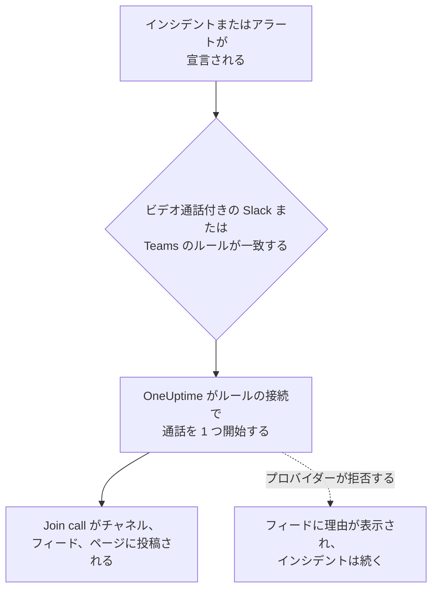

# ビデオ通話

すべてのインシデントとアラートに専用の通話を用意します。新しいインシデントやアラートで Slack または Microsoft Teams の通知ルールが発動すると、OneUptime は専用の会議 (Zoom の会議、Google Meet、Microsoft Teams の会議、またはインシデントの Slack チャネルのハドル) を開始し、インシデントの更新が届くすべての場所に **通話に参加** ボタンを投稿します。対応者はワンクリックで参加でき、午前 3 時に誰かが会議を作ってリンクを配って回る必要はありません。

:::cards
- [しくみ](#しくみ): ルールが通話を開始し、対応者はどこからでも参加します。
- [ワンクリックで接続する](#ワンクリックで接続する): Zoom、Google Meet、Microsoft Teams に、サインインするだけで接続します。
- [プロバイダー](#プロバイダー): 自分のアプリのサービス ID、常設の会議リンク、Slack のハドル。
- [手動で通話を開始する](#手動で通話を開始する): インシデントやアラートのページから開始します。
- [通話の文字起こし](#通話の文字起こし): インシデントの通話で話された内容と、そこから OneUptime AI が読み取る根本原因。
:::

## しくみ



:::steps
### プロバイダーを接続する

**プロジェクト設定** > **ワークスペース** > **ビデオ通話** に移動し、Zoom、Google Meet、Microsoft Teams のいずれかを接続するか、常設の会議リンクを追加します。OneUptime Cloud では、Zoom、Google Meet、Microsoft Teams の接続はワンクリックです。サインインして、OneUptime に会議の作成を許可します ([ワンクリックで接続する](#ワンクリックで接続する) を参照)。Slack のハドルには、プロジェクトの Slack 接続以外に何も必要ありません。

### ルールでオンにする

インシデントまたはアラートの Slack や Microsoft Teams の通知ルールを開きます (たとえば **インシデント** > **ワークスペース** > **Slack** )。ルールの **ビデオ通話** ステップで **インシデントのビデオ通話を開始** をオンにし、通話を行う場所を選びます。

### ワンクリックで参加する

ルールが発動すると、OneUptime はインシデントの通話を 1 つ開始し、インシデントの更新が届くチャネルとインシデントのフィードに **通話に参加** ボタン付きで投稿します。インシデントのページでは、 **ビデオ通話** カードに通話が表示され、ヘッダーに **通話に参加** ボタンが表示されます。
:::

どのインシデントに通話を用意するかは、ルールの条件で決まります。Sev1 のインシデントだけでブリッジを開くには、ルールに **重大度** の条件を付けます。通話は、進行中として宣言されたインシデントとアラートで開始されます。すでに解決済みとして作成されたインシデントには通話は用意されません。

### インシデントごとに 1 つの通話

通話は、通話を行う場所ごとに、インシデントにつき 1 回だけ開始されます。同じ接続を選ぶルールは 1 つの通話を共有し、その接続の通話がすでにあるインシデントに対して、ルールが 2 つ目の通話を開始することはありません。異なる場所を選ぶルールは、それぞれ自分の通話を開始します。たとえば、対応者向けの Zoom の会議と、インシデントの Slack チャネルのハドルです。

### 通話を開始できない場合

インシデントの宣言が、ビデオ通話のプロバイダーを待つことはありません。通話はインシデントの作成後に開始されるので、プロバイダーが遅くても失敗しても、インシデントやそのオンコールの呼び出しが遅れることはありません。

プロバイダーが拒否した場合 (シークレットの期限切れ、権限の不足、ホストの削除など)、インシデントのフィードには、ルールの通話を開始できなかったことがプロバイダーの理由とともに表示されるので、対応者はインシデントのページから通話を開始すればよいとわかります。ルールの実行はワークスペースの通知ログに **ビデオ通話を開始する** として記録され、 **プロジェクト設定** > **ワークスペース** > **ビデオ通話** の接続の行には、通話が再び開始されるまでエラーが表示されます。

### 非公開のインシデント

会議の名前は対象のインシデントの番号とタイトルから付けられ、会議の説明にはインシデントへのリンクが含まれます。非公開のインシデントでは、会議に招待された全員が会議の名前を読めるので、タイトルは含まれません。

## ワンクリックで接続する

OneUptime Cloud では、Zoom、Google Meet、Microsoft Teams の接続はワンクリックで済み、プロバイダー側での設定は不要です。

:::steps
1. **プロジェクト設定** > **ワークスペース** > **ビデオ通話** に移動し、Zoom、Google Meet、Microsoft Teams のいずれかで **接続** をクリックします。
2. **Continue to Zoom** (または Google、Microsoft) をクリックしてサインインし、OneUptime に会議の作成を許可します。
3. 接続が完了した状態でビデオ通話のページに戻ります。 **テスト会議を開始** で端から端まで確認してから、Slack または Microsoft Teams の通知ルールでその接続を選びます。
:::

すべての会議は、サインインしたアカウントとして作成され、そのアカウントがホストになります。メンバーが退職しても通話が開始され続けるように、自分のアカウントではなく、incidents@example.com のような共有アカウントでサインインしてください。接続の行には、どのアカウントとしてサインインしているかが表示されます。

| プロバイダー | サインインに使うもの | OneUptime ができること |
| --- | --- | --- |
| Zoom | Zoom ユーザー。Basic (無料) ユーザーがホストの会議は 40 分で終了します。 | そのユーザーの会議の作成 (`meeting:write:meeting`) と、そのユーザーが誰かの読み取り (`user:read:user`)。 [通話の文字起こし](#通話の文字起こし) のために、そのユーザーの会議のクラウド録画の文字起こしの読み取り (`cloud_recording:read:list_recording_files`、 `cloud_recording:read:meeting_transcript`)。 |
| Google Meet | Google Meet を使える Google アカウント。 | そのアカウントとしての Meet スペースの作成 (`meetings.space.created`) と、そのメールアドレスの読み取り。 |
| Microsoft Teams | Microsoft Teams を使える職場または学校のアカウント。個人の Microsoft アカウントでは Teams の会議を作成できません。 | そのアカウントとしてのオンライン会議の作成 (委任されたアクセス許可 `OnlineMeetings.ReadWrite`) と、サインイン状態の維持 (`offline_access`)。 [インシデント通話の録画と文字起こし](#すべての通話を録画して文字起こしする) のために、そのアカウントのカレンダーへの会議の追加 (`Calendars.ReadWrite`) と、その文字起こしの読み取り (`OnlineMeetingTranscript.Read.All`、管理者の承認が必要)。 |

サインインで作成した接続にも、誰が待つかを決める設定があります。Google Meet では **Who can join**、Microsoft Teams では **Who skips the lobby** です。接続の行の **編集** で変更します。

OneUptime が通話の文字起こしを読み取るようになる前にサインインした Zoom の接続は、これまでどおり通話を開始しますが、もう一度サインインするまで文字起こしは読み取れません。行の **Reconnect** で、Zoom に文字起こしの権限を求めます。

**インシデント通話を録画して文字起こしする** がオフのときにサインインした Microsoft Teams の接続は、これまでどおり通話を開始しますが、録画はされません。この設定をオンにすると、行の **Reconnect** で、Microsoft にカレンダーと文字起こしの権限も求めます。

### サインイン状態を保つ

OneUptime はサインインのリフレッシュトークンを暗号化して保持し、少なくとも週に 1 回更新するので、プロジェクトでインシデントがどれだけ長く起きなくても、使われないことでトークンが期限切れになることはありません。サインインが機能しなくなった場合 (アカウントが OneUptime を削除した、アカウントが削除または停止された、組織のポリシーで再サインインが求められた)、接続の行には、次のインシデントのときではなく、OneUptime が気付いたその日に、理由とともに **異常** と表示されます。行の **Reconnect** で再びサインインします。

同じアカウントとしてサインインした接続は、すべてのプロジェクトで 1 つのサインインを共有します。Zoom はアカウントごとに 1 つのサインインしか保持しないので、同じ Zoom ユーザーをもう一度接続すると、それらすべてのサインインが置き換わります。

### 再接続と削除

接続の行の **Reconnect** は、同じアカウントまたは別のアカウントで再びサインインします。アカウントが OneUptime を削除した後や、インシデントの会議を別のアカウントに移すときに使います。

接続を削除すると、そのサインインを使うほかの接続がなくなった時点で、Zoom と Google での OneUptime のアクセスが取り消されます。Microsoft では、アカウントの **My Apps** (myapps.microsoft.com) で OneUptime を削除します。Zoom App Marketplace で Zoom アカウントから OneUptime を削除すると、そのアカウントとしてサインインしたすべての接続からサインインが削除され、それらの接続には再接続するまで **異常** と表示されます。

### Microsoft が管理者を求める場合

Microsoft 365 の組織によっては、アプリを承認できるのは管理者だけです。Microsoft に管理者の承認が必要だと言われたら、Microsoft 365 の管理者に Microsoft Teams を接続してもらうか、[Microsoft Entra 管理センター](https://entra.microsoft.com/) の **Enterprise applications** > **Admin consent requests** で OneUptime を承認してもらいます。Teams の通話を録画するプロジェクトでは、組織ごとに 1 回、この承認が必要です。アプリに会議の文字起こしの読み取りを許可できるのは管理者だけだからです。

### 代わりに自分のアプリを使う

人のサインインではなくサービス ID で接続するには (Zoom の Server-to-Server OAuth アプリ、ドメイン全体の委任を設定した Google のサービスアカウント、Microsoft Entra のアプリ登録)、接続ダイアログで **Use your own Zoom app** (または Google、Microsoft) をクリックします。それぞれについては [プロバイダー](#プロバイダー) で説明しています。ワンクリック用のアプリを設定していないセルフホストのサーバーでは、 **接続** でこのフォームが直接開きます。設定方法は [セルフホストのサーバーでのワンクリック接続](#セルフホストのサーバーでのワンクリック接続) を参照してください。

## 手動で通話を開始する

インシデントやアラートのページの **ビデオ通話** カードには **通話を開始** があります (すでに通話がある場合は **別の通話を開始** )。プロジェクトの接続のいずれか、インシデントの Slack チャネルのハドルを選ぶか、自分の会議リンクを貼り付けます。通話は、ルールが開始した通話と同じく、インシデントのチャネルとフィードに投稿されます。

カードの **削除** は、インシデントのページから通話を外します。会議自体は削除されず、リンクを知っている人は引き続き参加できます。

通話の開始と削除には、インシデント (またはアラート) を操作する権限が必要です。 **プロジェクト所有者**、 **プロジェクト管理者**、 **プロジェクトメンバー**、 **インシデント管理者**、 **インシデントメンバー**、またはカスタムロールの **Create Incident Video Call** と **Delete Incident Video Call** です。インシデントを読める人は全員、その通話を見られます。

## 通話の文字起こし

対応者が通話で話す内容、つまり何を確認し、何を疑い、何を決めたかは、インシデントがどう対応されたかの最良の記録ですが、通話が終わると失われます。インシデントの通話は文字起こしを保持し、OneUptime AI はそれを読んで通話が指し示す根本原因を探します。読み取った内容は、対応者が使うまでインシデントには反映されません。

:::steps
### 通話の後で文字起こしを取得する

インシデントの **ビデオ通話** カードで、 **Zoom から取得**、 **Google Meet から取得**、または **Microsoft Teams から取得** が、OneUptime がそこで開始した会議の文字起こしを読み取ります (Microsoft Teams の場合は、すべての通話を録画して文字起こししている間に開始した会議)。それ以外の通話では、 **文字起こしを追加** で会議ツールが保存したファイル (`.vtt`、 `.srt`、 `.txt`、最大 5 MB) または貼り付けた文字起こしを追加します。[すべての通話を録画して文字起こしする](#すべての通話を録画して文字起こしする) ようにしている場合は、通話が終わると OneUptime が自動で取得します。

### OneUptime AI が読み取る

1〜2 分以内に、インシデントの **AI 調査** カードに **提案された根本原因** が **未確認** の印付きで表示され、その根拠となる文字起こしの行が時刻と話者付きで引用されます。その下には、折りたたまれて、通話で話されたその他の内容があります。発見事項 ( **通話で確認済み** と **仮説** の 2 つのリスト)、試したこと、決定事項、フォローアップ、未解決の質問です。読み取った内容はインシデントのフィードにも投稿され、そこからインシデントの Slack と Microsoft Teams のチャネルにも届きます。

### 使うか、却下する

**根本原因として使用** は、提案を引用ごと根本原因のエディターで開きます。必要な箇所を変更して保存すると、あなた自身の編集としてインシデントの根本原因になり、フィードに記録されます。 **却下** は提案を脇に置き、 **元に戻す** で元に戻します。
:::

OneUptime AI は、通話で原因が挙げられた場合にのみ、そう述べている行とともに原因を提案し、それらの行を文字起こしのとおりに引用します。通話で原因がはっきりしなかった場合、カードは推測する代わりに **根本原因を提案できるほどの内容が通話で話されませんでした** と表示します。

### すべての通話を録画して文字起こしする

通話の録画や文字起こしの取得を誰も覚えておく必要がないように、 **プロジェクト設定** > **ワークスペース** > **ビデオ通話** で **インシデント通話を録画して文字起こしする** をオンにします。オンの間は次のようになります。

- OneUptime は、自身が開始するインシデントの会議ごとに、Zoom にはクラウドへの録画を、Google Meet には文字起こしを、Microsoft Teams には自動の録画と文字起こしを依頼します。通話を投稿するメッセージには、誰かが参加する前にそのことが書かれています。
- 通話が終わると、 **Zoom から取得** と同じように OneUptime が自動で文字起こしを取得し、OneUptime AI がそれを読み取ります。それまでは、 **ビデオ通話** カードに待機中であることが表示されます。
- OneUptime AI が読み取った内容は、インシデントのフィードと、その Slack と Microsoft Teams のチャネルに届きます。未確認の印が付いた提案された根本原因、続いて確認されたこと、試したこと、決まったこと、フォローアップ、未解決の質問です。
- 文字起こしが届く前にインシデントが解決した場合、自動のポストモーテムの下書きは、通話で話された内容を読み取れるよう文字起こしを待ちます。プロバイダーが文字起こしを準備している間は最大 6 時間、まだその兆しがない場合は 1 時間です。

この設定は人を録画するため、既定ではオフです。これらの通話の参加者全員に、録画または文字起こしされていることが表示されるので、組織で許可されていることを確認してください。Zoom が文字起こしを保持するのは、アカウントが音声文字起こしをオンにしてクラウドに録画する場合だけで、Google Meet では文字起こしのある Google Workspace のエディションの場合だけです。Slack のハドルと会議リンクは録画されず、アラートの通話も録画されません。それらの文字起こしは手動で追加してください。

Microsoft がアプリに文字起こしの読み取りを許可するのはカレンダー上の Teams 会議だけなので、OneUptime はインシデントの会議をそれぞれ開催者のカレンダーに追加し、会議のオプションで自動の録画と文字起こしをオンにします。そのため、接続には Microsoft Graph のアクセス許可がさらに 2 つ、 `Calendars.ReadWrite` と `OnlineMeetingTranscript.Read.All` が必要です。アプリ登録にこれらを追加するか ( [Microsoft Teams](#microsoft-teams) を参照)、サインインで作成した接続では **Reconnect** を使ってください。開催者の Teams 会議ポリシーでクラウド録画、文字起こし、自動録画が許可されている必要があり、組織でアプリによる文字起こしへのアクセスが無効になっていてはいけません。OneUptime がカレンダーに追加できない通話も録画なしでそのまま開始され、その **ビデオ通話** カードに理由が表示されます。

### 各プロバイダーが保持するもの

| 通話 | 文字起こしの取得方法 | 必要なもの |
| --- | --- | --- |
| Zoom | **Zoom から取得** | 音声文字起こしをオンにしてクラウドに録画された会議、または AI Companion の会議の要約がオンの会議。接続には文字起こしのスコープが必要で ( [Zoom](#zoom) を参照)、それ以前にサインインした接続には **Reconnect** が必要です。Zoom は会議の後に文字起こしを準備し、通常は会議の長さの 2 倍以内に完了します。 |
| Google Meet | **Google Meet から取得** | 通話中にオンにした文字起こし (文字起こしのある Google Workspace のエディション)。ほかに設定するものはありません。OneUptime は自身が作成した会議の文字起こしを読み取ります。Google はアプリが読める状態で文字起こしを 30 日間保持します。 |
| Microsoft Teams | **Microsoft Teams から取得** | [すべての通話を録画して文字起こししている](#すべての通話を録画して文字起こしする) 間に OneUptime が開始した会議。Microsoft がアプリに文字起こしの読み取りを許可するのはカレンダー上の会議だけで、会議は 60 日間保持されます。それ以外の Teams の会議では **文字起こしを追加** を使います。Teams で会議の要約を開き、次に文字起こしを開いて、 `.vtt` ファイルとしてダウンロードしてください。 |
| 会議リンクまたは Slack のハドル | **文字起こしを追加** | 会議ツール、またはハドルのメモが保持する文字起こし。 |

### 誰が何をできるか

文字起こしの取得、追加、置き換え、削除、再読み込み、および提案の却下には、インシデントの通話を開始する権限が必要です。 **プロジェクト所有者**、 **プロジェクト管理者**、 **プロジェクトメンバー**、 **インシデント管理者**、 **インシデントメンバー**、またはカスタムロールの **Create Incident Video Call** です。 **根本原因として使用** には、インシデントの根本原因を編集する権限が必要です。インシデントを読める人は全員、その通話の文字起こしと、OneUptime AI がそこから読み取った内容を見られます。

### OneUptime AI が読み取るもの

文字起こしの読み取りは、調査と同じく AI の作業です。プロジェクトで AI がオンの間だけ実行され、プロジェクトの AI 使用量と 1 日の上限に含まれます ( [コスト管理](/docs/ai/ai-sre#コスト管理) を参照)。長い文字起こしは分割して読み取られます。AI がオフの場合、文字起こしは保持され、カードには読み取られなかったことが表示されます。文字起こしを削除すると、OneUptime AI がそこから読み取った内容も削除されますが、インシデントの根本原因は保持されます。AI によるポストモーテムの下書きも、インシデントの通話で話された内容を読み取ります ( [ポストモーテム](/docs/incidents/postmortems) を参照)。

## プロバイダー

このセクションでは、自分のアプリのサービス ID でプロバイダーを接続する方法を説明します。Zoom の Server-to-Server OAuth アプリ、Google のサービスアカウント、Microsoft Entra のアプリ登録です。サービス ID は人に依存しないので、誰が退職しても動作し続けます。代わりにサインインで接続するには、[ワンクリックで接続する](#ワンクリックで接続する) を参照してください。

認証情報は保存時に暗号化され、API から返されることはありません。接続を編集するとき、空欄のままにした認証情報は保存済みの値が保持されます。

接続フォームの **テスト会議を開始** と、接続の行の **テスト** は、接続の設定で実際の会議を作成し、そのリンクを表示します。認証情報、プロバイダー側の権限、ホストがすべて連携して動作することを確かめられる唯一のチェックです。どこにも何も投稿されません。

プロバイダーの接続には、 **プロジェクト所有者**、 **プロジェクト管理者**、 **設定管理者**、またはカスタムロールの **Create Video Call Connection** と **Edit Video Call Connection** が必要です。

### Zoom

OneUptime は、Zoom の **Server-to-Server OAuth** アプリを通じてインシデントごとに Zoom の会議を作成し、選んだライセンス付きの Zoom ユーザーがホストになります。

:::steps
1. [Zoom App Marketplace](https://marketplace.zoom.us/) で **Develop** > **Build App** を選び、 **Server-to-Server OAuth** アプリを作成します。作成には、Zoom アカウントの管理者、または Server-to-Server OAuth アプリを許可するロールが必要です。
2. アプリの **Scopes** ページで **meeting:write:meeting:admin** (ユーザーの会議を作成する) を追加します。詳細なスコープが導入される前に作成したアプリでは、代わりに **meeting:write:admin** を使えます。OneUptime に [通話の文字起こし](#通話の文字起こし) も読み取らせるには、 **cloud_recording:read:list_recording_files:admin** と **cloud_recording:read:meeting_transcript:admin** (詳細なスコープが導入される前に作成したアプリでは **recording:read:admin** ) を追加します。
3. **Activate** をクリックしてアプリを有効にし、 **App Credentials** ページの **Account ID**、 **Client ID**、 **Client secret** を接続フォームにコピーします。
4. **Meeting host** を入力します。ライセンス付きの Zoom ユーザーのメールアドレスで、メンバーが退職しても会議が動作し続けるように、incidents@example.com のようなサービスアカウントが理想的です。Basic (無料) ユーザーがホストの会議は 40 分で終了します。
5. ホストは参加することのないサービスアカウントなので、対応者はホストを待たずに参加します。Zoom アカウントの **Waiting room** の設定がオンでロックされていないことを確認してください。ロックされていると誰も入室できません。
:::

| フィールド | 入手場所 |
| --- | --- |
| Account ID | アプリの **App Credentials** ページ |
| Client ID | アプリの **App Credentials** ページ |
| Client secret | アプリの **App Credentials** ページ |
| Meeting host | すべての会議のホストになる、ライセンス付きの Zoom ユーザーのメールアドレス |

### Google Meet

OneUptime は、ドメイン全体の委任によって Google Workspace ユーザーとして動作する Google Cloud のサービスアカウントを通じて、Google Meet REST API でインシデントごとに Google Meet を作成します。

:::steps
1. [Google Cloud コンソール](https://console.cloud.google.com/) でプロジェクトを選ぶか作成し、そのプロジェクトで **Google Meet REST API** を有効にします。
2. **IAM & Admin** > **Service accounts** でサービスアカウントを作成します。それを開き、 **Keys** > **Add key** > **Create new key** に移動して **JSON** を選び、ダウンロードしたファイルを接続フォームの **Service account JSON key** に貼り付けます。
3. [Google 管理コンソール](https://admin.google.com/) で **Security** > **Access and data control** > **API controls** > **Manage Domain Wide Delegation** を開き、 **Add new** をクリックします。サービスアカウントの数値の **Client ID** と、スコープ `https://www.googleapis.com/auth/meetings.space.created` を入力します。
4. サービスアカウントが代理で動作する Google Workspace ユーザーを **Create meetings as** に入力します。incidents@example.com のような専用のアカウントです。すべての会議はこのユーザーが所有します。
:::

**Who can join** は、誰が承認なしで参加できるかを決めます。 **People in your organization join directly, others ask to join** (デフォルト) では、Google Workspace の外部の人は参加をリクエストし、通話の参加者がそれを承認します。 **Anyone with the link joins directly** では誰も待ちません。

ドメイン全体の委任が機能し始めるまでには数分かかることがあります。委任を追加した直後に、Google がサービスアカウントにユーザーとしての動作を許可しなかったとテストで報告された場合は、数分待ってからもう一度テストしてください。

### Microsoft Teams

OneUptime は、ライセンス付きの Teams ユーザーの代理で会議を開催する Microsoft Entra のアプリ登録を通じて、Microsoft Graph でインシデントごとに Microsoft Teams の会議を作成します。

:::steps
1. [Microsoft Entra 管理センター](https://entra.microsoft.com/) で **App registrations** > **New registration** を開き、シングルテナントのアプリを登録します。その **Directory (tenant) ID** と **Application (client) ID** をコピーします。
2. **API permissions** で、Microsoft Graph の **application** のアクセス許可 **OnlineMeetings.ReadWrite.All** (と、 [インシデント通話の録画と文字起こし](#すべての通話を録画して文字起こしする) も行う場合は **Calendars.ReadWrite** と **OnlineMeetingTranscript.Read.All** ) を追加し、 **Grant admin consent** をクリックします。
3. **Certificates & secrets** でクライアントシークレットを作成し、Secret ID ではなく **Value** を、接続フォームの **クライアントシークレット** に貼り付けます。
4. 開催者を選びます。ライセンス付きの Teams ユーザーで、サービスアカウントが理想的です。Entra 管理センターの **Users** からその **Object ID** をコピーし、 **Organizer object ID** に入力します。
5. アプリケーションアクセスポリシーで、アプリが開催者の会議を作成できるようにします。Teams PowerShell で `Connect-MicrosoftTeams` の後に、次の 2 つのコマンドを実行します。
:::

```powershell
New-CsApplicationAccessPolicy -Identity OneUptime-Meetings -AppIds "<application-client-id>"
Grant-CsApplicationAccessPolicy -PolicyName OneUptime-Meetings -Identity "<organizer-object-id>"
```

ポリシーが適用されるまでに最大 30 分かかることがあります。それまでは、アプリが開催者の会議を作成することを許可されていないとテストで報告されます。

同じポリシーで、アプリは開催者の会議の文字起こしも読み取れるようになります。 `Calendars.ReadWrite` はアプリに組織内のすべてのカレンダーの変更を許可します。開催者のカレンダーだけに限定するには、 **API permissions** ではなく [Exchange Online のアプリケーション用 RBAC](https://learn.microsoft.com/exchange/permissions-exo/application-rbac) で、スコープを開催者に限定して付与します。

**Who skips the lobby** は、誰が待たずに参加できるかを決めます。 **People in your organization skip the lobby** (デフォルト) では、ほかの人は会議の参加者が承認するまでロビーで待ちます。 **Everyone skips the lobby** では誰も待ちません。

### 会議リンク

常設の会議リンクは、すべてのインシデントで同じ部屋です。Zoom の個人ミーティングルーム、Microsoft Teams や Google Meet の定期的な会議、Webex の個人用ルーム、Jitsi のルームなどです。インシデントごとに何も作成されないので、承認するものはありません。

:::steps
1. チームがすでに使っているツールで、期限切れにならない会議を作成します。
2. その https の参加リンクを、接続フォームの **会議リンク** に貼り付けます。
:::

この接続で開始されたすべてのインシデントとアラートが部屋を共有するので、同時に起きた 2 つのインシデントも部屋を共有します。ホストなしで参加できる会議にしてください。

### Slack のハドル

Slack のルールでは、代わりにインシデントの Slack チャネルのハドルを開始できます。接続するものはありません。ルールの **ビデオ通話** ステップで **Slack ハドル** を選びます。

ハドルは、ルールがインシデント用に作成するチャネルで行われます。ルールが既存のチャネルに投稿する場合は、その最初のチャネルで行われます。そのため、ルールはチャネルを作成するか、既存のチャネルに投稿する必要があります。 **ハドルに参加** ボタンは、Slack でチャネルのハドルを開きます。最初に開いた対応者がハドルを開始し、その後の人はそれに参加します。Slack にはアプリがハドルを開始する方法がないので、誰かが開くまでハドルには誰もいません。

Slack のハドルは Slack のルール専用です。Microsoft Teams のルールは、プロジェクトのビデオ通話の接続のいずれかで通話を開始します。

## API を使う

通話は、インシデント (`IncidentVideoCall`) またはアラート (`AlertVideoCall`) に付くレコードです。インシデントの `_id` と、次のいずれかを指定して作成します。

- `videoCallConnectionId`: その接続で新しい会議を開始します。
- `SlackHuddle` に設定した `provider`: インシデントの Slack チャネルのハドルです。
- `joinUrl` (必要に応じて `title`): 自分の会議リンクです。

```json
{
  "data": {
    "projectId": "<project-id>",
    "incidentId": "<incident-id>",
    "videoCallConnectionId": "<connection-id>"
  }
}
```

`POST /api/video-call-connection/test` は、保存済みの接続 (`{ "connectionId": "..." }`) または未保存の設定 (`{ "provider": "Zoom", "config": { ... }, "secrets": { ... } }`) でテスト会議を開始し、その `joinUrl` を返します。

接続の `authMethod` は、その接続のサインイン方法を示します。サインインで作成した接続は `OAuth`、自分のアプリの認証情報を使う接続は `AppCredentials`、会議リンクでは何も入りません。サインインで作成する接続は、ダッシュボードでサインインすることでしか作成できません。API では名前の変更と `config` の変更ができ、その `connectedAccount` はどのアカウントとしてサインインしているかを示します。

## セルフホストのサーバーでのワンクリック接続

OneUptime Cloud には、ワンクリック接続用の独自の Zoom、Google、Microsoft のアプリがあります。セルフホストのサーバーでは、アプリを設定したプロバイダーごとにワンクリック接続が使えます。設定していない場合、 **接続** は自分のアプリ用のフォームを開きます。

プロバイダーごとに OAuth アプリを 1 つ作成し、サーバーのホストを使って次のリダイレクト URI を登録します。

| プロバイダー | リダイレクト URI | 環境変数 | Helm の値 |
| --- | --- | --- | --- |
| Zoom | `https://<host>/api/video-call-oauth/zoom/callback` | `ZOOM_APP_CLIENT_ID`, `ZOOM_APP_CLIENT_SECRET`, `ZOOM_APP_WEBHOOK_SECRET_TOKEN` | `zoomApp.clientId`, `zoomApp.clientSecret`, `zoomApp.webhookSecretToken` |
| Google Meet | `https://<host>/api/video-call-oauth/google-meet/callback` | `GOOGLE_MEET_APP_CLIENT_ID`, `GOOGLE_MEET_APP_CLIENT_SECRET` | `googleMeetApp.clientId`, `googleMeetApp.clientSecret` |
| Microsoft Teams | `https://<host>/api/video-call-oauth/microsoft-teams/callback` | `MICROSOFT_TEAMS_MEETINGS_APP_CLIENT_ID`, `MICROSOFT_TEAMS_MEETINGS_APP_CLIENT_SECRET` | `microsoftTeamsMeetingsApp.clientId`, `microsoftTeamsMeetingsApp.clientSecret` |

- **Zoom**: [Zoom App Marketplace](https://marketplace.zoom.us/) で **Develop** > **Build App** を選び、ユーザーが管理する **General App** を作成します。 **Basic Information** で、 **Development** と **Production** の両方のタブと OAuth の許可リストにリダイレクト URI を OAuth Redirect URL として追加し、 **Production** タブで **Deauthorization Notification** のエンドポイント URL を `https://<host>/api/video-call-oauth/zoom/events` に設定します。 **Scopes** で `meeting:write:meeting` と `user:read:user` を追加します。[通話の文字起こし](#通話の文字起こし) を読み取らせるには、 `cloud_recording:read:list_recording_files` と `cloud_recording:read:meeting_transcript` も追加します。 **Features** > **Access** の **Secret Token** が `ZOOM_APP_WEBHOOK_SECRET_TOKEN` です。 **Development** の認証情報は自分の Zoom アカウントのユーザーにしか使えません。 **Production** の認証情報は、Zoom がアプリを審査して公開すると、誰でも使えるようになります。
- **Google Meet**: [Google Cloud コンソール](https://console.cloud.google.com/) で **Google Meet REST API** を有効にし、OAuth の同意画面 ( **Google Auth Platform** ) をスコープ `openid`、 `email`、 `https://www.googleapis.com/auth/meetings.space.created` で設定し、リダイレクト URI を指定して **Web application** タイプの OAuth クライアントを作成します。アプリは本番環境に公開してください。テストのままのアプリは 7 日後にサインインを失います。Google は Meet のスコープを求めるアプリを審査します。審査が終わるまで、サインインの前に警告が表示されます。
- **Microsoft Teams**: [Microsoft Entra 管理センター](https://entra.microsoft.com/) で **Accounts in any organizational directory** 向けのアプリを登録し、リダイレクト URI を **Web** のリダイレクト URI として追加し、Microsoft Graph の委任されたアクセス許可 `openid`、 `profile`、 `email`、 `offline_access`、 `OnlineMeetings.ReadWrite` (と、 [通話を録画して文字起こしする](#すべての通話を録画して文字起こしする) プロジェクトが求める `Calendars.ReadWrite` と `OnlineMeetingTranscript.Read.All` ) を追加して、クライアントシークレットを作成します。Microsoft Teams ボットの登録 (`MICROSOFT_TEAMS_APP_CLIENT_ID`) ではなく、専用の登録を使ってください。アプリに確認済みの発行元がない間は、ほとんどの組織で管理者の同意が必要です。

クライアント ID は公開情報です。どのプロバイダーがワンクリックで接続できるかを知るために、ダッシュボードに送られます。シークレットと Webhook のシークレットトークンは秘密にしてください。ワーカーは毎日、更新の時期が来たサインインを更新するので、アプリと同じ値が必要です。

## トラブルシューティング

:::details インシデントで通話が開始されなかった
ルールがインシデントに一致したこと ( **ルールをテスト** )、その **ビデオ通話** ステップがオンであること、インシデントが進行中として宣言されたことを確認します。すでに解決済みとして作成されたインシデントには通話は用意されません。その接続でインシデントの通話をすでに開始したルールは、別の通話を開始しません。
:::

:::details フィードに通話を開始できなかったと表示される
プロバイダーが拒否し、フィードにその理由が表示されています。その間はインシデントのページから通話を開始してください。その後、接続の行で **テスト** を実行します。クライアントシークレットの期限切れや権限の不足など、プロバイダー側の設定を直している間、同じ理由が表示されます。
:::

:::details 接続に 異常 と表示される
その接続のサインインが機能しなくなりました。アカウントが OneUptime を削除した、アカウントが削除または停止された、または再サインインが必要です。その行の **Reconnect** をクリックします。それまでは、その接続が開始するはずの通話は開始されません。
:::

:::details 参加者がロビーや待機室で待たされる
接続の行の **編集** で **Who can join** (Google Meet) または **Who skips the lobby** (Microsoft Teams) を変更します。Zoom では、アカウントの **Waiting room** の設定がオンでロックされていないことを確認してください。
:::

:::details Zoom から取得で文字起こしが見つからない
Zoom が文字起こしを保持するのは、音声文字起こしをオンにしてクラウドに録画された会議か、AI Companion の会議の要約がオンの会議だけで、会議の終了後に準備されます。どちらに当たるかはカードに表示されます。後でもう一度試すか、インシデントの会議でどちらかをオンにしてください。それまでは、 **文字起こしを追加** で保存しておいた文字起こしを追加できます。
:::

:::details ビデオ通話カードが文字起こしを待ったままになる
OneUptime は通話の終了後、数分おきに Zoom、Google Meet、または Microsoft Teams に文字起こしを問い合わせます。通話から時間がたつほど間隔を空け、通話の開始から 3 日間続けます。文字起こしは、プロバイダーが準備を終えてから数分で届きます。Zoom の準備には通話の長さのおよそ 2 倍までかかります。 **Zoom から取得** はすぐに問い合わせます。プロバイダーが文字起こしを保持していない場合は、カードにそう表示されます。Zoom アカウントが音声文字起こしをオンにしてクラウドに録画しているか、Google Workspace のエディションに文字起こしがあるか、Teams の開催者の会議ポリシーで自動録画が許可されているかを確認してください。
:::

:::details Microsoft Teams の通話が録画されなかった
OneUptime が会議を開催者のカレンダーに追加できなかったため、通常の方法で、録画なしで通話を開始しました。理由は **ビデオ通話** カードに表示されます。多くの場合、接続に `Calendars.ReadWrite` または `OnlineMeetingTranscript.Read.All` がありません。アプリ登録にこれらを追加して管理者の同意を付与するか、サインインで作成した接続では **Reconnect** を使ってください。その後に開始された通話は録画されます。
:::

:::details OneUptime AI が文字起こしを読み取れなかった
理由はカードに表示されます。プロジェクトで AI がオフになっている、プロジェクトが AI の 1 日の上限に達した、または AI プロバイダーが拒否した、のいずれかです。解決したら、カードの **再試行** で再び読み取ります。
:::

## 次のステップ

:::cards
- [Slack](/docs/workspace-connections/slack): 通話を開始するルールと、その投稿先のチャネル。
- [Microsoft Teams](/docs/workspace-connections/microsoft-teams): Microsoft Teams での同じルールと通話。
- [Microsoft Teams 統合](/docs/self-hosted/microsoft-teams-integration): セルフホストのサーバーで Teams ボットを設定します。
- [インシデントの宣言](/docs/incidents/declaring-incidents): インシデントが始まったときに起きること。
:::
