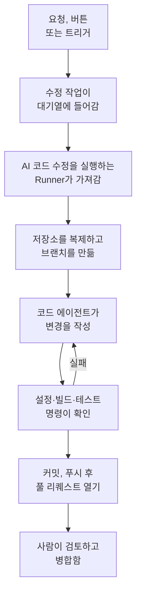

# 코드

코드는 코딩 에이전트에게 부탁하듯이 OneUptime AI에게 여러분의 저장소에서 일을 맡기는 곳입니다. 버그 수정, 테스트 작성, 코드 설명, 변경 작업 같은 일을 맡길 수 있습니다. 코드를 열면 연결된 저장소가 나타납니다. 저장소 페이지에는 그 저장소의 작업과 요청을 쓰는 입력란이 있고, 작업 페이지는 답장할 수 있는 대화입니다. OneUptime도 예외, 트레이스, 조사에서 스스로 작업을 시작합니다. [Runner](/docs/runbooks/agents)가 저장소를 복제하고, 새 브랜치에 변경을 작성하고, 빌드하고 테스트한 뒤 풀 리퀘스트를 엽니다. 모든 풀 리퀘스트는 사람이 검토하고 병합합니다. Runner는 브랜치를 푸시하고 풀 리퀘스트를 여는 것 외에는 아무것도 할 수 없습니다.

:::cards
- [저장소에서 AI에게 요청하기](#저장소에서-ai에게-요청하기): 여러분의 말로 쓴 요청과, 그 요청에 필요한 컨텍스트.
- [작업의 대화](#작업의-대화): AI가 한 일, 바꾼 내용, 그리고 여러분의 답장.
- [수정 실행의 흐름](#수정-실행의-흐름): 클릭부터 풀 리퀘스트까지 단계별로 설명합니다.
- [수정 작업이 시작되는 곳](#수정-작업이-시작되는-곳): OneUptime이 시작하는 작업과 각 풀 리퀘스트가 하는 일입니다.
- [시작하기 전에](#시작하기-전에): 모델, 연결된 저장소, Runner가 필요합니다.
- [수정이 실패할 때](#수정이-실패할-때): 오류가 나거나, 멈추거나, 기다리는 실행이 어떻게 되는지 설명합니다.
:::

> [!TIP]
> GitHub에서 시작할 수도 있습니다. 이슈나 풀 리퀘스트에서 OneUptime GitHub App을 멘션하면 그 자리에서 구현하거나, 수정하거나, 리뷰합니다. [GitHub App](/docs/ai/github-app)을 참조하세요. 같은 에이전트, 같은 Runner, 같은 예산을 쓰며 트리거만 다릅니다.

## 저장소에서 AI에게 요청하기

:::steps
### 저장소 열기

**제품 → 코드** 를 엽니다. 프로젝트의 저장소가 나열되고, 저장소마다 AI가 작업 중인 작업, 여러분을 기다리는 작업, 열려 있는 풀 리퀘스트가 표시됩니다. 아직 저장소가 없으면 **GitHub 연결** 을 제안합니다([시작하기 전에](#시작하기-전에) 참조).

### 원하는 것 쓰기

저장소 페이지에서 변경, 버그 또는 질문을 여러분의 말로 씁니다. 아직 작업이 없는 저장소는 **요청 예시** 아래에 몇 가지를 제안합니다.

### 컨텍스트 추가

**컨텍스트 추가** 를 클릭해 AI에게 필요한 것을 줍니다. 저장소의 파일이나 폴더, 노트, 링크, 프로젝트의 레코드를 추가할 수 있습니다. OneUptime은 요청을 보낼 때 여러분의 권한으로 각 레코드를 읽고, AI에게 준 내용을 보관합니다.

### 작업 시작

**작업 시작** 을 클릭하거나 Enter 키를 누릅니다. 작업 페이지가 열리고, AI의 작업이 진행되는 대로 그곳에 표시됩니다.
:::

| 컨텍스트 | AI가 받는 것 |
| --- | --- |
| **파일 또는 폴더** | 저장소 안의 경로로, AI가 가장 먼저 읽습니다. |
| **노트** | 붙여 넣은 텍스트: 오류, 명세, 로그 줄 등. |
| **링크** | 참고용 웹 주소. |
| **인시던트** 또는 **경고** | 요청을 보낸 시점의 상태, 설명, 근본 원인. |
| **예외** | 메시지와 스택 트레이스. |
| **모니터** | 유형, 상태, 설명. |
| **트레이스** | 스팬: 이름, 소요 시간, 오류. |
| **로그** | 검색어가 들어 있는 최신 로그 20줄. 기간은 지난 한 시간, 하루, 일주일 중에서 고릅니다. |

요청 하나에 담을 수 있는 컨텍스트는 최대 10개입니다. OneUptime이 읽은 내용에 있는 토큰, 키, 비밀번호, 이메일 주소는 OneUptime AI가 데이터를 읽는 다른 모든 곳에서처럼 AI가 보기 전에 가려집니다.

## 작업의 대화

작업 페이지는 대화입니다. 요청한 내용과 추가된 컨텍스트 다음에 AI의 차례가 이어집니다. AI가 밟는 단계(읽고 편집한 파일, 검색한 내용, 실행한 명령)가 진행되는 대로 표시되고, 이어서 AI의 답장, 변경한 파일과 그 diff, 풀 리퀘스트가 표시됩니다. 페이지 맨 위에는 작업의 상태가 표시됩니다.

| 상태 | 의미 |
| --- | --- |
| **대기열에 있음** | Runner가 가져가기를 기다리고 있습니다. |
| **작업 중…** | AI가 작업하고 있습니다. **중지** 로 멈출 수 있으며, 이미 푸시한 내용은 브랜치에 남습니다. |
| **귀하를 기다리는 중** | AI가 질문했습니다. 아래 입력란에서 답하세요. |
| **완료** | AI가 끝냈습니다. 답장과, 코드를 바꾼 경우 풀 리퀘스트가 표시됩니다. |
| **실패** | 차례를 끝내지 못했으며, 그 이유가 표시됩니다. **다시 시도** 는 같은 요청을 다시 보냅니다. |
| **중지됨** | 누군가 멈췄습니다. **다시 시도** 는 같은 요청을 다시 보냅니다. |

이어서 하려면 맨 아래 입력란에 씁니다. AI에게 답하거나, 컨텍스트를 추가하거나, 변경을 요청할 수 있습니다. 각 답장은 같은 작업의 다음 차례이며, 풀 리퀘스트가 열려 있는 동안 같은 브랜치에서 작업하고 같은 풀 리퀘스트에 푸시합니다. 작업은 한 번에 한 차례씩 진행되므로, AI가 일하는 동안 입력란은 기다립니다. 각 차례의 **로그** 는 그 차례에서 한 일을 그대로 기록한 것입니다.

저장소를 읽을 수 있는 사람은 그 작업도 읽을 수 있습니다. AI에게 요청하기, 답장하기, 작업 중지하기에는 저장소를 편집할 권한이 필요하며, 변경의 diff를 보는 것도 마찬가지입니다. 그 밖의 사람에게는 어떤 파일이 바뀌었는지만 보입니다. OneUptime이 스스로 시작하는 작업(아래)도 해당 저장소에 있으며, 답장할 수 있는 대화입니다.

## 수정 실행의 흐름



1. 저장소에서 **작업 시작** 을 클릭하거나, 해결되지 않은 예외에서 **Fix with AI** 를 클릭하거나, 다른 버튼이나 트리거가 작업을 시작합니다([수정 작업이 시작되는 곳](#수정-작업이-시작되는-곳) 참조).
2. 작업이 대기열에 들어가고, **AI 코드 수정 실행** 이 켜진 사용 가능한 Runner가 작업을 가져갑니다.
3. Runner가 작업의 컨텍스트를 가져옵니다. 요청의 경우 그 내용, 추가된 컨텍스트, 지금까지의 대화이고, 예외의 경우 유형, 메시지, 스택 트레이스입니다.
4. 저장소를 자체 작업 공간에 복제하고 브랜치를 만듭니다. 예외 수정 브랜치의 이름은 `oneuptime-fix-exception-` 뒤에 실행 ID의 앞 글자들이 붙은 것입니다. 답장은 대신 작업의 열린 풀 리퀘스트 브랜치에서 작업합니다.
5. 프로젝트의 LLM 공급자로 동작하는 코드 에이전트가 코드를 읽고 변경을 작성합니다. LLM 호출은 OneUptime 서버가 하므로 Runner는 공급자의 API 키를 절대 갖지 않으며, 모든 호출은 측정되어 AI 로그에 표시됩니다.
6. 저장소에 검증 명령이 있으면 자체 Runner는 무엇이든 커밋하기 전에 변경을 빌드하고 테스트하며, 실패를 코드 에이전트에 돌려보내 고치게 합니다([풀 리퀘스트 전 검증](#풀-리퀘스트-전-검증) 참조).
7. Runner가 커밋하고, 브랜치를 푸시하고, 풀 리퀘스트를 연 뒤(요청의 경우 코드를 바꿨을 때만) 작업 공간을 삭제합니다.

작업을 시작한 페이지에 실시간 상태가 표시됩니다. 모든 작업은 **제품 → 코드** 의 해당 저장소에 나열됩니다. 작업 페이지는 그 대화이며, 각 차례의 **로그** 에는 Runner가 읽거나 쓴 모든 파일과 실행한 모든 명령마다 한 줄이 있습니다.

각 실행은 서버가 강제하는 예산 안에서 동작합니다. 최대 **LLM 호출 40회** 와 **출력 토큰 100,000개** 입니다. 둘 중 하나에 도달한 실행은 반복하는 대신 그때까지의 작업 요약으로 끝납니다. 프로젝트가 일일 AI 한도를 설정한 경우 수정 실행도 그 한도에 포함됩니다.

## 수정 작업이 시작되는 곳

| 위치 | 클릭 | 풀 리퀘스트 |
| --- | --- | --- |
| 예외의 **AI Assistance** 페이지 | **Fix with AI** | 예외의 원인인 버그를 수정합니다. |
| 예외의 **AI Assistance** 페이지 | **Generate Regression Test** | 예외를 재현하고 버그가 수정될 때까지 실패하는 테스트를 추가합니다. |
| 예외의 **AI Assistance** 페이지 | **오류 처리 개선** | 잘못된 입력처럼 예상된 오류에 대해, 메시지에서 사용자 데이터를 빼고, 입력을 더 일찍 검증하고, 오류를 처리됨으로 표시합니다. 동작은 바꾸지 않습니다. |
| 인시던트나 경고의 **AI Investigation** 카드 | **Open Fix PR from this analysis** | 조사가 게시한 근본 원인을 수정합니다([조사에서 시작되는 자동 코드 수정](#조사에서-시작되는-자동-코드-수정) 참조). |
| 고칠 가치가 있는 트레이스 | **AI로 성능 문제 수정** | N+1 쿼리나 병렬로 실행할 수 있는 호출처럼 버튼이 알려 주는 느린 패턴을 수정합니다. |
| 서비스의 **로그** 페이지 | **로깅 개선** | 동작을 바꾸지 않고, 서비스의 로그를 구조화하고, 알맞은 심각도로 맞추고, 트레이스와 연결합니다. |
| 서비스의 **트레이스** 페이지 | **트레이싱 개선** | 동작을 바꾸지 않고, 서비스의 트레이싱이 빠진 곳에 스팬과 속성을 추가합니다. |

이 버튼들은 작업을 시작할 수 있는 곳에만 나타납니다. 프로젝트의 AI가 꺼져 있으면 아무것도 나타나지 않고, 예외의 사이드 메뉴에 **AI Assistance** 가 없습니다. **로깅 개선** 과 **트레이싱 개선** 은 저장소가 연결되면 나타나고, **AI로 성능 문제 수정** 은 고칠 가치가 있는 트레이스에만 나타납니다([트레이스 탐색기](/docs/telemetry/traces-explorer) 참고).

예외의 **AI Assistance** 페이지를 열려면 **제품 → 관측 가능성 → 예외** 에서 예외를 열고 사이드 메뉴에서 **AI Assistance** 를 선택합니다. 해결되었거나 보관된 예외는 먼저 미해결로 표시해야 합니다.

OneUptime AI는 스스로 수정 작업을 시작하기도 합니다. 코드 변경을 찾은 조사, 텔레메트리가 없어 결론 없이 끝난 조사, 그리고 예외와 느린 트레이스에 대한 AI Insights에서 시작합니다. 각각 자체 스위치가 있습니다. [자동 코드 수정](/docs/ai/ai-sre#자동-코드-수정)을 참조하세요.

## 풀 리퀘스트 전 검증

저장소는 코드의 **설정** 페이지에서 최대 세 개의 검증 명령을 가질 수 있습니다.

| 명령 | 예 | 실행 시점 |
| --- | --- | --- |
| **Setup Command** | `npm ci` | 맨 처음, 의존성을 설치하기 위해. |
| **Build Command** | `npm run build` | 설정 다음. |
| **Test Command** | `npm test` | 마지막. |

하나라도 설정되어 있으면, 모든 수정 실행은 풀 리퀘스트를 열기 전에 변경을 확인합니다.

1. 코드 에이전트가 끝나면 명령이 저장소 루트에서, Runner 위의 복제된 작업 공간 안에서 순서대로 실행됩니다. 각 명령에는 최대 15분이 주어지고 `CI=true` 로 실행되므로 어떤 것도 입력을 기다리지 않습니다. 첫 번째 실패에서 그 회차가 멈춥니다.
2. 실패하면 실패한 명령 출력의 끝부분이 수리 작업으로 같은 코드 에이전트에 돌아가며, 테스트를 약하게 하거나 건너뛰지 말고 자기 변경을 고치라는 지시가 함께 전달되고, 명령이 다시 실행됩니다. 수리 시도는 최대 **2** 번입니다. 수리 시도는 실행의 LLM 예산을 공유하고, 그 수정 내용은 수정과 같은 커밋에 들어갑니다.
3. 결과(통과, 실패, 또는 설정된 명령이 없거나 공유 Runner라서 건너뜀)는 풀 리퀘스트 설명의 Verification 섹션에 기록되고 작업의 풀 리퀘스트에 저장됩니다.

검증을 여전히 통과하지 못한 변경도 버려지지 않습니다. 풀 리퀘스트는 그래도 열리며, 실패한 명령을 밝히고 그 출력으로 끝나는 눈에 띄는 "Verification failed" 섹션이 붙습니다. 작업은 남고, 결정은 리뷰어가 합니다. 명령이 설정되지 않은 저장소는 빌드가 통과한 것처럼 보이게 하지 않고 건너뜀으로 보고됩니다.

명령은 팀이 작성하는 저장소 설정이며 여러분의 Runner에서 실행됩니다. 런북의 Bash 단계와 같은 신뢰 모델입니다. AI는 명령을 작성하거나 바꾸지 않습니다. OneUptime의 공유 Runner는 이 명령을 실행하지 않습니다. 공유 Runner에서는 수정이 작성되어 검토를 위해 열리고, 검증은 건너뜀으로 보고되며, 저장소 자체의 CI가 변경을 확인합니다. 풀 리퀘스트가 열리기 전에 수정을 빌드하고 테스트하려면 [자체 Runner를 실행하세요](#자체-runner-실행하기).

## 시작하기 전에

작업에는 세 가지가 필요합니다. 코드의 저장소 페이지와 예외의 **AI Assistance** 페이지는 시작을 제안하기 전에 세 가지를 모두 확인하고, 무엇이 빠졌는지 알려 줍니다.

| 필요한 것 | OneUptime Cloud | 자체 호스팅 |
| --- | --- | --- |
| LLM 공급자 | 설정할 것이 없습니다. 자체 공급자가 없는 프로젝트는 전역 공급자를 사용하며, 비용은 프로젝트의 AI 크레딧에서 지불됩니다. **프로젝트 설정 → AI → LLM 공급자** 에 추가한 자체 공급자가 우선합니다. | 서버에 `GLOBAL_LLM_PROVIDER_*` 환경 변수를 한 번 설정하거나, 프로젝트에 공급자를 추가합니다. |
| GitHub App으로 연결된 저장소 | **제품 → 코드**, 그다음 **GitHub 연결**. GitHub 계정에 앱이 이미 설치되어 있다면, 대신 **기존 설치 연결** 을 클릭합니다. 다시 설치해도 연결되지 않습니다. Growth 플랜이 필요합니다. | 인스턴스에 GitHub App이 있으면 동일합니다([GitHub 연동](/docs/self-hosted/github-integration) 참조). |
| AI 코드 수정을 실행하는 Runner | 운영할 것이 없습니다. OneUptime의 공유 Runner가 처리합니다. | Docker Compose의 `runner` 서비스나 Helm 차트의 Runner(`runner.enabled`, 기본값 켜짐)가 스스로 등록하고 AI 코드 수정을 실행합니다. |

자체 호스팅 인스턴스에서 전역 공급자는 `config.env`(Docker Compose) 또는 Helm 값의 블록 하나입니다. 자체 호스팅 Ollama의 경우:

```bash
GLOBAL_LLM_PROVIDER_TYPE=Ollama
# An address the OneUptime server can reach, never localhost.
GLOBAL_LLM_PROVIDER_BASE_URL=http://ollama:11434
GLOBAL_LLM_PROVIDER_MODEL_NAME=llama3.1
# No GLOBAL_LLM_PROVIDER_API_KEY needed — Ollama is keyless.
```

지원되는 모든 공급자가 동작합니다. 모든 공급자와 각 환경 변수는 [LLM 공급자](/docs/ai/llm-provider)를 참조하세요.

저장소를 서비스에 매핑하지 않아도 됩니다. 작업이 시작되면 OneUptime은 예외 스택 트레이스의 파일 경로를 연결된 저장소와 맞춰 보며 저장소를 찾습니다. 일치하는 것이 없으면 서비스와 같은 이름의 저장소로, 그다음 저장소가 하나뿐일 때는 프로젝트의 유일한 저장소로 대체합니다. **AI Assistance** 페이지에 찾은 저장소가 표시됩니다.

### 자체 Runner 실행하기

Runner를 다른 곳, 예를 들어 저장소와 가까운 머신에서 실행하려면:

:::steps
### Runner 만들기

**런북 → Runbook 에이전트** 에서 Runner를 만들고 해당 행의 **설정 지침 표시** 를 클릭합니다. 명령에는 Runner의 비밀 키가 들어 있으며, 이 키는 Project Owner, Project Admin 또는 Runbook Admin만 읽을 수 있습니다. 다음과 같은 형태입니다:

```bash
docker run --name oneuptime-runner --restart unless-stopped \
  -e ONEUPTIME_RUNNER_ID=<runner-id> \
  -e ONEUPTIME_RUNNER_KEY=<runner-key> \
  -e ONEUPTIME_URL=<your-oneuptime-url> \
  -d oneuptime/runner:release
```

### AI 코드 수정 켜기

Runner에서 **AI 코드 수정 실행** 을 켭니다. 기본값은 꺼짐이며, Runner는 다음 heartbeat에서 약 1분 안에 변경을 반영합니다. 다시 시작할 것은 없습니다.

### 연결 확인하기

Runner는 1~2분 안에 **런북 → Runbook 에이전트** 페이지에 연결됨으로 표시됩니다. 그렇지 않으면 컨테이너 로그(`docker logs oneuptime-runner`)에서 자격 증명이나 네트워크 오류를 확인하세요.
:::

컨테이너를 실행하는 방법은 무엇이든 됩니다(Docker Compose, Kubernetes 등). 이 변수들이 있고 HTTPS로 OneUptime 인스턴스에 도달할 수 있으면 됩니다:

| 변수 | 의미 |
| --- | --- |
| `ONEUPTIME_RUNNER_ID` | 대시보드에서 확인하는 Runner의 ID. |
| `ONEUPTIME_RUNNER_KEY` | Runner의 비밀 키. |
| `ONEUPTIME_URL` | OneUptime 인스턴스의 주소(OneUptime Cloud에서는 `https://oneuptime.com`). |

> [!NOTE]
> OneUptime 12 이전에는 AI 코드 수정이 별도의 AI Agent 구성 요소(`AI_AGENT_*` 변수를 쓰는 `oneuptime/ai-agent` 이미지)에서 실행되었습니다. 이 구성 요소는 Runner에 합쳐졌습니다. 아직 실행 중이라면 [v11에서 v12로 업그레이드 가이드](/docs/installation/upgrading)에서 교체 방법을 확인하세요.

## 조사에서 시작되는 자동 코드 수정

[AI 조사](/docs/ai/ai-sre)가 인시던트나 경고에 근본 원인 분석을 게시하고, 그 신중한 분류가 코드 변경을 권하면, 조사 카드에 **Open Fix PR from this analysis** 가 나타납니다. 게시된 분석 전체를 컨텍스트로 하는 수정 작업입니다. 해결책이 운영상의 것, 인프라에만 해당하는 것, 외부의 것, 예상된 거부, 사용자 오류, 또는 결론이 없는 경우 이 버튼은 숨겨집니다. 스위치 **조사에서 코드 변경이 발견되면 수정 풀 리퀘스트 열기** 가 켜져 있는 동안에는 해당하는 수정이 클릭 없이 이루어집니다. 이 스위치는 수정의 일부입니다. **인시던트 → AI → 설정** 의 **새 인시던트 자동 수정** 아래(그리고 **경고 → AI → 설정** 의 **새 경고 자동 수정** 아래)에 있으며, 수정을 켜면 함께 켜지고, 수정이 켜져 있는 동안에만 풀 리퀘스트를 엽니다. 둘 다 처음에는 꺼져 있으며, 새 프로젝트도 마찬가지입니다.

이 스위치가 켜져 있는 동안, 코드 변경으로 고칠 수 있는 확실하고 근거 있는 근본 원인으로 끝난 조사는 버튼이 만드는 것과 같은 수정 작업을 대기열에 넣습니다. 이 결정은 서버가 확인하는 제한된 분류이며, 분석 텍스트에 패턴을 맞추는 방식이 아닙니다. 코드 수정에 대한 긍정적인 판정만 풀 리퀘스트를 엽니다. 근거 부족, 코드 밖의 해결책, 분류 실패는 모두 아무것도 하지 않고 끝납니다.

나머지는 모두 버튼과 같습니다:

- 풀 리퀘스트는 게시된 분석을 바탕으로 작성되어 검토 준비 상태로 열리며, GitHub App으로 연결된 저장소와 **AI 코드 수정 실행** 이 켜진 Runner가 필요합니다.
- 해당 신호의 일일 수정 작업 한도(**Daily Incident AI Fix Task Limit** 또는 **Daily Alert AI Fix Task Limit**, AI 설정 페이지의 **추가 설정** 아래)와 저장소의 열린 풀 리퀘스트 상한에, 둘 중 하나가 설정되어 있으면 포함됩니다. 설정하지 않으면 둘 다 아무것도 제한하지 않습니다.
- 모든 트리거는 먼저 같은 인시던트나 경고에 대해 이미 대기 중이거나 실행 중인 수정 작업을 찾으므로, 자동 트리거와 클릭은 보통 두 개의 풀 리퀘스트가 아니라 하나의 작업이 됩니다. 이 확인은 잠금이 아니라 쓰기 전의 읽기이므로, 정확히 같은 순간의 두 트리거가 모두 통과할 수도 있습니다.
- 실행은 시스템이 작성하며, 누구의 공으로도 돌아가지 않고, 아무것도 스스로 병합되지 않습니다.

## 수정이 실패할 때

:::details 실행에 오류가 남
수정을 적용할 수 없었거나, 저장소에 연결할 수 없었거나, LLM 호출이 실패했습니다. 작업의 대화와 작업을 시작한 페이지에 이유가 표시되고 다시 시도하도록 제안합니다. 그 차례의 **로그** 에 전체 실행 로그가 있습니다.
:::

:::details Runner가 실행 도중에 멈춤
heartbeat가 12분 넘게 조용한 실행은 오류와 함께 실패 처리됩니다. Runner가 이미 수정 브랜치의 일부를 푸시했을 수 있으므로 스스로 다시 대기열에 들어가지 않습니다. 시작했던 곳에서 다시 시작하세요.
:::

:::details 어떤 Runner도 작업을 가져가지 않음
**AI 코드 수정 실행** 이 켜진 Runner가 하나도 연결되지 않은 상태로 30분 넘게 기다린 작업은 Runner를 확인하라는 메시지와 함께 실패하므로, 영원히 진행 중으로 표시되지 않습니다. Runner가 온라인이지만 바쁜 경우, 대기열의 작업은 차례를 기다립니다. 코드보다 오래된 Runner에는 코드의 요청이 전달되지 않습니다. 직접 운영하는 Runner는 서버와 함께 업데이트하세요.
:::

## 개인정보 보호

저장소의 복제본은 Runner 컨테이너 안의 작업 공간에 있으며, 실행이 끝나면 성공 여부와 관계없이 삭제됩니다. Runner는 LLM 공급자의 API 키를 절대 갖지 않으며, OneUptime 서버가 대신 LLM 호출을 합니다. OneUptime은 저장소를 보관하지 않으며 여러분의 코드로 학습하지 않습니다. 작업 로그는 각 단계 출력의 처음 300자를 보관하므로 Runner가 한 일을 확인할 수 있으며, 여기에는 코드 일부가 포함될 수 있습니다. 자체 LLM 공급자(로컬 Ollama 포함)와 함께 자체 호스팅 Runner를 실행하면 코드가 인프라 밖으로 나가지 않습니다.

## 로드맵

계획되어 있으며 **아직 사용할 수 없습니다**:

- **GitLab 지원.** 저장소는 GitHub App으로만 연결됩니다.
- **수정에 더 많은 텔레메트리.** 스택 트레이스를 넘어, 예외 주변의 트레이스, 로그, 메트릭을 수정에 반영합니다.

## 다음 단계

:::cards
- [GitHub App](/docs/ai/github-app): GitHub에서 바로 변경, 수정, 리뷰를 요청합니다.
- [AI SRE](/docs/ai/ai-sre): 수정 작업이 그 분석을 풀 리퀘스트로 바꿀 수 있는 조사입니다.
- [Runbook 에이전트](/docs/runbooks/agents): 모든 수정 실행을 수행하는 워커입니다.
:::
