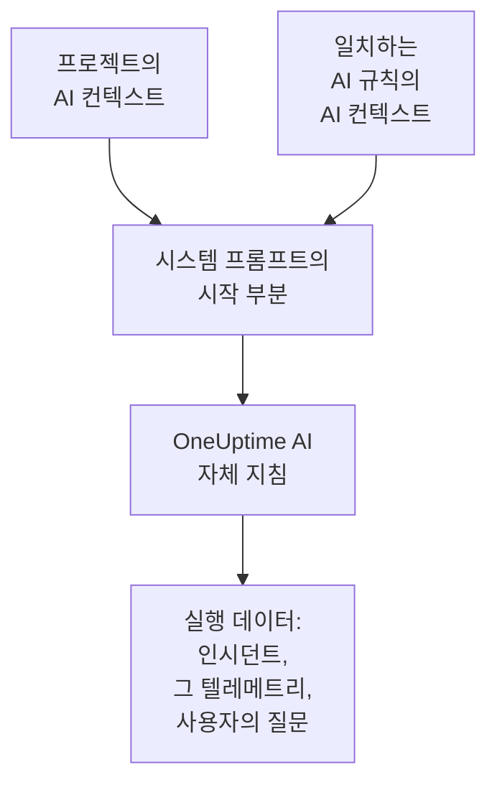

# AI 컨텍스트

AI 컨텍스트는 팀이 자신들의 시스템에 대해 OneUptime AI를 위해 적어 두는 내용입니다. 시스템이 서로 어떻게 연결되는지, 어떤 증상을 누가 맡는지, 로그가 어디 있는지, 팀이 쓰는 용어가 무엇인지를 적습니다. OneUptime AI는 모든 조사, 수정, 포스트모템 초안, AI에게 질문 대화에서 이것을 가장 먼저 읽으므로, 팀이 이미 아는 것에서 출발합니다.

:::cards
- [AI 컨텍스트 작성](#ai-컨텍스트-작성): 프로젝트 AI 설정에 있는 카드 하나입니다.
- [AI 규칙 자체의 메모](#ai-규칙-자체의-메모): 규칙 하나가 일치하는 대상에 대한 메모입니다.
- [이것을 읽는 기능](#이것을-읽는-기능): 이것을 읽는 기능과 읽지 않는 기능입니다.
- [실행이 읽은 내용](#실행이-읽은-내용): 모든 실행은 전달받은 메모를 보여 줍니다.
:::

## 작동 방식

OneUptime AI는 AI 컨텍스트를 시스템 프롬프트의 맨 앞, 자신의 지침과 실행 데이터보다 앞에 둡니다. 먼저 프로젝트의 메모, 그다음 일치하는 AI 규칙의 메모입니다. OneUptime AI는 이를 팀이 알려 주는 배경 지식으로 읽습니다. 지금 무슨 일이 일어나고 있는지에 대한 증거가 아니며, OneUptime AI 자체의 규칙을 바꾸지도 않습니다.

메모는 맨 앞에 오고 실행마다 바뀌지 않으므로, 공급자가 캐시하는 프롬프트 시작 부분에 포함됩니다. Anthropic의 경우 OneUptime이 시스템 프롬프트를 캐시 대상으로 표시하고, OpenAI, Azure OpenAI, 그리고 반복되는 프롬프트 시작 부분을 캐시하는 다른 공급자는 스스로 캐시합니다. 바뀌지 않은 메모는 다시 읽는 비용이 줄어듭니다.

## AI 컨텍스트 작성

:::steps
### AI Features 열기
**프로젝트 설정 → AI → AI Features** 를 엽니다. **AI 컨텍스트** 카드는 **AI 활성화** 아래에 있습니다.

### 메모 작성
**AI 컨텍스트 추가** 를 클릭하거나, 메모가 이미 있으면 **편집** 을 클릭합니다. Markdown으로 작성하거나, **개요로 시작** 을 클릭해 메모 종류마다 제목을 넣습니다.

### 저장
**변경 사항 저장** 을 클릭합니다. 카드에 메모와 그 길이, 모델이 대략 몇 토큰으로 읽는지가 표시됩니다.
:::

팀에 새로 합류한 사람에게 들려줄 내용을 적으세요:

| 메모 종류 | 예 |
| --- | --- |
| 시스템이 서로 연결되는 방식 | `checkout-api` 는 결제 페이지를 제공하고 `payments-db` 에 의존합니다. |
| 어떤 증상을 누가 맡는지 | 결제 페이지의 502는 결제 팀 담당입니다. 먼저 `payments-db` 를 확인하세요. |
| 로그 위치 | 결제 로그는 Loki의 `app=checkout` 아래에 있습니다. |
| 팀이 쓰는 용어 | PSP는 결제 대행 서비스를 뜻합니다. |

> [!WARNING]
> 비밀 정보는 적지 마세요. AI 실행이 한 일을 볼 수 있는 사람은 누구나 그 실행이 전달받은 메모를 읽을 수 있습니다.

## AI 규칙 자체의 메모

AI 규칙은 자신이 일치하는 인시던트나 알림에 대한 메모를 따로 가질 수 있습니다. 한 제품의 서비스, 담당자, 로그 위치 같은 내용입니다. 규칙의 **추가 필드** 에서 **LLM 제공자** 다음에 있는 **AI 컨텍스트** 에 적습니다. 매번 런북만 실행하는 규칙은 OneUptime AI에게 아무것도 묻지 않으므로 적을 AI 컨텍스트가 없습니다.

- 조사는 프로젝트의 메모를 읽은 다음, 인시던트나 알림에 일치하고 조사를 수행하는 활성화된 모든 AI 규칙의 메모를 규칙 이름 순서대로 읽습니다.
- 수정은 프로젝트의 메모를 읽은 다음, 자신을 시작한 규칙의 메모를 읽습니다.
- 인시던트나 알림에 대한 대화는 그 조사와 같은 메모를 읽습니다.

## 이것을 읽는 기능

| 기능 | 읽는 내용 |
| --- | --- |
| AI SRE 조사와, 새 알림이 열릴 때의 재확인 | 프로젝트의 메모와 일치하는 AI 규칙의 메모 |
| AI 규칙이 시작하는 수정: 그 계획, 명령, MCP 서버 | 프로젝트의 메모와 그 규칙의 메모 |
| AI에게 질문과, 인시던트나 알림에 대한 대화 | 프로젝트의 메모. 인시던트나 알림에서는 일치하는 AI 규칙의 메모도 |
| Slack과 Microsoft Teams에서의 답변 | 프로젝트의 메모 |
| 인시던트와 에피소드의 포스트모템 초안 | 프로젝트의 메모 |
| AI Insights 분류와 보안 케이스 분류 | 프로젝트의 메모 |

받은 내용을 바꿔 말하거나 평가하기만 하는 호출은 이것을 읽지 않습니다. 메모와 공개 메모의 초안, 통화 요약, 조사의 요약·확신도·평가, 대화 제목이 그렇습니다. 워크플로나 런북의 AI 단계처럼 사람이 직접 쓰는 프롬프트도 읽지 않습니다.

## 한도

| 대상 | 최대 |
| --- | --- |
| 프로젝트의 AI 컨텍스트 | 20,000자 |
| AI 규칙의 AI 컨텍스트 | 5,000자 |
| 실행 한 번이 읽는 AI 컨텍스트 전체 | 30,000자 |

양식은 입력하는 동안 글자 수를 세고 한도를 넘으면 저장을 거부하며, API도 마찬가지입니다. 실행은 먼저 프로젝트의 메모를 읽고, 그다음 일치하는 각 규칙의 메모를 이름 순서대로 읽습니다. 메모를 더하면 실행이 30,000자를 넘게 되는 규칙은 통째로 제외되며, 실행의 활동에 그 사실이 표시됩니다.

토큰 수는 추정값입니다. 메모의 UTF-8 바이트 수를 4로 나누고 올림한 값입니다. 모델마다 토큰을 세는 방식이 달라서 공급자가 센 값과 다를 수 있으며, 영어가 아닌 텍스트에서 특히 차이가 큽니다.

## 실행이 읽은 내용

모든 실행은 읽은 메모를 한 글자도 빠짐없이 기록합니다. 실행의 활동에는 **프로젝트의 AI 컨텍스트를 읽었습니다** 또는 몇 개의 AI 규칙 메모를 함께 읽었는지가 대략적인 토큰 수와 함께 표시됩니다. **보기** 를 누르면 실행이 읽은 그대로 메모가 열립니다. 먼저 프로젝트의 메모, 그다음 각 규칙의 메모가 규칙 이름 아래에 표시되며, 이후에 메모가 바뀌었더라도 그대로입니다. 실행의 한도 때문에 규칙의 메모가 제외되었으면 경고가 그 사실을 알려 줍니다.

## 변경할 수 있는 사람

- **Project Owner** 와 **Project Admin** 은 프로젝트의 AI 컨텍스트를 변경할 수 있습니다. **Project Member**, **Viewer**, **Read Project** 는 읽을 수 있습니다.
- AI 규칙의 메모는 규칙의 일부입니다. 규칙을 변경할 수 있는 사람은 그 메모도 변경할 수 있습니다.
- 메모는 자신의 프로젝트에서만 읽힙니다. 어떤 실행도 다른 프로젝트의 AI 컨텍스트를 읽지 않습니다.

API나 Terraform에서는 프로젝트의 메모가 프로젝트의 `aiContext` 이고, AI 규칙의 메모는 그 규칙 자체의 `aiContext` 입니다.

## 다음 단계

:::cards
- [AI SRE](/docs/ai/ai-sre): 새 인시던트와 알림을 모두 OneUptime AI가 조사하게 하세요.
- [AI에게 질문](/docs/ai/ask-ai): 대화로 프로젝트의 데이터에 대해 물어보세요.
- [LLM 공급자](/docs/ai/llm-provider): 메모를 읽는 모델을 고르세요.
:::
