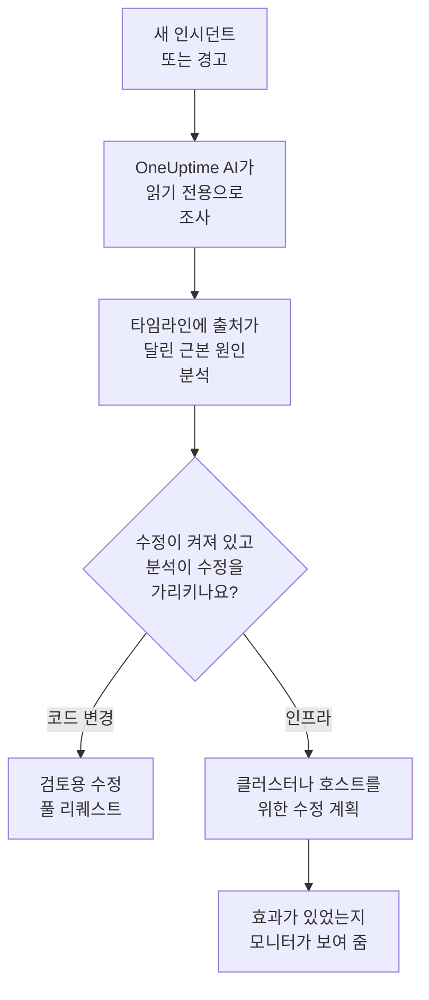
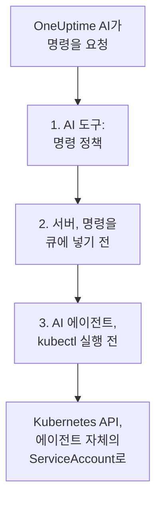

# AI SRE

OneUptime AI는 여러분의 AI 사이트 신뢰성 엔지니어입니다. 새 인시던트나 경고가 선언되는 순간 깨어나서, 여러분의 텔레메트리(로그, 메트릭, 트레이스, 예외, 모니터, 최근 변경 사항)로 조사하고, 출처가 달린 근본 원인 분석을 인시던트나 경고의 타임라인에 게시합니다. 대개 온콜 엔지니어가 호출 내용을 다 읽기도 전에 끝납니다.

분석의 모든 주장에는 그 주장을 뒷받침하는 정확한 데이터로 바로 연결되는 출처가 붙어 있으며, 조사 자체는 **엄격하게 읽기 전용** 입니다. 조사하는 동안 OneUptime AI는 프로젝트의 어떤 것도 바꿀 수 없습니다.

:::cards
- [작동 방식](#작동-방식): 새 인시던트에서 출처가 달린 분석까지, 그리고 허용하면 수정까지.
- [AI 조사 활성화](#ai-조사-활성화): 스위치와 그 스위치에 필요한 것.
- [클러스터 액세스 — OneUptime AI가 kubectl을 실행하게 하기](#클러스터-액세스-oneuptime-ai가-kubectl을-실행하게-하기): Kubernetes 안에서 조사하고 수정합니다.
- [비용 관리](#비용-관리): 인시던트, 경고, 프로젝트 전체에 대한 한도.
:::

## 작동 방식

OneUptime AI는 새 인시던트나 경고에 대해 세 가지 일을 하며, 각각 전용 스위치가 있습니다:

- **조사합니다** (기본값 켜짐). 텔레메트리와 AI 에이전트가 실행되는 클러스터와 호스트를 읽고, 출처가 달린 근본 원인 분석을 게시합니다. 조사는 아무것도 바꾸지 않습니다.
- **수정합니다** (기본값 꺼짐). 수정이 켜져 있으면 확신 있는 분석이 수정이 됩니다. 코드 변경을 위한 풀 리퀘스트, 또는 클러스터나 호스트를 위한 명령 계획이며, 그 클러스터나 호스트의 AI 에이전트가 허용하는 방식으로 실행됩니다.
- **학습합니다.** AI Insights 페이지는 기록된 모든 것에서 찾아낸, 계속 잘못되는 일을 알려 줍니다.



원인을 찾지 못한 분석은 아무도 호출하지 않고 조용히 게시되며([조용한 모드](#조용한-모드) 참고), 원인이 없으면 아무것도 수정되지 않습니다.

## 조사가 게시하는 내용

조사가 끝나면 OneUptime AI는 다음 섹션으로 구성된 근본 원인 분석을 게시합니다:

- **Summary** — 호출받은 엔지니어가 5초 안에 읽을 수 있는 한두 문장.
- **Most likely root cause** — 증거가 뒷받침하는 만큼의 확신만 담은 가설로, 사실에 관한 주장마다 출처가 붙습니다. 텔레메트리가 부족하면 AI는 추측하는 대신 그렇다고 분명히 말하고 확인한 내용을 나열합니다.
- **Evidence** — 가설을 뒷받침하거나 배제하는 핵심 발견 사항으로, 각각 출처가 붙습니다.
- **Suggested next steps** — 온콜 엔지니어를 위한 구체적인 조치.

인시던트의 경우 분석은 인시던트 피드 **와** 인시던트 내부 메모(대응자들이 협업하는 곳)로 게시됩니다. 경고의 경우 경고 피드에 게시됩니다.

조사가 실행되는 동안 인시던트나 경고 페이지에는 각 단계를 설명하는 실시간 **AI Investigation** 패널이 표시됩니다. 어떤 도구가 실행되었는지, 무엇을 찾았는지, 얼마나 걸렸는지 보여 주므로 생각하는 과정을 지켜볼 수 있습니다. 조사가 실패하면 패널은 조용한 공백 대신 실패 이유를 보여 줍니다.

조사는 끝날 때까지 실행됩니다. **시간 제한이 없고** 작은 쿼리 예산도 없으므로, 필요한 모든 쿼리와 kubectl 또는 인프라 명령을 실행할 수 있습니다. 긴 명령 출력(바쁜 노드의 `kubectl describe node`, 파드의 로그)은 절대 잘리지 않으며, OneUptime AI는 한 번에 한 페이지씩 읽습니다. 확실하게 멈추고 싶다면 신호 유형마다 **조사 시간 제한** 을 설정하세요(아래 **비용 관리** 참고).

## 조사가 읽는 것

조사는 인시던트나 경고, 그리고 그것이 연결된 인프라에서 시작합니다. 모니터가 감시하는 호스트, Docker 및 Podman 호스트, Kubernetes 클러스터, 데이터베이스, 서비스입니다. 웹사이트, API 또는 합성 모니터는 **모니터 → 개요 → 연결된 리소스** 에서 연결한 대상을 감시하므로, 확인 대상을 제공하는 호스트에 연결해 두면 해당 인시던트의 모든 조사가 거기서 시작됩니다. 이 모든 것보다 먼저, 조사는 프로젝트의 [AI 컨텍스트](/docs/ai/ai-context)를 읽습니다. 팀이 자신들의 시스템에 대해 OneUptime AI를 위해 적어 둔 내용이며, 일치하는 AI 규칙의 메모도 함께 읽습니다.

- 인시던트 전 30분 동안 그 인프라에서 발생했거나 아직 열려 있는 경고를 최신순으로 읽습니다. 느린 사이트 뒤에 있는 호스트의 높은 CPU 경고 같은 것입니다. 비공개 경고는 제외됩니다.
- 인프라 자체의 메트릭을 사람이 읽는 방식으로 읽습니다. `system.cpu.utilization` 및 `system.memory.utilization` 같은 호스트 메트릭은 상태별로 한 번씩 보고되고 상태를 모두 더하면 100%이므로, 전체를 하나로 평균하면 아무 의미가 없습니다. OneUptime AI는 이를 상태별로 하나씩 읽고(사용 중인 CPU는 user와 system의 합), 어떤 메트릭이든 컨테이너별, 마운트 지점별 또는 다른 속성별로 읽습니다.
- Docker 또는 Podman 호스트의 컨테이너: CPU, 메모리 또는 재시작이 가장 많은 컨테이너와 보고를 멈춘 컨테이너입니다. 멈춘 컨테이너는 0 대신 아무것도 보내지 않으므로 호스트 전체의 수치에서는 보이지 않습니다.
- 인시던트나 경고 전 2시간 동안 기록된 변경(배포, Kubernetes 롤아웃, 구성 변경, OneUptime이 실행한 수정)과, 그중 서비스의 텔레메트리로 보아 의심 대상이 되는 변경을 읽습니다. 의심 대상은 변경 직후 서비스가 눈에 띄게 나빠진 경우입니다. [배포 및 변경 사항](/docs/telemetry/change-events)을 참조하세요.

**AI Investigation** 카드의 조사 활동은 열려 있거나 최근에 발생한 경고를 몇 개 읽었는지, 어떤 리소스에서 읽었는지 알려 줍니다.

### 새 경고가 발생하면 다시 확인

조사는 인시던트가 선언되는 순간 시작되며, 몇 분 분량의 메트릭이 필요한 호스트 경고는 그 뒤에 발생할 수 있습니다. 인시던트 후 30분 이내에, 조사가 인프라를 읽은 뒤 인시던트의 연결된 인프라에서 경고가 발생하고 인시던트가 아직 열려 있으면, OneUptime AI는 그 경고를 가지고 인시던트를 한 번 더 확인합니다. 새 분석은 **Checked again** 과 확인을 촉발한 경고로 시작하며, 활동에도 그렇게 표시됩니다. AI 규칙 때문에 OneUptime AI가 인시던트를 조사하기 전에 대기했다면, 이 시간은 대신 그 조사가 끝난 시점부터 셉니다([조사 전 대기](#조사-전-대기) 참고).

이 확인은 인시던트당 최대 한 번이며, 새 조사와 같은 스위치와 한도를 따릅니다. **AI 활성화**, _새 인시던트 조사_, AI 크레딧, 일일 한도와 동시 실행 한도입니다. 켜야 할 것은 없습니다. 후속 확인은 자동 복구를 다시 실행하지 않고 그 자체가 다시 확인되지도 않으며, 경고의 조사는 다시 확인되지 않습니다.

## 인시던트에 대해 OneUptime AI와 대화하기

**AI Investigation** 카드는 인시던트나 경고를 볼 수 있는 모든 사람이 함께 쓰는 대화 **Ask OneUptime AI** 로 끝납니다. 위에서 무슨 일이 있었든 카드는 하나입니다. 보고서 아래에서는 후속 질문을 하고, 자동 조사가 실행되지 않았거나 보고 전에 멈춘 경우 첫 번째 제안은 **What is the root cause?** 이며, 이것으로 OneUptime AI가 요청에 따라 조사합니다.

- **후속 질문하기** — "메모리를 가장 많이 쓰는 파드는?", "이 일이 시작되기 직전에 무엇이 바뀌었지?", "다른 영향을 받는 것이 있나?". OneUptime AI는 자신의 보고서를 바탕으로 새 데이터를 조회하고(액세스 권한이 있는 곳에서는 여러분이 볼 수 있는 클러스터와 리소스에서 읽기 전용 kubectl 또는 인프라 명령을 실행하고), 모든 주장에 출처를 답니다.
- **작업 요청하기** — "이 인시던트를 확인 처리해 줘", "조사 중이라는 상태 업데이트를 게시해 줘", "데이터베이스 온콜을 호출해 줘", "심각도를 올려 줘". AI에게 질문 과 같은 작업을 사용하며 항상 **여러분 자신의 권한으로** 작업하므로, 여러분이 할 수 있는 것보다 더 많은 일을 할 수는 없습니다.
- **작업 방식 선택하기** — 메시지 상자의 스위치로 선택하며, 옆에 선택한 모드의 의미가 표시됩니다: _Auto-run_ (기본값. 명확한 요청에는 바로 작업합니다), _Ask to act_ (먼저 승인 카드를 보여 주며, 인시던트의 누구나 승인하거나 거부할 수 있습니다), 또는 _읽기 전용_.
- **하나의 공유 스레드.** 질문마다 누가 했는지 표시되고, 모두가 같은 대화를 실시간으로 보며, 누구나 진행 중인 답변을 멈출 수 있습니다. 답변의 차트와 표는 질문한 사람에게 표시되고, 다른 사람들은 출처가 달린 답변을 봅니다. 각 답변에는 **소스**가 나열되며, 자체 페이지가 있는 출처(로그, 메트릭, 모니터)는 그 페이지를 엽니다. 긴 스레드는 최신 메시지에서 열리고, 그 위의 버튼(예: **Show 6 earlier messages**)으로 나머지를 다시 불러옵니다.

AI가 꺼져 있어서 OneUptime AI가 조사도 수정도 하지 않은 인시던트나 경고는 대신 한 줄짜리 카드가 됩니다: **AI 조사가 꺼져 있습니다** (프로젝트의 AI가 아직 꺼져 있는 동안에는 **이 프로젝트에서 AI가 꺼져 있습니다** , 다시 켜진 뒤에는 **AI 조사가 꺼져 있었습니다** )와 그 이유입니다. 이유는 프로젝트에서 AI가 꺼짐, 생성 시 _새 인시던트 조사_ (또는 경고용)가 꺼짐, 조사하는 AI 규칙과 일치하지 않음, 또는 심각도가 최소 기준보다 낮음 중 하나입니다. 화살표 **할 수 있는 일** 을 열면 무엇을 켜야 하는지, 변경할 수 있는 사람에게는 변경하는 곳으로 가는 링크, 그 밖의 사람에게는 누가 변경할 수 있는지가 표시되며, 변경은 새 인시던트와 경고에만 적용되고 이 인시던트에는 적용되지 않습니다. AI가 켜져 있는 동안 줄의 **Ask OneUptime AI** 는 대화를 열고, 누군가 이미 시작한 대화는 줄 아래에 저절로 표시됩니다. 그때 **해결** 카드는 표시되지 않습니다: 줄이 아무것도 수정되지 않은 이유를 알려 줍니다.

## AI 조사 활성화

자율 조사는 **새 프로젝트에서 기본적으로 켜져 있습니다**. 포스트모템 초안과 AI Insights도 마찬가지입니다. 수정은 꺼진 상태로 시작하며, 수정에 포함된 풀 리퀘스트는 수정이 켜져 있는 동안에만 열립니다([자동 코드 수정](#자동-코드-수정) 참고). 이 기본값 이전에 만든 프로젝트는 기존 설정을 유지합니다. 3단계처럼 조사를 켜거나, 아무 Kubernetes 클러스터의 **AI 에이전트** 페이지에서 **켜기** 로 켭니다(Project Owner 또는 Project Admin). 확인하거나 변경하려면:

:::steps
1. **LLM 공급자를 구성합니다.** 셀프 호스팅 설치는 자체 키를 사용합니다(또는 로컬 Ollama로 완전히 격리된 환경에서 실행합니다) — [LLM 공급자](/docs/ai/llm-provider) 를 참고하세요. OneUptime Cloud 사용자는 미리 구성된 글로벌 공급자를 사용할 수 있으며, 이는 사용량 기반 AI 토큰으로 청구되므로 프로젝트에 AI 크레딧이 필요합니다. 프로젝트 소유자나 **Manage Billing** 권한이 있는 사람이 **프로젝트 설정 → AI → AI 크레딧** 에서 추가하며, 그곳의 **자동 충전** 으로 크레딧이 떨어지지 않게 할 수 있습니다.
2. **프로젝트에 AI가 활성화되어 있는지 확인합니다** (기본적으로 활성화되어 있습니다): **프로젝트 설정 → AI → AI Features** 의 **AI 활성화**.
3. **신호 유형별로 선택합니다** (새 프로젝트에서는 둘 다 켜짐):
   - 인시던트: **인시던트 → AI → 설정** — _새 인시던트 조사_ 를 켭니다.
   - 경고: **경고 → AI → 설정** — _새 경고 조사_ 를 켭니다.
:::

이 페이지의 각 AI 동작은 전환하는 즉시 저장되는 스위치이며, 저장 버튼은 없습니다. 인시던트 페이지에는 **OneUptime AI가 하는 일** 아래에 세 가지가 있습니다: _새 인시던트 조사_, _새 인시던트 자동 수정_, _인시던트가 해결되면 포스트모템 초안 작성_. 경고 페이지에도 포스트모템을 뺀 같은 스위치가 있습니다. _새 인시던트 자동 수정_ (과 _새 경고 자동 수정_) 은 새 프로젝트에서도 **꺼짐** 으로 시작합니다. OneUptime AI가 인프라를 바꾸게 하는 스위치이므로 프로젝트가 직접 켭니다 — [조사하고 수정하는 인시던트](#조사하고-수정하는-인시던트) 를 참고하세요. 수정이 여는 풀 리퀘스트, 즉 코드 수정과 조사에서 부족했던 텔레메트리도 수정에 포함되며, AI 규칙마다 정합니다. 규칙이 없으면 둘 다 열리고, 규칙은 **추가 필드** 에서 어느 쪽이든 끌 수 있습니다([자동 코드 수정](#자동-코드-수정) 참고). Project Owners와 Project Admins는 이 스위치를 바꿀 수 있으며, 그 밖의 사람에게는 각 스위치가 잠겨 있고 필요한 권한이 표시됩니다.

이 페이지는 두 가지를 사실일 때만 알려 줍니다. **AI 활성화** 가 꺼져 있으면 페이지에서 아무것도 실행되지 않으며, 페이지 상단에 그 사실이 표시되고, 변경할 수 있는 사람(Project Owners와 Manage Billing 권한이 있는 모든 사람)에게는 AI 활성화 스위치 자체가 함께 표시됩니다. 그 밖의 사람에게는 누가 바꿀 수 있는지가 표시됩니다. OneUptime AI가 사용할 수 있는 LLM 공급자가 프로젝트에 없으면(전혀 없거나, 공급자는 있지만 기본값으로 설정된 것이 없으면) 페이지에 그 사실도 **프로젝트 설정 → AI → LLM 공급자** 링크와 함께 표시됩니다. OneUptime Cloud에서는 글로벌 공급자가 포함되므로 아무것도 표시되지 않습니다.

인시던트와 경고는 독립적으로 구성되므로, 신호 유형마다 고유한 동시 실행 한도, 일일 토큰 예산, 수정 작업 예산, 고유한 규칙을 지정할 수 있습니다. 이 한도는 설정하기 전까지 적용되지 않으며, 각 페이지 아래쪽의 **추가 설정** 에 접혀 있습니다. 아래 **비용 관리** 를 참고하세요. 경고의 AI 설정을 바꿔도 해당하는 인시던트 설정은 바뀌지 않으며, 그 반대도 마찬가지입니다.

수정은 조사를 바탕으로 합니다. **새 인시던트 자동 수정** (또는 경고용) 이 켜져 있는 동안 저장소의 코드 변경을 확신 있게 찾아낸 조사는 수정 풀 리퀘스트를 자동으로 엽니다 — 아래 **자동 코드 수정** 을 참고하세요.

## 클러스터 액세스 — OneUptime AI가 kubectl을 실행하게 하기

기본적으로 조사는 에이전트가 보내는 텔레메트리만 사용할 수 있습니다. Kubernetes 신호에는 이것만으로 부족한 경우가 많습니다. "Pending 상태에 멈춘 파드"는 메트릭을 보는 것이 아니라 파드를 describe하고 이벤트를 읽어서 진단하는 스케줄링 문제입니다. **Kubernetes AI 에이전트** 는 OneUptime AI가 바로 그 일을 하게 하고, 허용하면 찾은 것을 수정하게 합니다.

각 클러스터 페이지의 사이드 메뉴에는 **AI** 섹션이 있습니다:

- **에이전트** — 클러스터의 **AI 에이전트** 페이지: 에이전트가 연결되어 있는지, 클러스터에서 AI가 무엇을 할 수 있는지, 주의가 필요한 모든 것을 각각 해결하는 단계와 함께 보여 줍니다. AI가 OneUptime 데이터만으로 조사해야 했을 때는 같은 설명이 인시던트의 조사 패널에도 표시됩니다.
- **인사이트** — 클러스터의 **AI Insights** 페이지: OneUptime AI가 클러스터에 대해 알아낸 것, 즉 계속 잘못되는 일과 그 이유, 그리고 해결 방법입니다([AI가 클러스터에서 배운 것](#ai가-클러스터에서-배운-것) 참고).
- **로그** — 클러스터의 **AI 로그** 페이지: OneUptime AI가 클러스터에서 한 모든 일을 최신순으로 보여 줍니다([AI가 클러스터에서 한 모든 일](#ai가-클러스터에서-한-모든-일) 참고).

클러스터의 **개요** 는 AI 에이전트 페이지를 요약한 **AI 에이전트** 카드로 끝납니다: 에이전트가 연결되어 있는지, **kubectl로 조사** 가 켜져 있는지, 수정이 어떻게 실행되는지(**꺼짐**, **승인 요청**, **자동**, **승인 건너뛰기**), 무엇에 주의가 필요한지를 보여 주며, 이를 변경하는 AI 에이전트 페이지로 연결됩니다.

### Kubernetes AI 에이전트 — 기본값 켜짐, 읽기 전용

[OneUptime Kubernetes 에이전트](/docs/telemetry/kubernetes-agent) 차트는 기본적으로 Kubernetes AI 에이전트를 실행합니다. **읽기 전용** ServiceAccount를 가진 작은 파드 하나(`component=ai-agent`, 이미지 `oneuptime/kubernetes-ai-agent`)입니다. 차트가 이미 사용하는 API 키로 연결하므로 대시보드에서 설정할 것이 없습니다. 1분 안에 클러스터의 AI 에이전트 페이지에 **연결됨** 으로 표시되고 **kubectl로 조사** 가 켜집니다. 단, 누군가 이미 그곳에서 클러스터의 AI 설정을 골랐다면 그 설정이 그대로 유지됩니다.

Kubernetes AI 에이전트가 나오기 전에 설치한 에이전트에서는 먼저 차트 인덱스를 새로 고친 다음 업그레이드합니다:

```bash
helm repo update
helm upgrade kubernetes-agent oneuptime/kubernetes-agent \
  --namespace oneuptime-agent --reset-then-reuse-values \
  --set aiAgent.enabled=true
```

`kubernetes-agent` 와 `oneuptime-agent` 는 대시보드의 설치 안내가 사용하는 릴리스 이름과 네임스페이스입니다. 다른 이름으로 에이전트를 설치했다면 그 이름을 사용하세요(`helm list -A | grep kubernetes-agent` 로 확인할 수 있습니다). `helm repo update` 없이 업그레이드하면 Helm이 설치할 때 쓴 차트를 사용할 수 있으며, 그 차트는 `aiAgent` 를 몰라서 `Additional property aiAgent is not allowed` 로 실패합니다. 셀프 호스팅 OneUptime에서는 차트보다 OneUptime을 먼저 업그레이드하세요 — [에이전트 업그레이드](/docs/telemetry/kubernetes-agent#에이전트-업그레이드) 를 참고하세요. AI 에이전트 없이 차트를 실행하려면 `--set aiAgent.enabled=false` 를 전달합니다.

AI 에이전트 페이지에서 에이전트 상태 옆의 **⋯** 메뉴에 있는 **연결 테스트** 는 에이전트를 통해 `kubectl version` 과 `kubectl auth can-i --list` 를 실행하고 결과를 보여 줍니다. 무엇에 닿을 수 있고 무엇을 할 수 있는지 알 수 있습니다. 페이지에 에이전트가 연결되지 않았다고 표시되면 `kubectl logs -n oneuptime-agent -l component=ai-agent --tail=100` 으로 로그를 읽으세요. **Pinned Service Name** 이 설정된 키로는 에이전트를 등록할 수 없으므로, 그것이 없는 키를 차트에 주세요. 서버가 등록을 거부하면 로그에 그 거부가 저절로 해소되는지(아직 보고 중인 이전 에이전트 파드, 또는 업그레이드 중 아직 종료 중인 이전 클러스터 내 Runner), 아니면 무엇을 바꿔야 하는지가 표시됩니다. 같은 메뉴의 **에이전트 재설정** 은 확인하면 서버가 에이전트의 키를 잊게 하며, 파드는 몇 분 안에 저절로 다시 연결됩니다.

Kubernetes AI 에이전트는 Runner가 아니며 런북 → Runbook 에이전트 아래에 나타나지 않습니다. 항상 자신의 ServiceAccount만 사용하므로 OneUptime이 자격 증명을 넘겨주는 일이 없고, 런북의 Bash/SSH 호스트로 사용되지 않으며, AI 규칙의 명령 Runner로 받아들여지지도 않습니다.

### AI가 할 수 있는 작업 — 에이전트가 설정

OneUptime AI가 클러스터에서 할 수 있는 작업은 에이전트가 실행되는 곳, 즉 차트에서 두 값으로 설정합니다:

- `aiAgent.investigation` — `true`: AI는 조사하는 동안 클러스터에서 읽기 전용 kubectl을 실행할 수 있습니다. `false`: OneUptime이 이미 가진 데이터로 계속 조사합니다.
- `aiAgent.fixes` — AI가 수정을 적용하는 방식: `off`, `ask-for-approval`, `automatic`, `bypass-approval`([수정 작동 방식](#수정-작동-방식) 참고). `off` 를 제외한 모든 수준은 AI 에이전트에 쓰기 액세스를 줍니다. `off` 에서는 쓰기 액세스가 없으며 에이전트가 직접 모든 쓰기를 거부합니다.

AI 에이전트는 하트비트마다 두 값을 OneUptime에 보고하고, OneUptime은 이를 클러스터에 적용합니다. 클러스터의 AI 에이전트 페이지에 있는 **AI가 할 수 있는 작업** 은 이 값을 보여 주지만(**켜짐** 과 수정 수준, 켜져 있으면 녹색) 그곳에서 바꿀 방법은 없습니다. **변경** 은 각 옵션을 설정하는 정확한 `helm upgrade` 와 함께 보여 줍니다. 에이전트가 값을 설정하는 동안에는 AI 에이전트 페이지, API, Terraform 등 다른 곳에서 한 변경이 거부됩니다.

두 값을 모두 설정하지 않은 릴리스는 에이전트가 기본값을 사용하게 합니다(조사 켜짐, 수정 꺼짐, 또는 이전 `aiAgent.remediation.enabled=true` 가 있으면 ask-for-approval). OneUptime은 아무도 AI 에이전트 페이지에서 AI 설정을 고르지 않은 클러스터에만 이 기본값을 적용합니다. 그곳에서 고른 설정은 그대로 유지되며, 페이지에는 그 설정을 차트로 옮기는 명령이 표시됩니다. AI 에이전트가 너무 오래되어 값을 보고하지 못하는 클러스터도 마찬가지이며, 두 값을 넣어 차트를 업그레이드하면 옮겨집니다.

### AI가 찾은 것을 수정하게 하기

수정은 `aiAgent.fixes` 로 켜기 전까지 꺼져 있으며, 이 값은 AI 에이전트에 쓰기 액세스도 줍니다. 가능하면 AI가 수정해도 되는 네임스페이스로만 한정하고 노드 작업은 끄세요:

```bash
helm repo update
helm upgrade kubernetes-agent oneuptime/kubernetes-agent \
  --namespace oneuptime-agent --reset-then-reuse-values \
  --set aiAgent.enabled=true \
  --set aiAgent.investigation=true \
  --set aiAgent.fixes=ask-for-approval \
  --set "aiAgent.remediation.namespaces={web,api}" \
  --set aiAgent.remediation.nodeOperations=false
```

또는 클러스터 전체에:

```bash
helm repo update
helm upgrade kubernetes-agent oneuptime/kubernetes-agent \
  --namespace oneuptime-agent --reset-then-reuse-values \
  --set aiAgent.enabled=true \
  --set aiAgent.investigation=true \
  --set aiAgent.fixes=ask-for-approval \
  --set-json 'aiAgent.remediation.namespaces=[]'
```

`{web,api}` 를 AI가 수정해도 되는 네임스페이스로 바꾸세요. 목록의 모든 네임스페이스는 이미 존재해야 합니다. 차트는 각 네임스페이스에 RoleBinding을 하나씩 만들지만 네임스페이스를 만들지는 않으므로, 하나라도 없으면 설치나 업그레이드 전체(수집기 포함)가 `namespaces "api" not found` 로 실패합니다. 먼저 만들거나 목록에서 빼세요. 네임스페이스를 삭제하기 전에는 목록에서 빼세요. 업그레이드할 때 플래그를 생략하면 릴리스에 저장된 목록이 유지되므로, 클러스터 전체로 돌아가려면 두 번째 명령처럼 `--set-json 'aiAgent.remediation.namespaces=[]'` (Helm 3.10+) 를 전달하세요. `={}` 는 안 됩니다. Helm은 이것을 빈 이름 하나로 읽고 차트가 거부합니다. `--set aiAgent.remediation.namespaces=null` 은 `--reuse-values` 에서 저장된 목록을 초기화하지 않으며, Helm은 저장된 목록을 유지합니다. `aiAgent.remediation.nodeOperations=false` 는 수정을 노드에서 멀리 둡니다. AI가 노드를 cordon, uncordon, drain하고 taint를 걸 수 있게 하려면 `true` 로 설정하세요(노드의 drain, taint, patch는 여전히 사람을 기다립니다).

더 많은 자율성을 원하면 `ask-for-approval` 대신 `automatic` 또는 `bypass-approval` 을 사용하고, 수정을 다시 끄려면 `--set aiAgent.fixes=off` 를 사용하세요. 그러면 쓰기 액세스도 제거됩니다. 수정에는 프로젝트 스위치 두 개도 필요합니다. **새 인시던트 자동 수정** (**인시던트 → AI → 설정** 에 있음) 과 **새 경고 자동 수정** (**경고 → AI → 설정** 에 있음) 은 꺼진 상태로 시작하며, 둘 중 하나가 켜지기 전까지 그 종류의 새 항목은 수정되지 않습니다. **AI 활성화** (**프로젝트 설정 → AI → AI Features**) 는 누군가 끄지 않는 한 켜져 있으며, 에이전트 구성과 상관없이 프로젝트의 모든 AI를 끕니다.

### 클러스터의 수정이 적용되는 인시던트

**새 인시던트 자동 수정** 이 켜져 있고 AI 규칙이 하나도 없으면, OneUptime AI는 클러스터가 연결된 모든 새 인시던트를 그 AI 에이전트 페이지가 설정한 모드로 수정합니다. 경고도 **새 경고 자동 수정** 으로 마찬가지입니다. 규칙이 있으면 OneUptime AI로 수정하는 규칙과 일치하는 인시던트만 수정합니다([조사하고 수정하는 인시던트](#조사하고-수정하는-인시던트) 참고). 연결되지 않은 것은 원인이 아무리 분명히 클러스터에 있어도 건드리지 않습니다. 인시던트나 경고가 클러스터에 연결되는 경우는 다음과 같습니다:

- 발생 원인이 된 텔레메트리가 클러스터를 가리킬 때(클러스터의 데이터에 대한 메트릭, 로그, 트레이스 모니터);
- 모니터가 그 클러스터의 Kubernetes 모니터일 때;
- 모니터가 **모니터 → 개요 → 연결된 리소스** 에서 클러스터에 연결되어 있을 때 — 웹사이트, API, 합성 모니터를 그 모니터가 확인하는 대상을 제공하는 클러스터에 연결하는 방법입니다;
- 누군가 선언할 때 **기타 영향받는 리소스** 에서 클러스터를 골랐을 때(연결된 모니터를 고르면 그곳에 자동으로 추가됩니다).

각 인시던트와 경고는 **해결** 카드에 클러스터에 연결되었는지와 클러스터의 수정이 무엇을 했는지 표시합니다. [자동 해결이 한 일](#자동-해결이-한-일) 을 참고하세요. 인프라 리소스와 그 AI 에이전트도 마찬가지입니다.

### 누가 변경할 수 있는가

Kubernetes AI 에이전트가 조사와 수정을 설정하는 동안에는 클러스터에서 차트 값을 바꿀 수 있는 사람이 그것을 바꾸며, OneUptime은 다른 곳에서 한 변경을 거부합니다. 아래 규칙은 OneUptime에 남는 것(kubectl 허용 목록, 클러스터의 이전 클러스터 내 Runner와의 연결)과, 설정이 아직 OneUptime에서 이루어지는 클러스터의 조사와 수정에 적용됩니다([AI가 할 수 있는 작업 — 에이전트가 설정](#ai가-할-수-있는-작업-에이전트가-설정) 참고).

수정을 켜는 것(**꺼짐** 에서 다른 모드로 바꾸는 모든 경우)과 완화하는 것(**자동** 또는 **승인 건너뛰기** 로 전환, kubectl 허용 목록 작성, Runner 연결)에는 Project Owner, Project Admin 또는 **Edit AI Rule** 권한이 필요합니다. 승인 없이 수정하는 AI 규칙을 만들 수 있는 사람과 같습니다. **에이전트 재설정** 에는 수정을 켜는 것과 같은 사람이 필요합니다. 강화하는 것(**꺼짐**, **승인 요청** 으로 되돌리기, 허용 목록이나 Runner 연결 비우기)은 클러스터를 편집할 수 있는 누구나 할 수 있으며, **연결 테스트** 와 OneUptime AI가 그 클러스터에 제안한 수정을 승인하는 것도 마찬가지입니다. 이 모든 것에는 바로 그 클러스터를 편집할 권한이 필요합니다. 일부 라벨이나 본인 또는 본인 팀이 소유한 클러스터로 제한된 권한은 그 클러스터에만 미치며, 라벨이 있는 차단 항목은 그 라벨이 붙은 클러스터를 제외합니다.

### 조사가 실행할 수 있는 것

액세스 권한이 있으면 조사는 AI 에이전트를 통해 **읽기 전용** kubectl(`get`, `describe`, `logs`, `events`, `top`, `rollout status/history`, `auth can-i`)을 필요한 만큼 실행하고, 다른 증거와 마찬가지로 각 명령에 출처를 답니다. 출력은 절대 잘리지 않습니다. 에이전트는 최대 1메가바이트를 보관하고, OneUptime AI는 긴 출력을 한 번에 한 페이지씩 읽습니다. 세 가지 독립적인 검사가 읽기 전용을 유지합니다: 모든 명령을 분류하는 정책, 조사를 위해 다른 것은 큐에 넣지 않는 서버, 그리고 kubectl을 시작하기 전에 같은 정책을 다시 확인하는 AI 에이전트입니다. "읽기 전용 — 시스템에서 아무것도 변경되지 않았습니다"는 문자 그대로 사실로 남습니다.



### 수정 작동 방식

AI 에이전트 페이지의 **수정** 에는 네 가지 설정이 있습니다(차트의 `aiAgent.fixes`: `off`, `ask-for-approval`, `automatic`, `bypass-approval`):

- **꺼짐** — AI는 조사만 합니다.
- **승인 요청** — 근본 원인 분석 후 OneUptime AI는 kubectl로 진단하고 원인을 해결하는 가장 작은 kubectl 계획을 만듭니다. 예를 들면 `kubectl rollout restart deployment/web -n web` 입니다. 계획은 근거, 예상 효과, 롤백과 함께 인시던트에 표시되며, 사람이 한 번의 클릭으로 승인하면 OneUptime은 정확히 그 명령을 실행합니다. 모니터가 회복되지 않으면 롤백이 실행되고, OneUptime AI는 실패한 시도를 참고해 계획을 하나 더 만들어(역시 승인 필요) 다른 접근을 택하거나 사람이 무엇을 살펴봐야 하는지 알려 줍니다.
- **자동** — 안전한 변경은 자동으로 실행되고, 더 위험한 변경은 절대 자동으로 실행되지 않습니다. 한 라운드에서 더 위험한 수정만 찾았다면, 바로 그것을 한 번의 클릭으로 승인하도록 제안하며 끝납니다. 안전한 수정도 실행했다면 더 위험한 수정은 분석에 남고, 안전한 수정으로 모니터가 회복되지 않았음이 검증에서 확인될 때만 승인을 요청하는 후속 라운드에서 제안됩니다. 더 위험한 명령의 형태를 AI 에이전트 페이지의 허용 목록에 넣으면 그 명령도 자동으로 실행됩니다. 자동 모드는 검증에서 모니터 회복이 확인되면 신호도 해결하며, 클러스터당 시간당 무인 수정 세 번이라는 회로 차단기가 있습니다. 이를 넘거나, OneUptime AI의 다른 무인 라운드가 아직 같은 클러스터를 변경하거나 검증하는 동안에는 라운드가 계획을 실행하지 않고 승인을 위해 제안합니다.
- **승인 건너뛰기** — AI가 묻지 않습니다. 정책이 허용하는 모든 변경이 더 위험한 것까지 포함해 자동으로 실행되며, 검증이 실패한 후의 후속 라운드도 마찬가지입니다. 검증에서 회복이 확인되면 신호는 저절로 해결됩니다. 어느 모드에서든 사람이 필요한 것(아래)은 여전히 사람을 기다립니다. 다음의 경우에도 라운드는 계획을 실행하지 않고 승인을 위해 제안하며, 그 이유를 인시던트에 적습니다:
  - 시간당 회로 차단기(클러스터당 시간당 무인 수정 세 번)가 작동했거나 확인할 수 없을 때;
  - OneUptime AI의 다른 무인 라운드가 아직 같은 클러스터를 변경하거나 그곳의 수정을 검증하는 중일 때(같은 모니터의 경고와 인시던트가 흔한 경우입니다), 또는 그것을 확인할 수 없을 때;
  - 롤백이 완료되지 않은 수정 후의 후속 라운드일 때.

**롤백이 먼저입니다.** OneUptime이 클러스터의 Kubernetes 롤아웃을 인시던트의 의심 대상으로 표시했다면([배포 및 변경 사항](/docs/telemetry/change-events) 참조), OneUptime AI는 다른 어떤 수정보다 먼저 그 롤아웃을 롤백해 봅니다. OneUptime은 `kubectl rollout undo` 를 모델이 쓴 내용이 아니라 항상 기록된 변경으로부터 만들며, 이 명령은 클러스터의 모드에서 다른 안전한 변경과 똑같이 실행되거나 승인을 기다립니다. 그 롤아웃 이후 Deployment가 다시 바뀌었다면 이 롤백은 제안되지 않습니다. 되돌리면 나중의 변경까지 되돌리게 되기 때문입니다.

**Argo CD, Flux 또는 Helm이 선언한 워크로드.** 많은 클러스터가 워크로드를 git에 선언하고 Argo CD나 Flux가 이를 적용하게 하거나, Helm으로 설치합니다. 그곳에 선언된 내용을 kubectl로 바꾸면 그 변경은 오래가지 않습니다. Application에 self-heal이 켜져 있으면 Argo CD는 몇 초 안에(아니면 다음 동기화 때), Flux는 다음 조정(reconciliation) 때, Helm 릴리스는 다음 업그레이드 때 이를 되돌립니다. 그래서 OneUptime AI가 kubectl 변경을 실행하거나 제안하기 전에, OneUptime은 클러스터의 AI 에이전트를 통해 읽기 전용 kubectl로 변경 대상 객체(ReplicaSet이면 그 Deployment)와 그것을 선언한 주체를 읽습니다: Argo CD(`argocd.argoproj.io/tracking-id` 어노테이션, `argocd.argoproj.io/instance` 레이블 또는 그 필드 매니저), Flux(`kustomize.toolkit.fluxcd.io/*` 또는 `helm.toolkit.fluxcd.io/*` 레이블), Helm 릴리스(`meta.helm.sh/release-name` 어노테이션 또는 `app.kubernetes.io/managed-by: Helm` 레이블). Argo CD나 Flux가 되돌리는 변경 — `rollout undo`(롤백 우선 포함), `scale`(git이 레플리카 수를 정한 경우), `set image/env/resources`, `patch`, 워크로드 삭제 — 은 승인 건너뛰기와 허용 목록을 포함해 어떤 모드에서도 자동으로 실행되지 않습니다. **임시 수정**으로 원클릭 승인을 위해 제안되며, 계획에는 지속되는 수정, 즉 git에서의 같은 변경(워크로드가 만들어지는 매니페스트, Helm values 또는 Kustomize 오버레이)이 적힙니다. `rollout restart`, `rollout pause`, 추가한 어노테이션처럼 git이 선언하지 않는 것은 Argo CD와 Helm이 건드리지 않으므로, 그런 변경은 클러스터 모드에 따라 실행됩니다. Flux Kustomization은 다음 조정 때 그것마저 제거하므로, 그곳에서는 pause, 레이블, 어노테이션도 임시 수정입니다. 그래도 Flux에서 재시작은 모드에 따라 실행됩니다. Flux가 재시작 어노테이션을 제거하면 Pod가 한 번 더 재시작될 뿐, 재시작이 취소되지는 않기 때문입니다. 실패하는 Pod 삭제는 워크로드를 누가 선언했든 모드에 따라 실행됩니다. git은 Pod를 선언하지 않으며, 그 ReplicaSet이 Pod를 대체하기 때문입니다. Helm 릴리스는 다음 업그레이드 때만 변경을 되돌리므로, 그곳에서도 변경은 클러스터 모드에 따라 실행되고 계획에는 그것이 임시라고 적힙니다.

**검증은 되돌려진 수정을 알아챕니다.** OneUptime은 kubectl 수정이 바꾸는 객체를 실행 직전과 직후에 읽고, 검증 기간이 열려 있는 동안 몇 분마다 다시 읽습니다. 예전 값으로 돌아간 수정(Argo CD, Flux, Helm 업그레이드, 오퍼레이터 또는 오토스케일러가 되돌린 것)은 즉시 검증에 실패하며, 메모에는 누가 되돌렸는지와 지속되는 변경을 어디에 해야 하는지가 적힙니다. 그 롤백은 실행되지 않습니다. 클러스터가 이미 취소했으며, 다시 취소하면 수정이 다시 적용될 수 있기 때문입니다. Argo CD나 Flux가 되돌리는 변경은 모니터가 회복되는 즉시가 아니라 기간이 끝날 때 판정됩니다. 재시작은 지켜볼 것을 남기지 않습니다. 나중에 그 어노테이션이 어떻게 되든 Pod는 이미 교체되었습니다.

**안전한** 변경은 이름이 지정된 객체 정확히 하나만 건드립니다: `rollout restart/undo/pause/resume`, `scale`(0을 제외한 값으로), 이름이 지정된 파드 삭제, `cordon`/`uncordon`, 그리고 이름이 지정된 Pod, Deployment, StatefulSet, DaemonSet, ReplicaSet, Job, CronJob 하나에 일반 키(`*.kubernetes.io/…` 나 `*.k8s.io/…` 같은 예약된 키가 아닌 것)로 하는 `label`/`annotate` 입니다. 정책이 허용하는 그 밖의 모든 것은 **더 위험합니다**: 이름 없는 종류에 대한 같은 동사(`rollout restart deployment`), 여러 객체에 대한 것, 선택기나 `--all` 을 쓰는 것, 0으로의 `scale`, 작업 삭제, `taint`, `drain`, `patch`, `set image/env/resources`, `create`, `--force` 로 삭제, 그리고 다른 종류에 하거나 예약된 키로 하는 레이블이나 어노테이션입니다.

일부 선은 승인 건너뛰기 를 포함한 **모든** 모드에서 지켜지며, 허용 목록의 어떤 항목도 이를 바꾸지 못합니다:

- **kube-system**, **kube-public**, **kube-node-lease** 에 쓰려면 항상 사람이 필요합니다. 사용자 정의 리소스는 쓰이는 네임스페이스로 판단되며, 이름이 기본 제공 클러스터 범위 종류처럼 보이는 것(`nodes.example.com`, `namespaces.example.com`)도 마찬가지입니다.
- 노드의 `drain`, `taint`, `patch` 에는 항상 사람이 필요합니다. 노드를 drain하면 모든 네임스페이스(위의 세 개와 에이전트 자신의 네임스페이스 포함)의 파드가 축출되며, `NoExecute` taint도 `kubectl taint` 로 설정하든 노드의 `patch` 로 설정하든 마찬가지로 파드를 축출합니다.
- AI 에이전트는 자신의 네임스페이스에서는 아무것도 바꾸지 않으며(그곳의 수정은 Kubernetes 에이전트나 AI 에이전트 자체를 축소해 없앨 수 있습니다), 차트가 쓰기를 허용한 네임스페이스(`aiAgent.remediation.namespaces`) 밖의 것도 바꾸지 않고, 차트가 노드 작업을 껐다면(`aiAgent.remediation.nodeOperations=false`) 노드도 바꾸지 않습니다. OneUptime은 이 범위를 AI 에이전트가 보고하는 내용에서 읽고, OneUptime AI가 그런 수정을 제안할 때와 누군가 승인할 때 다시 한 번 거부하므로, 그 수정이 실패한 수정으로 AI 에이전트에 도달하는 일은 없습니다. AI 에이전트도 `kubectl` 을 시작하기 전에 거부합니다.
- 파괴적인 명령(아래)은 사람이 승인해도 절대 실행되지 않습니다.

자동 모드의 허용 목록은 자유 텍스트가 아니라 파싱된 명령과 단어 단위로 비교됩니다. `*` 는 정확히 한 단어(이미지, 이름)를 나타내며, 추가 객체나 플래그, 두 번째 `-n` 을 나타내지 않습니다. 또한 명령이 쓰는 모든 플래그를 항목에 적어야 합니다. `kubectl set image deployment/web * -n web` 은 `web` 의 `web` 에 대한 새 이미지만 허용하고, 그 밖에는 아무것도 허용하지 않습니다. 항목은 동사(그리고 `rollout`, `set`, `create` 의 하위 명령)를 `*` 로 대신하지 말고 적어야 하며, 선택 사항인 맨 앞의 `kubectl` 뒤에 두 단어 이상이 있어야 합니다. `scale` 이나 `kubectl *` 처럼 이 규칙을 어기는 항목은 변경을 미리 승인할 수 없으므로 저장할 때 거부됩니다.

:::details 절대 실행되지 않는 명령과 명령을 읽는 방식
일부 명령은 모드와 상관없이, 사람이 승인해도 **절대** 실행되지 않습니다. 명령 정책이 이를 거부하며, 이 정책은 서버의 도구, 서버가 큐에 넣는 관문, 그리고 `kubectl` 을 시작하기 전의 AI 에이전트에서 세 번 적용됩니다: `exec`, `attach`, `cp`, `port-forward`, `proxy`, `debug`, `run`, `edit`, `apply`, `replace`, `diff`, kubectl 플러그인과 목록에 없는 그 밖의 모든 동사, 모든 파일 입력(`-f`, `-k`)이나 파일을 읽는 출력 형식(`-o jsonpath-file=`, `-o go-template-file=`, `-o custom-columns-file=`, `--template`, 인라인 템플릿 없이 단독으로 쓴 `-o jsonpath`/`go-template`/`custom-columns`), 자격 증명, 가장(`--as`, `--as-group`, `--as-uid`, `--as-user-extra`), 클러스터 선택, `--kuberc`, 원시 API, 자세한 로깅 플래그, **모든** 동사의 Secret 객체(OneUptime AI는 Secret을 읽거나 바꾸거나 삭제하거나 만들지 않으며, `create secret`, `create token`, `set env --resolve` 도 함께 거부됩니다), RBAC를 부여하는 모든 것(`create role`, `create clusterrole`, `create rolebinding`, `create clusterrolebinding`, `set subject`), `certificate approve`, `set serviceaccount`, `--image` 를 쓴 `create deployment`, `create cronjob`, `create job`(`create job --from=cronjob/…` 은 더 위험한 변경으로 남습니다), `expose --overrides` 또는 `--override-type`(재정의로 kubectl이 Service 대신 Job, ClusterRoleBinding 또는 다른 종류의 객체를 만들 수 있습니다), JSON이 아닌 `patch` 본문(kubectl은 이를 YAML로 읽으며, YAML 태그는 어떤 검사도 보지 못하는 필드를 쓸 수 있습니다), 파드 템플릿의 ServiceAccount, 볼륨, 보안 설정을 바꾸는 패치(호스트 포트, 사용자 네임스페이스 해제 `hostUsers`, 런타임 클래스 `runtimeClassName` 포함), 파드 템플릿의 일부를 필드 설정이 아니라 통째로 바꾸는 패치(strategic-merge `$patch: replace`, `containers` 목록 전체를 설정하는 merge patch, 파드 사양을 바꾸거나 제거하는 JSON patch) — 이는 그 설정들을 이름을 밝히지 않고 버리게 됩니다 —, 이름이 아니라 `--all` 이나 선택기로 고른 Namespace 객체의 레이블이나 어노테이션, RBAC 객체, CustomResourceDefinitions, APIServices, 어드미션 웹훅 구성, 어드미션 정책에 대한 모든 쓰기(`patch`, `label`, `annotate`, `set`), `--all-namespaces` 로 하는 쓰기, `delete --all`, 그리고 네임스페이스, 노드, 볼륨, CRD, 클러스터 역할의 삭제입니다. 플래그는 kubectl과 같은 방식으로 파싱되므로 금지된 플래그나 종류가 다른 것 뒤에 숨을 수 없습니다. 합쳐진 짧은 플래그는 한 글자씩 나뉘고(`-As` 도 잡힙니다), 값이 선택 사항인 플래그(`--cascade`, `--dry-run`, `--validate`)는 다음 단어를 삼키지 않으며, `-n`/`--namespace`, `--request-timeout`, `--match-server-version` 을 제외한 모든 플래그는 동사 뒤(그리고 `rollout`, `set`, `create`, `auth`, `cluster-info`, `top` 의 하위 명령 뒤)에 와야 합니다. kubectl은 플래그를 파싱하기 전에 명령을 고르기 때문입니다. AI 에이전트는 버전을 고정한 자체 kubectl(v1.36.5)을 함께 제공하고 kuberc를 끄므로, 정책이 확인한 뒤에 kuberc 파일이 명령에 기본값이나 별칭을 추가할 수 없습니다. 각 명령에는 마운트된 토큰 파일을 가리키는, 자신의 ServiceAccount용 전용 kubeconfig를 넘기며, 토큰의 사본은 절대 넘기지 않습니다.
:::

### AI 에이전트의 RBAC가 제한하는 것과 제한하지 않는 것

:::details 차트의 RBAC가 부여하는 것
차트의 RBAC는 정책과 별개의 계층으로, AI 에이전트가 **어디에** 쓸 수 있는지를 제한할 뿐 쓰기로 무엇을 할 수 있는지를 제한하지는 않습니다. 읽기 전용 액세스(get/list/watch, 파드 로그)는 클러스터 전체에 부여됩니다. `aiAgent.remediation.enabled` 는 Deployments, StatefulSets, DaemonSets, ReplicaSets와 그 scale 하위 리소스, Jobs, CronJobs, Pods, HPA에 대한 patch/update, Jobs와 HPA에 대한 create, 그리고 Pods와 Jobs에 대해서만 delete를 추가합니다. `aiAgent.remediation.nodeOperations`(기본값 켜짐)는 클러스터 전체의 노드에 대한 cordon, uncordon, taint, drain을 추가합니다. `false` 로 설정하면 차트는 노드 RBAC를 부여하지 않고 AI 에이전트에 이를 알리며(`ONEUPTIME_KUBECTL_ALLOW_NODE_OPERATIONS=false`), AI 에이전트는 kubectl을 시작하기 전에 노드에 대한 cordon, uncordon, drain, taint, label/annotate/patch를 거부합니다. 또 AI 에이전트가 이 스위치를 보고하므로, OneUptime은 그런 수정을 제안되거나 승인되는 시점에 이미 거부합니다. Secrets, `exec`, `attach`, `port-forward`, ServiceAccount 토큰, 가장, CRD, RBAC 쓰기는 절대 부여하지 않으므로, 다른 종류의 삭제나 Service, ConfigMap, Ingress, Namespace, PVC에 레이블을 붙이는 일은 사람이 승인했더라도 API 서버에서 `Forbidden` 으로 실패합니다. 두 계층은 서로의 사본이 아닙니다. RBAC에게 `apply`, `edit`, `replace`, `--all-namespaces` 쓰기, `delete --all` 은 일반적인 patch, update, delete 호출이며, 이를 막는 것은 정책뿐입니다.
:::

:::warning 쓰기 액세스가 의미하는 것
그러나 그 쓰기 액세스가 무엇을 의미하는지는 분명히 알아 두세요: **네임스페이스의 워크로드, 파드, CronJobs에 대한 patch/update와 Jobs에 대한 create는, 그 네임스페이스의 어떤 ServiceAccount로든 어떤 이미지든 실행하고 그 Secrets를 읽는 것과 같습니다.** 파드 템플릿은 어떤 이미지, ServiceAccount, Secret 볼륨이든 지정할 수 있으며, RBAC에는 "patch는 되지만 파드 템플릿은 안 되는" 동사가 없습니다. `exec` 나 Secrets를 지정한 규칙이 없다는 사실로는 이것이 바뀌지 않습니다. 그래서 정책은 파드가 실행되는 ServiceAccount, 보안 설정, 볼륨, 명령, Secret 연결을 바꾸는 것을 거부하고(파드 템플릿 보안 패치, 파드 사양이나 `containers` 목록 전체를 바꾸는 패치, `set serviceaccount`, `create … --image`, `expose --overrides`, JSON이 아닌 패치 본문), 보호된 네임스페이스에는 항상 사람이 필요하며, `aiAgent.remediation.namespaces` 가 존재하는 것입니다. 정책은 이미지 변경을 거부하지 **않습니다**: `set image` 나 이미지 필드의 패치는 더 위험한 변경으로(새 이미지는 워크로드 자신의 ServiceAccount로, 그 Secrets와 함께 실행됩니다), 클러스터가 승인을 건너뛰거나 허용 목록이 그 명령을 지정하지 않는 한 사람이 승인합니다. `aiAgent.remediation.namespaces` 가 없으면 쓰기 역할은 클러스터 전체에 연결되며(RBAC는 클러스터 전체 연결에서 네임스페이스를 뺄 수 없으므로 kube-system, kube-public, kube-node-lease, 에이전트 자신의 네임스페이스도 포함됩니다), 그곳에서 선을 지키는 것은 RBAC가 아니라 정책과 AI 에이전트입니다. 이 값이 있으면 차트는 나열한 네임스페이스에만 정확히 역할을 연결하고, OneUptime은 다른 곳에 대한 쓰기를 제안되거나 승인될 때 거부하며, AI 에이전트는 kubectl을 시작하기 전에 다시 거부합니다.
:::

### AI가 클러스터에서 배운 것

클러스터의 **AI Insights** 페이지(AI → 인사이트)는 지난 30일을 바탕으로 클러스터에 대해 알아 둘 만한 것을 알려 줍니다. AI가 한 일의 기록이 아니라 AI가 알아낸 것입니다:

- **OneUptime AI가 찾은 것** — 가장 중요한 몇 가지를 중요한 순서대로, 각각 그 뒤에 있는 인시던트와 경고, 그리고 다음 한 단계와 함께 보여 줍니다:
  - 계속 되풀이되는 문제: 얼마나 자주인지(조사 여부와 관계없이 그 문제가 일으킨 모든 인시던트와 경고를 셉니다)와 전체에서 차지하는 비중, 이번 주에 새로 생겼는지 악화 중인지, 주로 시작되는 시간대(여러분의 시간대 기준), 영향을 받는 클러스터의 부분, 최신 조사에서 찾은 것과 그 보고서가 제안하는 첫 단계;
  - 문제를 해결하지 못한 수정과 승인을 기다리는 수정;
  - 호출 전에 발견된 위험: 클러스터 자체의 텔레메트리에 대한, 심각도 High 또는 Medium의 열린 [인사이트](#인사이트-선제적-감지);
  - 여러 다른 문제의 뒤에 있는 노드, 파드, 네임스페이스, 워크로드로, 클러스터 안의 각 페이지로 연결됩니다;
  - AI가 스스로 수정한 것과 그 수정이 유지되었는지, 그리고 AI가 제안한 모든 수정을 팀이 승인해 왔다면 AI가 이런 수정을 스스로 적용할 수 있다는 것;
  - 계속 되풀이되다가 수정 후에 멈춘 문제.

  눈에 띄는 것이 없으면 페이지에 그렇게 표시됩니다.
- **기타 문제** — AI가 살펴본 나머지 모두를, 그것을 일으킨 것(모니터 하나는 몇 개의 파드나 노드에서 발생했든 문제 하나입니다)별로 묶어 빈도가 높은 순으로 보여 줍니다: 얼마나 자주인지, 어떤 네임스페이스, 워크로드, 파드, 노드에 영향을 주는지, 최신 조사에서 찾은 것과 제안, AI가 제안한 수정의 결과, 그리고 발견 사항에 대한 팀과 채점의 평가입니다. 두 번 이상 나타난 문제에는 **반복**, **이번 주 신규**, **악화 중** 이 표시됩니다.
- **문제가 생기는 곳** — 가장 많이 등장한 클러스터의 부분과, 그것이 몇 개의 다른 문제에 관련되었는지.
- **호출 전에 발견됨** — 감지기가 클러스터 자체의 텔레메트리에 대해 등록한 그 밖의 열린 인사이트.
- **OneUptime AI가 여기서 한 일** — 각주: 조사, 수정, 명령의 수와 그중 실패한 수, 하루당 조사, AI가 제안한 수정이 어떻게 되었는지와 적용된 수정이 문제를 해결했는지, 그리고 AI 자신의 작업에서 잘못된 것(실패한 조사, 에이전트가 가져가지 않은 명령, 팀이 거부한 발견 사항)을 각각 확인할 곳과 함께 보여 줍니다.

프로젝트에서 **AI 활성화** 가 꺼져 있거나 OneUptime AI가 사용할 수 있는 LLM 공급자가 없으면 페이지 상단에 그 사실이 표시됩니다. 새로 조사되는 것이 없으므로 새로 나타나는 것도 없습니다.

페이지의 모든 내용은 OneUptime이 이미 기록한 것(인시던트와 경고, 그 조사와 결론, 그에 대한 판정, 수정과 명령)에서 나오며, 페이지를 만드는 데 모델을 호출하지 않습니다. AI 자신의 말(발견 사항, 제안된 단계)은 그것을 찾은 조사가 쓴 것이며 그 조사의 말로 표시됩니다. 클러스터를 볼 수 있는 사람은 누구나 이 페이지를 볼 수 있으며, 페이지에는 그 사람이 읽을 수 있는 인시던트와 경고만 나옵니다.

### AI가 클러스터에서 한 모든 일

클러스터의 **AI 로그** 페이지(AI → 로그)는 OneUptime AI가 그곳에서 한 모든 일의 기록으로, 최신순입니다: 각 조사와 그 인시던트나 경고, 요약, 제안하거나 실행한 각 수정과 그 상태, 그리고 각 kubectl 명령(조사용이든 수정용이든)과 그 명령, 상태, 실행 시각입니다. 조사의 요약은 그 TL;DR이거나, TL;DR을 쓸 수 없었다면 보고서가 시작하는 요약입니다. 이 페이지는 예전에 AI Insights라고 불렸으며, 예전 주소의 북마크는 이제 AI Insights 페이지를 열고, 그 페이지가 이곳으로 연결됩니다.

### 이전 클러스터 내 Runner를 통해

이전 차트(`aiAccess.enabled=true`)로 설정한 클러스터는 차트를 업그레이드할 때까지 이전의 클러스터 내 Runner를 통해 OneUptime AI에 연결됩니다. 업그레이드하면 그 Runner가 Kubernetes AI 에이전트로 바뀌고 설정도 이어받습니다 — [에이전트 업그레이드](/docs/telemetry/kubernetes-agent#에이전트-업그레이드) 를 참고하세요.

클러스터 밖의 Runner는 더 이상 클러스터에 닿지 않습니다. Kubernetes Runbook 자격 증명으로 닿았는데, Runbook 자격 증명이 제거되었습니다. Kubernetes 에이전트 차트를 실행하지 않는 클러스터는 그 차트를 설치해 OneUptime AI의 kubectl을 얻습니다. 차트의 Kubernetes AI 에이전트가 들어오는 길입니다.

## 인프라 액세스 — Docker, Podman, Swarm, Proxmox, VMware, Ceph, 데이터베이스, 호스트

같은 종류의 액세스가 나머지 인프라에도 있습니다. 리소스 AI 에이전트(이미지 `oneuptime/resource-ai-agent`)는 Docker나 Podman 호스트, Docker Swarm 클러스터, Proxmox 클러스터, VMware vCenter, Ceph 클러스터, 데이터베이스 서버의 수집기 옆에서(또는 Linux 호스트에서 단독으로) 실행되며, 조사하는 동안 OneUptime AI가 그곳에서 읽기 전용 명령을 실행하게 합니다(`docker logs`, `pvesh get`, `govc vm.info`, `ceph health detail`, 고정된 데이터베이스 진단 목록, `systemctl status`, `journalctl` 등). 그리고 `ONEUPTIME_AI_ALLOW_WRITES=true` 와 수정 수준(`ONEUPTIME_AI_FIXES`)을 지정해 에이전트를 시작한 경우에만, Kubernetes 클러스터와 같은 네 가지 모드와 같은 세 가지 검사로 수정을 적용합니다. 클러스터와 마찬가지로 그런 리소스에서 AI가 할 수 있는 작업은 에이전트가 실행되는 곳에서 설정되며(`ONEUPTIME_AI_INVESTIGATION`, `ONEUPTIME_AI_FIXES`), AI 에이전트 페이지에 읽기 전용으로 표시됩니다. 그런 리소스마다 같은 **AI 에이전트**, **인사이트**, **로그** 페이지가 있습니다. 설치 방법, 각 에이전트가 실행할 수 있는 것, 보안 모델은 [인프라 AI 에이전트](/docs/ai/infrastructure-ai-agents) 를 참고하세요.

## 조용한 모드

원인을 알아낼 수 없는 조사는 Slack/Teams 워크스페이스나 온콜에 알림을 보내지 **않고** 분석을 타임라인에 게시합니다. 답이 없는 결과로 누군가를 호출해서는 안 됩니다. 누군가 보면 분석은 거기 있지만, "결론 없음" 때문에 누구도 깨우지 않습니다. 확신 있는 분석은 평소처럼 워크스페이스에 알립니다.

분석이 확신 있는 것으로 간주되는지는 분석의 문구가 아니라 서버가 검증한 신호로 결정됩니다. 증거를 모으지 못한 조사(성공한 텔레메트리 쿼리도, 출처도 없는 조사)는 항상 결론 없음으로 처리되며, 그 밖의 경우에는 별도의 제한된 검사가 분석을 분류합니다. 그 검사 자체가 실패하면 OneUptime AI는 알리는 쪽을 택합니다. 조용한 모드는 실패할 때 조용해지는 것이 아니라 더 시끄러워집니다.

## 자동 코드 수정

저장소의 코드 변경을 권하는 확신 있는 분석은 알림보다 한 걸음 더 나아가 수정을 열 수 있습니다. 수정 풀 리퀘스트는 수정의 일부입니다. **새 인시던트 자동 수정** (**인시던트 → AI → 설정**) 또는 **새 경고 자동 수정** (**경고 → AI → 설정**) 이 켜져 있는 동안에만 열리며, 수정은 새 프로젝트에서도 **꺼짐** 으로 시작합니다. AI 규칙이 없으면 조건을 충족하는 모든 조사에서 열리고, 규칙이 있으면 각 규칙이 일치하는 대상에 대해 정하며, **추가 필드** 의 **수정 풀 리퀘스트** 는 새 규칙에서 켜져 있습니다. 프로젝트에 연결된 저장소와 코드 수정 기능이 있는 Runner가 생기기 전에는 아무것도 열리지 않습니다. 조건을 충족하는 조사는 조사 패널의 **Open Fix PR from this analysis** 버튼과 같은 수정 작업을 자동으로 큐에 넣습니다. 게시된 분석을 검토 준비가 된 풀 리퀘스트로 바꾸는 AI 에이전트 작업입니다. 버튼은 같은 권고를 사용하며, 해결책이 운영상의 것, 인프라만의 것, 외부의 것, 예상된 거부, 사용자 실수이거나 결론이 없는 분석에서는 숨겨집니다.

그 옆, 규칙의 **추가 필드** 에 있는 **텔레메트리 풀 리퀘스트** 도 새 규칙에서 켜져 있으며, 필요한 로그, 트레이스, 메트릭이 없어서 결론 없이 끝난 조사를 위한 것입니다. OneUptime AI는 관련 코드 경로에 그 계측을 추가하는 풀 리퀘스트를 열어 팀이 검토하게 합니다. 연결된 저장소가 필요하며([저장소 연결하기](/docs/ai/ai-agent#저장소-연결하기) 참조), 이것도 수정이 켜져 있는 동안에만 열립니다.

풀 리퀘스트는 팀이 병합하기 전까지 아무것도 바꾸지 않지만, 수정은 풀 리퀘스트를 여는 것 이상을 합니다. OneUptime AI가 클러스터나 호스트를 바꾸지 않게 하면서 풀 리퀘스트만 받으려면, 수정을 켜고, 각 Kubernetes 클러스터와 호스트의 **AI 에이전트** 페이지에서 **수정** 을 꺼진 상태로 두고(꺼짐이 기본값입니다), AI 규칙을 추가하지 마세요. 수정이 켜져 있고 규칙이 없으면 OneUptime AI는 AI 에이전트 페이지가 허용하는 곳에서만 수정합니다. 규칙이 있으면 풀 리퀘스트는 규칙과 일치하는 인시던트(또는 경고)에 대해서만, 일치하는 규칙에서 그 풀 리퀘스트가 켜져 있을 때, 일치하는 규칙이 지정한 코드 저장소에서만 열립니다. 일치하는 규칙이 아무것도 지정하지 않으면 연결된 모든 저장소가 대상입니다.

API나 Terraform에서 수정은 프로젝트의 `enableAutomaticIncidentRemediation`(경고용은 `enableAutomaticAlertRemediation`)이며, 각 AI 규칙에는 `openCodeFixPullRequests` 와 `openTelemetryPullRequests`(설정하지 않으면 둘 다 `true`), 그리고 `codeRepositories`(비어 있으면 연결된 모든 저장소)가 있습니다. 예전에 두 풀 리퀘스트를 담던 프로젝트 필드는 없어졌습니다. [업그레이드 안내](/docs/installation/upgrading#풀-리퀘스트-스위치가-자동-해결-규칙으로-옮겨졌습니다)를 참고하세요.

확신도를 결정하는 것과 같은, 서버가 검증하는 제한된 분류가 저장소 변경이 적절한지도 결정합니다. 코드 수정으로 긍정적으로 분류된 경우에만 풀 리퀘스트를 제안하거나 자동으로 엽니다. 서버가 검증한 증거를 모으지 못한 조사, 코드가 아닌 해결책을 권하는 조사, 분류에 실패한 조사는 절대 풀 리퀘스트를 열지 않습니다. PR 생성은 실패하면 항상 아무것도 하지 않는 쪽으로 기웁니다. 나머지는 모두 수동 버튼과 같습니다: 풀 리퀘스트는 검토 준비가 된 상태로 열리고, 연결된 저장소와 코드 수정 기능이 있는 Runner가 필요하며, 둘 중 하나라도 설정되어 있으면 그 신호 유형의 일일 수정 작업 한도와 저장소의 열린 PR 한도에 포함되고, 인시던트나 경고마다 동시에 활성화될 수 있는 수정 작업은 최대 하나입니다. 조사 자체는 읽기 전용으로 유지되며, 수정은 완전히 기록되는 별도의 에이전트 작업으로 실행됩니다. 각 풀 리퀘스트가 열리기 전에 실행되는 빌드 및 테스트 검증을 포함해 수정 풀 리퀘스트가 작동하는 방식은 [코드](/docs/ai/ai-agent)를 참고하세요.

**프로덕션에서 검증됨.** 수정을 병합한다고 예외가 고쳐지는 것이 아니라, 그 수정이 실행되어야 고쳐집니다. 예외에 대한 AI 수정이 병합되면, OneUptime은 수정의 커밋을 포함한, 예외가 속한 서비스의 기록된 배포를 기다린 뒤([배포 및 변경 사항](/docs/telemetry/change-events) 참조) 그 배포에서 예외를 지켜봅니다. 예외가 다시 발생하면 수정은 **수정 후에도 계속 발생**으로 표시되고 예외는 다시 열립니다. 예외가 적어도 하루 동안, 그리고 수정 전 일주일 동안의 발생률이라면 적어도 3번은 발생했을 만큼 오래 나타나지 않으면, 수정은 **프로덕션에서 수정됨**으로 표시되고 예외는 해결됩니다. 14일 안에 어떤 기록된 배포에도 포함되지 않은 수정이나, 7일 동안 조용해도 아무 의미가 없을 만큼 드문 예외는 **프로덕션에서 검증되지 않음**으로 표시됩니다. 어느 쪽인지는 예외의 수정 작업에 표시됩니다.

**나머지 수정은 무엇을 고치는지로 판정됩니다.** 느린 트레이스나 지연 시간 인사이트의 수정, 조사가 찾은 근본 원인의 수정, 텔레메트리 개선은 같은 배포를 기다린 뒤 무엇을 위한 수정이었는지에 따라 판정됩니다.

- **느린 작업** — 수정이 최소 100개의 스팬으로 하루 동안 실행된 뒤, 배포된 수정에서의 p99를 병합 전 일주일과 비교합니다. 서비스의 텔레메트리가 배포 버전을 보고하면 그 버전으로 읽습니다. 5분의 1 이상 빨라지면 **프로덕션에서 빨라짐**이 되고 수정을 요청한 지연 시간 인사이트는 해결됩니다. 전혀 빨라지지 않으면 **수정 후에도 여전히 느림**이 되고 인사이트는 다시 주의가 필요합니다.
- **인시던트나 알림의 근본 원인** — 그것을 일으킨 모니터. 배포 후 모니터가 일으키는 인시던트나 알림은 모두 **수정 후 다시 발생**이 되며 양쪽 피드에 기록됩니다. 하루 동안 조용하고, 수정 전 30일의 빈도라면 3건을 일으켰을 만큼 시간이 지나면 **프로덕션에서 수정됨**이 되며 조사한 인시던트의 피드에 기록됩니다. 모니터의 인시던트 중 하나가 열려 있는 동안에는 모니터가 다른 인시던트를 일으키지 않으므로 그 시간은 세지 않습니다.
- **누락된 텔레메트리, 로깅 또는 트레이싱** — 수정의 변경이 추가했고 병합 전 일주일에는 없던 것, 즉 스팬의 이름, 속성의 키, 로그의 메시지입니다. 그중 하나라도 배포된 수정에서 도착하거나 스팬이나 로그를 보내지 않던 서비스가 보내기 시작하고, 수정이 하루 동안 실행되면 **프로덕션에서 수신 중**이 됩니다. 스팬이나 로그를 꾸준히 보내던 서비스가 배포 후 아무것도 보내지 않으면 **수정 후 텔레메트리 중단**이 됩니다.

배포 후 7일 안에(인시던트의 근본 원인은 14일 안에) 판단할 수 없는 수정은 **프로덕션에서 검증되지 않음**이 됩니다. 각 수정 풀 리퀘스트의 판정은 Code에 표시되며, 인시던트의 AI 로그와 수정을 요청한 인사이트에도 표시됩니다.

## 조사하고 수정하는 인시던트

각 신호 유형의 AI 설정 페이지에 있는 두 스위치가 OneUptime AI가 새 인시던트에 스스로 무엇을 할지 정합니다: _새 인시던트 조사_ (기본값 켜짐) 와 _새 인시던트 자동 수정_ (기본값 꺼짐). 경고에는 자체 한 쌍이 있습니다. 같은 페이지의 **추가 설정** 에 접혀 있는 **AI 규칙** 으로 OneUptime AI가 어떤 새 인시던트를 다루고 각각에 무엇을 할지, 둘 다 좁힐 수 있습니다. 대부분의 프로젝트에는 필요 없습니다.

- 규칙이 없으면 OneUptime AI는 모든 새 인시던트를 즉시 조사하고, _새 인시던트 자동 수정_ 이 켜져 있는 동안 연결된 Kubernetes 클러스터와 호스트에서 각 AI 에이전트 페이지가 설정한 모드로 모두 수정하며, 프로젝트의 런북 중 맞는 것을 골라 승인을 받도록 제안할 수 있습니다.
- 규칙이 있으면 OneUptime AI는 활성화된 규칙 중 하나 이상과 일치하는 인시던트만 조사하고, 수정하는 규칙과 일치하는 인시던트만 일치한 규칙이 말하는 방식대로 수정합니다. 나머지는 그렇다고 표시합니다. 규칙 밖의 인시던트는 **AI Investigation** 카드에(**This incident was outside the AI rules that investigate at creation**) 표시하며 그래도 OneUptime AI에게 물어볼 수 있고, 수정하지 않는 규칙에만 일치한 인시던트는 **해결** 카드에 표시합니다. 읽을 수 없는 규칙이 조사를 막는 일은 없으며, 인시던트는 규칙이 없는 것처럼 조사됩니다. 활성화된 규칙이 모두 **수정하지 않음** 상태이면 아무것도 수정되지 않으며, _새 인시던트 자동 수정_ 스위치 아래에 그렇게 표시됩니다.

AI 규칙은 단계마다 하나씩 세 가지를 묻습니다:

1. **일치** — 어떤 인시던트와 일치하는가: 새 규칙이 처음 고르는 **모든 인시던트** 또는 모니터, 심각도, 레이블, 모니터 레이블, 제목과 설명에 대한 **조건과 일치하는 인시던트만**으로, 프로젝트의 다른 인시던트 및 경고 규칙과 같은 조건입니다.
2. **조사** — 규칙과 일치하는 대상을 OneUptime AI가 언제 조사하는가: **즉시** 또는 **대기 후에도 해결되지 않은 경우에만**([조사 전 대기](#조사-전-대기) 참고).
3. **수정** — 조사한 뒤 OneUptime AI가 무엇을 하는가. **수정하지 않음**: 찾은 내용을 게시하고 아무것도 바꾸지 않습니다. **수정 전에 승인 요청**: 누군가 한 번의 클릭으로 수정을 승인할 때까지 아무것도 실행되지 않습니다. **승인 없이 수정**: OneUptime AI는 AI 에이전트 설정이 허용하는 곳이면 어디서든 바로 수정하고(승인을 요청하도록 설정된 클러스터나 호스트는 그래도 묻습니다), 선택한 런북을 시작합니다. 새 규칙은 수정 전에 승인을 요청합니다.

조사 없는 수정은 없으므로 대시보드에서 만든 규칙은 모두 조사합니다. 두 종류의 규칙이 하나가 되기 전에 자동 해결 규칙이었던 규칙이나, API 또는 Terraform 클라이언트가 지정하지 않고 만든 규칙은 수정만 할 수 있습니다. 그 규칙의 **조사 및 수정** 열에는 **조사 안 함** 이 표시되고, **조사** 단계에도 그렇게 표시되며, **조사도 하기** 로 다른 규칙과 같은 규칙이 됩니다. 그런 규칙은 어떤 인시던트를 조사할지 결정하지 않습니다. OneUptime AI는 다른 규칙이 조사하거나 조사하는 활성 규칙이 하나도 없을 때 그 규칙과 일치하는 대상을 조사합니다. 조사도 수정도 하지 않는 규칙은 거부됩니다.

OneUptime AI는 인시던트가 영향을 준 클러스터나 호스트의 AI 에이전트를 통해, 맞는 것이 있으면 프로젝트의 런북으로, 그리고 수정이 코드 변경이면 풀 리퀘스트로 수정합니다. 대부분의 규칙에서 바꾸지 않는 설정은 규칙의 마지막 단계 끝에 있는 **추가 필드** 아래에 접혀 있으며, 런북, Runner, 두 풀 리퀘스트는 수정하는 규칙에만 있습니다:

- **코드 저장소** — OneUptime AI가 조사하고 수정하는 동안 읽고 풀 리퀘스트를 열 수 있는 저장소. 아무것도 선택하지 않으면(**연결된 모든 저장소**) 프로젝트에 연결된 모든 저장소를 사용할 수 있습니다.
- **MCP 서버** — OneUptime AI가 이 규칙에 사용할 수 있는 [외부 MCP 서버](/docs/ai/external-mcp-servers). 조사할 때는 읽기 도구만, 수정할 때는 다른 도구도 사용합니다. 아무것도 선택하지 않으면(**모든 MCP 서버**) 프로젝트에서 켜져 있는 모든 서버를 사용할 수 있으며, 이를 통한 모든 변경은 승인을 기다립니다. 일부를 선택하면 그 서버만 사용하고, 승인 없이 수정하는 규칙이 그 변경을 직접 적용할 수 있습니다.
- **LLM 제공자** — OneUptime AI가 이 규칙에 사용하는 LLM 공급자. 조사와 함께 고르는 런북, 작성하는 명령, MCP 서버를 통한 수정, 풀 리퀘스트, 클러스터나 호스트에서의 AI 에이전트 작업에 사용됩니다. 아무것도 고르지 않으면 프로젝트의 기본 공급자이고, 없으면 글로벌 공급자입니다([규칙이 사용하는 LLM 제공자](#규칙이-사용하는-llm-제공자) 참고). 수정만 하며 **매번 실행** 으로 설정한 규칙은 AI를 사용하지 않으므로 공급자가 없습니다.
- **런북** — OneUptime AI가 이 규칙을 위해 실행할 수 있는 런북. 아무것도 고르지 않으면(**모든 런북**) 프로젝트의 활성화된 런북 중 무엇이든 고를 수 있습니다. 일부를 고르면 그것만 실행합니다. 모든 런북 중에서 고른 런북은 항상 승인을 받도록 제안됩니다. 규칙 자체의 런북 중에서 고른 런북은 승인 없이 수정하는 규칙이라면 바로 시작됩니다. 다만 일치하는 다른 규칙이 먼저 묻거나, AI 에이전트가 이미 클러스터나 호스트에서 인시던트를 수정하고 있거나, 규칙이 한 시간에 시작할 수 있는 최대 수의 런북을 이미 시작한 경우는 예외입니다.
- **매번 실행** — 규칙이 일치하는 인시던트마다 지정한 모든 런북을 매번 같은 방식으로 시작하며, OneUptime AI가 판단하지 않습니다. 규칙이 런북을 지정하면 표시됩니다.
- **Runner** — OneUptime AI가 이 규칙을 위해 Bash 명령을 실행하는 위치. 내 Runner와 **글로벌 Runner** 가 표시되며, 새 규칙은 맨 앞에 있는 프로젝트의 기본 Runner로 시작하고, 기본 Runner가 없으면 **글로벌 Runner** 로 시작합니다. 글로벌 Runner는 모든 프로젝트가 공유하며 셸을 실행하지 않으므로, **글로벌 Runner** 에서는 OneUptime AI가 이 규칙을 위해 자체 Bash 명령을 실행하지 않습니다. 네트워크 안에서 실행하게 하려면 내 Runner 중 하나를 고르세요. 글로벌 Runner를 사용하지 않는 프로젝트나 글로벌 Runner를 실행하지 않는 서버에서는 대신 **Runner 없음** 으로 표시됩니다. 영향을 받은 Kubernetes 클러스터나 호스트의 명령은 규칙이 무엇을 고르든 항상 그 AI 에이전트를 거칩니다. 내 Runner 중 하나를 골라야 OneUptime AI가 그 Runner에서 명령을 실행할 수 있습니다. Runner에는 이를 위한 스위치가 없습니다.
- **수정 풀 리퀘스트** 와 **텔레메트리 풀 리퀘스트** — 규칙과 일치하는 인시던트에 대해 OneUptime AI가 수정 풀 리퀘스트나 누락된 텔레메트리를 추가하는 풀 리퀘스트를 열지 여부([자동 코드 수정](#자동-코드-수정) 참고). 새 규칙에서는 둘 다 켜져 있습니다.

여러 규칙이 일치하면 각각 실행됩니다. OneUptime AI는 그 대기 시간 중 가장 짧은 시간 뒤에 인시던트를 한 번 조사하고 한 번 수정하며, 런북을 매번 실행하는 각 규칙은 자신의 런북을 실행합니다. OneUptime AI로 수정하는 일치 규칙 중 하나라도 수정 전에 묻는다면, 그 인시던트에 대한 OneUptime AI의 모든 수정이 먼저 묻고, **해결** 카드의 해당 줄에 그 규칙의 이름이 표시됩니다. 수정하지 않는 일치 규칙은 수정에 아무것도 더하지 않습니다.

규칙이 단순해지기 전에 저장된 규칙은 하던 일을 계속합니다. AI가 Runner에서 명령을 만들게 하거나 프로젝트의 런북 중 하나를 고르게 하던 규칙은 **OneUptime AI: Runner의 명령** 또는 **OneUptime AI: 런북 선택** 으로 표시되며 계속 그렇게 동작합니다. 클러스터와 호스트의 수정을 켜거나 묻게 만들지는 않습니다. 다른 설정(명령 허용 목록, 명령 Runner, 검증 기간)은 유지되며 API나 Terraform으로 설정합니다. 편집하면 규칙이 하는 일이 표시되며, **새 규칙처럼 수정** 을 누르면 새 규칙처럼 수정하고, 다르게 고를 때까지 먼저 묻습니다.

API에서 AI 규칙은 `/api/auto-remediation-rule` 에 있는 `AutoRemediationRule` 입니다. 자동 해결 규칙이 가졌던 경로, 권한, ID를 그대로 이어받습니다. `investigates` 와 `fixes` 가 규칙이 하는 일을 나타내며(설정하지 않으면 `false` 와 `true` 이므로 이전 클라이언트는 계속 수정만 하는 규칙을 만듭니다), `onlyIfOpenAfterMinutes` 가 대기 시간입니다. Terraform에서는 `oneuptime_ai_rule` 입니다. `oneuptime_auto_remediation_rule` 도 계속 동작하지만 더 이상 권장되지 않습니다. 조사 규칙 전용 경로와 Terraform 리소스는 없어졌습니다: [업그레이드 안내](/docs/installation/upgrading#조사-규칙과-자동-해결-규칙은-이제-ai-규칙입니다) 참고.

**Runner의 명령.** **Runner** 를 선택하는 규칙, 또는 Runner에서 명령을 작성하도록 저장된 규칙을 위해 OneUptime AI가 작성하는 명령은 그 Runner 자체의 호스트에서, 호스트가 닿을 수 있는 범위로 실행되는 Bash 명령입니다. OneUptime AI는 더 이상 SSH 명령을 작성하지 않습니다. SSH 명령은 Runbook 자격 증명으로 다른 호스트에 닿았는데, Runbook 자격 증명이 제거되었으므로 아직 SSH 명령을 담은 저장된 계획은 승인되지 않고 실행되지도 않습니다. kubectl 명령은 클러스터의 Kubernetes AI 에이전트, 또는 이전 클러스터 내 Runner를 통해 자체 ServiceAccount로 실행됩니다([클러스터 액세스](#클러스터-액세스-oneuptime-ai가-kubectl을-실행하게-하기) 참고).

### 규칙이 사용하는 LLM 제공자

모든 OneUptime AI 규칙(AI 규칙과 포스트모템 규칙)은 규칙의 **추가 필드**에서 OneUptime AI가 규칙이 시작하는 작업에 사용하는 **LLM 제공자**를 고를 수 있습니다. 프로젝트 자체 공급자 중 하나나 글로벌 공급자를 고를 수 있습니다. 대부분의 규칙은 아무것도 고르지 않습니다. 규칙이 시작하는 작업은 다음 순서로 공급자를 사용합니다:

1. 규칙이 고른 공급자.
2. 없으면 프로젝트의 기본 공급자(**프로젝트 설정 → AI → LLM 공급자** 에서 기본값으로 설정한 공급자).
3. 기본값도 없으면 글로벌 공급자.

빈 필드는 대신 사용되는 공급자의 이름을 보여 주며, 고를 수 있는 공급자가 둘 이상이면 규칙의 접힌 **추가 필드** 줄도 마찬가지입니다.

- **규칙이 시작하는 모든 것.** AI 규칙의 공급자는 조사, 새 경고가 열렸을 때의 재확인, 인시던트가 해결되었을 때의 평가를 작성합니다. **지금 조사** 와 OneUptime AI에게 조사를 시작해 달라고 요청하는 경우에도 이 공급자를 사용합니다. 수정하는 규칙에서는 이 공급자가 규칙의 수정도 마련하고 풀 리퀘스트를 열며, 수정의 다음 라운드는 이전 라운드의 공급자를 사용합니다. 포스트모템 규칙의 공급자는 초안을 작성하고 템플릿을 고릅니다.
- **여러 규칙.** 조사하는 규칙 여러 개가 일치하면 이름순으로 처음 공급자를 고른 규칙이 정합니다. 수정하는 규칙 여러 개가 일치하면 각 규칙이 자기 공급자로 자기 수정을 마련하고, 함께 쓰는 것(클러스터나 호스트에서의 AI 에이전트 작업과 풀 리퀘스트)은 이름순으로 처음 공급자를 고른 규칙의 공급자를 사용합니다. 공급자를 고르지 않은 일치 규칙이 다른 규칙의 선택을 가리는 일은 없습니다. 포스트모템에서는 템플릿을 정하는 규칙이 공급자도 정합니다.
- **더 이상 사용할 수 없는 공급자.** 공급자를 삭제하면 그 공급자를 고른 모든 규칙에서 빠집니다. 그 전에 대기열에 들어간 작업과 프로젝트가 더 이상 사용할 수 없는 공급자는 프로젝트의 기본 공급자로, 없으면 글로벌 공급자로 돌아갑니다. AI 크레딧으로 비용을 내는 글로벌 공급자는 크레딧이 소진되었거나 프로젝트의 일일 AI 지출 한도에 막혔을 때 프로젝트 자체의 기본 공급자로만 돌아갑니다. 자체 기본값이 없으면 작업이 멈춥니다.
- **실행이 어느 공급자인지 알려 줍니다.** 규칙이 공급자를 고른 실행은 어떤 공급자를 사용했는지, 또는 대신 어떤 공급자를 사용했고 그 이유가 무엇인지를 활동에 표시합니다. 포스트모템 초안은 인시던트 피드에 그 내용을 표시합니다.
- **고를 수 있는 사람.** 공급자를 고르려면 프로젝트의 LLM 공급자를 읽을 권한이 필요합니다. 규칙을 편집하지만 공급자를 읽지 못하는 사용자 지정 역할은 공급자를 고를 수 없으며, 그 역할의 편집은 규칙이 고른 공급자를 그대로 유지합니다.

API나 Terraform에서는 각 규칙의 공급자가 `llmProviderId` 이며, 고르지 않으면 비어 있습니다. AI 실행은 규칙이 고른 공급자를 자체 `llmProviderId` 에 기록합니다.

### 조사 전 대기

많은 인시던트는 몇 분 안에 끝납니다. 오락가락하는 검사나 저절로 회복되는 배포가 그렇습니다. AI 규칙은 규칙과 일치하는 인시던트를 조사하기 전에 OneUptime AI를 대기시키고, 대기가 끝났을 때 아직 열려 있는 인시던트만 조사하게 할 수 있습니다. 각 규칙은 **조사 시점** 에서 둘 중 하나를 고릅니다:

- **즉시** — 인시던트가 선언되는 즉시 OneUptime AI가 시작합니다. 새 규칙은 이 값으로 시작하며, 규칙이 대기할 수 있기 전에 저장된 모든 규칙도 이 값을 유지합니다.
- **대기 후에도 해결되지 않은 경우에만** — OneUptime AI는 규칙의 **대기 시간(분)** 만큼 기다립니다. 1부터 1440(하루)까지이며, 인시던트가 선언된 시점부터 셉니다. 대기 중에 해결된 인시던트는 조사되지 않으며, 그 **AI Investigation** 카드에 이유가 표시됩니다: **Resolved before the investigation started**. API와 Terraform에서 대기 시간은 규칙의 `onlyIfOpenAfterMinutes` 이며, 비어 있으면 대기하지 않습니다.

인시던트가 대기하는 동안 그 **AI Investigation** 카드에는 **대기 중** 과, 아직 열려 있다면 OneUptime AI가 조사할 시각이 표시되고, 규칙 표의 **조사 및 수정** 열은 각 규칙이 언제 조사하는지 알려 줍니다. 인시던트를 편집할 수 있는 사람은 카드의 **지금 조사** 로, 또는 OneUptime AI에게 시작을 요청해서 조사를 더 일찍 시작할 수 있습니다. AI가 켜져 있고 LLM 공급자와 AI 크레딧이 있으며 한도에 도달하지 않았다면, 규칙, 심각도 하한, 쿨다운과 관계없이 바로 시작됩니다.

- **여러 규칙.** 활성화된 규칙 여러 개가 일치하면 가장 짧은 대기 시간이 정하며, 즉시 조사하는 규칙이 일치하면 즉시 조사합니다.
- **대기 중 변경.** 대기 중에 인시던트의 심각도, 레이블, 모니터, 제목, 설명이 바뀌면 대기 시간은 그때 일치하는 규칙을 따릅니다. 대기 시간이 더 짧거나 대기하지 않는 규칙의 심각도가 되면 대기가 더 일찍 끝납니다.
- **대기가 끝나면.** 인시던트는 새 인시던트처럼 확인됩니다: 스위치, 규칙, 심각도 하한, 쿨다운, 한도. 지금 일치하는 규칙의 대기 시간이 더 길면 그때까지 계속 기다립니다. 더 이상 어떤 규칙과도 일치하지 않거나 다른 이유로 막히면 조사되지 않으며, 카드에 **대기가 끝났을 때 기록된 결정** 표시와 함께 이유가 나옵니다.
- **수정은 기다리지 않습니다.** 자동 해결은 조사가 큐에 들어가지 않을 때처럼 인시던트가 선언될 때 시작되며, 대기 후의 조사가 자동 해결을 다시 시작하는 일은 없습니다([자동 해결은 분석을 기다립니다](#자동-해결은-분석을-기다립니다) 참고).
- **그 뒤의 새 경고.** 후속 확인은 인시던트가 선언된 시점이 아니라 조사가 끝난 시점부터 30분을 셉니다([새 경고가 발생하면 다시 확인](#새-경고가-발생하면-다시-확인) 참고).

경고도 같은 방식으로 **경고 → AI → 설정** 에서 동작하며, 경고가 만들어진 시점부터 셉니다.

## 자동 해결은 분석을 기다립니다

프로젝트가 새 인시던트나 경고를 자동으로 수정할 때(**새 인시던트 자동 수정** 과 **새 경고 자동 수정**, 그리고 **인시던트 → AI → 설정** 과 **경고 → AI → 설정** 의 **추가 설정** 에 있는 AI 규칙), 수정은 조사를 기다립니다 — **근본 원인 분석이 먼저**:

- 새 인시던트나 경고가 **AI 조사를 큐에 넣으면**, 그 인시던트나 경고의 자동 해결은 조사가 **마무리될** 때까지 미뤄집니다. 마무리란 최종 결과 중 하나입니다: 분석이 게시되거나, 재시도 후 실행이 오류로 끝나거나, 큐에서 만료되거나, 오래되어 무효가 되는 것입니다. 그 뒤에야 AI 규칙이 실행되므로, 해결 계획기는 분석과 경쟁하는 대신 항상 게시된 근본 원인 분석을 입력으로 받습니다.
- **조사가 큐에 들어가지 않으면**(조사가 꺼져 있거나, 설정한 심각도 하한, 쿨다운, 예산 때문에 건너뛰어진 경우), 해결은 인시던트나 경고가 만들어지는 즉시 실행됩니다. 이전과 똑같습니다. 자동 해결은 AI 조사 레인이 활성화되어 있는지에 절대 의존하지 않습니다.
- AI 규칙 때문에 OneUptime AI가 **조사 전에 대기하면**([조사 전 대기](#조사-전-대기) 참고), 해결은 함께 기다리지 않습니다. 조사가 큐에 들어가지 않을 때처럼 인시던트나 경고가 만들어질 때 실행됩니다.
- **이미 해결된 상태로 만들어진** 인시던트나 경고는 조사도 해결도 되지 않습니다. 기록되기 전에 이미 끝났기 때문입니다. 그 **AI Investigation** 카드에 그렇게 표시되며, 그래도 OneUptime AI에게 물어볼 수 있습니다. [이미 확인되었거나 해결된 상태로 선언](/docs/incidents/declaring-incidents#이미-인지되었거나-해결된-상태로-선언된-인시던트) 을 참고하세요.

실패하거나, 만료되거나, 오래되어 무효가 된 조사도 해결을 풀어 줍니다. 미루기는 결과를 알 때까지 해결을 늦출 뿐, 절대 취소하지 않습니다.

해결이 기다리는 동안 인시던트나 경고의 **해결** 카드에 그렇게 표시되며, 조사가 마무리되면 무슨 일이 있었는지 보여 줍니다.

자동 해결은 두 스위치에 달려 있습니다. **새 인시던트 자동 수정**(또는 경고용)은 프로젝트가 켜기 전까지 꺼져 있으며, 꺼져 있으면 새 인시던트(또는 경고)는 수정되지 않습니다. 그리고 프로젝트의 AI 마스터 스위치인 **AI 활성화**(**프로젝트 설정 → AI → AI Features**)는 꺼져 있으면 AI 규칙이 하나도 실행되지 않으며(AI 없이 런북을 시작하는 규칙도 마찬가지), 어떤 클러스터나 리소스도 수정되지 않습니다.

## 자동 해결이 한 일

모든 인시던트와 경고에는 자동 해결이 그것에 대해 무엇을 했는지(아무것도 하지 않은 경우 포함) 알려 주는 **해결** 카드가 있습니다. 엔진은 인시던트나 경고를 평가할 때마다 수정할 수 있는 방법마다 한 줄을 기록합니다:

- **연결된 각 Kubernetes 클러스터** — OneUptime AI가 수정을 시작했음(승인을 요청하는지 스스로 실행되는지 포함), 클러스터에서 수정이 꺼져 있음, 수정이 켜져 있지만 차단됨(이유와 클러스터의 AI 에이전트 페이지가 알려 주는 다음 단계 포함), 클러스터에 이미 그 수정이 있음, 또는 수정을 시작할 수 없었음.
- **연결된 각 인프라 리소스** — 위와 같은 내용, 그리고 인시던트가 받는 단 하나의 AI 수정을 연결된 다른 리소스가 받았다는 것.
- **AI 규칙** — 규칙이 설정된 경우: 아무것도 일치하지 않았거나(몇 개를 확인했는지 포함) 수정하지 않는 규칙만 일치해 아무것도 수정되지 않았음, 또는 일치한 각 규칙이 한 일: OneUptime AI에게 인시던트를 수정하게 함(먼저 물었는지 여부 포함), 런북을 제안하거나 시작함, AI에게 명령을 만들게 하거나 런북을 고르게 함, 또는 하지 못했음과 그 이유.
- **프로젝트** — **새 인시던트 자동 수정**(또는 경고용)이 꺼져 있음, **AI 활성화** 가 꺼져 있어 아무것도 실행되지 않음, 인시던트가 이미 받을 수 있는 최대 수정을 받았음, 또는 평가가 오류로 멈췄음.

인시던트가 어떤 클러스터나 인프라 리소스에도 전혀 연결되지 않은 경우, 카드는 이를 한 줄로 알려 주며(아무것도 수정되지 않은 가장 흔한 이유입니다), 각 모니터로 가는 링크를 붙입니다. 그곳에서 모니터를 감시 대상에 연결하면 그 모니터가 다음에 일으키는 인시던트가 연결됩니다. 각 줄은 변경하는 곳으로 연결됩니다: 클러스터나 리소스의 AI 에이전트 페이지, 수정 스위치와 규칙이 있는 인시던트(또는 경고)의 AI 설정, **AI 활성화**, 또는 LLM 공급자. 이것이 기록되기 전에 만들어진 인시던트와 경고는 무언가 제안된 경우에만 카드를 표시합니다. 인시던트에서 AI가 완전히 꺼져 있었다면 **AI Investigation** 카드의 한 줄이 아무것도 수정되지 않은 이유를 알려 주고, **해결** 카드는 표시되지 않습니다.

## OneUptime AI가 배운 것과 한 모든 일

인시던트와 경고 사이드 메뉴의 **AI** 섹션은 그 신호 유형에 대해 OneUptime AI가 한 일을 되돌아보는 두 페이지로 열립니다. 어느 쪽도 아무것도 바꾸지 않습니다. 둘 다 기록된 것만, 그리고 여러분이 볼 수 있는 인시던트(또는 경고)에 대해서만 보여 줍니다.

- **인사이트**(**인시던트 → AI → 인사이트**, **경고 → AI → 인사이트**) — 클러스터에 있는 것과 같은 AI Insights 페이지([AI가 클러스터에서 배운 것](#ai가-클러스터에서-배운-것) 참고)로, 지난 30일의 인시던트(또는 경고)에 대해 기록된 것을 바탕으로 서버에서 산출됩니다:
  - **OneUptime AI가 찾은 것** — 가장 중요한 몇 가지를, 각각 그 뒤의 인시던트와 다음 한 단계와 함께 보여 줍니다: 계속 되풀이되는 인시던트(빈도와 전체에서 차지하는 비중, 이번 주에 새로 생겼는지 악화 중인지, 주로 시작되는 때, 그것을 일으킨 모니터, AI가 찾은 것과 제안하는 단계), 도움이 되지 않았거나 승인을 기다리는 수정, AI가 살펴보지 않은 인시던트와 그 이유(그것을 정하는 설정으로 가는 길을, 바꿀 수 있는 사람에게 함께 보여 줌), 여러 다른 문제의 뒤에 있는 서비스나 모니터, AI가 스스로 수정한 것, 그리고 AI가 제안한 모든 수정을 팀이 승인해 왔다면 AI가 이런 수정을 스스로 적용하게 하는 방법.
  - **기타 문제** — AI가 살펴본 나머지를, 그것을 일으킨 모니터(모니터가 없으면 제목)별로 묶어 빈도가 높은 순으로 보여 줍니다: 얼마나 자주인지, 그 뒤의 모니터, 영향을 받는 호스트, 파드 또는 다른 부분, 최신 조사에서 찾은 것과 제안, AI가 제안한 수정의 결과, 그리고 발견 사항에 대한 팀과 자동 채점의 평가.
  - **계속 실패하는 모니터** 와 **계속 실패하는 서비스** — 30일 동안 가장 많은 인시던트의 뒤에 있던 모니터와, 가장 많은 인시던트의 영향을 받은 서비스로, 조사 여부와 관계없습니다.
  - **OneUptime AI가 여기서 한 일** — 각주: 조사가 몇 번 있었는지와 30일 동안 만들어진 인시던트 중 AI가 몇 개를 조사했는지, 수정과 명령, 그중 실패한 수, 하루당 조사, 수정과 수정 풀 리퀘스트가 어떻게 되었는지, 그리고 AI가 나머지를 조사하지 않은 이유를 그것을 정하는 AI 설정으로 가는 길과 함께 보여 줍니다.

  수정 수치를 보려면 자동 해결 제안을 읽는 권한이 필요합니다. 권한이 없으면 수치는 0으로 표시되는 것이 아니라 생략됩니다.
- **로그**(**인시던트 → AI → 로그**, **경고 → AI → 로그**) — 모든 조사, 수정, 수정 풀 리퀘스트, 명령을 최신순으로, 각각 해당 인시던트나 경고로 연결해 보여 줍니다. 조사의 요약은 그 TL;DR이거나, TL;DR을 쓸 수 없었다면 보고서가 시작하는 요약입니다. 한 종류로 필터링하고 **이전 항목 불러오기** 로 이전 항목을 넘겨 보세요. 명령을 보려면 Runner 작업을 읽는 권한이, 수정을 보려면 자동 해결 제안을 읽는 권한이 필요하며, 페이지에 여러분의 역할에서 생략되는 종류가 표시됩니다.

AI 설정과 AI 규칙은 예전에 `…/settings/ai` 와 `…/settings/auto-remediation-rules` 에 있었고, 그 뒤 규칙은 `…/ai/auto-remediation-rules` 에 있었습니다. 이 주소들은 지금도 동작하며, 규칙이 지금 **추가 설정** 아래에 있는 **AI → 설정** 을 엽니다.

## 비용 관리

아래의 모든 한도는 선택 사항이며, 설정하기 전에는 어느 것도 적용되지 않습니다. 자동 조사가 켜져 있으면 심각도와 관계없이 모든 새 인시던트와 경고가 조사되며, 실행되는 조사나 수정 작업의 수에는 아무 제한이 없습니다. 경고의 양은 인시던트보다 훨씬 많을 수 있으므로, 상한이 필요할 때 쓰는 것이 이 관리 항목입니다.

이 항목들은 각 신호 유형의 AI 설정 페이지 아래쪽 **추가 설정** 에 AI 규칙, 그리고 인시던트 페이지에서는 포스트모템 규칙과 함께 접혀 있으며([조사하고 수정하는 인시던트](#조사하고-수정하는-인시던트), [자동 포스트모템](#자동-포스트모템) 참고), 위치는 **인시던트 → AI → 설정** 과 **경고 → AI → 설정** 입니다. 각각 한 페이지에서 편집하는 세 섹션으로 나뉩니다: **조사할 인시던트**(또는 경고: 심각도 하한과 쿨다운), **조사 한도**(동시 실행 한도와 시간 제한), **일일 한도**(토큰과 수정 작업 한도). 접혀 있을 때 **추가 설정** 은 규칙 표와 세 섹션의 이름을 보여 주고 기본값이 하는 일(심각도와 관계없이 모든 인시던트나 경고가 조사되고, 수정이 켜져 있는 동안 모두 수정되며, 해결된 모든 인시던트가 포스트모템 초안을 받고, OneUptime AI의 작업량에는 제한이 없음)을 알려 주며, 규칙이나 한도가 설정되면 그것을 담은 표나 섹션을 보여 줍니다. 펼치면 하나의 카드입니다. 각 표와 각 한도 묶음은 카드의 한 섹션으로, 고유한 제목과 **편집** 또는 **만들기** 버튼이 있고, 다음 섹션과는 구분선으로 나뉩니다.

| 관리 항목 | 동작 |
| --- | --- |
| 심각도 하한 | 최소 심각도 이상인 인시던트나 경고만 조사합니다. 설정하지 않음(기본값)은 **모든 심각도** 를 뜻합니다. |
| 재조사 쿨다운 | 쿨다운 안에 조사된 모니터에서 반복된 인시던트나 경고는 다시 조사하지 않으며, 첫 분석이 그대로 유지됩니다. 설정하지 않음(기본값) 또는 0은 **쿨다운 없음** 을 뜻하며, 모든 인시던트와 경고가 조사됩니다. 최대 1440분(하루). |
| 동시 실행 한도 | 이 신호 유형의 조사를 동시에 몇 개 실행할지. 인시던트와 경고는 풀이 따로 있습니다. 설정하지 않음(기본값)은 **제한 없음** 을 뜻하며, 모든 조사가 바로 시작됩니다. 설정하는 한도는 최소 1이고 최대값은 없습니다. 한도를 설정했을 때만 큐의 조사가 빈자리를 기다리며, 30분이 지나면 만료됩니다. |
| 조사 시간 제한 | 선택 사항. 이 시간(분)이 지나면 조사를 멈추고 찾은 것을 보고합니다. 설정하지 않음(기본값)은 **시간 제한 없음** 을 뜻하며, 조사는 끝날 때까지 실행되고 폭주를 막는 장치로 LLM 호출 100회와 도구 호출 300회만 있습니다. 완료된 조사는 여기에 더해 아주 작은 확신도 분류 호출(최대 출력 토큰 20개)을 한 번 쓰며, 이것도 측정되어 일일 토큰 한도에 포함됩니다. |
| 일일 토큰 한도 | 이 신호 유형과 연결된 자율 AI 작업(조사, 해결, 후속 수정 작업 포함)의 UTC 하루당 최대 토큰 수(선택 사항). 인시던트와 경고의 사용량은 따로 계산됩니다. 한도에 도달하면 그 신호 유형의 AI 작업만 다음 날까지 멈추며, 대화형 AI 채팅은 절대 막히지 않습니다. 설정하지 않음(기본값)은 **제한 없음** 을 뜻합니다. 그 레인을 멈추려면 **0** 을 설정하세요. |
| 일일 수정 작업 한도 | UTC 하루에 만들어지는, 인시던트나 경고와 연결된 수정 작업의 최대 수. 신호 유형마다 고유한 한도가 있습니다. 설정하지 않음(기본값)은 **제한 없음** 을 뜻합니다. 그 레인의 수정 작업을 멈추려면 0을 설정하세요. |

인시던트와 경고 밖의 AI 작업(인사이트 분류, 그리고 예외, 인사이트, 성능 저하를 위한 수정 작업)에는 자체 설정이 없고 표의 한도도 적용되지 않으며, 프로젝트 자체의 일일 한도(아래)만 적용됩니다. 그 풀 리퀘스트는 저장소의 **설정** 페이지의 **추가 설정** 아래에 있는 **Max Open Fix Pull Requests** 에 포함됩니다. **AI 수정 풀 리퀘스트** 는 **제한** 을 고르기 전까지 **제한 없음** 이며, **없음** 을 고르면 그 저장소의 AI 수정 풀 리퀘스트를 막습니다.

### 토큰을 세는 방법

이 페이지의 모든 토큰 한도는 호출의 토큰을 그 비용에 따라 셉니다. AI 로그와, OneUptime Cloud에서는 AI 크레딧도 마찬가지입니다. 모델이 새로 읽는 토큰과 모델이 쓰는 모든 토큰은 하나로 셉니다. 조사나 AI에게 질문의 답변은 여러 번의 호출로 이루어지고, 호출할 때마다 대화 전체를 다시 보냅니다: 공급자는 이미 본 부분을 자신의 프롬프트 캐시에서 훨씬 낮은 가격으로 제공합니다. 그 캐시에서 읽은 토큰은 토큰의 10분의 1로, 캐시에 쓴 토큰은 1.25개로 셉니다.

AI 로그(**프로젝트 설정 → AI → AI 로그**)는 각 호출을 계산된 토큰과 함께 보여 주고, 그 아래에 호출이 모두 몇 개의 토큰을 썼는지와 그중 몇 개가 캐시에서 왔거나 캐시에 들어갔는지를 보여 줍니다. Anthropic에서는(Microsoft Foundry의 Claude 포함) OneUptime이 시스템 프롬프트, 도구, 대화를 캐시 대상으로 표시하므로, 조사의 각 호출은 최신 도구 결과 앞의 모든 내용을 캐시에서 읽습니다. OpenAI와 Azure OpenAI는 반복되는 프롬프트를 스스로 캐시합니다.

### 프로젝트 자체의 일일 한도

표의 모든 한도 위에서, 프로젝트는 OneUptime AI가 무엇을 하든 하루에 쓰는 양에 상한을 둘 수 있습니다: AI에게 질문, 조사, 포스트모템 초안, 수정 풀 리퀘스트, 인사이트 분류, 워크플로, 런북, Slack이나 Microsoft Teams의 질문 모두가 대상입니다. 한도는 **프로젝트 설정 → AI → AI Features** 의 **추가 설정** 에 접힌 **일일 한도** 섹션에 있습니다:

- **일일 AI 토큰 한도**: 프로젝트의 AI가 어떤 LLM 공급자를 통해서든 하루에 쓸 수 있는 최대 토큰 수.
- **일일 AI 지출 한도(USD)**, OneUptime Cloud에서: 프로젝트의 AI가 하루에 쓸 수 있는 AI 크레딧의 최대 금액(미국 달러 정수 단위). 프로젝트의 AI 크레딧으로 청구되는 AI만 계산되므로, 프로젝트 자체의 LLM 공급자로 실행되는 AI는 절대 멈추지 않습니다. 셀프 호스팅 설치는 AI를 청구하지 않으므로 이 한도를 제공하지 않습니다.

설정하지 않음(기본값)은 **제한 없음** 을 뜻합니다. 한도는 1 이상의 정수입니다. AI를 끄려면 **AI 활성화** 를 사용하세요. 하루는 인시던트와 경고 한도와 마찬가지로 UTC 하루입니다. 사용량은 UTC 자정부터 계산되며, 다음 UTC 자정에 다시 처음부터 계산됩니다. 접혀 있을 때 섹션은 적용되는 내용과 오늘 AI가 쓴 양을 보여 줍니다. 예를 들면 "하루 최대 200,000 토큰. 오늘 사용량: 45,210 토큰."입니다. 한도를 바꿀 수 있는 사람은 프로젝트 소유자나 **Manage Billing** 권한이 있는 사람뿐이며, AI를 끌 수 있는 사람과 같습니다.

한도에 도달하면 새 AI 작업은 UTC 자정까지 멈춥니다. 이미 실행 중인 호출은 끝까지 진행되고, 그 뒤의 모든 호출은 어떤 한도에 도달했는지, 얼마나 썼는지, 누가 어디서 바꿀 수 있는지를 알려 주는 한 문장과 함께 거부됩니다: "A project owner or someone with Manage Billing can raise or remove the limit in Project Settings → AI → AI Features → More settings." AI에게 질문, **Generate with AI** 버튼, 워크플로, 런북 단계, 그리고 Slack과 Microsoft Teams는 그 문장으로 응답하며, 거부된 모든 호출은 AI 로그(**프로젝트 설정 → AI → AI 로그**)에 **Budget Exceeded** 상태로 표시됩니다. 자동 조사, 포스트모템 초안, 인사이트 분류는 아예 시작되지 않습니다. 그 사이에 만들어진 인시던트나 경고는 AI 조사 카드에 그렇다고 표시하며, 바꿀 수 있는 사람에게는 한도로 가는 링크를 보여 줍니다. 인시던트와 경고의 일일 토큰 한도는 프로젝트 자체의 한도 아래에서도 계속 적용되며, AI는 먼저 도달한 한도에서 멈춥니다.

#### 한도에 도달했을 때

**프로젝트 소유자에게 이메일이 발송됩니다.** UTC 하루 중 처음으로 한도가 OneUptime AI를 멈추면, 모든 프로젝트 소유자가 이메일을 한 통 받습니다: 어떤 한도인지, 오늘 프로젝트가 그중 얼마를 썼는지, 언제 초기화되는지, 그리고 한도를 올리거나 없앨 수 있는 **프로젝트 설정 → AI → AI Features** 로 가는 링크입니다. 이메일은 한도마다 하루에 한 번 옵니다. 토큰 한도와 지출 한도가 각자 보내며, 그날은 거부되는 호출이 아무리 많아도 더 이상 보내지 않습니다. 소유자가 청구에 관해 받는 것과 같은 이메일이며, 그것과 마찬가지로 프로젝트의 이메일 로그에 표시됩니다.

**건너뛴 인시던트와 경고는 초기화 후에 조사됩니다.** 한도에 도달해서 조사되지 않은 인시던트나 경고는 한도가 더 이상 AI를 멈추지 않게 되면 조사됩니다. UTC 자정이 지나거나, 소유자가 한도를 올리거나 없앨 때입니다. 단, 아직 열려 있고 만들어진 지 하루가 지나지 않은 경우에만, 한 번만 조사됩니다. 새 인시던트나 경고와 마찬가지로 그 시점의 설정이 적용됩니다. AI 활성화 나 자동 조사가 꺼져 있거나, LLM 공급자나 AI 크레딧이 없거나, 인시던트나 경고의 일일 토큰 한도에 도달한 동안에는 계속 기다립니다. 심각도 하한과 쿨다운 때문에 여전히 건너뛸 수 있으며, 그 경우 카드에 이유가 표시됩니다. 그 사이에 해결된 기록이나, 그 사이에 누군가 OneUptime AI에게 조사를 요청한 기록은 다시 조사하지 않습니다. 5분마다 몇 개씩, 최신 것부터, 프로젝트의 조사 큐에 기다리는 다른 것이 없을 때만 처리되므로 새 인시던트와 경고가 먼저입니다. 한도에 다시 도달하면 나머지는 다음 초기화를 기다립니다.

### AI 크레딧이 떨어졌을 때

OneUptime Cloud에서 글로벌 공급자로 실행되는 OneUptime AI는 **프로젝트 설정 → AI → AI 크레딧** 에 있는 프로젝트의 AI 크레딧으로 지불됩니다. 크레딧이 떨어졌을 때 무슨 일이 일어나는지는 같은 페이지의 **자동 충전** 에 달려 있습니다:

- **자동 충전 켜짐**: 크레딧이 소진된 것을 처음 발견한 AI 호출이 자동 충전에 설정된 금액을 프로젝트의 카드로 결제해 추가한 다음 실행됩니다. 같은 순간에 들어온 호출은 카드로 한 번만 결제합니다. 크레딧이 임계값보다 적을 때 자동 충전을 켜면, SMS 및 통화 잔액의 자동 충전과 마찬가지로 바로 추가됩니다.
- **자동 충전 꺼짐**: OneUptime AI가 멈춥니다. 모든 AI 호출은 누가 어디서 크레딧을 추가할 수 있는지와 함께 거부됩니다: "A project owner or someone with Manage Billing can add AI credits in Project Settings → AI → AI Credits." 거부된 모든 호출은 AI 로그(**프로젝트 설정 → AI → AI 로그**)에 **Insufficient Balance** 상태로 표시됩니다. 자동 조사와 포스트모템 초안은 시작되지 않으며, AI 에이전트 페이지와 코드에 프로젝트의 AI 크레딧이 떨어졌다고 표시됩니다.
- **자동 충전이 카드로 결제하지 못함**(결제 수단이 없거나 카드가 거절됨): OneUptime AI가 같은 방식으로 멈추고, 소유자는 충전에 실패했다는 이메일을 받습니다. 자동 충전은 한 시간 뒤에 카드 결제를 다시 시도합니다. 크레딧을 직접 추가하거나 자동 충전을 다시 저장하면 바로 다시 시도합니다. 그때까지 **AI 크레딧** 은 여는 모든 사람에게 상단에 그 사실을 표시합니다. 프로젝트 소유자나 **Manage Billing** 권한이 있는 사람에게는 결제 수단을 확인하거나 크레딧을 추가하라고 안내하고, 그 밖의 사람에게는 누가 할 수 있는지 알려 줍니다.

**프로젝트 소유자에게 이메일이 발송됩니다.** 크레딧 부족으로 OneUptime AI가 처음 멈출 때, 즉 마지막 크레딧을 쓴 호출이 끝나거나, AI 호출이 거부되거나, 조사가 건너뛰어질 때입니다. 이메일에는 할 일이 적혀 있고 **AI 크레딧** 으로 가는 링크가 있습니다. 크레딧이 떨어질 때마다 한 번 오며, 크레딧을 추가한 뒤 다시 떨어지면 또 한 통이 옵니다.

## 신뢰와 안전

- **항상 읽기 전용.** 자율 조사는 엄선된 읽기 전용 도구 세트로 실행됩니다(메트릭, 로그, 트레이스, 예외, 변경 쿼리로, 메트릭을 학습된 요일·시간대별 정상 범위와 비교해 판단하는 `baseline_anomaly` 도 포함). AI는 조사에서 무엇도 확인 처리, 해결, 호출, 수정할 수 없습니다.
- **출처는 서버에서 생성됩니다**. 실제로 실행된 도구 호출에서 만들어지므로, 모델이 읽지 않은 데이터에 대한 출처를 지어낼 수 없습니다.
- **완전한 감사 추적.** 모든 조사는 순서가 있는 이벤트 추적(모든 LLM 호출과 도구 호출)을 가진 AI 실행으로 기록되며, 모든 LLM 호출은 AI 로그 페이지(**프로젝트 설정 → AI → AI 로그**)에서 토큰 수와 비용과 함께 측정됩니다.
- **비밀 정보는 가려집니다**. LLM에 무엇이든 보내기 전에 도구 결과에서 제거됩니다(토큰, 자격 증명, 키 패턴).
- **이미지는 모델이 읽는 내용에서 빠집니다.** 인시던트나 경고의 텍스트에 포함된 이미지 - 설명에 들어간 합성 모니터의 스크린샷, 메모에 붙여 넣은 그림 - 는 모델이 읽을 수 없고 호출할 때마다 요금이 청구될 수백 킬로바이트의 base64입니다. 그 자리에는 `[image omitted: JPEG, 340 KB]` 같은 짧은 메모가 들어가고, 조사 활동에는 무엇이 빠졌는지 표시됩니다. 4,000자를 넘는 설명, 근본 원인, 메모도 같은 방식으로 잘리며, 얼마나 빠졌는지 알려 주는 메모로 끝납니다(초안 포스트모템이나 메모에서는 16,000자). 사람은 여전히 모든 이미지를 봅니다. 바뀌는 것은 모델이 읽는 내용뿐입니다.
- **셀프 호스팅 = 제3자로의 데이터 유출 없음.** 자체 LLM 공급자(로컬 Ollama 포함)를 쓰면 텔레메트리는 절대 여러분의 인프라를 벗어나지 않습니다.
- **작성한 내용은 아무것에도 작용하지 않습니다.** OneUptime AI는 텔레메트리를 바탕으로 글을 쓰며, 텔레메트리에는 AI를 조종하려는 텍스트가 들어 있을 수 있습니다. 그 Markdown이 어디로 가든 - 피드의 보고서와 내부 메모, 초안 포스트모템, AI가 쓰는 메모, 상태 업데이트, 인시던트 설명, Slack과 Microsoft Teams의 답변 - 제목, 목록, 표, 코드는 유지되지만, 그 안의 `<!channel>` 같은 Slack 멘션은 아무에게도 알리지 않고, 이미지는 링크로 표시되며, 링크는 쓰인 그대로의 단어와 주소를 보여 주고(주소만 있는 링크는 어디로 가는지 보여 주는 링크로 남습니다), HTML 태그는 텍스트로 표시됩니다.

## 자동 포스트모템

조사와 별개로, OneUptime AI는 인시던트가 해결되면 포스트모템 초안을 자동으로 작성할 수 있습니다. 전용 스위치 **인시던트가 해결되면 포스트모템 초안 작성** 이 인시던트 AI 설정 페이지(**인시던트 → AI → 설정**)에 있으므로, 초안 없이 조사하거나 조사 없이 초안을 작성할 수 있습니다. **새 프로젝트에서는 기본적으로 켜져 있으며**, 이 기본값 이전에 만든 프로젝트는 기존 설정을 유지합니다. 초안은 기존 포스트모템 메모를 절대 덮어쓰지 않으며, **상태 페이지에 게시** 가 이미 켜진 포스트모템에도 쓰이지 않습니다. 그곳에 쓰면 검토 없이 상태 페이지에 올라가고 구독자에게 알림이 가기 때문입니다. 초안은 프로젝트의 LLM 공급자나 일치하는 포스트모템 규칙이 고른 공급자로 작성되며([규칙이 사용하는 LLM 제공자](#규칙이-사용하는-llm-제공자) 참고), 사람이 검토할 수 있도록 인시던트의 포스트모템 탭에 표시됩니다.

같은 페이지의 **추가 설정** 에 접혀 있는 **포스트모템 규칙** 은 해결된 어떤 인시던트가 초안을 받을지와, 초안이 따를 수 있는 포스트모템 템플릿을 정합니다. 규칙이 없으면 해결된 모든 인시던트가 OneUptime AI의 표준 개요로 초안을 받습니다. 규칙이 있으면 목록 맨 위부터 보아 인시던트와 일치하는 첫 번째 활성화된 규칙이 결정합니다. 어떤 규칙과도 일치하지 않는 인시던트는 초안을 받지 않으며, 규칙을 읽을 수 없는 동안에는 어떤 인시던트도 초안을 받지 않습니다. [초안을 받을 인시던트와 그 템플릿 선택](/docs/incidents/postmortems#초안을-받을-인시던트와-그-템플릿-선택)을 참고하세요.

## 인사이트 — 선제적 감지

조사는 인시던트와 경고에 반응합니다. **AI Insights** 는 누군가 호출되기 전에 문제를 지켜봅니다. 15분마다 결정론적 감지기가 텔레메트리를 훑어, (아직) 모니터를 작동시키지 않은 문제를 찾습니다. **감시 루프에는 AI가 없습니다**. 감지기는 고정된 임계값을 가진 통계적 검사이므로, 항상 켜져 있는 부분은 토큰을 쓰지 않고 발견 사항을 지어낼 수도 없습니다. 임계값은 의도적으로 보수적입니다. 인사이트는 숫자가 흔들린 것이 아니라 무언가 정말로 움직였다는 뜻입니다.

감지기가 지켜보는 것:

| 감지기 | 발생 조건 | 심각도 |
| ------------------------- | ------------------------------------------------------------------------------------------------------------------------------------------------------------------------------------------------------------------------------------------------------------------------------------------ | ------------------------------------------------------------------------------------------------------- |
| 새 예외 | 지난 24시간 안에 처음 확인된 예외가 이미 3+번 발생함 | Medium, 50+번 발생 시 High |
| 예외 급증 | 이미 알려진 예외가 지난 한 시간 동안 10+번으로 뛰어올라 평소 시간당 발생률의 5×+가 됨(오랫동안 잠잠하던 예외가 다시 나타난 경우 포함) | Medium, 10×에서 High |
| 오류 로그 급증 | 프로젝트 전체의 Error/Fatal 로그 양이 지난 한 시간 동안 100+에 이르러 전날 시간당 평균의 3×+가 됨. 인사이트는 가장 많이 기여한 서비스를 알려 줌 | Medium, 10×에서 High |
| 트레이스 지연 시간 회귀 | 지난 한 시간 동안 서비스의 p99 지연 시간이 1초 이상이고 이전 24시간 p99의 2×+이며, 의미 있을 만큼 트래픽이 충분함. 감지기는 대표적인 느린 트레이스를 파고들어 찾은 것(N+1 쿼리 패턴, 지배적인 느린 스팬)을 인사이트의 증거로 기록함 | Medium, 4×에서 High |
| 메트릭 드리프트 | 이번 주 메트릭 평균이 지난주 같은 메트릭에 비해 50%+ 움직임 | 항상 Low. 드리프트의 방향은 변화가 나쁜지에 대해 아무것도 말해 주지 않으므로 드리프트는 절대 자동으로 수정되지 않음 |
| 배포 회귀 | 기록된 배포 후 30분 동안 서비스가 그 전 30분보다 눈에 띄게 나빠짐. 기준은 조사가 변경을 의심 대상으로 판단할 때와 같은 임계값임([배포 및 변경 사항](/docs/telemetry/change-events) 참조). 인사이트는 그 배포를 버전, 커밋, 그리고 무엇이 움직였는지와 함께 알려 줌 | Medium, 두 신호가 움직였거나 스팬 열 개 중 하나가 실패했을 때 High |

각 발견 사항은 조용한 받은편지함의 **인사이트** 가 됩니다 — 대시보드의 **제품 → AI → Insights** 입니다. 받은편지함은 먼저 볼 것부터 보여 줍니다: 가장 중요한 열린 발견 사항(가장 심각하고 가장 최근에 확인된 것)과 그 분류 결론, 열린 발견 사항 대부분의 뒤에 있는 서비스(눈에 띄는 것이 있다면), 그리고 이번 주에 새로 생긴 수입니다. 인사이트는 **누구도 호출하지 않고 인시던트도 열지 않습니다**. 누군가 볼 때까지 기다립니다. 되풀이되는 발견 사항은 중복을 쌓는 대신 기존 인사이트(마지막 확인 시각, 발생 횟수)를 갱신하고, 닫은 발견 사항은 7일 동안 받은편지함에 나타나지 않으며, 한 번의 검사로 등록되는 새 인사이트는 프로젝트당 최대 10개입니다.

LLM 공급자가 구성되어 있으면 새 인사이트마다 **분류 분석** 도 이루어집니다. 읽기 전용이며 출처가 달린 AI 조사로, 자율 조사와 같은 엔진, 같은 감사 추적, 같은 실행당 예산을 쓰며, 가능성 높은 근본 원인, 영향 범위, 할 만한 다음 조치 하나를 평가합니다. 인사이트 분류는 인시던트나 경고에 연결되지 않으므로 인시던트나 경고의 토큰 예산을 쓰지 않습니다. 결과는 인사이트 페이지에 저장됩니다. 공급자가 없어도 인사이트는 받으며, AI 분류만 건너뜁니다.

선택적으로, OneUptime AI는 증거가 가장 강한 인사이트 유형에 대해 **수정 풀 리퀘스트** 도 열 수 있습니다: 새 예외와 급증하는 예외(기존 예외 수정 파이프라인을 통해)와 트레이스 지연 시간 회귀(인사이트에 기록된 스팬 증거를 바탕으로)입니다. 오류 로그 급증, 메트릭 드리프트, 배포 회귀는 절대 자동으로 수정되지 않습니다. 모든 자동 수정 PR은 검토 준비가 된 상태로 열리며 사람의 검토가 필요합니다. 자동 병합은 존재하지 않습니다. 인시던트와 경고 밖의 AI 작업에는 일일 수정 작업 한도가 없으므로, 이런 풀 리퀘스트가 만나는 유일한 상한은 설정했다면 저장소의 열린 PR 한도입니다. 예외 자체의 AI 섹션이 켜져 있는 동안에는 새 예외와 급증하는 예외를 대신 그곳에서 그 AI 규칙에 따라 살펴보고 수정합니다. [예외 추적](/docs/telemetry/exceptions#ai로-새로-생기거나-늘어나는-예외-찾아-수정하기)을 참고하세요.

세 설정 모두 **새 프로젝트에서 기본적으로 켜져 있으며**(이 기본값 이전에 만든 프로젝트는 기존 설정을 유지합니다), **제품 → AI → Insights → 설정** 에 있습니다. 각각 전환하는 즉시 저장되는 스위치입니다:

1. **텔레메트리 문제 감시** — 감시 루프, 받은편지함, 분류를 켭니다.
2. **인사이트가 코드 문제를 가리키면 수정 풀 리퀘스트 열기** — 조건을 충족하는 인사이트에 대해 수정 작업 생성을 켭니다. 수동 "Fix with AI" 흐름과 같은 설정이 필요합니다: 연결된 저장소와 LLM 공급자입니다.
3. **예상된 예외 보관** — 분류가 예상된 거부(거부된 로그인, 요금제 한도, 의도적인 검증에 걸리는 스캐너)로 분류한 예외 그룹을 보관해, 해결되지 않은 것으로 표시되지 않게 합니다. 사용자 실수와 인프라 상태는 절대 보관되지 않으며, 보관된 그룹은 **보관됨** 탭에서 되돌릴 수 있습니다.

**AI 활성화** 가 꺼져 있어도 인사이트는 계속 찾아지지만(감지기는 AI를 쓰지 않습니다), 분류, 보관, 수정은 이루어지지 않으며 설정 페이지 상단에 그렇게 표시됩니다. OneUptime AI가 사용할 수 있는 LLM 공급자가 없으면 인사이트가 분류되지 않는다고 표시됩니다.

모든 인사이트에는 **확인** 과 **닫기** 버튼이 있습니다. 발견 사항에 대해 조치하지 않을 때도 사용하세요. 확인과 닫기 투표는 각 감지기의 정밀도를 측정하는 데 쓰이며, 그렇게 측정된 정밀도가 시간이 지나면서 어떤 인사이트 유형에 더 많은 자동화를 맡길지 결정합니다. 닫기는 같은 발견 사항을 다음 7일 동안 받은편지함에서 빼 두기도 합니다.

## 요구 사항과 제한

- LLM 공급자가 구성되어 있어야 합니다(프로젝트 전용 또는 클라우드의 글로벌 공급자).
- 조사는 **새로 만들어진** 인시던트와 경고에서만 시작됩니다. 스위치를 켜도 과거 신호는 조사되지 않습니다.
- `baseline_anomaly` 검사는 요일·시간대별 기준선이 믿을 만해지기까지 약 2주의 메트릭 기록이 필요합니다. 그 전에는 추측하지 않고 "insufficient baseline data"를 보고합니다.
- 글로벌 공급자를 쓰는 OneUptime Cloud에서는 조사가 사용량 기반 AI 토큰을 소비합니다(**프로젝트 설정 → AI → AI 크레딧** 참고). 사용량 측정 없이 쓰려면 자체 공급자 키를 사용하거나, 일일 AI 지출 한도(프로젝트 설정 → AI → AI Features → 추가 설정)로 AI가 하루에 쓸 수 있는 금액을 제한하세요.

## 문제 해결

:::details 인시던트가 조사되지 않았습니다
그 **AI Investigation** 카드에 이유가 표시됩니다: 프로젝트에서 AI가 꺼져 있음, LLM 공급자나 AI 크레딧이 없음, 한도에 도달함, 인시던트가 AI 규칙 밖이거나 심각도 하한보다 낮음, 모니터가 쿨다운 안에 조사됨, 이미 해결된 상태로 만들어짐, 또는 AI 규칙의 대기 중에 해결됨. 규칙 때문에 OneUptime AI가 대기하는 동안에는 카드가 대신 언제 조사할지 알려 줍니다. 카드에서 OneUptime AI에게 지금 조사하도록 요청하세요. AI가 꺼져 있었고 아무것도 수정되지 않았다면 카드는 한 줄입니다: 거기서 **할 수 있는 일** 을 열어 무엇을 켜야 하는지 확인하세요.
:::

:::details 분석에 원인을 찾을 수 없다고 나옵니다
조사에서 찾은 증거가 너무 적습니다. 무엇을 확인했는지 표시됩니다. 원인이 드러날 로그, 트레이스, 메트릭을 서비스가 보내는지 확인하고, OneUptime AI가 안을 볼 수 있도록 클러스터나 호스트에 AI 에이전트를 두세요. 수정이 켜져 있는 동안 OneUptime AI가 빠진 것을 추가하는 풀 리퀘스트를 엽니다. 단, 일치하는 AI 규칙이 **텔레메트리 풀 리퀘스트** 를 끈 경우에는 열지 않습니다.
:::

:::details 아무것도 수정되지 않았습니다
인시던트의 **해결** 카드에는 수정될 수 있었던 방법마다 한 줄이 있으며, 수정되지 않은 이유와 그것을 바꾸는 곳으로 가는 링크가 함께 있습니다: 수정 꺼짐, 인시던트에 연결된 클러스터나 호스트 없음, AI 에이전트 페이지에서 수정 꺼짐, 또는 일치하는 AI 규칙 없음. 인시던트에서 AI가 완전히 꺼져 있었다면 대신 **AI Investigation** 카드의 한 줄이 그것을 알려 줍니다.
:::

:::details OneUptime AI가 오늘 작업을 멈췄습니다
일일 한도나 AI 크레딧이 소진되었습니다. 거부 메시지에 어느 쪽인지와 누가 바꿀 수 있는지가 나옵니다. [비용 관리](#비용-관리) 를 참고하세요.
:::

## 다음 단계

:::cards
- [인프라 AI 에이전트](/docs/ai/infrastructure-ai-agents): OneUptime AI가 Docker, Proxmox, VMware, Ceph, 데이터베이스, 호스트 안을 살펴보게 합니다.
- [코드](/docs/ai/ai-agent): 수정 풀 리퀘스트를 작성하고 확인하는 방법.
- [AI에게 질문](/docs/ai/ask-ai): 어느 페이지에서든 프로젝트의 무엇이든 질문하세요.
:::
