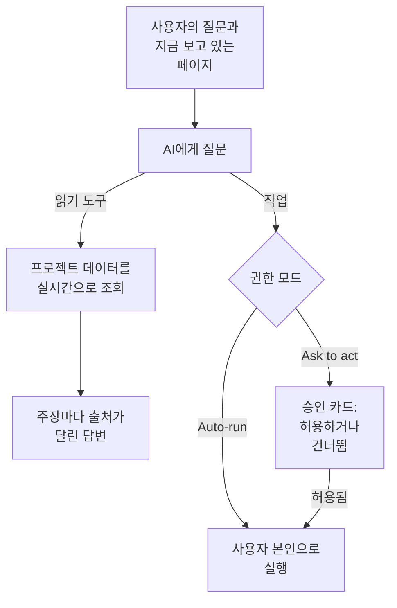

# AI에게 질문

AI에게 질문은 프로젝트의 데이터를 대상으로 하는 OneUptime의 채팅입니다. 로그, 트레이스, 메트릭, 예외, 인시던트, 알림, 모니터, 온콜, 상태 페이지, SLO, 런북, 워크플로에 대해 물어보면 프로젝트를 실시간으로 조회하고, 모든 주장에 출처를 달아 답하며, 허용하면 사용자 대신 작업도 합니다.

:::cards
- [AI에게 질문 열기](#ai에게-질문-열기): 헤더, 키보드, 차트 또는 제품 메뉴에서.
- [볼 수 있는 것](#볼-수-있는-것): 답하기 위해 읽는 데이터.
- [작업과 권한 모드](#작업과-권한-모드): 작업을 해도 되는지, 언제 먼저 물어볼지 정합니다.
- [작업은 사용자 본인으로 수행됩니다](#작업은-사용자-본인으로-수행됩니다): 사용자의 권한으로, 모든 변경에 사용자의 이름이 남습니다.
:::

## AI에게 질문이 답하는 방식

AI에게 질문은 도구가 돌려준 결과로만 답합니다. 기억에 의존해 답하지 않고 프로젝트에 쿼리를 실행합니다. 답변의 각 사실에는 출처 칩이 붙어 있어, 그 뒤의 쿼리를 보여 주고 읽은 데이터를 엽니다. 무언가를 바꾸어 달라고 하면, 대화의 권한 모드에 따라 먼저 물어볼지가 정해집니다. 질문보다 먼저 프로젝트의 [AI 컨텍스트](/docs/ai/ai-context)를 읽습니다. 팀이 자신들의 시스템에 대해 OneUptime AI를 위해 적어 둔 내용입니다.

**읽기 전용** 모드에서는 작업이 모델에 전혀 제공되지 않으므로 대화는 읽기만 합니다.

## AI에게 질문 열기

| 위치 | 방법 |
| --- | --- |
| 모든 페이지 | 헤더의 **AI에게 질문** 을 클릭하거나 `Ctrl` + `I` 를 누릅니다(Mac에서는 `Cmd` + `I`). 텍스트 상자나 편집기에 입력하는 동안에는 이 키가 편집기의 기울임꼴 단축키로 그대로 동작합니다. |
| 명령 팔레트 | `Ctrl` + `K`(Mac에서는 `Cmd` + `K`)를 누르고 **AI에게 질문** 을 선택합니다. |
| 로그의 오류 패턴, 또는 차트의 발견 사항 | **AI로 설명** 를 클릭하면, 보내기 전에 편집할 수 있는 질문 형태로 증거와 함께 AI에게 질문이 열립니다. |
| 제품 메뉴 | **제품 → AI → Chat** 을 엽니다. AI에게 질문은 보고 있던 페이지 위에 열립니다. 대화마다 고유한 주소가 있어서, 북마크해 두었다가 다시 돌아올 수 있습니다. |

AI에게 질문은 보고 있던 페이지 위, 화면 가운데에 열리며, 휴대폰에서는 화면 전체를 채웁니다. `Esc` 를 누르거나 바깥쪽을 클릭하면 페이지로 돌아갑니다. 대화는 떠난 그대로 남아 있으므로, AI에게 질문을 다시 열면 이어서 할 수 있습니다. 답변하는 도중에 닫으면, 답변이 준비되었을 때 모서리의 알림이 알려 주며, 알림을 누르면 답변이 열립니다.

인시던트나 알림에서는 **AI Investigation** 카드에 자체 대화 **Ask OneUptime AI** 가 있으며, 그 인시던트나 알림을 볼 수 있는 모든 사람이 함께 씁니다. [인시던트에 대해 OneUptime AI와 이야기하기](/docs/ai/ai-sre#인시던트에-대해-oneuptime-ai와-대화하기)를 참조하세요.

## 볼 수 있는 것

AI에게 질문은 사용자 본인의 권한으로 프로젝트를 읽으므로, 사용자가 볼 수 있는 것만 보고 그 이상은 보지 않습니다.

| 영역 | AI에게 질문이 읽는 것 |
| --- | --- |
| 텔레메트리 | 로그 검색과 히스토그램, 트레이스 집계와 스팬 트리, 메트릭, 예외, 보안 이벤트, 실제 사용자 모니터링과 Web Vitals, 최근 변경 사항, 학습된 기준선 대비 이상 징후 검사. |
| 인프라 | 호스트, Docker, Podman, Kubernetes, Docker Swarm, Proxmox, VMware vCenter, Ceph, 스토리지 어레이, 서버리스 함수, 클라우드 환경, IoT 플릿, 네트워크 장치: 인벤토리에 있는 것, 보고된 연결 상태, 메트릭 추세, 심각도별 로그 수, 트레이스 작업 요약. 하나의 쿼리가 서비스를 가리키는 텔레메트리와 인프라 리소스를 가리키는 텔레메트리를 모두 다룹니다. |
| 인시던트 대응 | 인시던트와 알림(상태 필터 포함: "지금 무엇이 활성 상태인가?"), 활동 타임라인(상태 변경, 내부 및 공개 노트, 피드)과 소유자, 그리고 해결 방법을 다시 쓰기 위한 과거 인시던트 검색. |
| 온콜 | 지금 누가 온콜인지, 정책과 에스컬레이션 체인, 최근 호출이 전달되고 확인되었는지 여부. |
| AI 자신의 작업 | AI SRE 조사와 AI Insights의 결과. 그래서 "AI가 무엇을 찾았나?"에는 다시 알아내는 대신 게시된 분석으로 답합니다. |
| 플랫폼 | 모니터(상태 필터 포함), 예정된 유지 관리, 상태 페이지와 그 공지, SLO, 런북, 워크플로 실행, 프로브 상태, 팀, 연결된 저장소의 코드. |

## 페이지 컨텍스트

AI에게 질문은 어느 페이지에서 열렸는지 압니다. 인시던트 페이지에서 "왜 이런 일이 일어났지?"라고 물으면 그 인시던트를 뜻합니다. 입력 영역에 페이지의 대상을 나타내는 칩이 표시되고, 제안하는 질문도 그 페이지에 맞춘 것입니다. 프로젝트 전체에 대해 물으려면 칩을 제거하고, 같은 방법으로 다시 추가할 수 있습니다. 다른 페이지에서 AI에게 질문을 열면 컨텍스트도 따라옵니다. 대화는 첫 대상을 서버에도 기억하므로, 며칠 뒤의 후속 질문에서도 "이 인시던트"를 제대로 알아듣습니다.

인시던트, 경고, 모니터, 예정된 유지 관리 이벤트에서는 제안하는 질문이 그 레코드의 현재 상태에도 맞춰지며, 상태는 AI에게 질문을 열 때마다 읽습니다. 해결된 인시던트는 대응이 어떻게 진행됐는지와 재발을 막을 방법을, 해결된 경고는 실제 문제였는지와 비슷한 경고가 얼마나 자주 발생하는지를, 정상 작동하지 않는 모니터는 그 이유를 묻습니다. 시작 전인 유지 관리 이벤트는 시작 전에 대상 모니터가 정상인지를, 끝난 이벤트는 정상으로 돌아왔는지를 묻습니다.

인프라 목록과 리소스 페이지는 보고 있는 리소스 종류에 맞는 질문을 제안합니다. Kubernetes 클러스터를 열고 "지난 24시간 동안 어떤 메트릭이 바뀌었나?"라고 묻거나, Docker 호스트를 열고 "지난 6시간의 로그 심각도와 트레이스 오류를 요약해 줘."라고 물어보세요. 증거 링크는 리소스 페이지로 돌아갑니다. 읽기는 프로젝트, 리소스, 텔레메트리에 대한 사용자의 권한을 따르며, 소유자와 레이블 제한도 지킵니다.

하위 항목 페이지에서는 선택한 파드, 컨테이너, VM, 프로세스 등의 하위 항목도 컨텍스트에 기록됩니다. 인프라 도구는 상위 리소스의 텔레메트리를 읽으므로, 이름만으로 특정 하위 항목을 측정할 수는 없습니다. AI에게 질문은 이를 알려 주며, 페이지가 알려 주지 않은 Kubernetes 네임스페이스를 추측하지 않습니다. 연결 상태는 워크로드의 상태가 아니며, 텔레메트리가 없다고 해서 리소스가 정상이라는 뜻은 아닙니다.

## 인프라에서 실행하는 명령

AI 에이전트가 연결된 리소스(호스트, Docker 또는 Podman 호스트, Docker Swarm 클러스터, Proxmox 클러스터, VMware vCenter, Ceph 클러스터, 데이터베이스 서버, Kubernetes 클러스터)의 페이지에서 열면, AI에게 질문은 요청할 때 그 에이전트를 통해 리소스에서 명령을 실행합니다. 예를 들어 "이 호스트에서 `uptime` 실행해 줘"나 "`journalctl -u nginx`의 마지막 100줄을 보여 줘"라고 하면, 돌아온 내용으로 답하고 다른 근거처럼 인용합니다. 인시던트나 경고에서 열면 그에 연결된 리소스에 닿습니다.

- AI 조사가 그 종류의 리소스에서 실행할 수 있는 읽기 전용 명령만 실행하며([인프라 AI 에이전트](/docs/ai/infrastructure-ai-agents) 참고), 한 답변에 에이전트 종류마다 최대 30개까지, 어떤 권한 모드에서든 OneUptime이 확인하고 에이전트가 다시 확인합니다. 서비스 재시작 같은 에이전트를 통한 변경은 AI에게 질문에서 절대 실행되지 않으며, 대신 정확한 명령을 알려 줍니다. 에이전트는 OneUptime AI가 인시던트나 경고를 해결할 때만, 리소스 자체의 수정 설정에 따라 변경을 적용합니다. 런북 실행 같은 AI에게 질문 자체의 작업은 아래에서 설명하는 대화의 권한 모드를 따릅니다.
- 사용자가 볼 수 있는 리소스에만, 그리고 그 리소스의 AI 조사가 켜져 있는 동안에만 닿습니다.
- 그곳에서 명령을 실행할 수 없을 때(연결된 에이전트가 없거나, 에이전트가 오프라인이거나, 리소스의 AI 조사가 꺼져 있을 때)는 그 사실과 바꿔야 할 점을 알려 주고, 대신 프로젝트의 데이터로 답합니다.

## 작업과 권한 모드

대화마다 권한 모드가 있으며, 입력 영역에서 입력란 옆에서 고릅니다.

| 모드 | 동작 |
| --- | --- |
| **실행 전 확인** | 기본값입니다. AI에게 질문은 각 작업을 승인 카드로 제안하며, 각 작업에 대해 **허용** 또는 **건너뛰기** 를 고르거나 **모두 거부** 를 고르기 전에는 아무것도 실행되지 않습니다. |
| **자동 실행** | 모델이 요청하는 즉시 작업이 실행되며, 그래도 사용자의 역할이 허용하는 범위로 제한됩니다. 신중하게 사용하세요. |
| **읽기 전용** | 작업이 모델에 전혀 제공되지 않습니다. AI에게 질문은 읽기만 할 수 있습니다. |

모드가 허용할 때 AI에게 질문이 할 수 있는 일:

- 인시던트나 알림 생성, 인시던트와 알림의 확인 또는 해결, 인시던트의 심각도 변경.
- 인시던트나 알림을 관련된 인프라와 서비스에 연결. 호스트 같은 리소스의 페이지에서 생성한 인시던트나 알림은 그 리소스에 연결되며, 승인 카드에 각 작업이 무엇을 연결하는지 표시됩니다. OneUptime AI는 인시던트나 알림이 연결된 대상을 조사하고 수정합니다.
- 인시던트나 알림에 내부 노트 게시. 내부 노트는 상태 페이지에 절대 표시되지 않습니다.
- 인시던트에 공개 상태 업데이트 게시. 상태 페이지 구독자에게 알림이 가므로 별도의 작업입니다.
- 온콜 정책 호출, 런북 실행, 인시던트나 알림의 AI 조사 시작.
- 코드 변경 제안: 연결된 저장소의 새 브랜치에 커밋하고 pull request를 엽니다. 기본 브랜치나 보호된 브랜치에는 절대 쓰지 않으므로, 변경을 병합하는 것은 여전히 사람입니다.

사용자에게 영향이 있으면 인시던트를, 호스트의 메모리가 계속 오르는 것처럼 먼저 팀이 살펴봐야 할 일이 있으면 알림을 요청하세요. 둘 다 한 번 생성될 뿐 아무것도 감시하지 않습니다. 호스트의 메모리가 75%를 넘을 때마다 알림을 받으려면 메모리 템플릿으로 [호스트 모니터](/docs/monitor/host-monitor#미리-만들어진-알림-템플릿)를 만들고 임계값을 75%로 설정하세요. AI에게 질문은 모니터를 만들 수 없습니다. 요청을 받으면 그렇다고 말하고, 현재 값을 확인한 뒤 이미 넘었다면 알림 생성을 제안합니다.

## 작업은 사용자 본인으로 수행됩니다

AI에게 질문이 하는 모든 작업은 사용자 본인으로 수행됩니다. 같은 작업에 대해 대시보드가 하는 것과 같은 변경을, 프로젝트 안의 사용자 본인의 권한으로 하며, 변경은 사용자에게 기록됩니다. 채팅에서 인시던트를 확인하면 인시던트의 상태 패널과 같은 상태 변경이 생기므로, 인시던트의 타임라인과 피드에는 사용자가 상태를 바꾼 것으로 표시됩니다. 채팅에서 보낸 호출에는 사용자가 호출한 사람으로 표시됩니다.

- **각 작업에 필요한 것.** 같은 변경에 대해 대시보드가 요구하는 권한입니다. 인시던트나 알림을 생성하려면 생성할 권한이 필요합니다: 생성할 수 있는 역할, 또는 사용자 지정 역할의 **Create Incident** 또는 **Create Alert**. 인시던트를 확인하거나 해결하려면 상태를 바꿀 권한이 필요합니다: **프로젝트 소유자**, **프로젝트 관리자**, **프로젝트 구성원**, **인시던트 관리자**, **인시던트 구성원**, 또는 사용자 지정 역할의 **Create Incident State Timeline**. 알림에는 알림에 대한 같은 권한(**Create Alert State Timeline**)이 필요합니다. 온콜 정책을 호출하려면 그것을 실행할 권한(**Create On-Call Duty Policy Execution Log**)이 필요하고, 런북을 실행하려면 런북 실행을 시작할 권한이 필요합니다. 런북을 실행하는 역할(그 레이블이 닿는 런북에 한함)이나, 프로젝트의 모든 런북에 닿는 사용자 지정 역할의 **Create Runbook Execution** 입니다. 인시던트의 심각도 변경, 인시던트나 알림의 AI 조사 시작, 연결된 저장소에 코드 쓰기에는 그 인시던트, 알림, 저장소를 변경할 권한이 필요합니다. 허용되지 않은 작업은 거부되며, AI가 필요한 권한을 알려 줍니다. 권한은 있지만 속한 팀이 그것을 차단하고 있으면, AI가 그 사실을 대신 알려 줍니다. 일부 레이블에 대한 차단은 그 레이블이 붙은 레코드뿐 아니라 모든 레코드에 대해 AI에게 질문의 그 작업을 거부합니다.
- **어떤 레코드인가.** OneUptime의 다른 곳과 마찬가지로, 사용자가 변경할 수 있는 레코드입니다. 일부 레이블이나 본인 소유 레코드로 제한된 역할이라면, 다른 레코드에 대한 작업은 아무것도 바꾸지 않습니다. 런북은 런북 실행을 시작할 사용자의 권한이 닿을 때만 실행됩니다. OneUptime Cloud에서는 프로젝트의 요금제에 포함되지 않은 작업이 필요한 요금제를 알려 주며 거부됩니다.
- **작업이 거부되면.** 아무것도 바뀌지 않으며, AI는 다시 시도하는 대신 작업이 수행되지 않았다는 것과 그 이유를 분명히 알려 줍니다.
- **Slack, Microsoft Teams, AI 조사.** Slack과 Microsoft Teams에서의 AI 답변과 자율 AI 조사는 읽기만 합니다. 이 작업들은 하나도 하지 않습니다. Slack이나 Microsoft Teams에서 작업하려면, 역시 사용자 본인으로 동작하는 OneUptime 메시지의 버튼을 사용하세요([Slack](/docs/workspace-connections/slack#slack-에서-인시던트-경고-이벤트-조치하기) 및 [Microsoft Teams](/docs/workspace-connections/microsoft-teams#microsoft-teams-에서-인시던트-경고-이벤트-조치하기) 참조).

## 대화 조정하기

- **멈추기.** AI에게 질문이 작업하는 동안 보내기 버튼은 중지 버튼으로 바뀝니다. 언제든 실행을 멈추고 바로 다른 것을 물어보세요.
- **작업 지켜보기.** 답변하는 동안 로그 검색처럼 지금 하는 일을 한 줄로 보여 줍니다. 옆의 단계 수를 클릭하면 각 단계를 볼 수 있습니다.
- **모델 고르기.** 프로젝트에서 LLM 공급자를 둘 이상 쓸 수 있으면, 입력 영역의 공급자 선택기에 프로젝트의 LLM 공급자와 글로벌 공급자가 나열되며, 기본 공급자에 표시가 붙습니다. 새 대화는 기본 공급자를 사용합니다.
- **답변 평가하기.** **좋은 답변** 과 **좋지 않은 답변** 은 메시지와 함께 저장되므로, 시간이 지나며 답변 품질을 측정할 수 있습니다.
- **비용 보기.** 각 답변 아래에서 출처를 펼치면 실행한 쿼리가 보이며, 최신 답변에서는 실행한 쿼리 수, 토큰, 비용도 함께 보입니다. 답변 안의 각 출처 칩은 그 뒤의 데이터를 엽니다.
- **사본 보관하기.** **대화 다운로드** 로 스레드를 **Markdown으로 다운로드**(읽거나 티켓에 붙여 넣기용) 또는 **PDF로 다운로드**(누군가에게 전달하기용)로 저장합니다.
- **이어서 하기.** AI에게 질문 헤더의 **모든 대화** 에는 대화가 최신순으로 나열되어, 다시 열거나 삭제할 수 있습니다. 새 대화를 시작하는 화면에는 최근 세 개가 표시됩니다.

## 요구 사항

- **LLM 공급자.** AI에게 질문은 프로젝트의 기본 LLM 공급자를 사용합니다([LLM 공급자](/docs/ai/llm-provider) 참조). OneUptime Cloud에서는 프로젝트의 AI 크레딧으로 비용을 내는 글로벌 공급자로 바로 동작합니다. 자체 호스팅 설치에서는 공급자나 글로벌 공급자의 환경 변수를 구성합니다. 답변의 질은 모델에 달려 있습니다. 도구 호출이 안정적이지 않은 작은 자체 호스팅 모델은 답변이 부실합니다.
- **OneUptime Cloud에서는 Growth 요금제.** 더 낮은 요금제의 프로젝트에는 AI가 요금제에 포함되지 않았다는 안내가 **프로젝트 설정 → 결제 및 청구서 → 결제** 링크와 함께 표시됩니다.
- **프로젝트에서 켜진 AI.** **프로젝트 설정 → AI → AI Features** 의 **AI 활성화** 는 AI에게 질문을 포함한 프로젝트의 모든 AI 기능을 끕니다. 누군가 끄지 않는 한 켜져 있습니다.

프로젝트가 자체 일일 AI 한도를 정해 두면 AI에게 질문도 그 한도에 포함됩니다(프로젝트 설정 → AI → AI Features → 추가 설정). 한도에 도달하면 AI에게 질문은 어떤 한도에 도달했는지, OneUptime AI가 UTC 자정에 다시 시작한다는 것, 누가 한도를 올리거나 없앨 수 있는지를 알려 주는 문장을 표시합니다. 프로젝트 소유자에게는 매일 처음 한도에 도달할 때 이메일이 갑니다. 인시던트와 알림의 일일 한도는 AI에게 질문을 멈추지 않습니다. [프로젝트 자체의 일일 한도](/docs/ai/ai-sre#프로젝트-자체의-일일-한도)를 참조하세요.

## 문제 해결

:::details AI에게 질문이 AI를 사용할 수 없다고 표시함
AI에게 질문은 입력하기 전에 이유를 알려 줍니다. 프로젝트의 요금제에 AI가 포함되지 않았거나, **AI 활성화** 가 꺼져 있거나, 프로젝트에 LLM 공급자가 없는 경우입니다. 각 안내는 이를 바꾸는 페이지로 연결됩니다.
:::

:::details 작업이 거부됨
AI에게 질문은 작업에 필요한 권한이나 그것을 차단하는 팀을 알려 줍니다. 변경할 수 있는 사람에게 부탁하거나, 프로젝트 소유자에게 사용자의 역할에 그 권한을 달라고 요청하세요. 아무것도 변경되지 않았습니다.
:::

:::details 답변이 모호하거나 데이터를 전혀 쓰지 않음
공급자 뒤의 모델을 확인하세요. AI에게 질문에는 도구를 안정적으로 호출하는 모델이 필요합니다. 작은 로컬 모델은 쿼리를 하나도 실행하지 않고 답하는 경우가 많습니다. [LLM 공급자](/docs/ai/llm-provider)를 참조하세요.
:::

## 다음 단계

:::cards
- [AI SRE](/docs/ai/ai-sre): 새 인시던트와 알림을 모두 OneUptime AI가 조사하게 하세요.
- [LLM 공급자](/docs/ai/llm-provider): AI에게 질문과 다른 AI 기능이 쓰는 모델을 고르세요.
- [MCP 서버](/docs/ai/mcp-server): 대신 Claude, Cursor 또는 VS Code에서 OneUptime에 대해 물어보세요.
:::
